# 2026-10-13 arXiv 每日论文订阅摘要

<!-- PAPER_CARDS_START -->
## 论文卡片

按原日报排名展示；点击标题或 Paper 查看原文，详细中文分析见下方。

| 论文 | 论文 | 论文 |
|---|---|---|
| 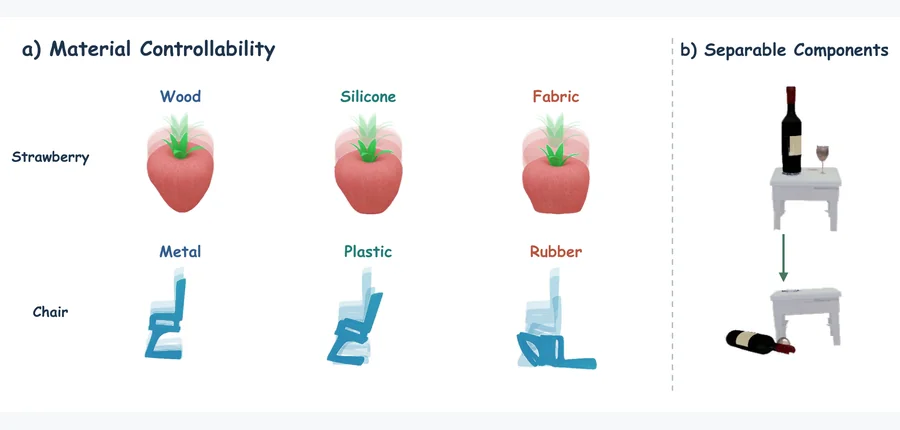 arXiv New 2026-10-12 · cs.CV · #1 **[PhysForge: Material-Controllable 3D Reconstruction with Separable Components](https://arxiv.org/abs/2610.13681)** Yuchen Wang, Yanqi Bao, Zheng Gu, Zhengqing Chen, Jieqi Shi, Jing Huo 机构：Nanjing University / Shenzhen University / Horizon Robotics（[HTML](https://arxiv.org/html/2610.13681)） [Paper](https://arxiv.org/abs/2610.13681) · [Project](https://masterwanna.github.io/PhysForge.html) · [图源](https://arxiv.org/html/2610.13681v1/teaser.png) 

中文摘要
近期物理 3D 生成已能产生视觉真实且具有可仿真力学行为的资产，但现有方法除了基于外观推断外，对材料行为的控制有限，也难从物体及语义部件间复杂交互估计物性。我们提出 PhysForge，一个基于视频扩散模型（VDM）的框架，含材料可控的物理拟合与部件级交互建模两模块。PhysFit 把材料条件化 VDM 动力学作为物性拟合参考，以窗口拟合聚焦能显露材料性质的交互，并用 Hallucinated Forcing 区分 VDM 虚构的非物理运动与真实材料响应。PhysComp 把复杂交互分解为单个物体和语义部件，分别优化物理参数，再灵活组合以进行联合仿真。PhysAssets 和 Google Scanned Objects 上的实验表明，相比已有方法，PhysForge 更能控制与材料有关的物理响应，并支持复杂交互的部件级建模；在常见和少见材料上均取得最佳 CLIP 与物理可控性分数，定性比较、部件级消融与用户研究进一步支持这一结果。项目页见原文：https://masterwanna.github.io/PhysForge.html。 <a href="https://arxiv.org/abs/2610.13681">原摘要来源</a>
 | 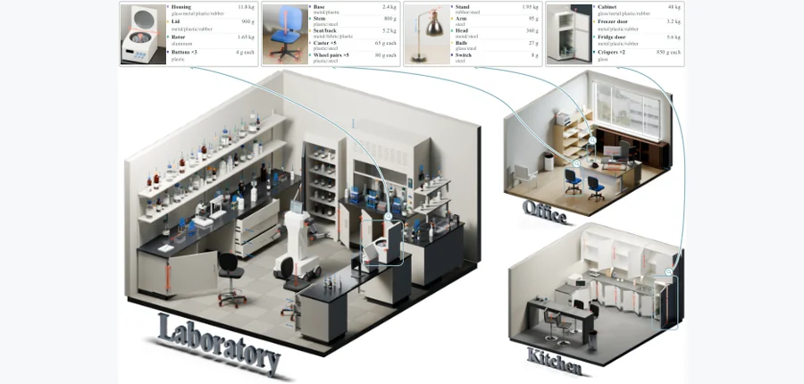 arXiv New 2026-10-12 · cs.CV · #2 **[Towards Physically Grounded Articulated 3D Assets: A Multi-Agent Pipeline and Benchmark](https://arxiv.org/abs/2610.13947)** Xudong Cai, Ruijie Zhu, Haoliang Shang, Ruining Li, Marc Pollefeys, Shangzhe Wu, Andrea Vedaldi, Chuanxia Zheng 机构：Nanyang Technological University / ETH Zurich / Microsoft / University of Cambridge / University of Oxford（[HTML](https://arxiv.org/html/2610.13947)） [Paper](https://arxiv.org/abs/2610.13947) · [图源](https://arxiv.org/html/2610.13947v1/teaser_rooms.png) 

中文摘要
本文研究具有物理依据的关节式 3D 资产生成，把目标从复现外观推进到刻画物体如何运动和发挥功能。借鉴程序化与智能体生成研究，我们提出 Artisan：在近期 Articraft 方法基础上加入带物理仿真反馈的多智能体流程，使资产除几何、外观与物理上合理的关节外，还具有无碰撞运动、重力下稳定性以及准确质量和材料属性。我们还建立统一基准，覆盖空间保真度、物理合理性、下游任务表现和总体质量四方面。基准包含来自 ArtVIP 与 LightWheel 的 100 个参考资产、50 个稳定性提示，以及 50 个有参考质量的 ABO 物体，并提供多种指标的评测协议。对十余种代表模型的评测表明，Artisan 保持有竞争力的空间保真度，同时在被评方法中具有最低碰撞率和最高稳定率。系统与基准为把 3D 生成推进到物理合理、功能可用的资产提供了依据。 <a href="https://arxiv.org/abs/2610.13947">原摘要来源</a>
 | 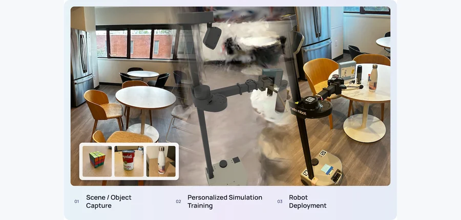 arXiv New 2026-10-12 · cs.RO · #3 **[Splat2Act: From Captured Scenes to Personalized VLA Manipulation](https://arxiv.org/abs/2610.13945)** Xiaomeng Ye, Krishna Jaganathan, Gyubeum Lim, Gunjan Chhablani, Muhammad Zubair Irshad, Zsolt Kira 机构：Georgia Institute of Technology / Waymo / Toyota Research Institute（[HTML](https://arxiv.org/html/2610.13945)） [Paper](https://arxiv.org/abs/2610.13945) · [图源](https://arxiv.org/html/2610.13945v1/figs/splat2act-teaser.png) 

中文摘要
用户希望通用操作策略能在家中或办公室拾取架子、柜台和桌上的个人物品，但即使是较强的 π_0.5，未经适配时在论文采集的部署场景中的拾取成功率也只有 0%；为每个环境采集真实示范又过于昂贵。我们提出 Splat2Act，仅用手持手机扫描和用户物体图片，把预训练视觉—语言—动作（VLA）策略自动适配到特定场景及物体集合的 real-to-sim-to-real 流程。与只重建桌面的方法不同，它面向建筑尺度室内环境：用 3D Gaussian Splatting 和碰撞几何构建照片真实的数字孪生，自动发现桌面与非桌面容器位置，构造可行拾取任务，再用拥有特权信息的仿真 oracle 生成成功示范；人只需采集场景和物体。对 101 个扫描的校园环境，导航区域中位数为 104.87 m²、容器位置中位数为 7，流程得到 852 个容器位置和超过 68,000 条拾取示范。我们分两阶段微调 π_0.5：第一阶段用部署场景或全部 101 个场景中的数百个公开物体资产适配；第二阶段在部署场景的容器位置上适配用户自己的物体。最佳个性化策略在目标场景总体拾取成功率为 62.5%；同一策略在真实 Stretch 3 上的 12 任务子集成功率为 63.9%，接近这些任务 66.7% 的仿真成功率。结果表明，仅用仿真 oracle 数据的自动 real-to-sim-to-real 训练有望个性化 VLA 操作策略。 <a href="https://arxiv.org/abs/2610.13945">原摘要来源</a>
 |
| 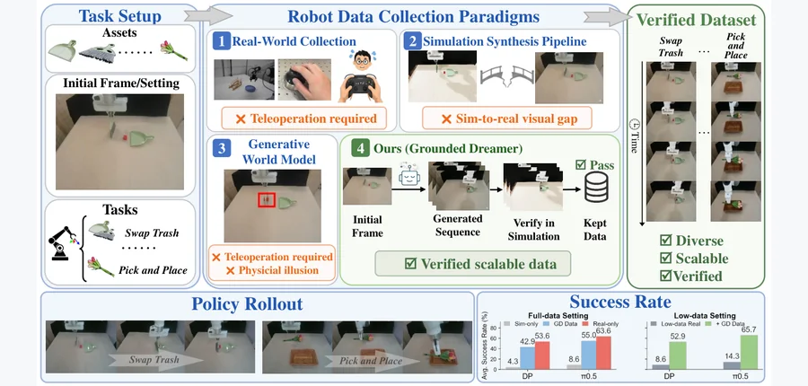 arXiv New 2026-10-12 · cs.RO · #4 **[Grounded-Dreamer: Robot Learning from World Model Synthetic Data with Physical Grounding](https://arxiv.org/abs/2610.13164)** Feng Jiang, Shu Chen, Yuanfei Wang, Yuan Li, Zhenhao Shen, Jiaqi Liang, Yang Chen, Lei Wei, Chen Xie, Ruihai Wu 机构：Peking University / HKUST Guangzhou / Lightwheel（[HTML](https://arxiv.org/html/2610.13164)） [Paper](https://arxiv.org/abs/2610.13164) · [图源](https://arxiv.org/html/2610.13164v1/teaser.png) 

中文摘要
扩展机器人操作策略需要大量多样且带动作标签的数据，但真实采集昂贵且难扩展。现有方法依赖人工遥操作、视觉真实感有限的仿真，或缺少具身动作标注的人类视频。我们提出 Grounded-Dreamer：结合生成式视频世界模型的视觉真实感与仿真器物理引擎，合成具有物理依据的机器人操作数据，避免人工遥操作示范。方法从少量显示机器人任务初始状态的真实图像出发，自动重建任务相关物体与相机几何、在仿真中对齐，并采集物理有效轨迹。用这些轨迹后训练视频世界模型和逆动力学模型，从真实图像生成视觉真实的机器人操作视频及对应动作。为过滤物理上不合理的滚动结果，方法在重建的仿真中重放生成轨迹，只保留成功完成任务的轨迹。真实机器人策略只用这种有物理依据的合成轨迹训练，不用人类示范。真实任务实验显示，该方法可合成有物理依据的数据并显著促进策略学习，而无需人工遥操作。 <a href="https://arxiv.org/abs/2610.13164">原摘要来源</a>
 | 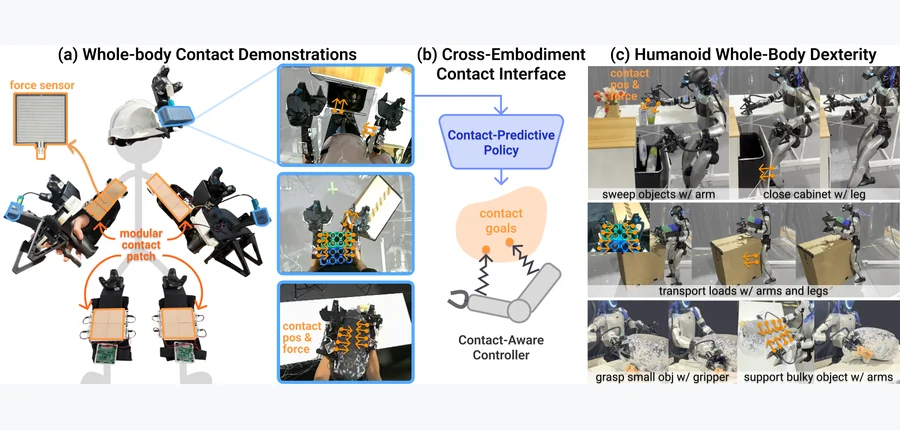 arXiv New 2026-10-12 · cs.RO · #5 **[PanTact: Teaching Whole-Body Dexterity with a Wearable Contact Interface](https://arxiv.org/abs/2610.12558)** Xiaomeng Xu, Han Zhang, Zhian Ruan, Xiaofeng Guo, Jinkun Cao, Ruihan Yang, Carmelo Sferrazza, Shuran Song, Guanya Shi 机构：Stanford University / Amazon FAR / Carnegie Mellon University（[HTML](https://arxiv.org/html/2610.12558)） [Paper](https://arxiv.org/abs/2610.12558) · [Project](https://pantact.github.io) · [图源](https://arxiv.org/html/2610.12558v1/figures/teaser-v3-1.jpg) 

中文摘要
人形机器人拥有许多自由度和接触表面，但多数移动操作研究把操作限制在双手，并避免身体其他部位与环境接触。为把操作扩展到双手之外，我们提出 PanTact：直接从无需机器人的人类示范中学习人形机器人全身灵巧操作，即使用任何合适的身体表面操作。核心思想是把接触作为可跨具身迁移的、以操作为中心的信息：接触位置与时序指定完成任务所需的交互，机器人则在自身物理约束内协调身体实现这些交互。具体而言，PanTact 包括三部分：（1）无需机器人的可穿戴采集接口，在第一人称视觉和双手 UMI 夹爪之外加入全身模块化接触贴片，记录身体接触位置与状态；（2）缓解第一人称观察缺口并预测全身接触目标的视觉运动策略；（3）利用合适机器人表面实现主动接触目标的接触感知全身控制。我们在没有额外身体接触传感器的 Unitree G1 上部署 PanTact，展示身体支撑、推动、清扫和分担载荷等全身灵巧行为。网站见论文原文：https://pantact.github.io。 <a href="https://arxiv.org/abs/2610.12558">原摘要来源</a>
 | 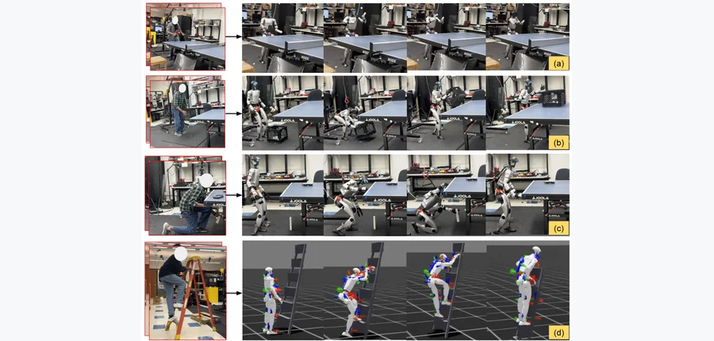 arXiv New 2026-10-12 · cs.RO · #6 **[VICAR: Video Imitation with Contact-Aware Retargeting for Humanoid Interactive Skills](https://arxiv.org/abs/2610.13079)** Dvij Kalaria, Bike Zhang, S. Shankar Sastry 机构：University of California, Berkeley（[HTML](https://arxiv.org/html/2610.13079)） [Paper](https://arxiv.org/abs/2610.13079) · [图源](https://arxiv.org/html/2610.13079v1/top_rebuttal.png) 

中文摘要
第三人称人类视频为人形机器人移动操作提供一种可扩展替代，减少针对任务的奖励设计、遥操作与手写示范。近期视频到人形机器人的系统已能从非结构化视频中提取带噪的人体运动、物体轨迹和接触，再细化为可部署技能；但接触丰富的模仿仍有关键缺口：任务常由世界坐标系中的接触定义，其位姿、时序和速度必须在具身差异和运行时场景变化下保留。我们提出 VICAR，从第三人称视频学习人形机器人交互技能。系统先恢复人体运动并从单目视频重建任务相关障碍物，再在保留全局接触位姿、运动速度和避碰裕量的条件下将运动重定向至人形机器人。与只消除穿透或保持局部交互几何的方法不同，我们把用户指定接触位姿与避碰裕量表示为高优先级拉格朗日惩罚，并优化整段运动，使接触丰富的过渡保持平滑。所得运动用于训练以接触为条件的运动生成器，其输入包含可移动接触点，支持运行时适应新接触位置。我们在十种第三人称视频技能上展示该框架，包括六种乒乓球发球、三种拾物任务和爬梯，并在硬件上部署所学技能。结果表明保留接触的重定向有助于人形机器人通过观察人类学习交互行为。 <a href="https://arxiv.org/abs/2610.13079">原摘要来源</a>
 |
| 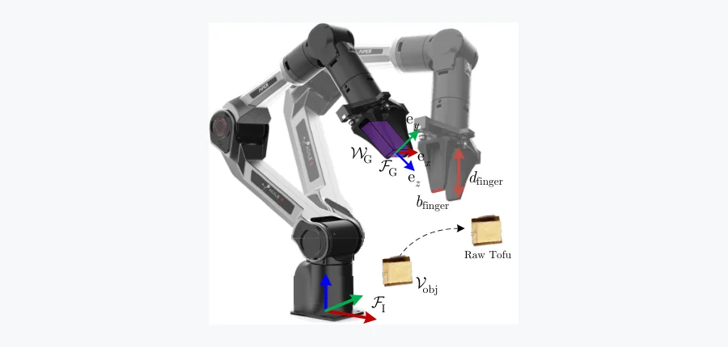 arXiv New 2026-10-12 · cs.RO · #7 **[Tactile Sensing-based Secure and Gentle Grasping of Unknown Objects](https://arxiv.org/abs/2610.12790)** Feng Han 机构：New York Institute of Technology（[HTML](https://arxiv.org/html/2610.12790)） [Paper](https://arxiv.org/abs/2610.12790) · [图源](https://arxiv.org/html/2610.12790v1/Fig_Robot.png) 

中文摘要
可靠机器人操作既要保持牢固抓取，又要严格避免接触滑移和物体结构损伤。对未知物体同时满足“牢固且轻柔”的抓取约束尤其困难。我们提出用于未知物体安全动态抓取的在线数据驱动预测控制框架。系统用一对紧凑的单通道触觉模块实时表征夹爪—物体动力学，无需先验知识或离线训练。基于有限状态机的抓取力探测机制确定初始夹持力，并显式识别夹持力约束。在线动力学学习用 Gaussian Process（GP）建模夹爪—物体交互，模型不确定性进一步形成鲁棒抓取约束，并嵌入模型预测控制。我们在概率意义下证明误差收敛。控制框架以 100 Hz 实时运行，执行物体动态操作与搬运，而不只是静态保持。跨不同接触表面拓扑与物体类型的实验表明，其性能和效率优于基线，能操作从生豆腐和棉花糖到岩石的物体。 <a href="https://arxiv.org/abs/2610.12790">原摘要来源</a>
 | 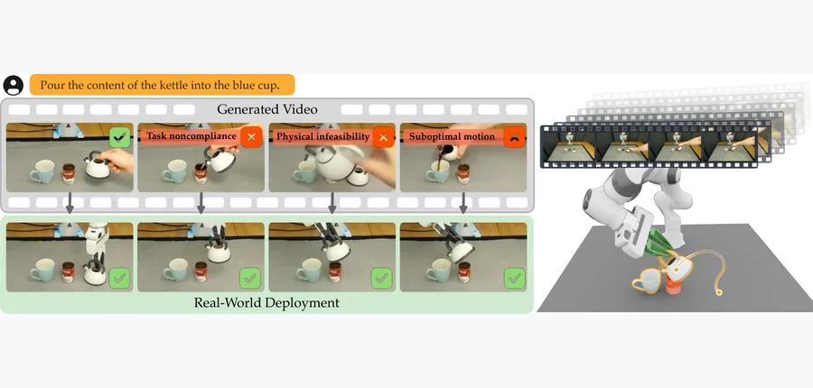 arXiv New 2026-10-12 · cs.RO · #8 **[CASTER: Formalizing Zero-Shot Manipulation from Synthetic Videos as Constrained Optimization](https://arxiv.org/abs/2610.12567)** Yinlong Dai, Homanga Bharadhwaj, Dylan P. Losey 机构：Virginia Tech / Johns Hopkins University（[HTML](https://arxiv.org/html/2610.12567)） [Paper](https://arxiv.org/abs/2610.12567) · [Project](https://collab.me.vt.edu/CASTER/) · [图源](https://arxiv.org/html/2610.12567v1/front.png) 

中文摘要
以往从人类学习常需真实人类示范，而视频生成模型使得通过提示生成任务合成视频成为可能。这些视频发生在机器人当前环境中，无需真人教学；但看似合理的运动缺乏物理一致性和机器人落地约束，机器人无法直接执行视频轨迹。本文形式化从合成视频到零样本操作真实机器人轨迹的过程，指出这是一类约束优化问题：从视频提取的物体轨迹提供运动初值，机器人须在例如数字孪生环境中修正轨迹，同时满足物理可行性与语义一致性。这一形式化揭示成功所需的视频生成性质：生成视频必须以一定概率把搜索初始化在语义吸引域中，使轨迹能局部修改而不失去任务对齐。分析还表明，已有先进方法可视为这一统一形式化的简化实例。实验中移除这些简化以更接近底层优化，使合成视频生成的零样本轨迹更稳健，平均任务成功率较最强基线提高 34.1%。视频见项目网站：https://collab.me.vt.edu/CASTER/。 <a href="https://arxiv.org/abs/2610.12567">原摘要来源</a>
 | 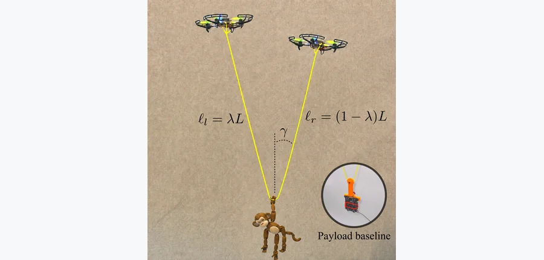 arXiv New 2026-10-12 · cs.RO · #9 **[Cooperative Aerial Transportation of a Payload with a Sliding Cable Attachment](https://arxiv.org/abs/2610.13665)** Sebastian Tilaguy Lezama, Diego S D'Antonio 机构：Oakland University（[HTML](https://arxiv.org/html/2610.13665)） [Paper](https://arxiv.org/abs/2610.13665) · [图源](https://arxiv.org/html/2610.13665v1/images/main_monkey.png) 

中文摘要
本文提出用于协同空中操作的双四旋翼吊钩悬挂搬运系统，载荷并非沿缆绳刚性固定在某一点。两架四旋翼由一根不可伸长的缆绳相连，缆绳穿过载荷上的无摩擦吊钩，因而可在两段间滑动。这引入缆绳分配变量，使四旋翼运动、缆绳几何和载荷动力学相耦合。我们根据期望载荷位姿、缆绳分配和系统形状构造可行参考，同时满足缆长约束及椭圆工作空间限制。四旋翼跟踪几何生成的轨迹，并维持正的缆绳张力、遵守执行器限制。载荷位姿由系统几何估计，实测载荷位置只用于验证期望轨迹。方法通过实验演示评估。 <a href="https://arxiv.org/abs/2610.13665">原摘要来源</a>
 |
| 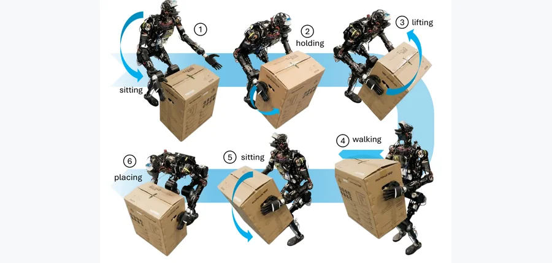 arXiv New 2026-10-12 · cs.RO · #10 **[Adaptive Whole-Body MPC with Optimal Posture Planning for Humanoid Robots under Unknown Payloads](https://arxiv.org/abs/2610.12972)** Manh Cuong Nguyen, Duc Cuong Vu, Viet Anh Vu, Duc Tuan Pham, Toan Nguyen, Minh Hiep Phung, Ngo Anh Vien, Minh Nhat Vu 机构：VinRobotics / VinUniversity（[PDF](https://arxiv.org/pdf/2610.12972)） [Paper](https://arxiv.org/abs/2610.12972) · [图源](https://arxiv.org/html/2610.12972v1/punch-figure.png) 

中文摘要
执行举升和物料搬运的人形机器人即使载荷未知且变化，也必须保持平衡；载荷不确定性会显著影响全身动力学，并可能使传统控制器失稳。我们提出自适应全身控制架构，集成三部分：（1）生成动力学可行参考运动的质心模型预测控制器（MPC）；（2）生成分配至支撑腿关节的修正力矩、补偿载荷引起的模型失配的自适应模糊平衡控制器；（3）基于三重积分器模型的航点式最优姿态规划器，生成平滑的坐下到站起及站起到坐下轨迹，同时满足质心（CoM）稳定、关节限制和全身可行性约束。三者共同支持在显著载荷不确定性下稳定地放低身体、抓取、举升、搬运与放置。广泛的仿真和硬件实验表明，相比非自适应基线，该框架提高了平衡鲁棒性，减轻姿态过渡与举升任务中的跟踪退化。 <a href="https://arxiv.org/abs/2610.12972">原摘要来源</a>
 | 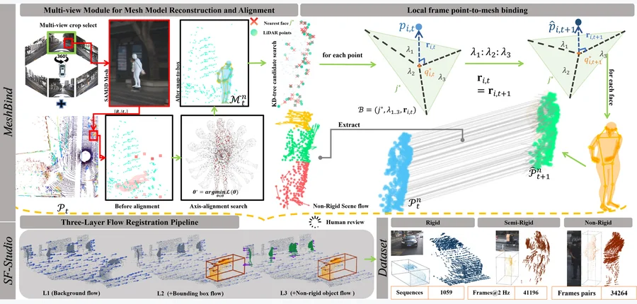 arXiv New 2026-10-12 · cs.CV · #11 **[MeshBind: Point-to-Mesh Binding for Non-Rigid Scene Flow Automatic Annotation](https://arxiv.org/abs/2610.12895)** Yinqi Chen, E Li, Shuaijun Wang, Weiyuan Peng, Meiying Zhang, Qi Hao 机构：Southern University of Science and Technology（[HTML](https://arxiv.org/html/2610.12895)） [Paper](https://arxiv.org/abs/2610.12895) · [图源](https://arxiv.org/html/2610.12895v1/figures/final/fig_pipeline.jpg) 

中文摘要
场景流估计对自动驾驶和机器人应用很重要，但行人等非刚体的真值场景流极难获取。我们提出 MeshBind，用网格模型自动生成非刚体逐点场景流标注。创新有三点：（1）从六个环视摄像头重建关节网格并配准到 LiDAR 坐标系的多视图模块；（2）通过逐三角形切线—法线局部坐标系将点绑定到网格，使绑定对刚体运动不变、同时适应关节形变；（3）结合自车运动补偿、包围盒绑定和网格绑定的三层流配准流程，生成全场景逐点流。我们在交互式标注工具 SF-Studio 中实现 MeshBind，可可视化流、接受人工网格修正并自动重算。还基于公开 SUScape 数据集发布 SFB 基准，覆盖 41,000 帧及逐点非刚体行人标注，并提供刚体、半刚体、非刚体评测协议。在 SFB 微调使三类端点误差（EPE）降低 2–3 倍，非刚体 EPE 达到与刚体 EPE 相同水平。 <a href="https://arxiv.org/abs/2610.12895">原摘要来源</a>
 | 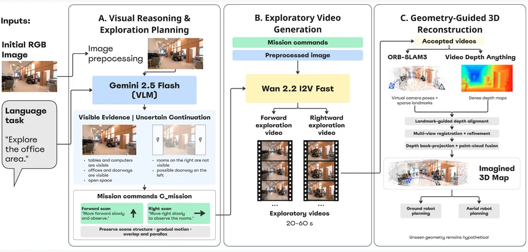 arXiv New 2026-10-12 · cs.RO · #12 **[HorizonNav: Geometry-Guided Video Diffusion for Anticipatory 3D Robot Navigation](https://arxiv.org/abs/2610.13849)** Hajira Amjad, Valerii Serpiva, Viacheslav Liubimov, Didar Seyidov, Dzmitry Tsetserukou 机构：Skolkovo Institute of Science and Technology（[HTML](https://arxiv.org/html/2610.13849)） [Paper](https://arxiv.org/abs/2610.13849) · [图源](https://arxiv.org/html/2610.13849v1/figures/system.png) 

中文摘要
我们提出 HorizonNav：一个用于前瞻式机器人导航的视频扩散框架，把单张 RGB 图像和文本提示转为对周围合理三维空间的几何对齐表示。给定初始观察与重建目标描述，视觉语言模型按设计好的指令理解场景，并为视频扩散模型生成结构化提示；所得视频序列提供环境的可能未来观察，再由单目 ORB-SLAM3 估计相机位姿、Video Depth Anything 预测稠密深度。核心贡献是几何引导深度对齐：结合估计相机位姿与三角化视觉地标来约束多视图深度，提高重建 3D 环境的几何一致性，解决仅靠视频时间连贯性无法消除的矛盾。在想象三维环境的导航评测中，19 个场景的 horizon 研究里，规划可行场景从 P20 的 13/19 增至 P81 的 15/19，成功 RRT 试验从 62/90 增至 75/90。另一项走廊研究中，25 条可评估的生成相机轨迹有 6 条违反重建的碰撞约束，RRT 为其中 5 条找到可行替代。更大的档案包含 67 次尝试中的 58 个可用重建，其中 36 个支持下游规划、22 个不支持，揭示了重建和自由空间失效模式，而非在无 LiDAR 时隐藏它们。15 个走廊重建在匹配结构地标处的平均重建误差约 0.30 m。 <a href="https://arxiv.org/abs/2610.13849">原摘要来源</a>
 |
| 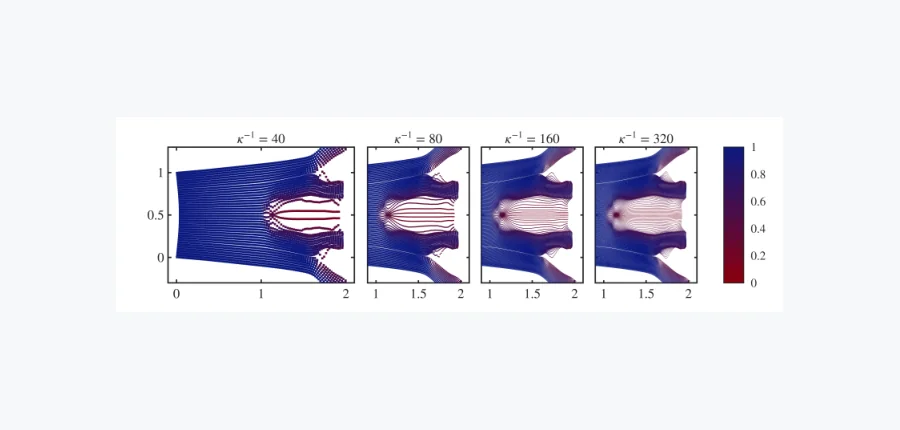 arXiv New 2026-10-12 · math.NA · #13 **[On the Convergence of the Mesh-Free Discretization of a Non-Linear Bond-Based Peridynamic Model with a Bond-Breakage Criterion](https://arxiv.org/abs/2610.13355)** Lukas Pflug, Michael Stingl, Max Zetzmann 机构：Friedrich-Alexander University Erlangen-Nuremberg（[HTML](https://arxiv.org/html/2610.13355)） [Paper](https://arxiv.org/abs/2610.13355) · [图源](https://arxiv.org/html/2610.13355v1/comp0.2.png) 

中文摘要
我们证明了对固定作用半径 δ&gt;0，一种常用无网格离散对带键断裂判据、具有不可逆损伤的动态非线性键基周动力学模型收敛。所选模型是文献中常见非连续周动力学算子的一个数学适定正则化，假设裂纹只由拉伸应变引起。分析显式包含这一格式使用的单点求积。收敛所依据的是解空间的自然范数 C^1([0,T], L∞(Ω)^d)，因而空间坐标上采用 L∞(Ω)^d；这一结果对连续解的空间正则性提出很强限制，我们随后证明该性质。更具体地，对局部 L-Lipschitz 连续输入数据，我们推导位移的局部 Lipschitz 界，且不依赖损伤情况。这与把此周动力学模型解释为真实不连续断裂模型的近似相一致，近似长度尺度由 δ&gt;0 给定。我们不研究 δ 趋近于 0 时解的极限。 <a href="https://arxiv.org/abs/2610.13355">原摘要来源</a>
 | 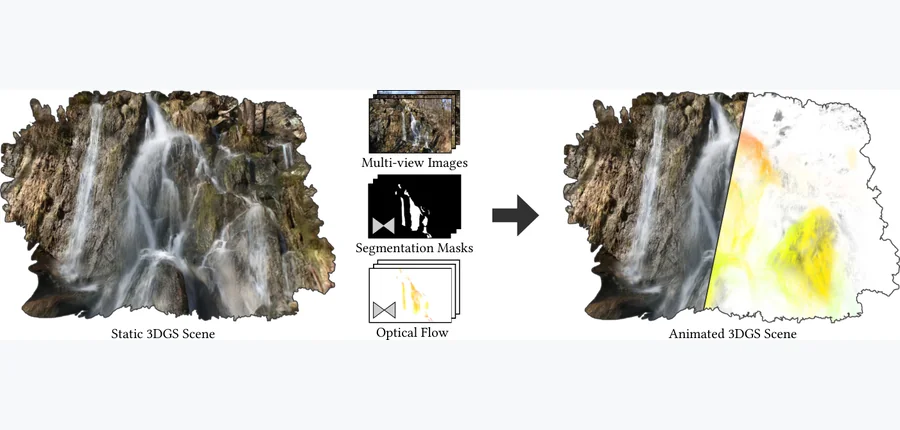 arXiv New 2026-10-12 · cs.CV · #14 **[Make It Flow: Animating Water in 3D Gaussian Splatting Scenes](https://arxiv.org/abs/2610.13860)** Kjell Keune, Florian Hahlbohm, Jannis Möller, Susana Castillo, Martin Eisemann, Marcus Magnor 机构：TU Braunschweig（[HTML](https://arxiv.org/html/2610.13860)） [Paper](https://arxiv.org/abs/2610.13860) · [图源](https://arxiv.org/html/2610.13860v1/teaser.png) 

中文摘要
3D Gaussian Splatting（3DGS）等显式三维场景表示已实现高质量、实时新视角合成，但这些方法假设场景静态，面对现实中常见的动态现象时真实感受限。虽然人或车辆等连贯运动可被捕获并重建，但在无法进行密集多视图高速采集的随手拍摄条件下，流水等高频效应仍难处理。我们提出在静态 3DGS 场景中为水体添加动画的方法，无需动态拍摄或物理仿真即可生成视觉上可信的运动。方法从参考图像或模型渲染估计 2D 光流，把它提升为一致的 3D 欧拉运动场；随后用受 cinemagraph 启发的算法，让这一运动场形变 Gaussian 基元，生成时间上无缝循环的动画。所得表示保持实时渲染，显著提高感知真实感并保留场景内自由视角导航。我们在新采集的野外瀑布数据集上评测，发现其视觉质量与计算效率优于先前的动态 Gaussian splatting 和 3D cinemagraph 方法。 <a href="https://arxiv.org/abs/2610.13860">原摘要来源</a>
 | 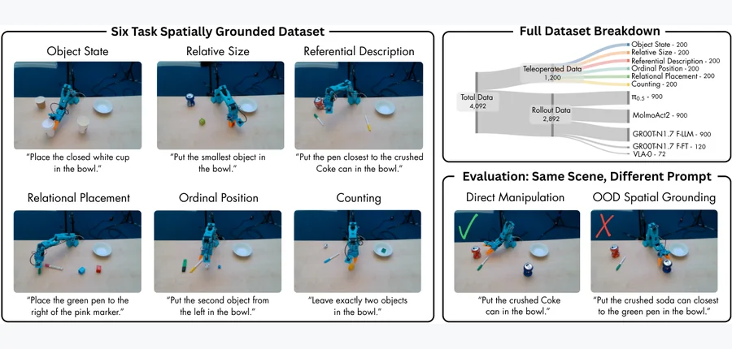 arXiv New 2026-10-12 · cs.RO · #15 **[Spa-Bench: A Real-Robot Benchmark for Spatial Grounding in Vision-Language-Action Models](https://arxiv.org/abs/2610.12696)** Justin Tien-Smith, Matthew Pidden, Rolandos Alexandros Potamias 机构：Imperial College London（[HTML](https://arxiv.org/html/2610.12696)） [Paper](https://arxiv.org/abs/2610.12696) · [Project](https://justintiensmith.github.io/Spa-Bench/) · [图源](https://arxiv.org/html/2610.12696v1/teaser4.png) 

中文摘要
视觉—语言—动作模型（VLA）通过把大规模视觉语言预训练中的语义知识迁移到语言条件控制，有望支持通用机器人。然而，多数 VLA 评测强调物体、指令或环境变化下的总体操作成功率，无法看清策略是否可靠地把空间描述落到实际物理场景中。我们提出更具体的问题：当前 VLA 能多可靠地把空间描述转化为恰当的真实机器人行为？为此提出真实机器人基准 Spa-Bench，覆盖物体状态、相对大小、指称描述、关系放置、序数位置和计数六类桌面任务。主要评测比较分布内（ID）与分布外（OOD）空间配置，同时保持相关物体、概念和动作在训练中有支持，以减少物体或运动陌生性等替代解释。另设四种诊断条件，检验物理执行、措辞敏感性、物体—任务关联及识别无需动作的情况。我们发布在 SO-101 机械臂上采集的 4,092 个 episode：1,200 条人工遥操作示范，以及来自五种先进 VLA 策略的 2,892 次真实机器人评测。三种完整评测策略在 ID 空间配置上的成功率为 67.5–73.3%，OOD 上降至 40.7–52.0%；匹配的直接指令使成功率提高 28.3–40.0 个百分点。结果表明，这些 VLA 往往能完成操作动作，但空间落地仍不稳健。项目资料、视频、代码和基准数据见原文链接：https://justintiensmith.github.io/Spa-Bench/。 <a href="https://arxiv.org/abs/2610.12696">原摘要来源</a>
 |
| 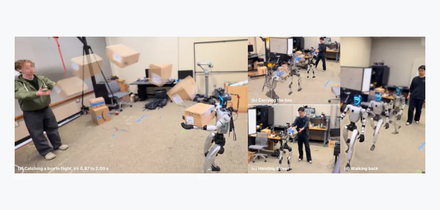 arXiv New 2026-10-12 · cs.RO · #16 **[Reflex: Visually Grounded Reactive Humanoid Control](https://arxiv.org/abs/2610.12772)** Taoyang Jia, Weikai Huang, Linxin Song, Jared Darlington, Jieyu Zhao, Yue Wang, Jiafei Duan, Zhongzheng Ren, Ranjay Krishna 机构：University of Washington / Stanford University / University of Southern California / National University of Singapore / UNC Chapel Hill / Allen Institute for AI（[HTML](https://arxiv.org/html/2610.12772)） [Paper](https://arxiv.org/abs/2610.12772) · [图源](https://arxiv.org/html/2610.12772v1/fig_teaser.png) 

中文摘要
人能够在约一秒内预判运动目标并以全身快速响应，例如回击网球、接住落杯、避让推车或接住搬运时抛来的箱子。对人形机器人，这种视觉反应式全身控制要求同时协调全身、实时响应物体动力学，并把第一人称视觉与控制联系起来。我们以接住抛来的箱子作为需要三种能力的代表任务；已有系统往往依赖末端执行器、动作捕捉或标记物体，只覆盖其中部分能力。我们提出三阶段框架 Reflex，通过紧凑物体动力学表示连接逐阶段学习的能力：先以强化学习训练状态输入的全身接箱策略；再让策略从延迟、不完整的观察推断运动箱子的动力学；最后在保持全身控制器冻结时，训练第一人称 RGB-D 编码器直接从视觉恢复这一动力学表示。这种分解为每种能力提供直接训练信号，使视觉学习更易扩展。在仿真中，第一人称 RGB-D 的接箱成功率为 85.7%，给定特权箱子观察时为 87.9%；去除视觉时间历史，在居中和横向偏移抛掷中成功率分别下降 35.6 和 39.8 个百分点。真实 Unitree G1 在 2.5 m 和 5 m 接人抛箱子的成功率分别为 65% 和 40%，达到相同距离人类接箱者成功率的 76% 和 59%。 <a href="https://arxiv.org/abs/2610.12772">原摘要来源</a>
 | 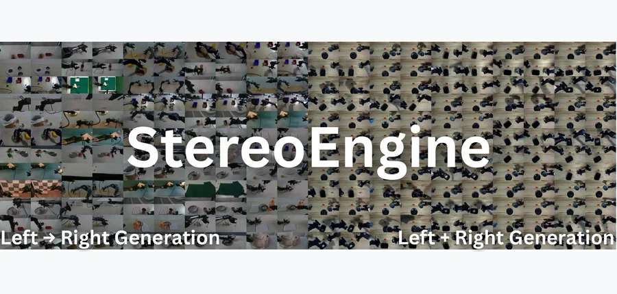 arXiv New 2026-10-12 · cs.RO · #17 **[StereoEngine: Scaling Stereo Bimanual Robot Data without Stereo Cameras](https://arxiv.org/abs/2610.12734)** Jason Chen, I-Chun Arthur Liu, Gaurav Sukhatme, Daniel Seita 机构：University of Southern California（[HTML](https://arxiv.org/html/2610.12734)） [Paper](https://arxiv.org/abs/2610.12734) · [Project](https://stereoengine.github.io) · [图源](https://arxiv.org/html/2610.12734v1/figure_pull_v5.png) 

中文摘要
立体视觉越来越多地用于机器人操作和视觉—语言—动作（VLA）模型，但大规模真实立体数据稀缺，成为扩展这类策略的主要瓶颈。近期单目到立体生成方法主要面向 VR 内容或自动驾驶；机器人操作的真实感合成立体数据过去主要来自仿真。我们提出 StereoEngine，用两种互补方法合成机器人操作立体数据。第一种用估计深度把单目左视角视频变形为右视角，再以视频扩散模型修补去遮挡区域，从而无需真实立体训练数据即可将单目示范提升为立体对。第二种在仿真中渲染立体对，再联合生成照片真实的双视角，不需真实视频输入。StereoEngine 生成的立体质量优于已有基线；把合成数据用于策略中期训练或任务专用微调，可显著改善下游双臂操作。项目网站见原文：https://stereoengine.github.io。 <a href="https://arxiv.org/abs/2610.12734">原摘要来源</a>
 | 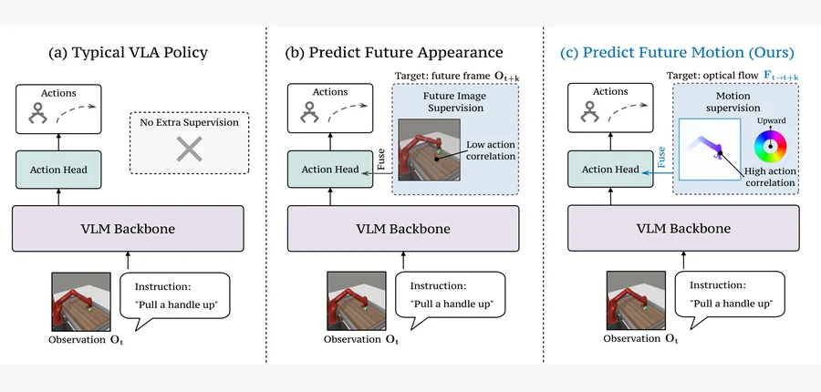 arXiv New 2026-10-12 · cs.RO · #18 **[Evo-World: A Lightweight Vision-Language-Action Model with Future Motion Prediction via Optical-Flow Supervision](https://arxiv.org/abs/2610.12936)** Zile Zhong, Yuxin Du, Tao Lin, Haoxiao Wang, Wei Dai, Binhua Zuo, Bo Zhao 机构：Shanghai Jiao Tong University / Zhejiang University / University of Electronic Science and Technology of China / QuicRobot（[HTML](https://arxiv.org/html/2610.12936)） [Paper](https://arxiv.org/abs/2610.12936) · [Code](https://github.com/MINT-SJTU/Evo-World) · [图源](https://arxiv.org/html/2610.12936v1/fig1.png) 

中文摘要
视觉—语言—动作（VLA）模型统一视觉理解、语言落地与机器人控制，但预测当前观察之后场景如何演化可为控制提供额外信息。单靠动作监督并不明确鼓励这种预判，而未来图像预测又把任务相关运动与大量静态外观混在一起。我们提出轻量 VLA 模型 Evo-World，通过光流监督加入未来运动预测，为策略提供集中于运动而非外观的任务相关预测信号。训练流程还在策略学习期间保留预测表征，调节表征多样性，并把表征学习与动作优化解耦。在仿真基准上，Evo-World 的 Meta-World MT50 分层平均成功率达 91.1%，比不带预测的基线相对提高 13.0%。在真实 AgileX 机器人上，它在单臂及双臂操作任务中优于所评基线，参数量仅 0.87B，GPU 显存占用更低、推理更高效。结果表明，光流监督的未来运动预测是一种提升 VLA 预测能力的有效轻量方法。 <a href="https://arxiv.org/abs/2610.12936">原摘要来源</a>
 |
| 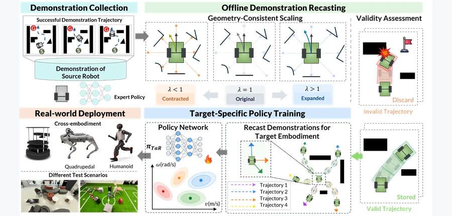 arXiv New 2026-10-12 · cs.RO · #19 **[CeDR-Nav: Cross-Embodiment Mapless Navigation via Offline Demonstration Recasting](https://arxiv.org/abs/2610.13007)** Xianghui Wang, Xinming Zhang, Yiwei Qian, Siwei Cheng, Shanze Wang, Dan Zhang, Wei Zhang 机构：Hong Kong Polytechnic University / Eastern Institute of Technology Ningbo / University of Science and Technology of China（[HTML](https://arxiv.org/html/2610.13007)） [Paper](https://arxiv.org/abs/2610.13007) · [图源](https://arxiv.org/html/2610.13007v1/Figures/framework.png) 

中文摘要
基于学习的无地图机器人导航表现良好，但策略通常受限于训练时的机器人形态。许多跨具身导航方法需要耗时的在线训练，仍可能不及目标平台专用策略。源机器人示范已有可重用的导航经验，但具身差异使它们不能直接成为目标监督。我们提出 CeDR-Nav：一种跨具身示范重构框架，无需在线数据采集，就可用已有源示范为每个目标形态训练专用导航策略。带逐示范有效性评估的几何一致缩放把源示范转为目标训练数据；目标专用 Gaussian mixture 策略为每个形态生成可行避障机动。多平台的定量仿真与真实部署验证有效性：跨具身仿真中相对 DRL-DCLP 平均成功率提高 13.8 个百分点，目标专用策略训练在数秒内完成。 <a href="https://arxiv.org/abs/2610.13007">原摘要来源</a>
 | 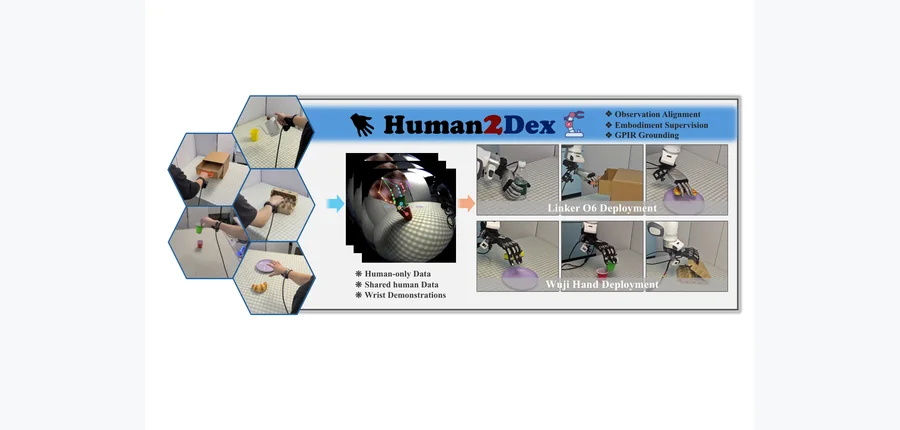 arXiv New 2026-10-12 · cs.RO · #20 **[Human2Dex: Dexterous Robot Learning from Wrist-Centric Human Demonstrations](https://arxiv.org/abs/2610.13119)** Jiachen Zhang, Yuanyuan Li, Shaqi Luo 机构：Beijing Academy of Artificial Intelligence（[HTML](https://arxiv.org/html/2610.13119)） [Paper](https://arxiv.org/abs/2610.13119) · [Project](https://human2dex.pages.dev/) · [图源](https://arxiv.org/html/2610.13119v1/fig_main_v2.png) 

中文摘要
为每种灵巧机器人手采集操作示范，需要反复进行针对任务的数据获取。我们研究同一套自然人手示范能否成为不同灵巧手可重用的数据接口，而无需在每个目标机器人上采集任务示范。Human2Dex 是以手腕为中心的人类示范接口，把共享的人类观察与运动语义同特定具身执行分开。它通过局部手部外观适配，以及在人手和机器人手观察中保持结构语义一致的 21 点表示来对齐观察；通过把融合的人手运动重定向到各目标手来构造可执行监督，并提出 Grasp-Pocket Interaction Representation（GPIR），在以手为中心的 Functional Grasp Pocket 中表示跟踪物体。人类示范库被转换为 Linker O6 与 Wuji 各自的训练集，而动作标签、归一化、训练和扩散策略检查点仍按手型分别处理。六项真实任务中，Linker O6 成功 109/120（90.8%），Wuji 成功 97/120（80.8%）；两种手合计，Human-Raw 成功 63/240（26.3%），完整 Human2Dex 成功 206/240（85.8%）。结果支持以手腕为中心的人类示范作为经标定灵巧手之间的可重用接口，同时保留具身专用策略学习。项目网站见原文：https://human2dex.pages.dev/。 <a href="https://arxiv.org/abs/2610.13119">原摘要来源</a>
 | 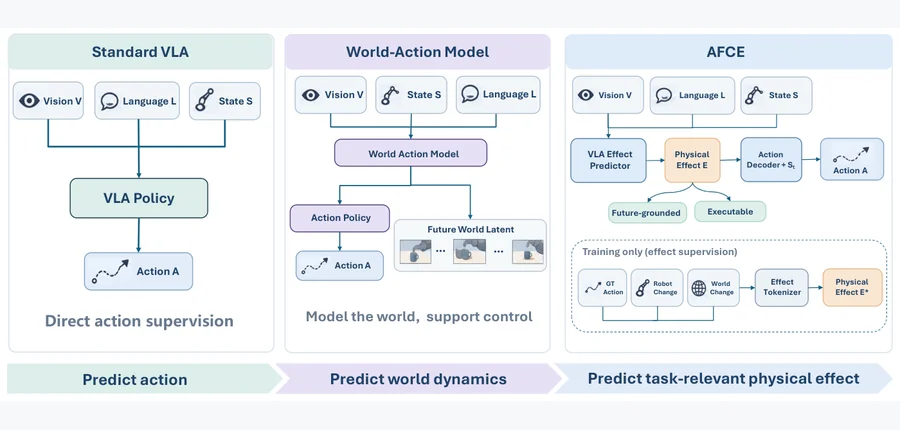 arXiv New 2026-10-12 · cs.RO · #21 **[Beyond Actions: Learning Future Operation Targets for Vision-Language-Action Models](https://arxiv.org/abs/2610.13212)** Min Lin, Bokai Zhou, Jianqi Lin, Kaiyuan Yang, Yicheng Chang, Junjie Yu, Xiaofan Liu, Jianhua Han, Rui Li, Shen Zhao, Xiao… 机构：Sun Yat-sen University / Yinwang Intelligent Technology（[HTML](https://arxiv.org/html/2610.13212)） [Paper](https://arxiv.org/abs/2610.13212) · [Project](https://afceproject.github.io/AFCE-Web/) · [图源](https://arxiv.org/html/2610.13212v1/effect_supervised_vla_framework_compare.png) 

中文摘要
动作说明机器人要执行什么，却不说明命令会造成什么结果；视觉—语言—动作（VLA）策略仍主要从图像、语言和状态预测动作块。我们提出 Action–Future Coupled Effect Learning（AFCE），让由未来落地的物理 Effect 成为策略的主要预测目标。离线 tokenizer 根据示范动作、实际机器人响应及稀疏视觉变化构造按时间排列的 Effect token；重建目标鼓励表示保留可执行细节和观察到的物理变化。流匹配 VLA 根据当前图像、指令和机器人状态预测 Effect，再由以状态为条件的解码器转为动作块。具身专用接口允许单臂与双臂任务共享 Effect 模型。在 DexJoCo 上，AFCE 总成功率为 50.97%，分别比 π_0.5 和 UVT 高 11.82 与 15.21 个百分点；它在全部五项双臂任务上领先，凸显 Effect 监督对协调灵巧操作的价值。项目页见原文：https://afceproject.github.io/AFCE-Web/。 <a href="https://arxiv.org/abs/2610.13212">原摘要来源</a>
 |
| 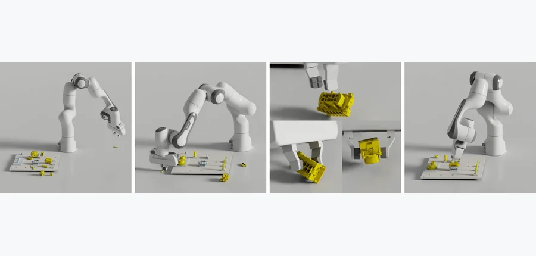 arXiv New 2026-10-12 · cs.AI · #22 **[AlphaNIST: Emergent Assembly Skills from Binary Task Rewards](https://arxiv.org/abs/2610.13354)** Octi Zhang, Iretiayo Akinola, Rosario Scalise, Mateo Guaman Castro, Patrick Yin, Tobias Widmer, Miles Macklin, Chris Amevo… 机构：NVIDIA / University of Washington（[HTML](https://arxiv.org/html/2610.13354)） [Paper](https://arxiv.org/abs/2610.13354) · [Project](https://alpha-nist.github.io/) · [图源](https://arxiv.org/html/2610.13354v1/figures/overview/hero_k10_clutter_square.png) 

中文摘要
NIST Assembly Task Board #1 是机器人操作学习方法的困难基准：短时程要求对小型、紧配合部件做精准且接触丰富的控制，长时程要求在扩展动作序列中恢复和协调。示范、任务分解及稠密进度奖励通过指定如何装配推动了研究，但究竟需要预设多少策略？AlphaGo 到 AlphaGo Zero 的发展表明，大规模强化学习可在不规定取胜方式下发现高水平策略。AlphaNIST 研究稀疏二值任务奖励及其允许的任务多样性，能否类似地让机器人发现装配方式。在仿真中，我们从零开始为 NIST Assembly Task Board #1 的全部 20 项装配任务训练单一策略，总体训练成功率达 98.2%，无需示范、进度塑形、脚本原语或逐任务调参。框架还能训练策略在单个 episode 中完成十对装配，顺序不预设，只有十对同时完成才给予任务成功奖励。所学策略出现灵巧和类似规划的行为：为后续装配选择抓取、借助周围几何调整部件方向，以及先准备一件、装配另一件再返回完成前者，而无显式规划器。视频见网站：https://alpha-nist.github.io/。 <a href="https://arxiv.org/abs/2610.13354">原摘要来源</a>
 | 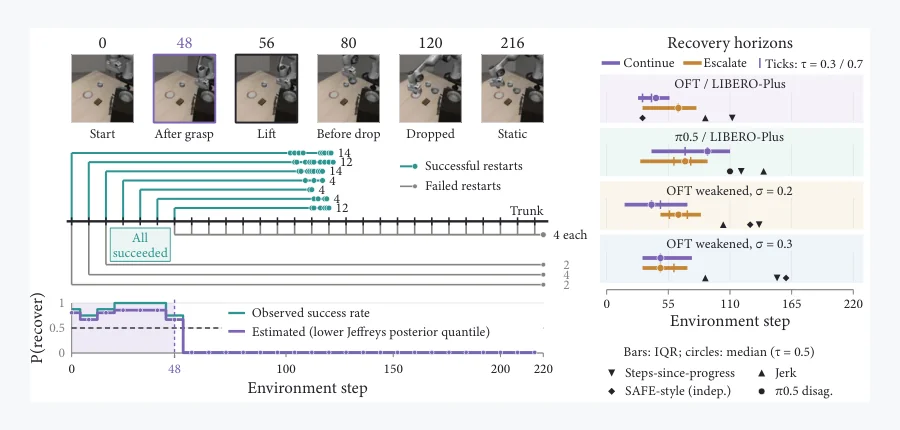 arXiv New 2026-10-12 · cs.RO · #23 **[RESCUE: Is This Alarm Worth Acting On? Counterfactual Evaluation of VLA Runtime Monitors](https://arxiv.org/abs/2610.13516)** David Ahmedt-Aristizabal, Abdelwahed Khamis, Mohammad Ali Armin, Lars Petersson 机构：CSIRO（[HTML](https://arxiv.org/html/2610.13516)） [Paper](https://arxiv.org/abs/2610.13516) · [图源](https://arxiv.org/html/2610.13516v1/recoverability_horizon.png) 

中文摘要
机器人策略的运行时失败监测通常按区分成功与失败执行的准确性评估，但准确警报可能来得太晚而无法恢复，无谓干预也可能破坏本会成功的执行。我们提出反事实框架 RESCUE，评估监测警报是否支持有用的干预：在执行检查点恢复仿真器与策略状态，比较替代动作，找到满足指定恢复标准的最晚检查点，并衡量响应警报能否降低期望任务完成成本。我们用 OpenVLA-OFT 和 π₀.₅ 在 LIBERO-Spatial 与 LIBERO-Plus 上评估，产生 128,340 个反事实分支。可恢复性取决于状态—干预组合，而非单独机器人状态：在 τ=0.5 时，OpenVLA-OFT/LIBERO-Plus 的 66 次失败中，继续执行下有 14 次含可恢复检查点；若允许继续或脚本恢复则有 34 次；其他条件下恢复反而降低可恢复性。在主要强策略条件下，良好检测分数并不能证明干预成本更低。在所评停止并重置模型中，即使理想检测器，误报率也只能为 2.0–3.3%，再高时不必要重置的损失就超过早停失败的收益。结果表明监测器价值同时依赖可用干预与部署工作负载。 <a href="https://arxiv.org/abs/2610.13516">原摘要来源</a>
 | 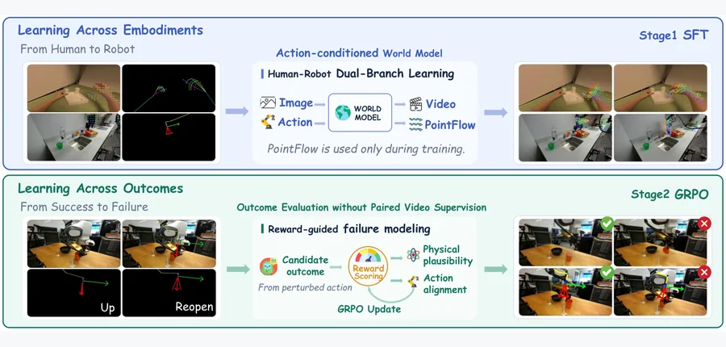 arXiv New 2026-10-12 · cs.RO · #24 **[Beyond Successful Robot Demonstrations: Learning from Human Interactions and Modeling Failure Dynamics](https://arxiv.org/abs/2610.13522)** Peiyan Tu, Cong Wang, Hanxin Zhu, Xin Jin, Zhibo Chen 机构：Zhejiang University / Beijing Zhongguancun Academy / USTC / Eastern Institute of Technology / CAS Institute of Automation（[PDF](https://arxiv.org/pdf/2610.13522)） [Paper](https://arxiv.org/abs/2610.13522) · [Project](https://peiyantu.github.io/HF-WM/) · [图源](https://arxiv.org/html/2610.13522v1/hfwm_overview.png) 

中文摘要
动作条件世界模型通过预测动作后果，为通用机器人智能提供可能基础；但现有机器人数据覆盖的交互动力学有限。大规模第一人称人类视频可补充交互经验，然而人手与机器人机械臂的具身差异阻碍跨具身学习。成功示范占主导又使失败动力学严重不足，限制世界模型预判失败执行。我们提出 HF-WM：结合人类交互学习与失败感知后训练的动作条件世界模型。为弥合具身差异，双分支框架把视频生成和辅助点流预测耦合，以稳定化点流作为人机交互共享的运动表示，同时抑制第一人称相机运动。为改善失败建模，再对成功示范扰动得到的动作做 Group Relative Policy Optimization（GRPO）后训练，以动作对齐和物理合理性奖励引导，使模型无需配对的失败真值视频也能学习合理的失败动力学。大量实验显示，HF-WM 在动作条件视频生成上达到先进表现，并对下游机器人任务的策略评估有较强实用性。 <a href="https://arxiv.org/abs/2610.13522">原摘要来源</a>
 |
| 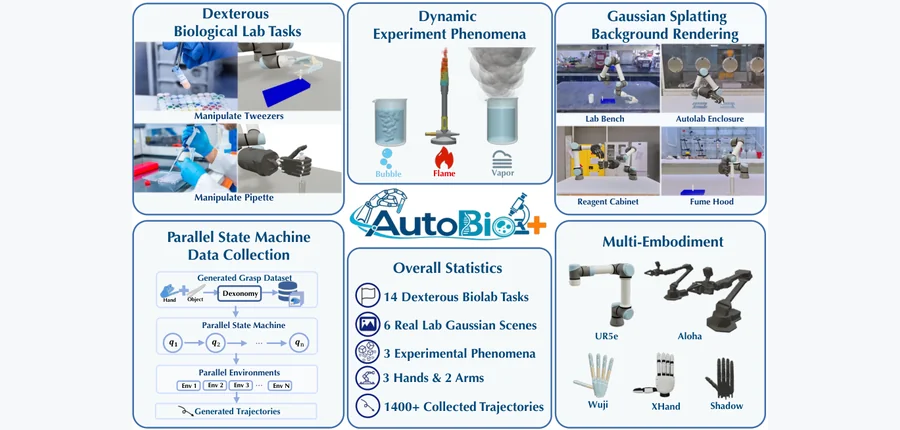 arXiv New 2026-10-12 · cs.RO · #25 **[AutoBio+: Benchmarking Dexterous Manipulation with Dynamic Experimental Phenomena in Realistic Laboratories](https://arxiv.org/abs/2610.13643)** Xuanye Wu, Yue Shi, Yongcan Yang, Yiqun Wang, Zhaoqi Wan, Dayu Xia, Jiezhang Cao, Xiangfei Li, Yao Mu, Guangtao Zhai 机构：Shanghai AI Laboratory / Huazhong University of Science and Technology / Shanghai Jiao Tong University / University of Southern California（[HTML](https://arxiv.org/html/2610.13643)） [Paper](https://arxiv.org/abs/2610.13643) · [Project](https://autobio-plus.github.io/AutoBioPlus) · [图源](https://arxiv.org/html/2610.13643v1/teaser.png) 

中文摘要
生物实验室自动化要求机器人在真实视觉条件下进行灵巧工具交互，并处理动态实验现象，因而操作困难。我们提出 AutoBio+，一个面向真实感生物实验室灵巧操作的仿真基准与框架，含四种机器人形态上的 14 项任务，涵盖功能性工具使用、精密操作、语言条件视觉落地和仪器操作。为表现实验流程不断变化的视觉条件，引入可控的火焰、蒸汽和气泡等动态现象。为进一步提高环境真实感，混合渲染流程把可交互的仿真前景物体与从6 个真实实验室场景重建的 Gaussian splatting 背景结合。为高效大规模生成数据和评估，还基于 mjlab 构建并行仿真框架，提出 Parallel Finite-State Machine（PFSM），结合批量渲染与解耦轨迹重放，实现示范生成及独立于模型的闭环策略评估。评测发现现有操作策略在各任务上表现差异很大，暴露不同强弱项；真实实验进一步显示 sim-to-real 差距缩小，支持 AutoBio+ 用于真实感操作评测。补充材料见原文：https://autobio-plus.github.io/AutoBioPlus。 <a href="https://arxiv.org/abs/2610.13643">原摘要来源</a>
 | 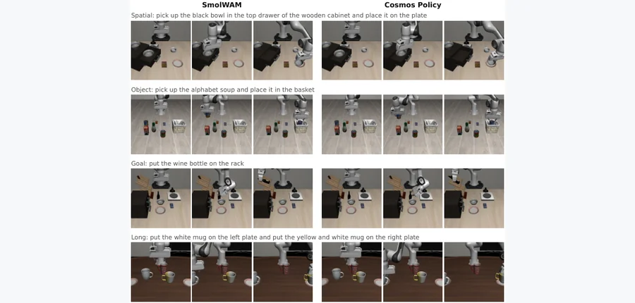 arXiv New 2026-10-12 · cs.RO · #26 **[SmolWAM: A Latent World-Action Model for Robotic Manipulation on Edge Devices](https://arxiv.org/abs/2610.13740)** Timi Owolabi, Hikmah Olawore, Frances Adelakun, Ayotomiwa Oyewumi 机构：ML Collective（[HTML](https://arxiv.org/html/2610.13740)） [Paper](https://arxiv.org/abs/2610.13740) · [图源](https://arxiv.org/html/2610.13740v1/rollouts.png) 

中文摘要
世界动作模型（WAM）联合预测机器人动作及这些动作将造成的观察，但最强模型依赖视频扩散 Transformer，对资源有限的边缘设备过于昂贵。我们提出 SmolWAM：保留 2B 参数 Cosmos Policy 的预训练主干，重建推理接口，使用单帧视觉潜变量、保留主干 attention sink 的缓存文本特征、28 个 Transformer 块中的 12 个，以及 1,008 个 token，并在一步 rectified flow 中读出动作和未来视觉潜变量。训练仅耗 3.6 GPU 小时；在 400 个 LIBERO episode 上，SmolWAM 成功率为 95.5%，每 16 动作块耗时 57 ms、2.3 TFLOP 和 2.4 GiB GPU 显存。相对教师模型，它快 11 倍、FLOPs 少 18.5 倍、显存少 3.2 倍，世界预测头仍能预测场景运动。 <a href="https://arxiv.org/abs/2610.13740">原摘要来源</a>
 | 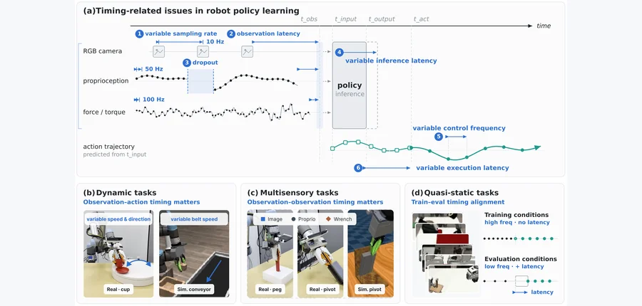 arXiv New 2026-10-12 · cs.RO · #27 **[Chronos Policy: Learning Robot Policies on Physical Time](https://arxiv.org/abs/2610.13929)** Changhao Wang, Jaden Clark, Shuran Song 机构：Stanford University（[HTML](https://arxiv.org/html/2610.13929)） [Paper](https://arxiv.org/abs/2610.13929) · [图源](https://arxiv.org/html/2610.13929v1/figs/Teaser.png) 

中文摘要
机器人策略常把感测与控制转成固定频率的观察—动作序列，使物理时间隐含在序列位置中；当观察频率、延迟或推理时延变化时，这一假设失效。我们提出 Chronos Policy，以观察采集时间和期望动作执行时间为条件，把物理时间显式纳入策略。研究在扩散 Transformer 中加入时间的两种方式：给 token 特征加时间戳嵌入，或通过时间感知旋转位置编码（time-aware RoPE）在位置编码中表示物理时间。结果发现 time-aware RoPE 更鲁棒，使注意力直接依赖物理时间而保持 token 内容不变。训练时随机化采样哪些观察以及动作块何时开始，使策略见到部署中可能出现的不同感测与执行日程，也能从异步、多速率数据学习，而不必强行对齐到固定时间网格。仿真和真实实验中，Chronos Policy 改善了时间关系关键的动态任务及观察间相对时序重要的多传感任务；在标准准静态任务中维持标称表现，同时增强对感测与推理时序变化的鲁棒性。 <a href="https://arxiv.org/abs/2610.13929">原摘要来源</a>
 |
| 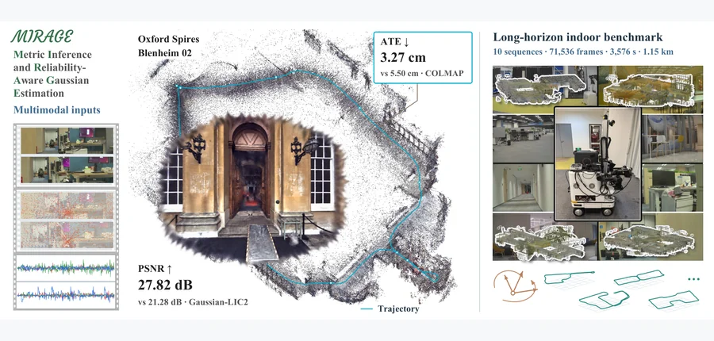 arXiv New 2026-10-12 · cs.CV · #28 **[MIRAGE: Metric Inference and Reliability-Aware Gaussian Estimation from Feed-Forward Vision](https://arxiv.org/abs/2610.12568)** Xinzhe Wang, Changjian Jiang, Kaiwen Song, Xudong Li, Kerui Ren, Ran Yi, Lizhuang Ma, Chunhua Shen, Linning Xu, Tao Lu, Mu… 机构：Shanghai Jiao Tong University / Shanghai AI Laboratory / University of Hong Kong（[HTML](https://arxiv.org/html/2610.12568)） [Paper](https://arxiv.org/abs/2610.12568) · [图源](https://arxiv.org/html/2610.12568v1/mirage_teaser.png) 

中文摘要
前馈式 3D 先验能从图像流实现高质量重建，但往往缺乏可靠的度量尺度，且长期轨迹会漂移。相对地，LiDAR—惯性估计提供度量准确的运动，却缺少高保真重建所需的图像空间一致性。我们提出 MIRAGE：用 LiDAR—IMU 的度量运动锚定前馈视觉几何，并根据对应点支持度和跨模态一致性调节在线位姿修正，从而同时实现准确的度量位姿估计与高保真 Gaussian 重建。在 Oxford Spires、M2DGR 和 INS 上，MIRAGE 获得准确的度量轨迹估计，优于计算开销较高、常用于纯视觉基准的 COLMAP。鉴于大规模室内重建缺少长时程单目基准，我们还构建多模态数据采集平台，用 MIRAGE 为新的纯视觉基准建立准确的 6-DoF 参考轨迹，并在该数据集上系统评测近期单目大规模重建方法的长时程室内表现。 <a href="https://arxiv.org/abs/2610.12568">原摘要来源</a>
 | 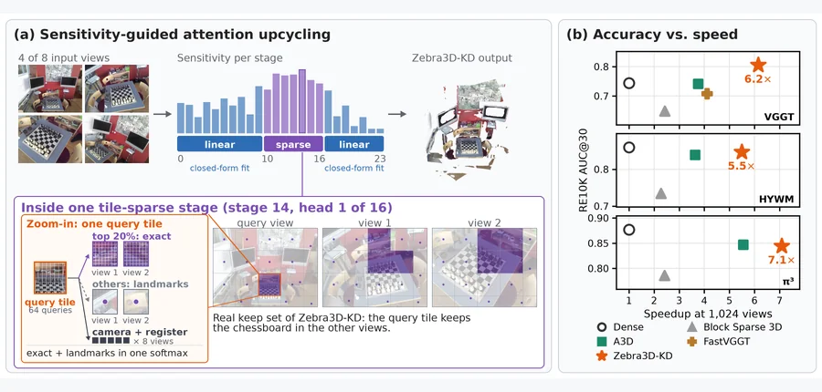 arXiv New 2026-10-12 · cs.CV · #29 **[Zebra3D: Efficient Hybrid Foundation Models For Scalable 3D Reconstruction](https://arxiv.org/abs/2610.12727)** Utkarsh Saxena, Ruijing Yang, Mehdi Rezagholizadeh, Akash Haridas, Vikram Appia, Emad Barsoum 机构：AMD（[PDF](https://arxiv.org/pdf/2610.12727)） [Paper](https://arxiv.org/abs/2610.12727) · [图源](https://arxiv.org/html/2610.12727v1/figures/fig1_v2/current/figure1_v9_draft.png) 

中文摘要
前馈式 3D 基础模型能从无位姿图像重建场景，但全局注意力的二次复杂度限制其扩展到大量视图。我们提出 Zebra3D，一种逐层稀疏—线性混合注意力框架，无需从零训练就能提高预训练 3D 基础模型效率。在 VGGT、HunyuanWorld-Mirror 和 π³ 上，观察到基本一致的深度方向模式：早期层较能容忍线性替换，敏感的中后期层注意力更集中。Zebra3D 在容忍层分配以线性为主的注意力，在敏感层使用分块稀疏注意力，并用地标摘要保留未选中的上下文。闭式仿射拟合支持无需训练的转换；可选的转换后训练结合任务监督、输出蒸馏和关系特征蒸馏。三个骨干在高注意力稀疏度下均保持较强重建和相机位姿精度，无训练版本接近稠密模型。端到端加速随输入视图数增加，在 1,024 视图时最高达 7.1 倍。转换后训练的 Zebra3D-VGGT 在平均注意力稀疏度 94% 下取得 RealEstate10K AUC@30 80.5%，仅比相同数据和训练日程微调的稠密 VGGT 低 1.1 个百分点。 <a href="https://arxiv.org/abs/2610.12727">原摘要来源</a>
 | 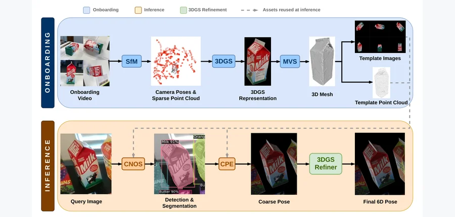 arXiv New 2026-10-12 · cs.CV · #30 **[NovaSplat: Model-Free 6D Object Pose Estimation via 3D Gaussian Splatting Onboarding and Refinement](https://arxiv.org/abs/2610.13309)** Georgios Floros, Evangelos Sartinas, Orestis Vangelis, Maria Pateraki 机构：National Technical University of Athens（[HTML](https://arxiv.org/html/2610.13309)） [Paper](https://arxiv.org/abs/2610.13309) · [Code](https://github.com/POSE-Lab/novasplat) · [图源](https://arxiv.org/html/2610.13309v1/system-pipeline.png) 

中文摘要
没有 CAD 模型的新物体 6D 位姿估计仍是难题：无模型方法必须在注册阶段从零构建物体表示，性能长期落后于有模型方法。我们提出 NovaSplat 无模型流程以缩小差距：从注册时拍摄的短手机视频训练 3D Gaussian Splatting（3DGS）模型，既用于生成检测与粗位姿估计模板，也作为位姿细化的可微骨干。细化器在无梯度奇异点的连续旋转参数化下，结合光度和几何损失优化物体到相机的位姿。在家居物体基准上，NovaSplat 超过所有有模型方法；在无纹理、镜面表面的困难工业基准上，它超过所有无模型对手，并明显缩小与有模型方法的差距。另提出推理版本 NovaSplat-Lite，以几乎不损失精度的代价加快 3.1 倍。代码将按原文链接发布：https://github.com/POSE-Lab/novasplat。 <a href="https://arxiv.org/abs/2610.13309">原摘要来源</a>
 |
|  arXiv New 2026-10-12 · cs.GR · #31 **[3DRAG: 3D-Native Object Drag Editing with Generative Models](https://arxiv.org/abs/2610.13216)** Kuixiang Shao, Yuyang Jiao, Chenghao Zhang, Wenbo Zhao, Yinuo Bai, Jingyi Yu 机构：ShanghaiTech University（[HTML](https://arxiv.org/html/2610.13216)） [Paper](https://arxiv.org/abs/2610.13216) · [图源](https://arxiv.org/pdf/2610.13216) 

中文摘要
3D 生成模型的进展降低了创建三维资产的门槛，但通过点拖拽实现直观、精确、交互式控制仍有挑战。现有 3D 拖拽方法或依赖缓慢的 2D 扩散先验（如 Score Distillation Sampling），或直接扭曲几何，常产生多视图不一致与拓扑伪影。我们提出无需训练的 3DRAG，在大规模生成模型显式 3D 潜空间中直接执行精确拖拽编辑，不依赖 SDS 优化或迭代点跟踪。为使形变在几何上合理，3DRAG 把拖拽位移场显式延展到三维空间，并以 Occupancy-Aware Winner-Takes-All（OA-WTA）策略稳健处理稀疏几何。生成式编辑流程再通过 3D 位移场显式变换潜表示，借助模型的生成能力得到平滑形变并保持物体身份。Logits-Level Token Fusion 把原始几何和纹理高保真地注入目标区域。我们还构建含多样 3D 资产和复杂多点拖拽指令的新数据集；定量与定性实验显示，3DRAG 在拖拽精度、几何保真和未编辑区域保持上超过已有基线。 <a href="https://arxiv.org/abs/2610.13216">原摘要来源</a>
 | 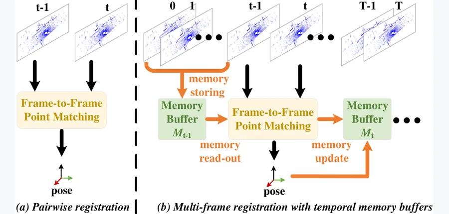 arXiv New 2026-10-12 · cs.CV · #32 **[MemReg: Streaming Outdoor LiDAR Point Cloud Registration with Hybrid Memory Buffers](https://arxiv.org/abs/2610.12624)** Jiuming Liu, Mengmeng Liu, Guangming Wang, Lihao Liu, Michael Ying Yang, Yunpeng Zhang, Francesco Nex, Hao Cheng, Hesheng… 机构：Shanghai Jiao Tong University / University of Twente / University of Cambridge / University of Bath / Phigent Robotics（[HTML](https://arxiv.org/html/2610.12624)） [Paper](https://arxiv.org/abs/2610.12624) · [Code](https://github.com/IRMVLab/MemReg) · [图源](https://arxiv.org/html/2610.12624v1/first_compare.png) 

中文摘要
以往室外 LiDAR 配准通常仅输入一对扫描，忽略流式序列固有的时间相关性。我们提出以位姿相关记忆缓冲增强的多帧室外点云配准网络。长期 LiDAR 序列提供全局上下文，可补全稀疏测量、过滤离群点并缓解低重叠问题，从而提高配准表现。具体设计两个混合记忆缓冲：隐式记忆特征缓冲和显式记忆位姿缓冲，用于储存并动态更新位姿相关的时间特征；再用动态历史加权模块自适应融合当前与历史位姿特征。KITTI、nuScenes 和 Apollo-Southbay 三个室外数据集上的大量实验显示，MemReg 超过此前所有成对方法和多帧 SLAM 系统。它还较好地泛化到多视角室内配准，在 3DMatch、3DLoMatch 和 ScanNet 上具有竞争力。代码将按原文链接发布：https://github.com/IRMVLab/MemReg。 <a href="https://arxiv.org/abs/2610.12624">原摘要来源</a>
 | 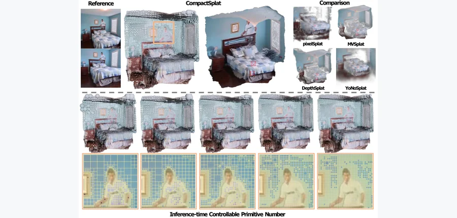 arXiv New 2026-10-12 · cs.CV · #33 **[CompactSplat: Spatially Adaptive Gaussian Distribution for Feedforward Scene Reconstruction](https://arxiv.org/abs/2610.13177)** Bing He, Jingnan Gao, Yunuo Chen, Zhengxue Cheng, Rong Xie, Li Song, Wenjun Zhang 机构：Shanghai Jiao Tong University（[HTML](https://arxiv.org/html/2610.13177)） [Paper](https://arxiv.org/abs/2610.13177) · [图源](https://arxiv.org/html/2610.13177v1/teaser.png) 

中文摘要
从稀疏视图进行无需逐场景优化的 3D 场景重建仍具挑战，尤其是恢复准确几何和精细纹理。近期前馈方法利用可泛化 3D Gaussian Splatting（3DGS）生成场景，但通常给每个像素分配一个或多个 Gaussian；均匀分配既在同质区域浪费基元，也未充分利用平面表面的几何先验，结构建模因此可能欠佳。我们提出前馈框架 CompactSplat，根据内容自适应分配 3D Gaussian。纹理引导空间划分与层级采样相结合，在复杂区域集中密集 Gaussian，在平坦区域则用扩展、尺度调节的基元平铺。框架还天然支持推理时动态控制稀疏度，无需重训网络即可在渲染质量与显存占用间切换。RealEstate10K、DL3DV 和 ScanNet 上的实验显示，CompactSplat 在标准指标和高分辨率渲染一致性上持续优于先前方法，并以显著更少的基元获得高保真重建。 <a href="https://arxiv.org/abs/2610.13177">原摘要来源</a>
 |
<!-- PAPER_CARDS_END -->

## 检索概况
- **检索窗口**：上次完成核对 2026-10-12 09:03 至本轮北京时间 2026-10-13 09:13；官方页面所示批次为 **Monday, 12 October 2026**。
- **来源与范围**：核对 arXiv 官方 cs、physics、cond-mat、math、stat.ML、eess.IV、eess.SY、eess.SP 的 New 页面；cs 页面覆盖 cs.CV、cs.GR、cs.RO、cs.AI、cs.LG。先筛标题，再核对候选的官方原摘要；主榜仅收官方 New，同一 ID 去重。
- **命中与入选**：八页共 **1,272 条 New 原始记录 / 1,229 个去重 ID**，以及 243 条 Cross、862 条 Replacement 原始记录；按本期主题筛选 **33 篇**，其中 3D/物理及三维机器人交互优先，具身机器人次之，基础 3D 置后。未用泛化 Agent/LLM 论文凑数。
- **卡片素材**：33 张均为论文对应的官方 HTML/PDF 图，**缺图 0 篇、缺原摘要 0 篇**；机构尚未确认 0 篇。
- **核实边界**：标题、作者、分类与原摘要来自所链接的 arXiv 官方 listing／论文页；机构来自 HTML/PDF 首页可辨认的署名，否则写“affiliation 未确认”。卡片中的中文摘要为原摘要译文。表内相关性、机构强度，以及正文的局限和实验建议均为**推断**，不等于论文结论。

## 官方 listing 状态

| 分类页面 | 官方 listing 日期 | New | Cross | Replacement |
|---|---|---:|---:|---:|
| [cs/new](https://arxiv.org/list/cs/new?show=2000) | Monday, 12 October 2026 | 728 | 91 | 445 |
| [physics/new](https://arxiv.org/list/physics/new?show=2000) | Monday, 12 October 2026 | 71 | 38 | 43 |
| [cond-mat/new](https://arxiv.org/list/cond-mat/new?show=2000) | Monday, 12 October 2026 | 71 | 29 | 55 |
| [math/new](https://arxiv.org/list/math/new?show=2000) | Monday, 12 October 2026 | 335 | 48 | 251 |
| [stat.ML/new](https://arxiv.org/list/stat.ML/new?show=2000) | Monday, 12 October 2026 | 23 | 18 | 24 |
| [eess.IV/new](https://arxiv.org/list/eess.IV/new?show=2000) | Monday, 12 October 2026 | 8 | 0 | 5 |
| [eess.SY/new](https://arxiv.org/list/eess.SY/new?show=2000) | Monday, 12 October 2026 | 16 | 12 | 25 |
| [eess.SP/new](https://arxiv.org/list/eess.SP/new?show=2000) | Monday, 12 October 2026 | 20 | 7 | 14 |

## Top papers

| # | 论文标题 | arXiv | 分类 | 作者 | 机构 | 相关性（推断） | 机构强度（推断） | 阅读优先级（推断） |
|---:|---|---|---|---|---|---|---|---|
| 1 | PhysForge: Material-Controllable 3D Reconstruction with Separable Components | [arXiv:2610.13681](https://arxiv.org/abs/2610.13681) | cs.CV | Yuchen Wang, Yanqi Bao, Zheng Gu, Zhengqing Chen, Jieqi Shi, Jing Huo | Nanjing University / Shenzhen University / Horizon Robotics（[HTML](https://arxiv.org/html/2610.13681)） | 高（3D/物理交叉） | 中高 | 高 |
| 2 | Towards Physically Grounded Articulated 3D Assets: A Multi-Agent Pipeline and Benchmark | [arXiv:2610.13947](https://arxiv.org/abs/2610.13947) | cs.CV | Xudong Cai, Ruijie Zhu, Haoliang Shang, Ruining Li, Marc Pollefeys, Shangzhe Wu, Andrea Vedaldi, Chuanxia Zheng | Nanyang Technological University / ETH Zurich / Microsoft / University of Cambridge / University of Oxford（[HTML](https://arxiv.org/html/2610.13947)） | 高（3D/物理交叉） | 高 | 高 |
| 3 | Splat2Act: From Captured Scenes to Personalized VLA Manipulation | [arXiv:2610.13945](https://arxiv.org/abs/2610.13945) | cs.RO | Xiaomeng Ye, Krishna Jaganathan, Gyubeum Lim, Gunjan Chhablani, Muhammad Zubair Irshad, Zsolt Kira | Georgia Institute of Technology / Waymo / Toyota Research Institute（[HTML](https://arxiv.org/html/2610.13945)） | 高（3D/物理交叉） | 中高 | 高 |
| 4 | Grounded-Dreamer: Robot Learning from World Model Synthetic Data with Physical Grounding | [arXiv:2610.13164](https://arxiv.org/abs/2610.13164) | cs.RO | Feng Jiang, Shu Chen, Yuanfei Wang, Yuan Li, Zhenhao Shen, Jiaqi Liang, Yang Chen, Lei Wei, Chen Xie, Ruihai Wu | Peking University / HKUST Guangzhou / Lightwheel（[HTML](https://arxiv.org/html/2610.13164)） | 高（3D/物理交叉） | 高 | 高 |
| 5 | PanTact: Teaching Whole-Body Dexterity with a Wearable Contact Interface | [arXiv:2610.12558](https://arxiv.org/abs/2610.12558) | cs.RO | Xiaomeng Xu, Han Zhang, Zhian Ruan, Xiaofeng Guo, Jinkun Cao, Ruihan Yang, Carmelo Sferrazza, Shuran Song, Guanya Shi | Stanford University / Amazon FAR / Carnegie Mellon University（[HTML](https://arxiv.org/html/2610.12558)） | 高（3D/物理交叉） | 高 | 高 |
| 6 | VICAR: Video Imitation with Contact-Aware Retargeting for Humanoid Interactive Skills | [arXiv:2610.13079](https://arxiv.org/abs/2610.13079) | cs.RO | Dvij Kalaria, Bike Zhang, S. Shankar Sastry | University of California, Berkeley（[HTML](https://arxiv.org/html/2610.13079)） | 高（3D/物理交叉） | 中高 | 高 |
| 7 | Tactile Sensing-based Secure and Gentle Grasping of Unknown Objects | [arXiv:2610.12790](https://arxiv.org/abs/2610.12790) | cs.RO | Feng Han | New York Institute of Technology（[HTML](https://arxiv.org/html/2610.12790)） | 高（3D/物理交叉） | 中高 | 高 |
| 8 | CASTER: Formalizing Zero-Shot Manipulation from Synthetic Videos as Constrained Optimization | [arXiv:2610.12567](https://arxiv.org/abs/2610.12567) | cs.RO | Yinlong Dai, Homanga Bharadhwaj, Dylan P. Losey | Virginia Tech / Johns Hopkins University（[HTML](https://arxiv.org/html/2610.12567)） | 高（3D/物理交叉） | 中高 | 高 |
| 9 | Cooperative Aerial Transportation of a Payload with a Sliding Cable Attachment | [arXiv:2610.13665](https://arxiv.org/abs/2610.13665) | cs.RO | Sebastian Tilaguy Lezama, Diego S D'Antonio | Oakland University（[HTML](https://arxiv.org/html/2610.13665)） | 高（3D/物理交叉） | 中高 | 高 |
| 10 | Adaptive Whole-Body MPC with Optimal Posture Planning for Humanoid Robots under Unknown Payloads | [arXiv:2610.12972](https://arxiv.org/abs/2610.12972) | cs.RO | Manh Cuong Nguyen, Duc Cuong Vu, Viet Anh Vu, Duc Tuan Pham, Toan Nguyen, Minh Hiep Phung, Ngo Anh Vien, Minh Nhat Vu | VinRobotics / VinUniversity（[PDF](https://arxiv.org/pdf/2610.12972)） | 高（3D/物理交叉） | 中高 | 高 |
| 11 | MeshBind: Point-to-Mesh Binding for Non-Rigid Scene Flow Automatic Annotation | [arXiv:2610.12895](https://arxiv.org/abs/2610.12895) | cs.CV | Yinqi Chen, E Li, Shuaijun Wang, Weiyuan Peng, Meiying Zhang, Qi Hao | Southern University of Science and Technology（[HTML](https://arxiv.org/html/2610.12895)） | 高（3D/物理交叉） | 中高 | 高 |
| 12 | HorizonNav: Geometry-Guided Video Diffusion for Anticipatory 3D Robot Navigation | [arXiv:2610.13849](https://arxiv.org/abs/2610.13849) | cs.RO | Hajira Amjad, Valerii Serpiva, Viacheslav Liubimov, Didar Seyidov, Dzmitry Tsetserukou | Skolkovo Institute of Science and Technology（[HTML](https://arxiv.org/html/2610.13849)） | 高（3D/物理交叉） | 中高 | 高 |
| 13 | On the Convergence of the Mesh-Free Discretization of a Non-Linear Bond-Based Peridynamic Model with a Bond-Breakage Criterion | [arXiv:2610.13355](https://arxiv.org/abs/2610.13355) | math.NA | Lukas Pflug, Michael Stingl, Max Zetzmann | Friedrich-Alexander University Erlangen-Nuremberg（[HTML](https://arxiv.org/html/2610.13355)） | 高（3D/物理交叉） | 中高 | 高 |
| 14 | Make It Flow: Animating Water in 3D Gaussian Splatting Scenes | [arXiv:2610.13860](https://arxiv.org/abs/2610.13860) | cs.CV | Kjell Keune, Florian Hahlbohm, Jannis Möller, Susana Castillo, Martin Eisemann, Marcus Magnor | TU Braunschweig（[HTML](https://arxiv.org/html/2610.13860)） | 高（3D/物理交叉） | 中高 | 高 |
| 15 | Spa-Bench: A Real-Robot Benchmark for Spatial Grounding in Vision-Language-Action Models | [arXiv:2610.12696](https://arxiv.org/abs/2610.12696) | cs.RO | Justin Tien-Smith, Matthew Pidden, Rolandos Alexandros Potamias | Imperial College London（[HTML](https://arxiv.org/html/2610.12696)） | 高（具身机器人） | 中高 | 高 |
| 16 | Reflex: Visually Grounded Reactive Humanoid Control | [arXiv:2610.12772](https://arxiv.org/abs/2610.12772) | cs.RO | Taoyang Jia, Weikai Huang, Linxin Song, Jared Darlington, Jieyu Zhao, Yue Wang, Jiafei Duan, Zhongzheng Ren, Ranjay Krishna | University of Washington / Stanford University / University of Southern California / National University of Singapore / UNC Chapel Hill / Allen Institute for AI（[HTML](https://arxiv.org/html/2610.12772)） | 高（具身机器人） | 高 | 中高 |
| 17 | StereoEngine: Scaling Stereo Bimanual Robot Data without Stereo Cameras | [arXiv:2610.12734](https://arxiv.org/abs/2610.12734) | cs.RO | Jason Chen, I-Chun Arthur Liu, Gaurav Sukhatme, Daniel Seita | University of Southern California（[HTML](https://arxiv.org/html/2610.12734)） | 高（具身机器人） | 中高 | 中高 |
| 18 | Evo-World: A Lightweight Vision-Language-Action Model with Future Motion Prediction via Optical-Flow Supervision | [arXiv:2610.12936](https://arxiv.org/abs/2610.12936) | cs.RO | Zile Zhong, Yuxin Du, Tao Lin, Haoxiao Wang, Wei Dai, Binhua Zuo, Bo Zhao | Shanghai Jiao Tong University / Zhejiang University / University of Electronic Science and Technology of China / QuicRobot（[HTML](https://arxiv.org/html/2610.12936)） | 高（具身机器人） | 高 | 中高 |
| 19 | CeDR-Nav: Cross-Embodiment Mapless Navigation via Offline Demonstration Recasting | [arXiv:2610.13007](https://arxiv.org/abs/2610.13007) | cs.RO | Xianghui Wang, Xinming Zhang, Yiwei Qian, Siwei Cheng, Shanze Wang, Dan Zhang, Wei Zhang | Hong Kong Polytechnic University / Eastern Institute of Technology Ningbo / University of Science and Technology of China（[HTML](https://arxiv.org/html/2610.13007)） | 高（具身机器人） | 中高 | 中高 |
| 20 | Human2Dex: Dexterous Robot Learning from Wrist-Centric Human Demonstrations | [arXiv:2610.13119](https://arxiv.org/abs/2610.13119) | cs.RO | Jiachen Zhang, Yuanyuan Li, Shaqi Luo | Beijing Academy of Artificial Intelligence（[HTML](https://arxiv.org/html/2610.13119)） | 高（具身机器人） | 中高 | 中高 |
| 21 | Beyond Actions: Learning Future Operation Targets for Vision-Language-Action Models | [arXiv:2610.13212](https://arxiv.org/abs/2610.13212) | cs.RO | Min Lin, Bokai Zhou, Jianqi Lin, Kaiyuan Yang, Yicheng Chang, Junjie Yu, Xiaofan Liu, Jianhua Han, Rui Li, Shen Zhao, Xiaodan Liang | Sun Yat-sen University / Yinwang Intelligent Technology（[HTML](https://arxiv.org/html/2610.13212)） | 高（具身机器人） | 中高 | 中高 |
| 22 | AlphaNIST: Emergent Assembly Skills from Binary Task Rewards | [arXiv:2610.13354](https://arxiv.org/abs/2610.13354) | cs.AI | Octi Zhang, Iretiayo Akinola, Rosario Scalise, Mateo Guaman Castro, Patrick Yin, Tobias Widmer, Miles Macklin, Chris Amevor, Dylan Turpin, Dirk Van Gelder, Jan Carius, Ankur Handa, Gavriel State, Yunrong Guo, Yashraj Narang | NVIDIA / University of Washington（[HTML](https://arxiv.org/html/2610.13354)） | 高（具身机器人） | 高 | 中高 |
| 23 | RESCUE: Is This Alarm Worth Acting On? Counterfactual Evaluation of VLA Runtime Monitors | [arXiv:2610.13516](https://arxiv.org/abs/2610.13516) | cs.RO | David Ahmedt-Aristizabal, Abdelwahed Khamis, Mohammad Ali Armin, Lars Petersson | CSIRO（[HTML](https://arxiv.org/html/2610.13516)） | 高（具身机器人） | 中高 | 中高 |
| 24 | Beyond Successful Robot Demonstrations: Learning from Human Interactions and Modeling Failure Dynamics | [arXiv:2610.13522](https://arxiv.org/abs/2610.13522) | cs.RO | Peiyan Tu, Cong Wang, Hanxin Zhu, Xin Jin, Zhibo Chen | Zhejiang University / Beijing Zhongguancun Academy / USTC / Eastern Institute of Technology / CAS Institute of Automation（[PDF](https://arxiv.org/pdf/2610.13522)） | 高（具身机器人） | 高 | 中高 |
| 25 | AutoBio+: Benchmarking Dexterous Manipulation with Dynamic Experimental Phenomena in Realistic Laboratories | [arXiv:2610.13643](https://arxiv.org/abs/2610.13643) | cs.RO | Xuanye Wu, Yue Shi, Yongcan Yang, Yiqun Wang, Zhaoqi Wan, Dayu Xia, Jiezhang Cao, Xiangfei Li, Yao Mu, Guangtao Zhai | Shanghai AI Laboratory / Huazhong University of Science and Technology / Shanghai Jiao Tong University / University of Southern California（[HTML](https://arxiv.org/html/2610.13643)） | 高（具身机器人） | 高 | 中高 |
| 26 | SmolWAM: A Latent World-Action Model for Robotic Manipulation on Edge Devices | [arXiv:2610.13740](https://arxiv.org/abs/2610.13740) | cs.RO | Timi Owolabi, Hikmah Olawore, Frances Adelakun, Ayotomiwa Oyewumi | ML Collective（[HTML](https://arxiv.org/html/2610.13740)） | 高（具身机器人） | 中高 | 中高 |
| 27 | Chronos Policy: Learning Robot Policies on Physical Time | [arXiv:2610.13929](https://arxiv.org/abs/2610.13929) | cs.RO | Changhao Wang, Jaden Clark, Shuran Song | Stanford University（[HTML](https://arxiv.org/html/2610.13929)） | 高（具身机器人） | 高 | 中高 |
| 28 | MIRAGE: Metric Inference and Reliability-Aware Gaussian Estimation from Feed-Forward Vision | [arXiv:2610.12568](https://arxiv.org/abs/2610.12568) | cs.CV | Xinzhe Wang, Changjian Jiang, Kaiwen Song, Xudong Li, Kerui Ren, Ran Yi, Lizhuang Ma, Chunhua Shen, Linning Xu, Tao Lu, Mulin Yu | Shanghai Jiao Tong University / Shanghai AI Laboratory / University of Hong Kong（[HTML](https://arxiv.org/html/2610.12568)） | 中高（基础 3D） | 高 | 中 |
| 29 | Zebra3D: Efficient Hybrid Foundation Models For Scalable 3D Reconstruction | [arXiv:2610.12727](https://arxiv.org/abs/2610.12727) | cs.CV | Utkarsh Saxena, Ruijing Yang, Mehdi Rezagholizadeh, Akash Haridas, Vikram Appia, Emad Barsoum | AMD（[PDF](https://arxiv.org/pdf/2610.12727)） | 中高（基础 3D） | 中高 | 中 |
| 30 | NovaSplat: Model-Free 6D Object Pose Estimation via 3D Gaussian Splatting Onboarding and Refinement | [arXiv:2610.13309](https://arxiv.org/abs/2610.13309) | cs.CV | Georgios Floros, Evangelos Sartinas, Orestis Vangelis, Maria Pateraki | National Technical University of Athens（[HTML](https://arxiv.org/html/2610.13309)） | 中高（基础 3D） | 中高 | 中 |
| 31 | 3DRAG: 3D-Native Object Drag Editing with Generative Models | [arXiv:2610.13216](https://arxiv.org/abs/2610.13216) | cs.GR | Kuixiang Shao, Yuyang Jiao, Chenghao Zhang, Wenbo Zhao, Yinuo Bai, Jingyi Yu | ShanghaiTech University（[HTML](https://arxiv.org/html/2610.13216)） | 中高（基础 3D） | 中高 | 中 |
| 32 | MemReg: Streaming Outdoor LiDAR Point Cloud Registration with Hybrid Memory Buffers | [arXiv:2610.12624](https://arxiv.org/abs/2610.12624) | cs.CV | Jiuming Liu, Mengmeng Liu, Guangming Wang, Lihao Liu, Michael Ying Yang, Yunpeng Zhang, Francesco Nex, Hao Cheng, Hesheng Wang | Shanghai Jiao Tong University / University of Twente / University of Cambridge / University of Bath / Phigent Robotics（[HTML](https://arxiv.org/html/2610.12624)） | 中高（基础 3D） | 高 | 中 |
| 33 | CompactSplat: Spatially Adaptive Gaussian Distribution for Feedforward Scene Reconstruction | [arXiv:2610.13177](https://arxiv.org/abs/2610.13177) | cs.CV | Bing He, Jingnan Gao, Yunuo Chen, Zhengxue Cheng, Rong Xie, Li Song, Wenjun Zhang | Shanghai Jiao Tong University（[HTML](https://arxiv.org/html/2610.13177)） | 中高（基础 3D） | 高 | 中 |

## 逐篇中文要点

### 1. [PhysForge: Material-Controllable 3D Reconstruction with Separable Components](https://arxiv.org/abs/2610.13681)

- [事实] PhysFit 用材料条件化视频动力学辅助物性拟合，PhysComp 按物体与语义部件分别估计参数。
- [事实] PhysAssets 和 Google Scanned Objects 上报告最佳 CLIP 与物理可控性分数，并提供部件消融和用户研究。
- [推断] 需用相同几何与相同真实外力下的独立材料真值检验，区分视频先验与真正物性辨识。

### 2. [Towards Physically Grounded Articulated 3D Assets: A Multi-Agent Pipeline and Benchmark](https://arxiv.org/abs/2610.13947)

- [事实] Artisan 把仿真反馈加入关节资产生成，关注碰撞、重力稳定、质量和材料。
- [事实] 基准含 100 个参考资产、50 个稳定性提示和 50 个带参考质量的 ABO 物体；所评模型中碰撞率最低、稳定率最高。
- [推断] 应单列关节轴、摩擦与接触几何误差，防止稳定性指标掩盖功能性失败。

### 3. [Splat2Act: From Captured Scenes to Personalized VLA Manipulation](https://arxiv.org/abs/2610.13945)

- [事实] 从手机扫描构建 3DGS 与碰撞几何数字孪生，再用仿真 oracle 产生拾取示范适配 VLA。
- [事实] 101 个场景产生超过 68,000 条示范；目标场景总体成功率 62.5%，真实 Stretch 3 子集为 63.9%。
- [推断] 需要在相同物体与任务上配对测试碰撞几何误差和真实接触失败，确认数字孪生迁移边界。

### 4. [Grounded-Dreamer: Robot Learning from World Model Synthetic Data with Physical Grounding](https://arxiv.org/abs/2610.13164)

- [事实] 从少量真实初始图像重建物体与相机，利用仿真轨迹后训练视频世界模型和逆动力学模型。
- [事实] 生成轨迹经重建仿真重放筛选，真实机器人策略只用合成轨迹训练。
- [推断] 仿真器既用于生成又用于筛选，应增加独立真实物理测量以避免自证物理有效。

### 5. [PanTact: Teaching Whole-Body Dexterity with a Wearable Contact Interface](https://arxiv.org/abs/2610.12558)

- [事实] 可穿戴接触贴片记录人类全身接触位置与状态，并将接触目标迁移到机器人控制。
- [事实] 无额外身体触觉传感器的 Unitree G1 展示身体支撑、推动、清扫和分担载荷。
- [推断] 对未见物体摩擦和接触面位置做配对扰动，测量接触目标预测与执行误差。

### 6. [VICAR: Video Imitation with Contact-Aware Retargeting for Humanoid Interactive Skills](https://arxiv.org/abs/2610.13079)

- [事实] 从第三人称视频恢复人体、障碍物与接触，重定向时优先保持世界坐标接触位姿和避碰裕量。
- [事实] 十种技能含六项乒乓球发球、三项拾物和爬梯，所学技能在硬件部署。
- [推断] 应报告接触时序、接触力与避碰裕量的逐项误差，检验可视成功之外的物理可靠性。

### 7. [Tactile Sensing-based Secure and Gentle Grasping of Unknown Objects](https://arxiv.org/abs/2610.12790)

- [事实] 以触觉在线探测夹持力约束，GP 学习未知物体交互动力学，鲁棒 MPC 避免滑移与损伤。
- [事实] 控制以 100 Hz 运行，实验物体从生豆腐和棉花糖延伸至岩石。
- [推断] 需对触觉噪声和材料迟滞做独立扰动，报告滑移率与损伤阈值的同时变化。

### 8. [CASTER: Formalizing Zero-Shot Manipulation from Synthetic Videos as Constrained Optimization](https://arxiv.org/abs/2610.12567)

- [事实] 把合成视频的物体轨迹作为约束优化初值，在物理可行与语义一致的条件下修正。
- [事实] 比最强基线的零样本平均任务成功率提高 34.1%，理论强调生成结果落入语义吸引域。
- [推断] 可固定生成视频，仅改变优化约束与仿真参数，识别成功率增益来自何处。

### 9. [Cooperative Aerial Transportation of a Payload with a Sliding Cable Attachment](https://arxiv.org/abs/2610.13665)

- [事实] 滑动缆绳吊钩引入分配变量，使双四旋翼运动、缆绳几何与载荷动力学耦合。
- [事实] 参考轨迹同时满足缆长、工作空间、正张力和执行器约束，并以实验证示。
- [推断] 增加吊钩摩擦与缆绳伸长扰动，量化理想模型失配时的张力安全裕量。

### 10. [Adaptive Whole-Body MPC with Optimal Posture Planning for Humanoid Robots under Unknown Payloads](https://arxiv.org/abs/2610.12972)

- [事实] 质心 MPC、自适应模糊平衡控制与姿态规划共同处理未知载荷举升。
- [事实] 仿真与硬件实验报告比非自适应基线更稳定、姿态过渡跟踪退化更小。
- [推断] 把载荷质量与质心偏差分开扫参，报告接触切换期间的稳定边界。

### 11. [MeshBind: Point-to-Mesh Binding for Non-Rigid Scene Flow Automatic Annotation](https://arxiv.org/abs/2610.12895)

- [事实] 网格的逐三角形局部坐标绑定 LiDAR 点，生成适应人体关节形变的逐点场景流。
- [事实] SFB 提供 4.1 万帧和刚体、半刚体、非刚体协议；微调后端点误差降低 2–3 倍。
- [推断] 应在人手修正量固定的条件下检验网格配准误差如何传播到非刚体流真值。

### 12. [HorizonNav: Geometry-Guided Video Diffusion for Anticipatory 3D Robot Navigation](https://arxiv.org/abs/2610.13849)

- [事实] 视频扩散生成候选视图，再用 ORB-SLAM3、深度预测和三角化地标对齐想象中的 3D 场景。
- [事实] 19 场景研究中规划可行从 13/19 增至 15/19；走廊案例暴露碰撞约束失效。
- [推断] 需在真实扫描真值上测自由空间误差，避免把想象环境中的规划可行误当真实导航成功。

### 13. [On the Convergence of the Mesh-Free Discretization of a Non-Linear Bond-Based Peridynamic Model with a Bond-Breakage Criterion](https://arxiv.org/abs/2610.13355)

- [事实] 证明固定 δ>0 下带不可逆键断裂的非线性周动力学无网格离散收敛。
- [事实] 分析包含单点求积，并明确不处理 δ→0 的解极限。
- [推断] 可用小规模断裂算例检验理论正则性条件与实际离散误差的关系。

### 14. [Make It Flow: Animating Water in 3D Gaussian Splatting Scenes](https://arxiv.org/abs/2610.13860)

- [事实] 把 2D 光流提升为 3D 欧拉运动场，形变静态 3DGS 中的水体 Gaussian。
- [事实] 野外瀑布数据上报告视觉质量和效率提升，方法无需动态拍摄或物理仿真。
- [推断] 它目标是视觉动画；可额外评测质量守恒或流速边界，明确视觉与物理真实性的差距。

### 15. [Spa-Bench: A Real-Robot Benchmark for Spatial Grounding in Vision-Language-Action Models](https://arxiv.org/abs/2610.12696)

- [事实] 真实 SO-101 基准分离空间落地与物体、动作熟悉度，含六类桌面任务。
- [事实] 完整评测策略从 ID 成功率 67.5–73.3% 降到 OOD 的 40.7–52.0%。
- [推断] 按空间关系类型统计错误，并用匹配直接指令对照区分语言落地与运动执行。

### 16. [Reflex: Visually Grounded Reactive Humanoid Control](https://arxiv.org/abs/2610.12772)

- [事实] 分阶段学习全身接箱、运动箱子动力学推断和第一人称 RGB-D 编码。
- [事实] 真实 G1 在 2.5 m 和 5 m 抛箱中的成功率分别为 65% 和 40%。
- [推断] 需独立扫描抛掷速度、延迟与感知噪声，定位视觉预测和控制饱和的失败边界。

### 17. [StereoEngine: Scaling Stereo Bimanual Robot Data without Stereo Cameras](https://arxiv.org/abs/2610.12734)

- [事实] 深度变形加视频修补，或仿真双视角联合生成，扩展立体双臂示范。
- [事实] 生成数据用于策略中期训练或任务微调时，下游双臂操作改善。
- [推断] 在相同视觉预算下测立体一致性与真实抓取深度误差，而非只比较视觉质量。

### 18. [Evo-World: A Lightweight Vision-Language-Action Model with Future Motion Prediction via Optical-Flow Supervision](https://arxiv.org/abs/2610.12936)

- [事实] 以光流预测未来运动作为 VLA 的辅助监督，避免未来图像的静态外观负担。
- [事实] Meta-World MT50 分层平均成功率 91.1%；真实 AgileX 单、双臂任务优于所评基线。
- [推断] 加入遮挡和非刚体扰动，检验光流预测能否对应真实接触后果。

### 19. [CeDR-Nav: Cross-Embodiment Mapless Navigation via Offline Demonstration Recasting](https://arxiv.org/abs/2610.13007)

- [事实] 几何一致缩放和逐示范有效性评估，把源机器人导航示范重构为目标机器人训练数据。
- [事实] 跨具身仿真相对 DRL-DCLP 平均成功率提高 13.8 个百分点，目标策略数秒训练。
- [推断] 分离尺度和动力学差异，评测几何有效但速度/转弯不可执行的失败。

### 20. [Human2Dex: Dexterous Robot Learning from Wrist-Centric Human Demonstrations](https://arxiv.org/abs/2610.13119)

- [事实] 共享手腕中心人类示范与 21 点手结构语义，分别重定向到 Linker O6 和 Wuji。
- [事实] 六项真实任务两手合计 206/240 成功，对照 Human-Raw 为 63/240。
- [推断] 用相同示范测试未见接触面和手型标定误差，量化 GPIR 表示的迁移边界。

### 21. [Beyond Actions: Learning Future Operation Targets for Vision-Language-Action Models](https://arxiv.org/abs/2610.13212)

- [事实] AFCE 把实际机器人响应和视觉变化编码为 Effect token，再由策略预测并解码成动作块。
- [事实] DexJoCo 总成功率 50.97%，分别比 π₀.₅ 与 UVT 高 11.82、15.21 个百分点。
- [推断] 固定策略容量、改变 Effect 的物理变化监督，测试收益是否来自后果建模。

### 22. [AlphaNIST: Emergent Assembly Skills from Binary Task Rewards](https://arxiv.org/abs/2610.13354)

- [事实] 仅用二值任务奖励、无示范或进度塑形，在仿真中从零训练 NIST 板 20 项装配的统一策略。
- [事实] 总体训练成功率 98.2%，还出现利用周围几何重新定向部件的行为。
- [推断] 需在真实接触公差和未见部件上验证，避免仿真成功率被解释为实机能力。

### 23. [RESCUE: Is This Alarm Worth Acting On? Counterfactual Evaluation of VLA Runtime Monitors](https://arxiv.org/abs/2610.13516)

- [事实] RESCUE 在执行检查点恢复仿真器和策略，比较警报后的反事实干预成本。
- [事实] 128,340 个分支显示恢复性依赖状态—干预组合；理想检测器容许误报率仅 2.0–3.3%。
- [推断] 应把实际人工恢复耗时和动作损害纳入成本，检验阈值是否稳定。

### 24. [Beyond Successful Robot Demonstrations: Learning from Human Interactions and Modeling Failure Dynamics](https://arxiv.org/abs/2610.13522)

- [事实] HF-WM 用稳定点流桥接人手和机器人交互，并从扰动成功动作训练失败动力学。
- [事实] 摘要报告动作条件视频生成达到先进表现，并能用于下游机器人策略评估。
- [推断] 需在真实失败视频与独立物理指标上校验，避免物理合理性奖励形成闭环自证。

### 25. [AutoBio+: Benchmarking Dexterous Manipulation with Dynamic Experimental Phenomena in Realistic Laboratories](https://arxiv.org/abs/2610.13643)

- [事实] AutoBio+ 在四种机器人上提供 14 项实验室任务、动态火焰/蒸汽/气泡及真实实验室 3DGS 背景。
- [事实] 并行 mjlab 框架支持示范生成和模型独立闭环评估，真实实验显示 sim-to-real 差距缩小。
- [推断] 应单独消融动态现象、前景接触物理和背景视觉真实感对策略表现的作用。

### 26. [SmolWAM: A Latent World-Action Model for Robotic Manipulation on Edge Devices](https://arxiv.org/abs/2610.13740)

- [事实] SmolWAM 保留 Cosmos Policy 主干的 12/28 块，并把世界与动作输出压到一步流推理。
- [事实] 3.6 GPU 小时训练后，在 400 个 LIBERO episode 上成功率 95.5%，16 动作块推理 57 ms。
- [推断] 真实边缘硬件上测端到端延迟与场景运动预测误差，确认效率收益可迁移。

### 27. [Chronos Policy: Learning Robot Policies on Physical Time](https://arxiv.org/abs/2610.13929)

- [事实] Chronos Policy 显式输入观察采集与动作执行时间，time-aware RoPE 比时间戳嵌入更稳健。
- [事实] 仿真和实机动态、多传感任务表现改善；准静态任务保持标称表现。
- [推断] 可固定轨迹并随机重排感测延迟，验证物理时间编码对异步接触操作的贡献。

### 28. [MIRAGE: Metric Inference and Reliability-Aware Gaussian Estimation from Feed-Forward Vision](https://arxiv.org/abs/2610.12568)

- [事实] 将前馈视觉几何锚定在 LiDAR—IMU 度量运动，并按跨模态一致性修正在线位姿。
- [事实] Oxford Spires、M2DGR、INS 上度量轨迹准确，另为新长时程室内基准建立 6-DoF 参考。
- [推断] 比较 LiDAR 稀疏或失效时的尺度漂移，确定视觉与度量传感器各自贡献。

### 29. [Zebra3D: Efficient Hybrid Foundation Models For Scalable 3D Reconstruction](https://arxiv.org/abs/2610.12727)

- [事实] 按层把较不敏感注意力换成线性形式，敏感层用分块稀疏注意力和地标摘要。
- [事实] 1,024 视图最高加速 7.1 倍；94% 稀疏度下 VGGT 的 AUC@30 为 80.5%。
- [推断] 在相同重建误差预算下比较视图分布变化，判断稀疏模式是否依赖训练场景。

### 30. [NovaSplat: Model-Free 6D Object Pose Estimation via 3D Gaussian Splatting Onboarding and Refinement](https://arxiv.org/abs/2610.13309)

- [事实] 手机视频注册 3DGS 物体，既生成位姿模板，也支撑光度与几何联合可微细化。
- [事实] 家居基准超过全部有模型方法；Lite 推理版本快 3.1 倍，精度代价很小。
- [推断] 应分别测试无纹理、镜面与遮挡条件下的初始化和优化失败率。

### 31. [3DRAG: 3D-Native Object Drag Editing with Generative Models](https://arxiv.org/abs/2610.13216)

- [事实] 在显式 3D 潜空间扩展拖拽位移场，使用 OA-WTA 和 token 融合保留几何及纹理。
- [事实] 新多点拖拽数据集上，精度、几何保真及未编辑区域保持优于基线。
- [推断] 增加碰撞和拓扑不变量评测，区分几何外观连贯与物理可用性。

### 32. [MemReg: Streaming Outdoor LiDAR Point Cloud Registration with Hybrid Memory Buffers](https://arxiv.org/abs/2610.12624)

- [事实] 隐式特征与显式位姿记忆缓冲融合长期 LiDAR 观测，解决稀疏和低重叠配准。
- [事实] KITTI、nuScenes、Apollo-Southbay 超过所评成对方法与多帧 SLAM，并可迁移至室内。
- [推断] 控制历史轨迹漂移后比较记忆长度，避免长序列带来累积错误。

### 33. [CompactSplat: Spatially Adaptive Gaussian Distribution for Feedforward Scene Reconstruction](https://arxiv.org/abs/2610.13177)

- [事实] 纹理引导划分和层级采样使 Gaussian 密集分配到复杂区域、稀疏分配到平面。
- [事实] RealEstate10K、DL3DV、ScanNet 上以更少基元获得较高重建质量，支持推理时稀疏控制。
- [推断] 在相同基元数下测试薄结构与镜面表面，明确自适应分配的失效范围。

## 今日最值得细读的 5 篇

1. [PhysForge](https://arxiv.org/abs/2610.13681)：材料可控物性拟合与部件交互直接命中三维物理资产问题；重点查物性真值与外力辨识。
2. [Artisan](https://arxiv.org/abs/2610.13947)：把稳定、碰撞和质量放入关节资产基准；重点看功能性接触指标是否独立。
3. [Splat2Act](https://arxiv.org/abs/2610.13945)：建筑尺度 3DGS、碰撞几何和真实机器人闭环连成一条证据链；重点查仿真与真实接触失配。
4. [Grounded-Dreamer](https://arxiv.org/abs/2610.13164)：将视频世界模型与仿真物理联动生成操作数据；重点查生成与筛选共用仿真器的证据边界。
5. [PanTact](https://arxiv.org/abs/2610.12558)：以全身接触而非仅手部动作跨具身迁移；重点查接触状态的测量与控制误差。

## 低算力可改进论文（方法级实验建议，均为推断）

1. **Artisan**：在现有 20 个关节资产上加入逐关节扫掠体积碰撞约束；以相同生成资产比较穿透率、动作范围和任务成功。仅做资产级优化，无需重训生成器；预期减少功能性碰撞，风险是保守约束缩小有效动作。
2. **PanTact**：给接触目标加位置/时序不确定度门控，低置信度时改用支撑接触；在少量未见表面摩擦条件下比较接触失败与任务成功。只训练小型门控头；预期提升鲁棒性，风险是过度保守。
3. **VICAR**：为每段视频估计接触事件时间偏移并在重定向优化中显式校正；用乒乓球发球和拾物各少量片段比较接触时序误差。只优化现有轨迹；预期减少错时接触，风险是视频事件检测噪声。
4. **触觉安全抓取**：把 GP 后验方差变为逐时刻滑移与损伤机会约束；在豆腐、棉花糖和粗糙物体上比较失败率与平均夹持力。小样本在线 GP 即可；预期改善安全余量，风险是后验失校准。
5. **MeshBind**：对逐三角形绑定附加重投影一致性置信度，并将低置信点排除微调；在 SFB 小子集比较非刚体 EPE 和可用点比例。只增加标注过滤；预期降低伪真值污染，风险是丢失困难样本。
6. **HorizonNav**：把三角化深度方差传入 RRT 的占据安全边界；在论文 19 场景和走廊案例上比较可行路径与真实结构地标碰撞。无需重训视频模型；预期减少假自由空间，风险是过度膨胀障碍。
7. **Splat2Act**：用少量真实接触点对扫描场景碰撞代理做局部残差修正；固定 VLA，仅在 12 项实机子集上比较接触失败率。只拟合小型几何残差；预期缩小 sim-to-real 接触差，风险是接触点稀疏。
8. **Grounded-Dreamer**：为仿真重放筛选加独立的接触位移/物体最终位姿阈值；在少量真实任务上比较合成数据筛选前后的策略成功。无需训练大模型；预期去除物理假阳性，风险是阈值偏向简单轨迹。
9. **Make It Flow**：在既有 3D 欧拉运动场上做低分辨率无散度投影；对瀑布场景比较循环视觉质量、流场散度和帧时延。只改小网格场；预期提升局部运动一致性，风险是光流投影不适合飞溅。
10. **周动力学断裂**：在固定 δ 的小型裂纹算例中比较单点与局部自适应求积的误差—成本曲线。无需学习模型；预期降低断裂前沿离散误差，风险是破坏现有收敛证明的条件。

## Replacement 状态

本批八页共 862 条 Replacement 原始记录；主榜没有混入 Replacement。本次未核实到足以单列的重大版本变化，因此不把仅标题相关的替换版本当作新论文。
