# 2026-10-15 arXiv 每日论文订阅摘要

<!-- PAPER_CARDS_START -->
## 论文卡片

按原日报排名展示；点击标题或 Paper 查看原文，详细中文分析见下方。

| 论文 | 论文 | 论文 |
|---|---|---|
| 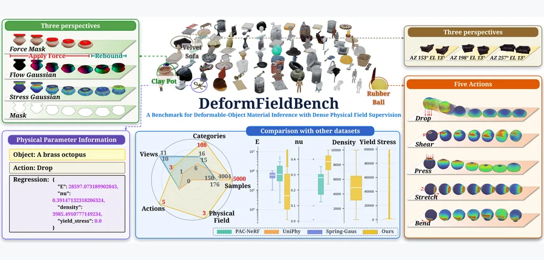 arXiv 2026-10-15 · cs.CV · #1 **[Physical-Field-Bridged Material Parameter Inference from Multi-View Deformation Videos](https://arxiv.org/abs/2610.17591)** Linrui Shou, Jie Li, Yu Liu, Tao Huang 机构：Shanghai Jiao Tong University / University of Science and Technology Beijing / Peking University（[PDF](https://arxiv.org/pdf/2610.17591)） [Paper](https://arxiv.org/abs/2610.17591) · [图源](https://arxiv.org/html/2610.17591v1/dataset.png) 

中文摘要
从视觉观测估计可直接用于仿真的材料参数，对可变形物体操作至关重要，但材料性质只能由物理响应间接显现，因此仍很困难。我们提出“物理场桥接”的单次前向材料推断框架，以稠密物理响应连接多视角 RGB 形变视频、材料本构类型分类和连续参数回归。与需要逐场景重建、在线调整或在优化循环中调用仿真的逆物理方法不同，本模型先预测力/接触掩码、投影运动流场与投影应力响应图，再以这些场作为材料推断条件，以减少对外观或物体类别捷径的依赖。我们构建 DeformFieldBench：一个 3DGS–MPM 学习环境，含 100 种物体形状、五种能揭示力学性质的加载方式下的 5,000 次仿真，并提供像素对齐的稠密物理监督。方法在四个连续参数上均取得最低的中位误差，把应力热点召回率从 0.0762 提升到 0.5121，并在未见物体的同一仿真器重放中达到 0.8676 SSIM / 36.82 dB PSNR。在协议匹配的 GSO 评测中，推断和未来状态预测约需 30 秒，而逐场景优化需 15–120 分钟；在五段真实视频上也取得可测量的重放一致性。结果支持稠密物理场可作为快速材料推断的有效桥梁，同时跨仿真器与真实世界测试也暴露出尚存的领域差异和参数可辨识性问题。 <a href="https://arxiv.org/abs/2610.17591">原摘要来源</a>
 | 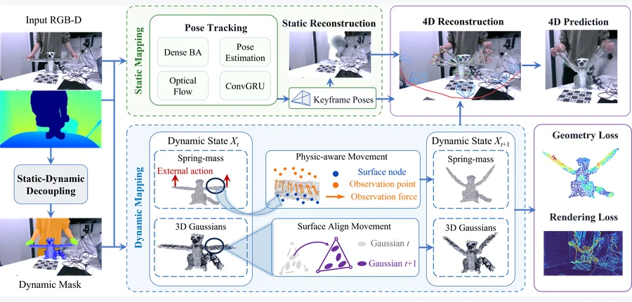 arXiv 2026-10-15 · cs.RO · #2 **[Physical SLAM: Physics-aware Simultaneous Localisation and Mapping](https://arxiv.org/abs/2610.17260)** Guangming Wang, Zhishuo Liu, Haibing Wu, Wanli Ma, Yixiong Jing, Olaf Wysocki, Brian Sheil 机构：University of Cambridge（[PDF](https://arxiv.org/pdf/2610.17260)） [Paper](https://arxiv.org/abs/2610.17260) · [图源](https://arxiv.org/html/2610.17260v1/figs/Picture2.png) 

中文摘要
为从移动相机拍摄的单目视频重建具有预测能力的物理世界 4D 表示，我们联合重建动态高斯辐射场并推断其底层物理动力学。本文提出 Physical SLAM：给定一段 RGB-D 图像，构建可变形物体的 4D 高斯场，并预测其受到外部动作后的未来状态。方法将场景分成用于相机定位的静态背景高斯场，以及由弹性形变、惯性和阻尼的弹簧—质量模型驱动的动态物体高斯场。为融合视觉观测与动力学，我们引入虚拟观测力，将仿真表面节点逐步拉向观测深度点，避免直接突变式替换节点位置；同时根据整个重建观测窗口汇总的仿真误差更新弹簧—质量模型参数，使动力学与观测一致。为耦合外观、几何与物理，方法沿形变物理表面变换动态高斯，并在基于渲染的优化中约束其与表面对齐。所得表示既支持已观测帧渲染，也支持动作条件仿真，使 SLAM 地图描述可变形物体受操作后的响应。在 PhysTwin 基准上，相较 PhysTwin 的重建与预测 PSNR 分别提高 10.4% 和 11.0%；在 TUM RGB-D 基准上，相较 4DGS-SLAM，平均相机跟踪误差降低 20.6%，SSIM 提高 3.6%，LPIPS 降低 8.3%。 <a href="https://arxiv.org/abs/2610.17260">原摘要来源</a>
 | 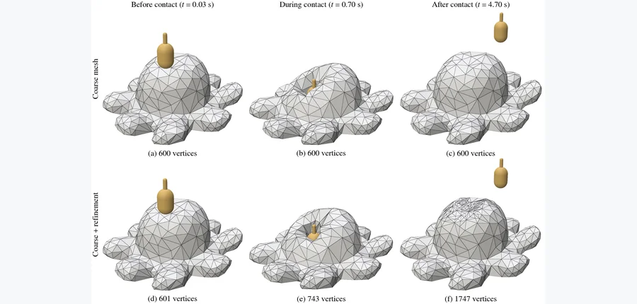 arXiv 2026-10-15 · cs.RO · #3 **[Refine Where It Matters: Contact-Adaptive Meshing for Deformable Object Manipulation](https://arxiv.org/abs/2610.14142)** Gabriel Johnson, Tom Olesch, Fei Liu 机构：University of Tennessee, Knoxville（[PDF](https://arxiv.org/pdf/2610.14142)） [Paper](https://arxiv.org/abs/2610.14142) · [图源](https://arxiv.org/html/2610.14142v1/figures/refinement_frames_octopus_ieee.png) 

中文摘要
可变形物体操作既需要准确刻画高度局部化的接触，也需要适合交互使用的仿真速度。均匀细化的四面体网格能够分辨这些相互作用，却在整个物体中引入不必要的自由度；粗网格效率更高，但可能无法分辨接触引起的形变。我们提出接触自适应网格细化框架，只在最有用的位置增加空间分辨率。方法利用可变形体求解器已有的几何、弹性和接触量对候选边评分，再以完全 GPU 并行的过程选出互不冲突的边集，并在仿真循环内直接更新网格拓扑和物理状态。我们在真实可变形物体操作序列上评估该方法。自适应细化降低仿真与真实之间的误差，提高与细网格参考结果的一致性，同时比全局均匀细网格仿真高效得多。结果表明，局部细化能在不承担全局细离散代价的情况下提高物理保真度，并为交互操作、sim-to-real 建模及在线物理数字孪生中的富接触仿真提供基础。 <a href="https://arxiv.org/abs/2610.14142">原摘要来源</a>
 |
| 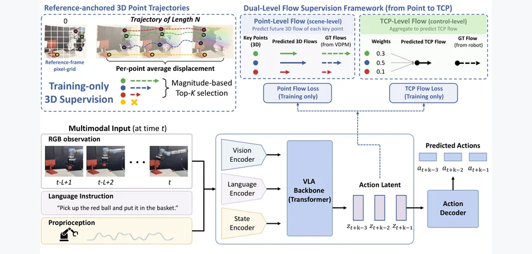 arXiv 2026-10-15 · cs.RO · #4 **[FlowVLA: Enabling World Dynamics Understanding through Pluggable 3D Flow Learning](https://arxiv.org/abs/2610.16160)** Junhyeong Go, Mingyu Jung, Woobin Im, Jongbin Ryu 机构：Ajou University / Samsung Electronics（[PDF](https://arxiv.org/pdf/2610.16160)） [Paper](https://arxiv.org/abs/2610.16160) · [Project](https://mmai-laboratory.github.io/flowvla/) · [图源](https://arxiv.org/html/2610.16160v1/3dflow_corl_overallframework.png) 

中文摘要
近期 3D 重建进展使人们能够从 RGB 观测中提取时间一致的三维运动，但现有视觉—语言—动作（VLA）模型仍主要依赖 2D 图文先验，因而不能准确表示与物理动作相关的三维世界基本动力学；对静态 2D 视觉线索的过度依赖限制了机器人操作的稳健性。我们提出 FlowVLA：一种由重建引导、可插拔的 3D 流学习框架，旨在让 VLA 学会与动作有关的动力学。它只在训练时使用时间对齐的 3D 流，无需显式 3D 传感器输入，也不改变推理阶段架构，从而保留常规 2D VLA 主干的计算效率。为连接场景动力学和操作，我们设计双层流监督：点级流引导模型预测任务关键 3D 点的未来位移，TCP 级流汇聚这些运动，使其与机器人工具中心点轨迹对齐。双层监督促使模型关注语义相关的动态区域，将场景运动与精确控制信号耦合。仿真和真实实验表明，FlowVLA 持续改善操作性能、零样本稳健性及数据效率。训练时仅增加轻量辅助头，并在推理时移除，因此不增加 3D 传感器输入、架构改动或推理计算。 <a href="https://arxiv.org/abs/2610.16160">原摘要来源</a>
 | 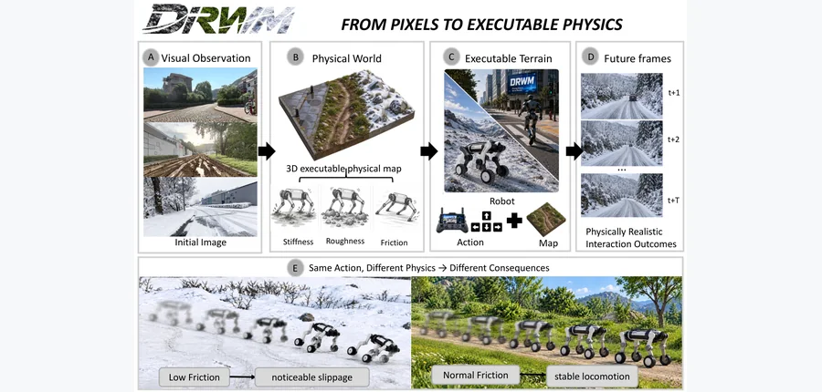 arXiv 2026-10-15 · cs.RO · #5 **[From Pixels to Executable Physics: Behavior-Grounded World Models for Embodied Action Consequence Prediction](https://arxiv.org/abs/2610.17630)** Ruo Chen, Jiahua Pang, Yingjie Niu, Hongyi Lin, Jun Tian, Yang Zhu, Chao Li 机构：DEEP Robotics / Zhejiang University / Beijing Institute of Technology / MIT / Tsinghua University / University of Illinois Urbana-Champaign（[PDF](https://arxiv.org/pdf/2610.17630)） [Paper](https://arxiv.org/abs/2610.17630) · [Project](https://developer.deeprobotics.cn/research/articles/dr-wm/index.html) · [图源](https://arxiv.org/html/2610.17630v1/x1.png) 

中文摘要
在室外环境中，地形和接触条件变化会让四足机器人执行相同动作指令时得到不同运动结果。预测这些结果对可靠导航和路径选择至关重要。现有视频世界模型虽能生成视觉可信的未来，却常难刻画机器人动力学与地形交互，因而过度乐观地预测动作结果。我们提出 DR-WM，一种纳入机器人—地形接触动力学的物理一致世界模型。方法从初始 RGB 图像重建场景几何，并融合由真实动作—响应数据校准的稠密、无量纲地形接触属性先验；所得地形模型可仿真摩擦等空间变化的接触属性。给定机器人初始状态和候选动作序列，我们仿真其未来运动，并用生成的相机轨迹与渲染几何指导视频世界模型训练。生成的未来观测又用于更新地形重建，使模型无需额外真实图像即可迭代展开。大量实验显示，DR-WM 在刻画动作结果的关键物理指标上明显优于仅用几何或统一物理参数的基线，并在被评基线中取得最佳表现。这种有物理依据的预测支持更知情的动作选择：在 90 个困难场景中，加入 DR-WM 的 8B 视觉语言模型在六项指标中的五项优于未获得辅助的 32B 模型。 <a href="https://arxiv.org/abs/2610.17630">原摘要来源</a>
 | 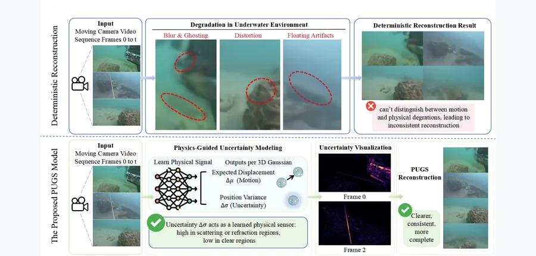 arXiv 2026-10-15 · cs.CV · #6 **[PUGS: Physics-Guided Uncertainty Modeling for Underwater Dynamic 3D Gaussian Splatting](https://arxiv.org/abs/2610.17936)** Tingjun Li, Yuxi Wang, Guoqiang Zhong, Zhaoxiang Zhang 机构：Ocean University of China / Chinese Academy of Sciences / University of Chinese Academy of Sciences（[HTML](https://arxiv.org/html/2610.17936)） [Paper](https://arxiv.org/abs/2610.17936) · [图源](https://arxiv.org/html/2610.17936v1/first.png) 

中文摘要
动态 3D Gaussian Splatting（3DGS）提供了高效的动态场景重建框架。多数现有方法用确定性形变场建模场景动力学，假设每个高斯随时间遵循一条明确的几何轨迹；但在水下，光散射、折射、海雪和低能见度会给采集图像带来显著的物理歧义，因而这一假设失效。我们提出 PUGS，用于水下动态 3DGS 的物理引导不确定性模型。PUGS 学习由水下成像过程引发的固有不确定性，并把它作为动态场景建模的物理信号；它不估计单一确定位移，而将每个高斯的运动参数化为包含期望形变和物理不确定性的概率分布。我们通过局部重参数化采样高斯轨迹并进行随机形变优化，在训练中探索多种物理上合理的解；随后用不确定性随机退火及双路径自一致蒸馏目标，将随机探索转成保持时间一致性的确定性重建。水下动态数据集和物理感知基准上的大量实验显示，更好的渲染质量、时间一致性和重建稳健性；相对最强基线，UVEB 的 PSNR 提高 1.16 dB，DRUVA 提高 3.99 dB。 <a href="https://arxiv.org/abs/2610.17936">原摘要来源</a>
 |
| 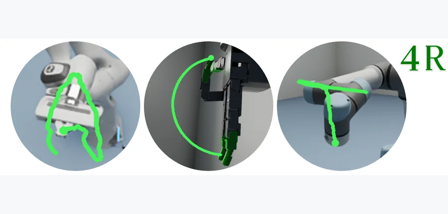 arXiv 2026-10-15 · cs.RO · #7 **[Act4R: Action-conditioned 4D reconstruction for kinematics-free control](https://arxiv.org/abs/2610.17462)** Zhaoliang Zhang, Chenhao Yu, Zhimin Shao, Xijun Liu, Cheng Peng 机构：Johns Hopkins University / University of Virginia（[HTML](https://arxiv.org/html/2610.17462)） [Paper](https://arxiv.org/abs/2610.17462) · [图源](https://arxiv.org/html/2610.17462v1/figures/ACT4R.png) 

中文摘要
跨不同机器人形态精确控制运动一直是难题；建模复杂结构需要大量时间、专用传感器和人工标注。近期 4D 表示学习带来另一种可能：能否从 2D 观测提升的 4D 特征出发，依据动作信号稠密映射机器人空间运动？我们提出 Act4R，建立在 3D 基础模型之上，对任意给定动作预测机器人 3D 场景流。其 Spatial-Action Encoder 将当前 2D 机器人状态与动作信号编码为代表未来 3D 状态的嵌入；再把当前和未来空间嵌入解码为点图，以估计动作条件场景流。为了学习动作与未来状态的映射，Act4R 在 Transformer 编码器中融合空间与动作信息，并以空间对齐损失引导未来流预测。在某种机器人形态的少量样本上训练后，Act4R 可通过优化动作信号来实现目标场景流的逆向控制。我们在公开真实数据集及仿真合成数据上评估；多个机器人平台的实验显示，Act4R 的场景流预测优于此前最佳方法，逆向控制在动作精度指标及仿真闭环控制中也更好。 <a href="https://arxiv.org/abs/2610.17462">原摘要来源</a>
 | 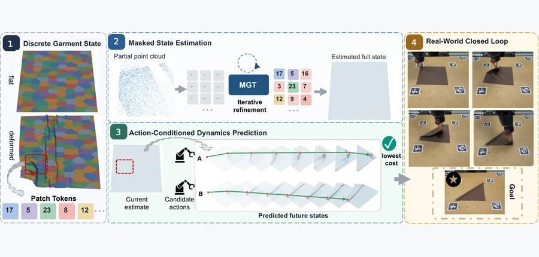 arXiv 2026-10-15 · cs.RO · #8 **[ClothCode: Generative Modeling for Garment State Estimation and Dynamics Prediction](https://arxiv.org/abs/2610.14200)** Yingdong Ru, Lipeng Zhuang, Shiyu Fan, Zhuo He, Florent P. Audonnet, Gerardo Aragon Camarasa 机构：University of Glasgow（[HTML](https://arxiv.org/html/2610.14200)） [Paper](https://arxiv.org/abs/2610.14200) · [图源](https://arxiv.org/html/2610.14200v1/main_david1.png) 

中文摘要
我们提出 ClothCode：在共享的离散构型空间中统一进行服装状态估计和动作条件动力学预测的生成框架。与材料对齐的 tokenizer 把服装构型编码为残差向量量化的 patch token，任务专用 Masked Generative Transformer 再通过并行、由置信度引导的细化预测这些 token。在三种服装模板上，相对最强基线，ClothCode 的状态估计平均位移误差降低 26.6%，动力学预测误差降低 37.0%。每个窗口的动力学预测只需 16.7 ms，而扩散方法需 556.2 ms。集成进同一模型预测控制器后，真实世界折叠和铺平成功率从 56.7% 提升至 78.9%。更多结果和视频见论文链接。 <a href="https://arxiv.org/abs/2610.14200">原摘要来源</a>
 | 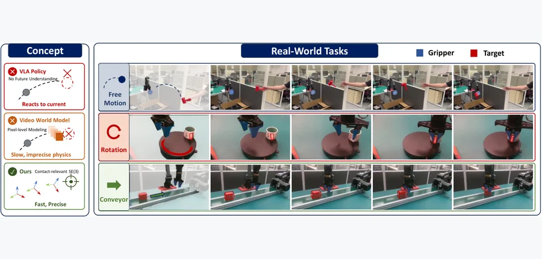 arXiv 2026-10-15 · cs.RO · #9 **[Physics-Aware Object-Centric SE(3) Forecasting for Real-Time Proactive Dynamic Grasping](https://arxiv.org/abs/2610.17843)** Yirui Zhou, Hongli Xu, Ying Zheng, Yi Wang, Lap-Pui Chau 机构：Hong Kong Polytechnic University / Technical University of Munich（[PDF](https://arxiv.org/pdf/2610.17843)） [Paper](https://arxiv.org/abs/2610.17843) · [图源](https://arxiv.org/html/2610.17843v1/teaser.png) 

中文摘要
主动抓取运动物体需要机器人预测物理接触发生时的未来状态，而非只对当前观测姿态作反应。但应预测哪一种未来、采用何种抽象层级？我们认为，SE(3) 中与接触有关的刚体状态是紧凑且足以完成任务的抽象：它直接决定何时何处建立接触，无需生成视觉完整的未来场景。由此，我们提出轻量的“先预测后选择”物体中心框架：根据短时姿态历史预测未来刚体轨迹，再以考虑可达性的拦截选择器，在运动学和时间约束下选择可行接触状态。预测器通过基元形状上的随机物理仿真训练；只要恢复真实物体的度量几何和 SE(3) 状态历史，就能迁移到真实物体。仿真和真实动态抓取实验中，平均成功率分别由 24.5% 提升到 62.0%、由 15.3% 提升到 67.3%，后者涵盖接球、传送带和转盘拦截。SE(3) 预测器运行只需 15 ms，比稠密视觉未来预测快数个数量级，支持实时接触决策。结果表明，主动抓取不必想象完整未来场景；预测决定接触的紧凑物理未来是有效且实用的抽象。 <a href="https://arxiv.org/abs/2610.17843">原摘要来源</a>
 |
| 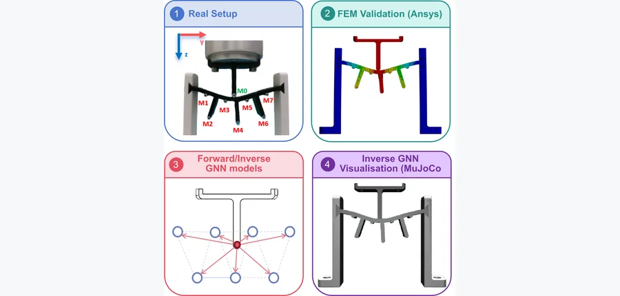 arXiv 2026-10-15 · cs.RO · #10 **[FEM-Validated Real-Time Modelling of Soft Tactile Deformation](https://arxiv.org/abs/2610.16667)** Silvia Terrile, Kaichen Shi, Taejun Kwon, Jiseok Lee, Nathan Lepora, Yeejin Lee, Saekwang Nam, Efi Psomopoulou 机构：University of Bristol / Kyungpook National University / Seoul National University of Science and Technology（[PDF](https://arxiv.org/pdf/2610.16667)） [Paper](https://arxiv.org/abs/2610.16667) · [图源](https://arxiv.org/html/2610.16667v1/Fig_1.jpg) 

中文摘要
准确建模软触觉传感器仍很困难：有限元方法（FEM）计算昂贵，而实时仿真器通常不足以忠实描述超弹性形变；重复物理测试还可能损坏脆弱传感器，使大规模真实数据难以采集。我们提出数据高效框架，结合有限真实验证、高保真 FEM 和图神经网络（GNN），实时预测平面软触觉结构的二维形变。关键是将验证与训练分开：82 种相机跟踪的接触构型只用于调校和验证 ANSYS FEM 模型，后者再生成 768 个合成接触场景用于 GNN 训练。我们评估从标记点形变到接触位置的正向预测，以及从接触构型到标记点形变的逆向推断。验证过的 FEM 在超过 90% 的验证案例中误差低于 0.5 mm；学习的 GNN 替代模型平均绝对误差为 0.32 mm，推理耗时毫秒级，FEM 则需分钟级。完全由合成 FEM 数据训练的模型，在该二维触觉结构的真实测量上仍保持亚毫米精度，显示所测平面设置内较强的 sim-to-real 迁移。我们还将模型接入实时可视化流程，以在无需大量实物测试的情况下快速预测形变，服务虚拟原型和仿真设计探索。 <a href="https://arxiv.org/abs/2610.16667">原摘要来源</a>
 | 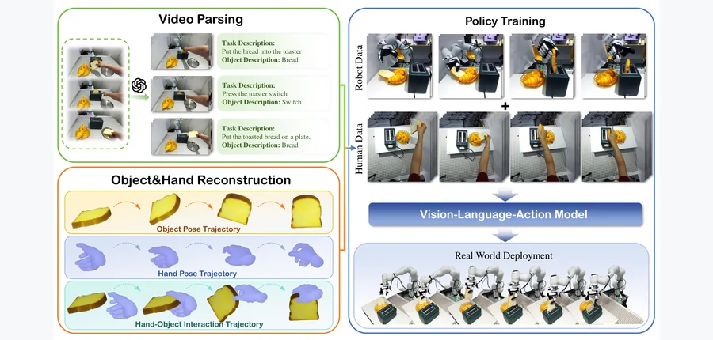 arXiv 2026-10-15 · cs.RO · #11 **[Hand2Robot: Object-Centric 4D Hand Reconstruction from Human Demonstrations for Robotics](https://arxiv.org/abs/2610.15769)** Zetao Du, Weiqing Wang, Hanbing Zhang, Yimiao Zhou, Ye Shi, Liang Wang, Jingya Wang 机构：ShanghaiTech University / InstAdapt / Chinese Academy of Sciences（[PDF](https://arxiv.org/pdf/2610.15769)） [Paper](https://arxiv.org/abs/2610.15769) · [图源](https://arxiv.org/html/2610.15769v1/teaser.png) 

中文摘要
人类示范能在不用目标机器人的情况下记录与任务相关的操作，但所录手部运动不能直接作为机器人动作监督。手部重建和运动重定向提供了一条路径，不过单独恢复手部运动并不能保证手—物交互在物理上自洽。我们提出 Hand2Robot，一种面向机器人策略后训练、以物体为中心的 4D 手部重建框架。给定人执行目标任务的视频，方法提取交互片段、重建物体几何，并通过手—物交互优化与运动重定向产生机器人动作监督。对于物体跟踪，它结合观测置信度和时间运动约束，从逐帧候选姿态中选出全局一致的物体姿态轨迹；对于手部细化，它以物体几何与运动为参考，结合分阶段 2D 对齐及物体局部接触约束，优化手部轨迹与手指关节构型。在 DexYCB 和 HO3D-v3 上，方法提高了物体姿态精度和手—物交互质量；在三个真实机器人灵巧操作任务中，实验进一步表明，重建并重定向的人类示范可有效补充有限的机器人数据，用于目标任务策略后训练。 <a href="https://arxiv.org/abs/2610.15769">原摘要来源</a>
 | 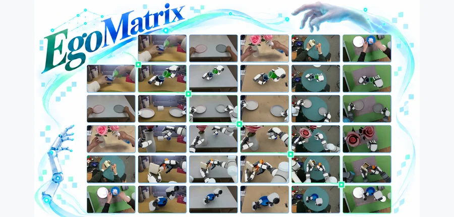 arXiv 2026-10-15 · cs.RO · #12 **[EgoMatrix: Physically Faithful Dexterous Robot Demonstrations from Egocentric Human Videos](https://arxiv.org/abs/2610.18822)** Ziheng Wang, Yanming Shao, Ting Mao, Kaihan Chen, Yiqun Wang, Xuanye Wu, Yao Mu 机构：Shanghai Jiao Tong University / University of Hong Kong / Zhejiang University / Shanghai AI Laboratory（[HTML](https://arxiv.org/html/2610.18822)） [Paper](https://arxiv.org/abs/2610.18822) · [图源](https://arxiv.org/html/2610.18822v1/figs/teaser_final.jpg) 

中文摘要
第一视角人类视频可作为机器人遥操作之外可扩展的灵巧操作数据来源，但单目 RGB 的准确手—物交互（HOI）重建，以及高质量机器人示范、尤其视觉观测的生成，仍是两大障碍。我们提出 EgoMatrix，一条端到端数据管线，将单目第一视角人类视频转换为双手灵巧轨迹和配对的机器人观测视频，且轨迹能直接在真实机器人上重放。它重建 HOI 时强调相对几何和接触，而非精确的度量场景恢复，再通过重定向和强化学习在仿真中重现任务。方法根据这些仿真轨迹联合渲染机器人手和物体，得到与状态、控制记录同步的物理可信观测；同一轨迹还可在多样、与任务相容的背景中渲染，以在保持机器人—物体运动和接触的同时扩充配对训练数据。在 TACO、OakInk2 和自采数据上，EgoMatrix 的仿真端到端成功率为 54.84%，最强基线为 14.52%；在两个公开基准的大多数重建指标上取得当时最佳表现。定性结果显示手—物交互比先前方法更忠实，特征空间分析显示其观测比 GPT-6 Astra 生成的结果更接近真实机器人观测。项目页见论文。 <a href="https://arxiv.org/abs/2610.18822">原摘要来源</a>
 |
| 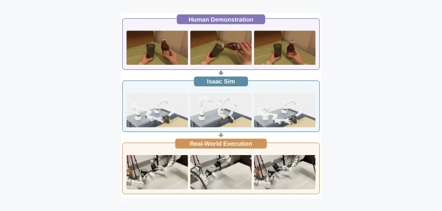 arXiv 2026-10-15 · cs.RO · #13 **[EgoCPT: Learning Dexterous Manipulation from a Single Ego-Centric Video with Contact-Aware Optimization](https://arxiv.org/abs/2610.17572)** Zhixin Sun, Kairui Shi, Tianao Ren, Ming Yang, Mark Cutkosky, James Jingxi Xu 机构：Ant Group / University at Buffalo / Stanford University（[PDF](https://arxiv.org/pdf/2610.17572)） [Paper](https://arxiv.org/abs/2610.17572) · [Project](https://ego-cpt.github.io/) · [图源](https://arxiv.org/html/2610.17572v1/teaser.png) 

中文摘要
真实机器人的专家示范难以收集，而人类第一视角视频容易采集且网络上大量存在。不过，从人类视频学习灵巧操作策略仍很困难，重要障碍之一是形态差异巨大，难以重建具有物理依据的机器人轨迹。本文提出 EgoCPT，一种直接从单段第一视角视频学习高质量重定向灵巧手轨迹的新范式，所得轨迹随后可直接部署于真实机器人。方法仅需第一视角 RGB 视频和参考手部姿态轨迹；后者可由现成软件或录制时的专用相机获取。其新的接触感知优化框架反复优化机器人手与物体之间的接触点，因此对噪声手姿态尤其稳健。在五项操作任务中，面对带噪声的 EgoDex 手姿态重建，方法总体成功率达 67.3%；面对用动作捕捉硬件采集的高质量 TACO 重建，达 92.0%；两个基准上均优于多种基线。 <a href="https://arxiv.org/abs/2610.17572">原摘要来源</a>
 | 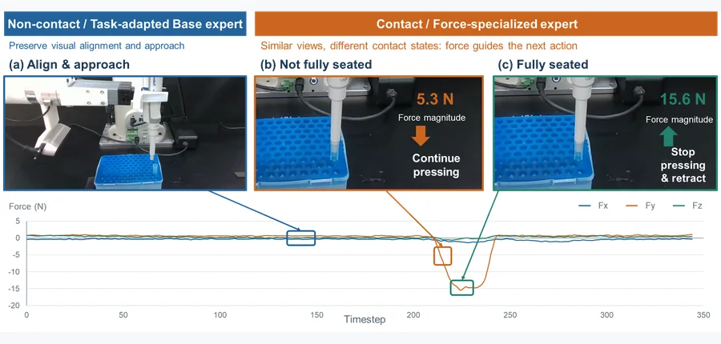 arXiv 2026-10-15 · cs.RO · #14 **[DEFT-VLA: Stage-Localized Force Specialization for Contact-Rich Robotic Manipulation](https://arxiv.org/abs/2610.14854)** Zan Huang, Yibo Qiu, Kan Ding, Xuanping Zhang, Ao Tian, Ronald X Xu, Mingzhai Sun 机构：University of Science and Technology of China / Xi’an Jiaotong-Liverpool University（[PDF](https://arxiv.org/pdf/2610.14854)） [Paper](https://arxiv.org/abs/2610.14854) · [图源](https://arxiv.org/html/2610.14854v1/figures/deft_vla_overview.png) 

中文摘要
富接触操作存在随阶段变化的感知冲突：定位和接近阶段需要视觉与本体感觉，力信号大多无信息且可能干扰；接触后力信号变得关键，而无关视觉细节和相关的机器人状态可能成为捷径。我们提出 DEFT-VLA（面向视觉—语言—动作操作的双专家力专门化训练）：保留任务适配的基础专家负责视觉主导的非接触行为，并为关键接触阶段引入感知力的接触专家，将力条件适配限制在需要它的位置。我们还提出接触局部化的力注意课程，仅对接触专家进行力注意后训练，逐步恢复视觉并掩蔽状态 token，以抑制捷径。真实机器人上的移液枪枪头安装、双手移液吸取和擦白板实验表明，DEFT-VLA 能利用力反馈提高接触阶段表现，同时保持较强的非接触行为和对未见抓取高度的稳健性。相对每个任务的最强基线，总体任务成功率提高 20–40 个百分点。 <a href="https://arxiv.org/abs/2610.14854">原摘要来源</a>
 | 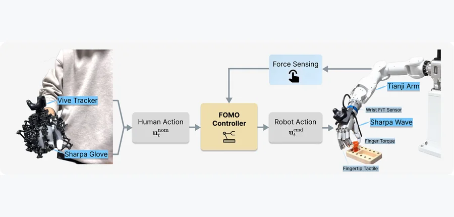 arXiv 2026-10-15 · cs.RO · #15 **[Force-Modulated Dexterity: Unified Compliance for Contact-Rich Manipulation](https://arxiv.org/abs/2610.17161)** Ying Yuan, David Held, Jitendra Malik, Haozhi Qi 机构：Amazon FAR / Carnegie Mellon University（[PDF](https://arxiv.org/pdf/2610.17161)） [Paper](https://arxiv.org/abs/2610.17161) · [Project](https://yingyuan0414.github.io/fomo-dex/) · [图源](https://arxiv.org/html/2610.17161v1/system-setup-fixed.png) 

中文摘要
遥操作常用于收集高质量机器人学习示范，但灵巧操作需要协调运动与接触力。操作者可以指定运动，却难以在没有感知机器人接触的情况下复现人类操作中的细微力调整。我们提出 Force-Modulated Dexterity（FOMO-Dex），一种统一的富接触操作柔顺性表述。它在由任务几何和接触结构定义的坐标系中表示名义动作，沿选定方向施加由力驱动的运动修正，其余指令分量保持不变。在取卡片、剪纸、拧螺丝和螺母—螺栓装配任务中，FOMO-Dex 相较刚性控制减少过量接触力。用户研究显示，短暂练习后操作者每小时可收集更多成功示范。对于策略学习，模仿修正后的动作比模仿原始操作者指令更能提高取卡片成功率；用 FOMO-Dex 示范训练的策略，在螺母—螺栓操作和拧螺丝中也比用刚性控制器示范训练的策略实现更多旋转。视频见论文。 <a href="https://arxiv.org/abs/2610.17161">原摘要来源</a>
 |
| 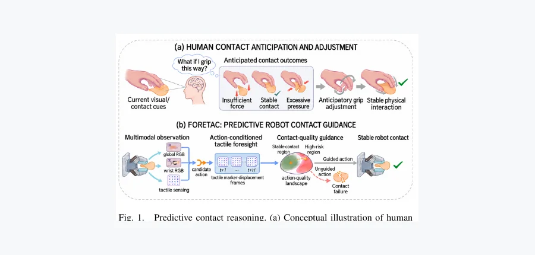 arXiv 2026-10-15 · cs.RO · #16 **[ForeTac: Predictive Contact Guidance for Generative Robot Policies](https://arxiv.org/abs/2610.18118)** Zhiyuan Chen, Shuai Chen, Haoran Zhou, Yizhe Zhao, Kaiyuan Yang, Zhixiang Duan, Shaoqing Xu, Ran Cao, Diyun Xiang, Yangwei… 机构：affiliation 未确认 [Paper](https://arxiv.org/abs/2610.18118) · [Project](https://foretac.github.io/) · [图源](https://arxiv.org/pdf/2610.18118) 

中文摘要
视觉上相似的动作可能造成接触丢失、卡滞、滑移或不可逆损坏，而触觉反馈可能在关键状态转变之后才到来。因此，富接触操作需要生成式策略预先评估候选动作能否产生理想接触结果，并在执行前调整动作生成。我们提出 ForeTac，一种按“表示—预测—评估—引导”循环组织的预测式接触引导框架。ForeTac 编码当前触觉状态，预测候选动作序列的触觉后果，并用从成功与失败的物理交互中学到的接触质量目标评估预测轨迹。部署时，目标函数梯度穿过触觉预测器，引导动作生成，而预训练模型参数保持冻结。我们用扩散及流匹配策略，在四项真实机器人任务上评估：平面与曲面擦拭、刷卡和易碎物抓取。与纯视觉 Diffusion Policy 相比，平均任务成功率由 36.3% 提高到 71.3%，平均接触成功率（CSR）由 20.0% 提高到 66.3%。组件分析支持触觉表示和动作条件预见性的作用，也表明预测触觉保留了接触质量的排序。项目页见论文。 <a href="https://arxiv.org/abs/2610.18118">原摘要来源</a>
 | 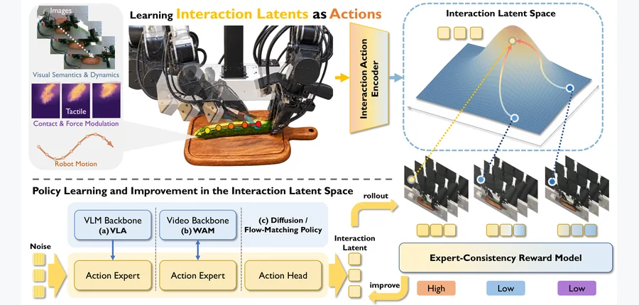 arXiv 2026-10-15 · cs.RO · #17 **[Interaction Latents as Actions for Contact-Rich Manipulation](https://arxiv.org/abs/2610.18855)** Yuhang Zheng, Yujie Zang, Yuchen Liu, Yupeng Zheng, Zhennan Jiang, Zebin Xing, Shuai Tian, Songen Gu, Jingxiang Guo, Chen… 机构：National University of Singapore / Anyverse Robotics / Beijing Institute of Technology / University of Chinese Academy of Sciences / Fudan University（[PDF](https://arxiv.org/pdf/2610.18855)） [Paper](https://arxiv.org/abs/2610.18855) · [图源](https://arxiv.org/html/2610.18855v2/teaser.png) 

中文摘要
富接触操作不仅要协调机器人向哪里移动，还要协调交互过程中的接触和施力如何变化。但多数策略主要用运动轨迹表示动作，把触觉作为输入或辅助预测目标，未在动作表示中明确编码接触动力学。我们提出 ILA（Interaction Latents as Actions），把运动、接触和施力的联合演变编码为可解码的交互潜变量，作为策略动作单元，并为动作生成、评估和离线改进提供共享表示。方法通过视觉条件的动作—触觉联合重建及时间条件隐式解码器学习潜变量；以其作为流匹配生成目标，可对预训练 VLA 和世界动作模型（WAM）后训练，也可从零训练流匹配策略，最后由共享解码器还原可执行动作。为了离线改进，我们从专家示范编码的交互潜变量学习触觉条件专家参考模型：专家一致性奖励指导从成功展开中加权学习，与观测相容的专家参考则用于修正失败展开中的低奖励预测。在三类策略、四项真实任务中，相比以触觉为条件的直接动作基线，ILA 的平均成功率高出 21.0–36.5 个百分点。消融支持将接触演变纳入动作目标的额外收益，同一潜空间也支持专家引导的离线改进。项目页见论文。 <a href="https://arxiv.org/abs/2610.18855">原摘要来源</a>
 | 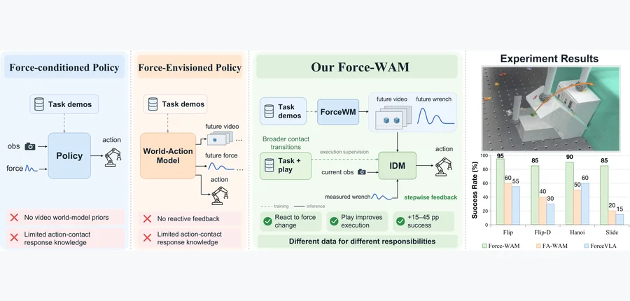 arXiv 2026-10-15 · cs.RO · #18 **[ForceWAM: Decoupling Future and Response Learning from Demo and Play Data for Contact-Rich Manipulation](https://arxiv.org/abs/2610.18852)** Zijun Xu, Wendi Chen, Xinkai Wang, Jiachen Zou, Hongjin Chen, Hairuo Liu, Bokai Lin, Shihao Ma, Ke Ma, Zhiwei Zhang, Zhuoh… 机构：Fudan University / Shanghai Jiao Tong University / Southeast University / Shanghai Innovation Institute / Southern University of Science and Technology / Noematrix（[PDF](https://arxiv.org/pdf/2610.18852)） [Paper](https://arxiv.org/abs/2610.18852) · [Project](https://force-wam.github.io/) · [图源](https://arxiv.org/html/2610.18852v1/Force_WAM.png) 

中文摘要
专家示范说明如何完成富接触任务，却较少覆盖不同动作会引起怎样的交互力响应；与任务无关的自由交互（play）则提供更广泛的接触动力学经验，却没有目标。为了结合两类数据，我们提出 ForceWAM，一种力感知世界动作模型，将与任务相容的交互结果知识和局部动作如何改变接触的知识分开学习。世界模型从成功示范中联合预测未来视频与六轴力/力矩轨迹，以描述任务期间运动和接触的预期演变；独立逆动力学模型（IDM）从任务数据与 play 数据中学习，将当前观测和记录的视觉—力矩未来映射为对应机器人动作。因此，play 数据为目标驱动的执行提供力响应知识。部署时，IDM 将生成的未来响应式转换为动作，并在世界模型更新间利用新的力/力矩反馈复用未来预测。在真实机器人的力调节滑动、受扰和无扰翻盒以及放环任务上，ForceWAM 平均成功率达到 85%–95%，超过世界模型与响应式基线；加入与任务无关的 play 数据又使成功率提高 15–45 个百分点，说明其有助于学习富接触执行。项目页与代码见论文。 <a href="https://arxiv.org/abs/2610.18852">原摘要来源</a>
 |
| 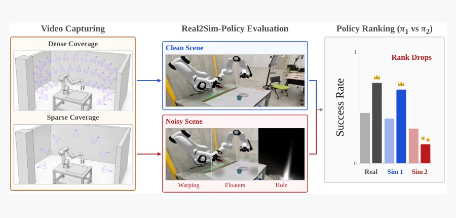 arXiv 2026-10-15 · cs.RO · #19 **[YUBI-Real2Sim: 3DGS Scene Verification for Reliable Policy Evaluation](https://arxiv.org/abs/2610.17521)** Hiroki Nishizawa, Takehiko Ohkawa, Nicola Scianca, Tatsuya Matsushima, Shigeo Morishima, Kei Ota 机构：AI Robot Association (AIRoA) / Waseda University（[PDF](https://arxiv.org/pdf/2610.17521)） [Paper](https://arxiv.org/abs/2610.17521) · [图源](https://arxiv.org/html/2610.17521v1/teaser.png) 

中文摘要
真实机器人上的 VLA 策略评估昂贵、耗时且难复现，因此真实到仿真的场景构建对规模化评估很重要。3D Gaussian Splatting（3DGS）虽能快速生成仿真场景，但可靠评估策略所需的重建质量仍未量化。依赖腕部鱼眼相机的策略尤其容易在广角视野中受到空洞、浮点等视觉伪影干扰，直接损害任务表现。我们提出 YUBI-Real2Sim，在双腕鱼眼视角下统一进行基于 3DGS 的场景重建和真实到仿真策略评估。流程结合 200 度鱼眼相机采集、3DGS 训练、用于物体建模的 3D 基础模型及 MuJoCo 物理仿真；在九组场景—任务比较中，有八组复现了真实世界策略排序。基于该流程，我们构建涵盖两个双手机器人平台、三个场景、三个任务及两种基于 π0.5 的策略的基准，系统测量 real-to-sim 排序一致性，并评估策略对反事实 3DGS 伪影（天花板空洞、浮点、扭曲）及采集干扰的敏感性。我们还在留出场景的协议下分析新视角质量分数能否预示策略排序可靠性。结果显示质量预测可靠性随任务而异且存在局限，凸显 real-to-sim 评估须检验重建质量；这些结果尚未确立普适可靠的场景验收规则。项目页见论文。 <a href="https://arxiv.org/abs/2610.17521">原摘要来源</a>
 | 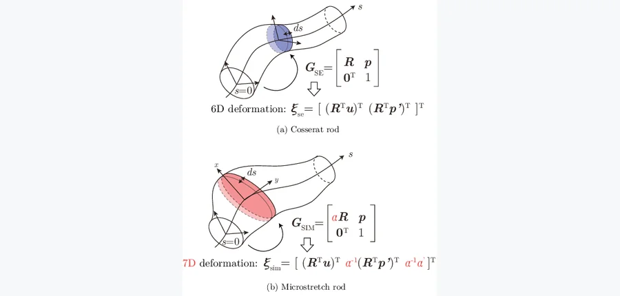 arXiv 2026-10-15 · cs.RO · #20 **[PC7 Model: Dynamics of Expanding and Contracting Soft Robots using Piece-wise Constant 7D Deformation Based on Similarity Transformation Group](https://arxiv.org/abs/2610.14586)** Yamato Kudo, Taiki Ishigaki, Ko Ayusawa, Ko Yamamoto 机构：affiliation 未确认 [Paper](https://arxiv.org/abs/2610.14586) · [图源](https://arxiv.org/html/2610.14586v1/cosserat_microstretch_rods.png) 

中文摘要
本文提出软体机器人模型 PC7（分段常数七维形变），可表示人工肌肉执行器等结构的伸长和收缩形变。方法在 3D 相似变换群 SIM(3) 上重新定义七维形变向量；先前基于特殊欧氏群 SE(3) 的 Cosserat 杆分段常数应变（PCS）模型使用六维向量。新增的一维来自 SIM(3) 的尺度参数，用来表示伸缩形变。SE(3) 与 SIM(3) 的共同数学性质，使 PCS 模型的运动学和动力学可直接扩展至 PC7。特别地，我们基于 Euler–Poincaré 方程，以数学上精确的方式推导 PC7 动力学方程。最后通过假设细圆柱结构或 McKibben 型人工肌肉执行器的动力学仿真验证该模型。 <a href="https://arxiv.org/abs/2610.14586">原摘要来源</a>
 | 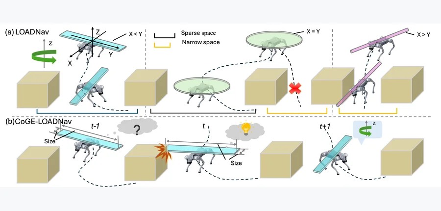 arXiv 2026-10-15 · cs.RO · #21 **[Load-Aware Quadruped Navigation with Online Contact-based Geometry Estimation](https://arxiv.org/abs/2610.14596)** Qi Yin, XiaoLi Zhang, Yangming Shi 机构：Colorado School of Mines（[PDF](https://arxiv.org/pdf/2610.14596)） [Paper](https://arxiv.org/abs/2610.14596) · [Project](https://qiii04.github.io/LOADNav/) · [图源](https://arxiv.org/html/2610.14596v1/fig/lead_xy.png) 

中文摘要
四足机器人携带物体穿越拥挤环境仍很困难。与侧重负载感知步态适配、维持行走稳定性的工作相比，现有自主导航系统通常忽略所携物体的几何，使用固定的足迹膨胀，因此过于保守。为弥补这一缺口，我们提出两阶段负载感知导航学习框架。第一阶段以强化学习训练 LOADNav，使机器人根据所携物体的几何尺寸调整路线和通行间隙；第二阶段以模仿学习训练在线几何预测器 CoGE，使其由偶发接触事件估计未知负载的几何。我们在携带不同大小和形状负载的拥挤环境中评估。结果显示，导航策略表现出明显的负载感知行为，在线预测器也能由偶发接触逐步修正物体几何估计，并据此调整导航。即便事先不知道负载信息，该方法仍缩小了与直接掌握几何的策略之间的差距。 <a href="https://arxiv.org/abs/2610.14596">原摘要来源</a>
 |
| 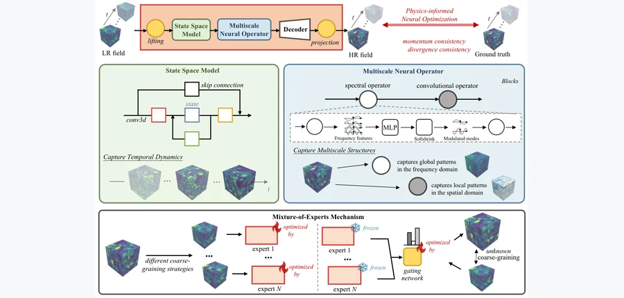 arXiv 2026-10-15 · physics.flu-dyn · #22 **[High-fidelity Three-Dimensional Flow Field Reconstruction Driven by Turbulent Fluid Dynamics](https://arxiv.org/abs/2610.18045)** Hanlin Kong, Jianan Wei, Yuntian Chen, Yujia Wang, Wenguan Wang 机构：Zhejiang University / Shanghai Innovation Institute / Eastern Institute of Technology Ningbo / Zhejiang Sci-Tech University（[PDF](https://arxiv.org/pdf/2610.18045)） [Paper](https://arxiv.org/abs/2610.18045) · [图源](https://arxiv.org/html/2610.18045v1/method__.png) 

中文摘要
高保真三维湍流流场对科学和工程分析十分重要，但直接数值仿真或高分辨率测量都很昂贵。因此，从粗粒度数据进行超分辨率重建是一条有前景的路径；不过，精细尺度结构本质上是三维的，并跨尺度动态耦合，使问题仍然困难。现有数据驱动方法也难同时恢复多尺度体积结构及其连贯的时间演变。我们提出面向时间分辨三维流场重建的湍流感知框架：用多尺度神经算子恢复体积结构，并与状态空间模型耦合，以促进重建动力学的时间一致性；同时将 Navier–Stokes 残差作为软约束，使重建趋向物理上合理的动力学；还引入混合专家机制，以无监督方式适配未知粗粒化过程。在典型湍流系统和大气再分析数据的评估中，相对学习式及经典基线，方法降低了重建误差，更好地保留多尺度空间结构和连贯时间演变。结果支持该框架从粗粒度数据恢复高保真三维流场的有效性。 <a href="https://arxiv.org/abs/2610.18045">原摘要来源</a>
 | 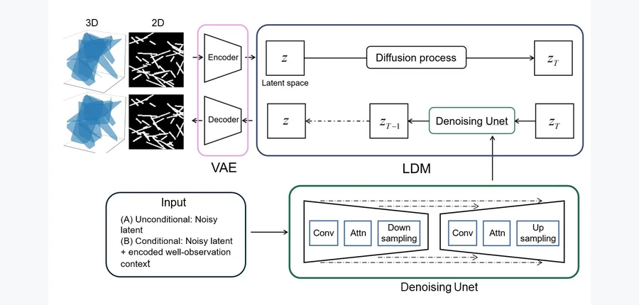 arXiv 2026-10-15 · physics.geo-ph · #23 **[Latent Diffusion Modeling of Two- and Three-dimensional Fracture Networks with Sparse Observation Conditioning](https://arxiv.org/abs/2610.14412)** Jiawei Shen, Hongkyu Yoon, Jonghyun Lee 机构：University of Hawaiʻi at Mānoa / Sandia National Laboratories（[PDF](https://arxiv.org/pdf/2610.14412)） [Paper](https://arxiv.org/abs/2610.14412) · [图源](https://arxiv.org/html/2610.14412v1/LDM_architecture.jpg) 

中文摘要
由于地下裂隙的几何和连通性只在少量测点被观测，远离测量位置时存在显著不确定性，因此刻画裂隙网络很困难。我们开发潜空间扩散框架，可无条件或以观测为条件生成二维（2D）与三维（3D）裂隙网络。方法把裂隙及周围基质表示为二值场，用变分自编码器压缩成紧凑的空间潜表示，再由 Elucidated Diffusion Model 学习其分布。3D 模型直接处理原生体素场，并设计重建目标以保留稀疏、细薄的裂隙结构；稀疏井孔观测则通过条件编码器、无分类器引导与扩散后验采样纳入。生成的样本集合复现了裂隙面积/体积分数、两点相关和弦长分布等关键统计量；在所考虑的多相流情景下，重建裂隙数量和气体产出响应与参考网络相当。二维条件生成满足 99.6% 的指定井观测；在垂直井孔约束整列体素的三维情形中，条件样本满足 84.2% 的观测井体素，同时保持与参考集合相当的裂隙体积和几何。结果显示潜空间扩散可作为裂隙网络表征、样本集合生成和稀疏观测条件化的紧凑概率方法。 <a href="https://arxiv.org/abs/2610.14412">原摘要来源</a>
 | 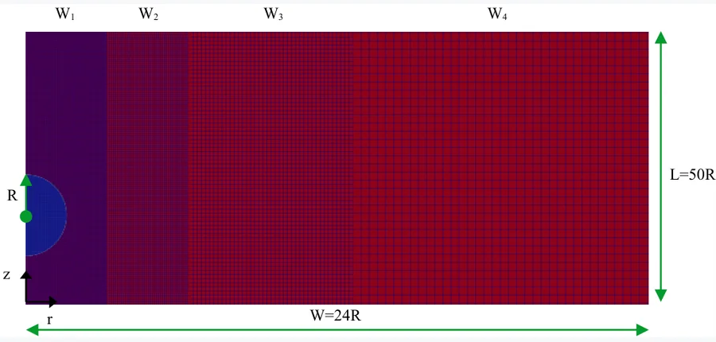 arXiv 2026-10-15 · physics.flu-dyn · #24 **[DeboRheo v2.0: Improved Robustness for Geometrical VOF Simulations of Viscoelastic Two-Phase Flows](https://arxiv.org/abs/2610.17082)** Daulet Izbassarov, Matthias Niethammer, Rahul Subburaj, Dieter Bothe, Francesco Romanò, Renjie Hao, Metin Muradoglu, Tomis… 机构：Finnish Meteorological Institute / Technical University of Darmstadt / University of Lille / Koç University（[PDF](https://arxiv.org/pdf/2610.17082)） [Paper](https://arxiv.org/abs/2610.17082) · [Code](https://gitlab.com/deborheo/deborheorelease/-/tree/v2.0.5) · [图源](https://arxiv.org/html/2610.17082v1/AxiMesh.png) 

中文摘要
我们提出 DeboRheo v2.0：在 OpenFOAM 中实现、用于黏弹性两相流的非结构、几何非分裂体积分数（Volume-of-Fluid）框架。第 2 版提高了在巨大黏度差与强烈形变界面、薄黏弹性液片或细丝同时出现时的数值稳健性。修订后的界面黏度处理保留尖锐的几何界面，同时对动量方程中的黏性贡献作正则化。求解器结合质量—动量一致的相输运、可选的 SIMPLEC 压力—速度耦合，以及带构象张量稳定化的模块化流变框架。我们使用由 Oldroyd-B 和指数型 Phan-Thien-Tanner 模型支配的二维、轴对称及三维基准评估方法。结果与已发表的数值和实验数据吻合，并显示在非结构网格上的高难度黏弹性自由表面配置中稳健性提高。 <a href="https://arxiv.org/abs/2610.17082">原摘要来源</a>
 |
| 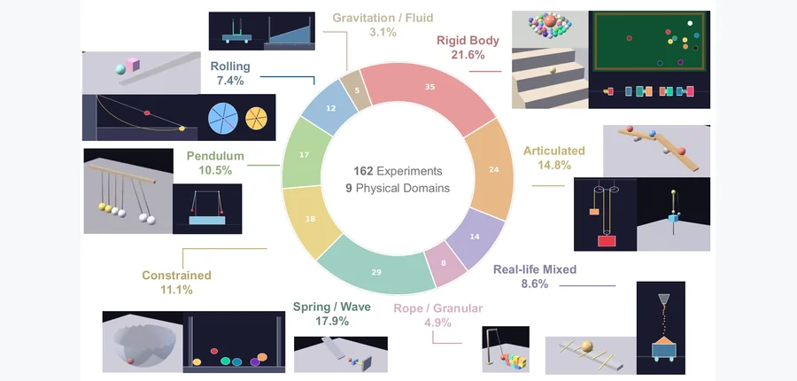 arXiv 2026-10-15 · cs.CV · #25 **[PhySimCode: A Benchmark and Evaluation Method for Physics Video to Code Generation](https://arxiv.org/abs/2610.15722)** Souraja Kundu, Aditya Gupta, Joel Julin, Yizhou Zhao, Liuyue Xie, Laszlo A. Jeni 机构：Carnegie Mellon University / Amazon AGI（[PDF](https://arxiv.org/pdf/2610.15722)） [Paper](https://arxiv.org/abs/2610.15722) · [Project](https://sourajakundu.github.io/PhySimCode/) · [图源](https://arxiv.org/html/2610.15722v1/pie_chart.png) 

中文摘要
多模态大语言模型（MLLM）擅长视频理解和代码生成，但能否恢复视频背后的物理规律仍不清楚；这一能力对于把视频转为可执行仿真、以及为机器人提供结构化物理监督至关重要。给运动视频写描述，并不意味着模型推断出支配动力学、估计出定量参数，或能用代码重现观测场景。已有视频物理基准测试合理性、属性估计或未来状态预测，却难揭示模型能否把视觉动力学转成可运行的仿真代码。我们提出 PhySimCode 视频到物理代码生成基准：只给原始视频，模型须推断相关物理、恢复参数值，并生成可重现输入视频的可运行 Python。数据集包含 160.6K 个程序生成样本，跨越 162 种物理现象，涵盖解析 SciPy 仿真以及 PyBullet 渲染的刚体、关节、流体和富接触场景；每个样本都含仿真代码、物理参数、渲染视频，以及覆盖观测、规律、常微分方程、数值方法和验证检查的结构化思维链。我们从物理规律正确性、仿真等价性、代码可执行性和参数恢复四方面评估十个最先进的闭源与开源 MLLM。模型通常能陈述物理规律（4.27–4.93/5），但从视频推断规律仅得 1.51–2.47/5；最好的 Claude Sonnet 4.6 也只有 7.7% 的真值参数落在 ±20% 误差内，暴露出显著的视频到仿真鸿沟。2,430 段视频的评估集及评估代码见论文链接。 <a href="https://arxiv.org/abs/2610.15722">原摘要来源</a>
 | 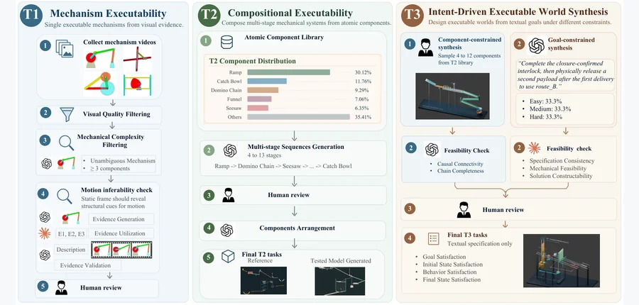 arXiv 2026-10-15 · cs.CV · #26 **[ExeWorldBench: Benchmarking Code-Based Executable 3D World Modeling](https://arxiv.org/abs/2610.15166)** Xinge Peng, Zhen Fang, Ruibing Wang, Yongxuan Lv, Haodong Li, Guohui Zhang, Xiaoxiao Ma, Yiting Lu, Lin Chen, Zehui Che, F… 机构：University of Science and Technology of China / Chinese University of Hong Kong（[PDF](https://arxiv.org/pdf/2610.15166)） [Paper](https://arxiv.org/abs/2610.15166) · [Project](https://helen1p.github.io/ExeWorldBench/) · [图源](https://arxiv.org/html/2610.15166v1/data.png) 

中文摘要
编码智能体正逐步从复现世界的外观，走向构建能体现世界运行机制的可执行世界。这要求把两种核心能力合在一起：世界理解，即推理世界底层的结构、力学和因果原理；以及可执行实现，即把这种理解转换为由物理交互涌现行为的代码系统。但现有基准往往分别评估物理推理、视觉保真度或行为正确性，尚未充分检验这些能力的整合。为弥补缺口，我们提出 ExeWorldBench；据我们所知，这是首个通过基于代码的 3D 世界构建，综合评估世界理解与可执行实现的基准。它有三项难度递增的任务：从视觉观测实现单个机制的“机制可执行性”；扩展到具有空间、力学和因果依赖的多阶段系统的“组合可执行性”；以及根据高层目标与物理要求构建可执行世界的“意图驱动世界合成”。对前沿模型的大量实验揭示了其可执行世界建模的显著局限，并为开发更有物理依据、因果更连贯的世界构建系统提供见解。 <a href="https://arxiv.org/abs/2610.15166">原摘要来源</a>
 | 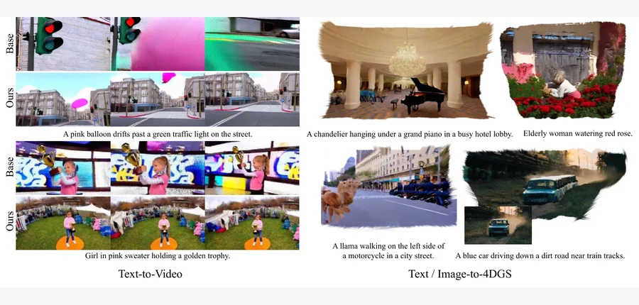 arXiv 2026-10-15 · cs.CV · #27 **[GeoFix: Geometry Fixing for 4D Consistent Generation](https://arxiv.org/abs/2610.14293)** Yeobin Hong, Hyojun Go, Dohun Lee, Jeongjae Lee, Sunghwan Hong, Federico Tombari, Zhaochong An, Jong Chul Ye, Konrad Schin… 机构：KAIST / ETH Zurich / Google / EPFL（[PDF](https://arxiv.org/pdf/2610.14293)） [Paper](https://arxiv.org/abs/2610.14293) · [Project](https://yeobinhong.github.io/GeoFix/) · [图源](https://arxiv.org/html/2610.14293v1/represent.png) 

中文摘要
视频扩散模型越来越常被用作 4D 生成的先验，但生成视频常缺乏几何一致性。近期方法通过后训练设计几何奖励来改善这一点，却可能损害纹理和细节，因此需要额外外观奖励及谨慎的奖励平衡。我们提出 GeoFix：仅用一个几何奖励，同时改善几何一致性和视觉质量的统一框架，既适用于训练，也适用于推理时的奖励对齐。奖励衡量静态场景区域跨视角的深度一致性，针对结构不一致，而不直接限制外观，也不惩罚合理的物体运动。关键在于，即使对真实视频和 4D 数据集，深度一致性也会随相机视野重叠增加；若不校正，较小的相机移动会被误判为较好的几何。我们依据重叠量相关趋势校准奖励。GeoFix 使 WorldScore 3D 一致性提高 39%，VBench Quality Score 提高 4%。 <a href="https://arxiv.org/abs/2610.14293">原摘要来源</a>
 |
| 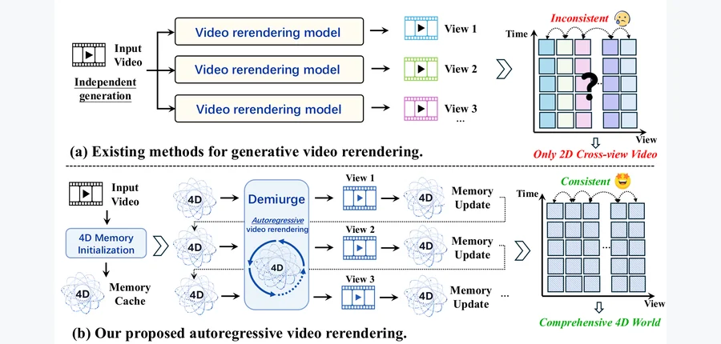 arXiv 2026-10-15 · cs.CV · #28 **[Demiurge: Forging Navigable 4D Worlds via Autoregressive Video Rerendering](https://arxiv.org/abs/2610.14685)** Hanxin Zhu, Jianqi Ma, Cong Wang, Zhihao Hu, Junyao Gao, Tianyu He, Junyan Lin, Jiayin Xiao, Jiateng Shou, Sen Liang, Weid… 机构：University of Science and Technology of China / Tencent / Chinese Academy of Sciences / Tongji University / Microsoft / Hong Kong Polytechnic University（[PDF](https://arxiv.org/pdf/2610.14685)） [Paper](https://arxiv.org/abs/2610.14685) · [图源](https://arxiv.org/html/2610.14685v1/FIG1.png) 

中文摘要
近期视频扩散技术可以从单段输入视频合成新视角视频，支持世界建模、具身智能和机器人仿真。但现有方法独立处理相机轨迹，缺乏构建连贯、可导航 4D 世界所需的跨轨迹一致性。我们提出 Demiurge：以动态 4D 点云记忆缓存为基础的自回归视频重渲染流程。它通过四个组件促进跨轨迹一致性：（1）以 4D 记忆为条件合成照片级新视角视频的外观视频扩散模型；（2）把已知区域深度与缓存几何对齐、补全缺失区域的记忆一致视频深度补全模型，以缓解记忆更新中的尺度歧义和断裂；（3）感知记忆的双流扭曲，提供高保真视觉指引与遮挡线索；（4）提升感知质量的几何感知视频细化。大量实验显示了当时最佳表现和三种能力：在密集多视角轨迹上构建连贯时空格点；在困难相机运动下、包括与输入视角无重叠的 180 度旋转，进行大视差视频重渲染；以及产生几何忠实的输出，可直接优化成伪影很少的高质量 3D Gaussian Splatting 表示。项目页见论文。 <a href="https://arxiv.org/abs/2610.14685">原摘要来源</a>
 | 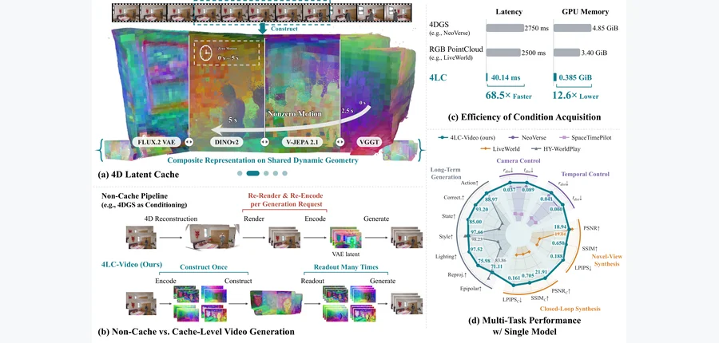 arXiv 2026-10-15 · cs.CV · #29 **[4LC: 4D Latent Cache for Efficient Conditioning in Dynamic World Modeling](https://arxiv.org/abs/2610.17625)** Jianhui Zhang, Zuyao Lin, Pengxin Xu, Jingdong Wang, Xingyu Chen 机构：Shanghai Jiao Tong University / Zhongguancun Academy / Chinese Academy of Sciences / Harbin Institute of Technology（[PDF](https://arxiv.org/pdf/2610.17625)） [Paper](https://arxiv.org/abs/2610.17625) · [Project](https://zgca-hmi-lab.github.io/4LC/) · [图源](https://arxiv.org/html/2610.17625v1/Fig1-teaser.png) 

中文摘要
动态世界建模的视频生成应高效复用已观测的静态和动态内容，以在不同时间和视角的重复生成中提供条件。我们提出 4LC：带复合视觉表示和灵活时空访问接口的 4D 潜缓存。作为潜缓存，它直接复用静态与动态内容的视觉表示，避免每次请求都进行 RGB 渲染与重新编码；作为复合缓存，它把多个视觉编码器（例如 VAE、DINO、V-JEPA、VGGT）的表示绑定到共享几何和运动，使缓存以丰富信息描述动态世界。我们还设计可独立指定时间和视角、直接读取缓存并合并不同观测读出结果的时空接口，为多种下游任务提供统一条件格式。基于 4LC，我们开发 4LC-Video，通过改变源观测、时空请求和历史复用配置，处理相机控制、时间控制、新视角合成、场景重访及长时生成等任务。实验表明，单个无需任务专用微调的 4LC-Video 模型，能更高效地获取条件，并在各任务上实现有效的时空可控性与场景一致性。 <a href="https://arxiv.org/abs/2610.17625">原摘要来源</a>
 | 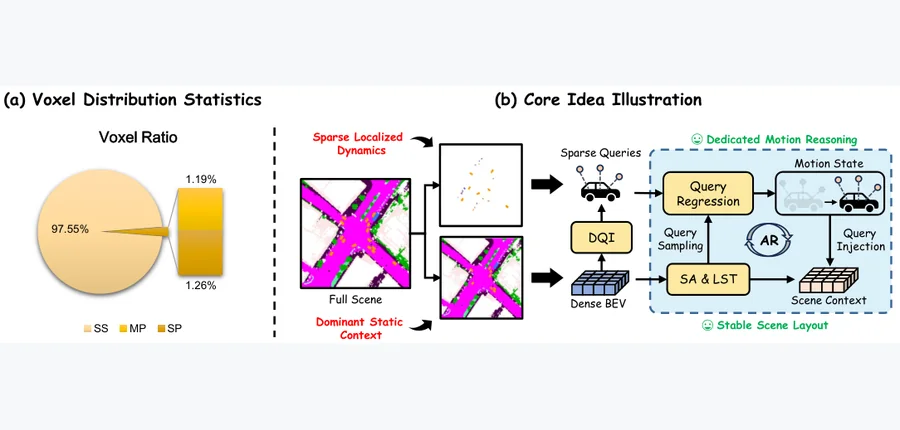 arXiv 2026-10-15 · cs.CV · #30 **[InfraWorld: Motion-Aware World Modeling for Roadside 4D Occupancy Forecasting](https://arxiv.org/abs/2610.14544)** Songkai Wang, Xiaokai Bai, Lei Yang, Hui-liang Shen 机构：Zhejiang University / Nanyang Technological University（[PDF](https://arxiv.org/pdf/2610.14544)） [Paper](https://arxiv.org/abs/2610.14544) · [图源](https://arxiv.org/html/2610.14544v1/Fig1-insight.png) 

中文摘要
路侧 4D 占据预测要在固定的基础设施坐标系中预测未来语义占据。路侧场景整体结构稳定、局部却持续变化，因此既需完整场景级上下文，也需精细建模稀疏的局部运动；现有预测范式难同时满足。我们提出 InfraWorld，把路侧占据预测表述为选择性的状态演变。模型为完整场景维护稠密鸟瞰图（BEV）状态，并为运动区域维护持久运动查询，分别承担全局上下文和局部动力学。Dynamic Query Initiation（DQI）在观测历史有运动证据的区域初始化查询；展开时，Long–Short Temporal Fusion（LST）结合邻帧短期连续性与长期运动趋势，更新稠密状态，以保持稳定上下文并捕获场景变化；Motion-Aware Query Injection（MAQI）进一步细化查询，并以置信度加权将查询信息注入对应 BEV token，使动态区域被定向更新而不扰动全局上下文。因此，InfraWorld 将预测能力集中在变化的交通区域。InfraOcc 和 Occ3D--nus 上的大量实验显示，方法在路侧 4D 占据预测中达到当时最佳表现，在自车视角设置中也保持有效。代码将发布。 <a href="https://arxiv.org/abs/2610.14544">原摘要来源</a>
 |
| 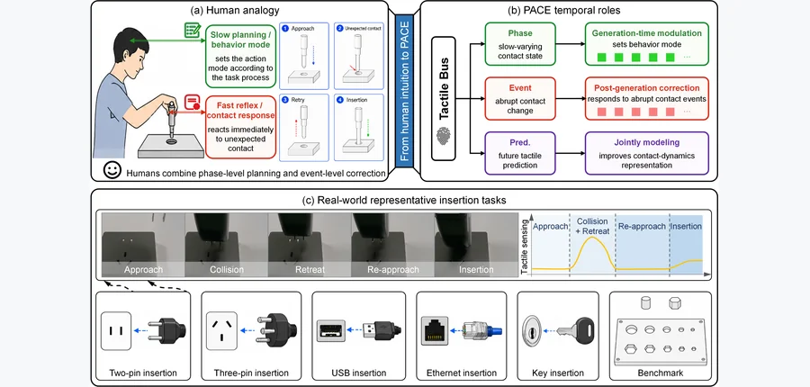 arXiv 2026-10-15 · cs.RO · #31 **[PACE: Temporal-Role Tactile Conditioning for Chunk-Based Insertion Policies](https://arxiv.org/abs/2610.16308)** Zhiyuan Chen, Shixiong Xu, Shuai Chen, Yangwei You 机构：Beijing Xiaomi Robot Technology（[PDF](https://arxiv.org/pdf/2610.16308)） [Paper](https://arxiv.org/abs/2610.16308) · [图源](https://arxiv.org/html/2610.16308v1/figs/Figure1.png) 

中文摘要
富接触插入要求机器人结合视觉对准与触觉调整。但现有视觉—触觉动作块策略通常把触觉反馈压入单一的生成时融合路径，使持续接触状态、突发接触事件和未来接触后果都隐式混在一个表示中。我们提出 PACE（Phase-Aware Contact-Event Conditioning），一种为动作块插入策略区分触觉时间角色的条件化框架。它将同一触觉流分为三种时间角色：持续接触状态为动作块生成提供条件；突发接触事件修正已生成的动作块；接触后果预测在训练时塑造动作表示。这样既保留动作块层面的连续性，又让不同时间角色的接触反馈走不同路径。在五项真实机器人插入任务上，PACE 平均成功率达到 90.7%，比纯视觉及生成时触觉融合基线高出超过 44 个百分点；在 ManipulationNet 基准的六种几何—间隙配置上保持 88.7% 成功率，其中包括工业级 0.1 mm 间隙。消融确认三种时间角色具有互补贡献；机制分析显示，PACE 能区分正常插入进展与需要立即修正的接触事件；跨信号、跨架构实验表明，该原则可推广到不同物理反馈信号与策略主干。视频和材料见论文。 <a href="https://arxiv.org/abs/2610.16308">原摘要来源</a>
 | 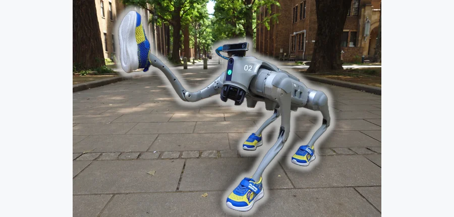 arXiv 2026-10-15 · cs.RO · #32 **[SHOES: Sim-to-real Hardware-adaptation via On-policy Expansion of Skills for Legged Robots](https://arxiv.org/abs/2610.16457)** Kota Tsuruhara, Tsung-Yuan Chen, Kento Kawaharazuka 机构：Tokyo University of Agriculture and Technology / University of Tokyo（[PDF](https://arxiv.org/pdf/2610.16457)） [Paper](https://arxiv.org/abs/2610.16457) · [图源](https://arxiv.org/html/2610.16457v1/figs/teaser.png) 

中文摘要
人会穿适合环境的鞋来扩展移动能力，例如登山靴或冰鞋；鞋改变与地面的接触界面，使原本困难的地形可通行。相比之下，运动控制器通常为固定形态训练，鞋改变足部几何、质量和摩擦后，性能可能下降。我们提出 SHOES，一种样本高效的框架，使运动策略适配鞋带来的形态变化。方法冻结仿真训练的名义策略，仅在真实机器人上微调轻量、以恒等映射初始化的调制模块，保留初始行为，同时支持高效硬件适配。我们还提出 SafeBox，一种感知工作空间的航点采样器，把在线适配限制在用户定义的范围内。为 Unitree Go2 装鞋的仿真实验显示，SHOES 仅用有限追加适配便显著恢复了形态变化后的运动性能；在相同适配预算下优于仅用 FiLM、仅用线性适配器及残差强化学习基线。给 Unitree Go2 穿人类鞋的真实实验进一步评估了其硬件部署效果。 <a href="https://arxiv.org/abs/2610.16457">原摘要来源</a>
 | 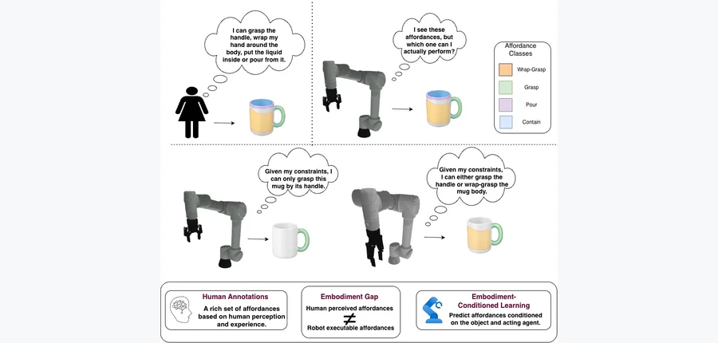 arXiv 2026-10-15 · cs.RO · #33 **[Cross-Embodiment Affordance Transfer for Robotic Manipulation](https://arxiv.org/abs/2610.18194)** Sawera Yaseen, Serge Thill, Rekha Raja 机构：Radboud University（[PDF](https://arxiv.org/pdf/2610.18194)） [Paper](https://arxiv.org/abs/2610.18194) · [图源](https://arxiv.org/html/2610.18194v1/figures/intro.jpg) 

中文摘要
机器人操作系统常从人工标注数据学习物体 affordance，但这些标注反映的是人手可交互的区域，而非特定机器人的物理约束。例如，人标为可抓的表面区域，对机器人可能在几何上不可达或在力学上不可行，这种差异却很少被明确处理。我们提出将人类 affordance 标注转化为以机器人物理性质为条件的可执行 affordance 预测框架。给定物体 3D 点云及编码机器人几何与约束的描述符，网络预测哪些物体表面区域可由该机器人实际执行。模型以人工标注 affordance 和仿真中多次采样接近试验的机器人执行结果共同训练，后者决定哪些区域对机器人可执行。我们在家庭物体数据集上，用 UR5e 机械臂的两种平行夹爪配置评估；框架优于不接收机器人信息的模型。实验表明，affordance 预测必须以机器人为条件，单靠人类标注不足以学习机器人可执行的 affordance 表示。 <a href="https://arxiv.org/abs/2610.18194">原摘要来源</a>
 |
| 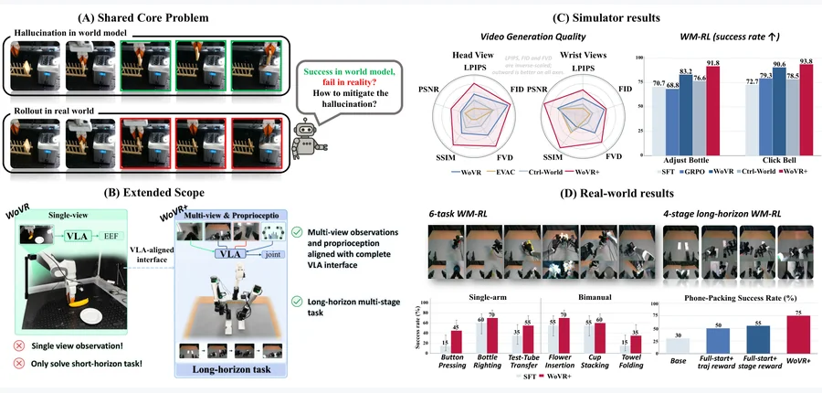 arXiv 2026-10-15 · cs.RO · #34 **[WoVR+: World Model as Reliable Simulator for Versatile VLA Policy Optimization with RL](https://arxiv.org/abs/2610.17922)** Shangqing Zhou, Zhennan Jiang, Ning Ma, Xin Fu, Yupeng Zheng, Shuai Tian, Huangrui Li, Jiahao Liu, Chao Yu, Zhongpu Xia, H… 机构：Chinese Academy of Sciences / University of Chinese Academy of Sciences / Zhongguancun Academy / Xi’an Jiaotong-Liverpool University / Tsinghua University / Anyverse Dynamics（[PDF](https://arxiv.org/pdf/2610.17922)） [Paper](https://arxiv.org/abs/2610.17922) · [图源](https://arxiv.org/html/2610.17922v1/overview_new.png) 

中文摘要
动作条件世界模型能减少视觉—语言—动作模型强化学习（VLA-RL）中昂贵的真实机器人交互，但世界模型的幻觉会误导策略优化。将其扩展到更丰富的 VLA 接口和长时程任务，还要处理时空与跨模态一致性、强化学习中探索和可靠性的平衡，以及展开误差累积。我们提出 WoVR+，在 WoVR 的幻觉感知世界模型强化学习框架上，重设计学习的环境与想象交互协议：与 VLA 接口对齐的世界模型提供多视角预测和本体感觉更新，同时缓解幻觉；按动作块加入噪声，保留基于流的策略探索，同时限制会破坏预测的动作抖动。对于长时程任务，局部阶段想象训练结合阶段入口重置、阶段专用奖励、局部时间范围和可控采样，以缩短生成前缀、平衡各阶段训练。相对监督微调（SFT），WoVR+ 在 RoboTwin 及六项真实机器人任务上的成功率分别提高 21.09% 和 16.7%；长时程手机包装任务成功率由 30% 升至 75%。视频见论文。 <a href="https://arxiv.org/abs/2610.17922">原摘要来源</a>
 | 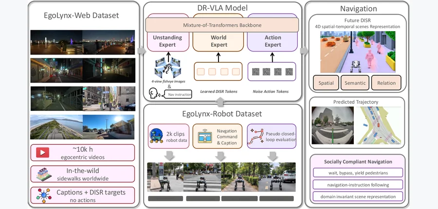 arXiv 2026-10-15 · cs.RO · #35 **[DR-VLA: Learning Human-Like Quadruped Navigation from Egocentric Web Videos via Domain-Invariant Scene Representations](https://arxiv.org/abs/2610.18373)** Jun Tian, Yingjie Niu, Ruo Chen, Hongyi Lin, Chao Li 机构：DEEP Robotics / University of Illinois Urbana-Champaign / Zhejiang University / Tsinghua University / MIT（[PDF](https://arxiv.org/pdf/2610.18373)） [Paper](https://arxiv.org/abs/2610.18373) · [图源](https://arxiv.org/html/2610.18373v1/pipeline.png) 

中文摘要
执行室外配送的四足机器人须理解复杂场景、预判变化并以符合社会规范的方式导航，但足够规模的机器人示范昂贵。第一视角网络视频提供丰富的人类导航经验，却因视角和运动差异而难以迁移。我们提出 DR-VLA，一种混合 Transformer 框架，通过领域不变场景表示（DISR）迁移人类导航经验，并结合视觉语言理解、潜世界建模及流匹配动作专家。我们构建 EgoLynx：包含 10,000 小时筛选的第一视角网络视频（EgoLynx-Web）和真实配送中遥操作采集的 2,000 段机器人导航视频（EgoLynx-Robot）。理解专家和世界专家先在没有动作标签的网络视频上预训练，再将模型适配机器人观测，并在机器人视频上训练动作专家预测可执行轨迹。我们还提出 Quadruped Navigation Score（QNS），一种结合安全、指令遵从、舒适性和进展的伪闭环指标。在留出的 EgoLynx-Robot 测试集上，相较各指标的最强竞争结果，DR-VLA 的 QNS 提高约 5%，开环最终朝向误差（FHE）降低 14.6%。消融显示网络视频预训练有助于泛化，关键组件也各有贡献。作为未来预测目标，DISR 优于五种通用视觉表示；即使构建目标时不用专用几何标注或点云，其表现仍接近任务专用 3D 感知。另在 NAVSIM v1 上从头单独训练且不使用网络视频预训练时，DR-VLA 取得 92.1 PDMS，说明框架也可能适用于自动驾驶。 <a href="https://arxiv.org/abs/2610.18373">原摘要来源</a>
 | 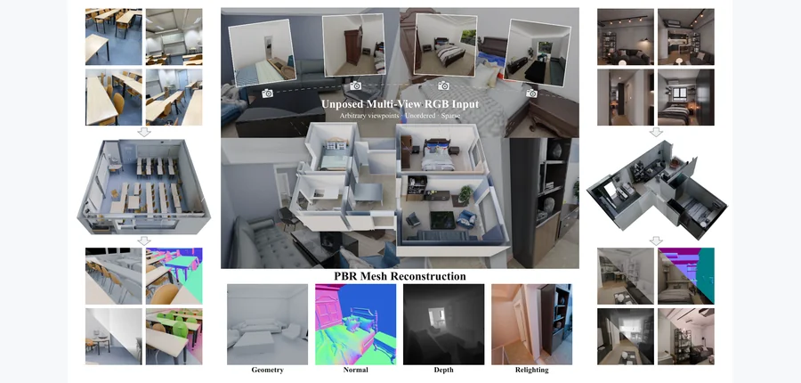 arXiv 2026-10-15 · cs.CV · #36 **[WorldRecon: Generative Multi-View Mesh Reconstruction for Large-Scale 3D World](https://arxiv.org/abs/2610.18846)** Mengchen Zhang, Yang Li, Chunshi Wang, Tong Wu, Chunchao Guo 机构：Zhejiang University / Tencent Hunyuan / Fudan University（[HTML](https://arxiv.org/html/2610.18846)） [Paper](https://arxiv.org/abs/2610.18846) · [图源](https://arxiv.org/html/2610.18846v1/teaser_refined_pdf.png) 

中文摘要
从未标定姿态的多视角图像重建完整、高质量的大尺度场景网格，既要忠实于观测几何，也要合理补全未观测或稀疏采集的表面。我们提出 WorldRecon，一种从无位姿 RGB 图像恢复完整大尺度 3D 场景网格的生成式多视角重建框架。它先用重建模型从输入估计相机位姿和粗糙、带噪的全局点云，以之作为全场景生成骨架，再划分为重叠空间块。为稳健利用不完美几何先验，我们给原生 3D 生成模型 TRELLIS.2 加入专门的重建条件架构：依据每块的局部点云和相关图像观测，生成稀疏结构、细致几何和 PBR 材料。为维持场景级连贯性，方法还采用邻块感知潜空间修补和因果世界生成流程，在重叠块间传播结构、几何与材料上下文。这些设计让多视角生成重建扩展到大场景，产出统一、连贯的网格。大量实验表明，在合成及真实室内场景上，相比最强基线，Chamfer 距离分别降低 14.9% 与 43.1%，F-score 分别提高 17.3% 与 12.0%，显示出忠实且完整的生成重建以及较强的 sim-to-real 泛化。项目页见论文。 <a href="https://arxiv.org/abs/2610.18846">原摘要来源</a>
 |
| 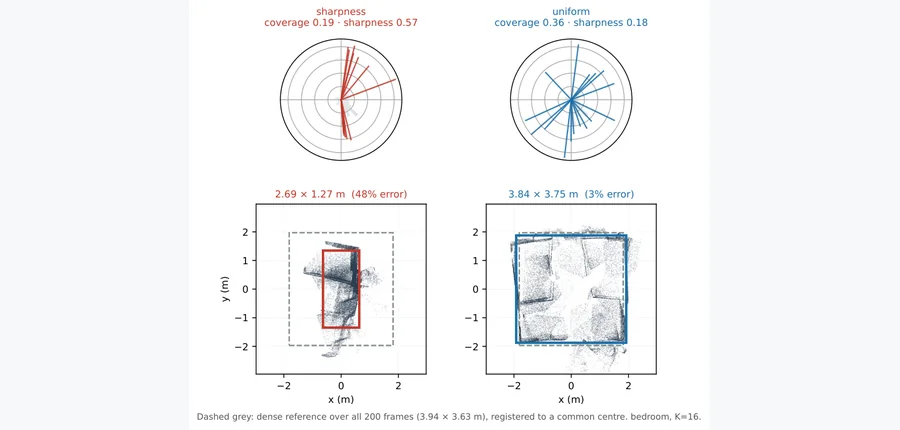 arXiv 2026-10-15 · cs.CV · #37 **[Sharper Frames, Worse Rooms: Viewpoint Coverage Dominates Image Quality in Feed-Forward 3D Reconstruction](https://arxiv.org/abs/2610.15854)** Alibek Dadajonov, Hikmatillo Umarhojiyev 机构：Arbuz AI（[PDF](https://arxiv.org/pdf/2610.15854)） [Paper](https://arxiv.org/abs/2610.15854) · [图源](https://arxiv.org/html/2610.15854v1/fig_main.png) 

中文摘要
室内场景的空间推理依赖几何重建，而多模态系统通常并不亲自生成该重建。前馈式多视角重建模型受固定视角预算约束，因此如何选帧很关键。我们表明，在这一设置下，偏爱清晰帧可能反而有害：在九段手持室内扫描中，从 200 个候选帧选最清晰的 16 帧，是受测策略中最差的，房间尺寸误差达到 48%，而均匀时间采样仅为 3%。原因在于图像质量与相机运动耦合：清晰帧倾向于出现在缓慢运动时，因而聚集于狭窄角度；在一个示例中留下 192 度房间视角未观测，在最差单元中超过 300 度。独立操纵视角分布和逐帧清晰度的 2×2 因子实验显示，分布范围的主效应约为质量的三倍；在九次采集中，有八次模糊但分散的选帧胜过清晰但聚集的选帧。随着帧预算增加、角覆盖饱和，这一优势减弱，与上述机制一致。最后，我们检验推理时能否发现失败：重建模型的多视角一致性分数反而随重建误差升高，而看同一组帧的视觉语言模型所报置信度与自身空间估计误差无关。视角预算较小时，视角覆盖比单帧质量更重要，现有两种推理时不确定性信号都未揭示这项上游失败。 <a href="https://arxiv.org/abs/2610.15854">原摘要来源</a>
 | 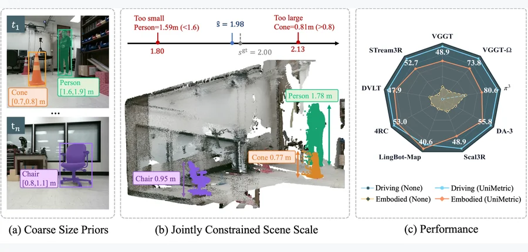 arXiv 2026-10-15 · cs.CV · #38 **[UniMetric: Universal Metric Scale Recovery for Visual Geometry Foundation Models](https://arxiv.org/abs/2610.16945)** Lei Yang, Yuner Zhang, Ziyang Liu, Ziying Song, Kai WU, Yiyang Gao, Jiangtao Su, Yiming Li 机构：Nanyang Technological University / Carnegie Mellon University / Hong Kong Polytechnic University / Tongji University / University of Toronto / Tsinghua University（[HTML](https://arxiv.org/html/2610.16945)） [Paper](https://arxiv.org/abs/2610.16945) · [Code](https://github.com/yanglei18/UniMetric) · [图源](https://arxiv.org/html/2610.16945v1/teaser.png) 

中文摘要
近期多模态基础模型（以 GPT-6 Astra 为例）的进展，增加了通用具身推理与规划的可能性；用互联网视频进行具身预训练，需要可靠的物理尺度标注。但视觉几何基础模型常能恢复场景结构与相机运动，却不能可靠恢复度量尺度。我们表明，熟悉物体的不确定尺寸先验可联合约束整段重建的共享尺度。由此提出 UniMetric：无需训练、额外传感器或任务专用度量监督，便能为几何基础模型恢复尺度的通用框架。其 Metric Prior Acquisition 从视觉语言模型获取物体高度区间；Semantic-Geometric Alignment 沿估计的支撑表面法向测量逐帧重建物体高度，把先验换算为尺度区间；Global Scale Recovery 再用凸目标调和这些区间，重叠时得到共同可行尺度，否则给出唯一折中值。所得序列级尺度统一施加到重建点和相机平移。采用真实 VLM 先验的受控实验显示，合并多次观测可提高尺度精度，且相对物体高度保持精确。为不依赖真值尺度对齐而评估几何基础模型重建的度量精度，我们提出 MetricBench，含具身、驾驶和路侧的十二个带传感器真值的子集。对九个几何基础模型，UniMetric 在整个基准组上把平均深度 Abs Rel、重建 Chamfer 距离和轨迹误差分别降低 54.2%、83.8% 和 65.6%，并在三项任务上改善所有模型。我们发布 UniMetric 代码和 MetricBench 数据。 <a href="https://arxiv.org/abs/2610.16945">原摘要来源</a>
 | 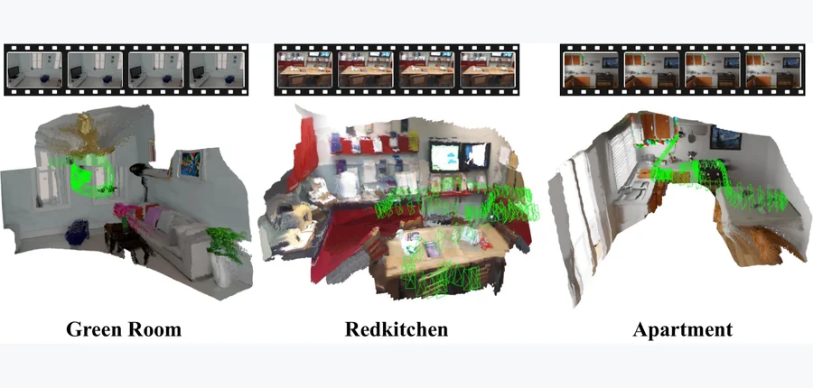 arXiv 2026-10-15 · cs.CV · #39 **[BAT3R: Robust Online 3D Reconstruction with Bayesian Adaptive State Updates](https://arxiv.org/abs/2610.16330)** Lijian Li, Yuanpeng He, Yudian Zheng, Chung-ju Huang, Linyu Li, Dongming Jin, Wenpin Jiao, Zhi Jin, Chi-Man Pun 机构：University of Macau / Peking University（[PDF](https://arxiv.org/pdf/2610.16330)） [Paper](https://arxiv.org/abs/2610.16330) · [图源](https://arxiv.org/html/2610.16330v1/prefix.png) 

中文摘要
前馈式 Transformer 推动了 3D 视觉进展，但平方级复杂度使其难处理长视频。流式 3D 重建通过逐帧处理并维持常数内存缓解这一瓶颈；然而现有循环架构忽视观测本身的可靠性和历史状态累积置信度，长序列中会逐渐退化、误差累积。我们提出无需训练的贝叶斯自适应框架 BAT3R，含协同的 State Innovation Gating（SIG）与 Bayesian-guided Adaptive State Updating（BASU）。SIG 作为分布正则器，将状态演变锚定在几何初始化上，以遏止长时推理的表示漂移；BASU 则在卡尔曼滤波框架中，把状态更新改写为递归贝叶斯推断。它用信息论增益刻画观测的时间可靠性，用交叉注意力图刻画空间相关性，从而实现非对称时空状态融合：保护已充分建立的历史区域，避免重复更新，同时积极纳入真正新的场景内容。在 7-Scenes、TUM、ScanNet、KITTI 等标准基准上的大量实验显示，BAT3R 持续优于当时最佳在线 3D 重建方法，长序列和复杂场景的增益尤其明显。 <a href="https://arxiv.org/abs/2610.16330">原摘要来源</a>
 |
| 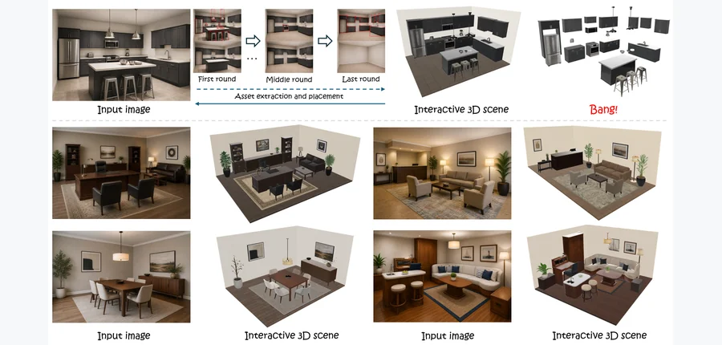 arXiv 2026-10-15 · cs.CV · #40 **[Unravel: Recovering an Interactive 3D Scene from a Single Image](https://arxiv.org/abs/2610.16146)** Hui Shan, Keyang Luo, Binjia Zhou, Ming Li, Kai Li, Xin Wang, Zhenyang Li, Zesong Yang, Weikai Chen, Runze Zhang, Xin Wang… 机构：Zhejiang University / Shanghai Innovation Institute / Westlake University / LIGHTSPEED / Adobe / Fudan University / City University of Hong Kong（[HTML](https://arxiv.org/html/2610.16146)） [Paper](https://arxiv.org/abs/2610.16146) · [图源](https://arxiv.org/html/2610.16146v1/Images/teaser.png) 

中文摘要
我们提出 Unravel：一种无需训练的框架，可把单张图像变成每个物体都是独立可移动资产的交互式 3D 场景。现有生成器要么生成物体无法单独移动的纠缠几何，要么一次前馈预测所有物体，使错误猜测难以检测和修复。Unravel 采取“先拆后装”的方式：从输入图像开始，由智能体流程逐层剥离图像，并主要利用点云恢复空间关系。具体而言，视觉语言模型规划哪些物体完全可见，图像编辑器移除这些物体并补全遮挡区域；每次编辑都先验证，再纳入重建。这一过程把原先被遮挡的场景部分逐步变为直接观测，让物体在暴露最充分时被重建，而不是仅从原图幻想。随后按移除的逆序重建场景，使支撑物先于其上物体摆放。鉴于单视角只显示物体的一部分，我们把已观测点视为尺寸下界：资产可以扩展覆盖这些点，但不能缩小到漏掉它们。最后让重建场景经过物理静置，消除悬浮物和相互穿透，并用智能体审查修正剩余放置错误。多种室内场景的大量实验表明，相比现有方法，Unravel 可恢复更多物体，摆放更忠实，场景也更符合物理直觉。 <a href="https://arxiv.org/abs/2610.16146">原摘要来源</a>
 |   |   |
<!-- PAPER_CARDS_END -->

## 检索概况

- **本轮时间与窗口**：北京时间 2026-10-15 09:26 至 2026-10-15 09:42；相对 [2026-10-14 日报](2026-10-14.md)，新增核对官方 **Wednesday, 14 October 2026** 批次。
- **范围与来源**：逐页核对 arXiv 官方 `new`：`cs.CV`、`cs.GR`、`cs.RO`、`cs.AI`、`cs.LG`、`physics`、`cond-mat`、`math`、`stat.ML`、`eess.IV`、`eess.SY`、`eess.SP`。以下计数是这些官方页面的原始 listing 记录；Cross/Replacement 跨页面可能重复。
- **总命中 / 入选**：New **3,345** 个不同 arXiv ID，标题和官方原摘要筛选后收录 **40** 篇。另见 Cross **1,446** 条、Replacement **2,677** 条；两者均不进入主榜。
- **排序**：优先 3D 与力学、接触、形变、流体或物理世界模型的交叉研究；其后是有具体机器人任务和实验证据的具身方法，以及基础 3D 重建。相关性、机构强度、阅读优先级、局限与实验建议均为**推断**；[事实] 表示论文原摘要中的作者陈述，并非独立复现结论。标题、作者、摘要和分类可点击原论文核对。

## 官方 listing 状态

| 分类页面 | 官方批次 | New | Cross | Replacement |
|---|---|---:|---:|---:|
| [cs.CV/new](https://arxiv.org/list/cs.CV/new?show=2000) | Wednesday, 14 October 2026 | 381 | 98 | 263 |
| [cs.GR/new](https://arxiv.org/list/cs.GR/new?show=2000) | Wednesday, 14 October 2026 | 10 | 10 | 10 |
| [cs.RO/new](https://arxiv.org/list/cs.RO/new?show=2000) | Wednesday, 14 October 2026 | 255 | 49 | 175 |
| [cs.AI/new](https://arxiv.org/list/cs.AI/new?show=2000) | Wednesday, 14 October 2026 | 360 | 492 | 501 |
| [cs.LG/new](https://arxiv.org/list/cs.LG/new?show=2000) | Wednesday, 14 October 2026 | 502 | 360 | 482 |
| [physics/new](https://arxiv.org/list/physics/new?show=2000) | Wednesday, 14 October 2026 | 198 | 106 | 148 |
| [cond-mat/new](https://arxiv.org/list/cond-mat/new?show=2000) | Wednesday, 14 October 2026 | 260 | 60 | 158 |
| [math/new](https://arxiv.org/list/math/new?show=2000) | Wednesday, 14 October 2026 | 1188 | 149 | 754 |
| [stat.ML/new](https://arxiv.org/list/stat.ML/new?show=2000) | Wednesday, 14 October 2026 | 51 | 59 | 71 |
| [eess.IV/new](https://arxiv.org/list/eess.IV/new?show=2000) | Wednesday, 14 October 2026 | 16 | 5 | 15 |
| [eess.SY/new](https://arxiv.org/list/eess.SY/new?show=2000) | Wednesday, 14 October 2026 | 68 | 35 | 44 |
| [eess.SP/new](https://arxiv.org/list/eess.SP/new?show=2000) | Wednesday, 14 October 2026 | 56 | 23 | 56 |

## Top papers

| # | 论文 | arXiv | 分类 | 作者 | 机构 | 相关性（推断） | 机构强度（推断） | 阅读优先级（推断） |
|---:|---|---|---|---|---|---|---|---|
| 1 | Physical-Field-Bridged Material Parameter Inference from Multi-View Deformation Videos | [arXiv:2610.17591](https://arxiv.org/abs/2610.17591) | cs.CV | Linrui Shou, Jie Li, Yu Liu, Tao Huang | Shanghai Jiao Tong University / University of Science and Technology Beijing / Peking University（[PDF](https://arxiv.org/pdf/2610.17591)） | 高（3D/物理交叉） | 高 | 高 |
| 2 | Physical SLAM: Physics-aware Simultaneous Localisation and Mapping | [arXiv:2610.17260](https://arxiv.org/abs/2610.17260) | cs.RO | Guangming Wang, Zhishuo Liu, Haibing Wu, Wanli Ma, Yixiong Jing, Olaf Wysocki, Brian Sheil | University of Cambridge（[PDF](https://arxiv.org/pdf/2610.17260)） | 高（3D/物理交叉） | 高 | 高 |
| 3 | Refine Where It Matters: Contact-Adaptive Meshing for Deformable Object Manipulation | [arXiv:2610.14142](https://arxiv.org/abs/2610.14142) | cs.RO | Gabriel Johnson, Tom Olesch, Fei Liu | University of Tennessee, Knoxville（[PDF](https://arxiv.org/pdf/2610.14142)） | 高（3D/物理交叉） | 中高 | 高 |
| 4 | FlowVLA: Enabling World Dynamics Understanding through Pluggable 3D Flow Learning | [arXiv:2610.16160](https://arxiv.org/abs/2610.16160) | cs.RO | Junhyeong Go, Mingyu Jung, Woobin Im, Jongbin Ryu | Ajou University / Samsung Electronics（[PDF](https://arxiv.org/pdf/2610.16160)） | 高（3D/物理交叉） | 中高 | 高 |
| 5 | From Pixels to Executable Physics: Behavior-Grounded World Models for Embodied Action Consequence Prediction | [arXiv:2610.17630](https://arxiv.org/abs/2610.17630) | cs.RO | Ruo Chen, Jiahua Pang, Yingjie Niu, Hongyi Lin, Jun Tian, Yang Zhu, Chao Li | DEEP Robotics / Zhejiang University / Beijing Institute of Technology / MIT / Tsinghua University / University of Illinois Urbana-Champaign（[PDF](https://arxiv.org/pdf/2610.17630)） | 高（3D/物理交叉） | 高 | 高 |
| 6 | PUGS: Physics-Guided Uncertainty Modeling for Underwater Dynamic 3D Gaussian Splatting | [arXiv:2610.17936](https://arxiv.org/abs/2610.17936) | cs.CV | Tingjun Li, Yuxi Wang, Guoqiang Zhong, Zhaoxiang Zhang | Ocean University of China / Chinese Academy of Sciences / University of Chinese Academy of Sciences（[HTML](https://arxiv.org/html/2610.17936)） | 高（3D/物理交叉） | 中高 | 高 |
| 7 | Act4R: Action-conditioned 4D reconstruction for kinematics-free control | [arXiv:2610.17462](https://arxiv.org/abs/2610.17462) | cs.RO | Zhaoliang Zhang, Chenhao Yu, Zhimin Shao, Xijun Liu, Cheng Peng | Johns Hopkins University / University of Virginia（[HTML](https://arxiv.org/html/2610.17462)） | 高（3D/物理交叉） | 中高 | 高 |
| 8 | ClothCode: Generative Modeling for Garment State Estimation and Dynamics Prediction | [arXiv:2610.14200](https://arxiv.org/abs/2610.14200) | cs.RO | Yingdong Ru, Lipeng Zhuang, Shiyu Fan, Zhuo He, Florent P. Audonnet, Gerardo Aragon Camarasa | University of Glasgow（[HTML](https://arxiv.org/html/2610.14200)） | 高（3D/物理交叉） | 中高 | 高 |
| 9 | Physics-Aware Object-Centric SE(3) Forecasting for Real-Time Proactive Dynamic Grasping | [arXiv:2610.17843](https://arxiv.org/abs/2610.17843) | cs.RO | Yirui Zhou, Hongli Xu, Ying Zheng, Yi Wang, Lap-Pui Chau | Hong Kong Polytechnic University / Technical University of Munich（[PDF](https://arxiv.org/pdf/2610.17843)） | 高（3D/物理交叉） | 中高 | 高 |
| 10 | FEM-Validated Real-Time Modelling of Soft Tactile Deformation | [arXiv:2610.16667](https://arxiv.org/abs/2610.16667) | cs.RO | Silvia Terrile, Kaichen Shi, Taejun Kwon, Jiseok Lee, Nathan Lepora, Yeejin Lee, Saekwang Nam, Efi Psomopoulou | University of Bristol / Kyungpook National University / Seoul National University of Science and Technology（[PDF](https://arxiv.org/pdf/2610.16667)） | 高（3D/物理交叉） | 中高 | 高 |
| 11 | Hand2Robot: Object-Centric 4D Hand Reconstruction from Human Demonstrations for Robotics | [arXiv:2610.15769](https://arxiv.org/abs/2610.15769) | cs.RO | Zetao Du, Weiqing Wang, Hanbing Zhang, Yimiao Zhou, Ye Shi, Liang Wang, Jingya Wang | ShanghaiTech University / InstAdapt / Chinese Academy of Sciences（[PDF](https://arxiv.org/pdf/2610.15769)） | 高（3D/物理交叉） | 中高 | 高 |
| 12 | EgoMatrix: Physically Faithful Dexterous Robot Demonstrations from Egocentric Human Videos | [arXiv:2610.18822](https://arxiv.org/abs/2610.18822) | cs.RO | Ziheng Wang, Yanming Shao, Ting Mao, Kaihan Chen, Yiqun Wang, Xuanye Wu, Yao Mu | Shanghai Jiao Tong University / University of Hong Kong / Zhejiang University / Shanghai AI Laboratory（[HTML](https://arxiv.org/html/2610.18822)） | 高（3D/物理交叉） | 中高 | 高 |
| 13 | EgoCPT: Learning Dexterous Manipulation from a Single Ego-Centric Video with Contact-Aware Optimization | [arXiv:2610.17572](https://arxiv.org/abs/2610.17572) | cs.RO | Zhixin Sun, Kairui Shi, Tianao Ren, Ming Yang, Mark Cutkosky, James Jingxi Xu | Ant Group / University at Buffalo / Stanford University（[PDF](https://arxiv.org/pdf/2610.17572)） | 高（3D/物理交叉） | 高 | 高 |
| 14 | DEFT-VLA: Stage-Localized Force Specialization for Contact-Rich Robotic Manipulation | [arXiv:2610.14854](https://arxiv.org/abs/2610.14854) | cs.RO | Zan Huang, Yibo Qiu, Kan Ding, Xuanping Zhang, Ao Tian, Ronald X Xu, Mingzhai Sun | University of Science and Technology of China / Xi’an Jiaotong-Liverpool University（[PDF](https://arxiv.org/pdf/2610.14854)） | 高（3D/物理交叉） | 中高 | 高 |
| 15 | Force-Modulated Dexterity: Unified Compliance for Contact-Rich Manipulation | [arXiv:2610.17161](https://arxiv.org/abs/2610.17161) | cs.RO | Ying Yuan, David Held, Jitendra Malik, Haozhi Qi | Amazon FAR / Carnegie Mellon University（[PDF](https://arxiv.org/pdf/2610.17161)） | 高（3D/物理交叉） | 高 | 高 |
| 16 | ForeTac: Predictive Contact Guidance for Generative Robot Policies | [arXiv:2610.18118](https://arxiv.org/abs/2610.18118) | cs.RO | Zhiyuan Chen, Shuai Chen, Haoran Zhou, Yizhe Zhao, Kaiyuan Yang, Zhixiang Duan, Shaoqing Xu, Ran Cao, Diyun Xiang, Yangwei You | affiliation 未确认 | 高（3D/物理交叉） | 未评估 | 中高 |
| 17 | Interaction Latents as Actions for Contact-Rich Manipulation | [arXiv:2610.18855](https://arxiv.org/abs/2610.18855) | cs.RO | Yuhang Zheng, Yujie Zang, Yuchen Liu, Yupeng Zheng, Zhennan Jiang, Zebin Xing, Shuai Tian, Songen Gu, Jingxiang Guo, Chen Gao, Zhongpu Xia, Shuicheng Yan | National University of Singapore / Anyverse Robotics / Beijing Institute of Technology / University of Chinese Academy of Sciences / Fudan University（[PDF](https://arxiv.org/pdf/2610.18855)） | 高（3D/物理交叉） | 高 | 中高 |
| 18 | ForceWAM: Decoupling Future and Response Learning from Demo and Play Data for Contact-Rich Manipulation | [arXiv:2610.18852](https://arxiv.org/abs/2610.18852) | cs.RO | Zijun Xu, Wendi Chen, Xinkai Wang, Jiachen Zou, Hongjin Chen, Hairuo Liu, Bokai Lin, Shihao Ma, Ke Ma, Zhiwei Zhang, Zhuohao Yan, Ke Wu, Haoming Song, Xueqi Li, Chuan Wen, Jieru Zhao, Wenchao Ding, Cewu Lu, Lixin Yang | Fudan University / Shanghai Jiao Tong University / Southeast University / Shanghai Innovation Institute / Southern University of Science and Technology / Noematrix（[PDF](https://arxiv.org/pdf/2610.18852)） | 高（3D/物理交叉） | 中高 | 中高 |
| 19 | YUBI-Real2Sim: 3DGS Scene Verification for Reliable Policy Evaluation | [arXiv:2610.17521](https://arxiv.org/abs/2610.17521) | cs.RO | Hiroki Nishizawa, Takehiko Ohkawa, Nicola Scianca, Tatsuya Matsushima, Shigeo Morishima, Kei Ota | AI Robot Association (AIRoA) / Waseda University（[PDF](https://arxiv.org/pdf/2610.17521)） | 高（3D/物理交叉） | 中高 | 中高 |
| 20 | PC7 Model: Dynamics of Expanding and Contracting Soft Robots using Piece-wise Constant 7D Deformation Based on Similarity Transformation Group | [arXiv:2610.14586](https://arxiv.org/abs/2610.14586) | cs.RO | Yamato Kudo, Taiki Ishigaki, Ko Ayusawa, Ko Yamamoto | affiliation 未确认 | 高（3D/物理交叉） | 未评估 | 中高 |
| 21 | Load-Aware Quadruped Navigation with Online Contact-based Geometry Estimation | [arXiv:2610.14596](https://arxiv.org/abs/2610.14596) | cs.RO | Qi Yin, XiaoLi Zhang, Yangming Shi | Colorado School of Mines（[PDF](https://arxiv.org/pdf/2610.14596)） | 高（3D/物理交叉） | 中高 | 中高 |
| 22 | High-fidelity Three-Dimensional Flow Field Reconstruction Driven by Turbulent Fluid Dynamics | [arXiv:2610.18045](https://arxiv.org/abs/2610.18045) | physics.flu-dyn | Hanlin Kong, Jianan Wei, Yuntian Chen, Yujia Wang, Wenguan Wang | Zhejiang University / Shanghai Innovation Institute / Eastern Institute of Technology Ningbo / Zhejiang Sci-Tech University（[PDF](https://arxiv.org/pdf/2610.18045)） | 高（3D/物理交叉） | 中高 | 中高 |
| 23 | Latent Diffusion Modeling of Two- and Three-dimensional Fracture Networks with Sparse Observation Conditioning | [arXiv:2610.14412](https://arxiv.org/abs/2610.14412) | physics.geo-ph | Jiawei Shen, Hongkyu Yoon, Jonghyun Lee | University of Hawaiʻi at Mānoa / Sandia National Laboratories（[PDF](https://arxiv.org/pdf/2610.14412)） | 高（3D/物理交叉） | 中高 | 中高 |
| 24 | DeboRheo v2.0: Improved Robustness for Geometrical VOF Simulations of Viscoelastic Two-Phase Flows | [arXiv:2610.17082](https://arxiv.org/abs/2610.17082) | physics.flu-dyn | Daulet Izbassarov, Matthias Niethammer, Rahul Subburaj, Dieter Bothe, Francesco Romanò, Renjie Hao, Metin Muradoglu, Tomislav Maric | Finnish Meteorological Institute / Technical University of Darmstadt / University of Lille / Koç University（[PDF](https://arxiv.org/pdf/2610.17082)） | 高（3D/物理交叉） | 中高 | 中高 |
| 25 | PhySimCode: A Benchmark and Evaluation Method for Physics Video to Code Generation | [arXiv:2610.15722](https://arxiv.org/abs/2610.15722) | cs.CV | Souraja Kundu, Aditya Gupta, Joel Julin, Yizhou Zhao, Liuyue Xie, Laszlo A. Jeni | Carnegie Mellon University / Amazon AGI（[PDF](https://arxiv.org/pdf/2610.15722)） | 高（3D/物理交叉） | 高 | 中高 |
| 26 | ExeWorldBench: Benchmarking Code-Based Executable 3D World Modeling | [arXiv:2610.15166](https://arxiv.org/abs/2610.15166) | cs.CV | Xinge Peng, Zhen Fang, Ruibing Wang, Yongxuan Lv, Haodong Li, Guohui Zhang, Xiaoxiao Ma, Yiting Lu, Lin Chen, Zehui Che, Feng Zhao | University of Science and Technology of China / Chinese University of Hong Kong（[PDF](https://arxiv.org/pdf/2610.15166)） | 高（3D/物理交叉） | 中高 | 中高 |
| 27 | GeoFix: Geometry Fixing for 4D Consistent Generation | [arXiv:2610.14293](https://arxiv.org/abs/2610.14293) | cs.CV | Yeobin Hong, Hyojun Go, Dohun Lee, Jeongjae Lee, Sunghwan Hong, Federico Tombari, Zhaochong An, Jong Chul Ye, Konrad Schindler, Dominik Narnhofer | KAIST / ETH Zurich / Google / EPFL（[PDF](https://arxiv.org/pdf/2610.14293)） | 高（3D/物理交叉） | 高 | 中高 |
| 28 | Demiurge: Forging Navigable 4D Worlds via Autoregressive Video Rerendering | [arXiv:2610.14685](https://arxiv.org/abs/2610.14685) | cs.CV | Hanxin Zhu, Jianqi Ma, Cong Wang, Zhihao Hu, Junyao Gao, Tianyu He, Junyan Lin, Jiayin Xiao, Jiateng Shou, Sen Liang, Weidong Zhang, Zhibo Chen, Jun Zhang | University of Science and Technology of China / Tencent / Chinese Academy of Sciences / Tongji University / Microsoft / Hong Kong Polytechnic University（[PDF](https://arxiv.org/pdf/2610.14685)） | 高（3D/物理交叉） | 中高 | 中高 |
| 29 | 4LC: 4D Latent Cache for Efficient Conditioning in Dynamic World Modeling | [arXiv:2610.17625](https://arxiv.org/abs/2610.17625) | cs.CV | Jianhui Zhang, Zuyao Lin, Pengxin Xu, Jingdong Wang, Xingyu Chen | Shanghai Jiao Tong University / Zhongguancun Academy / Chinese Academy of Sciences / Harbin Institute of Technology（[PDF](https://arxiv.org/pdf/2610.17625)） | 高（3D/物理交叉） | 中高 | 中高 |
| 30 | InfraWorld: Motion-Aware World Modeling for Roadside 4D Occupancy Forecasting | [arXiv:2610.14544](https://arxiv.org/abs/2610.14544) | cs.CV | Songkai Wang, Xiaokai Bai, Lei Yang, Hui-liang Shen | Zhejiang University / Nanyang Technological University（[PDF](https://arxiv.org/pdf/2610.14544)） | 高（3D/物理交叉） | 中高 | 中高 |
| 31 | PACE: Temporal-Role Tactile Conditioning for Chunk-Based Insertion Policies | [arXiv:2610.16308](https://arxiv.org/abs/2610.16308) | cs.RO | Zhiyuan Chen, Shixiong Xu, Shuai Chen, Yangwei You | Beijing Xiaomi Robot Technology（[PDF](https://arxiv.org/pdf/2610.16308)） | 高（具身机器人） | 中高 | 中高 |
| 32 | SHOES: Sim-to-real Hardware-adaptation via On-policy Expansion of Skills for Legged Robots | [arXiv:2610.16457](https://arxiv.org/abs/2610.16457) | cs.RO | Kota Tsuruhara, Tsung-Yuan Chen, Kento Kawaharazuka | Tokyo University of Agriculture and Technology / University of Tokyo（[PDF](https://arxiv.org/pdf/2610.16457)） | 高（具身机器人） | 中高 | 中高 |
| 33 | Cross-Embodiment Affordance Transfer for Robotic Manipulation | [arXiv:2610.18194](https://arxiv.org/abs/2610.18194) | cs.RO | Sawera Yaseen, Serge Thill, Rekha Raja | Radboud University（[PDF](https://arxiv.org/pdf/2610.18194)） | 高（具身机器人） | 中高 | 中高 |
| 34 | WoVR+: World Model as Reliable Simulator for Versatile VLA Policy Optimization with RL | [arXiv:2610.17922](https://arxiv.org/abs/2610.17922) | cs.RO | Shangqing Zhou, Zhennan Jiang, Ning Ma, Xin Fu, Yupeng Zheng, Shuai Tian, Huangrui Li, Jiahao Liu, Chao Yu, Zhongpu Xia, Haoran Li, Dongbin Zhao | Chinese Academy of Sciences / University of Chinese Academy of Sciences / Zhongguancun Academy / Xi’an Jiaotong-Liverpool University / Tsinghua University / Anyverse Dynamics（[PDF](https://arxiv.org/pdf/2610.17922)） | 高（具身机器人） | 高 | 中高 |
| 35 | DR-VLA: Learning Human-Like Quadruped Navigation from Egocentric Web Videos via Domain-Invariant Scene Representations | [arXiv:2610.18373](https://arxiv.org/abs/2610.18373) | cs.RO | Jun Tian, Yingjie Niu, Ruo Chen, Hongyi Lin, Chao Li | DEEP Robotics / University of Illinois Urbana-Champaign / Zhejiang University / Tsinghua University / MIT（[PDF](https://arxiv.org/pdf/2610.18373)） | 高（具身机器人） | 高 | 中高 |
| 36 | WorldRecon: Generative Multi-View Mesh Reconstruction for Large-Scale 3D World | [arXiv:2610.18846](https://arxiv.org/abs/2610.18846) | cs.CV | Mengchen Zhang, Yang Li, Chunshi Wang, Tong Wu, Chunchao Guo | Zhejiang University / Tencent Hunyuan / Fudan University（[HTML](https://arxiv.org/html/2610.18846)） | 中高（基础 3D） | 中高 | 中高 |
| 37 | Sharper Frames, Worse Rooms: Viewpoint Coverage Dominates Image Quality in Feed-Forward 3D Reconstruction | [arXiv:2610.15854](https://arxiv.org/abs/2610.15854) | cs.CV | Alibek Dadajonov, Hikmatillo Umarhojiyev | Arbuz AI（[PDF](https://arxiv.org/pdf/2610.15854)） | 中高（基础 3D） | 中高 | 中高 |
| 38 | UniMetric: Universal Metric Scale Recovery for Visual Geometry Foundation Models | [arXiv:2610.16945](https://arxiv.org/abs/2610.16945) | cs.CV | Lei Yang, Yuner Zhang, Ziyang Liu, Ziying Song, Kai WU, Yiyang Gao, Jiangtao Su, Yiming Li | Nanyang Technological University / Carnegie Mellon University / Hong Kong Polytechnic University / Tongji University / University of Toronto / Tsinghua University（[HTML](https://arxiv.org/html/2610.16945)） | 中高（基础 3D） | 高 | 中高 |
| 39 | BAT3R: Robust Online 3D Reconstruction with Bayesian Adaptive State Updates | [arXiv:2610.16330](https://arxiv.org/abs/2610.16330) | cs.CV | Lijian Li, Yuanpeng He, Yudian Zheng, Chung-ju Huang, Linyu Li, Dongming Jin, Wenpin Jiao, Zhi Jin, Chi-Man Pun | University of Macau / Peking University（[PDF](https://arxiv.org/pdf/2610.16330)） | 中高（基础 3D） | 高 | 中高 |
| 40 | Unravel: Recovering an Interactive 3D Scene from a Single Image | [arXiv:2610.16146](https://arxiv.org/abs/2610.16146) | cs.CV | Hui Shan, Keyang Luo, Binjia Zhou, Ming Li, Kai Li, Xin Wang, Zhenyang Li, Zesong Yang, Weikai Chen, Runze Zhang, Xin Wang, Yanwei Fu, Zhen Chen, Xiangru Huang | Zhejiang University / Shanghai Innovation Institute / Westlake University / LIGHTSPEED / Adobe / Fudan University / City University of Hong Kong（[HTML](https://arxiv.org/html/2610.16146)） | 中高（基础 3D） | 中高 | 中高 |

## 逐篇中文分析（事实与推断分列）

### 1. [Physical-Field-Bridged Material Parameter Inference from Multi-View Deformation Videos](https://arxiv.org/abs/2610.17591)

- **[事实] 研究问题**：从视觉观测估计可直接用于仿真的材料参数，对可变形物体操作至关重要，但材料性质只能由物理响应间接显现，因此仍很困难。
- **[事实] 方法要点**：我们提出“物理场桥接”的单次前向材料推断框架，以稠密物理响应连接多视角 RGB 形变视频、材料本构类型分类和连续参数回归。与需要逐场景重建、在线调整或在优化循环中调用仿真的逆物理方法不同，本模型先预测力/接触掩码、投影运动流场与投影应力响应图，再以这些场作为材料推断条件，以减少对外观或物体类别捷径的依赖。
- **[事实] 结果与证据**：DeformFieldBench 含 100 种物体、五种加载方式的 5,000 次仿真；四个连续参数均取得最低中位误差，应力热点召回率从 0.0762 升至 0.5121，同仿真器重放达 0.8676 SSIM / 36.82 dB PSNR。
- **[推断] 局限与复核方向**：跨仿真器与真实物体的参数可辨识性仍需单独验证；可比较有无各类物理场监督时的同协议误差。

### 2. [Physical SLAM: Physics-aware Simultaneous Localisation and Mapping](https://arxiv.org/abs/2610.17260)

- **[事实] 研究问题**：为从移动相机拍摄的单目视频重建具有预测能力的物理世界 4D 表示，我们联合重建动态高斯辐射场并推断其底层物理动力学。
- **[事实] 方法要点**：本文提出 Physical SLAM：给定一段 RGB-D 图像，构建可变形物体的 4D 高斯场，并预测其受到外部动作后的未来状态。
- **[事实] 结果与证据**：在 PhysTwin 基准上，相较 PhysTwin 的重建与预测 PSNR 分别提高 10.4% 和 11.0%；在 TUM RGB-D 基准上，相较 4DGS-SLAM，平均相机跟踪误差降低 20.6%，SSIM 提高 3.6%，LPIPS 降低 8.3%。
- **[推断] 局限与复核方向**：弹簧—质量模型可能难覆盖塑性、撕裂等非弹性过程；应按材料和动作类型拆分预测误差。

### 3. [Refine Where It Matters: Contact-Adaptive Meshing for Deformable Object Manipulation](https://arxiv.org/abs/2610.14142)

- **[事实] 研究问题**：可变形物体操作既需要准确刻画高度局部化的接触，也需要适合交互使用的仿真速度。
- **[事实] 方法要点**：均匀细化的四面体网格能够分辨这些相互作用，却在整个物体中引入不必要的自由度；粗网格效率更高，但可能无法分辨接触引起的形变。我们提出接触自适应网格细化框架，只在最有用的位置增加空间分辨率。
- **[事实] 结果与证据**：真实可变形物体操作序列上，自适应细化降低仿真到真实误差、接近细网格参考，同时比全局均匀细网格仿真高效。
- **[推断] 局限与复核方向**：局部细化若频繁切换可能造成拓扑抖动；应量化接触位置误判与计算延迟。

### 4. [FlowVLA: Enabling World Dynamics Understanding through Pluggable 3D Flow Learning](https://arxiv.org/abs/2610.16160)

- **[事实] 研究问题**：近期 3D 重建进展使人们能够从 RGB 观测中提取时间一致的三维运动，但现有视觉—语言—动作（VLA）模型仍主要依赖 2D 图文先验，因而不能准确表示与物理动作相关的三维世界基本动力学；对静态 2D 视觉线索的过度依赖限制了机器人操作的稳健性。
- **[事实] 方法要点**：我们提出 FlowVLA：一种由重建引导、可插拔的 3D 流学习框架，旨在让 VLA 学会与动作有关的动力学。它只在训练时使用时间对齐的 3D 流，无需显式 3D 传感器输入，也不改变推理阶段架构，从而保留常规 2D VLA 主干的计算效率。
- **[事实] 结果与证据**：双层监督促使模型关注语义相关的动态区域，将场景运动与精确控制信号耦合。仿真和真实实验表明，FlowVLA 持续改善操作性能、零样本稳健性及数据效率。
- **[推断] 局限与复核方向**：训练阶段三维流的重建误差可能传给策略；应按遮挡、接触和运动幅度分组测试。

### 5. [From Pixels to Executable Physics: Behavior-Grounded World Models for Embodied Action Consequence Prediction](https://arxiv.org/abs/2610.17630)

- **[事实] 研究问题**：在室外环境中，地形和接触条件变化会让四足机器人执行相同动作指令时得到不同运动结果。
- **[事实] 方法要点**：我们提出 DR-WM，一种纳入机器人—地形接触动力学的物理一致世界模型。方法从初始 RGB 图像重建场景几何，并融合由真实动作—响应数据校准的稠密、无量纲地形接触属性先验；所得地形模型可仿真摩擦等空间变化的接触属性。
- **[事实] 结果与证据**：这种有物理依据的预测支持更知情的动作选择：在 90 个困难场景中，加入 DR-WM 的 8B 视觉语言模型在六项指标中的五项优于未获得辅助的 32B 模型。
- **[推断] 局限与复核方向**：地形接触先验依赖真实动作—响应校准；应考察未见地形与摩擦突变下的失效。

### 6. [PUGS: Physics-Guided Uncertainty Modeling for Underwater Dynamic 3D Gaussian Splatting](https://arxiv.org/abs/2610.17936)

- **[事实] 研究问题**：动态 3D Gaussian Splatting（3DGS）提供了高效的动态场景重建框架。
- **[事实] 方法要点**：PUGS 把每个高斯的运动表示为含期望形变与物理不确定性的分布，并用随机形变优化、退火及双路径自一致蒸馏获得时间连贯的确定性重建。
- **[事实] 结果与证据**：水下动态数据集和物理感知基准上的大量实验显示，更好的渲染质量、时间一致性和重建稳健性；相对最强基线，UVEB 的 PSNR 提高 1.16 dB，DRUVA 提高 3.99 dB。
- **[推断] 局限与复核方向**：水下不确定性同时来自成像和真实运动；应验证两种来源是否能被模型区分。

### 7. [Act4R: Action-conditioned 4D reconstruction for kinematics-free control](https://arxiv.org/abs/2610.17462)

- **[事实] 研究问题**：跨不同机器人形态精确控制运动一直是难题；建模复杂结构需要大量时间、专用传感器和人工标注。
- **[事实] 方法要点**：近期 4D 表示学习带来另一种可能：能否从 2D 观测提升的 4D 特征出发，依据动作信号稠密映射机器人空间运动？我们提出 Act4R，建立在 3D 基础模型之上，对任意给定动作预测机器人 3D 场景流。
- **[事实] 结果与证据**：我们在公开真实数据集及仿真合成数据上评估；多个机器人平台的实验显示，Act4R 的场景流预测优于此前最佳方法，逆向控制在动作精度指标及仿真闭环控制中也更好。
- **[推断] 局限与复核方向**：在已见机器人形态的少量训练样本之外，跨形态逆向控制的可靠性仍需验证。

### 8. [ClothCode: Generative Modeling for Garment State Estimation and Dynamics Prediction](https://arxiv.org/abs/2610.14200)

- **[事实] 研究问题**：我们提出 ClothCode：在共享的离散构型空间中统一进行服装状态估计和动作条件动力学预测的生成框架。
- **[事实] 方法要点**：材料对齐 tokenizer 把服装构型编码成残差向量量化 patch token，任务专用 Masked Generative Transformer 以并行置信度细化预测状态与动作条件动力学。
- **[事实] 结果与证据**：三种服装模板上，状态估计及动力学位移误差分别降低 26.6% 和 37.0%；预测用时 16.7 ms/窗口，真实折叠与铺平成功率从 56.7% 升到 78.9%。
- **[推断] 局限与复核方向**：三种服装模板之外的材料与拓扑泛化未由摘要证明；应做留出服装类别评估。

### 9. [Physics-Aware Object-Centric SE(3) Forecasting for Real-Time Proactive Dynamic Grasping](https://arxiv.org/abs/2610.17843)

- **[事实] 研究问题**：主动抓取运动物体需要机器人预测物理接触发生时的未来状态，而非只对当前观测姿态作反应。
- **[事实] 方法要点**：由此，我们提出轻量的“先预测后选择”物体中心框架：根据短时姿态历史预测未来刚体轨迹，再以考虑可达性的拦截选择器，在运动学和时间约束下选择可行接触状态。
- **[事实] 结果与证据**：仿真平均抓取成功率从 24.5% 升至 62.0%，真实接球、传送带和转盘拦截从 15.3% 升至 67.3%；SE(3) 预测器用时 15 ms。
- **[推断] 局限与复核方向**：依赖准确的度量几何与姿态历史；应对追踪延迟和速度突变做灵敏度分析。

### 10. [FEM-Validated Real-Time Modelling of Soft Tactile Deformation](https://arxiv.org/abs/2610.16667)

- **[事实] 研究问题**：准确建模软触觉传感器仍很困难：有限元方法（FEM）计算昂贵，而实时仿真器通常不足以忠实描述超弹性形变；重复物理测试还可能损坏脆弱传感器，使大规模真实数据难以采集。
- **[事实] 方法要点**：我们提出数据高效框架，结合有限真实验证、高保真 FEM 和图神经网络（GNN），实时预测平面软触觉结构的二维形变。关键是将验证与训练分开：82 种相机跟踪的接触构型只用于调校和验证 ANSYS FEM 模型，后者再生成 768 个合成接触场景用于 GNN 训练。
- **[事实] 结果与证据**：完全由合成 FEM 数据训练的模型，在该二维触觉结构的真实测量上仍保持亚毫米精度，显示所测平面设置内较强的 sim-to-real 迁移。
- **[推断] 局限与复核方向**：结果限定在所测二维平面触觉结构；三维复杂接触与长期材料漂移仍需验证。

### 11. [Hand2Robot: Object-Centric 4D Hand Reconstruction from Human Demonstrations for Robotics](https://arxiv.org/abs/2610.15769)

- **[事实] 研究问题**：人类示范能在不用目标机器人的情况下记录与任务相关的操作，但所录手部运动不能直接作为机器人动作监督。
- **[事实] 方法要点**：我们提出 Hand2Robot，一种面向机器人策略后训练、以物体为中心的 4D 手部重建框架。给定人执行目标任务的视频，方法提取交互片段、重建物体几何，并通过手—物交互优化与运动重定向产生机器人动作监督。
- **[事实] 结果与证据**：在 DexYCB 和 HO3D-v3 上，方法提高了物体姿态精度和手—物交互质量；在三个真实机器人灵巧操作任务中，实验进一步表明，重建并重定向的人类示范可有效补充有限的机器人数据，用于目标任务策略后训练。
- **[推断] 局限与复核方向**：视频中遮挡和物体几何误差可能影响接触优化；应按可见度拆分真实任务成功率。

### 12. [EgoMatrix: Physically Faithful Dexterous Robot Demonstrations from Egocentric Human Videos](https://arxiv.org/abs/2610.18822)

- **[事实] 研究问题**：第一视角人类视频可作为机器人遥操作之外可扩展的灵巧操作数据来源，但单目 RGB 的准确手—物交互（HOI）重建，以及高质量机器人示范、尤其视觉观测的生成，仍是两大障碍。
- **[事实] 方法要点**：我们提出 EgoMatrix，一条端到端数据管线，将单目第一视角人类视频转换为双手灵巧轨迹和配对的机器人观测视频，且轨迹能直接在真实机器人上重放。
- **[事实] 结果与证据**：TACO、OakInk2 与自采数据上的仿真端到端成功率为 54.84%，最强基线为 14.52%；两个公开基准的大多数重建指标达到当时最佳。
- **[推断] 局限与复核方向**：端到端仿真成功率不等同真实机器人成功率；需要同任务的实机配对评估。

### 13. [EgoCPT: Learning Dexterous Manipulation from a Single Ego-Centric Video with Contact-Aware Optimization](https://arxiv.org/abs/2610.17572)

- **[事实] 研究问题**：真实机器人的专家示范难以收集，而人类第一视角视频容易采集且网络上大量存在。
- **[事实] 方法要点**：本文提出 EgoCPT，一种直接从单段第一视角视频学习高质量重定向灵巧手轨迹的新范式，所得轨迹随后可直接部署于真实机器人。方法仅需第一视角 RGB 视频和参考手部姿态轨迹；后者可由现成软件或录制时的专用相机获取。
- **[事实] 结果与证据**：在五项操作任务中，面对带噪声的 EgoDex 手姿态重建，方法总体成功率达 67.3%；面对用动作捕捉硬件采集的高质量 TACO 重建，达 92.0%；两个基准上均优于多种基线。
- **[推断] 局限与复核方向**：参考手姿态仍是输入条件；应检验低质量自动姿态与严重遮挡时的稳定性。

### 14. [DEFT-VLA: Stage-Localized Force Specialization for Contact-Rich Robotic Manipulation](https://arxiv.org/abs/2610.14854)

- **[事实] 研究问题**：富接触操作存在随阶段变化的感知冲突：定位和接近阶段需要视觉与本体感觉，力信号大多无信息且可能干扰；接触后力信号变得关键，而无关视觉细节和相关的机器人状态可能成为捷径。
- **[事实] 方法要点**：我们提出 DEFT-VLA（面向视觉—语言—动作操作的双专家力专门化训练）：保留任务适配的基础专家负责视觉主导的非接触行为，并为关键接触阶段引入感知力的接触专家，将力条件适配限制在需要它的位置。
- **[事实] 结果与证据**：真实机器人上的移液枪枪头安装、双手移液吸取和擦白板实验表明，DEFT-VLA 能利用力反馈提高接触阶段表现，同时保持较强的非接触行为和对未见抓取高度的稳健性。相对每个任务的最强基线，总体任务成功率提高 20–40 个百分点。
- **[推断] 局限与复核方向**：阶段切换错误可能错过短暂接触；应测试接触时序偏移和传感器噪声。

### 15. [Force-Modulated Dexterity: Unified Compliance for Contact-Rich Manipulation](https://arxiv.org/abs/2610.17161)

- **[事实] 研究问题**：遥操作常用于收集高质量机器人学习示范，但灵巧操作需要协调运动与接触力。
- **[事实] 方法要点**：我们提出 Force-Modulated Dexterity（FOMO-Dex），一种统一的富接触操作柔顺性表述。它在由任务几何和接触结构定义的坐标系中表示名义动作，沿选定方向施加由力驱动的运动修正，其余指令分量保持不变。
- **[事实] 结果与证据**：对于策略学习，模仿修正后的动作比模仿原始操作者指令更能提高取卡片成功率；用 FOMO-Dex 示范训练的策略，在螺母—螺栓操作和拧螺丝中也比用刚性控制器示范训练的策略实现更多旋转。
- **[推断] 局限与复核方向**：选定修正方向需要任务几何；应测试几何标定误差与新工具形状。

### 16. [ForeTac: Predictive Contact Guidance for Generative Robot Policies](https://arxiv.org/abs/2610.18118)

- **[事实] 研究问题**：视觉上相似的动作可能造成接触丢失、卡滞、滑移或不可逆损坏，而触觉反馈可能在关键状态转变之后才到来。
- **[事实] 方法要点**：我们提出 ForeTac，一种按“表示—预测—评估—引导”循环组织的预测式接触引导框架。ForeTac 编码当前触觉状态，预测候选动作序列的触觉后果，并用从成功与失败的物理交互中学到的接触质量目标评估预测轨迹。
- **[事实] 结果与证据**：与纯视觉 Diffusion Policy 相比，平均任务成功率由 36.3% 提高到 71.3%，平均接触成功率（CSR）由 20.0% 提高到 66.3%。
- **[推断] 局限与复核方向**：触觉预测误差可能使梯度引导偏向错误动作；应测量失败接触上的校准。

### 17. [Interaction Latents as Actions for Contact-Rich Manipulation](https://arxiv.org/abs/2610.18855)

- **[事实] 研究问题**：富接触操作不仅要协调机器人向哪里移动，还要协调交互过程中的接触和施力如何变化。
- **[事实] 方法要点**：我们提出 ILA（Interaction Latents as Actions），把运动、接触和施力的联合演变编码为可解码的交互潜变量，作为策略动作单元，并为动作生成、评估和离线改进提供共享表示。
- **[事实] 结果与证据**：在三类策略、四项真实任务中，相比以触觉为条件的直接动作基线，ILA 的平均成功率高出 21.0–36.5 个百分点。
- **[推断] 局限与复核方向**：潜动作的可解码性可能随任务和接触模式变化；应分别评估动作重建与策略收益。

### 18. [ForceWAM: Decoupling Future and Response Learning from Demo and Play Data for Contact-Rich Manipulation](https://arxiv.org/abs/2610.18852)

- **[事实] 研究问题**：专家示范说明如何完成富接触任务，却较少覆盖不同动作会引起怎样的交互力响应；与任务无关的自由交互（play）则提供更广泛的接触动力学经验，却没有目标。
- **[事实] 方法要点**：为了结合两类数据，我们提出 ForceWAM，一种力感知世界动作模型，将与任务相容的交互结果知识和局部动作如何改变接触的知识分开学习。
- **[事实] 结果与证据**：在真实机器人的力调节滑动、受扰和无扰翻盒以及放环任务上，ForceWAM 平均成功率达到 85%–95%，超过世界模型与响应式基线；加入与任务无关的 play 数据又使成功率提高 15–45 个百分点，说明其有助于学习富接触执行。
- **[推断] 局限与复核方向**：play 数据的力响应分布需覆盖目标任务；应测量分布外材料与接触方式。

### 19. [YUBI-Real2Sim: 3DGS Scene Verification for Reliable Policy Evaluation](https://arxiv.org/abs/2610.17521)

- **[事实] 研究问题**：真实机器人上的 VLA 策略评估昂贵、耗时且难复现，因此真实到仿真的场景构建对规模化评估很重要。
- **[事实] 方法要点**：我们提出 YUBI-Real2Sim，在双腕鱼眼视角下统一进行基于 3DGS 的场景重建和真实到仿真策略评估。流程结合 200 度鱼眼相机采集、3DGS 训练、用于物体建模的 3D 基础模型及 MuJoCo 物理仿真；在九组场景—任务比较中，有八组复现了真实世界策略排序。
- **[事实] 结果与证据**：流程在九组场景—任务比较中有八组复现真实策略排序，但新视角质量分数预测可靠性的效果随任务变化，尚不能给出通用场景验收规则。
- **[推断] 局限与复核方向**：论文明确未建立通用场景验收规则；可尝试把伪影指标与策略排序置信区间关联。

### 20. [PC7 Model: Dynamics of Expanding and Contracting Soft Robots using Piece-wise Constant 7D Deformation Based on Similarity Transformation Group](https://arxiv.org/abs/2610.14586)

- **[事实] 研究问题**：本文提出软体机器人模型 PC7（分段常数七维形变），可表示人工肌肉执行器等结构的伸长和收缩形变。
- **[事实] 方法要点**：方法在 3D 相似变换群 SIM(3) 上重新定义七维形变向量；先前基于特殊欧氏群 SE(3) 的 Cosserat 杆分段常数应变（PCS）模型使用六维向量。
- **[事实] 结果与证据**：特别地，我们基于 Euler–Poincaré 方程，以数学上精确的方式推导 PC7 动力学方程。最后通过假设细圆柱结构或 McKibben 型人工肌肉执行器的动力学仿真验证该模型。
- **[推断] 局限与复核方向**：目前摘要只给动力学仿真验证；真实人工肌肉的参数识别和控制闭环仍待验证。

### 21. [Load-Aware Quadruped Navigation with Online Contact-based Geometry Estimation](https://arxiv.org/abs/2610.14596)

- **[事实] 研究问题**：四足机器人携带物体穿越拥挤环境仍很困难。
- **[事实] 方法要点**：为弥补这一缺口，我们提出两阶段负载感知导航学习框架。第一阶段以强化学习训练 LOADNav，使机器人根据所携物体的几何尺寸调整路线和通行间隙；第二阶段以模仿学习训练在线几何预测器 CoGE，使其由偶发接触事件估计未知负载的几何。
- **[事实] 结果与证据**：结果显示，导航策略表现出明显的负载感知行为，在线预测器也能由偶发接触逐步修正物体几何估计，并据此调整导航。
- **[推断] 局限与复核方向**：偶发接触可提供的几何信息取决于接触位置；需量化碰撞代价和收敛速度。

### 22. [High-fidelity Three-Dimensional Flow Field Reconstruction Driven by Turbulent Fluid Dynamics](https://arxiv.org/abs/2610.18045)

- **[事实] 研究问题**：高保真三维湍流流场对科学和工程分析十分重要，但直接数值仿真或高分辨率测量都很昂贵。
- **[事实] 方法要点**：现有数据驱动方法也难同时恢复多尺度体积结构及其连贯的时间演变。我们提出面向时间分辨三维流场重建的湍流感知框架：用多尺度神经算子恢复体积结构，并与状态空间模型耦合，以促进重建动力学的时间一致性；同时将 Navier–Stokes 残差作为软约束，使重建趋向物理上合理的动力学；还引入混合专家机制，以无监督方式适配未知粗粒化过程。
- **[事实] 结果与证据**：在典型湍流系统和大气再分析数据的评估中，相对学习式及经典基线，方法降低了重建误差，更好地保留多尺度空间结构和连贯时间演变。结果支持该框架从粗粒度数据恢复高保真三维流场的有效性。
- **[推断] 局限与复核方向**：Navier–Stokes 软约束可能平滑重要小尺度结构；需看能谱与涡量而非只看像素误差。

### 23. [Latent Diffusion Modeling of Two- and Three-dimensional Fracture Networks with Sparse Observation Conditioning](https://arxiv.org/abs/2610.14412)

- **[事实] 研究问题**：由于地下裂隙的几何和连通性只在少量测点被观测，远离测量位置时存在显著不确定性，因此刻画裂隙网络很困难。
- **[事实] 方法要点**：我们开发潜空间扩散框架，可无条件或以观测为条件生成二维（2D）与三维（3D）裂隙网络。方法把裂隙及周围基质表示为二值场，用变分自编码器压缩成紧凑的空间潜表示，再由 Elucidated Diffusion Model 学习其分布。
- **[事实] 结果与证据**：二维条件生成满足 99.6% 的指定井观测；在垂直井孔约束整列体素的三维情形中，条件样本满足 84.2% 的观测井体素，同时保持与参考集合相当的裂隙体积和几何。结果显示潜空间扩散可作为裂隙网络表征、样本集合生成和稀疏观测条件化的紧凑概率方法。
- **[推断] 局限与复核方向**：井孔条件的满足率在 3D 下降；应量化连通性误差对下游多相流响应的影响。

### 24. [DeboRheo v2.0: Improved Robustness for Geometrical VOF Simulations of Viscoelastic Two-Phase Flows](https://arxiv.org/abs/2610.17082)

- **[事实] 研究问题**：我们提出 DeboRheo v2.0：在 OpenFOAM 中实现、用于黏弹性两相流的非结构、几何非分裂体积分数（Volume-of-Fluid）框架。
- **[事实] 方法要点**：修订的界面黏度处理在保留尖锐几何界面的同时正则化动量方程的黏性贡献，并结合质量—动量一致的相输运、可选 SIMPLEC 耦合与构象张量稳定化。
- **[事实] 结果与证据**：二维、轴对称及三维 Oldroyd-B / 指数型 Phan-Thien-Tanner 基准与既有数值和实验结果吻合，在困难黏弹性自由表面配置上更稳健。
- **[推断] 局限与复核方向**：稳健性证据来自指定 Oldroyd-B/PTT 基准；其他流变模型与极端黏度比需验证。

### 25. [PhySimCode: A Benchmark and Evaluation Method for Physics Video to Code Generation](https://arxiv.org/abs/2610.15722)

- **[事实] 研究问题**：多模态大语言模型（MLLM）擅长视频理解和代码生成，但能否恢复视频背后的物理规律仍不清楚；这一能力对于把视频转为可执行仿真、以及为机器人提供结构化物理监督至关重要。
- **[事实] 方法要点**：我们提出 PhySimCode 视频到物理代码生成基准：只给原始视频，模型须推断相关物理、恢复参数值，并生成可重现输入视频的可运行 Python。
- **[事实] 结果与证据**：模型通常能陈述物理规律（4.27–4.93/5），但从视频推断规律仅得 1.51–2.47/5；最好的 Claude Sonnet 4.6 也只有 7.7% 的真值参数落在 ±20% 误差内，暴露出显著的视频到仿真鸿沟。2,430 段视频的评估集及评估代码见论文链接。
- **[推断] 局限与复核方向**：物理规律口头正确而参数恢复弱；应将可执行重放误差作为独立于代码语法的指标。

### 26. [ExeWorldBench: Benchmarking Code-Based Executable 3D World Modeling](https://arxiv.org/abs/2610.15166)

- **[事实] 研究问题**：编码智能体正逐步从复现世界的外观，走向构建能体现世界运行机制的可执行世界。
- **[事实] 方法要点**：为弥补缺口，我们提出 ExeWorldBench；据我们所知，这是首个通过基于代码的 3D 世界构建，综合评估世界理解与可执行实现的基准。
- **[事实] 结果与证据**：对前沿模型的大量实验揭示了其可执行世界建模的显著局限，并为开发更有物理依据、因果更连贯的世界构建系统提供见解。
- **[推断] 局限与复核方向**：基准衡量可执行世界生成，但真实机器人迁移仍需与可操作性实验对照。

### 27. [GeoFix: Geometry Fixing for 4D Consistent Generation](https://arxiv.org/abs/2610.14293)

- **[事实] 研究问题**：视频扩散模型越来越常被用作 4D 生成的先验，但生成视频常缺乏几何一致性。
- **[事实] 方法要点**：近期方法通过后训练设计几何奖励来改善这一点，却可能损害纹理和细节，因此需要额外外观奖励及谨慎的奖励平衡。我们提出 GeoFix：仅用一个几何奖励，同时改善几何一致性和视觉质量的统一框架，既适用于训练，也适用于推理时的奖励对齐。
- **[事实] 结果与证据**：GeoFix 使 WorldScore 3D 一致性提高 39%，VBench Quality Score 提高 4%。
- **[推断] 局限与复核方向**：静态区域深度奖励依赖可靠的静动态分离；应检验运动掩码错误时的奖励偏差。

### 28. [Demiurge: Forging Navigable 4D Worlds via Autoregressive Video Rerendering](https://arxiv.org/abs/2610.14685)

- **[事实] 研究问题**：近期视频扩散技术可以从单段输入视频合成新视角视频，支持世界建模、具身智能和机器人仿真。
- **[事实] 方法要点**：但现有方法独立处理相机轨迹，缺乏构建连贯、可导航 4D 世界所需的跨轨迹一致性。我们提出 Demiurge：以动态 4D 点云记忆缓存为基础的自回归视频重渲染流程。
- **[事实] 结果与证据**：大量实验显示了当时最佳表现和三种能力：在密集多视角轨迹上构建连贯时空格点；在困难相机运动下、包括与输入视角无重叠的 180 度旋转，进行大视差视频重渲染；以及产生几何忠实的输出，可直接优化成伪影很少的高质量 3D Gaussian Splatting 表示。
- **[推断] 局限与复核方向**：多轨迹一致的视觉世界不直接证明物理可执行；需补接触与碰撞测试。

### 29. [4LC: 4D Latent Cache for Efficient Conditioning in Dynamic World Modeling](https://arxiv.org/abs/2610.17625)

- **[事实] 研究问题**：动态世界建模的视频生成应高效复用已观测的静态和动态内容，以在不同时间和视角的重复生成中提供条件。
- **[事实] 方法要点**：我们提出 4LC：带复合视觉表示和灵活时空访问接口的 4D 潜缓存。作为潜缓存，它直接复用静态与动态内容的视觉表示，避免每次请求都进行 RGB 渲染与重新编码；作为复合缓存，它把多个视觉编码器（例如 VAE、DINO、V-JEPA、VGGT）的表示绑定到共享几何和运动，使缓存以丰富信息描述动态世界。
- **[事实] 结果与证据**：实验表明，单个无需任务专用微调的 4LC-Video 模型，能更高效地获取条件，并在各任务上实现有效的时空可控性与场景一致性。
- **[推断] 局限与复核方向**：缓存的长期更新可能积累几何和运动漂移；应测量重复重访后的误差。

### 30. [InfraWorld: Motion-Aware World Modeling for Roadside 4D Occupancy Forecasting](https://arxiv.org/abs/2610.14544)

- **[事实] 研究问题**：路侧 4D 占据预测要在固定的基础设施坐标系中预测未来语义占据。
- **[事实] 方法要点**：我们提出 InfraWorld，把路侧占据预测表述为选择性的状态演变。模型为完整场景维护稠密鸟瞰图（BEV）状态，并为运动区域维护持久运动查询，分别承担全局上下文和局部动力学。
- **[事实] 结果与证据**：InfraOcc 和 Occ3D--nus 上的大量实验显示，方法在路侧 4D 占据预测中达到当时最佳表现，在自车视角设置中也保持有效。
- **[推断] 局限与复核方向**：路侧固定坐标系的优势可能随摄像机校准误差下降；需做位姿扰动测试。

### 31. [PACE: Temporal-Role Tactile Conditioning for Chunk-Based Insertion Policies](https://arxiv.org/abs/2610.16308)

- **[事实] 研究问题**：富接触插入要求机器人结合视觉对准与触觉调整。
- **[事实] 方法要点**：我们提出 PACE（Phase-Aware Contact-Event Conditioning），一种为动作块插入策略区分触觉时间角色的条件化框架。
- **[事实] 结果与证据**：五项真实插入任务平均成功率 90.7%，比纯视觉与生成时触觉融合基线高超 44 个百分点；ManipulationNet 六种几何—间隙配置为 88.7%，含 0.1 mm 间隙。
- **[推断] 局限与复核方向**：0.1 mm 间隙表现依赖触觉装置与标定；需跨传感器、跨几何确认。

### 32. [SHOES: Sim-to-real Hardware-adaptation via On-policy Expansion of Skills for Legged Robots](https://arxiv.org/abs/2610.16457)

- **[事实] 研究问题**：人会穿适合环境的鞋来扩展移动能力，例如登山靴或冰鞋；鞋改变与地面的接触界面，使原本困难的地形可通行。
- **[事实] 方法要点**：我们提出 SHOES，一种样本高效的框架，使运动策略适配鞋带来的形态变化。方法冻结仿真训练的名义策略，仅在真实机器人上微调轻量、以恒等映射初始化的调制模块，保留初始行为，同时支持高效硬件适配。
- **[事实] 结果与证据**：为 Unitree Go2 装鞋的仿真实验显示，SHOES 仅用有限追加适配便显著恢复了形态变化后的运动性能；在相同适配预算下优于仅用 FiLM、仅用线性适配器及残差强化学习基线。给 Unitree Go2 穿人类鞋的真实实验进一步评估了其硬件部署效果。
- **[推断] 局限与复核方向**：摘要中的主要量化比较来自仿真；真实穿鞋部署需报告同预算的匹配统计。

### 33. [Cross-Embodiment Affordance Transfer for Robotic Manipulation](https://arxiv.org/abs/2610.18194)

- **[事实] 研究问题**：机器人操作系统常从人工标注数据学习物体 affordance，但这些标注反映的是人手可交互的区域，而非特定机器人的物理约束。
- **[事实] 方法要点**：我们提出将人类 affordance 标注转化为以机器人物理性质为条件的可执行 affordance 预测框架。给定物体 3D 点云及编码机器人几何与约束的描述符，网络预测哪些物体表面区域可由该机器人实际执行。
- **[事实] 结果与证据**：实验表明，affordance 预测必须以机器人为条件，单靠人类标注不足以学习机器人可执行的 affordance 表示。
- **[推断] 局限与复核方向**：仅两种平行夹爪配置与 UR5e 评估；多指手和不同臂长的可执行性待测。

### 34. [WoVR+: World Model as Reliable Simulator for Versatile VLA Policy Optimization with RL](https://arxiv.org/abs/2610.17922)

- **[事实] 研究问题**：动作条件世界模型能减少视觉—语言—动作模型强化学习（VLA-RL）中昂贵的真实机器人交互，但世界模型的幻觉会误导策略优化。
- **[事实] 方法要点**：我们提出 WoVR+，在 WoVR 的幻觉感知世界模型强化学习框架上，重设计学习的环境与想象交互协议：与 VLA 接口对齐的世界模型提供多视角预测和本体感觉更新，同时缓解幻觉；按动作块加入噪声，保留基于流的策略探索，同时限制会破坏预测的动作抖动。
- **[事实] 结果与证据**：相对监督微调（SFT），WoVR+ 在 RoboTwin 及六项真实机器人任务上的成功率分别提高 21.09% 和 16.7%；长时程手机包装任务成功率由 30% 升至 75%。
- **[推断] 局限与复核方向**：想象展开误差在长时程可能累积；应绘制阶段长度与真实成功率的关系。

### 35. [DR-VLA: Learning Human-Like Quadruped Navigation from Egocentric Web Videos via Domain-Invariant Scene Representations](https://arxiv.org/abs/2610.18373)

- **[事实] 研究问题**：执行室外配送的四足机器人须理解复杂场景、预判变化并以符合社会规范的方式导航，但足够规模的机器人示范昂贵。
- **[事实] 方法要点**：我们提出 DR-VLA，一种混合 Transformer 框架，通过领域不变场景表示（DISR）迁移人类导航经验，并结合视觉语言理解、潜世界建模及流匹配动作专家。
- **[事实] 结果与证据**：EgoLynx 含 10,000 小时网络视频及 2,000 段真实机器人片段；留出测试集的 QNS 提高约 5%，开环最终朝向误差降低 14.6%，另在 NAVSIM v1 单独训练得到 92.1 PDMS。
- **[推断] 局限与复核方向**：伪闭环 QNS 与真实社会导航的相关性需单独验证；尤其关注人群交互。

### 36. [WorldRecon: Generative Multi-View Mesh Reconstruction for Large-Scale 3D World](https://arxiv.org/abs/2610.18846)

- **[事实] 研究问题**：从未标定姿态的多视角图像重建完整、高质量的大尺度场景网格，既要忠实于观测几何，也要合理补全未观测或稀疏采集的表面。
- **[事实] 方法要点**：我们提出 WorldRecon，一种从无位姿 RGB 图像恢复完整大尺度 3D 场景网格的生成式多视角重建框架。它先用重建模型从输入估计相机位姿和粗糙、带噪的全局点云，以之作为全场景生成骨架，再划分为重叠空间块。
- **[事实] 结果与证据**：大量实验表明，在合成及真实室内场景上，相比最强基线，Chamfer 距离分别降低 14.9% 与 43.1%，F-score 分别提高 17.3% 与 12.0%，显示出忠实且完整的生成重建以及较强的 sim-to-real 泛化。
- **[推断] 局限与复核方向**：生成式补全可能创造未观测但看似合理的结构；应测物理碰撞及尺寸误差。

### 37. [Sharper Frames, Worse Rooms: Viewpoint Coverage Dominates Image Quality in Feed-Forward 3D Reconstruction](https://arxiv.org/abs/2610.15854)

- **[事实] 研究问题**：室内场景的空间推理依赖几何重建，而多模态系统通常并不亲自生成该重建。
- **[事实] 方法要点**：前馈式多视角重建模型受固定视角预算约束，因此如何选帧很关键。我们表明，在这一设置下，偏爱清晰帧可能反而有害：在九段手持室内扫描中，从 200 个候选帧选最清晰的 16 帧，是受测策略中最差的，房间尺寸误差达到 48%，而均匀时间采样仅为 3%。
- **[事实] 结果与证据**：独立操纵视角分布和逐帧清晰度的 2×2 因子实验显示，分布范围的主效应约为质量的三倍；在九次采集中，有八次模糊但分散的选帧胜过清晰但聚集的选帧。
- **[推断] 局限与复核方向**：九段室内扫描是有限样本；应在不同运动模式与视角预算上验证覆盖效应。

### 38. [UniMetric: Universal Metric Scale Recovery for Visual Geometry Foundation Models](https://arxiv.org/abs/2610.16945)

- **[事实] 研究问题**：近期多模态基础模型（以 GPT-6 Astra 为例）的进展，增加了通用具身推理与规划的可能性；用互联网视频进行具身预训练，需要可靠的物理尺度标注。
- **[事实] 方法要点**：由此提出 UniMetric：无需训练、额外传感器或任务专用度量监督，便能为几何基础模型恢复尺度的通用框架。其 Metric Prior Acquisition 从视觉语言模型获取物体高度区间；Semantic-Geometric Alignment 沿估计的支撑表面法向测量逐帧重建物体高度，把先验换算为尺度区间；Global Scale Recovery 再用凸目标调和这些区间，重叠时得到共同可行尺度，否则给出唯一折中值。
- **[事实] 结果与证据**：对九个几何基础模型，UniMetric 在整个基准组上把平均深度 Abs Rel、重建 Chamfer 距离和轨迹误差分别降低 54.2%、83.8% 和 65.6%，并在三项任务上改善所有模型。
- **[推断] 局限与复核方向**：VLM 高度区间若系统性偏差，凸目标仍可能产生错误尺度；需做先验校准。

### 39. [BAT3R: Robust Online 3D Reconstruction with Bayesian Adaptive State Updates](https://arxiv.org/abs/2610.16330)

- **[事实] 研究问题**：前馈式 Transformer 推动了 3D 视觉进展，但平方级复杂度使其难处理长视频。
- **[事实] 方法要点**：我们提出无需训练的贝叶斯自适应框架 BAT3R，含协同的 State Innovation Gating（SIG）与 Bayesian-guided Adaptive State Updating（BASU）。
- **[事实] 结果与证据**：在 7-Scenes、TUM、ScanNet、KITTI 等标准基准上的大量实验显示，BAT3R 持续优于当时最佳在线 3D 重建方法，长序列和复杂场景的增益尤其明显。
- **[推断] 局限与复核方向**：贝叶斯更新所用置信度仍是模型估计；需测试动态物体与突发视角变化。

### 40. [Unravel: Recovering an Interactive 3D Scene from a Single Image](https://arxiv.org/abs/2610.16146)

- **[事实] 研究问题**：我们提出 Unravel：一种无需训练的框架，可把单张图像变成每个物体都是独立可移动资产的交互式 3D 场景。
- **[事实] 方法要点**：Unravel 先由智能体逐层移除物体、验证图像补全并恢复点云关系，再按逆序重建独立资产，最后物理静置以减少悬浮和相互穿透。
- **[事实] 结果与证据**：多种室内场景实验显示，相比现有方法，Unravel 恢复更多物体、放置更忠实，并生成更具物理合理性的场景。
- **[推断] 局限与复核方向**：智能体移除/修复可能引入未观测结构；应把单视角物理静置与真实可交互性分开评估。

## 今日最值得细读的 5 篇

1. **[Physically Bridged Material Inference](https://arxiv.org/abs/2610.17591)**：直接连接多视角形变、力/应力场与材料参数，包含同仿真器、跨域和真实序列证据；重点核对可辨识性。
2. **[Physical SLAM](https://arxiv.org/abs/2610.17260)**：把动态高斯、弹簧—质量参数和相机跟踪联动；重点看虚拟观测力的更新稳定性。
3. **[Contact-Adaptive Meshing](https://arxiv.org/abs/2610.14142)**：直接针对可变形接触的局部离散精度与交互速度权衡；重点核对网格切换误差。
4. **[FlowVLA](https://arxiv.org/abs/2610.16160)**：只在训练时引入三维流监督，推理阶段没有额外 3D 计算；重点看重建噪声和真实零样本收益。
5. **[DR-WM](https://arxiv.org/abs/2610.17630)**：把空间变化的地形接触属性放进四足动作结果预测；重点看校准成本和未见摩擦条件。

## 低算力可改进论文（方法级实验建议）

以下均为**推断/未验证建议**，不是论文已报告结果。每项优先使用论文已公开的较小子集或简化场景，不把复现、单纯换数据或调参视作创新。

1. **[Material Parameter Inference](https://arxiv.org/abs/2610.17591)**：在现有物理场桥梁上加入跨加载方式一致性约束，让同一物体的本构参数在不同受力视频中共享，同时允许接触场不同。小实验：从 DeformFieldBench 取 100 个物体、两种加载方式，比较单视频与双视频的参数误差和压力热点召回。只训练轻量融合头；预期减少外观捷径。风险是两种加载方式都不足以辨识某些参数。
2. **[Physical SLAM](https://arxiv.org/abs/2610.17260)**：给虚拟观测力增加基于深度残差的自适应权重，遮挡时降低观测拉力、充分可见时加强约束。小实验：PhysTwin 选短序列，在人为遮挡和深度噪声下对比固定权重；只改现有求解器的一项权重，算力较低。预期减少表面拉扯和参数漂移；风险是权重误判会减慢收敛。
3. **[Contact-Adaptive Meshing](https://arxiv.org/abs/2610.14142)**：在边评分上加入接触历史滞回，要求高误差连续多帧才细化、低误差持续一段时间才合并，以抑制拓扑抖动。小实验：两类接触位置来回移动的软体物体，比较模拟误差、网格变更次数及每步时间；只需局部网格求解。预期更稳定；风险是突然新接触会被延迟细化。
4. **[Dynamic Grasp SE(3)](https://arxiv.org/abs/2610.17843)**：把单一未来姿态改为少量 SE(3) 假设及其置信度，并让拦截选择器按可达概率决策。小实验：合成球体/盒子加入短时遮挡和速度突变，比对 15 ms 基线、抓取成功率与延迟；无需稠密视频生成。预期提高不确定轨迹下的安全性；风险是概率失校准使选择过保守。
5. **[Soft Tactile FEM–GNN](https://arxiv.org/abs/2610.16667)**：用 GNN 的预测不确定性主动挑选下一批 FEM 接触构型，而非均匀生成 768 个场景。小实验：固定 82 个真实验证样本，分别用 192/384 个主动与随机 FEM 样本训练，比较接触定位和亚毫米误差；只需小型 GNN 与有限仿真。预期降低仿真预算；风险是模型初期不确定性失准。
6. **[3D Turbulent Flow Reconstruction](https://arxiv.org/abs/2610.18045)**：在 Navier–Stokes 软约束之外加入局部能谱一致性损失，约束高频湍流结构而不要求全局大模型。小实验：单一标准湍流体积裁块、两种粗化倍率，比较体素误差、能谱和涡量；只训练小裁块。预期减少过度平滑；风险是能谱匹配仍可能产生相位错误。
7. **[Fracture Network Diffusion](https://arxiv.org/abs/2610.14412)**：对潜空间生成加入可微连通性代理损失，让满足井孔观测的同时保持裂隙贯通路径。小实验：低分辨率 3D 体素与两处井孔条件，比较 84.2% 观测满足率、连通性和简化流动响应；可在小体积运行。预期改善下游流动相关性；风险是代理损失会偏向过度连通。
8. **[GeoFix](https://arxiv.org/abs/2610.14293)**：在视野重叠校准之外显式估计静态像素可信度，用不确定性加权跨视角深度奖励。小实验：短视频中人为加入动态前景与静态区域分割误差，比较几何一致性和 VBench 质量；仅调奖励与少量推理时对齐。预期降低运动物体污染；风险是遮罩不准会遗漏可用几何。
9. **[YUBI-Real2Sim](https://arxiv.org/abs/2610.17521)**：用小规模真实策略排序校准 3DGS 伪影的场景验收阈值，并输出“不确定/需补采”而非二元通过。小实验：原有三场景、三任务中留一场景，比较新视角分数、鱼眼空洞面积与策略排序预测；主要是离线统计。预期减少错误的仿真策略结论；风险是阈值跨任务不泛化。
10. **[Sharper Frames, Worse Rooms](https://arxiv.org/abs/2610.15854)**：设计低成本帧选择器，先满足角覆盖，再在每个角度桶内选清晰帧，并以估计位姿不确定性动态扩大桶间距。小实验：九段房间扫描中固定 16/200 帧预算，与最清晰、均匀采样和单纯覆盖法比较尺寸误差；仅重跑前馈重建。预期兼顾覆盖与质量；风险是姿态估计错误会误导选择。

## Replacement 单列

本轮十二个页面共有 **2,677 条**跨页面 Replacement 原始记录（可能重复）。本期未确认需要单独报道的重大版本改动；这些记录未混入只收 New 的 40 篇主榜。

## 配图与摘要核对

- 卡片配图：**40 / 40** 张来自对应论文 HTML 或官方 PDF，缺图 **0**。
- 卡片中文摘要：**40 / 40** 篇完整译文，均保留 `abstract_en` 与原摘要来源，缺摘要 **0**。
- 机构：已由论文 PDF/HTML 核实 **38 / 40** 篇，另 **2** 篇标记 `affiliation 未确认`。
