# 2026-10-16 arXiv 每日论文订阅摘要

<!-- PAPER_CARDS_START -->
## 论文卡片

按原日报排名展示；点击标题或 Paper 查看原文，详细中文分析见下方。

| 论文 | 论文 | 论文 |
|---|---|---|
|  arXiv 2026-10-16 · cs.GR · #1 **[DiffGIPC: Differentiable Mixed-Coordinate Contact Dynamics on GPU](https://arxiv.org/abs/2610.19091)** Kemeng Huang ,  Bowen Ren ,  Xinyu Lu ,  Minchen Li ,  Taku komura 机构：The University of Hong Kong / TransGP / Carnegie Mellon University（[PDF](https://arxiv.org/pdf/2610.19091)） [Paper](https://arxiv.org/abs/2610.19091) · [图源](https://arxiv.org/html/2610.19091v1/figures/experiments/stone_placement/initial_f0250.jpg) 

中文摘要
富接触逆问题需要高效梯度和可靠的非穿透约束。现有可微方法虽可快速仿真并耦合刚体与可变形体，但基于惩罚或速度级约束的接触处理可能允许穿透或位置漂移。增量势接触（IPC）通过几何障碍函数与连续碰撞检测（CCD）保持非穿透；然而，在全空间有限元（FEM）实现中，反复前向和反向计算仍昂贵，尤其是近刚体部件保留大量顶点自由度时。我们提出 DiffGIPC：用于优化相互作用的可变形体与近刚体的 GPU 加速可微 IPC 框架。仿射体导数在每个仿射体仅保留 12 个运动自由度的同时，支持静止形状设计、初始状态优化和关节控制。这些梯度计入几何、放置和驱动的变化如何经碰撞与摩擦影响其他物体。我们在每帧的单个耦合 FEM–仿射伴随系统中保留这些相互作用，缩小反向系统规模而不丢弃驱动逆问题的依赖。GPU 优化的反向计算进一步降低重复求梯度成本。可复用的 PyTorch 接口把受支持的物理参数接到用户定义的参数映射和损失，覆盖设计、辨识、运动、放置和关节控制。实验表明，前向仿真加反向微分相对 DiffIPC 的峰值加速，在全空间 FEM 下约为 150.0 倍，在仿射体下约为 4133.3 倍。 <a href="https://arxiv.org/abs/2610.19091">原摘要来源</a>
 | 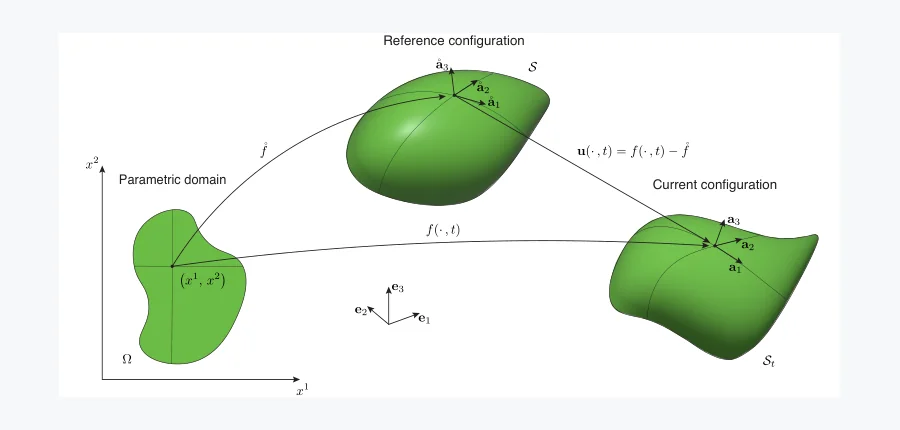 arXiv 2026-10-16 · cond-mat.soft · #2 **[Dynamic morphing of non-Euclidean active shells enabled by flutter under a steady stimulus](https://arxiv.org/abs/2610.20330)** Roberto Marchello ,  Pietro Maria Santucci ,  Giovanni Noselli 机构：SISSA – International School for Advanced Studies（[PDF](https://arxiv.org/pdf/2610.20330)） [Paper](https://arxiv.org/abs/2610.20330) · [图源](https://arxiv.org/html/2610.20330v1/fig_1.png) 

中文摘要
合成主动表面通常被设计为达到指定静态构型，而动态形状变化一般需要调制驱动。我们表明，薄主动壳体可利用颤振失稳，在恒定刺激下维持动态形变。研究对象是浸于黏性流体、受到恒定均匀电场作用的聚电解质水凝胶壳体；我们扩展薄结构的非欧几何框架，以随系统构型和时间演化的自发曲率描述电场诱导的活动。以椭圆板和圆柱壳为例，我们结合线性稳定性分析与非线性仿真，先确定颤振起点，再揭示由产生推力的形状变化表征的后续动力学。所有情况下，涌现行为都源于流体环境中主动重构与弹性的相互作用。对板而言，线性阶段的问题是纯弯曲的，而大形变下弯曲与拉伸的竞争决定后续形状和游动轨迹；对圆柱壳，弯曲与拉伸在所有层级都耦合，且拉伸是维持颤振的关键。毫米尺度水凝胶板实验通过结合数字图像相关与光学体视显微镜的形状重建，为理论结果提供实验证据。因此，颤振为基于主动壳体、在没有固有频率或特征长度尺度的刺激下工作的无系绳软机器人和微流体器件提供了路径。 <a href="https://arxiv.org/abs/2610.20330">原摘要来源</a>
 | 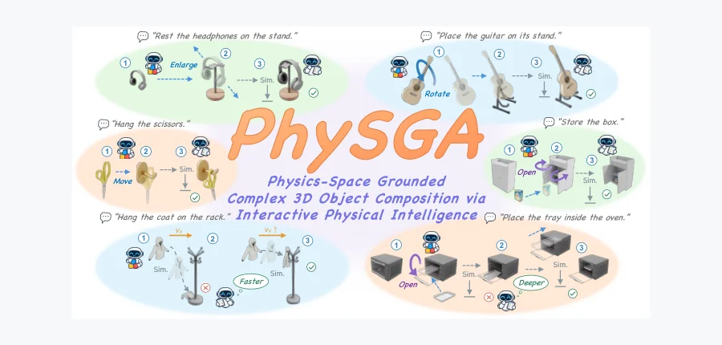 arXiv 2026-10-16 · cs.AI · #3 **[PhySGA: A Physics-Space Grounded Agentic Framework for Generalizable and Interactive 3D Composition](https://arxiv.org/abs/2610.20560)** Weichen Lyu ,  Chong Xia ,  Mingyu Dong ,  Long Xu ,  Shengjun Zhang ,  Yueqi Duan 机构：Tsinghua University / Zhejiang University（[PDF](https://arxiv.org/pdf/2610.20560)） [Paper](https://arxiv.org/abs/2610.20560) · [图源](https://arxiv.org/html/2610.20560v1/teaser.png) 

中文摘要
3D 物体组合既是数字内容创作和机器人仿真的关键，也可检验基础模型的物理智能。以往方法或让大语言模型直接预测物体坐标，或依赖生成扩散先验合成组合图像用于视觉对齐；两者都依赖数字空间中的静态先验，因此在精确悬挂、重力沉降和隐蔽容纳等复杂组合中遇到困难。这些任务需要全局规划、精细对齐和物理仿真构成的交互式搭建过程。为此，我们提出 PhySGA，一种通过智能体探索和物理仿真进行 3D 组合的物理空间锚定框架，支持刚体、关节体和可变形体的通用交互式装配。直接使用普通 LLM 或 VLM 不足以完成该任务，因为当前模型缺乏扎根于物理的理解和交互搭建经验。我们设计前馈与反馈协作架构：Assembly Agent 负责几何和运动学推理、全局步骤规划及粗调整；Critic Agent 推理接触动力学，以诊断仿真器状态并作细粒度闭环修正。Action Routers 将语义规划和分析映射为仿真器内可执行的物理基元；任务专用的自演化技能库把历史试错反馈提炼为可复用经验，以提高成功率并减少探索次数。Isaac Sim 中的大量实验显示，PhySGA 在关系保真度、物理合理性和视觉质量上显著优于现有方法。 <a href="https://arxiv.org/abs/2610.20560">原摘要来源</a>
 |
| 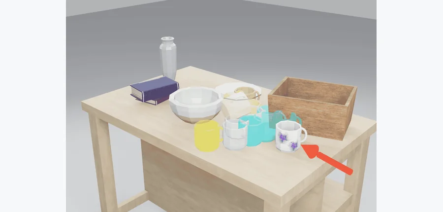 arXiv 2026-10-16 · cs.RO · #4 **[Probabilistic Physics Digital Twin for Human-Robot Interaction](https://arxiv.org/abs/2610.19336)** Yushen Hu ,  Harshvardhan Chandirasekar ,  Apurv Kushwaha ,  Jonathan King ,  Zhu-Tian Chen 机构：University of Minnesota / Howard University（[PDF](https://arxiv.org/pdf/2610.19336)） [Paper](https://arxiv.org/abs/2610.19336) · [图源](https://arxiv.org/pdf/2610.19336) 

中文摘要
数字孪生越来越多地用于机器人交互仿真、动作结果预测和规划，但构建准确孪生体需要精确估计质量、摩擦和质心等物理属性，而这些量在真实环境中往往难以取得。我们提出概率式数字孪生：把不确定的物理属性表示为概率分布，而非固定数值。通过在这些分布上仿真动作，孪生体预测可能结果的范围及其发生概率。概率仿真可识别在物理不确定性下仍有效的动作，从而指导人和机器人。我们通过人机交互场景展示该框架，包括向用户传达仿真结果的界面，以及显式考虑不确定性的机器人规划策略。 <a href="https://arxiv.org/abs/2610.19336">原摘要来源</a>
 | 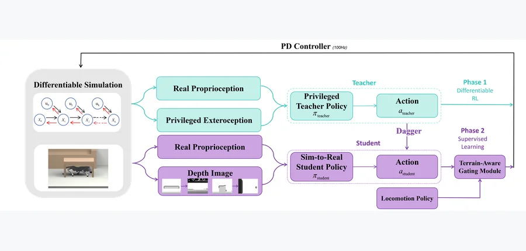 arXiv 2026-10-16 · cs.RO · #5 **[E2DRL: End-to-End Differentiable Reinforcement Learning for 3D Obstacle Avoidance in Quadruped Robots](https://arxiv.org/abs/2610.19627)** Cheng Fan ,  Bingyang Zhou ,  Gang Yang ,  Zixuan Zhuang ,  Aoqian Zhang ,  Pengzhi Yang ,  Xin Liu ,  Chunzheng Wang ,  Y… 机构：National University of Singapore（[PDF](https://arxiv.org/pdf/2610.19627)） [Paper](https://arxiv.org/abs/2610.19627) · [图源](https://arxiv.org/html/2610.19627v1/figures/diagram-new.png) 

中文摘要
可微强化学习在机器人策略学习中前景可观，但此前在足式运动中的应用仍限于盲行或仿真的 2D 任务。把它扩展到端到端视觉避障很难：硬碰撞约束和接触后的提前终止会破坏一阶梯度，使优化器陷入局部极小。我们提出 E2DRL，以软性的可微障碍物交互形式解决该问题：对多个机体关键点施加穿透惩罚，并用以速度为条件的 stop-gradient 塑形，为 3D 避障提供一阶训练信号。为得到可部署的感知控制系统，我们在可微仿真器中用 Soft Analytic Policy Optimization（SAPO）训练特权教师，经 DAgger 蒸馏成基于深度的循环学生策略，再以地形感知门控模块把它与基础运动策略融合部署。在仿真中，E2DRL 比 PPO 有更高样本效率，且速度跟踪和 3D 避障能力优于 PPO 与基于对偶的 DCBF NMPC。我们还在静态和动态环境中的 Unitree Go2 上，给出端到端可微强化学习用于 3D 避障的首次 sim-to-real 验证。 <a href="https://arxiv.org/abs/2610.19627">原摘要来源</a>
 | 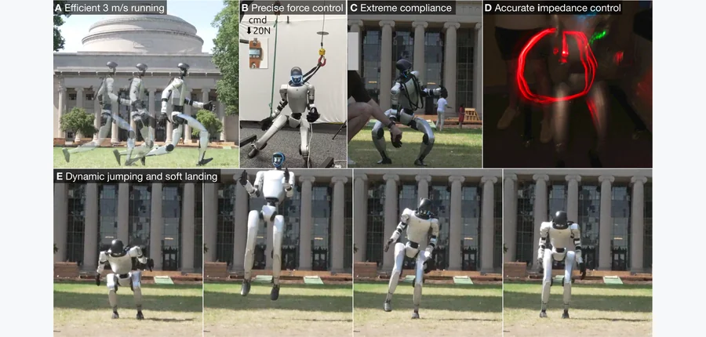 arXiv 2026-10-16 · cs.RO · #6 **[Contact-UAN: Unsupervised Actuator Networks as a Residual World Model for Humanoid Control](https://arxiv.org/abs/2610.18991)** Nolan Fey ,  Khai Nguyen ,  Yash Prabhu ,  Gabriel B. Margolis ,  Pulkit Agrawal 机构：MIT（[PDF](https://arxiv.org/pdf/2610.18991)） [Paper](https://arxiv.org/abs/2610.18991) · [图源](https://arxiv.org/html/2610.18991v1/new_main_figure.png) 

中文摘要
在仿真中训练的人形机器人策略可能看似转移到了硬件，却未能转移训练时学到的力交互，从而损害力矩效率、负载调节和抗冲击能力。原因之一是执行器的 sim-to-real 差异，因为力取决于执行器力矩。我们提出 Contact-UAN：一种保留仿真器物理先验、同时修正执行器动力学的残差世界模型，使仿真轨迹与硬件记录对齐。对有接触的人形运动，这需要接触一致的重放：如果仿真中的硬件轨迹回放从错误对齐的接触力矩开始，残差模型就会学习修正重置伪影，而不是执行器差异。Contact-UAN 仅用机载本体感觉推断仿真器一侧的支撑脚姿态，以一致的接触力初始化重放。我们表明，用 6.5 分钟真实步行数据训练的 UAN 可泛化到依赖准确力和冲量调节的任务，使策略顺利转移到真实世界，带来跑步力矩降低 20%、力跟踪误差降低 43%，以及高度柔顺性、准确阻抗控制和动态稳健跳跃。 <a href="https://arxiv.org/abs/2610.18991">原摘要来源</a>
 |
| 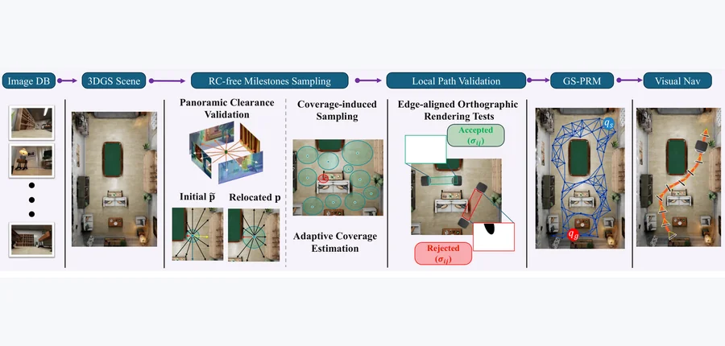 arXiv 2026-10-16 · cs.RO · #7 **[GS-PRM: Gaussian Visual Roadmap for Image-Goal Navigation](https://arxiv.org/abs/2610.19541)** Ashraf Siddique ,  Kyung Min Han ,  Young J. Kim 机构：affiliation 未确认 [Paper](https://arxiv.org/abs/2610.19541) · [图源](https://arxiv.org/html/2610.19541v2/pipeline_simple1_db.png) 

中文摘要
图像目标导航需要能连接视觉指定终点的全局规划器，同时为局部策略提供可跟随的观测。3D Gaussian Splatting（3DGS）提供与地图配准的 RGB、不透明度和深度渲染，却不显式编码可通行拓扑。我们提出 GS-PRM：直接通过 3DGS 渲染建立里程碑、局部连接和视觉参考的高斯视觉路图，无需导出占据栅格或有符号距离场。我们定义基于渲染的无碰撞（RC-free）构型和路径。全景深度为里程碑验证和自适应覆盖提供保守的净空估计，而沿边对齐的正交渲染检查机器人扫掠体积。我们给出条件可靠性，以及确定性查询完备性和概率构图完备性的充分条件。仿真与真实环境实验展示了由 GS-PRM 引导目标条件策略的长时程导航。与先进的 3DGS 导航系统相比，在两个系统都完成任务的情况下，GS-PRM 系统的平均成功率最高可达到其两倍，行进时间最多降低 57.2%。 <a href="https://arxiv.org/abs/2610.19541">原摘要来源</a>
 | 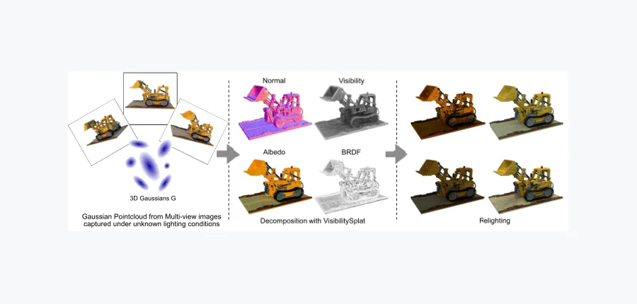 arXiv 2026-10-16 · cs.CV · #8 **[VisibilitySplat: Ray-Traced Occlusion for Relighting with 3D Gaussian Splatting](https://arxiv.org/abs/2610.19847)** Sven Kluge ,  Oliver Staadt 机构：University of Rostock（[PDF](https://arxiv.org/pdf/2610.19847)） [Paper](https://arxiv.org/abs/2610.19847) · [图源](https://arxiv.org/html/2610.19847v1/Teaser.png) 

中文摘要
我们在 3D Gaussian Splatting（3DGS）逆渲染中引入显式可见性建模，用于重光照以及材质和光照分解。方法在标准光栅化 3DGS 流程中加入稀疏可见性查询器，从采样光照方向估计高斯基元的透射率加权遮挡。查询器由包围体层次结构（BVH）加速的点式光线追踪器实现，并在逆渲染目标中稀疏调用；原有 3DGS 循环得以保留，以维持训练效率、交互可视化和工具兼容性。着色采用物理渲染（PBR）形式，包括有原理依据的微表面双向反射分布函数（BRDF）和低分辨率高动态范围（HDR）环境图。我们在 TensoIR 合成数据集上，与基于 NeRF、张量表示和 3DGS 的基线比较。结果在新视角合成（NVS）、反照率重建和重光照上具有竞争力，并优于若干较早基线。消融表明显式可见性是重光照及材质—照明解耦的重要因素，而单纯 PBR 监督可能偏向在 NVS 中拟合外观。总体上，稀疏点式可见性查询可有效补充光栅化 splatting 逆渲染，同时保留 3DGS 生态的实用优势。 <a href="https://arxiv.org/abs/2610.19847">原摘要来源</a>
 | 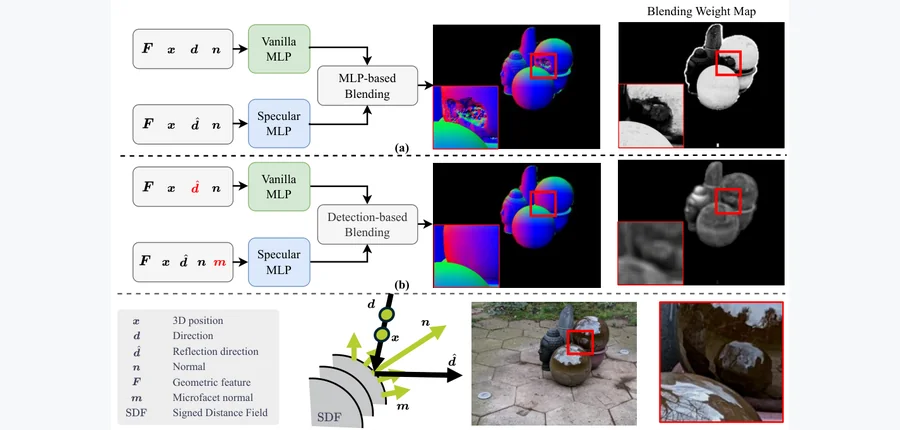 IEEE Transactions on Image Processing (2026) · #9 **[MicroSDF: Microfacet-Driven Hybrid Neural SDFs for Mixed-Reflectance Surface Reconstruction](https://arxiv.org/abs/2610.19681)** Lejia Ye ,  Yuhua Xu ,  Yulan Guo ,  Lian Xu ,  Xiaohu Zhang 机构：Sun Yat-sen University / Orbbec / University of Western Australia（[PDF](https://arxiv.org/pdf/2610.19681)） [Paper](https://arxiv.org/abs/2610.19681) · [图源](https://arxiv.org/html/2610.19681v1/fig-1-fix.png) 

中文摘要
真实环境中，反光和非反光表面并存，对 3D 重建提出不同建模需求。现有方法通常分别处理这两类表面，限制泛化性和物理合理性。我们提出 MicroSDF：通过微表面理论联合建模几何与反射率的神经隐式框架。方法有三项核心设计：（i）微表面引导的几何模型从有符号距离场（SDF）提取宏观和微表面多尺度法线，并用提出的微表面法线一致性损失正则化，以约束物理合理的表面朝向；（ii）增强的双分支颜色模型中，镜面分支用微表面法线建模高频反射，基础分支则不同于以往工作，使用反射方向而非观察方向建模漫反射和低频镜面成分；（iii）检测引导的颜色混合依据反射先验自适应融合颜色输出，比隐式学习的混合权重更符合物理直觉。结合专门的多阶段优化方案，MicroSDF 对反光和非反光表面均实现稳健、高保真重建。在 DTU、Shiny Blender、Ref-NeRF 和 DeepVoxels 上的大量实验显示达到当前最佳表现，为有物理依据的神经重建提供了新方向。 <a href="https://arxiv.org/abs/2610.19681">原摘要来源</a>
 |
| 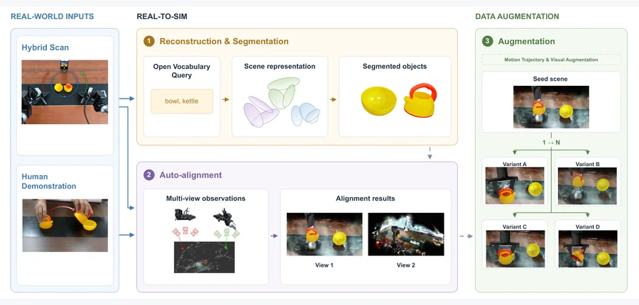 arXiv 2026-10-16 · cs.RO · #10 **[AutoRSR: Automated Real-to-Sim-to-Real Data Generation for Scalable Robot Learning](https://arxiv.org/abs/2610.20336)** Jiawei Zhang ,  Chang Liu ,  Litao Deng ,  Tao Zhang ,  Qin Jin 机构：Renmin University of China（[PDF](https://arxiv.org/pdf/2610.20336)） [Paper](https://arxiv.org/abs/2610.20336) · [图源](https://arxiv.org/html/2610.20336v1/AutoRSR_overview.png) 

中文摘要
大规模具身机器人学习需要多样的操作数据，但真实示教耗费人力和机器人时间。仿真虽能扩展数据，仍需大量人工完成真实工作空间到可用于机器人学习环境的物体提取、资产处理、坐标校准和轨迹指定。我们提出 AutoRSR：把扫描得到的真实工作空间转换成可复用具身仿真资产和可扩展操作数据的高度自动化 real-to-sim-to-real 框架。给定多视角观测、机器人状态和开放词汇语义查询，AutoRSR 重建工作空间、提取单个物体资产，并自动将重建场景以米制尺度配准到机器人基坐标系。从少量参考运动出发，它生成可执行操作轨迹，再通过轨迹插值和领域随机化扩展数据。在工作空间扫描和语义查询后，其余流程无需人工物体标注、场景到机器人的校准或机器人遥操作。在三项真实操作任务中，每项使用 1K 个自动生成 episode 训练的策略取得 73.3%–86.7% 的真实成功率，与使用 150 条人工遥操作示教训练的 pi 0.5 相当，同时使数据生成所需人工时间降低一个数量级。结果表明，真实观测可用大幅降低的人力成本转为米制对齐、可执行且可扩展的仿真数据。 <a href="https://arxiv.org/abs/2610.20336">原摘要来源</a>
 | 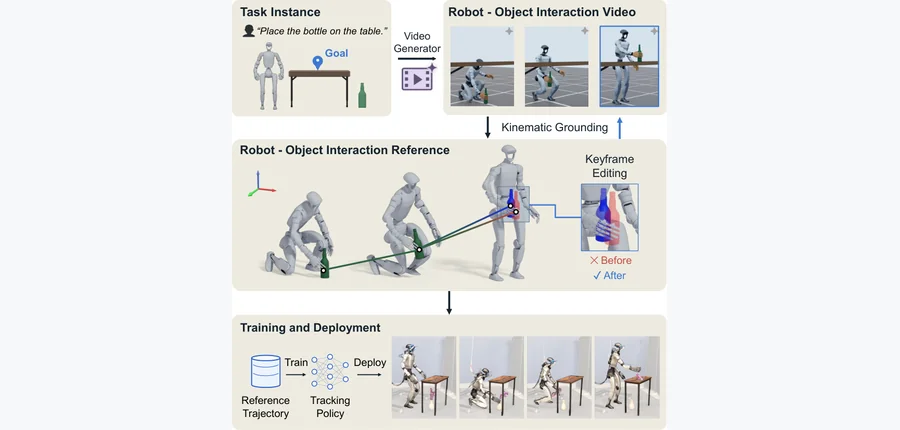 arXiv 2026-10-16 · cs.RO · #11 **[KinoGen: Customizable Humanoid Loco-Manipulation References via Kinematically Grounded Video Generation](https://arxiv.org/abs/2610.20552)** Qi Wu ,  Lulu Zhao ,  Sanghyun Hahn ,  Rishi Yennu ,  Emmy Yang ,  Dingqi Zhang ,  Tao Pang ,  Jiuguang Wang ,  Kuan Fang 机构：Cornell University / Multiply Labs（[PDF](https://arxiv.org/pdf/2610.20552)） [Paper](https://arxiv.org/abs/2610.20552) · [Project](https://kinogen-humanoid.github.io/) · [图源](https://arxiv.org/html/2610.20552v1/teaser_vert2.png) 

中文摘要
我们提出 KinoGen：通过运动学约束的视频生成来合成可定制的人形机器人移动操作参考。KinoGen 以仿真任务实例中目标机器人和物体的校准渲染为条件驱动预训练视频生成器，再把同一模型拟合到生成的双视角视频以恢复参考；由此参考在构造上位于机器人的构型空间中，不需要人体代理或重定向。身体、手和物体先验初始化重建，针对跨视角证据的直接优化进一步细化结果。由于编辑后的关键帧也只是另一种渲染状态，用户可以指定目标物体姿态，在该关键帧附近重新生成视频，得到精确满足姿态的参考。在八项移动操作任务中，KinoGen 相比视频基线产生更少穿透和足部打滑，保留了超过 90% 的标注接触；定制参考满足全部指定目标，且穿透显著少于直接插值。用合成参考训练的跟踪策略部署在配有灵巧手的 Unitree G1 人形机器人上。 项目页见原摘要所附链接。 <a href="https://arxiv.org/abs/2610.20552">原摘要来源</a>
 | 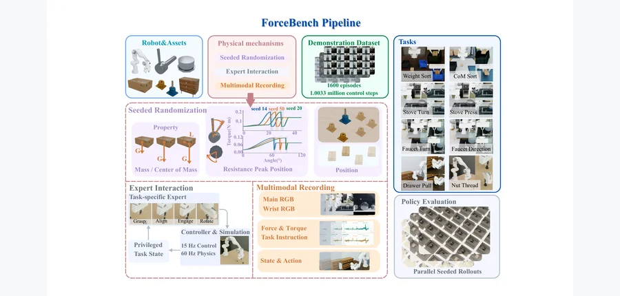 arXiv 2026-10-16 · cs.RO · #12 **[ForceBench: Benchmarking Force Integration for Robotic Manipulation](https://arxiv.org/abs/2610.19604)** Xuan Han ,  Zinuo Jin ,  Tianlin Li ,  Yunfan Lou ,  Xin Liu ,  Yuchen Xue ,  Yuanpeng He ,  Boxian Yao ,  Shuhan Zhan… 机构：Peking University / UC Berkeley / National University of Singapore / ePyBot Intelligence（[PDF](https://arxiv.org/pdf/2610.19604)） [Paper](https://arxiv.org/abs/2610.19604) · [Project](https://forcebench-platform.github.io/) · [图源](https://arxiv.org/html/2610.19604v1/forcebench_pipeline_revision15_20260916.png) 

中文摘要
力反馈可向视觉—语言—动作（VLA）策略提供物理观测，引导动作选择和执行；但不同系统在任务、示教和控制设置上的差异妨碍了可靠比较。我们提出 ForceBench，在统一协议下评估六轴腕部力信息融合的仿真基准。它包含横跨物理属性推断、依赖阻力的交互和富接触装配的八项任务、1,600 条同步示教及任务专属成功标准。我们在共同的 $\pi_{0.5}$ 主干上比较一个无力基线和六种融合设计。Prompt Fusion 在仿真中的平均成功率最高，为 35.31%，无力基线为 23.25%，且在三个任务类别都提高成功率。仿真中的预测和时序收益集中于物理属性推断，而两种时序设计在装配上均低于基线。对五项任务、八个系统的真实评测支持主要定性趋势：Prompt Fusion 和 Dual-Path Fusion 平均成功率均为 63.00%，基线为 40.00%，但只有 Prompt Fusion 在每项任务上都有提升。这些结果支持 ForceBench 用于识别不同操作需求下力信息融合的收益与局限。 项目页见原摘要所附链接。 <a href="https://arxiv.org/abs/2610.19604">原摘要来源</a>
 |
| 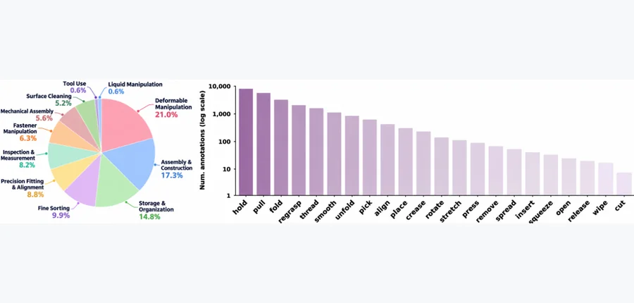 arXiv 2026-10-16 · cs.RO · #13 **[FACT: A Multimodal Force-Action-Track Foundation Model for Human-to-Robot Dexterity](https://arxiv.org/abs/2610.19155)** Zhi Cao ,  Yining Hong ,  Jiaolong Yang ,  Yejin Choi ,  Li Fei-Fei ,  Jiajun Wu ,  Huang Huang 机构：University of Michigan / Stanford University / Microsoft Research（[PDF](https://arxiv.org/pdf/2610.19155)） [Paper](https://arxiv.org/abs/2610.19155) · [图源](https://arxiv.org/html/2610.19155v1/data_statistics_v3.png) 

中文摘要
人类示教为昂贵的机器人数据采集提供了可扩展替代，但多数人类数据集缺乏力测量。灵巧操作不仅需要视觉和本体感觉理解，还需要预测并调节交互力。为扩展有力感知的人机联合训练，我们提出记录富力操作经验的大规模人类触觉数据集 EgoForce，并结合机器人示教预训练。我们提出 FACT：从前瞻视觉规划逐级走向力感知细化的灵巧操作机器人基础模型。FACT 包含两个联合训练的组件。轨迹引导的粗规划器联合预测动作、未来视频和视觉轨迹；未来视频与视觉轨迹还提供共享任务表示，以促进跨形态知识转移和粗动作生成。在此基础上，力—动作联合细化器联合预测未来力并细化粗动作，使预期力和动作在细化中相互影响。我们在十项需要精细协调和力反馈的任务上评估，包括工具使用、乐器演奏和精密实验室操作。微调仅用 10 条机器人轨迹和 90 条人类轨迹时，FACT 优于两个基线，相比 T-Rex 的成功率最高提升 60 个百分点。消融表明，人类预训练数据中的力监督对微调后的机器人表现至关重要，视觉轨迹预测和未来力预测训练也改善灵巧执行。改变微调时人机数据比例的实验进一步表明，FACT 利用人类示教的效果接近利用机器人示教。 <a href="https://arxiv.org/abs/2610.19155">原摘要来源</a>
 | 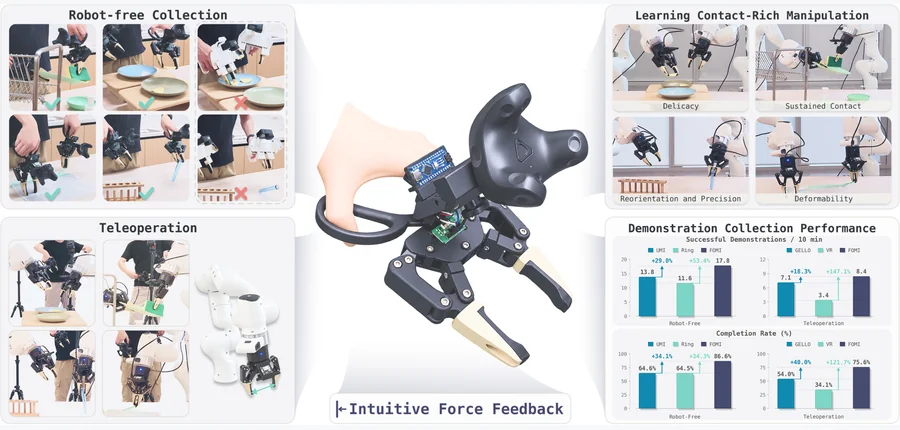 arXiv 2026-10-16 · cs.RO · #14 **[FOMI: A Force-Feedback Manipulation Interface for Teaching Contact-Rich Manipulation](https://arxiv.org/abs/2610.19839)** Yishu Shen ,  Yiming Luo ,  Ruilin Wang ,  Bowen Yang ,  Shuai Yang ,  Fangyi Xu ,  Yujun Shen ,  Fu Zhang ,  Boyu Zhou… 机构：HKUST / The University of Hong Kong / Robbyant / SUSTech（[PDF](https://arxiv.org/pdf/2610.19839)） [Paper](https://arxiv.org/abs/2610.19839) · [图源](https://arxiv.org/html/2610.19839v1/images/1.png) 

中文摘要
使用手持接口、不依赖机器人采集人类示教，可扩展策略学习数据；但现有接口通常缺乏直观的力反馈，使富接触示教采集对操作者很困难。为此，我们提出 FOMI：一种剪刀形机构的力反馈操作接口，无需力传感器，而是通过驱动连杆把物体交互力直接传到操作者双手。这种直观的力反馈支持人在无机器人采集时实时调整动作。围绕 FOMI，我们构建集成传感器校准、数据采集和同步的示教系统。进一步将 FOMI 的姿态变化和夹爪开合映射为机器人末端姿态与夹爪指令后，系统也支持遥操作。在四项富接触任务中，相比最强基线，FOMI 在无机器人采集和遥操作下的采集效率分别提高约 29% 和 18%。两种模式下采得的示教使策略能以较高成功率完成困难的富接触操作任务。 <a href="https://arxiv.org/abs/2610.19839">原摘要来源</a>
 | 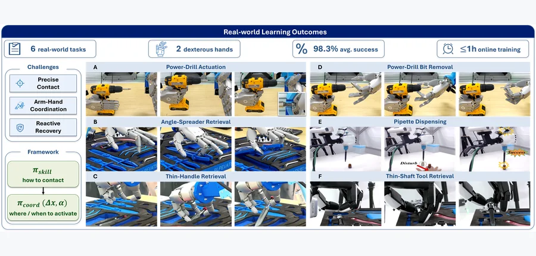 arXiv 2026-10-16 · cs.RO · #15 **[HiFun: a Hierarchical Framework for Efficient Functional Dexterous Manipulation Learning](https://arxiv.org/abs/2610.19518)** Linyi Huang ,  Guowei Huai ,  Weibin Liu ,  Shulong Jiang ,  Ping Tan ,  Weixuan Zhang ,  Hui Zhang ,  Jie Song 机构：HKUST (Guangzhou) / HKUST / ETH Zurich（[HTML](https://arxiv.org/html/2610.19518)） [Paper](https://arxiv.org/abs/2610.19518) · [Project](https://hly-123.github.io/HiFun/) · [图源](https://arxiv.org/html/2610.19518v1/figures/Teaser_V10.png) 

中文摘要
多指灵巧手有望实现接近人类的灵巧性，但功能性操作仍很困难，因为任务成功依赖精确接触、协调的手臂—手部运动，以及执行出错后的反应式恢复。精确接触涉及难以在仿真中准确建模的复杂接触动力学，因此需要真实世界学习；但在完整手臂—手部控制空间中采集真实示教昂贵且噪声大，因为每条轨迹都要协调手臂运动与高自由度多指接触。微小的执行偏差还可能使接触滑脱或过早施力，因此从非标准接触状态中恢复很重要。我们提出 HiFun：面向功能性灵巧操作的分层真实世界强化学习框架。核心是把控制复杂性拆为执行精确接触的功能性手部技能，以及负责手臂控制和手部技能激活的协调策略。这使实时人工干预可用于学习反应式恢复，并借助动态运动基元（DMP）增强高效采集数据。在两种灵巧手的六项真实任务上，HiFun 在一小时在线训练内达到 98.3% 平均成功率，对动态扰动保持稳健。 项目页见原摘要所附链接。 <a href="https://arxiv.org/abs/2610.19518">原摘要来源</a>
 |
| 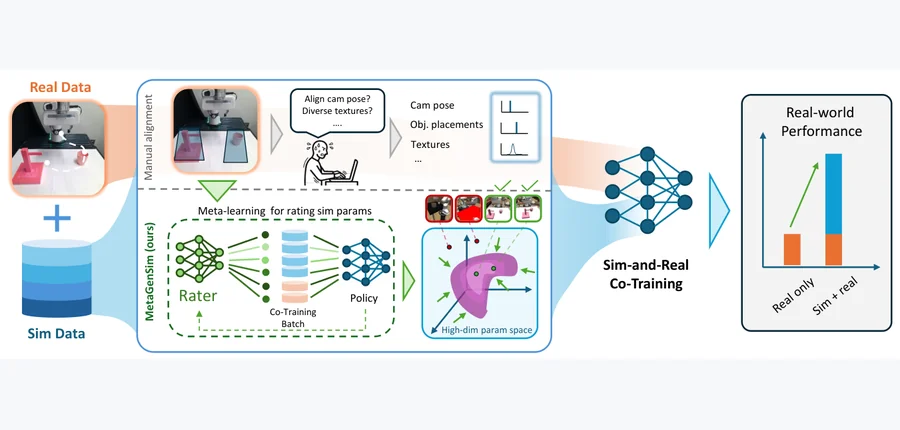 arXiv 2026-10-16 · cs.RO · #16 **[Active Generative Simulation: Meta-Learning What to Simulate for Sim-and-Real Policy Co-Training](https://arxiv.org/abs/2610.19479)** Liqian Ma ,  Vaibhav Saxena ,  Utkarsh Aashu Mishra ,  Shuo Cheng ,  Yongxin Chen ,  Danfei Xu 机构：Georgia Institute of Technology（[PDF](https://arxiv.org/pdf/2610.19479)） [Paper](https://arxiv.org/abs/2610.19479) · [Project](https://meta-gensim.github.io) · [图源](https://arxiv.org/html/2610.19479v1/teaser.png) 

中文摘要
真实与仿真联合训练可用仿真数据扩充有限的真实示教，以扩展机器人学习。但现有做法多将仿真器视为固定数据源，依赖均匀生成、离线检索或专家手工对齐参数。我们提出“主动生成式仿真”：优化仿真器的数据生成分布，使下游真实表现最大化。为此，我们提出 MetaGenSim，一种元学习框架，通过元梯度训练辅助评分网络，在用户指定的仿真参数空间中自动寻找高效用的数据生成分布，无需人工参数对齐。在仿真和真实操作任务中，MetaGenSim 优于均匀生成与检索基线；相比均匀生成，真实全任务成功率相对提高 150%，并达到专家手工对齐的水平。我们还表明，轻量代理策略筛选出的分布可转移到 VLA 微调；当真实与仿真任务无法精确对齐时，MetaGenSim 可通过原子技能拼接和物体—容器组合利用部分对齐。 项目页见原摘要所附链接。 <a href="https://arxiv.org/abs/2610.19479">原摘要来源</a>
 | 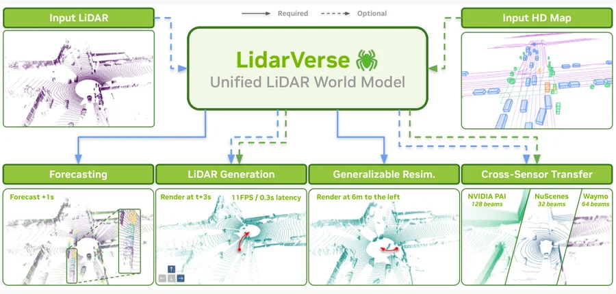 arXiv 2026-10-16 · cs.CV · #17 **[Into the LidarVerse: A Real-Time Unified LiDAR World Model Across Tasks and Sensors](https://arxiv.org/abs/2610.19201)** Henry Che ,  Xuanchi Ren ,  Sanja Fidler ,  Shenlong Wang ,  Laura Leal-Taixé ,  Shengyu Huang 机构：NVIDIA / University of Illinois Urbana-Champaign / University of Toronto（[HTML](https://arxiv.org/html/2610.19201)） [Paper](https://arxiv.org/abs/2610.19201) · [图源](https://arxiv.org/html/2610.19201v1/teaser.png) 

中文摘要
我们提出 LidarVerse：一个跨任务和传感器、实时运行的统一 LiDAR 世界模型，用于传感器仿真。现有 LiDAR 仿真器主要有两类互补范式：基于重建的方法保留已采场景几何，却要逐场景长时间优化；生成式方法能跨数据摊销学习成本，但缺少长时程展开所需的一致性。LidarVerse 将两者纳入统一的条件生成框架。通用 tokenizer 把 LiDAR 距离序列映射到共享潜空间，双向教师学习以 LiDAR 前缀、高精地图、持久空间缓存以及可选文本为条件的共同接口。依场景证据的可用程度，同一模型可生成新世界、预测点云，或在不逐场景优化的情况下对已观测场景进行可泛化的再仿真。我们把教师蒸馏为四步自回归因果学生，并同时维持滚动时间 K/V 缓存和世界坐标对齐的空间缓存，使其可在单张 H100 GPU 上以 11 FPS 实时进行持久长时程展开。LidarVerse 在三项评测协议的大多数报告指标上达到当前最佳；其 tokenizer 支持 32、64 和 128 线 LiDAR，并泛化到未见过的扫描模式。结果表明，生成式与重建锚定的 LiDAR 仿真可在同一模型中实现，为未来闭环传感器仿真提供核心能力。 <a href="https://arxiv.org/abs/2610.19201">原摘要来源</a>
 | 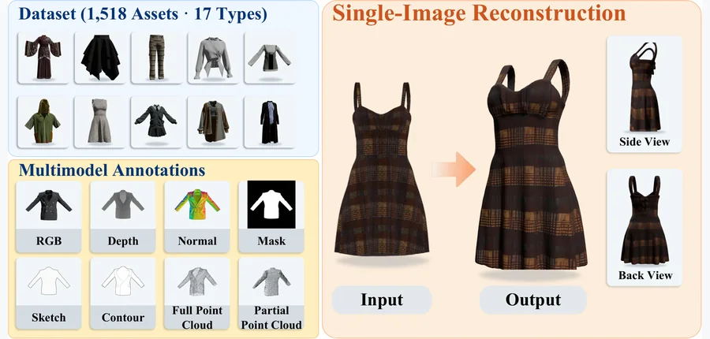 arXiv 2026-10-16 · cs.CV · #18 **[MagicGarment: Benchmarking Single-Image Standalone 3D Garment Reconstruction](https://arxiv.org/abs/2610.19623)** Jia Chen ,  Ruyang Zhao ,  Jun Bai ,  Chao Huang ,  Saishang Zhong ,  Xinrong Hu 机构：Wuhan Textile University / McGill University（[PDF](https://arxiv.org/pdf/2610.19623)） [Paper](https://arxiv.org/abs/2610.19623) · [Project](https://1019538157.github.io/MagicGarment/) · [图源](https://arxiv.org/html/2610.19623v1/Fig1_Overview_of_MagicGarment.png) 

中文摘要
单图像 3D 重建进展很快，但独立衣物仍因薄壳几何、开放边界和分层结构而困难。现有数据集与评测协议不足以系统评估这一情形。我们提出 MagicGarment：单图像独立衣物 3D 重建基准，包含 17 类复合衣物中的 1,518 个专业构建资产、对齐的多模态标注和统一评测协议。我们还通过两级适配预训练图像到 3D 主干，建立衣物感知的参考基线：Grounded Semantic Refinement（GSR）提供面向衣物的视觉条件；Flow-Time-Route LoRA（FTR-LoRA）利用流时间步、token 路由和专家负载信息，适配冻结的 3D 生成主干。实验展示了 MagicGarment 的基准用途及衣物感知适配的效果。 项目页见原摘要所附链接。 <a href="https://arxiv.org/abs/2610.19623">原摘要来源</a>
 |
| 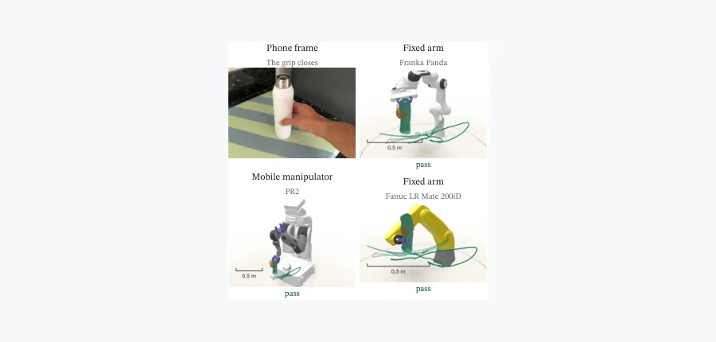 arXiv 2026-10-16 · cs.RO · #19 **[Human Demonstrations as Post-Training Data for Any Robot Body: Retargeting the Object, Not the Hand](https://arxiv.org/abs/2610.20351)** Nagasrikanth Kallakuri 机构：Dxtr AI Co.（[PDF](https://arxiv.org/pdf/2610.20351)） [Paper](https://arxiv.org/abs/2610.20351) · [图源](https://arxiv.org/html/2610.20351v1/fig_teaser.png) 

中文摘要
人类示教目前主要用于视觉—语言—动作模型预训练，难以把同一数据用于目标机器人形态或任务定向的训练，而机器人在工业及一般环境中的规模部署需要这种能力。用手机等简单、可扩展设备记录的人类示教，即使目标机器人的身体结构和能力不同，也可能成为其后训练数据。关键是重定向物体而非手部运动。一次采集产生与身体无关的记录：物体随时间的姿态、接触区间，以及有来源记录的重建 3D 物体。给定任意机器人的 URDF 和简短描述，系统依据该记录求解，并在仿真中以示教物体运动为真值逐机器人评分；这是 human-to-simulation-to-robot 转移中按机器人测量的 human-to-simulation 阶段。每个“机器人、episode”配对在动作前得到一种结果：通过、带命名失败模式的失败，或附原因的拒绝。方法在持续增长的采集库上运行；本文分析其中样本：42 次采集、8 个机器人、157 个配对，31.2% 通过、52.2% 失败、14.0% 被拒绝、2.5% 无法审计（在仿真中按运动学可行性和 ±50 mm／±15° 判定）。拒绝检查得到验证：在存储证据上被拒却仍运行的 13 个配对全部失败，其中 5 个来自公开模型把手焊接固定的机器人。仅凭描述文件无法筛查机器人，其结果的可预测性几乎不高于猜测。尚未利用该记录训练任何策略；记录只决定机器人可以用哪些数据后训练，策略能否在真实机器人上工作仍是后续 simulation-to-robot 问题。 <a href="https://arxiv.org/abs/2610.20351">原摘要来源</a>
 | 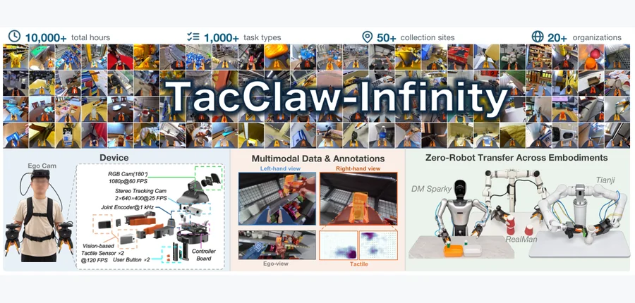 arXiv 2026-10-16 · cs.RO · #20 **[TacClaw-Infinity: A Large-Scale Vision-Tactile-Language-Action Dataset for Dexterous Manipulation](https://arxiv.org/abs/2610.20320)** Fucai Zhu ,  Xidong Zhang ,  Yichi Zhang ,  Yipan Wang ,  Fubo Wang ,  Zibin Wu ,  Kaiqi Li ,  Jianhao Jiao ,  Shihan Lu… 机构：Daimon Robotics / Nanjing University / Great Bay University 等 16 家机构（[PDF](https://arxiv.org/pdf/2610.20320)） [Paper](https://arxiv.org/abs/2610.20320) · [图源](https://arxiv.org/html/2610.20320v1/teaser.png) 

中文摘要
大规模机器人学习越来越依赖多样的人类示教，但触觉操作数据难以大规模采集，现有多模态数据集也常缺乏统一质控和结构化监督。我们提出 TacClaw-Infinity：一个面向富接触操作的大规模结构化视觉—触觉—语言—动作（VTLA）数据集。它由 TacClaw 采集；这是一种带触觉的 UMI 式手持接口，可同步记录视觉观测、指尖触觉信号和末端轨迹，采集时不需要目标机器人。数据集通过全球分布式采集建立，覆盖住宅、实验室、工业场所、零售店及户外环境，并包含学术和工业合作者提供的任务。最终得到超过 10,000 小时、100 万个 episode、10 亿帧、超过 1,000 类任务。我们开发可扩展的轨迹重建、多模态质控、形态感知过滤和结构化标注流水线，标注涵盖以接触为中心的分段、子任务描述和空间定位。我们从数据与模型两个层面验证数据集：数据层面评估采集接口、筛选后示教与动作空间的兼容性及结构化标注；模型层面展示在没有机器人专用示教的情况下，跨三种异构机器人的形态转移。 <a href="https://arxiv.org/abs/2610.20320">原摘要来源</a>
 | 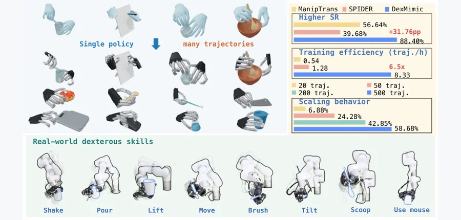 arXiv 2026-10-16 · cs.RO · #21 **[DexMimic: A Generalist Dexterous Hand-Object Tracking Policy via Value-Guided Reset Allocation](https://arxiv.org/abs/2610.19089)** Zhexi Luo ,  Zhixuan Xu ,  Rui Yang ,  Zeyu Xiao ,  Yiwen Hou ,  Lin Shao 机构：National University of Singapore / RoboScience（[PDF](https://arxiv.org/pdf/2610.19089)） [Paper](https://arxiv.org/abs/2610.19089) · [图源](https://arxiv.org/html/2610.19089v2/dexmimic_teaser.png) 

中文摘要
实现类人的灵巧操作仍是机器人学核心挑战。人类手物交互（HOI）数据为学习多样灵巧技能提供路径，但现有基于物理的方法通常逐轨迹训练专门策略，限制了大规模技能复用。我们提出 DexMimic：跨多样 HOI 轨迹联合训练的通用灵巧手物跟踪策略。高效联合训练需要把每次 rollout 同时分配到训练不足的阶段和支持继续跟踪的起始状态。DexMimic 以 Value-Guided Reset Allocation 实现这一点：在线调整初始化分布，优先选择困难阶段，并选取预期跟踪回报较高的重置状态。我们还提出覆盖训练、微调和泛化的基准。实验显示更高的跟踪成功率和训练效率、更快的微调，以及对未见轨迹和物体零样本泛化的潜力；更大的训练集进一步提高效率和泛化。最后，我们在真实灵巧操作平台上验证 DexMimic。 <a href="https://arxiv.org/abs/2610.19089">原摘要来源</a>
 |
| 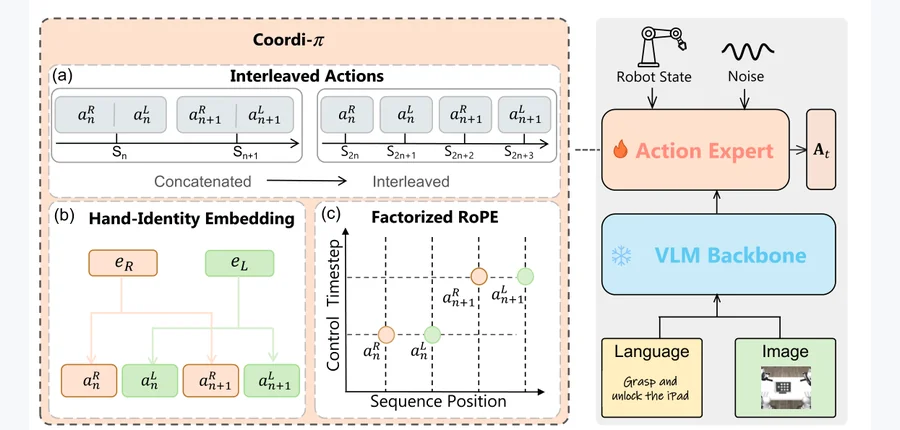 arXiv 2026-10-16 · cs.RO · #22 **[Coordi-pi: Coordination-Aware Dual-Hand Action Representation for Bimanual Dexterous Manipulation](https://arxiv.org/abs/2610.19753)** Yiming Meng ,  Yanming Shao ,  Weijie Shen ,  Kunyang Lin ,  Jiayu Sun ,  Ping Luo ,  Yao Mu 机构：Shanghai Jiao Tong University / The University of Hong Kong（[PDF](https://arxiv.org/pdf/2610.19753)） [Paper](https://arxiv.org/abs/2610.19753) · [图源](https://arxiv.org/html/2610.19753v1/xitong.png) 

中文摘要
视觉—语言—动作（VLA）模型在通用机器人操作上很有潜力，但扩展到双手灵巧操作时会遇到高维且有结构的动作空间。现有双手 VLA 策略常在每个控制时刻拼接左右手臂和手部动作，把跨手相互作用隐含在单个动作向量中。我们提出 Coordi-$\pi$：一种结构化双手灵巧操作动作表示。它把左右手臂—手部动作分别表示为动作 token，并组织成交错序列，从而在动作序列中显式呈现两侧。为在该表示中编码手的身份和时间同步，可学习的手身份嵌入区分左右侧；将序列位置与控制时刻分解的旋转位置编码（RoPE），使同一控制时刻的动作共享时间坐标，同时保有不同序列位置。在 DexJoCo 的五项双手灵巧操作任务中，Coordi-$\pi$ 在 rand-obj 和 rand-full 两种设置下均达到当前最佳，相比 $\pi_{0.5}$，平均成功率分别从 31.9% 提高到 51.3%、从 18.3% 提高到 32.3%。在四项真实双手灵巧操作任务中，Coordi-$\pi$ 也持续优于 $\pi_{0.5}$。 <a href="https://arxiv.org/abs/2610.19753">原摘要来源</a>
 |  arXiv 2026-10-16 · cs.CV · #23 **[Why 3D Reconstruction Breaks Down on Under-Ice AUV Video, and How to Predict It](https://arxiv.org/abs/2610.19993)** Ana-Ştefania Kogălniceanu ,  Klára Orbán ,  Ashwin Nedungadi ,  Stefan Lüdtke ,  Kuderna-Iulian BenÅ£a 机构：Babeș-Bolyai University / University of Rostock（[PDF](https://arxiv.org/pdf/2610.19993)） [Paper](https://arxiv.org/abs/2610.19993) · [图源](https://arxiv.org/html/2610.19993v1/images/vggt_v2/vggt1_cropped.png) 

中文摘要
用冰下自主水下航行器（AUV）视频重建 3D 结构一直不准确，但尚不清楚原因是方法不足还是采集系统本身的局限。我们在同一段南极冰下 AUV 视频（Icefin、Kamb Ice Stream）上测试四类重建模型：经典特征匹配 SfM、可微光度 splatting、体积深度融合以及无位姿的前馈基础模型。四者都失败，但方式不同：几乎无法配准、结构近乎不存在；光度指标看似正常但几何破碎；持续的覆盖伪影；跨片段尺度不稳定。我们表明，这四种失败都符合相同采集情形：相机基线相对于场景深度很小。基于此分析，我们提出检测系统，可在几分钟内标记这类失败，而不必先浪费数小时计算。 <a href="https://arxiv.org/abs/2610.19993">原摘要来源</a>
 | 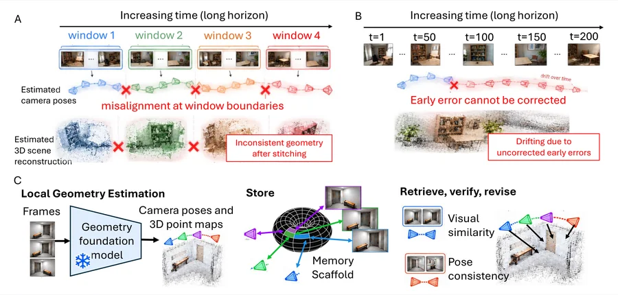 arXiv 2026-10-16 · cs.CV · #24 **[Remember, Revisit, Revise: Scaffold Memory for Long-Horizon 3D Geometry](https://arxiv.org/abs/2610.19674)** Soumick Sarker ,  Mengmi Zhang 机构：Nanyang Technological University（[PDF](https://arxiv.org/pdf/2610.19674)） [Paper](https://arxiv.org/abs/2610.19674) · [图源](https://arxiv.org/html/2610.19674v1/images/fig1_new.png) 

中文摘要
几何基础模型从视频序列估计相机位姿和 3D 场景结构，但保持长时程重建一致性仍很难。前馈模型把长序列分成独立、固定长度的帧窗口，再对齐预测，造成位姿和重建误差逐窗累积；流式模型保留过去帧信息，却无法在后续观测揭示错误时修正早先估计。我们提出 SMORE：为冻结的几何基础模型配备可修订外部记忆，以支持长时程推理。受生物大脑海马体联想记忆启发，该记忆关联观察者的位置与所见内容，使过去观测可被存储、检索、与新证据核验，并在不一致时修订。我们用八个有竞争力的几何模型、五个数据集评估，涵盖相机位姿、多视角深度、3D 点云重建、同步定位与建图（SLAM）及新视角合成。对所有受评模型，SMORE 均改进长序列位姿估计，使多视角深度误差最多降低 58%、3D 点云重建的 Chamfer 距离最多降低 43%，并在长时程 SLAM 中达到低至 2.9 cm 的平均轨迹误差。通过保留修正后的位姿和观测，它还提高大规模 3D 场景重建的保真度与空间一致性。这些结果表明，可修订外部记忆是把预训练几何模型从固定上下文预测扩展到长序列迭代纠错推理的灵活接口。 <a href="https://arxiv.org/abs/2610.19674">原摘要来源</a>
 |
| 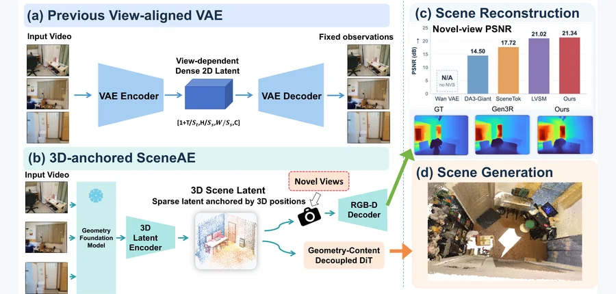 arXiv 2026-10-16 · cs.CV · #25 **[SceneAE: Scene Generation and Reconstruction in Queryable 3D-Anchored Latent Space](https://arxiv.org/abs/2610.19708)** Shuofeng Sun ,  Wenzhao Zheng ,  Yunpeng Zhang ,  Yi Wu ,  Linqing Zhao ,  Haibin Yan 机构：Beijing University of Posts and Telecommunications / UC Berkeley / PhiGent Robotics / SynapX（[PDF](https://arxiv.org/pdf/2610.19708)） [Paper](https://arxiv.org/abs/2610.19708) · [图源](https://arxiv.org/html/2610.19708v1/teaser.png) 

中文摘要
近期视频世界模型越来越多地使用 3D 记忆，把历史观测整合进轻量而持久的场景表示。这引出另一个问题：若 3D 表示可有效记忆已观测场景，能否直接作为重建与生成场景的潜空间？我们据此把场景表示为紧凑、无结构的 3D 锚定潜空间 SceneAE。每个潜变量结合显式 3D 位置与隐式内容特征，并在空间上锚定于局部场景区域，组成稀疏潜点云。传统视频 VAE 潜变量描述场景从特定视角看起来如何；我们的表示直接描述场景本身，因此天然适用于重建和生成。对重建而言，场景生成后，持久的 3D 表示可投影并解码成不同目标相机的 RGB-D 观测，而无需为每条新相机轨迹重新生成视频。对生成而言，我们利用几何与内容分离，先生成可控相机的 3D 几何，再以此为条件合成内容，减少相机与外观的纠缠，增强相机可控性。实验显示，该 3D 潜表示在生成质量、计算成本和相机可控性上表现更好。 <a href="https://arxiv.org/abs/2610.19708">原摘要来源</a>
 | 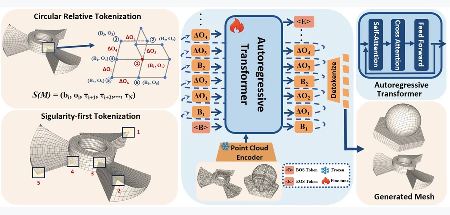 arXiv 2026-10-16 · cs.CV · #26 **[Q-MAGIC: Quad-only Mesh Autoregressive Generation via Singularity-Aware Circular Relative Offset Tokenization](https://arxiv.org/abs/2610.19777)** Yuming Zhao ,  Zezeng Li ,  Weimin Wang ,  Xiang Wu ,  Na Lei 机构：affiliation 未确认 [Paper](https://arxiv.org/abs/2610.19777) · [图源](https://arxiv.org/html/2610.19777v1/figures/pipeline.png) 

中文摘要
自回归模型可把三角网格生成转换为逐面预测，把不可微的连通关系预测变为 token 序列预测。但纯四边形网格更难生成，因为四边形面对拓扑的约束比三角形更严格：模型既要把面序列化为有效 token 序列，也要支持反序列化时无歧义地重建连通关系。我们提出 Q-MAGIC，一种四边形网格自回归生成模型。首先设计专门的四边形网格序列化方案：下一面至少需要两个新顶点，严格的接线约束使其灵活性低于三角网格。为满足这些要求并缩短序列，我们提出奇点感知序列化，优先从奇点接线，得到更连贯的遍历。另提出环形相对偏移 token 化，主要以局部相对偏移编码几何。基于此表示，自回归 Transformer 通过下一个 token 预测学习四边形网格分布，从而有效生成网格。大量实验显示，Q-MAGIC 产生更紧凑的序列，同时相较现有最佳方法持续提高几何保真度和网格质量。 <a href="https://arxiv.org/abs/2610.19777">原摘要来源</a>
 |   |
<!-- PAPER_CARDS_END -->

## 检索概况

- **本轮时间与窗口**：北京时间 2026-10-16 09:06；相对 [2026-10-15 日报](2026-10-15.md)，新增官方 **Thursday, 15 October 2026** 批次。
- **范围与来源**：逐页核对 arXiv 官方 `new`：`cs`（覆盖 cs.CV / cs.GR / cs.RO / cs.AI / cs.LG 等）、`physics`、`cond-mat`、`math`、`stat.ML`、`eess.IV`、`eess.SY`、`eess.SP`。以下分类页计数为原始记录，跨页面可能重复。
- **总命中 / 入选**：官方 New 共 **1,417** 个不同 arXiv ID，经标题与原摘要逐篇筛选收录 **26** 篇；Cross **229** 条、Replacement **1,042** 条均不进入主榜。
- **排序与证据**：优先 3D 几何与力学、接触、形变、材料、仿真的交叉；其后为具体机器人任务与基础 3D 方法。下文标注 **[事实]** 的内容是论文原摘要的作者陈述，并非独立复现；相关性、机构强度、阅读优先级、局限和建议均为 **[推断]**。标题、作者、分类、英文摘要可点击 arXiv 来源核对。

## 官方 listing 状态

| 分类页面 | 官方批次 | New | Cross | Replacement |
|---|---|---:|---:|---:|
| [cs/new](https://arxiv.org/list/cs/new?show=2000) | Thursday, 15 October 2026 | 882 | 66 | 574 |
| [physics/new](https://arxiv.org/list/physics/new?show=2000) | Thursday, 15 October 2026 | 66 | 32 | 69 |
| [cond-mat/new](https://arxiv.org/list/cond-mat/new?show=2000) | Thursday, 15 October 2026 | 84 | 28 | 65 |
| [math/new](https://arxiv.org/list/math/new?show=2000) | Thursday, 15 October 2026 | 366 | 50 | 273 |
| [stat.ML/new](https://arxiv.org/list/stat.ML/new?show=2000) | Thursday, 15 October 2026 | 27 | 31 | 30 |
| [eess.IV/new](https://arxiv.org/list/eess.IV/new?show=2000) | Thursday, 15 October 2026 | 6 | 2 | 3 |
| [eess.SY/new](https://arxiv.org/list/eess.SY/new?show=2000) | Thursday, 15 October 2026 | 23 | 15 | 13 |
| [eess.SP/new](https://arxiv.org/list/eess.SP/new?show=2000) | Thursday, 15 October 2026 | 25 | 5 | 15 |

## Top papers

| # | 论文 | arXiv | 分类 | 作者 | 机构 | 相关性（推断） | 机构强度（推断） | 阅读优先级（推断） |
|---:|---|---|---|---|---|---|---|---|
| 1 | DiffGIPC: Differentiable Mixed-Coordinate Contact Dynamics on GPU | [arXiv:2610.19091](https://arxiv.org/abs/2610.19091) | cs.GR | Kemeng Huang ,  Bowen Ren ,  Xinyu Lu ,  Minchen Li ,  Taku komura | The University of Hong Kong / TransGP / Carnegie Mellon University（[PDF](https://arxiv.org/pdf/2610.19091)） | 高（3D/物理交叉） | 高 | 高 |
| 2 | Dynamic morphing of non-Euclidean active shells enabled by flutter under a steady stimulus | [arXiv:2610.20330](https://arxiv.org/abs/2610.20330) | cond-mat.soft | Roberto Marchello ,  Pietro Maria Santucci ,  Giovanni Noselli | SISSA – International School for Advanced Studies（[PDF](https://arxiv.org/pdf/2610.20330)） | 高（3D/物理交叉） | 中高 | 高 |
| 3 | PhySGA: A Physics-Space Grounded Agentic Framework for Generalizable and Interactive 3D Composition | [arXiv:2610.20560](https://arxiv.org/abs/2610.20560) | cs.AI | Weichen Lyu ,  Chong Xia ,  Mingyu Dong ,  Long Xu ,  Shengjun Zhang ,  Yueqi Duan | Tsinghua University / Zhejiang University（[PDF](https://arxiv.org/pdf/2610.20560)） | 高（3D/物理交叉） | 高 | 高 |
| 4 | Probabilistic Physics Digital Twin for Human-Robot Interaction | [arXiv:2610.19336](https://arxiv.org/abs/2610.19336) | cs.RO | Yushen Hu ,  Harshvardhan Chandirasekar ,  Apurv Kushwaha ,  Jonathan King ,  Zhu-Tian Chen | University of Minnesota / Howard University（[PDF](https://arxiv.org/pdf/2610.19336)） | 高（3D/物理交叉） | 中高 | 高 |
| 5 | E2DRL: End-to-End Differentiable Reinforcement Learning for 3D Obstacle Avoidance in Quadruped Robots | [arXiv:2610.19627](https://arxiv.org/abs/2610.19627) | cs.RO | Cheng Fan ,  Bingyang Zhou ,  Gang Yang ,  Zixuan Zhuang ,  Aoqian Zhang ,  Pengzhi Yang ,  Xin Liu ,  Chunzheng Wang ,  Yan Rui Tan ,  Fan Shi | National University of Singapore（[PDF](https://arxiv.org/pdf/2610.19627)） | 高（3D/物理交叉） | 中高 | 高 |
| 6 | Contact-UAN: Unsupervised Actuator Networks as a Residual World Model for Humanoid Control | [arXiv:2610.18991](https://arxiv.org/abs/2610.18991) | cs.RO | Nolan Fey ,  Khai Nguyen ,  Yash Prabhu ,  Gabriel B. Margolis ,  Pulkit Agrawal | MIT（[PDF](https://arxiv.org/pdf/2610.18991)） | 高（3D/物理交叉） | 高 | 高 |
| 7 | GS-PRM: Gaussian Visual Roadmap for Image-Goal Navigation | [arXiv:2610.19541](https://arxiv.org/abs/2610.19541) | cs.RO | Ashraf Siddique ,  Kyung Min Han ,  Young J. Kim | affiliation 未确认 | 高（3D/物理交叉） | 未评估 | 高 |
| 8 | VisibilitySplat: Ray-Traced Occlusion for Relighting with 3D Gaussian Splatting | [arXiv:2610.19847](https://arxiv.org/abs/2610.19847) | cs.CV | Sven Kluge ,  Oliver Staadt | University of Rostock（[PDF](https://arxiv.org/pdf/2610.19847)） | 高（3D/物理交叉） | 中高 | 高 |
| 9 | MicroSDF: Microfacet-Driven Hybrid Neural SDFs for Mixed-Reflectance Surface Reconstruction | [arXiv:2610.19681](https://arxiv.org/abs/2610.19681) | cs.CV | Lejia Ye ,  Yuhua Xu ,  Yulan Guo ,  Lian Xu ,  Xiaohu Zhang | Sun Yat-sen University / Orbbec / University of Western Australia（[PDF](https://arxiv.org/pdf/2610.19681)） | 高（3D/物理交叉） | 中高 | 高 |
| 10 | AutoRSR: Automated Real-to-Sim-to-Real Data Generation for Scalable Robot Learning | [arXiv:2610.20336](https://arxiv.org/abs/2610.20336) | cs.RO | Jiawei Zhang ,  Chang Liu ,  Litao Deng ,  Tao Zhang ,  Qin Jin | Renmin University of China（[PDF](https://arxiv.org/pdf/2610.20336)） | 高（3D/物理交叉） | 中高 | 高 |
| 11 | KinoGen: Customizable Humanoid Loco-Manipulation References via Kinematically Grounded Video Generation | [arXiv:2610.20552](https://arxiv.org/abs/2610.20552) | cs.RO | Qi Wu ,  Lulu Zhao ,  Sanghyun Hahn ,  Rishi Yennu ,  Emmy Yang ,  Dingqi Zhang ,  Tao Pang ,  Jiuguang Wang ,  Kuan Fang | Cornell University / Multiply Labs（[PDF](https://arxiv.org/pdf/2610.20552)） | 高（3D/物理交叉） | 中高 | 中高 |
| 12 | ForceBench: Benchmarking Force Integration for Robotic Manipulation | [arXiv:2610.19604](https://arxiv.org/abs/2610.19604) | cs.RO | Xuan Han ,  Zinuo Jin ,  Tianlin Li ,  Yunfan Lou ,  Xin Liu ,  Yuchen Xue ,  Yuanpeng He ,  Boxian Yao ,  Shuhan Zhan ,  Ruihai Wu ,  Zhibo Pang | Peking University / UC Berkeley / National University of Singapore / ePyBot Intelligence（[PDF](https://arxiv.org/pdf/2610.19604)） | 高（具身机器人） | 中高 | 中高 |
| 13 | FACT: A Multimodal Force-Action-Track Foundation Model for Human-to-Robot Dexterity | [arXiv:2610.19155](https://arxiv.org/abs/2610.19155) | cs.RO | Zhi Cao ,  Yining Hong ,  Jiaolong Yang ,  Yejin Choi ,  Li Fei-Fei ,  Jiajun Wu ,  Huang Huang | University of Michigan / Stanford University / Microsoft Research（[PDF](https://arxiv.org/pdf/2610.19155)） | 高（具身机器人） | 高 | 中高 |
| 14 | FOMI: A Force-Feedback Manipulation Interface for Teaching Contact-Rich Manipulation | [arXiv:2610.19839](https://arxiv.org/abs/2610.19839) | cs.RO | Yishu Shen ,  Yiming Luo ,  Ruilin Wang ,  Bowen Yang ,  Shuai Yang ,  Fangyi Xu ,  Yujun Shen ,  Fu Zhang ,  Boyu Zhou ,  Yinghao Xu | HKUST / The University of Hong Kong / Robbyant / SUSTech（[PDF](https://arxiv.org/pdf/2610.19839)） | 高（具身机器人） | 中高 | 中高 |
| 15 | HiFun: a Hierarchical Framework for Efficient Functional Dexterous Manipulation Learning | [arXiv:2610.19518](https://arxiv.org/abs/2610.19518) | cs.RO | Linyi Huang ,  Guowei Huai ,  Weibin Liu ,  Shulong Jiang ,  Ping Tan ,  Weixuan Zhang ,  Hui Zhang ,  Jie Song | HKUST (Guangzhou) / HKUST / ETH Zurich（[HTML](https://arxiv.org/html/2610.19518)） | 高（具身机器人） | 未评估 | 中高 |
| 16 | Active Generative Simulation: Meta-Learning What to Simulate for Sim-and-Real Policy Co-Training | [arXiv:2610.19479](https://arxiv.org/abs/2610.19479) | cs.RO | Liqian Ma ,  Vaibhav Saxena ,  Utkarsh Aashu Mishra ,  Shuo Cheng ,  Yongxin Chen ,  Danfei Xu | Georgia Institute of Technology（[PDF](https://arxiv.org/pdf/2610.19479)） | 高（具身机器人） | 中高 | 中高 |
| 17 | Into the LidarVerse: A Real-Time Unified LiDAR World Model Across Tasks and Sensors | [arXiv:2610.19201](https://arxiv.org/abs/2610.19201) | cs.CV | Henry Che ,  Xuanchi Ren ,  Sanja Fidler ,  Shenlong Wang ,  Laura Leal-Taixé ,  Shengyu Huang | NVIDIA / University of Illinois Urbana-Champaign / University of Toronto（[HTML](https://arxiv.org/html/2610.19201)） | 高（具身机器人） | 未评估 | 中高 |
| 18 | MagicGarment: Benchmarking Single-Image Standalone 3D Garment Reconstruction | [arXiv:2610.19623](https://arxiv.org/abs/2610.19623) | cs.CV | Jia Chen ,  Ruyang Zhao ,  Jun Bai ,  Chao Huang ,  Saishang Zhong ,  Xinrong Hu | Wuhan Textile University / McGill University（[PDF](https://arxiv.org/pdf/2610.19623)） | 高（具身机器人） | 中高 | 中高 |
| 19 | Human Demonstrations as Post-Training Data for Any Robot Body: Retargeting the Object, Not the Hand | [arXiv:2610.20351](https://arxiv.org/abs/2610.20351) | cs.RO | Nagasrikanth Kallakuri | Dxtr AI Co.（[PDF](https://arxiv.org/pdf/2610.20351)） | 高（具身机器人） | 中高 | 中高 |
| 20 | TacClaw-Infinity: A Large-Scale Vision-Tactile-Language-Action Dataset for Dexterous Manipulation | [arXiv:2610.20320](https://arxiv.org/abs/2610.20320) | cs.RO | Fucai Zhu ,  Xidong Zhang ,  Yichi Zhang ,  Yipan Wang ,  Fubo Wang ,  Zibin Wu ,  Kaiqi Li ,  Jianhao Jiao ,  Shihan Lu ,  Di Hu ,  Mengdi Xu ,  Siyu Zhu ,  Xiaoxiao Long ,  Yao Yao ,  Xun Cao ,  Zhuo Xu ,  Koichi Hashimoto ,  Qifeng Chen ,  Zhe Li ,  Jianfei Yang ,  Haofei Lu ,  Danica Kragic ,  Shuicheng Yan ,  Jianghua Duan ,  Michael Yu Wang ,  Weihao Yuan | Daimon Robotics / Nanjing University / Great Bay University 等 16 家机构（[PDF](https://arxiv.org/pdf/2610.20320)） | 高（具身机器人） | 中高 | 中高 |
| 21 | DexMimic: A Generalist Dexterous Hand-Object Tracking Policy via Value-Guided Reset Allocation | [arXiv:2610.19089](https://arxiv.org/abs/2610.19089) | cs.RO | Zhexi Luo ,  Zhixuan Xu ,  Rui Yang ,  Zeyu Xiao ,  Yiwen Hou ,  Lin Shao | National University of Singapore / RoboScience（[PDF](https://arxiv.org/pdf/2610.19089)） | 高（具身机器人） | 中高 | 中高 |
| 22 | Coordi-pi: Coordination-Aware Dual-Hand Action Representation for Bimanual Dexterous Manipulation | [arXiv:2610.19753](https://arxiv.org/abs/2610.19753) | cs.RO | Yiming Meng ,  Yanming Shao ,  Weijie Shen ,  Kunyang Lin ,  Jiayu Sun ,  Ping Luo ,  Yao Mu | Shanghai Jiao Tong University / The University of Hong Kong（[PDF](https://arxiv.org/pdf/2610.19753)） | 高（具身机器人） | 中高 | 中高 |
| 23 | Why 3D Reconstruction Breaks Down on Under-Ice AUV Video, and How to Predict It | [arXiv:2610.19993](https://arxiv.org/abs/2610.19993) | cs.CV | Ana-Ştefania Kogălniceanu ,  Klára Orbán ,  Ashwin Nedungadi ,  Stefan Lüdtke ,  Kuderna-Iulian BenÅ£a | Babeș-Bolyai University / University of Rostock（[PDF](https://arxiv.org/pdf/2610.19993)） | 中高（基础 3D） | 中高 | 中高 |
| 24 | Remember, Revisit, Revise: Scaffold Memory for Long-Horizon 3D Geometry | [arXiv:2610.19674](https://arxiv.org/abs/2610.19674) | cs.CV | Soumick Sarker ,  Mengmi Zhang | Nanyang Technological University（[PDF](https://arxiv.org/pdf/2610.19674)） | 中高（基础 3D） | 中高 | 中高 |
| 25 | SceneAE: Scene Generation and Reconstruction in Queryable 3D-Anchored Latent Space | [arXiv:2610.19708](https://arxiv.org/abs/2610.19708) | cs.CV | Shuofeng Sun ,  Wenzhao Zheng ,  Yunpeng Zhang ,  Yi Wu ,  Linqing Zhao ,  Haibin Yan | Beijing University of Posts and Telecommunications / UC Berkeley / PhiGent Robotics / SynapX（[PDF](https://arxiv.org/pdf/2610.19708)） | 中高（基础 3D） | 中高 | 中高 |
| 26 | Q-MAGIC: Quad-only Mesh Autoregressive Generation via Singularity-Aware Circular Relative Offset Tokenization | [arXiv:2610.19777](https://arxiv.org/abs/2610.19777) | cs.CV | Yuming Zhao ,  Zezeng Li ,  Weimin Wang ,  Xiang Wu ,  Na Lei | affiliation 未确认 | 中高（基础 3D） | 未评估 | 中高 |

## 逐篇中文分析（事实与推断分列）

### 1. [DiffGIPC: Differentiable Mixed-Coordinate Contact Dynamics on GPU](https://arxiv.org/abs/2610.19091)

- **[事实] 方法**：GPU 可微 IPC 以几何障碍和 CCD 处理可变形体与近刚体接触。
- **[事实] 结果与证据**：仿射体仅保留 12 个运动自由度；作者报告相对 DiffIPC 峰值加速约 150.0 / 4133.3 倍。
- **[推断] 局限与复核**：需按复杂碰撞场景复核梯度误差、峰值加速与端到端优化时间。

### 2. [Dynamic morphing of non-Euclidean active shells enabled by flutter under a steady stimulus](https://arxiv.org/abs/2610.20330)

- **[事实] 方法**：非欧薄壳模型把恒定电场下的自发曲率与流体中的弹性耦合。
- **[事实] 结果与证据**：线性稳定性、非线性仿真和毫米水凝胶板实验共同支持颤振驱动的动态形变。
- **[推断] 局限与复核**：可用小网格比较弯曲—拉伸耦合项对颤振阈值和推进效率的贡献。

### 3. [PhySGA: A Physics-Space Grounded Agentic Framework for Generalizable and Interactive 3D Composition](https://arxiv.org/abs/2610.20560)

- **[事实] 方法**：PhySGA 让规划智能体与接触批评智能体在 Isaac Sim 中闭环装配 3D 物体。
- **[事实] 结果与证据**：Action Routers 与技能库支持刚体、关节体、可变形体组合；作者报告关系与物理合理性改善。
- **[推断] 局限与复核**：应单独统计每次成功装配的仿真调用次数和不可见接触失败。

### 4. [Probabilistic Physics Digital Twin for Human-Robot Interaction](https://arxiv.org/abs/2610.19336)

- **[事实] 方法**：把质量、摩擦、质心等不确定物理属性表示为分布，而非点估计。
- **[事实] 结果与证据**：在分布上仿真动作结果，并在人机交互界面与机器人规划中展示不确定性。
- **[推断] 局限与复核**：需要检验分布校准和尾部危险动作，不能只看平均成功。

### 5. [E2DRL: End-to-End Differentiable Reinforcement Learning for 3D Obstacle Avoidance in Quadruped Robots](https://arxiv.org/abs/2610.19627)

- **[事实] 方法**：以多关键点穿透惩罚和速度条件 stop-gradient，保留 3D 避障的一阶训练信号。
- **[事实] 结果与证据**：SAPO 特权教师经 DAgger 蒸馏到深度学生，作者报告 Unitree Go2 静态及动态环境 sim-to-real。
- **[推断] 局限与复核**：应区分避障收益来自可微训练还是蒸馏与地形门控。

### 6. [Contact-UAN: Unsupervised Actuator Networks as a Residual World Model for Humanoid Control](https://arxiv.org/abs/2610.18991)

- **[事实] 方法**：Contact-UAN 用本体感觉估计接触一致的重放初态，修正仿真执行器动力学。
- **[事实] 结果与证据**：6.5 分钟真实步行数据训练后，作者报告跑步力矩降低 20%、力跟踪误差降低 43%。
- **[推断] 局限与复核**：建议单独比较接触重置与残差模型各自带来的迁移收益。

### 7. [GS-PRM: Gaussian Visual Roadmap for Image-Goal Navigation](https://arxiv.org/abs/2610.19541)

- **[事实] 方法**：GS-PRM 直接在 3DGS 渲染中建立路图，以全景深度估计净空、正交渲染检查扫掠体。
- **[事实] 结果与证据**：作者给出条件可靠性与完备性条件，仿真和真实导航相对 3DGS 基线最高两倍成功率。
- **[推断] 局限与复核**：需要检查薄障碍、透明物体和深度空洞下的保守净空是否失效。

### 8. [VisibilitySplat: Ray-Traced Occlusion for Relighting with 3D Gaussian Splatting](https://arxiv.org/abs/2610.19847)

- **[事实] 方法**：在 3DGS 逆渲染中稀疏查询 BVH 加速的点式可见性，并用 PBR 微表面 BRDF 着色。
- **[事实] 结果与证据**：TensoIR 上作者报告重光照、反照率与新视角合成有竞争力，显式可见性消融有效。
- **[推断] 局限与复核**：应分别报告材质与光照辨识误差，防止重光照指标掩盖分解歧义。

### 9. [MicroSDF: Microfacet-Driven Hybrid Neural SDFs for Mixed-Reflectance Surface Reconstruction](https://arxiv.org/abs/2610.19681)

- **[事实] 方法**：MicroSDF 用微表面法线和 SDF 联合约束反光与非反光表面几何。
- **[事实] 结果与证据**：双颜色分支与检测引导混合在 DTU、Shiny Blender 等四组数据上报告先进表现。
- **[推断] 局限与复核**：可按材质混合边界拆分重建误差，验证法线先验的作用。

### 10. [AutoRSR: Automated Real-to-Sim-to-Real Data Generation for Scalable Robot Learning](https://arxiv.org/abs/2610.20336)

- **[事实] 方法**：AutoRSR 从多视角观测重建米制工作空间，并自动提取物体、对齐机器人坐标。
- **[事实] 结果与证据**：三项真实任务每项 1K 自动 episode 训练，作者报告 73.3%–86.7% 成功率。
- **[推断] 局限与复核**：应检查重建的接触几何误差是否在策略训练中被领域随机化掩盖。

### 11. [KinoGen: Customizable Humanoid Loco-Manipulation References via Kinematically Grounded Video Generation](https://arxiv.org/abs/2610.20552)

- **[事实] 方法**：KinoGen 以机器人与物体校准渲染控制视频生成，再拟合双视角参考到机器人构型空间。
- **[事实] 结果与证据**：八项任务保留超过 90% 标注接触；跟踪策略部署于 Unitree G1。
- **[推断] 局限与复核**：需分别检查视频拟合误差与真实接触力可行性。

### 12. [ForceBench: Benchmarking Force Integration for Robotic Manipulation](https://arxiv.org/abs/2610.19604)

- **[事实] 方法**：ForceBench 在八项任务和 1,600 条同步示教上比较六种腕部力融合方案。
- **[事实] 结果与证据**：Prompt Fusion 仿真平均成功率 35.31% 对 23.25% 基线；真实五任务为 63% 对 40%。
- **[推断] 局限与复核**：建议按装配与物性推断分开评估时序力信号，避免均值掩盖退化。

### 13. [FACT: A Multimodal Force-Action-Track Foundation Model for Human-to-Robot Dexterity](https://arxiv.org/abs/2610.19155)

- **[事实] 方法**：FACT 联合未来视频、视觉轨迹与未来力预测，细化灵巧操作动作。
- **[事实] 结果与证据**：十项任务中，用 10 条机器人和 90 条人类轨迹微调，作者报告相对 T-Rex 最高提升 60 个百分点。
- **[推断] 局限与复核**：需检查未来力预测是否仅学习示教中的视觉相关性。

### 14. [FOMI: A Force-Feedback Manipulation Interface for Teaching Contact-Rich Manipulation](https://arxiv.org/abs/2610.19839)

- **[事实] 方法**：FOMI 用剪刀形驱动连杆向操作者传递力，无需力传感器。
- **[事实] 结果与证据**：四项富接触任务的采集效率相对最强基线约提高 29%（无机器人）和 18%（遥操作）。
- **[推断] 局限与复核**：可在等时长示教下比较策略成功率，区分采集快与数据好。

### 15. [HiFun: a Hierarchical Framework for Efficient Functional Dexterous Manipulation Learning](https://arxiv.org/abs/2610.19518)

- **[事实] 方法**：HiFun 把精确接触的手部技能与手臂协调策略分层，并用人工干预学习恢复。
- **[事实] 结果与证据**：两种灵巧手六项真实任务，一小时在线训练内报告 98.3% 平均成功率。
- **[推断] 局限与复核**：需要披露干预次数及失败恢复时长，以比较真实数据成本。

### 16. [Active Generative Simulation: Meta-Learning What to Simulate for Sim-and-Real Policy Co-Training](https://arxiv.org/abs/2610.19479)

- **[事实] 方法**：MetaGenSim 通过元梯度学习仿真数据分布，目标是提高真实操作成功率。
- **[事实] 结果与证据**：真实全任务成功率相对均匀采样提高 150%，轻量代理筛选的数据可用于 VLA 微调。
- **[推断] 局限与复核**：应在相同真实数据与总仿真预算下比较元优化成本。

### 17. [Into the LidarVerse: A Real-Time Unified LiDAR World Model Across Tasks and Sensors](https://arxiv.org/abs/2610.19201)

- **[事实] 方法**：LidarVerse 统一重建锚定与生成式 LiDAR 仿真，使用时间与世界坐标空间双缓存。
- **[事实] 结果与证据**：四步学生在单张 H100 上 11 FPS，支持 32/64/128 线传感器。
- **[推断] 局限与复核**：需评估长时程几何漂移和障碍物碰撞相关误差，而非只看帧级指标。

### 18. [MagicGarment: Benchmarking Single-Image Standalone 3D Garment Reconstruction](https://arxiv.org/abs/2610.19623)

- **[事实] 方法**：MagicGarment 给出 1,518 个资产、17 类衣物的单图像独立衣物 3D 重建基准。
- **[事实] 结果与证据**：GSR 与 FTR-LoRA 适配冻结的图像到 3D 主干。
- **[推断] 局限与复核**：应单独测薄边界与分层穿透，不把外观保真当作可仿真的布料几何。

### 19. [Human Demonstrations as Post-Training Data for Any Robot Body: Retargeting the Object, Not the Hand](https://arxiv.org/abs/2610.20351)

- **[事实] 方法**：方法记录物体 3D 几何、姿态轨迹和接触区间，而不是重定向人的手。
- **[事实] 结果与证据**：42 次采集、8 台机器人、157 个配对中 31.2% 通过；作者明确尚未训练策略。
- **[推断] 局限与复核**：后续应检验仿真通过判定能否预测真实机器人训练收益。

### 20. [TacClaw-Infinity: A Large-Scale Vision-Tactile-Language-Action Dataset for Dexterous Manipulation](https://arxiv.org/abs/2610.20320)

- **[事实] 方法**：TacClaw-Infinity 用带指尖触觉的手持接口采集视觉、触觉与末端轨迹。
- **[事实] 结果与证据**：作者报告超过 10,000 小时、100 万 episode、10 亿帧和千余任务，并展示跨三种机器人迁移。
- **[推断] 局限与复核**：应核对不同采集地点的触觉校准与重复样本比例。

### 21. [DexMimic: A Generalist Dexterous Hand-Object Tracking Policy via Value-Guided Reset Allocation](https://arxiv.org/abs/2610.19089)

- **[事实] 方法**：DexMimic 以价值引导的重置分配，在多条 HOI 轨迹间训练通用手物跟踪策略。
- **[事实] 结果与证据**：作者报告跟踪和训练效率改善，并在真实灵巧平台验证。
- **[推断] 局限与复核**：应量化未见物体的接触稳定性，避免仅靠轨迹误差评价。

### 22. [Coordi-pi: Coordination-Aware Dual-Hand Action Representation for Bimanual Dexterous Manipulation](https://arxiv.org/abs/2610.19753)

- **[事实] 方法**：Coordi-π 将双手动作拆成交错 token，并显式编码手身份与控制时刻。
- **[事实] 结果与证据**：DexJoCo 两设置平均成功率从 31.9%/18.3% 升至 51.3%/32.3%，真实四任务也报告提升。
- **[推断] 局限与复核**：应检验提升来自编码结构还是增加的序列长度与计算。

### 23. [Why 3D Reconstruction Breaks Down on Under-Ice AUV Video, and How to Predict It](https://arxiv.org/abs/2610.19993)

- **[事实] 方法**：同一冰下 AUV 视频的 SfM、光度 splatting、深度融合和前馈 3D 模型分别失败。
- **[事实] 结果与证据**：作者将四种失败归因于相机基线与场景深度比过小，并提出分钟级预警。
- **[推断] 局限与复核**：可将预警阈值在其他水下场景和不同深度范围上外部验证。

### 24. [Remember, Revisit, Revise: Scaffold Memory for Long-Horizon 3D Geometry](https://arxiv.org/abs/2610.19674)

- **[事实] 方法**：SMORE 为冻结的几何模型增加可修订外部记忆，在新观测不一致时回改旧状态。
- **[事实] 结果与证据**：八模型五数据集上，作者报告多视角深度误差最多降 58%、点云 Chamfer 距离最多降 43%。
- **[推断] 局限与复核**：应限制记忆大小并测回环误匹配对长期几何的影响。

### 25. [SceneAE: Scene Generation and Reconstruction in Queryable 3D-Anchored Latent Space](https://arxiv.org/abs/2610.19708)

- **[事实] 方法**：SceneAE 以显式 3D 位置和隐式内容特征构成稀疏潜点云。
- **[事实] 结果与证据**：同一表示可重建目标相机 RGB-D，或分离几何与内容生成可控 3D 场景。
- **[推断] 局限与复核**：需要测试未见视角及遮挡区域的几何一致性，避免仅凭生成质量判断。

### 26. [Q-MAGIC: Quad-only Mesh Autoregressive Generation via Singularity-Aware Circular Relative Offset Tokenization](https://arxiv.org/abs/2610.19777)

- **[事实] 方法**：Q-MAGIC 提出奇点感知的四边形网格序列化与环形相对偏移 token。
- **[事实] 结果与证据**：作者报告较短序列及更好的几何保真度和网格质量。
- **[推断] 局限与复核**：应测拓扑有效率和下游变形仿真质量，而非只看几何外观。

## 今日最值得细读的 5 篇

1. **[DiffGIPC: Differentiable Mixed-Coordinate Contact Dynamics on GPU](https://arxiv.org/abs/2610.19091)**：可微接触中的非穿透、反向求导与仿射降维直接相连；重点复核梯度与加速口径。
2. **[Dynamic morphing of non-Euclidean active shells enabled by flutter under a steady stimulus](https://arxiv.org/abs/2610.20330)**：将三维薄壳形变、流体环境和恒定刺激颤振连到实验；重点看非欧曲率的可辨识性。
3. **[Contact-UAN: Unsupervised Actuator Networks as a Residual World Model for Humanoid Control](https://arxiv.org/abs/2610.18991)**：接触一致的执行器 sim-to-real 直接影响真实力控制；重点分离重置与残差作用。
4. **[GS-PRM: Gaussian Visual Roadmap for Image-Goal Navigation](https://arxiv.org/abs/2610.19541)**：由 3DGS 渲染直接得到导航路图和扫掠体碰撞检测；重点查薄障碍安全性。
5. **[VisibilitySplat: Ray-Traced Occlusion for Relighting with 3D Gaussian Splatting](https://arxiv.org/abs/2610.19847)**：把显式可见性放回 3DGS 材质与光照逆问题；重点查物理分解质量。

## 低算力可改进论文（方法级实验建议）

以下均为 **[推断] 未验证建议**；每项包含方法改法、小实验、低算力理由、预期收益与风险。
1. **[DiffGIPC: Differentiable Mixed-Coordinate Contact Dynamics on GPU](https://arxiv.org/abs/2610.19091)**：方法：给仿射体接触伴随梯度加入基于局部 CCD 最小间隙的自适应精度切换。 小实验：两个软体加一近刚体的少量接触序列，对比固定与自适应导数的有限差分误差和优化收敛。 低算力原因：只改局部接触导数与短序列。 预期收益：减少接触临界点的错误梯度。 风险：可能降低峰值加速。
2. **[Dynamic morphing of non-Euclidean active shells enabled by flutter under a steady stimulus](https://arxiv.org/abs/2610.20330)**：方法：把颤振阈值写成弯曲、拉伸及电场反馈的可微代理，并用小样本实验拟合。 小实验：两种板长宽比、三档电场，比较线性阈值与实际波形。 低算力原因：二维壳网格即可。 预期收益：区分阈值预测与事后形状拟合。 风险：代理会忽略流体非线性。
3. **[Contact-UAN: Unsupervised Actuator Networks as a Residual World Model for Humanoid Control](https://arxiv.org/abs/2610.18991)**：方法：在接触一致重放中加入接触力不确定度，低置信足端减弱残差更新。 小实验：用原 6.5 分钟数据切分鞋底/地面接触条件，对比固定与不确定度加权重放。 低算力原因：只训练小残差网络。 预期收益：抑制错误接触初始化。 风险：不确定度失准会削弱学习信号。
4. **[GS-PRM: Gaussian Visual Roadmap for Image-Goal Navigation](https://arxiv.org/abs/2610.19541)**：方法：对 3DGS 深度空洞加入区间净空，而不是单个深度阈值。 小实验：在室内小场景插入细杆和玻璃障碍，比较路图误接受率与路径长度。 低算力原因：只改变渲染后的边验证。 预期收益：提高保守导航可靠性。 风险：可能过度拒绝可行路径。
5. **[VisibilitySplat: Ray-Traced Occlusion for Relighting with 3D Gaussian Splatting](https://arxiv.org/abs/2610.19847)**：方法：按可见性不确定度自适应增加少量光线查询。 小实验：TensoIR 小物体两档采样预算，比较材质分解误差与耗时。 低算力原因：无需重训大型生成模型。 预期收益：把光线预算用于遮挡临界区。 风险：查询偏置可能导致外观过拟合。
6. **[MicroSDF: Microfacet-Driven Hybrid Neural SDFs for Mixed-Reflectance Surface Reconstruction](https://arxiv.org/abs/2610.19681)**：方法：在反光与非反光区域边界加入法线连续性门控。 小实验：DTU 或 Shiny Blender 两个混合材质物体，测边界法线和表面误差。 低算力原因：只加局部正则项。 预期收益：减少边界几何断裂。 风险：过平滑真实棱边。
7. **[ForceBench: Benchmarking Force Integration for Robotic Manipulation](https://arxiv.org/abs/2610.19604)**：方法：对六轴力信号做接触相位条件稀疏采样，再输入 Prompt Fusion。 小实验：ForceBench 八任务中每类抽一项，固定示教预算比较成功率与时延。 低算力原因：只训练轻量力编码器。 预期收益：减小冗余力输入。 风险：相位误判会漏掉瞬态接触。
8. **[AutoRSR: Automated Real-to-Sim-to-Real Data Generation for Scalable Robot Learning](https://arxiv.org/abs/2610.20336)**：方法：把资产几何的不确定区域显式传给域随机化，而非全局随机。 小实验：一个真实桌面任务、两个物体，比较均匀与不确定度条件随机化的真实成功率。 低算力原因：只用小规模仿真扩增。 预期收益：聚焦 real-to-sim 的误差源。 风险：重建不确定度可能不校准。
9. **[DexMimic: A Generalist Dexterous Hand-Object Tracking Policy via Value-Guided Reset Allocation](https://arxiv.org/abs/2610.19089)**：方法：按接触失稳概率调整 Value-Guided Reset，而非仅按跟踪回报。 小实验：少量 HOI 轨迹中加入滑移扰动，比较接触保持率与样本效率。 低算力原因：复用现有小策略和仿真轨迹。 预期收益：提高物理接触鲁棒性。 风险：概率估计错误会忽视可学阶段。
10. **[Remember, Revisit, Revise: Scaffold Memory for Long-Horizon 3D Geometry](https://arxiv.org/abs/2610.19674)**：方法：给可修订记忆加回环证据阈值与容量预算。 小实验：两条短长序列加入误匹配，测点云 Chamfer、轨迹漂移与内存。 低算力原因：冻结原几何主干，仅调外部记忆。 预期收益：降低错误回写和存储成本。 风险：过高阈值阻碍纠错。

## Replacement 单列

本轮八个页面共有 **1,042 条**跨页面 Replacement 原始记录（可能重复）。本期未确认应单独报道的重大版本变化；这些记录未混入 New 主榜。

## 配图与摘要核对

- 卡片配图：**26 / 26** 张来自对应论文官方 HTML 或 PDF；逐图核对后缺图 **0**。
- 卡片中文摘要：**26 / 26** 篇已据官方 New listing 原摘要翻译，缺摘要 **0**。
- 机构：官方 PDF 首页或 arXiv HTML 核实 **24 / 26** 篇，其余 **2** 篇标记 `affiliation 未确认`。
