# 2026-10-20 arXiv 每日论文订阅摘要

<!-- PAPER_CARDS_START -->
## 论文卡片

按原日报排名展示；点击标题或 Paper 查看原文，详细中文分析见下方。

| 论文 | 论文 | 论文 |
|---|---|---|
| 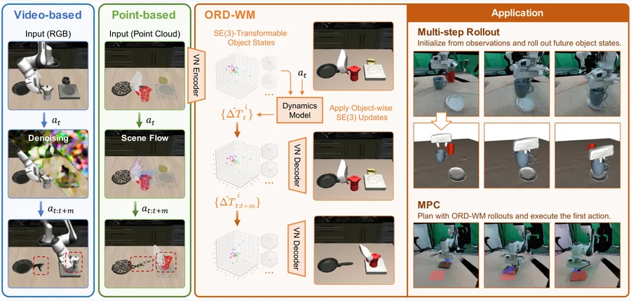 arXiv 2026-10-20 · cs.RO · #1 **[ORD-WM: Learning Object-Centric Rigid Dynamics for 3D World Modeling in Robotic Manipulation](https://arxiv.org/abs/2610.23156)** Yueyang Weng, Xiaopeng Zhang, Yuxi Ou, Yongjin Mu, Chengzhi Zhao, Yanjie Li 机构：Harbin Institute of Technology, Shenzhen（[PDF](https://arxiv.org/pdf/2610.23156)） [Paper](https://arxiv.org/abs/2610.23156) · [图源](https://arxiv.org/html/2610.23156v1/overall3.png) 

中文摘要
世界模型为机器人提供预测机制，以推理操作动作如何改变物体状态。然而，现有基于图像和稠密 3D 的世界模型未显式施加物体级刚体运动约束，把刚体几何保持交由模型隐式学习，使多步推演容易出现形状漂移或物体运动不一致。为此，我们提出 ORD-WM，一种学习物体中心刚体动力学的机器人操作 3D 世界模型。ORD-WM 学习受有符号距离场监督的向量神经元变分自编码器，将各物体点云编码为由 3D 向量特征组成的几何感知潜表示，并以动作条件动力学模型预测逐物体的 SE(3) 运动增量。它不直接生成无约束的下一潜状态，而是解析地将预测的逐物体刚体变换作用于当前潜状态，从而分离持续不变的物体几何与位姿变化。实验表明，ORD-WM 能进行稳定、保持几何形状的多步预测，并在仿真和真实机器人操作场景中支持闭环模型预测控制的高效实时重规划。 <a href="https://arxiv.org/abs/2610.23156">原摘要来源</a>
 | 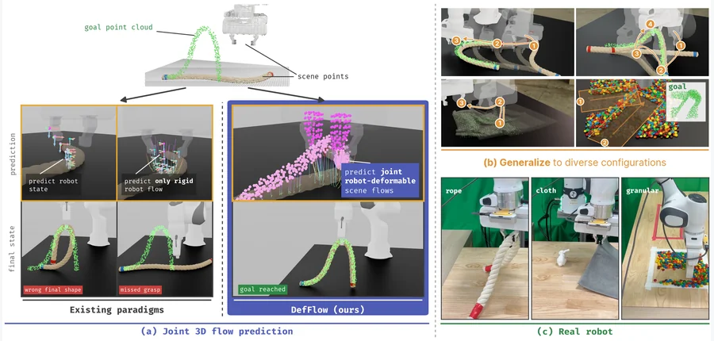 arXiv 2026-10-20 · cs.RO · #2 **[DefFlow: Goal-Conditioned Deformable Object Manipulation using 3D Point Flows](https://arxiv.org/abs/2610.22827)** Gaurav Singh, Sergio Orozco, Ryan Duong, Mete Tuluhan Akbulut, George Konidaris, Srinath Sridhar 机构：Brown University（[PDF](https://arxiv.org/pdf/2610.22827)） [Paper](https://arxiv.org/abs/2610.22827) · [图源](https://arxiv.org/html/2610.22827v1/Images/teaser_full_v22.png) 

中文摘要
将可变形物体操纵到目标 3D 构型，是机器人在非结构化物理环境中工作的一项基本能力。但随着初始构型和目标构型的范围扩大，目标条件可变形操作不仅要求精确连续动作，也要求推断日益多样的操作行为。我们提出 DefFlow，面向广泛 3D 目标构型的可变形物体目标条件操作框架。DefFlow 从示范中学习，同时预测机器人和可变形物体的目标条件 3D 点流。与仅预测机器人流相比，我们表明这一表述更能同时捕捉何时、何处抓取、释放或重新抓取等操作决策，以及到达目标所需的精确连续运动。在具有多样初始和目标构型的绳索、颗粒介质与布料操作场景中，DefFlow 在成功率和目标距离指标上显著优于目标条件动作预测及仅机器人流的基线。我们还使用真实点云观测和未见过的目标构型，在真实机器人上部署了该框架。 <a href="https://arxiv.org/abs/2610.22827">原摘要来源</a>
 | 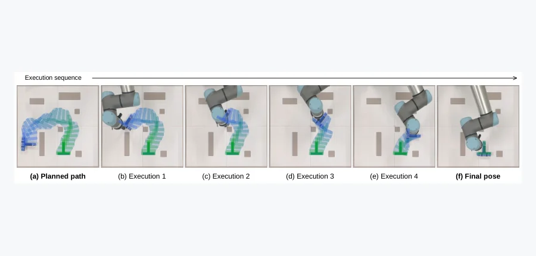 arXiv 2026-10-20 · cs.RO · #3 **[Shape-Aware Neural Time Fields for Rigid-Body Motion and Manipulation Planning](https://arxiv.org/abs/2610.22762)** Yanming Zhou, Yuchen Liu, Ahmed H. Qureshi 机构：Purdue University（[PDF](https://arxiv.org/pdf/2610.22762)） [Paper](https://arxiv.org/abs/2610.22762) · [图源](https://arxiv.org/html/2610.22762v1/pusht-teaser-six-v2.png) 

中文摘要
刚体运动规划是机器人运输和操作的基础；在杂乱环境中，物体能否通过取决于位置和朝向。周围几何对平移与旋转的约束可能很不相同，使两者耦合后的规划变得困难。我们提出 Shape-Aware Neural Time Fields：一种物理信息神经运动规划框架，学习可复用的行程时间或到目标代价表示，并显式考虑这些不同的几何限制。所学场刻画平移和旋转的局部运动难度，配合采样式规划器，在朝目标推进和到达附近位姿的代价之间取得平衡。我们在多种环境下的 2D、3D 刚体规划任务及物体推动这一非抓取操作任务中评估该框架。与物理信息神经规划基线相比，它显著提高规划成功率和推理效率；与经典采样式规划器相比，性能保持竞争力，同时规划时间显著更短。消融实验进一步验证了所学表示和规划策略各自的贡献。最后，在执行偏差和外部扰动下的闭环推动实验表明，快速重规划使任务执行能够作出反应和适应。 <a href="https://arxiv.org/abs/2610.22762">原摘要来源</a>
 |
| 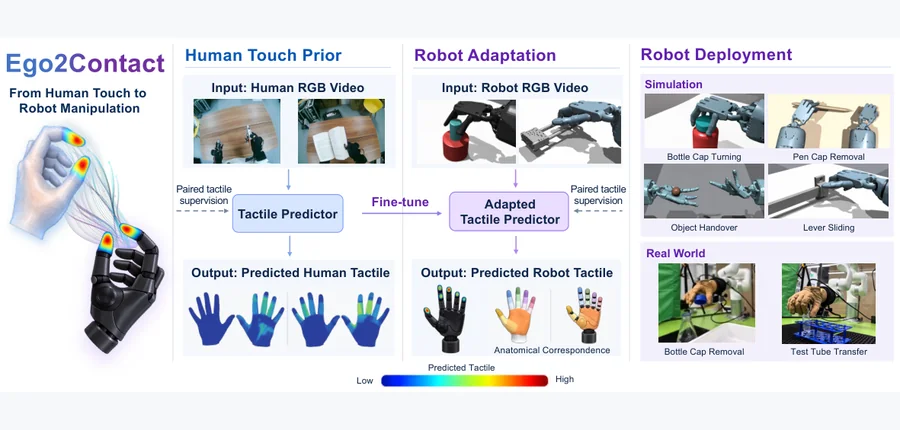 arXiv 2026-10-20 · cs.RO · #4 **[Ego2Contact: Predicting Touch from Egocentric Human Video for Contact-Rich Robot Manipulation](https://arxiv.org/abs/2610.22932)** Qianqian Yang, Dayou Li, Bangya Liu, Zihao Zhu, Nuo Chen, Siyuan Xu, Hezhen Hu, Chen Yu, Rebecca Friesen, Minghui Zheng, C… 机构：Carnegie Mellon University / Texas A&amp;M University / University of Wisconsin–Madison / University of Texas at Austin（[PDF](https://arxiv.org/pdf/2610.22932)） [Paper](https://arxiv.org/abs/2610.22932) · [图源](https://arxiv.org/html/2610.22932v1/teaser.png) 

中文摘要
接触位置和交互力对富接触机器人操作至关重要，却往往难以单凭视觉判断。在机器人上测量它们需要专门的触觉硬件和平台特定的数据采集，因此机器人触觉数据稀缺。人类第一视角视频更容易大规模获取，但缺少触觉；近期以同步触觉手套记录训练的预测器可以从视频预测该信号，不过仍局限于外观和触觉布局均不同于机器人的人手。我们提出 Ego2Contact，从人类交互中学习视觉—触觉先验，再迁移到机器人手。预测器融合场景的时间上下文和手部局部视觉特征，从 RGB 视频推断双手触觉场。解剖区域对应关系将不同的机器人触觉布局对齐到预测器的规范网格，使机器人测量既能作为微调目标，也能使预测结果成为策略输入。Ego2Contact 在包含未见物体的人类数据上优于既有触觉预测器，适配后在机器人数据上也优于它们。适配后的预测器为仿真强化学习和真实机器人策略后训练提供触觉输入。在仿真中，使用预测触觉的策略优于无触觉基线，并恢复了真实触觉传感带来的部分收益。结果表明，当直接触觉感知受限时，人类数据学习到的触觉先验可以提供触觉信息。 <a href="https://arxiv.org/abs/2610.22932">原摘要来源</a>
 | 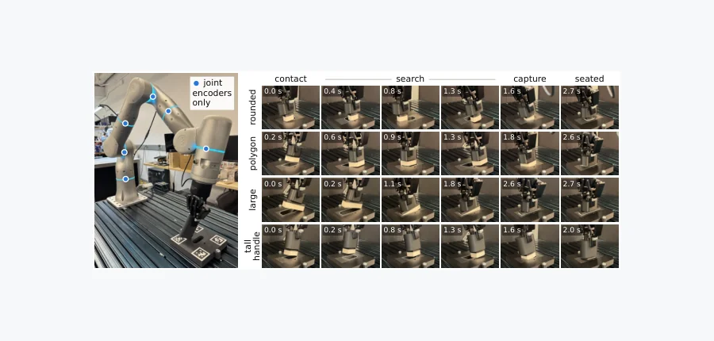 arXiv 2026-10-20 · cs.RO · #5 **[Blind Precise Assembly: Proprioceptive Sim-to-Real Peg-in-Hole for Diverse Parts](https://arxiv.org/abs/2610.23849)** Antonia Bronars, Younghyo Park, Kushal Kedia, Pulkit Agrawal 机构：Massachusetts Institute of Technology（[PDF](https://arxiv.org/pdf/2610.23849)） [Paper](https://arxiv.org/abs/2610.23849) · [图源](https://arxiv.org/html/2610.23849v1/fig_teaser.png) 

中文摘要
每台机器人都自带高分辨率的接触传感器：自身关节。足式机器人和人形机器人利用关节感知，在没有视觉的情况下行走、奔跑并跟踪全身动作，但这些任务的接触较大、力较强。对于需要通过轻微接触寻找毫米级孔位、啮合齿轮或挂住螺纹的精密装配，关节感知是否也足够？我们训练“盲”装配策略，仅观察短时间内的关节位置、速度和自身动作历史，不使用视觉、力、力矩或触觉传感。夹具和零件的位姿对策略均未知，抓取也有大幅随机化，因此策略只能通过自身本体感知到的接触完成装配。策略完全在仿真中使用随机化的零件、抓取和接触进行强化学习，学会插销、齿轮啮合及螺母旋入。插销策略零样本迁移到真实世界，在 73% 的试验中插入不同形状和尺寸的销。与匹配的视觉策略在仿真中的受控比较表明，盲策略对未见零件形状和尺寸的泛化明显更好，但可能更慢。训练需要数千种保留原有间隙的不同装配仿真，因此我们还开源了一个基于精确凸形部件为 MuJoCo 程序化生成装配任务的工具；它比凸分解或 MuJoCo 的有符号距离碰撞方法更准确、更快。视频和交互式仿真见论文所链资源。 <a href="https://arxiv.org/abs/2610.23849">原摘要来源</a>
 | 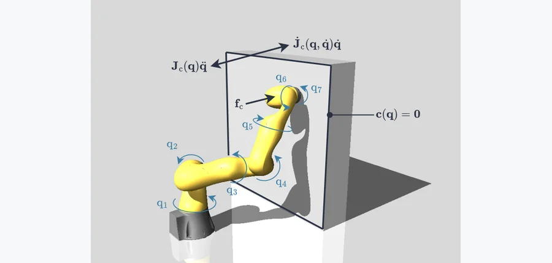 arXiv 2026-10-20 · cs.RO · #6 **[Simultaneous Force and Motion Control in Generalised Coordinates](https://arxiv.org/abs/2610.22813)** Jon Woolfrey 机构：Independent Researcher（[PDF](https://arxiv.org/pdf/2610.22813)） [Paper](https://arxiv.org/abs/2610.22813) · [图源](https://arxiv.org/html/2610.22813v1/figures/generalised_coordinates.png) 

中文摘要
机器人操作臂作业时常与刚体接触，从而对运动施加物理约束。同步力—运动控制旨在按照这些约束调节接触力，同时把运动控制投影到正交的无约束方向。传统方法通常先在任务坐标即操作空间中表述，再映射为机器人关节力矩；但关节限位、避碰、奇异位形规避等大多数控制约束本来就在广义坐标即关节空间中表示，因此任务空间表述难以保证控制可行性。本文用高斯最小约束原理，将控制求解表述为广义坐标中的二次规划（QP）问题。理论分析表明，该解能够给出正确的受约束动力学，实现准确接触力控制；还可加入不等式约束以保证可行性与安全性。作者在 MuJoCo 中做仿真，并与操作空间表述比较。所提方法能够同时维持期望接触力、减小轨迹跟踪误差，并满足实际不等式约束。 <a href="https://arxiv.org/abs/2610.22813">原摘要来源</a>
 |
| 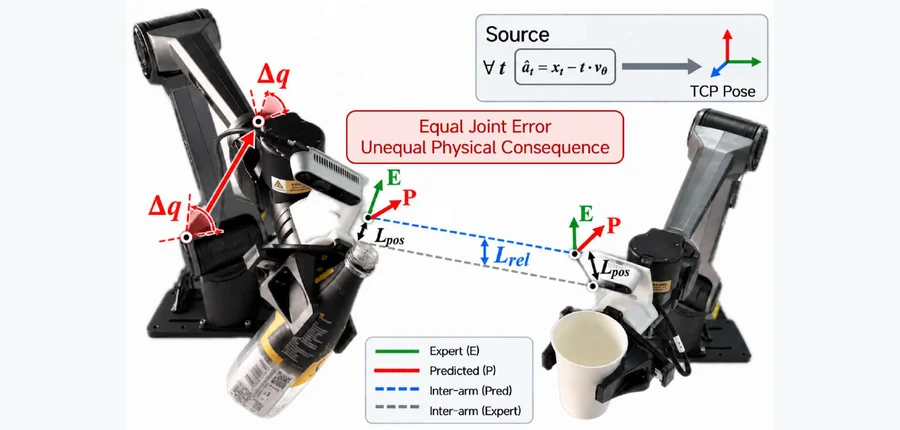 arXiv 2026-10-20 · cs.RO · #7 **[GRASP: Global-Local Representation Alignment and Spatial-Physical Grounding for Bimanual Robotic Manipulation](https://arxiv.org/abs/2610.23123)** Zeyuan Ren, Guanxun Zhao, Qi Li, Hao Wang, Wenlong Liao, Keyi Luo, Xijing Zhang, Zhiyuan Zhang, Jingye Cui, Qibin Gu, Zhic… 机构：COWARobot / Hong Kong Polytechnic University / Tongji University / Shanghai Jiao Tong University / National University of Singapore / Chinese University of Hong Kong / Northeastern University（[PDF](https://arxiv.org/pdf/2610.23123)） [Paper](https://arxiv.org/abs/2610.23123) · [图源](https://arxiv.org/html/2610.23123v1/GEO3.png) 

中文摘要
直接回归关节空间动作的视觉—语言—动作（VLA）模型可以省去部署时逆运动学的开销，但其训练目标仍与任务成功错位：关节空间损失忽略不同关节误差的物理后果差异，视觉条件也未显式关注手—物交互区域。为解决这些问题，我们提出面向精细双臂操作、在训练阶段注入先验的框架。首先，物理锚定的流匹配损失将每个噪声水平下隐式的干净动作估计经可微前向运动学（FK）映射，监督工具中心点（TCP）位姿和双臂相对位姿，并以有界的噪声级权重补偿梯度衰减。其次，我们引入由冻结的 DINOv3 教师通过未来帧特征预测蒸馏的全局预测查询组，以及在注意力层面由 Grounding DINO 监督的局部交互查询。推理时移除两个教师，部署流程仍是标准的关节空间流策略，仅增加学到的查询路径。在长时双臂任务的仿真和真实机器人实验中，两种先验在不同部署条件下互补：完整模型在分布内部署表现最好，而强视觉随机化时蒸馏后的查询分支更合适。 <a href="https://arxiv.org/abs/2610.23123">原摘要来源</a>
 | 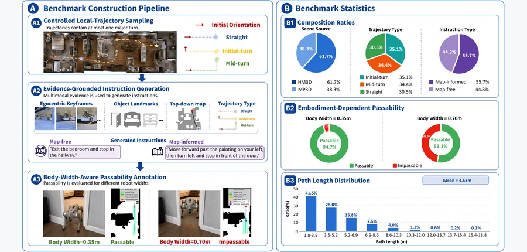 arXiv 2026-10-20 · cs.RO · #8 **[PASS-VLN: Passability-Aware Local-Command Vision-and-Language Navigation](https://arxiv.org/abs/2610.22812)** Cong Zou, Xiangsheng Shi, Xuanhui Wang, Fubin Wang, Guangjun Ge, Chao Wang, Yu Wang 机构：Qiyuan Lab / Tsinghua University（[PDF](https://arxiv.org/pdf/2610.22812)） [Paper](https://arxiv.org/abs/2610.22812) · [图源](https://arxiv.org/html/2610.22812v1/benchmark.png) 

中文摘要
可靠的视觉—语言导航（VLN）既要理解指令，也要判断机器人能否及如何实际执行。然而，既有 VLN 基准通常默认指令可执行，并关注长时任务，使依赖机体尺寸的局部执行、可通行性和无碰撞执行缺乏研究。若在长时任务中评估这些因素，局部物理执行会与任务规划及长期空间记忆混杂，难以归因导航失败。因此，我们聚焦在环境和机器人机体约束下，把局部导航命令落实为可执行运动。我们提出 PASS-VLN，一个可通行性感知的局部命令 VLN 基准和模型。基准固定场景、指令、起始位姿和参考路线，只改变机器人机体宽度；通道可行时要求到达目标，否则要求在障碍前停下。模型通过对深度导出的局部鸟瞰图作障碍膨胀来编码机体宽度，融合几何、视觉和语言上下文，预测离散潜动作码以进行连续闭环执行。实验显示，相比在该基准上微调的强 VLN 模型，PASS-VLN 将无碰撞成功率提高约 12 个百分点，同时能随机体约束调整“到达或停止”行为，并泛化到未见的机体宽度。与高层规划器结合后，PASS-VLN 以更少的局部命令取得更高成功率；真实部署也显示其作为低层执行器的有效性。基准和模型将会发布。 <a href="https://arxiv.org/abs/2610.22812">原摘要来源</a>
 | 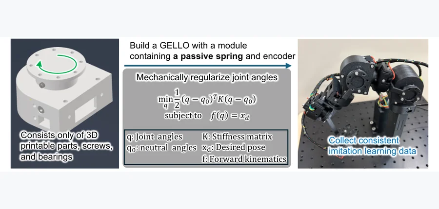 arXiv 2026-10-20 · cs.RO · #9 **[Hardware-as-Regularization: Enhancing Data Consistency in Imitation Learning via an Adjustable Passive Compliant Leader Arm](https://arxiv.org/abs/2610.22977)** Hideyuki Ichiwara, Yushi Kaida, Hirokazu Ishida 机构：SB Intuitions Corporation（[PDF](https://arxiv.org/pdf/2610.22977)） [Paper](https://arxiv.org/abs/2610.22977) · [图源](https://arxiv.org/html/2610.22977v1/digest.png) 

中文摘要
低成本被动示教臂便于大规模采集模仿学习数据，但由于缺少回复力，冗余关节不受约束，导致关节空间轨迹很不一致。为此，我们设计了低成本被动关节模块，包括可调机械离合器和 3D 打印螺旋弹簧，把各关节拉向用户设定的中性姿态。该被动回复力充当等价于关节空间 $L_2$ 正则化的物理先验，即“硬件即正则化”，在保持运动平滑性的同时，相比无正则示教臂提高运动学一致性并缩短任务完成时间。实验表明，相比普通被动臂，其轨迹方差明显降低；轨迹一致性与同类执行器的主动虚拟弹簧相当；下游成功率也明显提高，例如积木堆叠任务为 73.3%，对照为 36.7%。刚度扫描显示，刚度减小时一致性单调下降，印证机械刚度发挥着类似正则化权重的作用。 <a href="https://arxiv.org/abs/2610.22977">原摘要来源</a>
 |
| 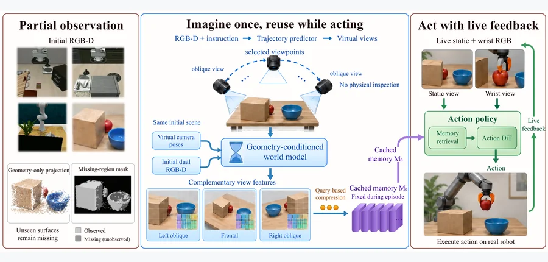 arXiv 2026-10-20 · cs.RO · #10 **[AWAM: Active Trajectory-Conditioned View Imagination for Robust Robot Manipulation](https://arxiv.org/abs/2610.23396)** Jiawei Geng, Zhenyang Liu, Yuzheng Wu, Yanwei Fu 机构：Fudan University / Shanghai Innovation Institute（[PDF](https://arxiv.org/pdf/2610.23396)） [Paper](https://arxiv.org/abs/2610.23396) · [图源](https://arxiv.org/html/2610.23396v1/AWAM_teaser.png) 

中文摘要
具身智能的快速进步让机器人愈发能够遵循语言指令并操作不同物体，但结构化环境中的良好结果未必能迁移到杂乱、遮挡和视角变化会掩盖动作所需空间关系的开放环境。为弥合这一感知缺口，我们引入虚拟主动感知范式。AWAM 是一种主动世界—动作模型，在行动前主动规划观察位置，并想象沿规划轨迹所见的内容。模型预测与任务相关的虚拟相机运动，将其作为对几何条件世界模型的结构化查询，为操作生成可复用的空间先验；随后把先验压缩为固定记忆，并通过交叉注意力与实时观测融合，供基于扩散的动作预测使用。AWAM 在 LIBERO-Occ、LIBERO-Plus、RLBench-OG Occlusion1 上分别取得 75.9%、62.4%、76.5% 的成功率，真实机器人试验为 94.4%。这些结果支持它对所评估遮挡和分布变化具有更强稳健性，部分缩小了结构化操作与较不受控环境之间的差距。 <a href="https://arxiv.org/abs/2610.23396">原摘要来源</a>
 | 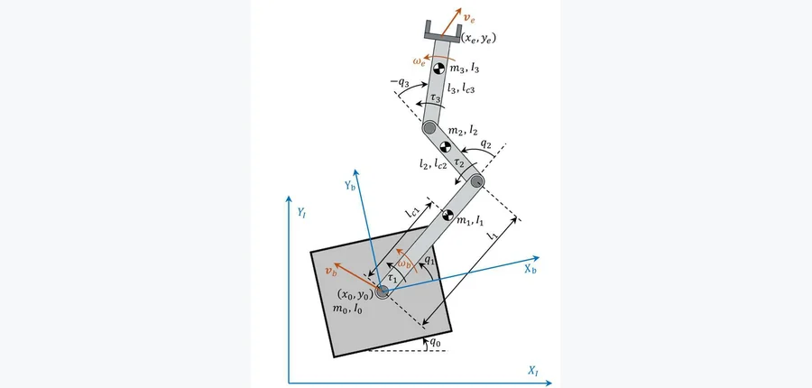 arXiv 2026-10-20 · eess.SY · #11 **[Modeling and Analysis of Dynamic Coupling Effects in a Free-Floating Space Manipulator](https://arxiv.org/abs/2610.22558)** Erik Chumacero-Polanco 机构：University of Texas Rio Grande Valley（[PDF](https://arxiv.org/pdf/2610.22558)） [Paper](https://arxiv.org/abs/2610.22558) · [图源](https://arxiv.org/pdf/2610.22558) 

中文摘要
自由漂浮航天器上机械臂的运动会引起基座平移和旋转，产生影响末端执行器运动的动力学耦合。本文研究平面三连杆空间机械臂中的这种耦合。作者利用动量守恒，建立机械臂关节、末端执行器和航天器基座之间的速度映射，再通过奇异值分解分析耦合强度、方向各向异性及耦合运动的方向。数值图显示，耦合强度与第一关节角无关，却强烈依赖其余关节的相对构型。增大航天器基座质量会减小关节到基座及末端到基座的耦合；对关节到末端映射的影响较小，也更依赖构型。在部分构型中，末端到基座的平移映射高度各向异性：随着弱耦合模态趋近零，基座速度椭圆越来越扁。末端与基座速度主方向的相对对齐也随构型改变，在某些区域主要反向，在另一些区域则横向或近似同向。总体上，这些结果给出了耦合大小和方向如何随机械臂构型与航天器质量变化的几何描述。 <a href="https://arxiv.org/abs/2610.22558">原摘要来源</a>
 | 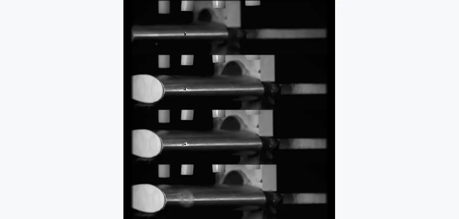 arXiv 2026-10-20 · physics.flu-dyn · #12 **[Influence of Droplet Morphology on Fluid Dynamics and Impact Erosion of Wind Turbine Blades](https://arxiv.org/abs/2610.23178)** Hao Hao, Antonis Sergis, Maria N. Charalambides, Alex M. K. P. Taylor, Yannis Hardalupas 机构：Imperial College London（[PDF](https://arxiv.org/pdf/2610.23178)） [Paper](https://arxiv.org/abs/2610.23178) · [图源](https://arxiv.org/html/2610.23178v1/RET.png) 

中文摘要
雨滴和海浪飞沫等液滴冲击风机叶片表面，可通过前缘侵蚀（LEE）造成严重损伤。现行工业实践主要依赖经验疲劳模型预测损伤发展和指导维护，但这类模型常假设液滴完全球形、正向撞击等理想条件，现实中却很少成立。本文建立流固耦合（FSI）模型，将不可压缩多相流仿真与叶片材料的有限元（FE）分析结合，以研究任意形状和朝向的液滴撞击动力学。结果发现，峰值冲击压力、压力峰值时的作用面积和峰值冲击力正相关；相反，由于动量守恒，峰值力出现时间呈反向缩放。基于这些结果，我们提出一条将所有关键冲击载荷与液滴投影面积这一简单参数联系起来的普适缩放律；该面积只需从液滴初始几何和朝向即可确定。该规律为非理想形状的撞击载荷动力学提供预测框架，并有助于理解 LEE 机制、提高风机叶片侵蚀预测精度。 <a href="https://arxiv.org/abs/2610.23178">原摘要来源</a>
 |
| 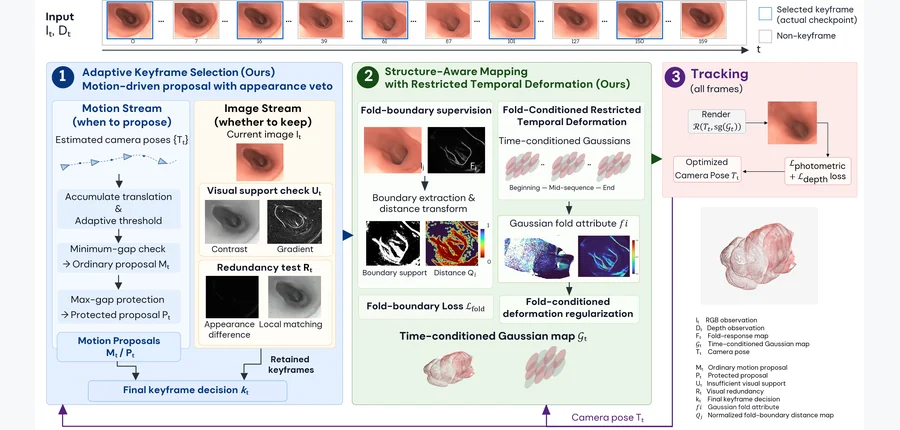 arXiv 2026-10-20 · cs.CV · #13 **[KFS$^4$LAM: Adaptive KeyFrame Selection with Structure-Aware Mapping for Endoscopic Gaussian Splatting SLAM](https://arxiv.org/abs/2610.22505)** Xinwei Ju, Zhehua Mao, Tianyi Song, Danail Stoyanov, Sophia Bano, Francisco Vasconcelos 机构：University College London（[PDF](https://arxiv.org/pdf/2610.22505)） [Paper](https://arxiv.org/abs/2610.22505) · [图源](https://arxiv.org/pdf/2610.22505) 

中文摘要
高斯泼溅同步定位与建图（SLAM）为传统 SLAM 加入稠密、可渲染的 3D 场景表示，支持高质量重建和新视角合成；但定位、重建与渲染效果高度依赖保留哪些观测用于建图。既有系统常按固定时间间隔，或简单按位姿和重叠度选择关键帧。结肠镜场景中的非均匀相机运动、重复解剖结构、镜面反射和视觉伪影会使这些准则失效，导致冗余帧或漏掉有信息量的视角。我们提出 KFS$^4$LAM，将运动引导的自适应关键帧选择、结构监督建图和受限时间形变相结合。累积运动引导关键帧选择，补充线索抑制冗余或不可靠候选；带解剖轮廓即结肠褶皱监督的密度感知建图突出结构信息丰富的区域，受限时间形变则容纳局部组织运动且避免无约束的几何漂移。我们在 C3VD 和 C3VD-v2 上对比高斯 SLAM 基线，并进行跨骨干和组件消融。方法在轨迹、渲染和深度指标上整体表现强，较难的 C3VD-v2 上收益尤为明显；在 C3VD-v2 与 SplaTAM 的匹配比较中，旋转相对位姿误差降低 20.3%，深度 RMSE 降低 38.4%，PSNR 提高 0.78 dB。跨骨干实验还显示该框架不依赖单一 SLAM 架构。代码和可视化结果见论文所链资源。 <a href="https://arxiv.org/abs/2610.22505">原摘要来源</a>
 | 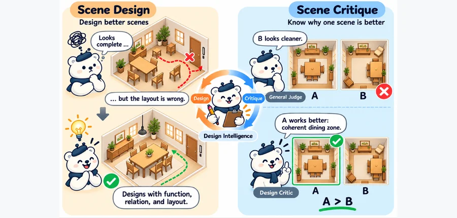 arXiv 2026-10-20 · cs.CV · #14 **[Scene-Designer: Learning Design Intelligence for Agentic 3D Scene Generation](https://arxiv.org/abs/2610.23121)** Xuanyu Liu, Hongyan Feng, Miao Pan, Sunlai Chen, Lizhou Liang, Bing Sun, Wenqi Zhang, Xuhong Zhang 机构：Zhejiang University / Universal Identification Technology (Hangzhou)（[PDF](https://arxiv.org/pdf/2610.23121)） [Paper](https://arxiv.org/abs/2610.23121) · [图源](https://arxiv.org/html/2610.23121v1/teaser.png) 

中文摘要
从自然语言生成完整、连贯、可用的 3D 室内场景，需要能够设计高质量场景并批评其质量的“设计智能”。既有方法要么依赖缺乏领域设计经验的通用模型，要么只从静态场景学习。我们提出 Scene-Designer，通过互补的设计和批评经验学习设计智能。我们构建了两个数据集：Scene-OTA-35K 以“观察—思考—动作”监督场景设计与高效纠错，Scene-OTC-15K 以“观察—思考—批评”监督物理有效性、功能正确性和布局连贯性的质量评判。在此基础上，我们提出由 Critic 引导的 Scene-GRPO 框架，以改进设计决策并减少不必要的试错修正。大量实验表明，Scene-Designer 在物理有效性、功能正确性和布局连贯性上表现更优；学到的 Scene-Critic 在场景批评中显著优于通用模型。测试时 Critic 引导还进一步改善场景生成，表明该 Critic 在训练之外也有用。额外分析提示，场景设计和批评能力存在相互促进的趋势。 <a href="https://arxiv.org/abs/2610.23121">原摘要来源</a>
 | 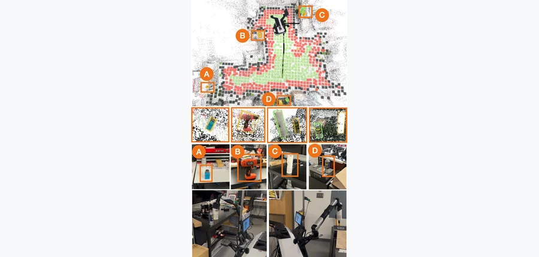 arXiv 2026-10-20 · cs.RO · #15 **[Foundation-Model-Driven 3D Scene Graphs for Mobile Manipulation](https://arxiv.org/abs/2610.23622)** Dominic Maggio, Lorenzo Shaikewitz, Aryan Naveen, Kris Hauser, Luca Carlone 机构：Massachusetts Institute of Technology / Samsung Research America（[PDF](https://arxiv.org/pdf/2610.23622)） [Paper](https://arxiv.org/abs/2610.23622) · [图源](https://arxiv.org/html/2610.23622v1/figures/fig/intro.jpg) 

中文摘要
几何与语义基础模型正愈来愈多地用于机器人空间建图。FOUND-IT 等近期工作利用这些工具，从单个未标定相机实时构建任务驱动、开放集的 3D 场景图。但相比经历大量系统演示的传统机器人建图方法，将这类新空间记忆集成到完整可用的自主流程所需的基础与系统进展仍有限。本文试图弥合这一缺口，并评估此类 3D 记忆的有效性和局限。我们把 FOUND-IT 集成到移动操作机器人平台，展示它适用于物体变化检测、多次建图会话、可通行路径确定，以及为场景重新布置任务直接支持物体抓取等多种目标。此外，基于严格的实体机器人实验观测，我们分析了单目、基础模型驱动的 3D 场景图构建系统的效用与限制。代码见论文提供的链接。 <a href="https://arxiv.org/abs/2610.23622">原摘要来源</a>
 |
| 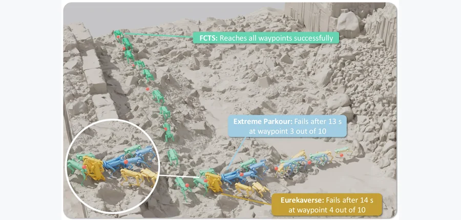 arXiv 2026-10-20 · cs.RO · #16 **[FCTS: Failure-Guided Curriculum Tree Search Over Generated Terrain for Legged Parkour](https://arxiv.org/abs/2610.22619)** Narayanan Palghat Parameswaran, Dong-Ki Kim, Jay Patrikar, Santiago Gutierrez, Harshad Zade, Shayegan Omidshafiei, Harmish… 机构：Carnegie Mellon University / FieldAI（[PDF](https://arxiv.org/pdf/2610.22619)） [Paper](https://arxiv.org/abs/2610.22619) · [图源](https://arxiv.org/html/2610.22619v1/fcts_figure1.png) 

中文摘要
四足跑酷策略能处理典型障碍，但训练课程常漏掉工业和救灾现场不规则、复合的地形几何，而敏捷运动在这些地方最重要。这类环境带来困难的泛化问题：即使直接在目标现场重建几何上训练，也无法可靠获得能穿越它的策略。手工课程仅覆盖少数地形族，近期 LLM 生成课程也难以控制其针对哪些策略弱点。我们提出 FCTS，一种以失败为条件的地形课程框架，根据局部穿越失败自动生成策略接下来应训练的地形。每次失败的位置、终止模式、机器人状态及周围地形几何共同作为生成条件，蒙特卡洛树搜索在固定训练预算内探索不同课程路径。在用真实建筑工地扫描数据构建的地形上，相比最强跑酷或 LLM 课程基线，FCTS 将中等难度路线成功率从 28.4% 提高到 85.8%，困难路线从 14.9% 提高到 44.7%；在很少能完整穿越的极难地形上也保持更高进度。四足机器人硬件实验确认所学 FCTS 策略可迁移到真实世界。 <a href="https://arxiv.org/abs/2610.22619">原摘要来源</a>
 | 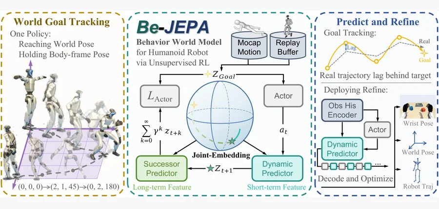 arXiv 2026-10-20 · cs.RO · #17 **[BeJEPA: A Goal-Conditioned Humanoid Behavior World Model via Unsupervised RL](https://arxiv.org/abs/2610.23127)** Liyun Yan, Haoyang Li, Yang Zhang, Jialing Zhu, Zhanxiang Cao, Zihao Zhou, Keqi Zhu, Yizhi Chen, Huang Chuxuan, Shengcheng… 机构：Shanghai Jiao Tong University / Shanghai Innovation Institute / Zhejiang University / Tongji University / Fudan University / Lenovo Research（[PDF](https://arxiv.org/pdf/2610.23127)） [Paper](https://arxiv.org/abs/2610.23127) · [图源](https://arxiv.org/html/2610.23127v1/Teaser.png) 

中文摘要
人形机器人控制需要在世界坐标中协调全身姿态、位置和朝向。主流控制器在根坐标系中模仿轨迹，但被外力推离后难以恢复目标世界位姿。我们提出 BeJEPA，一个通过人类运动先验与机器人交互的无监督强化学习获得的目标条件行为世界模型。它用联合嵌入预测架构（JEPA）学习身体构型与世界位置的共享表示。Dynamic Predictor 预测给定动作后的下一状态嵌入；Successor Predictor 则用单个向量概括目标条件策略在未来的期望折扣状态嵌入。联合训练中，Dynamic 将初始表示锚定到观测到的物理转移，Successor 逐步使其围绕长期行为组织。两者结合，通过一次物理预测和一次行为概括指导策略改进，无须长距离想象推演。在 20 秒动作跟踪实验中，带 Dynamic 在线动作精炼的 BeJEPA 在全局身体位置误差上优于所有受测基线：相对带世界位姿输入的 BFM-Zero，在 AMASS 上降低 61.7%；相对 SONIC 降低 58.7%。在 Unitree G1 上的实体部署展示了同时到达姿态、世界位置和朝向目标、从地面起身，以及扰动和目标变化后的闭环返回。项目页见论文所链资源。 <a href="https://arxiv.org/abs/2610.23127">原摘要来源</a>
 | 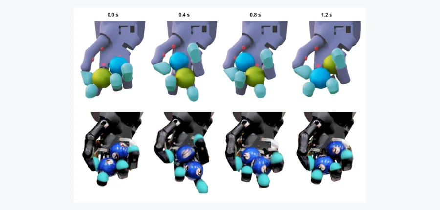 arXiv 2026-10-20 · cs.RO · #18 **[No Eyes, No Problem: What Does Touch Contribute to Blind Baoding Ball Manipulation?](https://arxiv.org/abs/2610.23438)** Ayush Deshmukh, Nalin Agarwal, Elle Miller, Sethu Vijayakumar 机构：University of Edinburgh（[PDF](https://arxiv.org/pdf/2610.23438)） [Paper](https://arxiv.org/abs/2610.23438) · [图源](https://arxiv.org/html/2610.23438v1/fig1_cover.png) 

中文摘要
人类仅凭触觉就能轻松在手中操纵物体，但机器人要在无视觉条件下持续完成真实操作仍是开放挑战。强化学习虽能在仿真中得到复杂的盲操作策略，迁移到真实灵巧手仍受不断变化的接触、运动引起的触觉信息漂移，以及仿真与物理动力学差距阻碍。我们在 Shadow Dexterous Hand Lite 上研究保定球旋转，观测仅含本体感知和二值触觉反馈。通过传感器对齐、考虑耦合的仿真机体模型、触觉校准，以及两种新的回合级域随机化——动作变化率限制与 STuck-AT Taxels——我们实现成功的零样本迁移。在实体手上，策略无需视觉或物体状态信息，单次连续实验中持续盲转保定球，完成连续 225 次 $\mathbf{180^\circ}$ 旋转，即 112.5 圈，速度约 $0.36\;\text{rot/s}$。此外，我们比较触觉感知相对于仅本体感知的贡献，并找出触觉信息最重要的手部区域。作者称，无论使用何种感知模态，这都是已报告的保定球实体操作中旋转次数和速度最强结果。通过缩小 sim-to-real 差距，该框架为真实硬件上的持续触觉驱动灵巧操作建立了新基准。 <a href="https://arxiv.org/abs/2610.23438">原摘要来源</a>
 |
| 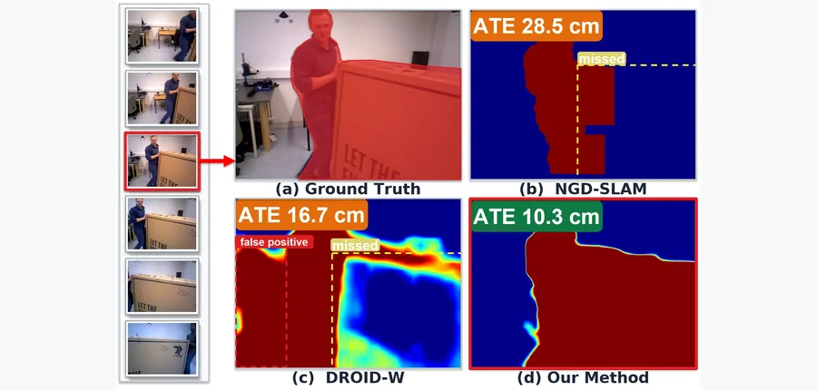 arXiv 2026-10-20 · cs.RO · #19 **[FLoTS-SLAM: Optical Flow-Derived Uncertainty for Monocular Dynamic SLAM with Two-Stage Optimization](https://arxiv.org/abs/2610.23496)** Haorui Du, Lipu Zhou 机构：Beihang University（[PDF](https://arxiv.org/pdf/2610.23496)） [Paper](https://arxiv.org/abs/2610.23496) · [图源](https://arxiv.org/html/2610.23496v1/motivationv1202.jpg) 

中文摘要
单目同步定位与建图（SLAM）在动态环境中仍很困难，实时识别动态物体是关键。近期方法从渲染残差或多视角特征不一致估计逐像素不确定性来找动态区域，但缺少直接运动证据；重建不准或特征模糊时精度可能下降。此外，这类不确定性只在束调整（BA）中降低像素权重，估计失准仍会损害相机位姿和 3D 重建。因此，我们提出面向动态场景的单目 RGB SLAM 系统：由光流与相机运动诱导光流之间的残差估计运动不确定性，直接反映物体运动；估计随帧对齐精度变化，减少误检并得到准确的逐像素动态掩码。为使 BA 更稳健，我们先用高置信度像素估计相机位姿，再用这些位姿在联合精炼位姿与深度时重投影动态像素，降低物体运动对两类更新的影响。我们还量化评估动态掩码，分析其对下游动态物体跟踪与重建的影响。相对先进基线，该方法在 DAVIS 上将平均动态掩码 IoU 提高 35%；相对其 SLAM 骨干，在 Bonn 和 TUM 上分别将平均绝对轨迹误差（ATE）降低 59% 和 19%。源代码将公开。 <a href="https://arxiv.org/abs/2610.23496">原摘要来源</a>
 | 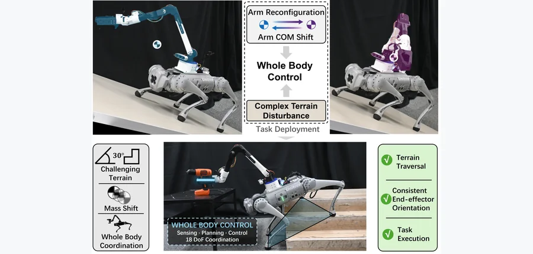 arXiv 2026-10-20 · cs.RO · #20 **[Reinforcement Learning Based Multi-Terrain Adaptive Whole-Body Control for a Quadruped Manipulator](https://arxiv.org/abs/2610.23548)** Yanzhou Jin, Fei Suo, Chang Liu, Yasuhisa Hasegawa, Liming Chen, Yusuke Iwasawa, Yutaka Matsuo, Yaonan Zhu 机构：University of Tokyo / Nagoya University / École Centrale de Lyon（[PDF](https://arxiv.org/pdf/2610.23548)） [Paper](https://arxiv.org/abs/2610.23548) · [图源](https://arxiv.org/html/2610.23548v1/figures/teaser.jpg) 

中文摘要
带机械臂的足式机器人有望在非结构化环境中完成移动操作，但行走期间保持末端执行器的任务一致行为仍很难，原因是地形扰动及行走与操作的强耦合，对小型四足平台尤其如此。我们提出面向复杂地形四足移动操作的强化学习全身控制框架，将混合任务表示和按任务优先级的全身学习结合，以协调行走和操作并维持末端执行器的任务一致行为。我们还开发轻量四足操作平台，在小型四足系统上验证框架。真实实验展示了在坡度最高 30 度、楼梯和可变形地形等复杂环境中的成功部署。结果表明，学习式全身控制策略在真实复杂地形移动操作中可行，也强调了任务一致的全身协调对地形自适应移动操作的重要性。 <a href="https://arxiv.org/abs/2610.23548">原摘要来源</a>
 | 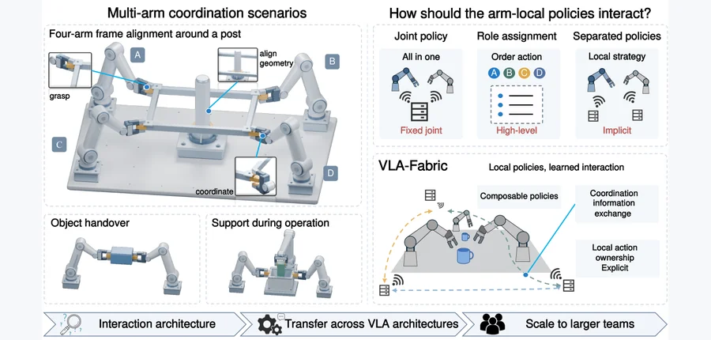 arXiv 2026-10-20 · cs.RO · #21 **[VLA-Fabric: Learning Interaction for Composable Multi-Arm VLA Agents](https://arxiv.org/abs/2610.23018)** Chenglong Zhang, Shuaijun Liu, Feiyang You, Shuyang Hao, Chengyu Wu, Ningxin Su 机构：Hong Kong University of Science and Technology (Guangzhou)（[PDF](https://arxiv.org/pdf/2610.23018)） [Paper](https://arxiv.org/abs/2610.23018) · [图源](https://arxiv.org/html/2610.23018v1/motivation_roadmap_asset.png) 

中文摘要
视觉—语言—动作（VLA）模型正扩展单个机器人能完成的任务，但许多真实操作场景需要多条机械臂作为协调系统工作。现有多臂协作形式包括集中式联合策略、高层任务或角色分配，以及会对队友作出反应的本地策略；然而，完整的、能输出动作的 VLA 应如何在动作生成过程中显式交互，仍缺乏研究。我们提出 VLA-Fabric：每条臂保留一个完整 VLA 及其本地感知和动作归属，同时通过跨策略边界的学习式交互协调。我们系统研究交互应发生的位置、如何聚合同伴信息以及如何学习交互，发现共享上下文、同伴特有潜信息和动作阶段交互承担互补的协调功能。随后，我们在结构不同的 VLA 架构中重新实现这些功能，表明协调原则不依赖特定张量布局或骨干实现。最后，我们组合三臂和四臂团队，并在仿真和实体实验中评估；在全部四个实体任务上，完整交互相比独立训练的本地策略使成功率提高 16–40 个百分点。结果提示，完整 VLA 策略之间的显式交互可成为可扩展的网络化具身智能路径。 <a href="https://arxiv.org/abs/2610.23018">原摘要来源</a>
 |
| 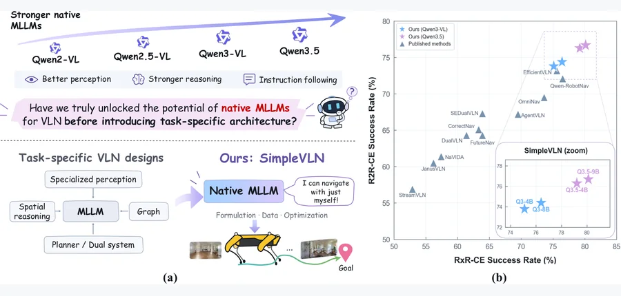 arXiv 2026-10-20 · cs.RO · #22 **[SimpleVLN: Towards Simple and Frontier Vision-Language Navigation](https://arxiv.org/abs/2610.23203)** Lingyi Hong, Weiren Cai, Jiayu Chen, Xinyu Zhou, Bailin He, Yunfei Guo, Qiao Sun, Boyu Ma, Jianfei Yang, Wenqiang Zhang 机构：Fudan University / Nanyang Technological University / Lenovo Research（[PDF](https://arxiv.org/pdf/2610.23203)） [Paper](https://arxiv.org/abs/2610.23203) · [图源](https://arxiv.org/html/2610.23203v1/motivation.png) 

中文摘要
视觉—语言导航（VLN）要求具身智能体把语言落实到视觉观测，并作出长时决策。现有方法常用任务特定架构；随着多模态大语言模型（MLLM）能力增强，一个问题是：在引入任务特定架构之前，原生 MLLM 的 VLN 潜力是否已充分释放？我们提出 SimpleVLN，一种通过研究导航形式、数据构造和优化而建立的、保留原有架构的框架。形式上，它以单轮决策输入配合固定预算的全局—局部记忆来高效使用导航历史，避免上下文无限增长，并用动作块让每次模型调用输出多个基本动作。数据方面，它结合专家示范和依赖当前策略的 DAgger 经验，并构建可扩展的任务合成流程，为强化学习生成大规模任务。优化方面，渐进的 IL–DAgger–RL 流程从动作模仿推进到任务结果优化。全面实验验证这三方面的有效性；在多个 MLLM 骨干与规模上的实例化也显示其通用性。SimpleVLN 在 R2R-CE 和 RxR-CE 划分上的成功率分别为 76.7% 和 80.1%，显著优于既有方法。结果表明，无须任务特定架构设计，也能有效释放原生 MLLM 的导航能力。 <a href="https://arxiv.org/abs/2610.23203">原摘要来源</a>
 | 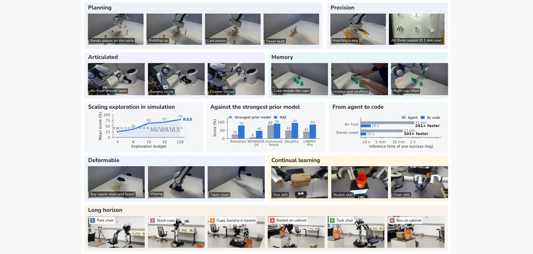 arXiv 2026-10-20 · cs.RO · #23 **[Scaling Online Exploration for Robot Agents](https://arxiv.org/abs/2610.22496)** Runhan Huang, Xiangcheng Zhang, Haoyu Chen, Yitong Li, Yen-Jen Wang, Bohan Lyu, Haotian Ye, Chuye Hong, Yixuan Wang, Chloe… 机构：Harvard University / NVIDIA / UC Berkeley / MIT / Stanford University（[PDF](https://arxiv.org/pdf/2610.22496)） [Paper](https://arxiv.org/abs/2610.22496) · [图源](https://arxiv.org/html/2610.22496v1/teaser_v2.png) 

中文摘要
通过扩大示范数据集和模型容量，机器人学习取得了进展；但部署新的机器人形态或任务通常仍需专门的遥操作数据集，所得策略也受模仿分布限制，妨碍泛化与持续自我改进。我们提出 RAX（Robot Agent eXploration），一个以扩大在线探索为中心的开源机器人智能体框架，使智能体能通过获取在线经验并合成可执行程序来改进。RAX 中的通用编码智能体生成机器人控制代码，无须动作示范数据、手工设计的动作基元或价值函数引导。通过在线探索，智能体找出达成目标的决策序列，并把它们编译成封装完整感知—规划—控制闭环的模块化程序。基于 RAX，我们在仿真和真实机器人上，对单臂、双臂、灵巧、移动和人形系统的精密及长时操作任务开展多形态在线探索扩展研究。随着探索扩展，未见环境的泛化性能持续改善；在仿真中，RAX 平均比领先基线高 37.4%。在真实机器人上，RAX 不依赖人类示范，自主学习依赖记忆、关节交互、高精度、可变形和长时移动操作任务，并通过组合先前探索会话中已验证的技能持续改进。随着探索扩展，还观察到主动感知、错误恢复、安全护栏和人机协作等涌现能力。我们将 RAX 开源为通用机器人智能体平台，使新的机器人形态仅通过 API 即可接入，无须遥操作采集或策略训练。 <a href="https://arxiv.org/abs/2610.22496">原摘要来源</a>
 | 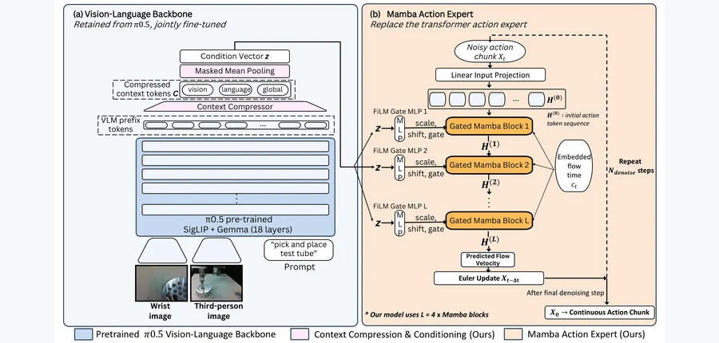 arXiv 2026-10-20 · cs.RO · #24 **[MambaAct: Efficient Mamba Action Experts for Flow-Matching Vision-Language-Action Models](https://arxiv.org/abs/2610.22951)** Khuyen Pham, Tran Nguyen Le, Edoardo Fazzari, Cesare Stefanini 机构：MBZUAI / Technical University of Denmark（[PDF](https://arxiv.org/pdf/2610.22951)） [Paper](https://arxiv.org/abs/2610.22951) · [图源](https://arxiv.org/html/2610.22951v1/MambaActVer5.png) 

中文摘要
视觉—语言—动作（VLA）模型在通用机器人操作方面有潜力，但推理开销仍是实时控制的主要瓶颈；对 $\pi_{0.5}$ 等流匹配 VLA 尤其如此，因为迭代去噪需反复调用动作专家。我们提出 MambaAct，一种用于流匹配 VLA 策略的高效 Mamba 动作专家。它保留 $\pi_{0.5}$ 预训练的视觉—语言前缀编码器，用紧凑的 Mamba 动作专家替换原 Transformer 动作专家。专家内部，Mamba 充当动作混合器，建模带噪连续动作序列的依赖关系。为在不反复进行 token 级交叉注意力的情况下保留视觉—语言条件，MambaAct 用轻量 Context Compressor 将 VLM 前缀 token 映射为紧凑条件信号，对每个 Mamba 动作块作门控和调制。其动作专家小 10 倍，在 LIBERO 上把流匹配去噪延迟降低 64.8%，真实部署降低 58.8%；同时，在三个独立微调种子上使 LIBERO 平均成功率提高 1.08 个百分点，并在 LIBERO-Plus 和真实基准上保持收益。代码和模型权重已公开，见论文所链资源。 <a href="https://arxiv.org/abs/2610.22951">原摘要来源</a>
 |
| 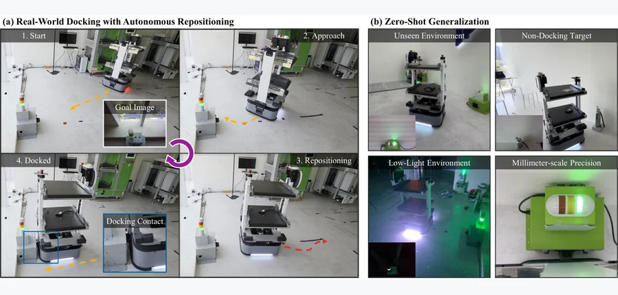 arXiv 2026-10-20 · cs.RO · #25 **[GR-VIP: Geometric representation conditioning for precise visuomotor policy](https://arxiv.org/abs/2610.22997)** Chanhwi Lee, Jiwon Seong, Eunje Choi, Hohyung Lee, Jongsoo Lee, Junyeong Bae, Inveom Kwak, Woosang Shin, Soohee Han 机构：POSTECH / Polaris3D / KITECH（[PDF](https://arxiv.org/pdf/2610.22997)） [Paper](https://arxiv.org/abs/2610.22997) · [图源](https://arxiv.org/html/2610.22997v1/teaser_10_12.png) 

中文摘要
学习式移动机器人控制仍难以实现精确的终点位置和航向对齐。近期视觉学习方法借助预训练视觉编码器，在精确目标相对控制和未见环境泛化上有进展，但通用视觉表示并非专为捕捉当前视图与目标视图间的细微空间差别而设计；同时，兼具毫米级终点精度与跨环境零样本迁移的真实实验仍有限。为此，我们提出 GR-VIP，一种目标条件视觉运动策略，利用为相对相机位姿估计而预训练的视觉编码器。GR-VIP 不使用最终的相对位姿估计，而以位姿回归前产生的稠密关系特征作为动作预测条件，保留跨视图的细粒度信息，以便从示范中学习纠正动作。我们在真实停靠任务上评估 GR-VIP，展示它在训练环境和未见环境中均有较高停靠成功率与毫米级终点精度，迁移无须额外训练。补充实验还表明，该策略能够对齐非停靠目标，并在所测试的弱光条件下完成停靠。 <a href="https://arxiv.org/abs/2610.22997">原摘要来源</a>
 | 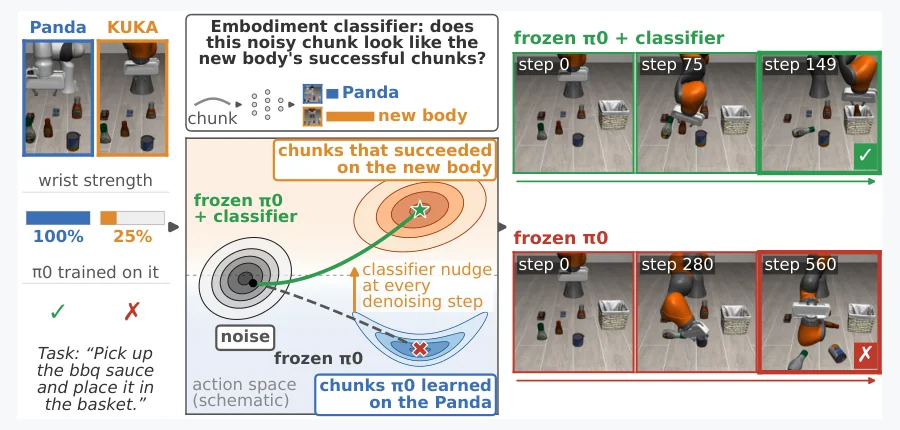 arXiv 2026-10-20 · cs.RO · #26 **[Embodiment-Classifier Guidance: Transferring Frozen VLAs Across Robot Dynamics without Demonstrations](https://arxiv.org/abs/2610.22576)** Devin Han, Hershraj Niranjani 机构：UC Berkeley（[PDF](https://arxiv.org/pdf/2610.22576)） [Paper](https://arxiv.org/abs/2610.22576) · [图源](https://arxiv.org/html/2610.22576v1/teaser_v10.png) 

中文摘要
基于流的 $\pi_0$ 等策略在固定的机器人形态集合上训练，向新形态迁移仍是开放问题。为在无需额外示范或参数更新的情况下把冻结的 $\pi_0$ 适配到新形态，我们利用少量校准任务训练轻量形态分类器，区分源机体和目标机体上的成功动作块。对于 $\pi_0$ 曾在源机体见过、分类器却未接受训练的迁移任务，我们在 $\pi_0$ 的每个去噪步骤用分类器梯度作引导；该梯度估计从源机体成功动作分布走向目标机体成功动作分布的方向。在采用四种修改控制器的 LIBERO 仿真基准上，跨 12 组任务集—控制器组合，该引导将目标机体平均成功率从 72% 提高到 80%，失败相对减少 31%；12 组中有 11 组改善，Holm 校正后 5 组显著。仿真中只需每项任务少量目标机体轨迹，因此对轨迹成本高的 sim-to-real 迁移有潜力。但在弱手腕上结果有好有坏，在锁定手腕上有害，因为分类器缺数据或偏好不可行动作。利用被引导的 $\pi_0$ 再采集目标机体数据可弥补缺口：一条弱手腕机械臂上，引导后解决了原始数据中未引导 $\pi_0$ 从未成功的任务；用新增成功样本重训分类器，使成功率从 52.5% 升至 70.7%。 <a href="https://arxiv.org/abs/2610.22576">原摘要来源</a>
 | 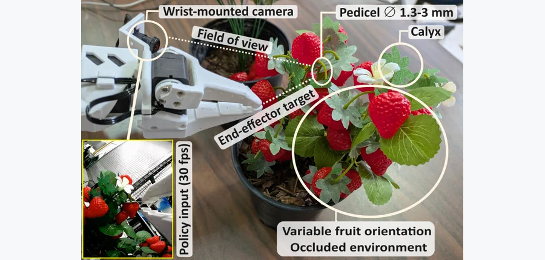 arXiv 2026-10-20 · cs.RO · #27 **[Pedicel-Targeted Strawberry Harvesting via Imitation Learning on a Low-Cost Teleoperated Robotic Arm](https://arxiv.org/abs/2610.22765)** Nitin Rai, Won Suk Lee, Hongyoung Leon, Heping Zhu 机构：University of Florida / USDA Agricultural Research Service（[PDF](https://arxiv.org/pdf/2610.22765)） [Paper](https://arxiv.org/abs/2610.22765) · [图源](https://arxiv.org/html/2610.22765v1/fig1.png) 

中文摘要
草莓采收中精准抓取果梗仍是关键瓶颈：果梗直径仅 1.3–3 mm，与周围叶片颜色相近，而从离层干净分离还需精确力控制。草莓作为按外观分级的作物，应避免直接抓果造成碰伤，因而无损果梗分离尤为重要。经典方法难以在遮挡冠层中将视觉、运动规划和接触操作统一为稳健框架。本文提出面向果梗的视觉运动模仿学习流程：采集人类遥操作示范，用 ResNet-50 视觉骨干训练 Transformer 动作分块（ACT）策略，并在 Jetson AGX Orin 边缘平台以 15 Hz 自主部署。基于 130 条示范训练 10 万梯度步后，训练损失从 2.84 稳定收敛至 0.091。作者还建立了可复现的开源流程，公开农业机器人数据集和模型权重；完整数据集、训练策略、代码、配置及部署说明见论文所链资源。 <a href="https://arxiv.org/abs/2610.22765">原摘要来源</a>
 |
| 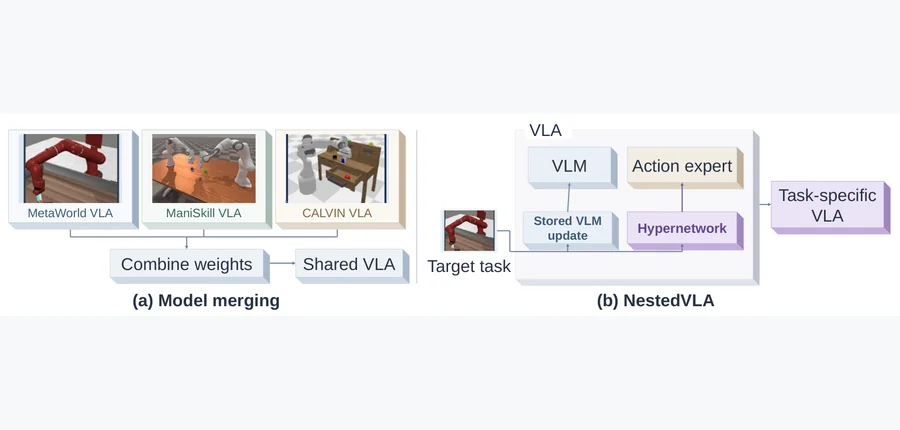 arXiv 2026-10-20 · cs.RO · #28 **[NestedVLA: Learning to Consolidate and Generate Skills for Vision-Language-Action Models](https://arxiv.org/abs/2610.23271)** Guodong Du, Wanyu Lin 机构：Hong Kong Polytechnic University（[PDF](https://arxiv.org/pdf/2610.23271)） [Paper](https://arxiv.org/abs/2610.23271) · [图源](https://arxiv.org/html/2610.23271v2/figure1_nestedvla_v1.png) 

中文摘要
视觉—语言—动作（VLA）模型有望成为通用机器人智能体，但异构任务和环境中学到的技能难以整合：训练数据分散于不同平台，联合多任务训练会互相干扰，模型合并会引入参数冲突或要求改架构。我们主张先独立学习技能，再事后整合。为此，我们提出 NestedVLA，以参数生成替代参数聚合：一个由目标任务条件化的嵌套超网络合成任务自适应动作专家参数，再与冻结的基础 VLA 组合；任务特定的压缩 VLM 残差单独保留。这种表述在减轻干扰的同时支持灵活的任务条件技能复用。在 MetaWorld、ManiSkill、CALVIN 三个强化学习基准上，NestedVLA 平均比最强模型合并基线高 41 个百分点；在 ManiSkill 上距逐任务微调不到 1 个百分点，并显著缩小 CALVIN 上的差距，提示一种存储效率较高的技能整合路径。代码见论文所链资源。 <a href="https://arxiv.org/abs/2610.23271">原摘要来源</a>
 | 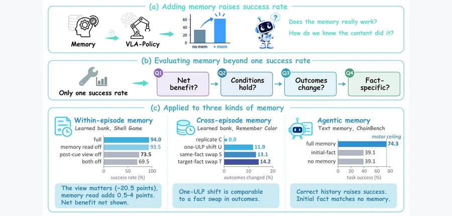 arXiv 2026-10-20 · cs.RO · #29 **[Beyond Success Rate: Interventional Evaluation of Memory in Vision-Language-Action Systems](https://arxiv.org/abs/2610.23372)** Keyuan Luo, Yi Xie, Wanyun Ling, Yuanzhe Li, Ziyue Li, Zhuoqi Zeng 机构：Hainan Bielefeld University of Applied Sciences / Technical University of Munich / Technische Universität Berlin（[PDF](https://arxiv.org/pdf/2610.23372)） [Paper](https://arxiv.org/abs/2610.23372) · [图源](https://arxiv.org/html/2610.23372v1/figure1_fourq_c.png) 

中文摘要
当我们说机器人“使用记忆”时，记忆是否真的发挥作用？仅比较成功率的消融不能证明模型使用了任务相关事实：它同时改变信息和计算，汇总成功率还可能掩盖相互抵消的收益与损失。我们提出针对视觉—语言—动作（VLA）系统的干预式记忆评估协议 IMEP，回答四个问题：记忆是否带来净收益；在什么条件下有益；改变记忆是否改变任务结果；这些影响是否特指任务相关事实。在检索接口，协议比较目标事实替换、保留事实的替换、最小数值扰动和完全复制，并把决策正确性与运动执行成功分开评估。我们考察回合内、跨回合及智能体式记忆。在跨回合学习记忆库实验中，一个最低有效位（ULP）干预连同其安装过程改变了 11.9% 的配对随机种子结果，而改变关键事实相对保留事实的替换没有明确额外效果。为考察记忆何时有益，我们引入 ChainBench；其正确决策需要当前观测中没有的历史信息。完整记忆配置把任务成功率从 39.1% 提升至 74.3%，在共享记录执行条件下与 oracle 决策相当。结果说明正确历史能支持机器人决策，但要证明记忆系统真正实现这一收益，需要超越汇总成功率的事实特定证据。 <a href="https://arxiv.org/abs/2610.23372">原摘要来源</a>
 | 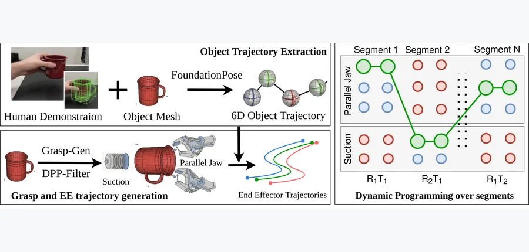 arXiv 2026-10-20 · cs.RO · #30 **[Embodiment-Aware Planning for Heterogeneous Bimanual Manipulation](https://arxiv.org/abs/2610.23551)** Sukhvansh Jain, Anurag Maurya, Shivam Vats, Narendra Kumar Dhar, Ravi Prakash 机构：Indian Institute of Technology Mandi / Indian Institute of Science / Brown University（[PDF](https://arxiv.org/pdf/2610.23551)） [Paper](https://arxiv.org/abs/2610.23551) · [图源](https://arxiv.org/html/2610.23551v1/images/method_new.png) 

中文摘要
许多人手轻松完成的操作，对只装有简单专用夹爪的机器人仍很困难。工业平台常用吸盘或平行夹爪，但单一末端执行器难以可靠满足复杂任务不同阶段的抓取、重新定向、插入和受约束放置要求。我们研究异构双臂系统中互补的简单夹爪能否共同完成单个夹爪无法完成的任务。给定一条指定目标物体运动的人类示范，我们把形态感知执行表述为臂—轨迹分配上的有限时域优化。每个阶段，规划器决定采用单臂操作还是协调双臂交接，同时推理异构抓取可行性、运动约束、可操作性和跨夹爪兼容性。利用这一形式，我们计算具有显式切换正则化的全局一致分配。配备吸盘和平行夹爪的双 Franka FR3 平台实验显示，对单夹爪执行不可行的任务，该方法提高了可行性和可靠性。 <a href="https://arxiv.org/abs/2610.23551">原摘要来源</a>
 |
| 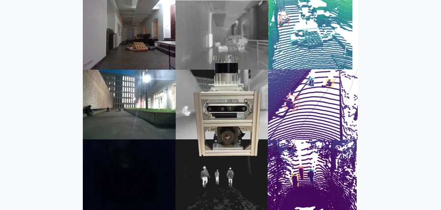 arXiv 2026-10-20 · cs.CV · #31 **[TriSAR-3D and PaintFusion: A Novel Trimodal LiDAR-RGB-Thermal Dataset and Method for 3D Person Detection in Search and Rescue](https://arxiv.org/abs/2610.22509)** Markus Kramer, Jan Wachenfeld, Oskar von Stryk 机构：Technical University of Darmstadt（[PDF](https://arxiv.org/pdf/2610.22509)） [Paper](https://arxiv.org/abs/2610.22509) · [图源](https://arxiv.org/html/2610.22509v1/teaser_2.png) 

中文摘要
可靠的 3D 人员检测可帮助救援机器人为一线人员提供态势感知。然而，多模态 3D 检测研究大多面向行人通常直立、靠近道路的自动驾驶场景，因此不清楚其性能有多少能迁移到人员可能躺卧、部分遮挡，且场地内外都无结构的救援场景。为研究这一差距，我们提出 TriSAR-3D 多模态人员检测数据集，由高分辨率 128 线 LiDAR、RGB 相机和热成像相机采集，覆盖不同时间、室内外位置与多样姿势，以研究其对 3D 检测器表现的影响。我们还提出 PaintFusion，一种用简单 MLP 融合基于 PointPainting 证据的三模态 3D 检测流程。该方法在数据集上达到 65.4 AP@50，优于仅 LiDAR 的 CenterPoint（53.4）、RGB+LiDAR 的 BEVFusion（60.5）和改造后的三模态 Tri-BEVFusion（60.7）；每帧延迟为 51.6 ms，也快于 BEVFusion 的 101 ms。我们还测试不同 3D 检测器向未见姿势类别的泛化。若从训练数据去掉躺卧样本，所有受测检测器的躺卧姿势 AP@50 都跌至近零。结果说明数据多样性对 3D 检测性能影响很大。数据集和代码见论文所链资源。 <a href="https://arxiv.org/abs/2610.22509">原摘要来源</a>
 | 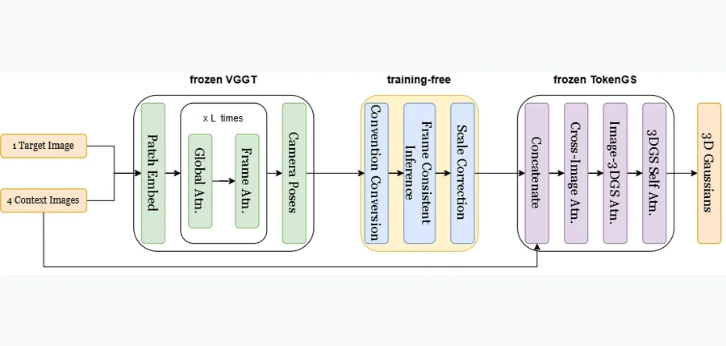 arXiv 2026-10-20 · cs.CV · #32 **[Frame-Consistent Feed-Forward 3D Gaussian Splatting from Sparse Unposed Images](https://arxiv.org/abs/2610.23039)** Viruthshaan Vinasirajan, Ranga Rodrigo 机构：University of Moratuwa（[PDF](https://arxiv.org/pdf/2610.23039)） [Paper](https://arxiv.org/abs/2610.23039) · [图源](https://arxiv.org/html/2610.23039v1/images/method.png) 

中文摘要
前馈高斯模型让新视角合成几乎即时完成。它们可以分两阶段或一次合并前向直接预测高斯。分别训练的两阶段模型很有吸引力，因为一个可专注准确位姿估计，另一个专注高质量重建，无须单个联合模型在两项目标间折中；自然的搭配是冻结位姿估计器 VGGT 与冻结重建骨干 TokenGS。VGGT-X、3R-GS 等先前两阶段工作把质量下降归因于位姿噪声，并引入学习式精炼。我们表明这并非主要问题。在 DL3DV 和 MipNeRF360 两个数据集的 107 个场景中，以 COLMAP 位姿为参考做逐相机分析，发现对齐后的旋转误差很小，中位数为 1.6 度，但平移尺度存在较大且在数据集内一致的偏移。对 140 个 DL3DV 场景的受控消融表明，主要障碍是坐标系不一致和平移尺度不匹配这两个集成问题，而非位姿误差；两者都可确定性地修正。修正后，当从场景所有视角估计位姿时，冻结 VGGT 驱动冻结 TokenGS 可达到 22.47 PSNR，距 COLMAP 参考仅 0.51 dB，且无须额外训练。在标准无位姿协议下仅用四张上下文图像重建的稀疏设置中，同一管线达到与全视角设置相当的质量，实现无需 COLMAP 或精炼步骤的完整管线。 <a href="https://arxiv.org/abs/2610.23039">原摘要来源</a>
 | 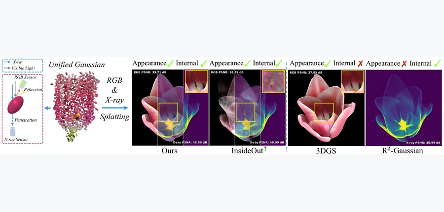 arXiv 2026-10-20 · cs.CV · #33 **[X-Splat: Unified Gaussian Splatting for Joint RGB and X-ray 3D Reconstruction](https://arxiv.org/abs/2610.23237)** Wangze Xu, Chu Zhou, Mae Yamaguchi, Linrui Dai, I-Chao Shen, Takashi Ijiri, Imari Sato 机构：University of Tokyo / National Institute of Informatics / Shibaura Institute of Technology（[PDF](https://arxiv.org/pdf/2610.23237)） [Paper](https://arxiv.org/abs/2610.23237) · [图源](https://arxiv.org/html/2610.23237v1/teaser_final.png) 

中文摘要
联合重建 RGB 和 X 射线可把外部外观与内部结构联系起来，比单一模态更全面地理解真实物体。但既有方法为各模态分别训练模型，造成冗余几何、对齐伪影以及限制跨模态信息发现的松散耦合。我们提出统一表示：所有高斯基元共享同一套几何参数，仅靠近表面的基元额外携带外观属性。跨模态配准使用干净的多视角立体视觉和 X 射线几何代理，而不是对齐两组已优化的高斯，以提升对齐稳定性。随后我们用两种模态的监督联合优化统一表示，并加入由 X 射线几何导出的表面—深度一致性损失来指导 RGB 重建。在 InsideOut 和我们的 Flower &amp; Insect 数据集上的实验显示，相比维护两套独立几何，该框架能实现更稳健的跨模态对齐、更高的 RGB 渲染质量，同时不损害 X 射线重建，并使用更紧凑的表示。 <a href="https://arxiv.org/abs/2610.23237">原摘要来源</a>
 |
| 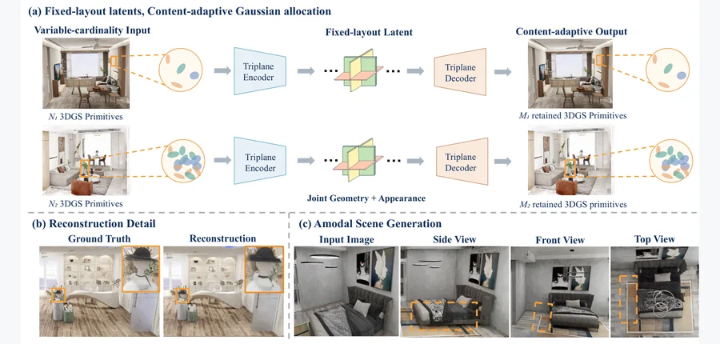 arXiv 2026-10-20 · cs.CV · #34 **[TriFold: Folding irregular 3D Gaussians into structured latents for 3D Scene Generation](https://arxiv.org/abs/2610.23050)** Yun Wang, Chiyu Wang, Fan Jiang, Ziyu Zhu, Zhaoxu Sun, Guangchi Fang, Mu Xu, Dapeng Wu 机构：AMAP, Alibaba Group / City University of Hong Kong / Hong Kong Polytechnic University（[PDF](https://arxiv.org/pdf/2610.23050)） [Paper](https://arxiv.org/abs/2610.23050) · [图源](https://arxiv.org/html/2610.23050v2/teaser.png) 

中文摘要
3D 生成的发展推动了对复杂 3D 场景紧凑生成表示的兴趣；但原生 3D 高斯场景的基元数量差异大、空间密度不均，即使相邻基元在几何和外观上也可能不同，使这种表示难以学习。我们提出 TriFold，一种原生 3D 高斯变分自编码器，把高斯场景编码到固定布局的三平面潜空间，同时重建几何和外观。关键是在潜空间加入结构规则性，同时保留底层高斯的空间自适应性。编码时，逐单元的学习查询将投影后的高斯聚合进每个单元的多个槽，减少单特征池化造成的信息损失；解码时，占据预测找出活跃区域，再由基于查询的集合预测和候选选择重建局部高斯集合，使基元数量随空间变化。基于这一表示，我们训练条件场景级 3DGS 生成的潜空间流匹配模型，支持点云条件合成和单图条件的补全式生成。实验表明，TriFold 可由只提供场景部分观测的单张图像实现高保真重建与生成，支持其原生 3D 高斯表示学习的有效性。相关资源见论文所链页面。 <a href="https://arxiv.org/abs/2610.23050">原摘要来源</a>
 | 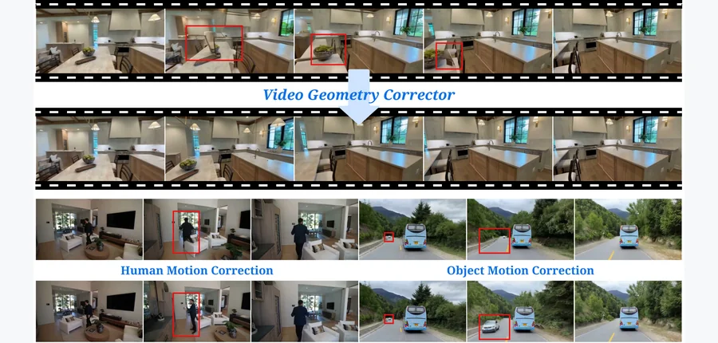 arXiv 2026-10-20 · cs.CV · #35 **[Learning to Correct Geometry in Generated Videos](https://arxiv.org/abs/2610.23856)** Weijie Lyu, Tiancheng Shen, Jason Li, Yujing Wang, Xiaoyuan Wang, Haobo Yuan, Yizhou Zhao, Ming-Hsuan Yang 机构：University of California, Merced / Nanyang Technological University / Peking University / Carnegie Mellon University（[PDF](https://arxiv.org/pdf/2610.23856)） [Paper](https://arxiv.org/abs/2610.23856) · [图源](https://arxiv.org/html/2610.23856v1/teaser_v5.png) 

中文摘要
生成视频在相机运动下常丧失几何一致性：结构随视角变化而扭曲，视差不一致，平滑相机运动也可能坍缩成类似切镜的转场。我们认为，这主要是数据问题：网络规模视频语料中，大多数可见运动来自静止或微动相机拍摄的动态物体，因视角变化引起的外观变化监督很少。为此，我们提出 Video Geometry Corrector（VGC），一种利用合成配对监督训练的后处理视频到视频模型。从带有多样相机运动和位姿标注的真实视频出发，我们用合成配对监督数据生成流程构造 VG-Pairs：把每段视频视为几何一致的目标，再用预训练图像到视频修复模型和轨迹自适应关键帧生成其扭曲对应样本。VGC 学习将扭曲输入映射回几何一致的目标，无须修改源生成器，并用光流作辅助线索来分离相机运动与物体运动。位姿条件与提示词驱动基准实验表明，VGC 能改善多个源生成器的几何一致性；扩大骨干模型规模还使框架更趋向通用视频精炼。 <a href="https://arxiv.org/abs/2610.23856">原摘要来源</a>
 |   |
<!-- PAPER_CARDS_END -->

## 检索概况

- **检索窗口**：上次运行（北京时间 2026-10-19 09:03）至本次官方页面核对（北京时间 2026-10-20 11:30）。
- **官方批次**：14 个 `new?show=2000` 官方分类页均显示 **Monday, 19 October 2026**；本期主榜仅取该批次 New submissions。
- **范围与方法**：优先 cs.CV、cs.GR、cs.RO、cs.AI、cs.LG；补查 physics、cond-mat、math.OC/NA/DS、stat.ML、eess.IV/SY/SP。先按标题召回，再阅读原摘要确认三维、物理或具体机器人贡献；同一 arXiv ID 去重。
- **官方页面总命中**：New **659**、Cross **316**、Replacement **739** 条；14 页 New 去重后 **659** 个 ID。
- **本期新增命中 / 入选**：**659 / 35 篇**；按 3D/物理交叉、具体具身任务、基础 3D 排序。未以宽泛 Agent/LLM 论文补足上限。
- **配图和摘要**：中文摘要与原始英文摘要逐篇保存在 `data/enrichment.json`；本期 35 篇均配有已核对的论文原图，缺图 **0** 篇；缺原摘要 **0** 篇。

## 官方 listing 状态

| 官方分类页 | 最新 listing 日期 | New | Cross | Replacement |
|---|---|---:|---:|---:|
| [cs.CV](https://arxiv.org/list/cs.CV/new?show=2000) | 2026-10-19 | 106 | 20 | 75 |
| [cs.GR](https://arxiv.org/list/cs.GR/new?show=2000) | 2026-10-19 | 1 | 3 | 4 |
| [cs.RO](https://arxiv.org/list/cs.RO/new?show=2000) | 2026-10-19 | 61 | 7 | 53 |
| [cs.AI](https://arxiv.org/list/cs.AI/new?show=2000) | 2026-10-19 | 92 | 82 | 170 |
| [cs.LG](https://arxiv.org/list/cs.LG/new?show=2000) | 2026-10-19 | 126 | 96 | 169 |
| [physics](https://arxiv.org/list/physics/new?show=2000) | 2026-10-19 | 78 | 29 | 63 |
| [cond-mat](https://arxiv.org/list/cond-mat/new?show=2000) | 2026-10-19 | 86 | 22 | 80 |
| [math.OC](https://arxiv.org/list/math.OC/new?show=2000) | 2026-10-19 | 13 | 17 | 33 |
| [math.NA](https://arxiv.org/list/math.NA/new?show=2000) | 2026-10-19 | 16 | 5 | 15 |
| [math.DS](https://arxiv.org/list/math.DS/new?show=2000) | 2026-10-19 | 10 | 3 | 13 |
| [stat.ML](https://arxiv.org/list/stat.ML/new?show=2000) | 2026-10-19 | 15 | 16 | 33 |
| [eess.IV](https://arxiv.org/list/eess.IV/new?show=2000) | 2026-10-19 | 14 | 3 | 0 |
| [eess.SY](https://arxiv.org/list/eess.SY/new?show=2000) | 2026-10-19 | 20 | 3 | 14 |
| [eess.SP](https://arxiv.org/list/eess.SP/new?show=2000) | 2026-10-19 | 21 | 10 | 17 |

## Top papers

> 表中标题、作者、分类、摘要和实验描述来自所链 arXiv 官方页面；机构来自所链 PDF 首页（未确认者另标）。相关性、机构强度、阅读优先级、局限与建议均为本日报**推断**。

| # | 论文 | arXiv | 分类 | 作者 | 机构 | 相关性（推断） | 机构强度（推断） | 阅读优先级（推断） |
|---:|---|---|---|---|---|---|---|---|
| 1 | ORD-WM: Learning Object-Centric Rigid Dynamics for 3D World Modeling in Robotic Manipulation | [arXiv:2610.23156](https://arxiv.org/abs/2610.23156) | cs.RO | Yueyang Weng, Xiaopeng Zhang, Yuxi Ou, Yongjin Mu, Chengzhi Zhao, Yanjie Li | Harbin Institute of Technology, Shenzhen（[PDF](https://arxiv.org/pdf/2610.23156)） | 高（3D/物理交叉） | 中高 | 高 |
| 2 | DefFlow: Goal-Conditioned Deformable Object Manipulation using 3D Point Flows | [arXiv:2610.22827](https://arxiv.org/abs/2610.22827) | cs.RO | Gaurav Singh, Sergio Orozco, Ryan Duong, Mete Tuluhan Akbulut, George Konidaris, Srinath Sridhar | Brown University（[PDF](https://arxiv.org/pdf/2610.22827)） | 高（3D/物理交叉） | 中高 | 高 |
| 3 | Shape-Aware Neural Time Fields for Rigid-Body Motion and Manipulation Planning | [arXiv:2610.22762](https://arxiv.org/abs/2610.22762) | cs.RO | Yanming Zhou, Yuchen Liu, Ahmed H. Qureshi | Purdue University（[PDF](https://arxiv.org/pdf/2610.22762)） | 高（3D/物理交叉） | 中高 | 高 |
| 4 | Ego2Contact: Predicting Touch from Egocentric Human Video for Contact-Rich Robot Manipulation | [arXiv:2610.22932](https://arxiv.org/abs/2610.22932) | cs.RO | Qianqian Yang, Dayou Li, Bangya Liu, Zihao Zhu, Nuo Chen, Siyuan Xu, Hezhen Hu, Chen Yu, Rebecca Friesen, Minghui Zheng, Cynthia Hipwell, Xiaoning Qian, Kenji Shimada, Zhiwen Fan | Carnegie Mellon University / Texas A&M University / University of Wisconsin–Madison / University of Texas at Austin（[PDF](https://arxiv.org/pdf/2610.22932)） | 高（3D/物理交叉） | 中高 | 高 |
| 5 | Blind Precise Assembly: Proprioceptive Sim-to-Real Peg-in-Hole for Diverse Parts | [arXiv:2610.23849](https://arxiv.org/abs/2610.23849) | cs.RO | Antonia Bronars, Younghyo Park, Kushal Kedia, Pulkit Agrawal | Massachusetts Institute of Technology（[PDF](https://arxiv.org/pdf/2610.23849)） | 高（3D/物理交叉） | 中高 | 高 |
| 6 | Simultaneous Force and Motion Control in Generalised Coordinates | [arXiv:2610.22813](https://arxiv.org/abs/2610.22813) | cs.RO | Jon Woolfrey | Independent Researcher（[PDF](https://arxiv.org/pdf/2610.22813)） | 高（3D/物理交叉） | 未评估 | 中高 |
| 7 | GRASP: Global-Local Representation Alignment and Spatial-Physical Grounding for Bimanual Robotic Manipulation | [arXiv:2610.23123](https://arxiv.org/abs/2610.23123) | cs.RO | Zeyuan Ren, Guanxun Zhao, Qi Li, Hao Wang, Wenlong Liao, Keyi Luo, Xijing Zhang, Zhiyuan Zhang, Jingye Cui, Qibin Gu, Zhichen Wang, Yucheng Hu, Liqiao Xia, Nan Bu, Zhengde Ma, Rankun Li, Xue Yang, Wende Xie | COWARobot / Hong Kong Polytechnic University / Tongji University / Shanghai Jiao Tong University / National University of Singapore / Chinese University of Hong Kong / Northeastern University（[PDF](https://arxiv.org/pdf/2610.23123)） | 高（3D/物理交叉） | 中高 | 中高 |
| 8 | PASS-VLN: Passability-Aware Local-Command Vision-and-Language Navigation | [arXiv:2610.22812](https://arxiv.org/abs/2610.22812) | cs.RO | Cong Zou, Xiangsheng Shi, Xuanhui Wang, Fubin Wang, Guangjun Ge, Chao Wang, Yu Wang | Qiyuan Lab / Tsinghua University（[PDF](https://arxiv.org/pdf/2610.22812)） | 高（3D/物理交叉） | 中高 | 中高 |
| 9 | Hardware-as-Regularization: Enhancing Data Consistency in Imitation Learning via an Adjustable Passive Compliant Leader Arm | [arXiv:2610.22977](https://arxiv.org/abs/2610.22977) | cs.RO | Hideyuki Ichiwara, Yushi Kaida, Hirokazu Ishida | SB Intuitions Corporation（[PDF](https://arxiv.org/pdf/2610.22977)） | 高（3D/物理交叉） | 中高 | 中高 |
| 10 | AWAM: Active Trajectory-Conditioned View Imagination for Robust Robot Manipulation | [arXiv:2610.23396](https://arxiv.org/abs/2610.23396) | cs.RO | Jiawei Geng, Zhenyang Liu, Yuzheng Wu, Yanwei Fu | Fudan University / Shanghai Innovation Institute（[PDF](https://arxiv.org/pdf/2610.23396)） | 高（3D/物理交叉） | 中高 | 中高 |
| 11 | Modeling and Analysis of Dynamic Coupling Effects in a Free-Floating Space Manipulator | [arXiv:2610.22558](https://arxiv.org/abs/2610.22558) | eess.SY | Erik Chumacero-Polanco | University of Texas Rio Grande Valley（[PDF](https://arxiv.org/pdf/2610.22558)） | 高（3D/物理交叉） | 中高 | 中高 |
| 12 | Influence of Droplet Morphology on Fluid Dynamics and Impact Erosion of Wind Turbine Blades | [arXiv:2610.23178](https://arxiv.org/abs/2610.23178) | physics.flu-dyn | Hao Hao, Antonis Sergis, Maria N. Charalambides, Alex M. K. P. Taylor, Yannis Hardalupas | Imperial College London（[PDF](https://arxiv.org/pdf/2610.23178)） | 高（3D/物理交叉） | 中高 | 中高 |
| 13 | KFS$^4$LAM: Adaptive KeyFrame Selection with Structure-Aware Mapping for Endoscopic Gaussian Splatting SLAM | [arXiv:2610.22505](https://arxiv.org/abs/2610.22505) | cs.CV | Xinwei Ju, Zhehua Mao, Tianyi Song, Danail Stoyanov, Sophia Bano, Francisco Vasconcelos | University College London（[PDF](https://arxiv.org/pdf/2610.22505)） | 高（3D/物理交叉） | 中高 | 中高 |
| 14 | Scene-Designer: Learning Design Intelligence for Agentic 3D Scene Generation | [arXiv:2610.23121](https://arxiv.org/abs/2610.23121) | cs.CV | Xuanyu Liu, Hongyan Feng, Miao Pan, Sunlai Chen, Lizhou Liang, Bing Sun, Wenqi Zhang, Xuhong Zhang | Zhejiang University / Universal Identification Technology (Hangzhou)（[PDF](https://arxiv.org/pdf/2610.23121)） | 高（3D/物理交叉） | 中高 | 中高 |
| 15 | Foundation-Model-Driven 3D Scene Graphs for Mobile Manipulation | [arXiv:2610.23622](https://arxiv.org/abs/2610.23622) | cs.RO | Dominic Maggio, Lorenzo Shaikewitz, Aryan Naveen, Kris Hauser, Luca Carlone | Massachusetts Institute of Technology / Samsung Research America（[PDF](https://arxiv.org/pdf/2610.23622)） | 高（3D/物理交叉） | 中高 | 中高 |
| 16 | FCTS: Failure-Guided Curriculum Tree Search Over Generated Terrain for Legged Parkour | [arXiv:2610.22619](https://arxiv.org/abs/2610.22619) | cs.RO | Narayanan Palghat Parameswaran, Dong-Ki Kim, Jay Patrikar, Santiago Gutierrez, Harshad Zade, Shayegan Omidshafiei, Harmish Khambhaita | Carnegie Mellon University / FieldAI（[PDF](https://arxiv.org/pdf/2610.22619)） | 高（3D/物理交叉） | 中高 | 中高 |
| 17 | BeJEPA: A Goal-Conditioned Humanoid Behavior World Model via Unsupervised RL | [arXiv:2610.23127](https://arxiv.org/abs/2610.23127) | cs.RO | Liyun Yan, Haoyang Li, Yang Zhang, Jialing Zhu, Zhanxiang Cao, Zihao Zhou, Keqi Zhu, Yizhi Chen, Huang Chuxuan, Shengcheng Fu, Zhong Jiangwei, Qiao Sun, Chen Zhang, Yue Gao | Shanghai Jiao Tong University / Shanghai Innovation Institute / Zhejiang University / Tongji University / Fudan University / Lenovo Research（[PDF](https://arxiv.org/pdf/2610.23127)） | 高（3D/物理交叉） | 中高 | 中高 |
| 18 | No Eyes, No Problem: What Does Touch Contribute to Blind Baoding Ball Manipulation? | [arXiv:2610.23438](https://arxiv.org/abs/2610.23438) | cs.RO | Ayush Deshmukh, Nalin Agarwal, Elle Miller, Sethu Vijayakumar | University of Edinburgh（[PDF](https://arxiv.org/pdf/2610.23438)） | 高（3D/物理交叉） | 中高 | 中高 |
| 19 | FLoTS-SLAM: Optical Flow-Derived Uncertainty for Monocular Dynamic SLAM with Two-Stage Optimization | [arXiv:2610.23496](https://arxiv.org/abs/2610.23496) | cs.RO | Haorui Du, Lipu Zhou | Beihang University（[PDF](https://arxiv.org/pdf/2610.23496)） | 高（3D/物理交叉） | 中高 | 中高 |
| 20 | Reinforcement Learning Based Multi-Terrain Adaptive Whole-Body Control for a Quadruped Manipulator | [arXiv:2610.23548](https://arxiv.org/abs/2610.23548) | cs.RO | Yanzhou Jin, Fei Suo, Chang Liu, Yasuhisa Hasegawa, Liming Chen, Yusuke Iwasawa, Yutaka Matsuo, Yaonan Zhu | University of Tokyo / Nagoya University / École Centrale de Lyon（[PDF](https://arxiv.org/pdf/2610.23548)） | 高（3D/物理交叉） | 中高 | 中高 |
| 21 | VLA-Fabric: Learning Interaction for Composable Multi-Arm VLA Agents | [arXiv:2610.23018](https://arxiv.org/abs/2610.23018) | cs.RO | Chenglong Zhang, Shuaijun Liu, Feiyang You, Shuyang Hao, Chengyu Wu, Ningxin Su | Hong Kong University of Science and Technology (Guangzhou)（[PDF](https://arxiv.org/pdf/2610.23018)） | 高（具体具身机器人） | 中 | 中高 |
| 22 | SimpleVLN: Towards Simple and Frontier Vision-Language Navigation | [arXiv:2610.23203](https://arxiv.org/abs/2610.23203) | cs.RO | Lingyi Hong, Weiren Cai, Jiayu Chen, Xinyu Zhou, Bailin He, Yunfei Guo, Qiao Sun, Boyu Ma, Jianfei Yang, Wenqiang Zhang | Fudan University / Nanyang Technological University / Lenovo Research（[PDF](https://arxiv.org/pdf/2610.23203)） | 高（具体具身机器人） | 中 | 中高 |
| 23 | Scaling Online Exploration for Robot Agents | [arXiv:2610.22496](https://arxiv.org/abs/2610.22496) | cs.RO | Runhan Huang, Xiangcheng Zhang, Haoyu Chen, Yitong Li, Yen-Jen Wang, Bohan Lyu, Haotian Ye, Chuye Hong, Yixuan Wang, Chloe Su, Haoyu Xiong, Yangzhen Wu, Enze Xie, Travis Manderson, Stefano Ermon, Pieter Abbeel, Antonio Torralba, Dawn Song, Weirui Ye, Yilun Du | Harvard University / NVIDIA / UC Berkeley / MIT / Stanford University（[PDF](https://arxiv.org/pdf/2610.22496)） | 高（具体具身机器人） | 中 | 中高 |
| 24 | MambaAct: Efficient Mamba Action Experts for Flow-Matching Vision-Language-Action Models | [arXiv:2610.22951](https://arxiv.org/abs/2610.22951) | cs.RO | Khuyen Pham, Tran Nguyen Le, Edoardo Fazzari, Cesare Stefanini | MBZUAI / Technical University of Denmark（[PDF](https://arxiv.org/pdf/2610.22951)） | 高（具体具身机器人） | 中 | 中高 |
| 25 | GR-VIP: Geometric representation conditioning for precise visuomotor policy | [arXiv:2610.22997](https://arxiv.org/abs/2610.22997) | cs.RO | Chanhwi Lee, Jiwon Seong, Eunje Choi, Hohyung Lee, Jongsoo Lee, Junyeong Bae, Inveom Kwak, Woosang Shin, Soohee Han | POSTECH / Polaris3D / KITECH（[PDF](https://arxiv.org/pdf/2610.22997)） | 高（具体具身机器人） | 中 | 中高 |
| 26 | Embodiment-Classifier Guidance: Transferring Frozen VLAs Across Robot Dynamics without Demonstrations | [arXiv:2610.22576](https://arxiv.org/abs/2610.22576) | cs.RO | Devin Han, Hershraj Niranjani | UC Berkeley（[PDF](https://arxiv.org/pdf/2610.22576)） | 高（具体具身机器人） | 中 | 中高 |
| 27 | Pedicel-Targeted Strawberry Harvesting via Imitation Learning on a Low-Cost Teleoperated Robotic Arm | [arXiv:2610.22765](https://arxiv.org/abs/2610.22765) | cs.RO | Nitin Rai, Won Suk Lee, Hongyoung Leon, Heping Zhu | University of Florida / USDA Agricultural Research Service（[PDF](https://arxiv.org/pdf/2610.22765)） | 高（具体具身机器人） | 中 | 中高 |
| 28 | NestedVLA: Learning to Consolidate and Generate Skills for Vision-Language-Action Models | [arXiv:2610.23271](https://arxiv.org/abs/2610.23271) | cs.RO | Guodong Du, Wanyu Lin | Hong Kong Polytechnic University（[PDF](https://arxiv.org/pdf/2610.23271)） | 高（具体具身机器人） | 中 | 中高 |
| 29 | Beyond Success Rate: Interventional Evaluation of Memory in Vision-Language-Action Systems | [arXiv:2610.23372](https://arxiv.org/abs/2610.23372) | cs.RO | Keyuan Luo, Yi Xie, Wanyun Ling, Yuanzhe Li, Ziyue Li, Zhuoqi Zeng | Hainan Bielefeld University of Applied Sciences / Technical University of Munich / Technische Universität Berlin（[PDF](https://arxiv.org/pdf/2610.23372)） | 高（具体具身机器人） | 中 | 中高 |
| 30 | Embodiment-Aware Planning for Heterogeneous Bimanual Manipulation | [arXiv:2610.23551](https://arxiv.org/abs/2610.23551) | cs.RO | Sukhvansh Jain, Anurag Maurya, Shivam Vats, Narendra Kumar Dhar, Ravi Prakash | Indian Institute of Technology Mandi / Indian Institute of Science / Brown University（[PDF](https://arxiv.org/pdf/2610.23551)） | 高（具体具身机器人） | 中 | 中高 |
| 31 | TriSAR-3D and PaintFusion: A Novel Trimodal LiDAR-RGB-Thermal Dataset and Method for 3D Person Detection in Search and Rescue | [arXiv:2610.22509](https://arxiv.org/abs/2610.22509) | cs.CV | Markus Kramer, Jan Wachenfeld, Oskar von Stryk | Technical University of Darmstadt（[PDF](https://arxiv.org/pdf/2610.22509)） | 高（具体具身机器人） | 中 | 中高 |
| 32 | Frame-Consistent Feed-Forward 3D Gaussian Splatting from Sparse Unposed Images | [arXiv:2610.23039](https://arxiv.org/abs/2610.23039) | cs.CV | Viruthshaan Vinasirajan, Ranga Rodrigo | University of Moratuwa（[PDF](https://arxiv.org/pdf/2610.23039)） | 中高（基础 3D） | 中 | 中高 |
| 33 | X-Splat: Unified Gaussian Splatting for Joint RGB and X-ray 3D Reconstruction | [arXiv:2610.23237](https://arxiv.org/abs/2610.23237) | cs.CV | Wangze Xu, Chu Zhou, Mae Yamaguchi, Linrui Dai, I-Chao Shen, Takashi Ijiri, Imari Sato | University of Tokyo / National Institute of Informatics / Shibaura Institute of Technology（[PDF](https://arxiv.org/pdf/2610.23237)） | 中高（基础 3D） | 中 | 中高 |
| 34 | TriFold: Folding irregular 3D Gaussians into structured latents for 3D Scene Generation | [arXiv:2610.23050](https://arxiv.org/abs/2610.23050) | cs.CV | Yun Wang, Chiyu Wang, Fan Jiang, Ziyu Zhu, Zhaoxu Sun, Guangchi Fang, Mu Xu, Dapeng Wu | AMAP, Alibaba Group / City University of Hong Kong / Hong Kong Polytechnic University（[PDF](https://arxiv.org/pdf/2610.23050)） | 中高（基础 3D） | 中 | 中高 |
| 35 | Learning to Correct Geometry in Generated Videos | [arXiv:2610.23856](https://arxiv.org/abs/2610.23856) | cs.CV | Weijie Lyu, Tiancheng Shen, Jason Li, Yujing Wang, Xiaoyuan Wang, Haobo Yuan, Yizhou Zhao, Ming-Hsuan Yang | University of California, Merced / Nanyang Technological University / Peking University / Carnegie Mellon University（[PDF](https://arxiv.org/pdf/2610.23856)） | 中高（基础 3D） | 中 | 中高 |

## 逐篇中文要点

### 1. [ORD-WM: Learning Object-Centric Rigid Dynamics for 3D World Modeling in Robotic Manipulation](https://arxiv.org/abs/2610.23156)

- **事实｜方法**：以有符号距离场监督的向量神经元潜表示编码物体点云，再预测逐物体 SE(3) 增量。
- **事实｜结果**：解析施加刚体变换，报告稳定多步预测与仿真、真实操作中的实时 MPC。
- **推断｜局限与改进**：可测试部分可变形物体或接触后形变时刚体约束何时失效。

### 2. [DefFlow: Goal-Conditioned Deformable Object Manipulation using 3D Point Flows](https://arxiv.org/abs/2610.22827)

- **事实｜方法**：同时预测机器人与物体的目标条件 3D 点流，把抓取、重抓取和连续运动放入同一预测。
- **事实｜结果**：在绳索、颗粒介质和布料上优于动作预测及仅机器人流基线，并部署到真实点云输入。
- **推断｜局限与改进**：可做目标点云稀疏或遮挡下的流场置信度门控。

### 3. [Shape-Aware Neural Time Fields for Rigid-Body Motion and Manipulation Planning](https://arxiv.org/abs/2610.22762)

- **事实｜方法**：学习显式区分平移和旋转几何约束的行程时间场，并与采样规划器耦合。
- **事实｜结果**：2D/3D 刚体规划与闭环推动中报告更高成功率和更快重规划。
- **推断｜局限与改进**：可在窄通道用刚体朝向误差分层评估失败模式。

### 4. [Ego2Contact: Predicting Touch from Egocentric Human Video for Contact-Rich Robot Manipulation](https://arxiv.org/abs/2610.22932)

- **事实｜方法**：从人类第一视角视频学习双手触觉场，再用解剖区域对应适配机器人触觉布局。
- **事实｜结果**：适配后预测触觉可用于仿真强化学习和真实策略后训练；仿真优于无触觉基线。
- **推断｜局限与改进**：可检验透明或遮挡物体上的视频触觉不确定性校准。

### 5. [Blind Precise Assembly: Proprioceptive Sim-to-Real Peg-in-Hole for Diverse Parts](https://arxiv.org/abs/2610.23849)

- **事实｜方法**：仅用关节位置、速度与动作历史训练盲装配策略，不依赖视觉或力触觉传感。
- **事实｜结果**：零样本实机插销成功率为 73%；仿真中对未见零件形状的泛化优于匹配视觉策略。
- **推断｜局限与改进**：可比较更小装配间隙下的成功率、耗时与接触安全性。

### 6. [Simultaneous Force and Motion Control in Generalised Coordinates](https://arxiv.org/abs/2610.22813)

- **事实｜方法**：用高斯最小约束原理，把同步力—运动控制写成广义坐标中的 QP。
- **事实｜结果**：MuJoCo 仿真显示可同时保持接触力、降低轨迹误差并满足不等式约束。
- **推断｜局限与改进**：尚需在实机上评估模型误差和接触刚度变化。

### 7. [GRASP: Global-Local Representation Alignment and Spatial-Physical Grounding for Bimanual Robotic Manipulation](https://arxiv.org/abs/2610.23123)

- **事实｜方法**：在训练阶段用可微 FK 监督 TCP 与双臂相对位姿，并蒸馏全局和局部交互查询。
- **事实｜结果**：仿真和真实双臂长时任务显示两类先验互补，强视觉随机化时蒸馏查询更合适。
- **推断｜局限与改进**：可拆分比较 FK 物理约束与交互查询的独立收益。

### 8. [PASS-VLN: Passability-Aware Local-Command Vision-and-Language Navigation](https://arxiv.org/abs/2610.22812)

- **事实｜方法**：固定导航路线，仅改变机体宽度，评测“可通过则抵达、不可通过则停下”。
- **事实｜结果**：深度鸟瞰图障碍膨胀模型将无碰撞成功率提高约 12 个百分点，并泛化至未见宽度。
- **推断｜局限与改进**：可测试深度误差导致的错误停走决策及安全裕度。

### 9. [Hardware-as-Regularization: Enhancing Data Consistency in Imitation Learning via an Adjustable Passive Compliant Leader Arm](https://arxiv.org/abs/2610.22977)

- **事实｜方法**：用可调离合器和 3D 打印螺旋弹簧提供被动回复力，约束示教臂冗余关节。
- **事实｜结果**：积木堆叠成功率示例为 73.3% 对 36.7%，刚度降低时轨迹一致性单调下降。
- **推断｜局限与改进**：可按任务阶段自适应设定机械刚度，验证精度与示教负担权衡。

### 10. [AWAM: Active Trajectory-Conditioned View Imagination for Robust Robot Manipulation](https://arxiv.org/abs/2610.23396)

- **事实｜方法**：先规划虚拟观察轨迹，再以几何条件世界模型想象视图并压缩为空间记忆。
- **事实｜结果**：报告 LIBERO-Occ 75.9%、LIBERO-Plus 62.4%、RLBench-OG Occlusion1 76.5% 和实机 94.4%。
- **推断｜局限与改进**：需区分虚拟视图质量与动作策略本身对抗遮挡的贡献。

### 11. [Modeling and Analysis of Dynamic Coupling Effects in a Free-Floating Space Manipulator](https://arxiv.org/abs/2610.22558)

- **事实｜方法**：以动量守恒构建空间机械臂关节、末端和自由漂浮基座的速度映射。
- **事实｜结果**：数值分析发现耦合依赖后两关节相对构型和基座质量，某些构型高度各向异性。
- **推断｜局限与改进**：可扩展到 3D 多自由度机械臂并验证接触作业。

### 12. [Influence of Droplet Morphology on Fluid Dynamics and Impact Erosion of Wind Turbine Blades](https://arxiv.org/abs/2610.23178)

- **事实｜方法**：用不可压缩多相流与叶片有限元耦合模拟任意形状、朝向液滴的撞击。
- **事实｜结果**：提出以初始液滴投影面积联系关键撞击载荷的缩放律。
- **推断｜局限与改进**：可用少量非球形液滴实验检验缩放律的外推范围。

### 13. [KFS$^4$LAM: Adaptive KeyFrame Selection with Structure-Aware Mapping for Endoscopic Gaussian Splatting SLAM](https://arxiv.org/abs/2610.22505)

- **事实｜方法**：结合运动引导的关键帧选择、结肠褶皱结构监督和受限时间形变。
- **事实｜结果**：在 C3VD-v2 与 SplaTAM 的匹配比较中，旋转误差降 20.3%、深度 RMSE 降 38.4%。
- **推断｜局限与改进**：可检验非周期大形变时受限形变假设的边界。

### 14. [Scene-Designer: Learning Design Intelligence for Agentic 3D Scene Generation](https://arxiv.org/abs/2610.23121)

- **事实｜方法**：以设计和批评经验训练 3D 室内场景生成，Critic 同时评估物理有效性和功能布局。
- **事实｜结果**：报告 Scene-GRPO 和测试时 Critic 引导可改善场景质量与减少纠错试错。
- **推断｜局限与改进**：应以真实仿真碰撞和可达性指标校准 Critic 的物理判断。

### 15. [Foundation-Model-Driven 3D Scene Graphs for Mobile Manipulation](https://arxiv.org/abs/2610.23622)

- **事实｜方法**：将单目基础模型驱动的开放集 3D 场景图集成进移动操作机器人。
- **事实｜结果**：实机展示变化检测、多次建图、路径确定和场景重排抓取。
- **推断｜局限与改进**：可测量场景图误差如何传播到抓取和导航失败。

### 16. [FCTS: Failure-Guided Curriculum Tree Search Over Generated Terrain for Legged Parkour](https://arxiv.org/abs/2610.22619)

- **事实｜方法**：根据四足机器人局部失败的位置、终止方式和地形几何生成下一步训练地形。
- **事实｜结果**：真实工地扫描地形上，中等与困难路线成功率分别从 28.4% 升至 85.8%、从 14.9% 升至 44.7%。
- **推断｜局限与改进**：可比较局部失败驱动课程与均匀难度课程的样本效率。

### 17. [BeJEPA: A Goal-Conditioned Humanoid Behavior World Model via Unsupervised RL](https://arxiv.org/abs/2610.23127)

- **事实｜方法**：联合训练物理转移 Dynamic Predictor 与长时行为 Successor Predictor，使人形世界位姿目标可控。
- **事实｜结果**：20 秒跟踪中相对 BFM-Zero 的 AMASS 位置误差降 61.7%，并在 Unitree G1 实机验证。
- **推断｜局限与改进**：可测更强外扰下单步物理预测与长时行为概括的边界。

### 18. [No Eyes, No Problem: What Does Touch Contribute to Blind Baoding Ball Manipulation?](https://arxiv.org/abs/2610.23438)

- **事实｜方法**：用传感器对齐、触觉校准和两类域随机化训练仅靠本体感知与二值触觉的盲操作。
- **事实｜结果**：Shadow Dexterous Hand Lite 实机单次连续完成 225 次半圈保定球旋转。
- **推断｜局限与改进**：可量化不同触觉区域缺失后的失效速度。

### 19. [FLoTS-SLAM: Optical Flow-Derived Uncertainty for Monocular Dynamic SLAM with Two-Stage Optimization](https://arxiv.org/abs/2610.23496)

- **事实｜方法**：由光流与相机运动诱导光流的残差估计动态像素，并用两阶段 BA 减少其影响。
- **事实｜结果**：DAVIS 动态掩码 IoU 增 35%，Bonn 与 TUM 的平均 ATE 分别降 59% 和 19%。
- **推断｜局限与改进**：可检验大幅相机旋转时光流残差的误检。

### 20. [Reinforcement Learning Based Multi-Terrain Adaptive Whole-Body Control for a Quadruped Manipulator](https://arxiv.org/abs/2610.23548)

- **事实｜方法**：混合任务表示与按任务优先级的全身强化学习协调小型四足行走和机械臂操作。
- **事实｜结果**：实机在最高 30 度坡道、楼梯和可变形地形中部署。
- **推断｜局限与改进**：可分离地形自适应与末端姿态保持的贡献。

### 21. [VLA-Fabric: Learning Interaction for Composable Multi-Arm VLA Agents](https://arxiv.org/abs/2610.23018)

- **事实｜方法**：每条臂保留完整 VLA，通过跨策略学习交互协调共享上下文与动作。
- **事实｜结果**：三、四臂仿真和实体实验中，四个实体任务的完整交互比独立策略高 16–40 个百分点。
- **推断｜局限与改进**：可测新增机械臂时通信延迟和观测缺失的影响。

### 22. [SimpleVLN: Towards Simple and Frontier Vision-Language Navigation](https://arxiv.org/abs/2610.23203)

- **事实｜方法**：保持原生 MLLM 架构，以固定预算记忆、动作块和 IL–DAgger–RL 实现导航。
- **事实｜结果**：在 R2R-CE 和 RxR-CE 上分别报告 76.7% 和 80.1% 成功率。
- **推断｜局限与改进**：可按路径长度分析固定记忆何时遗失关键线索。

### 23. [Scaling Online Exploration for Robot Agents](https://arxiv.org/abs/2610.22496)

- **事实｜方法**：RAX 让编码智能体在线探索机器人任务并把成功决策编译成闭环技能程序。
- **事实｜结果**：仿真平均比基线高 37.4%，并报告多种真实机器人在无动作示范下学习操作。
- **推断｜局限与改进**：可核查探索次数、代码执行成本和跨任务技能复用收益。

### 24. [MambaAct: Efficient Mamba Action Experts for Flow-Matching Vision-Language-Action Models](https://arxiv.org/abs/2610.22951)

- **事实｜方法**：以 Mamba 动作专家替换流匹配 VLA 的 Transformer 动作专家，并压缩视觉语言前缀条件。
- **事实｜结果**：动作专家缩小 10 倍；去噪延迟在 LIBERO 和实机分别降 64.8%、58.8%。
- **推断｜局限与改进**：需评估长动作序列及快速接触变化下的控制损失。

### 25. [GR-VIP: Geometric representation conditioning for precise visuomotor policy](https://arxiv.org/abs/2610.22997)

- **事实｜方法**：以相对相机位姿编码器回归前的稠密关系特征调节移动机器人动作。
- **事实｜结果**：真实停靠任务中报告训练和未见环境的毫米级终点精度及零样本迁移。
- **推断｜局限与改进**：可测反光地面和目标遮挡对特征稳定性的影响。

### 26. [Embodiment-Classifier Guidance: Transferring Frozen VLAs Across Robot Dynamics without Demonstrations](https://arxiv.org/abs/2610.22576)

- **事实｜方法**：训练轻量机体分类器，以其梯度引导冻结 VLA 的逐步去噪动作向新机体成功分布迁移。
- **事实｜结果**：LIBERO 四种修改控制器上，平均成功率从 72% 升至 80%；锁定手腕条件下存在失败。
- **推断｜局限与改进**：可用可行性约束抑制分类器偏好的不可行动作。

### 27. [Pedicel-Targeted Strawberry Harvesting via Imitation Learning on a Low-Cost Teleoperated Robotic Arm](https://arxiv.org/abs/2610.22765)

- **事实｜方法**：以 130 条遥操作示范训练 ACT 视觉运动策略，面向 1.3–3 mm 草莓果梗。
- **事实｜结果**：作者报告在 Jetson AGX Orin 上以 15 Hz 部署，并公开数据、权重和配置。
- **推断｜局限与改进**：摘要未报告采收成功率，可评估遮挡、碰伤与力控制。

### 28. [NestedVLA: Learning to Consolidate and Generate Skills for Vision-Language-Action Models](https://arxiv.org/abs/2610.23271)

- **事实｜方法**：用任务条件嵌套超网络生成动作专家参数，整合独立学习的 VLA 技能。
- **事实｜结果**：MetaWorld、ManiSkill、CALVIN 上平均比最强模型合并基线高 41 个百分点。
- **推断｜局限与改进**：需检验新增机器人本体时参数生成器的迁移成本。

### 29. [Beyond Success Rate: Interventional Evaluation of Memory in Vision-Language-Action Systems](https://arxiv.org/abs/2610.23372)

- **事实｜方法**：以事实替换、数值微扰和复制对照干预 VLA 检索记忆，拆分决策与运动执行。
- **事实｜结果**：ChainBench 中完整记忆将成功率从 39.1% 提至 74.3%，但关键事实干预未显现额外作用。
- **推断｜局限与改进**：应防止干预安装过程本身改变执行结果。

### 30. [Embodiment-Aware Planning for Heterogeneous Bimanual Manipulation](https://arxiv.org/abs/2610.23551)

- **事实｜方法**：以有限时域优化给异构双臂分配动作，联合考虑抓取、交接和夹爪兼容性。
- **事实｜结果**：双 Franka FR3 吸盘和平行夹爪实验改善单夹爪不可行任务的可行性与可靠性。
- **推断｜局限与改进**：可测切换次数正则化对失败恢复的影响。

### 31. [TriSAR-3D and PaintFusion: A Novel Trimodal LiDAR-RGB-Thermal Dataset and Method for 3D Person Detection in Search and Rescue](https://arxiv.org/abs/2610.22509)

- **事实｜方法**：构建 LiDAR、RGB、热成像三模态救援人员 3D 检测集，并以 MLP 融合 PointPainting 证据。
- **事实｜结果**：PaintFusion 达到 65.4 AP@50、51.6 ms 每帧；删去躺卧训练样本后该姿势检测近零。
- **推断｜局限与改进**：可评估传感器失效和跨季节夜间场景的鲁棒性。

### 32. [Frame-Consistent Feed-Forward 3D Gaussian Splatting from Sparse Unposed Images](https://arxiv.org/abs/2610.23039)

- **事实｜方法**：指出 VGGT 与 TokenGS 两阶段组合的主要问题是坐标系和尺度不匹配，而非位姿噪声。
- **事实｜结果**：确定性修正后，冻结模型达到 22.47 PSNR，仅低于 COLMAP 参考 0.51 dB。
- **推断｜局限与改进**：可检查跨数据集的尺度因子是否仍保持一致。

### 33. [X-Splat: Unified Gaussian Splatting for Joint RGB and X-ray 3D Reconstruction](https://arxiv.org/abs/2610.23237)

- **事实｜方法**：RGB 与 X 射线共用高斯几何，近表面基元额外表达外观，并用深度一致性联合优化。
- **事实｜结果**：在 InsideOut 与 Flower & Insect 上报告更稳健配准、更高 RGB 质量和更紧凑表示。
- **推断｜局限与改进**：可量化极薄内部结构与遮挡边界的重建误差。

### 34. [TriFold: Folding irregular 3D Gaussians into structured latents for 3D Scene Generation](https://arxiv.org/abs/2610.23050)

- **事实｜方法**：把不规则 3D 高斯编码进固定三平面潜空间，用多槽查询与占据预测重建局部高斯集。
- **事实｜结果**：潜空间流匹配支持点云条件及单图条件场景级生成。
- **推断｜局限与改进**：可检查大量小物体和稀疏区域是否出现基元遗漏。

### 35. [Learning to Correct Geometry in Generated Videos](https://arxiv.org/abs/2610.23856)

- **事实｜方法**：用几何一致真实视频与合成扭曲视频的配对数据训练生成视频后处理器。
- **事实｜结果**：位姿条件与提示词基准上报告跨多个源生成器的几何一致性改善。
- **推断｜局限与改进**：可用相机位姿闭环误差而非仅视觉评分评估修复。

## 今日最值得细读的 5 篇

1. [ORD-WM](https://arxiv.org/abs/2610.23156)：把刚体几何保持写进世界模型状态更新，适合检查多步物理一致性。
2. [DefFlow](https://arxiv.org/abs/2610.22827)：机器人与可变形物体的联合 3D 点流直接关联重抓取和目标到达。
3. [Shape-Aware Neural Time Fields](https://arxiv.org/abs/2610.22762)：把平移与旋转几何难度分开建模并验证闭环推动。
4. [Ego2Contact](https://arxiv.org/abs/2610.22932)：探究人类视频触觉先验到机器人策略的迁移。
5. [Blind Precise Assembly](https://arxiv.org/abs/2610.23849)：用本体感知与精确接触仿真检验无视觉精密装配。

## 低算力可改进论文：方法级实验建议

> 以下均为本日报**推断性提案**，不是论文作者已验证的结论。

1. **ORD-WM**：给逐物体 SE(3) 更新加入接触前后一致性残差；在两个刚体推盒任务中只训小型残差头，对比原版多步形状漂移与接触位置误差。冻结编码器可降低算力；可能把真实形变误判为误差。
2. **DefFlow**：用点流方差门控重抓取时机；在少量遮挡绳索与布料目标上比较成功率和重抓取次数。只训置信度头，代价低；方差未必对应可操作性。
3. **Shape-Aware Neural Time Fields**：对窄通道加入平移/旋转分开标定的障碍裕度；用小规模 T 形块推动网格比较碰撞率和规划时间。仅改代价项；过大裕度会降低可达性。
4. **Ego2Contact**：在触觉迁移前增加按手部区域的温度校准与置信度掩码；在少量新物体上比较触觉误差和下游抓取。只训轻量校准层；机器人布局差异可能超出区域对应。
5. **Blind Precise Assembly**：用关节残差的短时频谱估计接触阶段，给策略增加阶段 token；在小型 MuJoCo 插销集测试新间隙成功率和耗时。离线特征开销低；频谱可能对控制频率敏感。
6. **PASS-VLN**：把固定宽度障碍膨胀改成带深度置信区间的自适应膨胀；在少量通道宽度扰动和深度噪声下比较误撞/误停。无需重训大模型；保守边界可能增加误停。
7. **Hardware-as-Regularization**：按示教动作速度调节被动关节刚度；用单臂积木堆叠收集小样本，比较轨迹方差、完成时间和成功率。只改低成本机械模块；刚度切换可能引入滞后。
8. **KFS4LAM**：以形变残差预测关键帧信息量，再和运动阈值结合；在 C3VD-v2 的短序列上比较深度 RMSE 与帧数。只训练小评分器；残差可能被镜面反射误导。
9. **Frame-Consistent 3DGS**：为跨场景尺度因子加入仅由几何统计预测的线性校准器；冻结 VGGT/TokenGS，在少量 DL3DV 场景上交叉验证 PSNR。训练成本很低；可能失去确定性修正的稳健性。
10. **X-Splat**：用 X 射线边界一致性约束共享高斯的细薄结构；在 Flower & Insect 少量视角上比较 RGB、X-ray 质量和几何体素误差。只改损失和子集训练；可能伤及半透明外观。

## Replacement 状态

14 页共列出 **739** 条 Replacement（原始跨页计数）。本轮未完成任何条目的逐版本重大变更核实，因此不将 Replacement 混入 New 主榜，也不单列未经核实的重大更新。
