# 2026-10-21 arXiv 每日论文订阅摘要

<!-- PAPER_CARDS_START -->
## 论文卡片

按原日报排名展示；点击标题或 Paper 查看原文，详细中文分析见下方。

| 论文 | 论文 | 论文 |
|---|---|---|
| 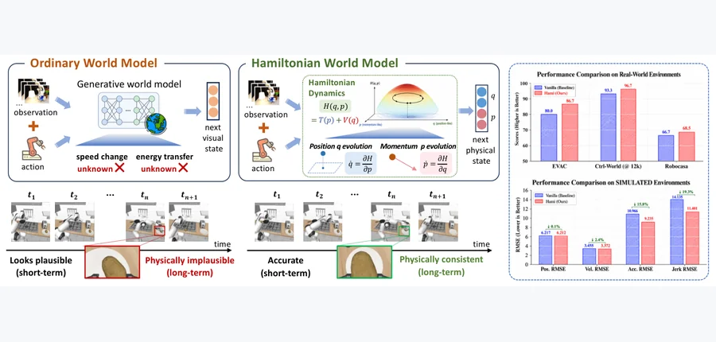 arXiv 2026-10-21 · cs.LG · #1 **[Structured Latent Dynamics for Long-Horizon Embodied World Models](https://arxiv.org/abs/2610.24534)** Kevin Chen, Yu-Wei Zhan, Haoran Liang, Sen Cui, Changshui Zhang 机构：Tsinghua University（[PDF](https://arxiv.org/pdf/2610.24534)） [Paper](https://arxiv.org/abs/2610.24534) · [图源](https://arxiv.org/html/2610.24534v1/intro.png) 

中文摘要
可靠的长时预测仍是具身世界模型的核心挑战。近期生成模型虽能合成视觉上可信的动作条件未来，其潜在动力学通常由无约束的转移模块学习，在递归推演中可能逐渐偏离连贯的物理演化。我们研究显式构造潜状态演化是否能提升想象轨迹的稳定性与用途。为此，提出 HWM：将主干网络的潜表示映射到由广义坐标与动量组成的学习相空间，经耗散哈密顿动力学传播未来状态，再通过可学习的逆接口映回原潜表示。该形式无需重做感知或解码部件，即可接入现有世界模型；多步转移监督促使结构化推演与真实观测诱导的潜轨迹对齐。受控仿真表明，相比无结构潜动力学，HWM 对速度、加速度和加加速度的估计更准确，并显著降低长时能量漂移。作者还在三种具身世界模型设置中评估：Ctrl-World 的单臂多视角预测、EVAC 的双臂单视角预测，以及 Cosmos-Predict2.5-2B 的任务导向单臂预测。在 RoboCasa 上，接入 HWM 后 Cosmos-Predict2.5-2B 的任务成功率相对提高 2.7%；在真实 AgiBot World 轨迹上，Ctrl-World 的 nDTW 提高 9.7%，EVAC 的 Logic 指标提高 8.4%。 <a href="https://arxiv.org/abs/2610.24534">原摘要来源</a>
 | 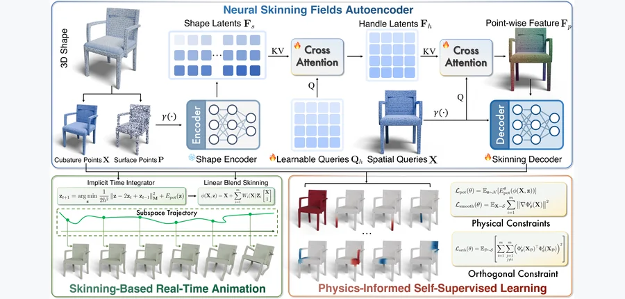 arXiv 2026-10-21 · cs.CV · #2 **[PhysSkin++: Real-Time and Generalizable Physics-Based Animation via Self-Supervised Neural Skinning](https://arxiv.org/abs/2610.26067)** Yuanhang Lei, Baofei Liu, Xingxuan Li, Tao Cheng, Zixuan Wang, Boming Zhao, Yujun Shen, Siyuan Huang, Ruizhen Hu, Peter Yi… 机构：Zhejiang University / Ant Group / Beijing Institute for General Artificial Intelligence / Shenzhen University / University of British Columbia（[PDF](https://arxiv.org/pdf/2610.26067)） [Paper](https://arxiv.org/abs/2610.26067) · [图源](https://arxiv.org/html/2610.26067v1/pipeline_v9.png) 

中文摘要
在不同 3D 形状和空间离散方式之间泛化实时物理动画仍有难度。本文提出 PhysSkin++：从静态几何学习连续神经蒙皮场，以构造紧凑形变子空间的物理信息框架。其神经蒙皮场自编码器能够预测形状相关的形变子空间，无需为每个物体单独训练网络。为不依赖仿真轨迹学习这些子空间，作者提出物理信息自监督学习，结合蒙皮场归一化和感知冲突的梯度修正，在物理约束与正交约束下稳定联合优化。所得表示支持带用户控制和接触交互的高效降阶动力学，并可直接绑定到网格、点云和 3D Gaussian。针对预设骨架动画，作者进一步提出自监督互补性目标，学习补充性的弹性响应，而在运行时无需施加互补性约束。实验展示了蒙皮场的跨形状泛化、实时降阶仿真，以及可控制、考虑碰撞和补充骨架动画的应用。 <a href="https://arxiv.org/abs/2610.26067">原摘要来源</a>
 | 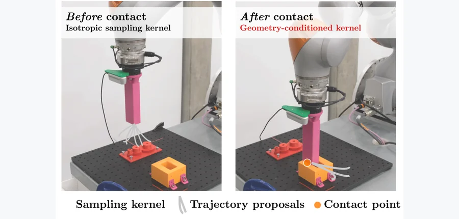 arXiv 2026-10-21 · cs.RO · #3 **[ContactKernels: Adaptive Proposals using Geometry-COnditioned Wrenches for Contact-Rich Manipulation](https://arxiv.org/abs/2610.23887)** Aditya Kamireddypalli, Matías Mattamala, João Moura, Sethu Vijayakumar, Steve Tonneau, Subramanian Ramamoorthy 机构：University of Edinburgh（[PDF](https://arxiv.org/pdf/2610.23887)） [Paper](https://arxiv.org/abs/2610.23887) · [图源](https://arxiv.org/html/2610.23887v1/figures/title_figure_new.png) 

中文摘要
富接触插入任务即使存在感知、几何和控制的不确定性，也要求精确的几何对齐。意外接触发生时，接触本身会提供可指导修正运动的局部信息。基于采样的模型预测控制（SMPC）通过前向仿真优化，不必穿过接触动力学求梯度，适合此场景；但标准 SMPC 通常使用通用提议分布，未利用已观测接触决定下一步搜索位置。我们提出 ContactKernels：用几何条件化的力矩测量估计接触位置及局部接触几何的自适应提议核。估计的接触状态直接调整提议分布：接触位置使搜索偏向修正运动，接触法向决定采样协方差的形状。作者将其与 Predictive Sampling（PS）和模型预测路径积分（MPPI）控制结合，在多种插入几何的仿真和真实机器人上评估。仿真中，两种控制器的平均插入成功率均提高超过 50 个百分点；实机成功率由 53.3% 升至 90.0%，平均插入时间降低 33%。结果表明，接触信息除了用作反馈，也能直接决定控制器搜索的位置。 <a href="https://arxiv.org/abs/2610.23887">原摘要来源</a>
 |
| 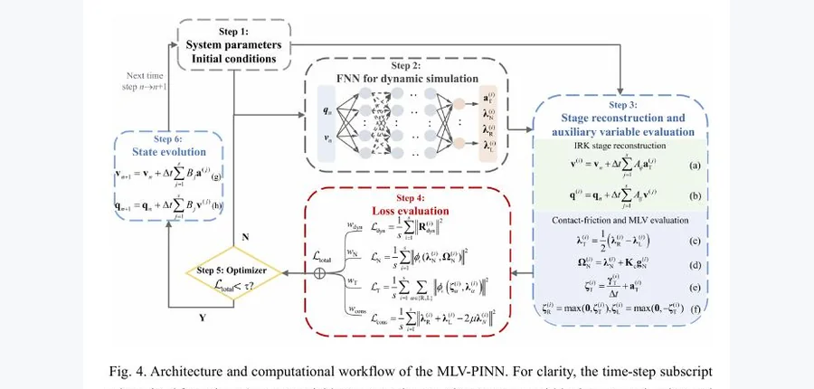 arXiv 2026-10-21 · physics.comp-ph · #4 **[A mixed leading variable physics-informed neural network for nonsmooth dynamics simulation in contact systems](https://arxiv.org/abs/2610.26495)** Xinyuan Li, Zilin Li, Hongtao Wei, Ronghan Wei 机构：Zhengzhou University（[PDF](https://arxiv.org/pdf/2610.26495)） [Paper](https://arxiv.org/abs/2610.26495) · [图源](https://arxiv.org/pdf/2610.26495) 

中文摘要
多摩擦接触系统中的非光滑动力学很难高精度计算。本文提出通用的混合主导变量物理信息神经网络（MLV-PINN），把控制方程与接触摩擦定律用作物理约束，为离散系统和连续体系统的非光滑动力学提供共同求解方式。网络将加速度、法向接触力与摩擦裕度作为独立输出并同时求解，而非先将动力学化为离散速度—冲量互补子问题。复合物理信息损失包含原始形式的运动方程、接触摩擦互补条件及摩擦裕度一致性关系。为改善 PINN 优化中的黏滑状态识别，作者引入结合相对切向速度与加速度的混合主导变量，重写切向互补条件。四组基准仿真包括单接触及多接触黏滑的一维非光滑动力学、耦合法向接触分离与切向黏滑的二维动力学，以及弹性梁移动接触的二维连续体动力学。大时间步下，与相应常规方法相比，位移与速度误差显著下降；消融及摩擦—速度斜率、长时积分和损失权重测试也支持所提框架的计算精度和广泛适用性。 <a href="https://arxiv.org/abs/2610.26495">原摘要来源</a>
 | 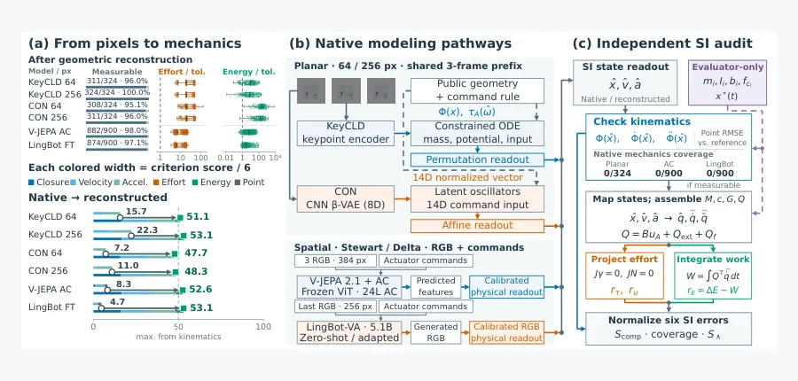 arXiv 2026-10-21 · cs.CV · #5 **[Beyond Geometric Closure: Measuring and Diagnosing Mechanical Consistency in Visual Dynamics](https://arxiv.org/abs/2610.24619)** Qibin Gu, Yunfeng Yan 机构：Nanjing Tech University / Zhejiang University（[PDF](https://arxiv.org/pdf/2610.24619)） [Paper](https://arxiv.org/abs/2610.24619) · [图源](https://arxiv.org/html/2610.24619v2/audit_mechanism.png) 

中文摘要
视觉准确并不能回答预测运动是否遵循动力学。本文提出测量和诊断视觉动力学机械一致性的框架：对刚性闭链进行独立的国际单位制审计，分别评估几何可容许性、无反力的驱动器出力和功—能平衡。连续评分衡量与固定工程目标的差距，参考轨迹重放则量化测量误差。每种设置使用三个随机种子，作者在 64/256 像素下的 343 个平面装配体上评估 KeyCLD 和 CON，并在 100 个共享空间测试装配体上评估 V-JEPA + AC 和 LingBot-VA。相对持久性基线，CON 将图像 MSE 分别降低 37.6%/37.2%，但两种平面模型均未达到有效的原生几何。在 256 像素下，经校准的 RGB 重放显示预测误差远高于测量误差。给定精确状态时，KeyCLD 保持几何，RK4 训练使评分从 52.65 升至 64.30。两条空间评估路径中，CAD/IK 重建恢复了几何，但平均驱动器残差仍超过工程目标的五倍。干预实验区分了视觉预测和几何可容许性的改进与尚存的力和能量误差。 <a href="https://arxiv.org/abs/2610.24619">原摘要来源</a>
 | 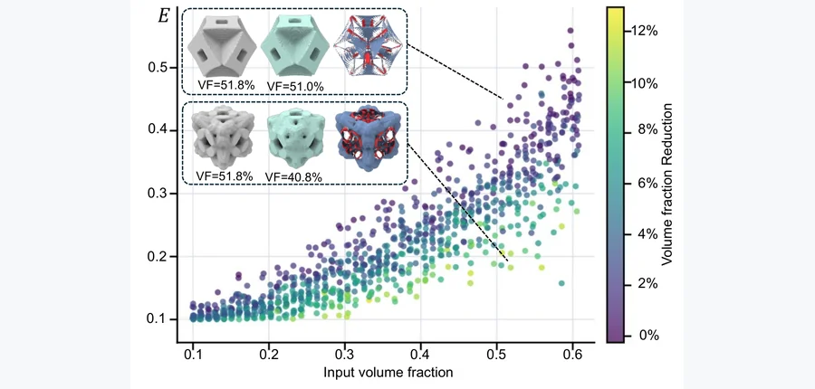 arXiv 2026-10-21 · cs.GR · #6 **[SLIM: Learning an Operator for Material-Efficient 3D Lattice Refinement](https://arxiv.org/abs/2610.24459)** Yueze Zhu, Yu Xing, Tianyang Xue, Peng-Shuai Wang, Jikai Liu, Haisen Zhao, Lin Lu 机构：affiliation 未确认 [Paper](https://arxiv.org/abs/2610.24459) · [图源](https://arxiv.org/html/2610.24459v1/testdataset.png) 

中文摘要
晶格逆设计能生成满足指定有效属性的单元，但属性可行不等于材料使用高效。在保持均匀化弹性的同时移除现有晶格中的冗余材料，通常需要为每个单元单独求解带约束的拓扑优化，因而大规模精简计算昂贵。本文提出 SLIM（Structural Lightweighting via Implicit Mapping）：用一次前向预测代替逐实例迭代优化的神经晶格精简模型。SLIM 使用双八叉树隐式网络预测轻量晶格的有符号距离场，以属性约束拓扑优化生成的输入—输出对训练。为更好保持刚度，作者在优化目标上计算均匀化灵敏度，估计预测中残余体素误差对均匀化刚度的影响，并在训练时惩罚这一估计变化。训练后预测无需拓扑优化、均匀化分析或灵敏度评估。在 906 个留出晶格的测试集上，SLIM 平均使体积分数降低 15.90%，轻量化成功率为 90.51%，与拓扑优化目标相比的平均归一化综合误差为 0.636%；单晶格平均生成时间由直接拓扑优化的 2516.0 秒降至约 0.5 秒。这些结果表明，SLIM 可作为重复进行 3D 晶格拓扑优化精简的快速神经代理。 <a href="https://arxiv.org/abs/2610.24459">原摘要来源</a>
 |
| 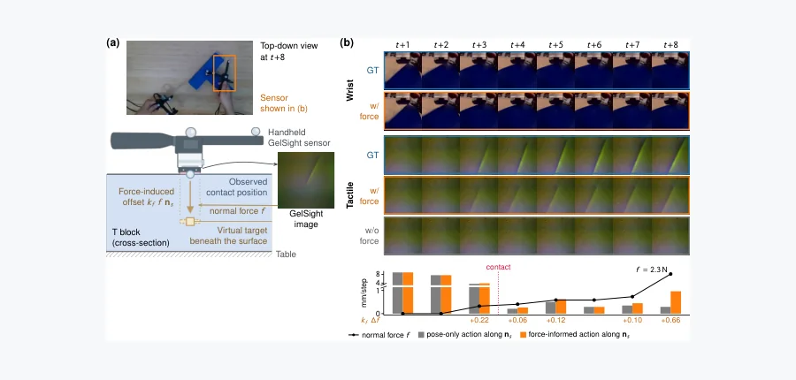 arXiv 2026-10-21 · cs.RO · #7 **[ACTS: Learning Visuo-Tactile World Models from Human Physical Interaction](https://arxiv.org/abs/2610.24285)** Yuxiang Ma, Weihan Xu, Pengfei Ye, Anna Mei, Yuxin Ray Song, Tingle Li, Haonan Chen, Edward H. Adelson 机构：Massachusetts Institute of Technology / University of Washington / Harvard University / University of California, Berkeley / Stanford University（[PDF](https://arxiv.org/pdf/2610.24285)） [Paper](https://arxiv.org/abs/2610.24285) · [图源](https://arxiv.org/html/2610.24285v1/teaser_force.png) 

中文摘要
面向富接触操作的动作条件世界模型需要描述接触如何在不同作用力下形成、滑动和释放的数据。通过机器人遥操作收集此类数据较慢，而且遥操作往往缺少力反馈并受夹爪几何限制。作者研究这些动力学能否从人类物理交互中学习并迁移到机器人，提出只用人类交互数据训练的视觉—触觉世界模型 ACTS。操作者使用手持 GelSight 传感器操作物体，系统记录第三人称和腕部视频、触觉图像、传感器 6-DoF 运动及由触觉推导的法向力，构成覆盖三个物体、时长 4.9 小时的双手 React 数据集。作者把传感器处的动作表示为附加力变化的运动，建立人类采集与机器人执行共享的动作空间；ACTS 联合预测未来场景、腕部和触觉观测。在留出的人类数据上，ACTS 的场景视图预测 PSNR 比两种从头在 React 上训练的视觉—触觉世界模型中较强者高 0.7–2.0 dB。未经微调，在作者检查的机器人遥操作轨迹中，预测触觉压痕仍会随记录的接触出现和消失。视觉迁移较不稳定：PushT 的相机预测优于复制帧，Rope 上结果混合，Motherboard 上低于复制帧；腕部视图还可能模糊或幻觉出结构。结果提示，人到机器人的接触动力学迁移比视觉外观迁移更可靠。 <a href="https://arxiv.org/abs/2610.24285">原摘要来源</a>
 | 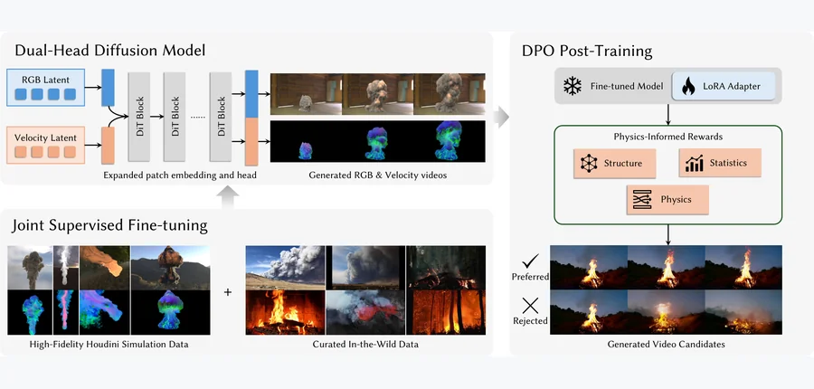 arXiv 2026-10-21 · cs.CV · #8 **[FluidGen: Physics-Aware Fluid Video Generation via Motion-Guided Post-Training](https://arxiv.org/abs/2610.25660)** Yang Zheng, Zizhang Li, Boyang Deng, Jan Ackermann, Lei Shu, Yinghao Xu, Jiajun Wu, Gordon Wetzstein, Leonidas Guibas 机构：Stanford University（[PDF](https://arxiv.org/pdf/2610.25660)） [Paper](https://arxiv.org/abs/2610.25660) · [图源](https://arxiv.org/html/2610.25660v1/method.png) 

中文摘要
视频生成模型能产生视觉上吸引人的运动，却系统性地难以表现烟雾、火焰和爆炸碎屑等流体现象：生成结果缺少连贯的涡旋结构，动力学趋于平淡并违背真实流体物理。经典求解器的物理保真度高，但要求详细的 3D 场景和精心调节的参数，难以用于野外图像和视频生成。作者把数据驱动的流体先验注入预训练视频模型，以带有配对速度场真值的高保真 Houdini 仿真数据和为外观多样性整理的真实流体视频混合训练。核心为双流架构，在预测 RGB 的同时预测逐帧速度场，并用仿真真值监督这一辅助信号，使生成更趋向物理一致的运动。速度场也是可解释的物理量，进一步用于感知速度的直接偏好优化奖励。与强视频基线和基于优化的方法相比，模型生成的流体动力学序列明显更真实。论文提供项目页。 <a href="https://arxiv.org/abs/2610.25660">原摘要来源</a>
 | 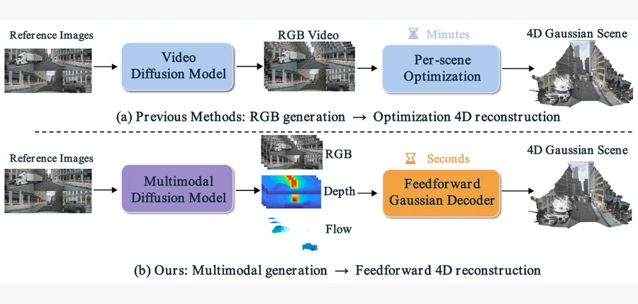 arXiv 2026-10-21 · cs.CV · #9 **[Drive2Gauss: FeedForward 4D Gaussian Reconstruction from Multimodal Generative Driving Videos](https://arxiv.org/abs/2610.26585)** Tong Zhao, Zhiyuan Han, Lin Chen, Bowen Xie, Yunxi Qiao, Bohan Li, Weiqing Xiao, Gen Li, Shu Han, Xuyang Dai, Cheng Bi, Ha… 机构：Tsinghua University / Tongji University / Beijing Technology and Business University / Fuzhou University / Shanghai Jiao Tong University / Nanjing University / Zhejiang University / University of Wisconsin–Madison / Great Wall Motor / Hong Kong University of Science and Technology（[PDF](https://arxiv.org/pdf/2610.26585)） [Paper](https://arxiv.org/abs/2610.26585) · [图源](https://arxiv.org/html/2610.26585v1/method_comparison.png) 

中文摘要
生成可复用的驾驶环境既需要可控的未来观测，也需要支持不同视点渲染的显式表示；现有方法却仍须对每段生成的 RGB 视频单独优化恢复显式场景。为此，作者提出 Drive2Gauss：将联合生成的 RGB、度量深度和动态流一次前向转成动态 4D Gaussian 场景。多模态视频生成器根据参考多视角图像与未来控制信号预测这三种模态。Gaussian Query Decoder 利用深度初始化稀疏 3D 查询，利用流跨时间关联查询，并通过时空特征聚合和迭代查询细化融合外观信息。重建阶段只需单次前向，无须逐场景优化。在 nuScenes 上，未来 RGB 生成的 FID 为 6.38、FVD 为 12.43；对自身生成观测的重建 PSNR 为 29.91 dB。框架还支持相机横向移动下的直接渲染和下游视频修复。作者提供代码与更多可视化。 <a href="https://arxiv.org/abs/2610.26585">原摘要来源</a>
 |
| 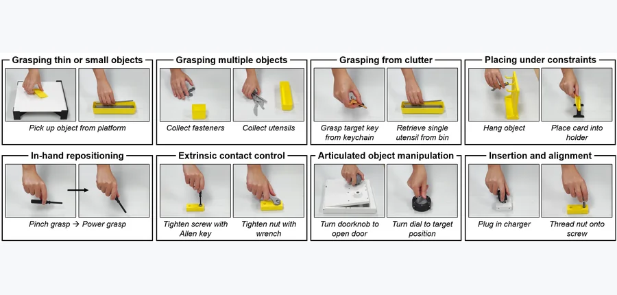 arXiv 2026-10-21 · cs.RO · #10 **[ContactBench 1.0: A Benchmark for Everyday Contact-Rich Robotic Manipulation](https://arxiv.org/abs/2610.24512)** Jingyi Xiang, Yixuan Wang, Jeannette Bohg, Wenzhen Yuan 机构：University of Illinois Urbana-Champaign / Stanford University（[PDF](https://arxiv.org/pdf/2610.24512)） [Paper](https://arxiv.org/abs/2610.24512) · [图源](https://arxiv.org/html/2610.24512v1/Figures/skills.png) 

中文摘要
富接触操作是日常活动的重要部分，但因接触行为多样、任务难以跨实验室复现，评估机器人能力仍具挑战。基于对日常人类操作的观察，作者归纳出八类反复出现的技能，作为研究这些能力的实用框架，并推出可扩展的 ContactBench 1.0：通过 36 个参考任务和超过 40 件物体资产实例化这些技能。资产保留任务相关的几何和接触行为，可用消费级 3D 打印机可复现地制造，并配有阻力负载可调的仿真模型。受控的任务变化用于评估策略泛化。作者在六个基准任务上评估近期视觉及视觉—触觉策略学习方法，发现所测纯视觉策略难以感知或回应接触事件，而所测视觉—触觉策略也未显著提高性能。通过共享任务、实体和仿真资产，ContactBench 1.0 为富接触操作研究建立可复现评测基础；基准已开源。 <a href="https://arxiv.org/abs/2610.24512">原摘要来源</a>
 | 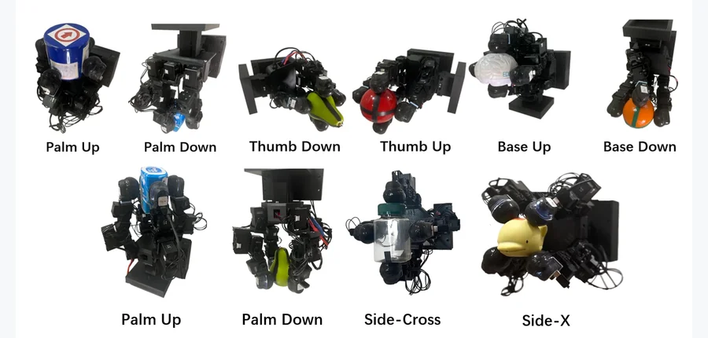 arXiv 2026-10-21 · cs.RO · #11 **[Tactile In-Hand Object Rotation: A Comparative Study of Hand Morphology in Simulation and Hardware](https://arxiv.org/abs/2610.26759)** Wenhao He, Max Yang, Chenghua Lu, Yijiong Lin, David A.W. Barton, Nathan F. Lepora 机构：University of Bristol（[PDF](https://arxiv.org/pdf/2610.26759)） [Paper](https://arxiv.org/abs/2610.26759) · [图源](https://arxiv.org/html/2610.26759v1/pics/leapori.png) 

中文摘要
连续的手内旋转需要协调维持和更新接触，因此操作表现与手部几何及触觉反馈均有关。本文用旋转进度、手指参与程度和指尖负载，研究两种低成本 LEAP Hand 形态：拟人手指排列与对称排列。两者均集成基于视觉的 TacTip 触觉传感器并使用同一强化学习框架。仿真在 12 个未见物体上比较完整触觉、二值接触和仅本体感知；硬件实验在十个物体及多种手部朝向下测试完整触觉策略。仿真中，与仅本体感知相比，完整触觉使每回合平均归一化旋转量在拟人手和对称手上分别提高 94.8% 和 66.9%，同时延长平均回合时长并降低平均总指尖负载。硬件接触测量显示，拟人手的手指参与更分化，对称手的累积负载分配更均匀。总体上，对称手的平均旋转次数高 32.0%、总旋转速率高 25.8%，操作持续时间更长；额外硬件力记录显示其平均总指尖负载低 19.9%。结果将手指排列与接触组织、负载分担联系起来，并显示在两种仿真手形中，更丰富的触觉信息能以更低平均负载支持更大任务进展。 <a href="https://arxiv.org/abs/2610.26759">原摘要来源</a>
 | 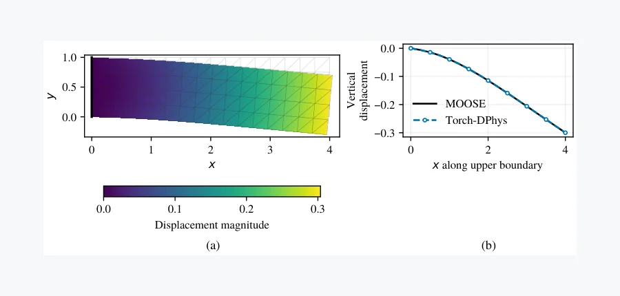 arXiv 2026-10-21 · cs.LG · #12 **[Torch-DPhys: A Torch-Native, MOOSE-Compatible Framework for Differentiable Physics Simulation and Hybrid Machine Learning Integration](https://arxiv.org/abs/2610.24301)** Akzhol Almukhametov, Yang Liu 机构：Texas A&amp;M University（[PDF](https://arxiv.org/pdf/2610.24301)） [Paper](https://arxiv.org/abs/2610.24301) · [图源](https://arxiv.org/html/2610.24301v1/mechanics_cantilever.png) 

中文摘要
本文提出 Torch-DPhys：用 PyTorch 实现的原生 Torch 框架，用于可微物理仿真与物理—机器学习混合建模。它实现了 MOOSE 热工水力模块和系统分析模块（SAM）中选定的建模概念与离散方法，并初步扩展到连续介质力学。原生张量残差支持 CPU、GPU 运行、部分数值核编译以及稀疏直接线性求解；灵敏度可通过对执行过的数值运算求导，或对收敛残差方程使用离散伴随得到。验证包括解析解、参考代码对照和导数检查。演示覆盖平面应变弹性、一环与两环热工水力瞬态，以及轴对称熔盐快堆。反应堆案例与 SAM-Lite 对比，在 200 个自适应时间步上的最大归一化场差异为 1.13×10^-5，说明所测离散实现一致。部分瞬态灵敏度在固定时间调度上由切线线性计算和有限差分评估。两个应用展示仿真与优化的连接：残差伴随参数辨识从无噪声合成 MOOSE 观测中恢复名义泵扬程与加热功率，相对误差低于 0.06%；另一三环装置演示通过热工水力仿真对轨迹级目标求导，进行求解器在环的预测控制器训练。这些案例为核工程中的梯度推断、控制及耦合物理—机器学习模型提供基础。 <a href="https://arxiv.org/abs/2610.24301">原摘要来源</a>
 |
| 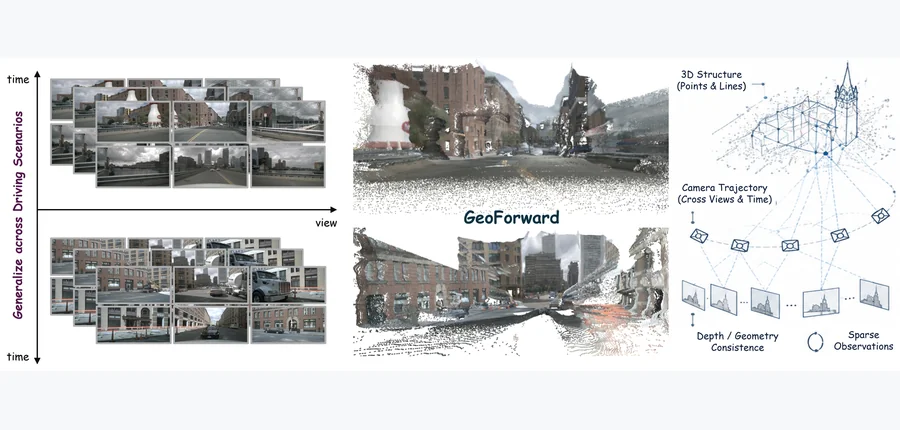 arXiv 2026-10-21 · cs.CV · #13 **[GeoForward: Geometry-Guided Cross-View Alignment for Feedforward 3D Gaussian Splatting](https://arxiv.org/abs/2610.23895)** Yiming Shu, Peng Sun, Lang Zhang, Mingyue Feng, Yaonong Wang, Pei Liu, Chen Sun, Jun Ma 机构：University of Hong Kong / Leapmotor / Hong Kong University of Science and Technology (Guangzhou)（[PDF](https://arxiv.org/pdf/2610.23895)） [Paper](https://arxiv.org/abs/2610.23895) · [图源](https://arxiv.org/html/2610.23895v1/example1_cropped.jpg) 

中文摘要
前馈 3D 重建主要遵循外观驱动范式：把多视角图像编码成视觉表示，由学习特征隐式推断跨视角对应，再预测 3D 基元。然而，已标定的相机和稀疏度量测量已能明确约束同一物理点在不同视角的位置。作者提出“几何条件化前馈重建”范式：在形成 3D 表示前，先用度量几何建立跨视角对应，再由学习到的视觉特征细化，而非从头发现对应。基于此提出 GeoForward：把稀疏 LiDAR 点反投影到 3D，再解析投影到标定相机以提供度量对应锚点；随后用有界连续局部搜索和视觉特征细化这些锚点，并融合 VGGT 的全局多视角上下文。共享表示分别预测度量深度与 Gaussian 属性，使显式几何直接连接到 Gaussian 中心与空间属性。稀疏 3D 细化模块在保持几何确定中心的同时改善局部属性兼容性；时间重建则结合车辆掩码与运动先验合成端点 Gaussian。在 nuScenes 上，GeoForward 在比较方法中取得最低的跨相机深度一致性误差和 Chamfer 距离，同时维持有竞争力的重建质量。这表明显式度量几何条件化对应关系是纯外观驱动前馈 3D 重建的一种有效替代。 <a href="https://arxiv.org/abs/2610.23895">原摘要来源</a>
 | 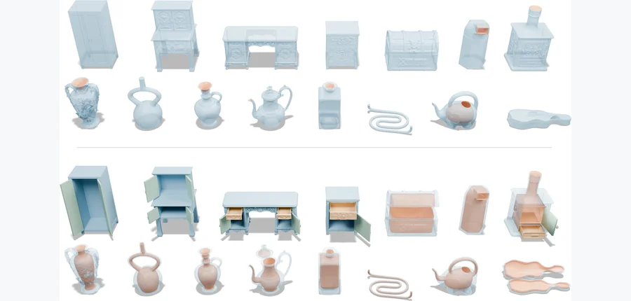 arXiv 2026-10-21 · cs.CV · #14 **[Functionalizing AI-Generated 3D Shapes via Interior Geometry Construction](https://arxiv.org/abs/2610.23953)** Haoyu Tang, Fancheng Gao, Kan Chen, Peng Song 机构：Singapore University of Technology and Design / Singapore Institute of Technology（[PDF](https://arxiv.org/pdf/2610.23953)） [Paper](https://arxiv.org/abs/2610.23953) · [图源](https://arxiv.org/html/2610.23953v1/images/teaser.png) 

中文摘要
Hunyuan 3D、Meshy 等 AI 3D 生成模型能从图像或文本生成外观吸引人的形状，但通常关注物体外表，内部几何可能不完整或不合理，因此生成形状未必具备功能有效性，限制其用于仿真和制造。本文提出通过构造内部几何来使 AI 生成的 3D 形状具备功能的计算方法。核心观察是：部件的功能角色决定其内部几何，而这类几何通常平滑、相对简单，并与外部形状密切相关。据此，作者引入包含构造内部几何所需信息的“内部感知部件图”，通过基于 VLM 的形状分割与图属性推断建立该图。在图的引导下，每个部件的内部几何被建模为广义圆柱，并通过优化从部件外部几何推断参数。得到的 3D 形状在保留 AI 生成外观的同时具有功能有效性。作者在容器、储物家具等多种 AI 生成 3D 形状上展示方法，并制造部分实例验证功能。 <a href="https://arxiv.org/abs/2610.23953">原摘要来源</a>
 | 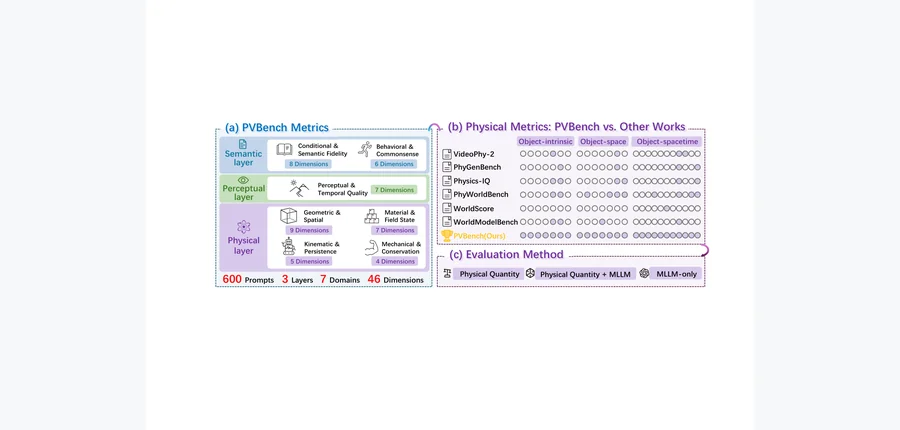 arXiv 2026-10-21 · cs.CV · #15 **[PVBench: Quantifying Physical Plausibility in Video Generation with Object-Level Physical Measurements](https://arxiv.org/abs/2610.26711)** Kaiwei Chen, Moran Li, Zhenye Gan, Yabiao Wang, Chengjie Wang, Kexin Zhang, Yong Liu, Jiangning Zhang 机构：Zhejiang University / Huazhong University of Science and Technology / Tencent Youtu Lab（[PDF](https://arxiv.org/pdf/2610.26711)） [Paper](https://arxiv.org/abs/2610.26711) · [图源](https://arxiv.org/html/2610.26711v1/figure1.png) 

中文摘要
近期视频生成模型的画面很有吸引力，但其物理可信度仍缺乏充分测量。物理可信度涉及生成物体是否遵循几何、运动学、动力学和守恒律。现有基准依赖粗粒度视觉语言模型判断，或面向具身世界模型而非视频生成。作者提出 PVBench：在七个领域、46 个维度定量测量生成视频物理可信度，包括指令与语义保真、行为与因果一致、感知与时间质量、几何与空间一致、材料属性与场状态、运动学与时空持续性，以及带守恒律的机械可信度。基准含 600 条精心构造的提示，其中 30% 涉及机器人臂、人形机器人、四足机器人和多智能体等物理具身主体。对难以测量但可用物理方式处理的维度，基准配备专门视觉模型，提取物体级 6D 位姿、度量尺度、表面法向、运动学和数值守恒残差等可核验的物理测量，因此不只依赖主观评分，并同时支持文生视频与图生视频。作者通过人工评估验证自动指标与人类判断的一致性，评估主流开源和闭源模型并给出若干观察；发布基准、提示词和校准协议，以支持物理约束的视频生成研究。 <a href="https://arxiv.org/abs/2610.26711">原摘要来源</a>
 |
| 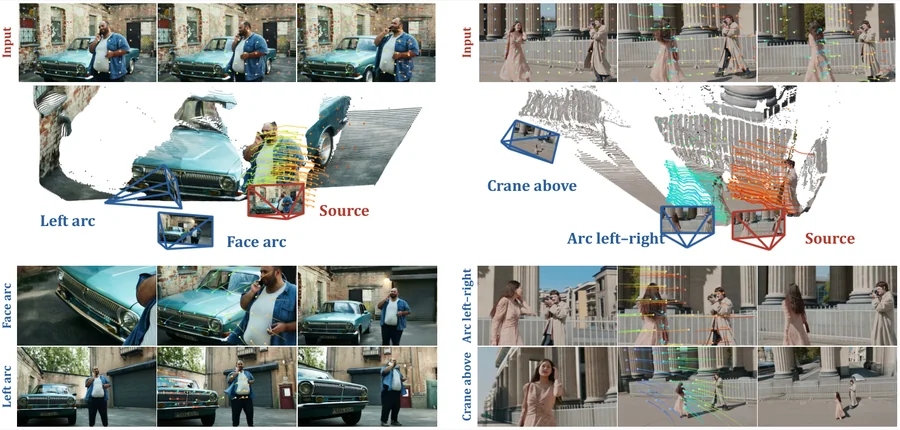 arXiv 2026-10-21 · cs.CV · #16 **[Holo4D: Holistic 4D Reconstruction as Geometric Control for Video Diffusion](https://arxiv.org/abs/2610.25276)** Yushi Lan, Zeren Jiang, Koichi Namekata, Xingang Pan, Chuanxia Zheng, Andrea Vedaldi 机构：University of Oxford / Nanyang Technological University（[PDF](https://arxiv.org/pdf/2610.25276)） [Paper](https://arxiv.org/abs/2610.25276) · [图源](https://arxiv.org/html/2610.25276v1/holo4d_final_teaser.png) 

中文摘要
从新相机轨迹合成单目视频，需要在补全新显露区域的同时保留已观测场景几何与运动。前馈 4D 重建器能恢复观测区域结构，视频扩散模型则为未见内容提供生成先验。作者提出视频重拍框架 Holo4D：以重建的 3D 轨迹作为完整的源视角 4D 支架，把轨迹投影到指定新视角并编码其几何和源图像外观，以指导预训练视频扩散模型。结合源视频和目标相机，这一支架让生成受已重建观测约束，同时把缺乏支持的区域交给生成先验。实验展示基于轨迹的条件信息对相机控制和新视角合成的价值。框架可接入不同 4D 重建器，无需重训视频生成器，因此可受益于未来源重建技术的进步。更多细节见项目页。 <a href="https://arxiv.org/abs/2610.25276">原摘要来源</a>
 | 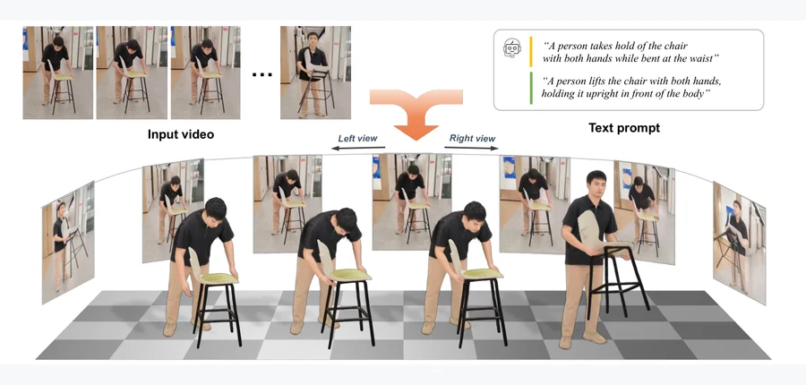 arXiv 2026-10-21 · cs.CV · #17 **[HORIA: 4D Human and Object Reconstruction from a Monocular Video with Interaction-Aware Re-Rendering](https://arxiv.org/abs/2610.25960)** Hyeongjin Nam, Taeryung Lee, Daniel Sungho Jung, Kyoung Mu Lee 机构：Seoul National University（[PDF](https://arxiv.org/pdf/2610.25960)） [Paper](https://arxiv.org/abs/2610.25960) · [图源](https://arxiv.org/html/2610.25960v1/_0_teaser.png) 

中文摘要
从单目视频联合重建人和物的 4D 形态，有助于理解人与环境的交互。虽然近期方法已有进展，捕捉人—物交互仍有两项主要难题：视频通常跨越语义不同的多个交互阶段，难以在重建中追踪交互随时间的变化；人和物相互遮挡时，单视角信息不全，容易得到几何不一致的重建。为此，作者提出 HORIA，包含两项设计。第一，用感知运动的描述生成，把整段视频分解成在时间上定位、语义上不同的交互阶段，并为每段得到特定文本描述。第二，以这些描述为条件进行交互感知重渲染，补偿单视角观测的不足：从新视角渲染初步重建的 4D 人与物，再以文本到视频扩散先验细化渲染，提供超出原单视角线索的辅助新视角监督。由此，框架在多种交互场景下产生时间连贯、准确的 4D 重建，并取得最先进性能。 <a href="https://arxiv.org/abs/2610.25960">原摘要来源</a>
 | 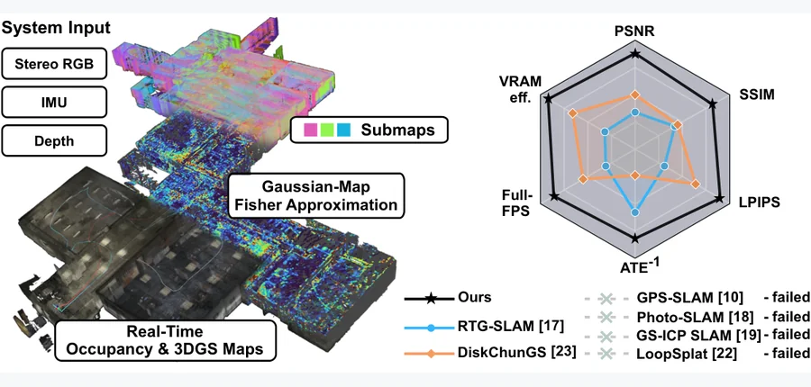 arXiv 2026-10-21 · cs.RO · #18 **[GOFusion: Real-Time Gaussian-Occupancy Submap Fusion for Fisher-Informed Autonomous Robot Navigation](https://arxiv.org/abs/2610.25261)** Boxin Bu, Simon Boche, Haoming Zhang, Jaehyung Jung, Jiaxin Wei, Hannah Schieber, Daniel Roth, Angela P. Schoellig, Stefan… 机构：Technical University of Munich / ETH Zurich / University of Toronto / Vector Institute（[PDF](https://arxiv.org/pdf/2610.25261)） [Paper](https://arxiv.org/abs/2610.25261) · [图源](https://arxiv.org/html/2610.25261v1/demo.png) 

中文摘要
本文提出 GOFusion：用于自主机器人导航的实时视觉建图系统，把 Gaussian 基元锚定到局部占据图，既为路径规划提供空间信息，也提供支持信息驱动导航的高保真外观。GOFusion 从视觉—惯性 SLAM 得到的位姿估计和局部占据图建立 3D Gaussian 地图，允许位姿校正以保持几何与视觉一致。它把 3D Gaussian Splatting 优化限制在活动子图内，以控制 GPU 内存。基于外观丰富的 Gaussian 地图，作者引入集成于光栅器的 Fisher 近似，在线量化每个基元的敏感度，用作 Gaussian 裁剪和下一最佳视角规划的信息驱动启发式。公共数据集与真实无人机飞行的评估表明，它不仅在建图质量上优于多种基线，也能在大范围场景中实现实时、高保真且感知不确定性的建图。作者还演示了利用 Fisher 启发式改进 Gaussian 地图的完全自主无人机探索，并提供代码和补充视频。 <a href="https://arxiv.org/abs/2610.25261">原摘要来源</a>
 |
| 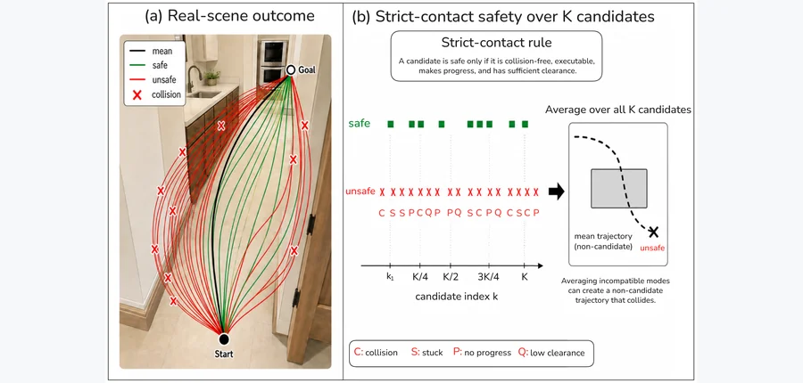 arXiv 2026-10-21 · cs.RO · #19 **[Revealing and Bridging the Physical Executability Gap in Vision-Language Navigation](https://arxiv.org/abs/2610.25687)** Gang He, Zhile Cheng, Kepeng Xu, Zhenyang Liu, Yu-Wing Tai 机构：Xidian University / Dartmouth College（[PDF](https://arxiv.org/pdf/2610.25687)） [Paper](https://arxiv.org/abs/2610.25687) · [图源](https://arxiv.org/html/2610.25687v1/figure1.png) 

中文摘要
连续视觉—语言导航通常按是否抵达目标评估，并假定这反映智能体执行语言引导行为的能力。作者表明该假设可能失效：现有仿真器宽松的接触模型会掩盖物理上不可执行的动作，使语义能力与具身执行之间形成“物理可执行性差距”。为弥合差距，作者提出视觉—语义可通行性对齐框架 VeSTA，使 VLN 策略对齐物理可执行的未来。这里的可通行性指预测同时满足指令语义、几何可行与物理稳健的轨迹。VeSTA 通过两种互补机制处理错位：增加生成轨迹中的可执行候选，并在多模态未来中进行风险感知选择。具体地，Trajectory Relative Group Policy Optimization 使用严格接触反馈，把候选分布推向可执行区域；Traversability Risk Critic 则学习风险调整后的标量效用，逐候选选择未来。R2R 和 RxR 实验显示现有 VLN 智能体显著依赖仿真器接触语义。严格接触评测下，VeSTA 在保持或改善目标到达表现的同时，显著减少碰撞导致的失败；受控真实机器人实验提供了偏好能迁移到仿真之外的证据。 <a href="https://arxiv.org/abs/2610.25687">原摘要来源</a>
 | 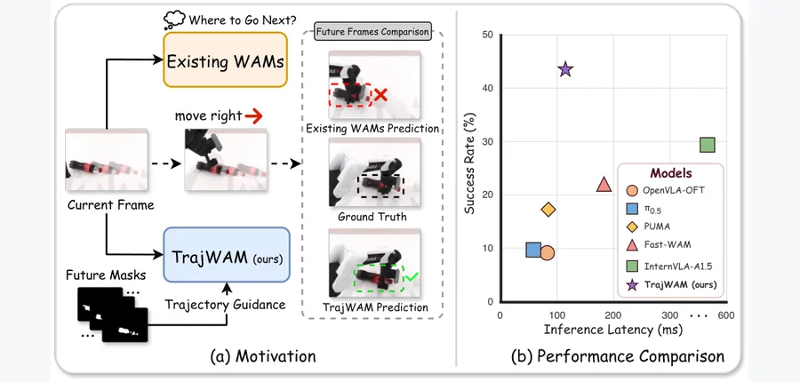 arXiv 2026-10-21 · cs.RO · #20 **[TrajWAM: An Efficient Trajectory-Guided World Action Model for Dynamic Robotic Manipulation](https://arxiv.org/abs/2610.25763)** Haohan Geng, Sha Zhang, Weishuo Sun, Guanting Ye, Wenhao Yu, Yuang Xie, Qicheng Zeng, Peng Ye, Jiajun Deng, Jianmin Ji 机构：University of Science and Technology of China / Chinese University of Hong Kong / University of Macau / Huawei Technologies（[PDF](https://arxiv.org/pdf/2610.25763)） [Paper](https://arxiv.org/abs/2610.25763) · [图源](https://arxiv.org/html/2610.25763v1/teaser.png) 

中文摘要
动态物体操作要求机器人预判目标运动，并足够快地重规划，以免执行过时动作。现有方法或采用缺少显式目标未来状态的快速反应控制，或仅隐式编码预期运动。世界动作模型（WAM）把未来视觉预测与动作生成耦合，但场景级视频目标可能不足以表征操作关键的目标动力学，迭代式视频—动作去噪又有较大延迟。作者提出用于高效动态操作的轨迹引导世界动作模型 TrajWAM：显式以预测的目标物体运动约束未来视觉想象，再用该未来表示条件化动作生成，并在加速后保留预判路径。根据短时物体掩码历史，历史条件运动预测器输出编码目标轨迹的未来掩码；轻量 Trajectory ControlNet 引导预训练视频模型生成轨迹一致的未来；未来表示再条件化动作专家，预测可执行动作块。为在不破坏接口的前提下实现单步推理，作者提出解耦蒸馏，结合视频主干的分布匹配、Trajectory ControlNet 重新对齐和动作推演蒸馏，使压缩未来表示能支持准确的单步动作预测。仿真与真实世界的综合评估显示，TrajWAM 在动态物体操作中取得最先进性能，同时实现高效的单步视频—动作推理。论文提供项目页。 <a href="https://arxiv.org/abs/2610.25763">原摘要来源</a>
 | 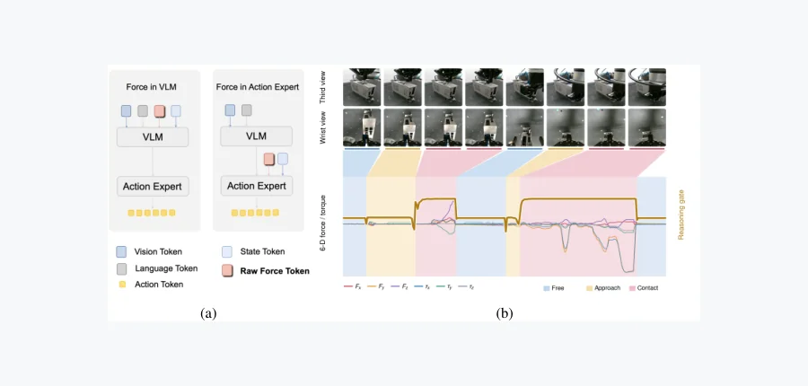 arXiv 2026-10-21 · cs.RO · #21 **[FR-VLA: Implicit Force Reasoning VLA for Contact-Rich Manipulation](https://arxiv.org/abs/2610.25981)** Jiaju He, Zhiyuan Yang, Ruyang Han, Jiahong Tang, Zhiping Lin, Haiyue Zhu 机构：Nanyang Technological University / A*STAR Singapore Institute of Manufacturing Technology（[PDF](https://arxiv.org/pdf/2610.25981)） [Paper](https://arxiv.org/abs/2610.25981) · [图源](https://arxiv.org/html/2610.25981v1/teaser_composed.png) 

中文摘要
把力感知纳入视觉—语言—动作模型（VLA），不只是增加一条力矩测量模态，还需要决定物理交互何时、以多大程度影响机器人动作生成。现有使用力信息的 VLA 常通过固定路径注入力信号，未显式判断该信号对当前动作的相关性。因此需要模型内部的力相关性机制：先由视觉—语言上下文估计物理反馈与当前任务的相关程度，再把力信息送入动作路径。FR-VLA 为此提出视觉—语言力推理模型，使用可学习的力查询 token 推导以视觉—语言上下文为基础的力准入信号，再用该信号调节外部 token 化力输入对动作生成的作用。在两个机器人平台、五项富接触任务的真实实验中，FR-VLA 在六个评估阶段取得最高平均成功率；轨迹可视化显示力准入随交互阶段变化。 <a href="https://arxiv.org/abs/2610.25981">原摘要来源</a>
 |
| 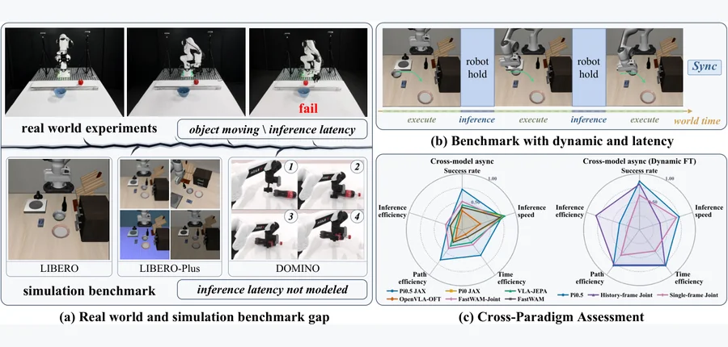 arXiv 2026-10-21 · cs.RO · #22 **[LIBERO-Dynamic: Benchmarking Robotic Manipulation in Dynamic Environments](https://arxiv.org/abs/2610.24579)** Shaojie Ren, Jingwen Sun, Zezhi Liu, Hongjin Chen, Xin Jin, Wei Zou, Zhibo Chen 机构：University of Chinese Academy of Sciences / Beijing Zhongguancun Academy / Chinese Academy of Sciences / University of Science and Technology of China / Nankai University / Harbin Institute of Technology / Eastern Institute of Technology, Ningbo（[PDF](https://arxiv.org/pdf/2610.24579)） [Paper](https://arxiv.org/abs/2610.24579) · [图源](https://arxiv.org/html/2610.24579v1/fig_overview.png) 

中文摘要
多数机器人操作仿真基准保持目标物体静止，并把策略推理视为瞬时完成。这些假设简化评测，却掩盖了计算期间目标如何运动，以及执行动作时观测已过时多久。作者提出 LIBERO-Dynamic，将全部 40 项 LIBERO 任务扩展到动态环境：物体在接触摩擦作用下沿三类轨迹和三个速度等级运动，物理世界按经过校准的模型专属推理延迟推进。同一机制也用于训练：重放经核验的静态示范，并在线补偿机器人动作中的目标位移，得到 9,000 条经过质量筛选的动态轨迹。作者在每种配置的 1,800 个动态条件下评估六种预训练策略；以固定检查点比较执行策略和动作时域，并用动态及混合数据微调三种架构。更快的目标运动降低所有策略的表现，但下降幅度不同；执行时机和动作时域会改变同一策略的行为；异步重规划只有在动作队列不断流时才能从频繁反馈中受益。动态示范在至少一种训练配方下改善每种架构，收益取决于时间条件、数据组成和训练预算。小规模实体实验呈现与仿真一致的任务相关执行策略差异。LIBERO-Dynamic 使目标运动、推理延迟和动作执行变得显式且可控制，便于评估和改善移动目标操作策略。 <a href="https://arxiv.org/abs/2610.24579">原摘要来源</a>
 | 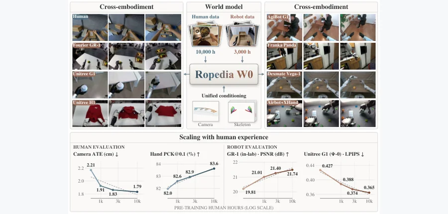 arXiv 2026-10-21 · cs.CV · #23 **[Ropedia W0: Scaling Loco-Manipulation World Models across Embodiments with Human Experience](https://arxiv.org/abs/2610.26855)** Tianqi Liu, Hanfei Zhao, Qifeng Liang, Hui En Pang, Jiarui Xu, Sayang Mu, Penghao Qiu, YingSheng Zhang, Jun Wang, Ziang Ca… 机构：Nanyang Technological University / Ropedia / Duke University / University of California, San Diego / Tsinghua University（[PDF](https://arxiv.org/pdf/2610.26855)） [Paper](https://arxiv.org/abs/2610.26855) · [图源](https://arxiv.org/html/2610.26855v1/teaser.png) 

中文摘要
世界模型让具身智能体预测动作后果，但跨不同本体同时建模移动与操作，受到异构动作空间和多模态监督不足的限制。作者提出 Ropedia W0，称其为首个跨人类及多种机器人体态的第一视角移动操作基础世界模型。他们整理了 Xp-Data：1 万小时第一视角人类数据及 3,000 小时机器人数据，配有统一多模态标注和系统化质量控制。统一运动学表示以相机位姿编码移动，以投影骨架编码操作；机器人骨架结合本体专属前向运动学、大量人工关键点标注与修正。作者还引入基于高质量灵巧人形遥操作数据的长时移动操作基准 Xp-Teleop。从零样本推理到少样本及全数据后训练，模型在 DreamDojo、$\Psi_0$、$\omega$-HOME、Xp-Teleop 和 AgiBot 五个跨本体基准以及留出的人类第一视角视频上表现达到最先进水平。扩充人类预训练数据同时改善人类和机器人评估；蒸馏后模型支持实时、分钟级推演，可进行实时 VR 交互。策略评估、基于模型的规划和世界动作建模等应用进一步展示其用于具身决策的价值。 <a href="https://arxiv.org/abs/2610.26855">原摘要来源</a>
 | 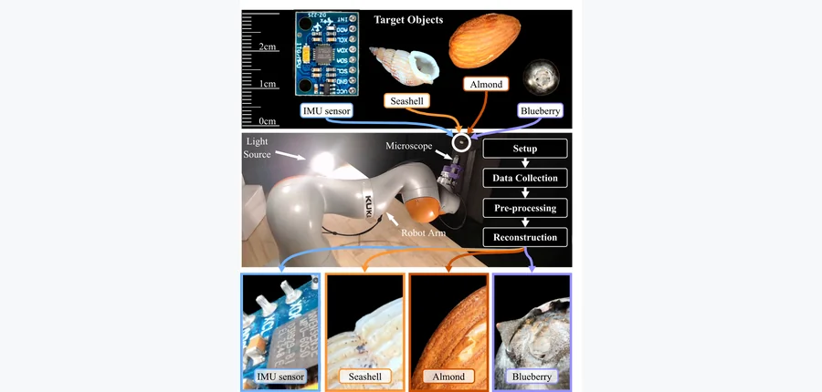 arXiv 2026-10-21 · cs.RO · #24 **[MicroSplat: Towards Automating 3D Small-Scale Reconstruction](https://arxiv.org/abs/2610.23899)** Roman Mineyev, Robert Azarcon, Suvrat Jain, Chuizheng Kong, Shreyas Kousik 机构：Georgia Institute of Technology（[PDF](https://arxiv.org/pdf/2610.23899)） [Paper](https://arxiv.org/abs/2610.23899) · [图源](https://arxiv.org/html/2610.23899v1/figures/hero.jpeg) 

中文摘要
重建小物体亚毫米细节有助于电路板缺陷检测、标本数字化和存档。3D Gaussian Splatting（3DGS）可仅从带位姿图像进行写实重建，但微距光学违反其依赖的两个条件：视场和景深缩至毫米量级，视角误差可能使样本出框，且单帧只有薄焦平面清晰。现有自动微距采集设备通过逐视角焦点堆叠处理浅景深，但一般仍依赖经典摄影测量和离线人工参与处理。作者提出 MicroSplat，使用机械臂上的低成本消费级显微镜生成 3DGS。只需一次初始物体定位，系统便无人值守地完成标定、规划无碰撞视角、在每个视角采集并融合焦点堆叠、跨视角分割物体，以及用机械臂自身位姿热启动 3DGS 优化。作者还与从失焦图像推断清晰场景的模糊感知 3DGS 方法比较，发现受控焦点扫描中测量清晰度比推断更有效。论文提供真实与合成数据集，包括机器人和相机参数及拟合的 3DGS 重建。 <a href="https://arxiv.org/abs/2610.23899">原摘要来源</a>
 |
| 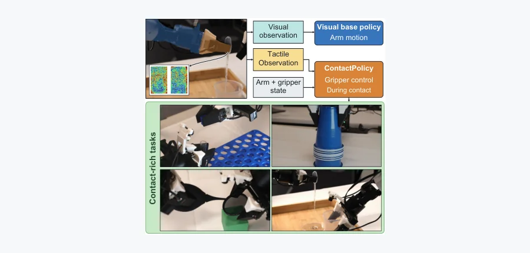 arXiv 2026-10-21 · cs.RO · #25 **[Touch Where It Matters: Learning Local Tactile Policies for Fine-Grained Gripper Control](https://arxiv.org/abs/2610.24485)** Mingyuan Ba, Yanan Zhou, James Zhao, Weiming Zhi 机构：University of Sydney（[PDF](https://arxiv.org/pdf/2610.24485)） [Paper](https://arxiv.org/abs/2610.24485) · [图源](https://arxiv.org/html/2610.24485v1/teaser_demo_typography_v1.png) 

中文摘要
视觉模仿策略可以组织任务运动，但富接触的物体使用要求夹爪做超出粗粒度开合的调整。作者把精细夹爪控制研究为持续任务执行中的局部反馈问题，并让触觉在富接触阶段承担专门的控制角色。所提 ContactPolicy 是学习到的局部控制器：视觉基础策略继续控制机械臂，它则接管夹爪。ContactPolicy 结合触觉、力的历史和当前机器人状态，同时预测夹爪增量及其调制，并根据每次新观测更新夹爪目标。Intent 策略管理视觉基础策略与 ContactPolicy 间的控制权交接。开容器、处理物体和使用工具的真实实验显示，相对 Visuomotor Policy 和 Tactile-Force Policy 基线，任务成功率均有改善。执行分析展示夹爪如何在任务进行中调整接触，包括保持目标和随交互条件变化进行细微调整的阶段。机械臂状态消融与失败分析进一步检验执行上下文如何支持局部调节。结果支持在视觉操作中使用任务局部触觉策略进行精细夹爪控制。 <a href="https://arxiv.org/abs/2610.24485">原摘要来源</a>
 |   |   |
<!-- PAPER_CARDS_END -->

## 检索概况

- **检索窗口**：上次发布（北京时间 2026-10-20 12:14）至本次官方页面核对（北京时间 2026-10-21 09:00）。
- **官方批次**：14 个官方分类页均显示 Tuesday, 20 October 2026；主榜只取 New submissions。
- **筛选**：逐篇阅读标题与官方摘要，按 3D/物理交叉、具体具身任务、基础 3D 方法排序；同一 arXiv ID 去重。
- **官方页面总命中**：New **1457**、Cross **776**、Replacement **1338** 条；New 去重后 **1457** 个 ID。
- **本期入选**：**25 篇**；低相关的泛化 Agent/LLM 论文未用于凑数。
- **摘要与配图**：完整中文摘要及原英文摘要保存在 `data/enrichment.json`；本期缺图 **0** 篇、缺原摘要 **0** 篇。

## 官方 listing 状态

| 官方分类页 | 最新 listing 日期 | New | Cross | Replacement |
|---|---|---:|---:|---:|
| [cs.CV](https://arxiv.org/list/cs.CV/new?show=2000) | 2026-10-20 | 289 | 57 | 159 |
| [cs.GR](https://arxiv.org/list/cs.GR/new?show=2000) | 2026-10-20 | 5 | 10 | 9 |
| [cs.RO](https://arxiv.org/list/cs.RO/new?show=2000) | 2026-10-20 | 135 | 25 | 74 |
| [cs.AI](https://arxiv.org/list/cs.AI/new?show=2000) | 2026-10-20 | 225 | 261 | 303 |
| [cs.LG](https://arxiv.org/list/cs.LG/new?show=2000) | 2026-10-20 | 308 | 203 | 306 |
| [physics](https://arxiv.org/list/physics/new?show=2000) | 2026-10-20 | 118 | 60 | 120 |
| [cond-mat](https://arxiv.org/list/cond-mat/new?show=2000) | 2026-10-20 | 146 | 35 | 90 |
| [math.OC](https://arxiv.org/list/math.OC/new?show=2000) | 2026-10-20 | 52 | 24 | 78 |
| [math.NA](https://arxiv.org/list/math.NA/new?show=2000) | 2026-10-20 | 39 | 14 | 41 |
| [math.DS](https://arxiv.org/list/math.DS/new?show=2000) | 2026-10-20 | 33 | 19 | 35 |
| [stat.ML](https://arxiv.org/list/stat.ML/new?show=2000) | 2026-10-20 | 18 | 33 | 57 |
| [eess.IV](https://arxiv.org/list/eess.IV/new?show=2000) | 2026-10-20 | 18 | 6 | 11 |
| [eess.SY](https://arxiv.org/list/eess.SY/new?show=2000) | 2026-10-20 | 34 | 17 | 30 |
| [eess.SP](https://arxiv.org/list/eess.SP/new?show=2000) | 2026-10-20 | 37 | 12 | 25 |

## Top papers

> 标题、作者、分类及论文结果取自所链官方 arXiv 页面；机构由 PDF 首页核对，无法确认者明示。相关性、机构强度、阅读优先级、局限和建议均为本日报**推断**。

| # | 论文 | arXiv | 分类 | 作者 | 机构 | 相关性（推断） | 机构强度（推断） | 阅读优先级（推断） |
|---:|---|---|---|---|---|---|---|---|
| 1 | Structured Latent Dynamics for Long-Horizon Embodied World Models | [arXiv:2610.24534](https://arxiv.org/abs/2610.24534) | cs.LG | Kevin Chen, Yu-Wei Zhan, Haoran Liang, Sen Cui, Changshui Zhang | Tsinghua University（[PDF](https://arxiv.org/pdf/2610.24534)） | 高（3D/物理交叉） | 中高 | 高 |
| 2 | PhysSkin++: Real-Time and Generalizable Physics-Based Animation via Self-Supervised Neural Skinning | [arXiv:2610.26067](https://arxiv.org/abs/2610.26067) | cs.CV | Yuanhang Lei, Baofei Liu, Xingxuan Li, Tao Cheng, Zixuan Wang, Boming Zhao, Yujun Shen, Siyuan Huang, Ruizhen Hu, Peter Yichen Chen, Hujun Bao, Zhaopeng Cui | Zhejiang University / Ant Group / Beijing Institute for General Artificial Intelligence / Shenzhen University / University of British Columbia（[PDF](https://arxiv.org/pdf/2610.26067)） | 高（3D/物理交叉） | 中高 | 高 |
| 3 | ContactKernels: Adaptive Proposals using Geometry-COnditioned Wrenches for Contact-Rich Manipulation | [arXiv:2610.23887](https://arxiv.org/abs/2610.23887) | cs.RO | Aditya Kamireddypalli, Matías Mattamala, João Moura, Sethu Vijayakumar, Steve Tonneau, Subramanian Ramamoorthy | University of Edinburgh（[PDF](https://arxiv.org/pdf/2610.23887)） | 高（3D/物理交叉） | 中高 | 高 |
| 4 | A mixed leading variable physics-informed neural network for nonsmooth dynamics simulation in contact systems | [arXiv:2610.26495](https://arxiv.org/abs/2610.26495) | physics.comp-ph | Xinyuan Li, Zilin Li, Hongtao Wei, Ronghan Wei | Zhengzhou University（[PDF](https://arxiv.org/pdf/2610.26495)） | 高（3D/物理交叉） | 中高 | 高 |
| 5 | Beyond Geometric Closure: Measuring and Diagnosing Mechanical Consistency in Visual Dynamics | [arXiv:2610.24619](https://arxiv.org/abs/2610.24619) | cs.CV | Qibin Gu, Yunfeng Yan | Nanjing Tech University / Zhejiang University（[PDF](https://arxiv.org/pdf/2610.24619)） | 高（3D/物理交叉） | 中高 | 高 |
| 6 | SLIM: Learning an Operator for Material-Efficient 3D Lattice Refinement | [arXiv:2610.24459](https://arxiv.org/abs/2610.24459) | cs.GR | Yueze Zhu, Yu Xing, Tianyang Xue, Peng-Shuai Wang, Jikai Liu, Haisen Zhao, Lin Lu | affiliation 未确认 | 高（3D/物理交叉） | 未评估 | 中高 |
| 7 | ACTS: Learning Visuo-Tactile World Models from Human Physical Interaction | [arXiv:2610.24285](https://arxiv.org/abs/2610.24285) | cs.RO | Yuxiang Ma, Weihan Xu, Pengfei Ye, Anna Mei, Yuxin Ray Song, Tingle Li, Haonan Chen, Edward H. Adelson | Massachusetts Institute of Technology / University of Washington / Harvard University / University of California, Berkeley / Stanford University（[PDF](https://arxiv.org/pdf/2610.24285)） | 高（3D/物理交叉） | 中高 | 中高 |
| 8 | FluidGen: Physics-Aware Fluid Video Generation via Motion-Guided Post-Training | [arXiv:2610.25660](https://arxiv.org/abs/2610.25660) | cs.CV | Yang Zheng, Zizhang Li, Boyang Deng, Jan Ackermann, Lei Shu, Yinghao Xu, Jiajun Wu, Gordon Wetzstein, Leonidas Guibas | Stanford University（[PDF](https://arxiv.org/pdf/2610.25660)） | 高（3D/物理交叉） | 中高 | 中高 |
| 9 | Drive2Gauss: FeedForward 4D Gaussian Reconstruction from Multimodal Generative Driving Videos | [arXiv:2610.26585](https://arxiv.org/abs/2610.26585) | cs.CV | Tong Zhao, Zhiyuan Han, Lin Chen, Bowen Xie, Yunxi Qiao, Bohan Li, Weiqing Xiao, Gen Li, Shu Han, Xuyang Dai, Cheng Bi, Hao Zhao, Chaojian Li | Tsinghua University / Tongji University / Beijing Technology and Business University / Fuzhou University / Shanghai Jiao Tong University / Nanjing University / Zhejiang University / University of Wisconsin–Madison / Great Wall Motor / Hong Kong University of Science and Technology（[PDF](https://arxiv.org/pdf/2610.26585)） | 高（3D/物理交叉） | 中高 | 中高 |
| 10 | ContactBench 1.0: A Benchmark for Everyday Contact-Rich Robotic Manipulation | [arXiv:2610.24512](https://arxiv.org/abs/2610.24512) | cs.RO | Jingyi Xiang, Yixuan Wang, Jeannette Bohg, Wenzhen Yuan | University of Illinois Urbana-Champaign / Stanford University（[PDF](https://arxiv.org/pdf/2610.24512)） | 高（3D/物理交叉） | 中高 | 中高 |
| 11 | Tactile In-Hand Object Rotation: A Comparative Study of Hand Morphology in Simulation and Hardware | [arXiv:2610.26759](https://arxiv.org/abs/2610.26759) | cs.RO | Wenhao He, Max Yang, Chenghua Lu, Yijiong Lin, David A.W. Barton, Nathan F. Lepora | University of Bristol（[PDF](https://arxiv.org/pdf/2610.26759)） | 高（3D/物理交叉） | 中高 | 中高 |
| 12 | Torch-DPhys: A Torch-Native, MOOSE-Compatible Framework for Differentiable Physics Simulation and Hybrid Machine Learning Integration | [arXiv:2610.24301](https://arxiv.org/abs/2610.24301) | cs.LG | Akzhol Almukhametov, Yang Liu | Texas A&M University（[PDF](https://arxiv.org/pdf/2610.24301)） | 高（3D/物理交叉） | 中高 | 中高 |
| 13 | GeoForward: Geometry-Guided Cross-View Alignment for Feedforward 3D Gaussian Splatting | [arXiv:2610.23895](https://arxiv.org/abs/2610.23895) | cs.CV | Yiming Shu, Peng Sun, Lang Zhang, Mingyue Feng, Yaonong Wang, Pei Liu, Chen Sun, Jun Ma | University of Hong Kong / Leapmotor / Hong Kong University of Science and Technology (Guangzhou)（[PDF](https://arxiv.org/pdf/2610.23895)） | 高（3D/物理交叉） | 中高 | 中高 |
| 14 | Functionalizing AI-Generated 3D Shapes via Interior Geometry Construction | [arXiv:2610.23953](https://arxiv.org/abs/2610.23953) | cs.CV | Haoyu Tang, Fancheng Gao, Kan Chen, Peng Song | Singapore University of Technology and Design / Singapore Institute of Technology（[PDF](https://arxiv.org/pdf/2610.23953)） | 高（3D/物理交叉） | 中高 | 中高 |
| 15 | PVBench: Quantifying Physical Plausibility in Video Generation with Object-Level Physical Measurements | [arXiv:2610.26711](https://arxiv.org/abs/2610.26711) | cs.CV | Kaiwei Chen, Moran Li, Zhenye Gan, Yabiao Wang, Chengjie Wang, Kexin Zhang, Yong Liu, Jiangning Zhang | Zhejiang University / Huazhong University of Science and Technology / Tencent Youtu Lab（[PDF](https://arxiv.org/pdf/2610.26711)） | 高（3D/物理交叉） | 中高 | 中高 |
| 16 | Holo4D: Holistic 4D Reconstruction as Geometric Control for Video Diffusion | [arXiv:2610.25276](https://arxiv.org/abs/2610.25276) | cs.CV | Yushi Lan, Zeren Jiang, Koichi Namekata, Xingang Pan, Chuanxia Zheng, Andrea Vedaldi | University of Oxford / Nanyang Technological University（[PDF](https://arxiv.org/pdf/2610.25276)） | 高（3D/物理交叉） | 中高 | 中高 |
| 17 | HORIA: 4D Human and Object Reconstruction from a Monocular Video with Interaction-Aware Re-Rendering | [arXiv:2610.25960](https://arxiv.org/abs/2610.25960) | cs.CV | Hyeongjin Nam, Taeryung Lee, Daniel Sungho Jung, Kyoung Mu Lee | Seoul National University（[PDF](https://arxiv.org/pdf/2610.25960)） | 高（3D/物理交叉） | 中高 | 中高 |
| 18 | GOFusion: Real-Time Gaussian-Occupancy Submap Fusion for Fisher-Informed Autonomous Robot Navigation | [arXiv:2610.25261](https://arxiv.org/abs/2610.25261) | cs.RO | Boxin Bu, Simon Boche, Haoming Zhang, Jaehyung Jung, Jiaxin Wei, Hannah Schieber, Daniel Roth, Angela P. Schoellig, Stefan Leutenegger | Technical University of Munich / ETH Zurich / University of Toronto / Vector Institute（[PDF](https://arxiv.org/pdf/2610.25261)） | 高（3D/物理交叉） | 中高 | 中高 |
| 19 | Revealing and Bridging the Physical Executability Gap in Vision-Language Navigation | [arXiv:2610.25687](https://arxiv.org/abs/2610.25687) | cs.RO | Gang He, Zhile Cheng, Kepeng Xu, Zhenyang Liu, Yu-Wing Tai | Xidian University / Dartmouth College（[PDF](https://arxiv.org/pdf/2610.25687)） | 高（具体具身机器人） | 中高 | 中高 |
| 20 | TrajWAM: An Efficient Trajectory-Guided World Action Model for Dynamic Robotic Manipulation | [arXiv:2610.25763](https://arxiv.org/abs/2610.25763) | cs.RO | Haohan Geng, Sha Zhang, Weishuo Sun, Guanting Ye, Wenhao Yu, Yuang Xie, Qicheng Zeng, Peng Ye, Jiajun Deng, Jianmin Ji | University of Science and Technology of China / Chinese University of Hong Kong / University of Macau / Huawei Technologies（[PDF](https://arxiv.org/pdf/2610.25763)） | 高（具体具身机器人） | 中高 | 中高 |
| 21 | FR-VLA: Implicit Force Reasoning VLA for Contact-Rich Manipulation | [arXiv:2610.25981](https://arxiv.org/abs/2610.25981) | cs.RO | Jiaju He, Zhiyuan Yang, Ruyang Han, Jiahong Tang, Zhiping Lin, Haiyue Zhu | Nanyang Technological University / A*STAR Singapore Institute of Manufacturing Technology（[PDF](https://arxiv.org/pdf/2610.25981)） | 高（具体具身机器人） | 中高 | 中高 |
| 22 | LIBERO-Dynamic: Benchmarking Robotic Manipulation in Dynamic Environments | [arXiv:2610.24579](https://arxiv.org/abs/2610.24579) | cs.RO | Shaojie Ren, Jingwen Sun, Zezhi Liu, Hongjin Chen, Xin Jin, Wei Zou, Zhibo Chen | University of Chinese Academy of Sciences / Beijing Zhongguancun Academy / Chinese Academy of Sciences / University of Science and Technology of China / Nankai University / Harbin Institute of Technology / Eastern Institute of Technology, Ningbo（[PDF](https://arxiv.org/pdf/2610.24579)） | 高（具体具身机器人） | 中高 | 中高 |
| 23 | Ropedia W0: Scaling Loco-Manipulation World Models across Embodiments with Human Experience | [arXiv:2610.26855](https://arxiv.org/abs/2610.26855) | cs.CV | Tianqi Liu, Hanfei Zhao, Qifeng Liang, Hui En Pang, Jiarui Xu, Sayang Mu, Penghao Qiu, YingSheng Zhang, Jun Wang, Ziang Cao, Mingze Sun, Yukang Cao, Fangzhou Hong, Zhaoxi Chen, Ziwei Liu | Nanyang Technological University / Ropedia / Duke University / University of California, San Diego / Tsinghua University（[PDF](https://arxiv.org/pdf/2610.26855)） | 高（具体具身机器人） | 中高 | 中高 |
| 24 | MicroSplat: Towards Automating 3D Small-Scale Reconstruction | [arXiv:2610.23899](https://arxiv.org/abs/2610.23899) | cs.RO | Roman Mineyev, Robert Azarcon, Suvrat Jain, Chuizheng Kong, Shreyas Kousik | Georgia Institute of Technology（[PDF](https://arxiv.org/pdf/2610.23899)） | 高（具体具身机器人） | 中高 | 中高 |
| 25 | Touch Where It Matters: Learning Local Tactile Policies for Fine-Grained Gripper Control | [arXiv:2610.24485](https://arxiv.org/abs/2610.24485) | cs.RO | Mingyuan Ba, Yanan Zhou, James Zhao, Weiming Zhi | University of Sydney（[PDF](https://arxiv.org/pdf/2610.24485)） | 高（具体具身机器人） | 中高 | 中高 |

## 逐篇中文要点

### 1. [Structured Latent Dynamics for Long-Horizon Embodied World Models](https://arxiv.org/abs/2610.24534)

- **事实｜问题与方法**：以广义坐标、动量和耗散哈密顿动力学约束世界模型的潜状态多步演化。
- **事实｜验证与结果**：仿真中降低能量漂移；在 RoboCasa 的 Cosmos-Predict2.5-2B 上任务成功率相对提高 2.7%。
- **推断｜局限与改进**：可在接触切换、非保守冲击和遮挡条件下按预测步长分层测试物理状态误差。

### 2. [PhysSkin++: Real-Time and Generalizable Physics-Based Animation via Self-Supervised Neural Skinning](https://arxiv.org/abs/2610.26067)

- **事实｜问题与方法**：从静态 3D 几何学习连续神经蒙皮场，构造跨形状的紧凑形变子空间。
- **事实｜验证与结果**：展示实时降阶仿真，支持用户控制、接触及网格、点云、3D Gaussian 绑定。
- **推断｜局限与改进**：可核对材料参数变化时形变子空间的泛化，并与全阶模拟比较能量误差。

### 3. [ContactKernels: Adaptive Proposals using Geometry-COnditioned Wrenches for Contact-Rich Manipulation](https://arxiv.org/abs/2610.23887)

- **事实｜问题与方法**：以几何条件化力矩估计接触位置与法向，并据此改变 SMPC 的采样方向和协方差。
- **事实｜验证与结果**：实机插入成功率由 53.3% 增至 90.0%，平均耗时下降 33%。
- **推断｜局限与改进**：可测力矩噪声和多点同时接触时的接触定位稳定性。

### 4. [A mixed leading variable physics-informed neural network for nonsmooth dynamics simulation in contact systems](https://arxiv.org/abs/2610.26495)

- **事实｜问题与方法**：同时输出加速度、法向接触力和摩擦裕度，用混合主导变量处理黏滑互补约束。
- **事实｜验证与结果**：四组离散和连续体基准在大时间步下相对常规方法降低位移、速度误差。
- **推断｜局限与改进**：需以更复杂三维多点碰撞和真实摩擦系数误差测试适用边界。

### 5. [Beyond Geometric Closure: Measuring and Diagnosing Mechanical Consistency in Visual Dynamics](https://arxiv.org/abs/2610.24619)

- **事实｜问题与方法**：把视觉动力学评估拆成几何可容许性、驱动器出力和功—能平衡三项机械检查。
- **事实｜验证与结果**：在 343 个平面及 100 个空间装配体上发现图像 MSE 改善仍可能伴随严重机械残差。
- **推断｜局限与改进**：可加入接触冲量和材料耗散的独立审计，避免只靠闭链机构下结论。

### 6. [SLIM: Learning an Operator for Material-Efficient 3D Lattice Refinement](https://arxiv.org/abs/2610.24459)

- **事实｜问题与方法**：用双八叉树隐式网络预测晶格 SDF，并以均匀化灵敏度约束刚度保持。
- **事实｜验证与结果**：906 个留出晶格上体积分数平均降 15.90%，单件生成由 2516 秒缩至约 0.5 秒。
- **推断｜局限与改进**：可检查细杆断裂和制造公差下的真实力学性能。

### 7. [ACTS: Learning Visuo-Tactile World Models from Human Physical Interaction](https://arxiv.org/abs/2610.24285)

- **事实｜问题与方法**：用人类手持 GelSight 交互数据训练动作条件视觉—触觉世界模型，预测场景、腕部及触觉未来。
- **事实｜验证与结果**：4.9 小时 React 数据上场景视图 PSNR 优于较强基线 0.7–2.0 dB；机器人视觉迁移因任务而异。
- **推断｜局限与改进**：可为触觉预测增加接触阶段置信度，避免视觉幻觉影响机器人规划。

### 8. [FluidGen: Physics-Aware Fluid Video Generation via Motion-Guided Post-Training](https://arxiv.org/abs/2610.25660)

- **事实｜问题与方法**：联合预测 RGB 与逐帧速度场，用 Houdini 速度真值和真实视频训练物理感知流体生成。
- **事实｜验证与结果**：摘要报告相对视频生成与优化基线更真实的流体运动。
- **推断｜局限与改进**：需用涡量、质量守恒和流速误差等物理量进一步量化“更真实”。

### 9. [Drive2Gauss: FeedForward 4D Gaussian Reconstruction from Multimodal Generative Driving Videos](https://arxiv.org/abs/2610.26585)

- **事实｜问题与方法**：联合生成 RGB、度量深度和动态流，再以前馈 Gaussian 查询解码器构造 4D 驾驶场景。
- **事实｜验证与结果**：在 nuScenes 上未来视频 FID 6.38、FVD 12.43，重建生成观测的 PSNR 29.91 dB。
- **推断｜局限与改进**：可对动态车体遮挡处的 4D 几何稳定性作独立评估。

### 10. [ContactBench 1.0: A Benchmark for Everyday Contact-Rich Robotic Manipulation](https://arxiv.org/abs/2610.24512)

- **事实｜问题与方法**：按八类日常接触技能建立 36 任务、40 余物体资产的实体与仿真基准。
- **事实｜验证与结果**：六任务评估中所测纯视觉策略难感知接触事件，所测视觉—触觉策略也无明显改进。
- **推断｜局限与改进**：应将触觉时延、接触定位误差和策略反应时间拆开报告。

### 11. [Tactile In-Hand Object Rotation: A Comparative Study of Hand Morphology in Simulation and Hardware](https://arxiv.org/abs/2610.26759)

- **事实｜问题与方法**：在拟人与对称两种 LEAP Hand 上比较完整触觉、二值触觉和本体感知。
- **事实｜验证与结果**：实机对称手的平均旋转次数高 32.0%，平均总指尖负载低 19.9%。
- **推断｜局限与改进**：可比较不同物体惯量和摩擦系数下，手形优势是否保持。

### 12. [Torch-DPhys: A Torch-Native, MOOSE-Compatible Framework for Differentiable Physics Simulation and Hybrid Machine Learning Integration](https://arxiv.org/abs/2610.24301)

- **事实｜问题与方法**：建立 Torch 原生可微物理仿真框架，支持执行运算求导及残差离散伴随。
- **事实｜验证与结果**：反应堆测试与 SAM-Lite 最大归一化场差异为 1.13×10^-5，合成参数恢复误差低于 0.06%。
- **推断｜局限与改进**：需检查自适应时间步发生分支变化时的梯度稳定性。

### 13. [GeoForward: Geometry-Guided Cross-View Alignment for Feedforward 3D Gaussian Splatting](https://arxiv.org/abs/2610.23895)

- **事实｜问题与方法**：先用 LiDAR 和标定相机建立度量对应，再以视觉特征细化前馈 3D Gaussian 重建。
- **事实｜验证与结果**：在 nuScenes 比较中跨相机深度一致性误差及 Chamfer 距离最低，重建质量保持竞争力。
- **推断｜局限与改进**：可分层测试 LiDAR 稀疏或标定偏差时的几何锚点失效。

### 14. [Functionalizing AI-Generated 3D Shapes via Interior Geometry Construction](https://arxiv.org/abs/2610.23953)

- **事实｜问题与方法**：用内部感知部件图和广义圆柱优化为 AI 生成 3D 形状补齐功能内部几何。
- **事实｜验证与结果**：在容器和储物家具等生成形状上展示，并制造部分实例作功能验证。
- **推断｜局限与改进**：可用承载、密封或容积等任务指标验证“功能有效”范围。

### 15. [PVBench: Quantifying Physical Plausibility in Video Generation with Object-Level Physical Measurements](https://arxiv.org/abs/2610.26711)

- **事实｜问题与方法**：将视频物理可信度分解为七领域、46 维度，并以物体级 6D 位姿和守恒残差等测量支撑评估。
- **事实｜验证与结果**：基准含 600 提示，其中 30% 是机器人等物理具身主体；作者比较自动指标与人工判断。
- **推断｜局限与改进**：可按估计器误差传播给每个物理评分附置信区间。

### 16. [Holo4D: Holistic 4D Reconstruction as Geometric Control for Video Diffusion](https://arxiv.org/abs/2610.25276)

- **事实｜问题与方法**：以重建 3D 轨迹构成 4D 几何支架，指导预训练视频扩散模型在新相机轨迹下生成。
- **事实｜验证与结果**：实验支持轨迹条件对相机控制和新视角合成有用，框架可接不同 4D 重建器。
- **推断｜局限与改进**：需分离轨迹重建误差与生成先验补全错误。

### 17. [HORIA: 4D Human and Object Reconstruction from a Monocular Video with Interaction-Aware Re-Rendering](https://arxiv.org/abs/2610.25960)

- **事实｜问题与方法**：把单目人—物视频分解为语义交互阶段，再以新视角重渲染和视频扩散先验补足遮挡。
- **事实｜验证与结果**：作者报告多交互场景下时间连贯的 4D 重建及最先进性能。
- **推断｜局限与改进**：可用接触点漂移和物体刚体保持量化交互几何一致性。

### 18. [GOFusion: Real-Time Gaussian-Occupancy Submap Fusion for Fisher-Informed Autonomous Robot Navigation](https://arxiv.org/abs/2610.25261)

- **事实｜问题与方法**：把 Gaussian 基元锚定局部占据图，并用在线 Fisher 近似做裁剪和下一视角规划。
- **事实｜验证与结果**：公共数据与真实无人机飞行显示实时、高保真、感知不确定性的建图和自主探索。
- **推断｜局限与改进**：可核对信息量增益是否同时减少导航碰撞和地图不确定性。

### 19. [Revealing and Bridging the Physical Executability Gap in Vision-Language Navigation](https://arxiv.org/abs/2610.25687)

- **事实｜问题与方法**：以严格接触反馈和风险评价调整 VLN 轨迹生成及候选选择。
- **事实｜验证与结果**：在 R2R、RxR 严格接触评测中减少碰撞失败，并有受控实机迁移证据。
- **推断｜局限与改进**：应核验真实接触模型与仿真中的失败类型是否一致。

### 20. [TrajWAM: An Efficient Trajectory-Guided World Action Model for Dynamic Robotic Manipulation](https://arxiv.org/abs/2610.25763)

- **事实｜问题与方法**：先预测目标物体掩码轨迹，再用轻量 ControlNet 引导视频未来并条件化动作块。
- **事实｜验证与结果**：仿真及实机动态操作中报告最先进性能，并实现单步视频—动作推理。
- **推断｜局限与改进**：可对预测轨迹误差、推理延迟和操作成功率作因果消融。

### 21. [FR-VLA: Implicit Force Reasoning VLA for Contact-Rich Manipulation](https://arxiv.org/abs/2610.25981)

- **事实｜问题与方法**：用视觉语言上下文推导力准入信号，动态调制 VLA 动作生成中的力 token。
- **事实｜验证与结果**：两个平台五项富接触实机任务上，六个评估阶段的平均成功率最高。
- **推断｜局限与改进**：需检查力传感器偏置和接触瞬间时延下的准入失效。

### 22. [LIBERO-Dynamic: Benchmarking Robotic Manipulation in Dynamic Environments](https://arxiv.org/abs/2610.24579)

- **事实｜问题与方法**：将 LIBERO 40 任务改成目标运动、模型推理延迟和执行时机显式可控的动态基准。
- **事实｜验证与结果**：生成 9,000 条动态轨迹，并在每配置 1,800 个条件下评估六种预训练策略。
- **推断｜局限与改进**：可将动作队列欠载与感知过时分开，定位异步重规划收益来源。

### 23. [Ropedia W0: Scaling Loco-Manipulation World Models across Embodiments with Human Experience](https://arxiv.org/abs/2610.26855)

- **事实｜问题与方法**：统一相机位姿与投影骨架，利用人类和多种机器人体态数据训练移动操作世界模型。
- **事实｜验证与结果**：Xp-Data 含 1 万小时人类和 3,000 小时机器人数据；蒸馏后支持实时分钟级推演。
- **推断｜局限与改进**：可在相同机器人数据量下测人类预训练数据的边际收益。

### 24. [MicroSplat: Towards Automating 3D Small-Scale Reconstruction](https://arxiv.org/abs/2610.23899)

- **事实｜问题与方法**：用机械臂显微镜自动规划视角、焦点堆叠和分割，热启动小物体 3DGS 重建。
- **事实｜验证与结果**：提供真实与合成数据、机器人及相机参数，并报告受控焦点扫描优于模糊推断。
- **推断｜局限与改进**：可按小物体遮挡和反光程度分析自动重建失败率。

### 25. [Touch Where It Matters: Learning Local Tactile Policies for Fine-Grained Gripper Control](https://arxiv.org/abs/2610.24485)

- **事实｜问题与方法**：由视觉策略控制机械臂，触觉局部策略在富接触阶段接管夹爪增量控制。
- **事实｜验证与结果**：开容器、物体处理和工具使用实机任务中，优于两种比较策略。
- **推断｜局限与改进**：可测试 Intent 交接时机抖动和触觉丢帧的影响。

## 今日最值得细读的 5 篇

1. [HWM：结构化潜动力学](https://arxiv.org/abs/2610.24534)：在已有具身世界模型中加入广义坐标、动量和耗散哈密顿转移，适合研究多步预测的物理稳定性；任务成功率增幅仍较小。
2. [PhysSkin++](https://arxiv.org/abs/2610.26067)：从静态形状学跨物体形变子空间，兼容接触、碰撞和 Gaussian 表示，适合跟踪实时物理动画的泛化边界。
3. [ContactKernels](https://arxiv.org/abs/2610.23887)：把几何条件化力矩变为控制采样分布，提供无需对接触动力学反传的实机插入证据。
4. [MLV-PINN](https://arxiv.org/abs/2610.26495)：把法向力和摩擦裕度直接纳入多接触非光滑动力学求解，值得审查大时间步精度与三维外推。
5. [机械一致性审计](https://arxiv.org/abs/2610.24619)：同场测视觉误差、机构几何、驱动器出力与功—能平衡，可避免把画面预测质量误认为物理正确性。

## 低算力可改进论文：方法级实验建议

> 下列均为本日报**推断性提案**，预期收益和风险尚未由论文作者验证。每项优先使用冻结模型、小型子集或解析约束。

### 1. [HWM](https://arxiv.org/abs/2610.24534)

- **接触门控耗散**：以接触发生概率调节哈密顿耗散系数；冻结视觉主干，在小型推盒序列上比较十步位置误差与能量漂移。只训练门控头，预期减少接触后的漂移；风险是接触检测噪声造成错误耗散。
- **冲量残差**：在光滑动力学后增加受法向约束的低秩冲量残差；用双物体碰撞仿真比较速度突变误差。参数少，预期改善非光滑事件；风险是把渲染噪声拟合为碰撞。
- **状态可辨识性**：以少量标注位姿约束广义坐标，再测跨相机预测一致性。小样本线性探针即可验证，预期提高物理解释性；风险是监督过少时坐标仍不唯一。

### 2. [PhysSkin++](https://arxiv.org/abs/2610.26067)

- **材料条件子空间**：给蒙皮场小网络增加弹性模量条件；在少量同形不同材质网格上比较形变 RMSE。冻结主编码器可省算力，预期改善材质迁移；风险是模量与网格分辨率混淆。
- **接触局部修正**：只在接触邻域学习低秩位移残差；用单球压软体实验比较穿透深度和帧率。局部计算成本低，预期减轻接触伪影；风险是多接触时邻域交叠。
- **能量投影**：每个降阶步做一次解析能量上界投影；在长时弹性摆动中测能量漂移。无需重训，预期稳定长时动画；风险是过度阻尼。

### 3. [ContactKernels](https://arxiv.org/abs/2610.23887)

- **接触位置置信度**：由力矩残差估计定位不确定度，自适应调节提议核宽度；在少量插销几何与加噪力矩数据上测成功率和采样数。只增标定层，预期减少误导搜索；风险是置信度失准。
- **多点接触混合核**：把单接触法向改为少量混合分量；在双壁卡滞仿真中比较脱困时间。仅改变采样分布，预期处理多点接触；风险是分量权重难辨。
- **几何先验消融**：分别去掉局部曲率和法向信息，在固定采样预算下测 3D 复杂孔位成功率。无需大模型训练，可定位收益来源；风险是任务几何变化过小。

### 4. [MLV-PINN](https://arxiv.org/abs/2610.26495)

- **自适应互补权重**：依据黏滑状态残差调整损失权重；在单滑块与弹性梁子集上测位移误差、状态切换时间。只改训练损失，预期减少边界误判；风险是权重振荡。
- **事件附近细网格**：仅在接触切换时加密时间采样；用相同计算预算比较速度尖峰误差。预期提高冲击精度；风险是事件检测漏报。
- **摩擦参数区间化**：把固定摩擦系数改为小区间鲁棒约束；用少量留出系数测试泛化。无需扩大网络，预期降低参数误设敏感性；风险是解过于保守。

### 5. [机械一致性审计](https://arxiv.org/abs/2610.24619)

- **接触冲量审计**：在原三项指标之外加入碰撞前后动量残差；用小型闭链碰撞视频比较模型排序。只需解析评估，预期发现视觉指标遗漏的失效；风险是质量估计误差。
- **误差传播条**：给位姿重建加入扰动重放，报告力和能量分数的置信区间；在 100 个空间装配体子集测试排序稳定性。无需训练，预期区分模型误差和测量误差；风险是扰动分布不代表真实噪声。
- **单位标准化**：按机构尺度归一化驱动器残差，比较大小不同装配体的排名。低算力后处理，预期提高跨任务可比性；风险是隐藏绝对安全阈值。

### 6. [SLIM](https://arxiv.org/abs/2610.24459)

- **最小杆径约束**：在 SDF 输出加可微局部厚度罚项；在 50 个晶格上比较体积分数、刚度误差和断杆率。仅微调预测头，预期提高可制造性；风险是减材收益下降。
- **不确定区域复核**：用小型模型预测高风险体素，只对这些区域做局部拓扑优化；测总耗时与均匀化刚度。预期兼顾速度和精度；风险是风险识别漏掉细长承载杆。
- **方向刚度校准**：单独约束主方向弹性模量误差；在各向异性晶格子集上测载荷方向外推。只改损失，预期减少方向性失配；风险是牺牲总体质量。

### 7. [ACTS](https://arxiv.org/abs/2610.24285)

- **触觉事件门控**：根据接触形成/释放置信度切换预测头；在 React 少量留出轨迹上比较触觉事件 F1 和压痕误差。只训轻量门控，预期更稳地迁移接触事件；风险是事件标注不准。
- **外观不确定度**：对腕部视觉预测输出置信度，规划时降低模糊帧权重；在 Motherboard 机器人轨迹上测复制帧基线差距。低算力校准，预期减少幻觉影响；风险是置信度退化为常数。
- **力变化尺度对齐**：用少量机器人触觉样本线性标定人类到机器人的力变化；比较不同物体上的法向力误差。只需小样本回归，预期改善跨本体转移；风险是传感器接触面积差异。

### 8. [FluidGen](https://arxiv.org/abs/2610.25660)

- **散度正则**：在速度场辅助头加入二维可见区域的散度损失；冻结视频主干，在小规模烟雾片段上测散度和视觉质量。预期抑制非物理流；风险是二维投影并非真实三维不可压流。
- **涡量一致性**：给相邻帧的速度场加入涡量输运残差；在 Houdini 留出场景测涡结构寿命。只训练辅助头，预期改善旋涡持续性；风险是边界条件未知。
- **量纲消融**：按场景尺度规范速度标签并比较原版；测跨火焰、烟雾类别的速度误差。无需扩大模型，预期提升跨场景标定；风险是未知尺度下无法恢复绝对速度。

### 9. [Drive2Gauss](https://arxiv.org/abs/2610.26585)

- **流深一致性**：在查询关联中惩罚流回投后深度不一致；冻结视频生成器，在 nuScenes 小子集测动态物体 Chamfer 距离。只训查询解码器，预期降低时间错配；风险是遮挡造成虚假惩罚。
- **遮挡显式标记**：为查询加入可见性位，跨遮挡时暂停外观更新；比较再出现目标的身份保持率。少量额外参数，预期减轻 4D 漂移；风险是可见性误判。
- **相机位移应力测试**：系统扩大侧向渲染偏移，分离几何和外观退化曲线。只需推理，预期明确泛化边界；风险是大偏移区域无真值。

### 10. [ContactBench 1.0](https://arxiv.org/abs/2610.24512)

- **事件对齐反馈**：把连续触觉输入压缩为接触开始、滑移、释放三个事件 token；在六个任务的小样本基线上测成功率和反应延迟。只训轻量事件编码器，预期让策略更关注关键接触；风险是细粒度力信息丢失。
- **阻力随机化课程**：依任务逐步扩大仿真负载范围；测真实 3D 打印资产上的成功率。无需增大策略，预期提升接触泛化；风险是过强随机化妨碍学习。
- **失效分型**：把失败拆成定位、力控与接触时序三类，在原基准中做按类消融。主要是评估开销，预期指明视觉—触觉策略无收益的原因；风险是类别边界主观。

## Replacement 状态

14 页共列出 **1,338** 条 Replacement（原始跨页计数）。本轮未逐版本核实足够重大的更新，因此不将 Replacement 混入 New 主榜，也不单列未经核实的条目。