# 2026-10-22 arXiv 每日论文订阅摘要

<!-- PAPER_CARDS_START -->
## 论文卡片

按原日报排名展示；点击标题或 Paper 查看原文，详细中文分析见下方。

| 论文 | 论文 | 论文 |
|---|---|---|
| 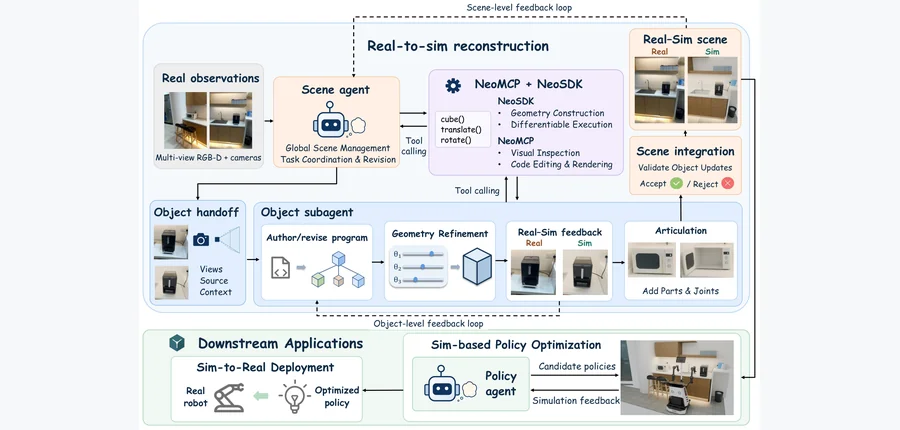 arXiv 2026-10-22 · cs.CV · #1 **[NeoWorld-3: From Pixels to Code-Defined Physical Worlds](https://arxiv.org/abs/2610.27690)** Eachen Soong, Zijian Niu, Haoran Xu, Yihong Dong, Yunbo Wang, Xiaokang Yang 机构：Shanghai Jiao Tong University / Doxi AI（[PDF](https://arxiv.org/pdf/2610.27690)） [Paper](https://arxiv.org/abs/2610.27690) · [Code](https://github.com/NeoWorldProject/NeoWorldStudio) · [Project](https://neoworldproject.github.io/Studio/) · [图源](https://arxiv.org/html/2610.27690v1/neoworld_method.png) 

中文摘要
可用于仿真的世界重建需要超越视觉真实感、具备物理交互能力，而现有黑箱式 3D 生成难以做到。本文提出 NeoWorld-3：一个通过可调、可执行程序从视觉观测重建交互式 3D 世界的编码智能体框架。其核心 NeoSDK 提供底层几何、部件组合、可微参数细化和物理验证的计算引擎；NeoMCP 则把这些能力作为结构化、可调用工具的 API 暴露给视觉语言智能体，使其能够视觉检查、编辑代码并迭代细化程序。分层的协调者—工作者架构使框架能从单个关节物体扩展到复杂的组合场景。在物体级与场景级重建基准上，NeoWorld-3 在几何保真度和物理可用性方面达到作者报告的最先进水平。更关键的是，在重建数字孪生体中规划的操作轨迹可在实体双臂机器人上零样本成功执行，完成 Real-Sim-Real 闭环。 <a href="https://arxiv.org/abs/2610.27690">原摘要来源</a>
 | 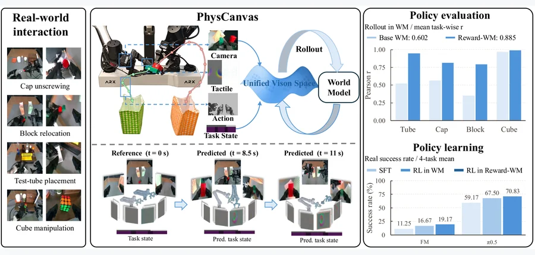 arXiv 2026-10-22 · cs.RO · #2 **[Physical Canvas: A Vision Tactile World Model For Robot Policy Evaluation And Learning](https://arxiv.org/abs/2610.28613)** Zebin Xing, Yuhang Zheng, Yupeng Zheng, Yichen Zhang, Zichen Li, Shangqing Zhou, Yujie Zang, Yuchen Liu, Zhongpu Xia, Haor… 机构：Institute of Automation, Chinese Academy of Sciences / Anyverse Robotics / Open-Phoenix Team / National University of Singapore / Xi’an Jiaotong University / Beijing Institute of Technology（[PDF](https://arxiv.org/pdf/2610.28613)） [Paper](https://arxiv.org/abs/2610.28613) · [图源](https://arxiv.org/html/2610.28613v1/teaser.png) 

中文摘要
通过物理交互评估和后训练机器人策略成本高、难以扩展，因此动作条件世界模型被用作交互式模拟器。然而，视觉上可信的预测可能错误刻画接触动力学，从而为策略评估和学习提供不可靠反馈。本文提出 PhysCanvas，一种面向富接触机器人操作、保持状态一致的视触觉世界模型。PhysCanvas 在统一视觉空间内整合多视角 RGB、触觉图像、标记点位移、任务状态和动作；所有模态共用视频 VAE 与预训练生成主干，使光学触觉可复用视觉与时间先验。由正向运动学和相机投影得到的运动图像提供空间对齐的动作条件，初始 RGB 锚点与更新后的参考观测引导序列生成。其一致性感知后训练使用冻结的场景奖励模型、模态奖励模型和状态奖励模型，监督场景保持、视触觉兼容性及与真实任务结果的一致性。所得世界模型支持闭环策略推演以进行评估，也为 GRPO 策略更新提供想象交互和奖励。在四项真实操作任务中，状态奖励模型监督把世界模型与真实世界成功率的逐任务 Pearson 相关系数算术平均值从 0.602 提高到 0.885。在奖励引导的世界模型中进行策略后训练，还将 $\pi_{0.5}$ 的真实世界平均成功率从 59.1% 的 SFT 基线提高到 70.8%。这些结果展示了统一多模态建模和一致性感知后训练对机器人策略评估与学习的价值。 <a href="https://arxiv.org/abs/2610.28613">原摘要来源</a>
 | 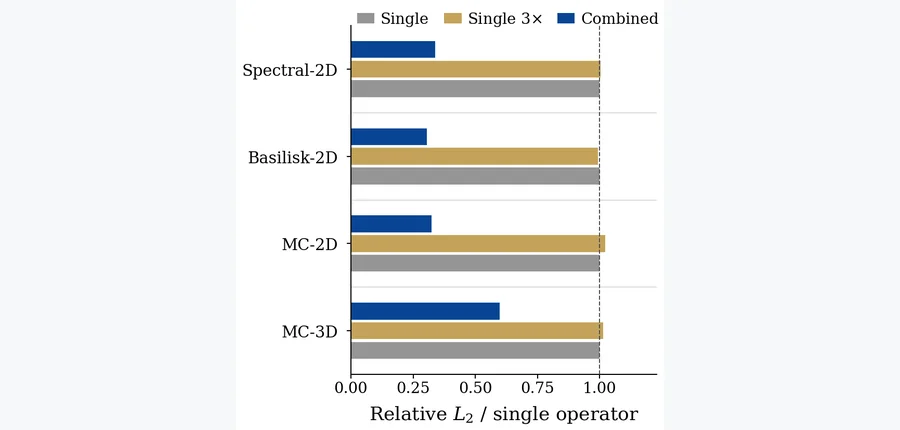 arXiv 2026-10-22 · cs.LG · #3 **[Neural Operator Splitting for Fluid Dynamics in Complex Geometry](https://arxiv.org/abs/2610.27671)** Jianxiang Li, Xi Deng, Hong Chul Nam, Anima Anandkumar 机构：Peking University / California Institute of Technology / New York University（[PDF](https://arxiv.org/pdf/2610.27671)） [Paper](https://arxiv.org/abs/2610.27671) · [图源](https://arxiv.org/html/2610.27671v1/fig/error1.png) 

中文摘要
在复杂且多样的几何域中求解动力系统，对数值求解器和学习型代理模型都仍有挑战。本文提出 Neural Operator Splitting：一种在学习流体动力学时保留分数步数值格式物理结构的框架。它不整体学习完整时间步的演化，而是把每一步拆为物理上可解释的步骤，并利用底层数值求解器产生的中间状态分别学习各个算子。依据分数步骤的线性性质，作者提出条件线性傅里叶神经算子 CL-FNO，其线性状态映射由边界几何等输入的非线性条件调制。作者还提出对称性采样与校正循环两种互补策略，以减轻自回归推演中的误差累积。在几何与初始条件各异的 2D 和 3D 流动实验中，相比单个整步神经算子，完整模型使平均相对 $L^2$ 推演误差分别降低 68% 和 40%。在相近误差水平下，神经算子每步推理约比蒙特卡洛求解器快 $10^3$ 倍。 <a href="https://arxiv.org/abs/2610.27671">原摘要来源</a>
 |
| 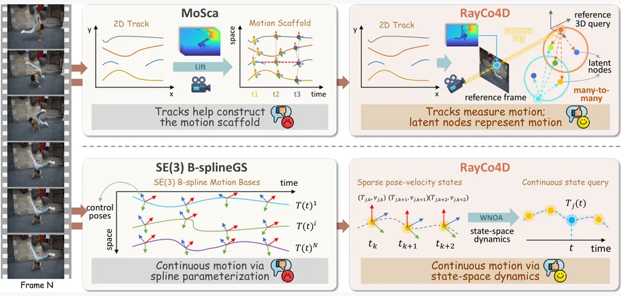 arXiv 2026-10-22 · cs.CV · #4 **[RayCo4D: Ray-Conditioned Continuous Motion Model for Monocular 4D Dynamic Reconstruction](https://arxiv.org/abs/2610.28351)** Yuanxiang Ni, Xianliang Huang, Ruihan Hou, Feng Xie, Hao Zhang 机构：Southern University of Science and Technology / Fudan University / East China University of Science and Technology / Beijing Technology and Business University / Shenzhen Institutes of Advanced Technology, Chinese Academy of Sciences（[PDF](https://arxiv.org/pdf/2610.28351)） [Paper](https://arxiv.org/abs/2610.28351) · [图源](https://arxiv.org/html/2610.28351v2/teaser.png) 

中文摘要
从单目视频重建动态 3D 场景，需要从有噪声且间歇可见的观测中推断运动。长程轨迹提供有价值的几何约束，但把分段的时间覆盖整合成共享连续运动仍很困难。本文提出 RayCo4D，一种用于单目 4D 重建的射线条件连续运动模型，显式区分视觉测量与潜在 3D 运动状态。每条轨迹对应一个受相机射线约束的参考时刻 3D 查询，其图像和深度观测通过局部多对多关联约束共享潜在运动节点。每个节点在稀疏支撑时刻维护一个 $\mathrm{SE}(3)$ 位姿和本体系速度。白噪声加速度过程先验耦合相邻状态并定义连续时间插值，使跨可见区间的观测共同约束同一潜在状态序列。推断出的共享运动通过双四元数混合传递给 Gaussian 基元，而参考锚定的局部 $\mathrm{SE}(3)$ 残差表示共享骨架之外的细尺度非刚性形变。多种单目动态场景实验显示，RayCo4D 具有有竞争力的新视角合成质量，在快速运动和不完整轨迹下改善结构及时间一致性，并支持连续时间渲染。 <a href="https://arxiv.org/abs/2610.28351">原摘要来源</a>
 | 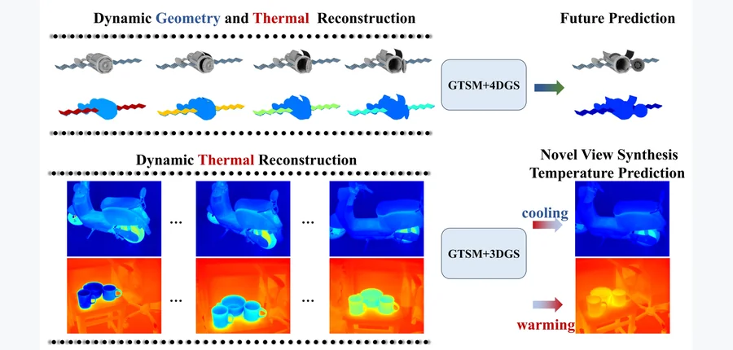 arXiv 2026-10-22 · cs.CV · #5 **[GTSM: Gaussian Splatting with Thermal State-Space Dynamics for Spatio-Temporal Thermal Field Reconstruction and Prediction](https://arxiv.org/abs/2610.26918)** Yunpeng Zhao, Haoxiang Zhang, Chao Liu 机构：Fudan University / Tsinghua University（[PDF](https://arxiv.org/pdf/2610.26918)） [Paper](https://arxiv.org/abs/2610.26918) · [图源](https://arxiv.org/html/2610.26918v1/Fig_1.jpg) 

中文摘要
温度场重建和预测对工业及动态环境中的状态监测、过程分析与状态评估很重要。本文旨在直接从 2D 观测恢复四维时空热状态场，无需预设 3D 模型、指定热力学方程或预定义加热／冷却轨迹。为此，作者提出 Gaussian Thermal State-Space Model（GTSM），以共享的场景级潜在过程和 Gaussian 专属局部热状态表示热演化。所得连续动力学通过可微 RK2 积分传播，使模型能从多视角、多时刻观测推断热演化，并连续外推至观测区间之外。GTSM 被设计为与主干无关的 Gaussian 表示热动力学模块，可接入静态 3D Gaussian Splatting 和动态 4D Gaussian Splatting，支持静态与随时间变化的目标几何下的热重建和预测。重建表示还支持新视角热渲染与未来热状态预测。真实红外序列和合成动态热数据实验表明，它比代表性基线具有更高重建精度及明显更强的时间外推能力，并验证了对形变目标的适用性。 <a href="https://arxiv.org/abs/2610.26918">原摘要来源</a>
 | 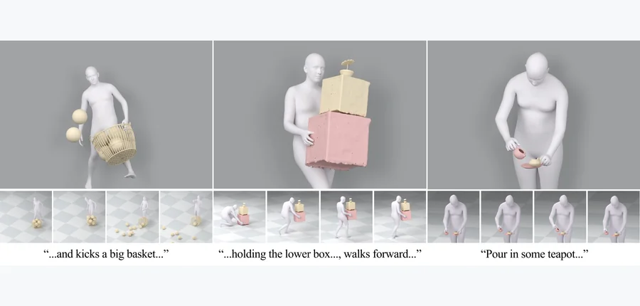 arXiv 2026-10-22 · cs.CV · #6 **[BUMP: Body-driven Unified Multi-object Physics for HOI Synthesis](https://arxiv.org/abs/2610.27066)** Wonjung Woo, Hyeonwoo Kim, Hanbyul Joo 机构：Seoul National University（[PDF](https://arxiv.org/pdf/2610.27066)） [Paper](https://arxiv.org/abs/2610.27066) · [Project](https://wonjungwoo.github.io/BUMP/) · [图源](https://arxiv.org/html/2610.27066v1/teaser.png) 

中文摘要
生成涉及多个物体的人物—物体交互（HOI）具有挑战，因为产生的运动有不同原因：人体运动体现语义意图，被有意操作的物体须与人体协调，周围物体则主要因接触和碰撞而运动。本文提出 BUMP，一种基于“学习有意运动、模拟物理后果”原则的文本驱动多物体 HOI 生成框架。方法先根据文本与场景上下文生成全身人体运动，再以人体运动为条件预测少数被有意操作的驱动物体轨迹；随后通过物理仿真得到响应物体的运动，从而无需扩大所学习轨迹的输出空间，就能处理不同数量与配置的周围物体。针对全身多物体 HOI 配对数据稀缺，作者结合仅有人体运动、全身 HOI，以及经合理身体运动增强的手部操作数据等异质监督。作者还提出结果条件交互编辑：从期望的响应物体行为推断驱动物体轨迹的局部修改，而不要求显式给出驱动物体目标轨迹。实验在单物体和多物体 HOI 基准上取得较强表现；定性结果展示涉及物体间关系与编辑的多种场景，体现统一模型形式的优势。 <a href="https://arxiv.org/abs/2610.27066">原摘要来源</a>
 |
| 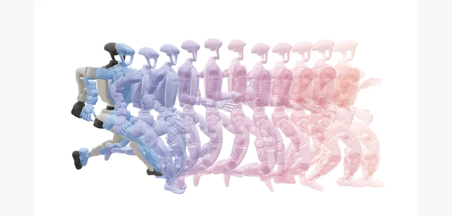 arXiv 2026-10-22 · cs.RO · #7 **[SuperMimic: Scaling Humanoid Whole-Body Control with One Differentiable World Model](https://arxiv.org/abs/2610.28480)** Qiayuan Liao, Yiyang Shao, Junfeng Long, Kevin Zakka, Roberto Horowitz, Pieter Abbeel, Koushil Sreenath 机构：University of California, Berkeley（[PDF](https://arxiv.org/pdf/2610.28480)） [Paper](https://arxiv.org/abs/2610.28480) · [图源](https://arxiv.org/pdf/2610.28480) 

中文摘要
追踪大规模人体运动数据已成为获得通用、表现丰富的人形机器人全身控制的主要路径，但跨大量运动扩展成本很高。现有流程采用无模型强化学习，要么把针对单个运动的专家经有损蒸馏合并，要么用集群算力暴力训练单一策略。SuperMimic 使用从标准刚体模拟器记录的状态转移拟合一个共享动力学的可微世界模型，把学习成本分摊到所有运动。世界模型与追踪策略在同一循环中训练，短程想象推演上的时间反向传播为策略提供解析梯度；快速想象推演与解析梯度提高学习效率。仅用单块 GPU 训练 3 小时，SuperMimic 的回报超过在 128 块 GPU 上训练 7 天的最先进运动追踪基线。其 GPU 小时数降低超过 $1000\times$；在 129,514 段基准运动中仅有 25 段失败，而基线失败 179 段。在两块 GPU 上训练 9.8 小时后，SuperMimic 达到零失败。当运动数据规模从 1 小时扩至 264 小时时，世界模型预测误差保持稳定，达到目标回报所需 GPU 小时数增长缓慢。策略还在实体 Unitree G1 上迁移到多种运动及杂技动作。作者据此认为，SuperMimic 消除了扩展人形全身控制时的算力瓶颈，使测量运动追踪缩放规律成为可行。 <a href="https://arxiv.org/abs/2610.28480">原摘要来源</a>
 | 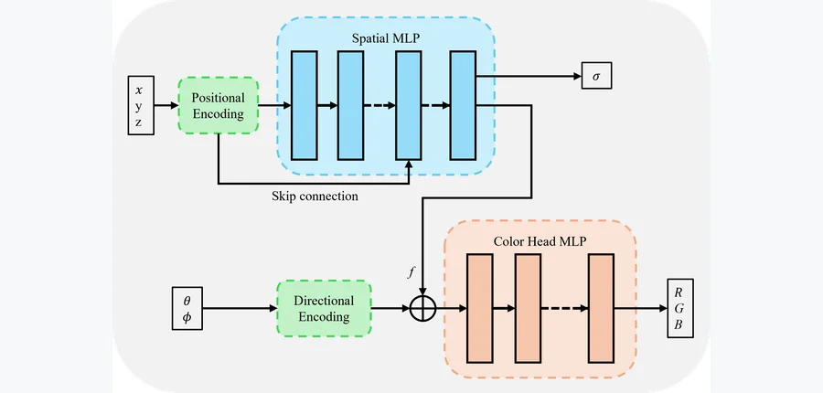 arXiv 2026-10-22 · physics.flu-dyn · #8 **[NeRF-Inspired Neural Fields for 3D Super-resolution of Reacting-Flows](https://arxiv.org/abs/2610.27284)** Dakshaka Vishwajith Amarathunga, Shang-Ru Li, Tarek Echekki 机构：North Carolina State University（[PDF](https://arxiv.org/pdf/2610.27284)） [Paper](https://arxiv.org/abs/2610.27284) · [图源](https://arxiv.org/html/2610.27284v1/images/original_NeRF_architecture.png) 

中文摘要
湍流反应流的多尺度性质以及细尺度结构的重要性给超分辨率带来挑战。本文研究一种受 Neural Radiance Fields（NeRF）启发的 3D 超分辨率框架 Neural Field Super-Resolution（NFSR），从降采样的反应流场重建高分辨率场。该方法把 NeRF 的连续坐标条件表示用于物理流场重建，以局部粗网格热化学信息为条件处理空间坐标，同时去掉辐射预测与体渲染。主成分分析提供紧凑的低维热化学状态表示；分层扩展 H-NFSR 则经中间分辨率逐级重建解。作者在湍流预混氢—空气火焰的三维直接数值模拟数据上评估，三个坐标方向各采用八倍空间粗化。结果显示，在未见过的测试实现上，该方法的预测指标及细尺度信息重建能力持续优于三次插值。分层形式减少可见的粗网格单元印痕，而偏置采样主要有利于最局部的结构。三维等值面比较进一步显示，H-NFSR 恢复了流场中许多小尺度和中尺度特征，包括表面褶皱与局部火焰曲率效应。这些结果表明坐标条件神经场有望作为反应流仿真三维由粗到细重建的灵活框架。 <a href="https://arxiv.org/abs/2610.27284">原摘要来源</a>
 | 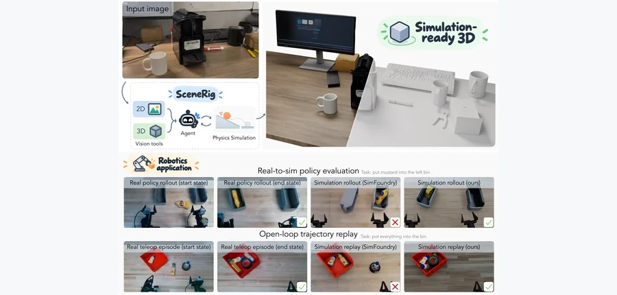 arXiv 2026-10-22 · cs.RO · #9 **[SceneRig: An Agentic System for Simulation-Ready 3D Scene Reconstruction from Single Images](https://arxiv.org/abs/2610.28585)** Rundong Luo, Yunong Liu, Di Cao, Matthew Tancik, Shyamal Buch, Colton Stearns, Wenqi Xian 机构：Luma AI / Cornell University（[PDF](https://arxiv.org/pdf/2610.28585)） [Paper](https://arxiv.org/abs/2610.28585) · [图源](https://arxiv.org/html/2610.28585v1/teaser_v3.png) 

中文摘要
仿真是机器人研究的有力工具，但大规模构建多样、可用于仿真的场景仍很困难。从单张图像重建场景是一种有前景的替代方案，不过视觉相似性不足以满足要求：还必须恢复物体、准确放置并赋予物理基础。依靠事后物理沉降的现有方法常把物体放错位置，导致场景看起来正确，却在操作时表现不佳。本文提出 SceneRig，一种把单张图像转成可编辑、可用于仿真的场景的智能体系统。SceneRig 结合几何、视觉与物理工具重建保真的 3D 场景，随后让智能体在物理模拟器中反复编辑和验证，以获得物理稳定性。在多样输入上，SceneRig 改善实例分割、以物体为中心的外观和 3D 放置，同时保持重建场景物理稳定。它对下游机器人任务也有效：与基线方法相比，其场景能更准确预测真实机器人策略结果，并更可靠地支持在不调整轨迹的情况下重放记录的操作。 <a href="https://arxiv.org/abs/2610.28585">原摘要来源</a>
 |
| 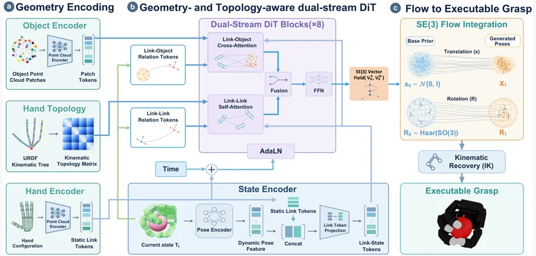 arXiv 2026-10-22 · cs.RO · #10 **[DexGraspFlow: Topology-Aware SE(3) Flow Matching for Cross-Embodiment Dexterous Grasp Generation](https://arxiv.org/abs/2610.26962)** Bin Zhou, Boyu Ma, Xinyu Zhou, Jiahua Dong, Chuhao Zhou, Yizhou Liu, Hao Wan, Jianfei Yang 机构：Nanyang Technological University / ROKAE Robotics（[PDF](https://arxiv.org/pdf/2610.26962)） [Paper](https://arxiv.org/abs/2610.26962) · [图源](https://arxiv.org/html/2610.26962v1/overview2_cropped.png) 

中文摘要
手部几何、关节参数化和运动学拓扑的差异给跨本体灵巧抓取生成带来挑战，而仅利用连杆间空间关系不足以充分表示手的运动学拓扑。本文提出 DexGraspFlow：一种融合几何关系与运动学拓扑、以连杆为单位的条件 $\mathrm{SE}(3)$ 流匹配框架。它编码局部物体几何、连杆几何和当前位姿；双流 DiT 建模连杆—连杆协调及连杆—物体交互，并用源自运动学树距离的注意力偏置，显式提供演化中几何交互的结构信息。模型联合学习平移和旋转速度场，积分得到连杆位姿，再通过逆运动学恢复关节配置。推理时的掌心朝向引导还能在无需重训的情况下实现可控抓取生成。在三种机器人手和 30 个物体—手组合上，DexGraspFlow 的平均仿真成功率为 95.33%，包含逆运动学的平均生成延迟比最先进基线约低 49%。其他实验展示了对七种去手指变体的零样本适应及掌心朝向控制。在部署用手的示范数据上训练的模型，经 100 次真实机器人抓取试验取得 91% 成功率，支持其物理抓取执行的适用性。 <a href="https://arxiv.org/abs/2610.26962">原摘要来源</a>
 | 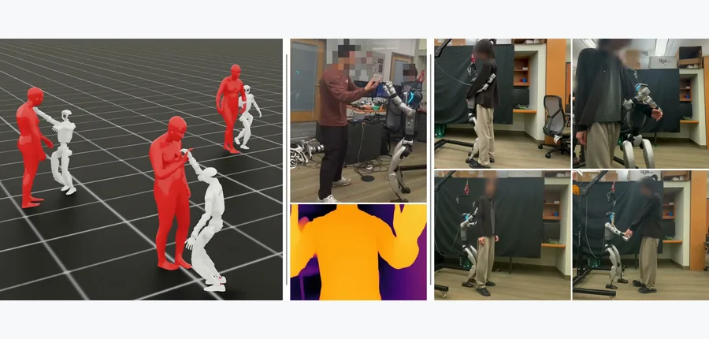 arXiv 2026-10-22 · cs.RO · #11 **[VLM-Guided Contact Retargeting and Generative Partner Modeling for Humanoid-Human Interaction](https://arxiv.org/abs/2610.28523)** Yuto Shibata, Kotaro Amaya, Kashu Yamazaki, Lalit Jayanti, Yoshimitsu Aoki, Mariko Isogawa, Katerina Fragkiadaki 机构：Carnegie Mellon University / Keio AI Research Center / Keio University（[PDF](https://arxiv.org/pdf/2610.28523)） [Paper](https://arxiv.org/abs/2610.28523) · [Project](https://yutoshibata07.github.io/REACT/) · [图源](https://arxiv.org/html/2610.28523v1/images/CoRL2026-teaser-v3.jpg) 

中文摘要
人形机器人与人近身交互时面临严重的部分可观测性：发生近距离身体接触时，人类伙伴可能被遮挡、截断或处于机器人视野之外，使姿态估计失效，往往需要外部追踪或特权人体状态；严重的相互遮挡也会给学习用的人—人动作捕捉数据带来误差。本文提出 REACT，一种从人—人示范学习可部署的人形机器人—人交互策略的框架，把语义接触结构作为连接示范处理、交互学习和机载控制的关键监督信号。首先，VLM 引导的接触建模与重定向流程识别有语义意义的接触，并将其转移至人形机器人—人几何，同时保留交互结构。利用这些标注，特权交互策略通过交互感知接触奖励学习有物理基础的行为；再借助逼真的人体深度渲染，将其蒸馏为完全依靠机载感知训练的可部署第一视角深度策略。为应对严重部分可观测性，作者提出生成式伙伴状态建模目标，从被遮挡的第一视角预测伙伴运动。在仿真及真实 Unitree G1 上的五种富接触交互中，语义接触建模显著改善示范交互的保留程度；生成式伙伴状态建模在五项中的四项提高接触召回率，重遮挡条件下尤为明显。实体实验中，REACT 仅用机载感知完成全部五种交互。 <a href="https://arxiv.org/abs/2610.28523">原摘要来源</a>
 | 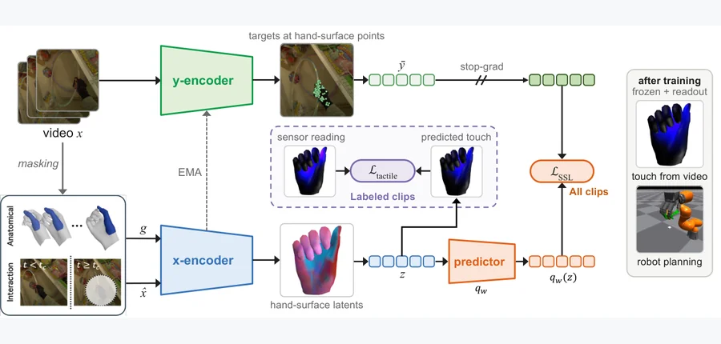 arXiv 2026-10-22 · cs.CV · #12 **[Touch-JEPA: Tactile Representation Learning from Hand-Object Video with Limited Tactile Supervision](https://arxiv.org/abs/2610.28519)** Minseong Kweon, Qiao Feng, Yiming Huang, Lingjie Liu 机构：University of Minnesota / University of Pennsylvania（[PDF](https://arxiv.org/pdf/2610.28519)） [Paper](https://arxiv.org/abs/2610.28519) · [Project](https://touch-jepa.github.io) · [图源](https://arxiv.org/html/2610.28519v1/main_figure_arxiv.png) 

中文摘要
理解手—物交互中的接触和触觉幅值，是构建具备物理智能系统的关键一步；但触觉测量成本高且覆盖范围有限，限制了相关表示学习。本文提出 Touch-JEPA，通过有限的触觉监督从手—物视频学习触觉表示。作者先引入仅从视频学习、无需触觉监督的自监督预训练目标：利用视频推得的手部几何，从空间与时间上下文预测对应手表面位置被遮蔽的视觉特征，促使表示捕捉潜在接触动力学。随后把它扩展为联合表示学习，对所有视频应用遮蔽预测，只对有标注的子集使用触觉监督，使共享表示锚定到实测接触及幅值。仅进行自监督预训练时，在三个真人手部基准上，冻结 Touch-JEPA 特征的简单监督读出在接触判别和触觉幅值估计方面优于监督基线，并能在没有机器人触觉训练数据的情况下迁移至机器人手。有限触觉监督的联合学习进一步改善真人手部基准上的接触和幅值估计。结果表明，手—物视频可以提供可扩展的触觉表示自监督，而少量触觉测量提供互补的物理锚定。 <a href="https://arxiv.org/abs/2610.28519">原摘要来源</a>
 |
| 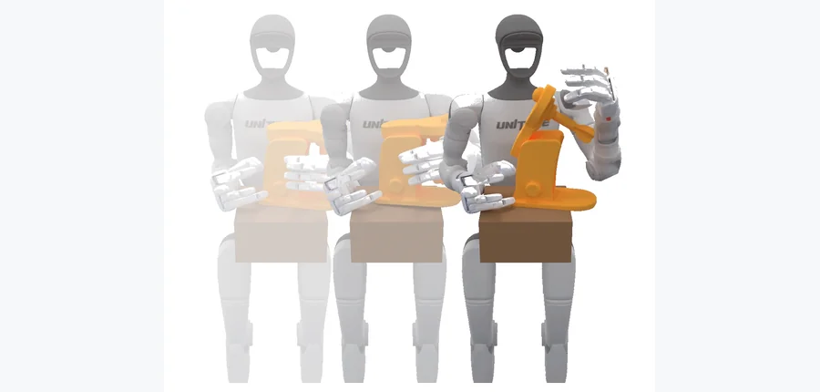 arXiv 2026-10-22 · cs.RO · #13 **[EmbodyHOI: Embodiment-Aware Generation of Hand-Object Interactions for Humanoid Dexterous Manipulation](https://arxiv.org/abs/2610.27242)** Chaitanya Chawla, Kartik Sharma, Ananya Bal, Laszlo A. Jeni, Guanya Shi 机构：Carnegie Mellon University（[PDF](https://arxiv.org/pdf/2610.27242)） [Paper](https://arxiv.org/abs/2610.27242) · [图源](https://arxiv.org/pdf/2610.27242) 

中文摘要
人形机器人灵巧操作需要语义丰富、且对目标机器人在运动学上可行的参考运动。文本条件手—物交互（HOI）生成器虽提供多样的语言指定示范，但在人体 MANO 空间合成运动，把本体差距留给事后重定向；部署到机器人后，轨迹可能无法维持物体接触，并损害策略学习。本文的关键想法是在生成交互轨迹时就施加机器人可达性约束。作者提出 EmbodyHOI，在冻结的流匹配 HOI 轨迹生成器采样循环中运行面向特定人形机器人本体的可微逆运动学（IK）求解器，把该求解器的梯度反馈给 HOI 采样器，并联合优化人形机器人相对于物体的位置。由于引导仅在推理时生效，一个在人手姿态上训练的 HOI 轨迹生成器无需重训即可跨人形机器人本体迁移。在采用 Unitree G1 与 H1-2 两种不同人形机器人的 ARCTIC 轨迹上，该引导方法把重定向手腕误差从 8.9 cm 降至 0.6 cm，保持文本到 HOI 生成质量，并在 50 个随机 G1 任务上把成功率从 68% 提高至 79%，在四任务 H1-2 套件上从 62% 提高至 76%。值得注意的是，更便宜的本体差距处理方法没有超过 EmbodyHOI：事后手腕细化和计算量匹配的 best-of-N 选择虽达到更低的 IK 能量，却训练出更差的策略。仿真结果见作者网站。 <a href="https://arxiv.org/abs/2610.27242">原摘要来源</a>
 | 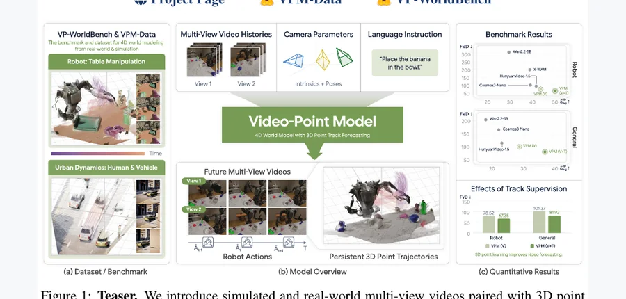 arXiv 2026-10-22 · cs.CV · #14 **[Learning the 4D World through Point Trajectory Forecasting](https://arxiv.org/abs/2610.28594)** Byungwoo Jeon, Sunghwan Hong, Dohyeon Kim, Jonghoon Lee, Jungwoo Park, Inhee Lee, Doosan Baek, Jinil Kim, Taehyun Lim, Han… 机构：KAIST / ETH Zurich / Seoul National University / New York University / RLWRLD / Physics Sim Lab（[PDF](https://arxiv.org/pdf/2610.28594)） [Paper](https://arxiv.org/abs/2610.28594) · [图源](https://arxiv.org/pdf/2610.28594) 

中文摘要
可靠的多视角预测要求不同相机的视频描述同一个演化中的 3D 场景。为此，作者提出 Video-Point Model（VPM）：以多视角视频历史和语言指令为条件，联合预测任意视角的未来视频以及持久场景点的 3D 轨迹。作者为预训练世界模型加入相机条件的多视角处理，以融合不同相机的互补观测，并添加预测物理点随时间运动的轨迹头。每条轨迹跨所有视角追踪同一个点；与视频生成一起监督这些轨迹，使每个相机中的外观变化锚定到共享的 3D 运动描述。为支持训练与评估，作者建立配对同步多视角视频和持久点轨迹的仿真语料 VPM-Data，以及覆盖仿真和真实环境的预测基准 VP-WorldBench。作者还把机器人动作作为生成器的一种 token 模态来扩展 VPM 的机器人控制能力；动作 token 与点监督主干共享表示，并与未来视频联合去噪，从而把策略锚定在同一具备 3D 感知的表示上。在 VP-WorldBench 和已有 4D 生成基准上，与仅有视频的对应模型相比，点监督提高视频保真度与 3D 运动精度；在仿真和真实机器人实验中，也提高了带动作模型的操作成功率。 <a href="https://arxiv.org/abs/2610.28594">原摘要来源</a>
 | 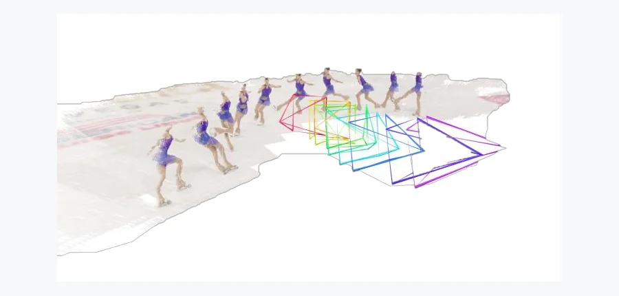 arXiv 2026-10-22 · cs.CV · #15 **[Causal Spatiotemporal State Evolution for Monocular 4D Reconstruction](https://arxiv.org/abs/2610.27594)** Qiaowei Miao, Yijing Guo, Lipei Zhang, Qifeng Cheng, Yuru Xiao, Ziqian Ni, Sheng Yang 机构：Zhejiang University / ShanghaiTech University / University of Cambridge / NIO / Harbin Institute of Technology（[PDF](https://arxiv.org/pdf/2610.27594)） [Paper](https://arxiv.org/abs/2610.27594) · [图源](https://arxiv.org/pdf/2610.27594) 

中文摘要
前馈模型擅长估计静态 3D 几何，但扩展到动态 4D 场景需要把视觉几何建模为因果演化的状态。现有方法通常依赖无序时间聚合，缺少物理时间的方向结构；监督又常把几何和运动当作独立目标，没有利用两者固有的物理耦合，因此缺少有效监督时间状态转移的统一约束，易导致 4D 场景表示不一致。本文提出从单目视频学习因果 4D 视觉几何的前馈框架。核心模块 Causal Spatiotemporal Mamba（CSM）用有方向性的状态传播增强时间聚合；通过互补的 Temporal-Spatial 与 Spatial-Temporal 扫描，CSM 跨帧持续传播几何感知状态，以建模时空演化。为使因果状态演化与可观测动力学对齐，作者提出 Unified Motion Supervision（UMS）：不把运动视为独立目标，而是利用相机与深度预测头的几何感知结果，构造符合底层 3D 结构的统一前向运动场。这种基于几何的监督显式约束帧间状态转移，使状态能够稳定跨帧传播。动态基准上的广泛评估显示，方法在视频深度、相机位姿和光流估计上达到作者报告的最先进表现。结果支持 CSM 的有方向状态传播与 UMS 的协同作用能够捕捉连续场景演化、明显减少时间漂移并增强 4D 表示的时空一致性。 <a href="https://arxiv.org/abs/2610.27594">原摘要来源</a>
 |
| 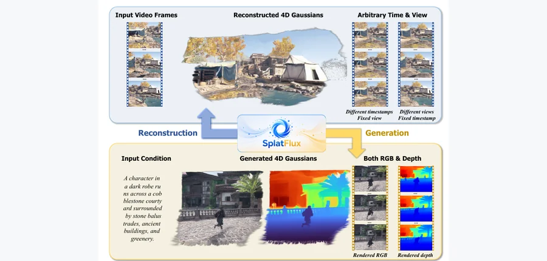 arXiv 2026-10-22 · cs.CV · #16 **[SplatFlux: Feed-Forward 4D Gaussian Reconstruction and Generation from Video Latents](https://arxiv.org/abs/2610.28257)** Runmin Zhang, Binglin Ren, Zhu Yu, Fudong Wang, Jiangke Lin, Yichun Shentu, Si-Yuan Cao, Yi Yuan, Hui-Liang Shen 机构：Zhejiang University / Ant Group（[PDF](https://arxiv.org/pdf/2610.28257)） [Paper](https://arxiv.org/abs/2610.28257) · [Project](https://rm-zhang.github.io/SplatFlux/) · [图源](https://arxiv.org/pdf/2610.28257) 

中文摘要
本文提出 SplatFlux，一种前馈式潜表示到 4D Gaussian Splatting（4DGS）的框架，同时用于基于视频的 4D 重建和条件 4D 生成。关键观察是，观测视频与有条件生成的内容可以表示在同一个预训练视频潜空间中，因而两项任务都可表述为从潜表示解码到 4DGS。为构建紧凑且时间连贯的 4D 场景，SplatFlux 引入静态—动态解耦的 4D Gaussian 表示，显式预测 Gaussian 基元的动态概率。该表示把静态场景结构与运动区域分开，通过静态聚合及动态运动插值以前馈方式构建完整 4D 场景。为在没有昂贵标注的情况下学习静动分解和动态 Gaussian 运动，作者还提出辅助蒸馏策略，提供伪动态掩码和光流线索。覆盖 3D 与 4D 重建、生成的广泛实验显示，SplatFlux 达到作者报告的最先进表现。 <a href="https://arxiv.org/abs/2610.28257">原摘要来源</a>
 | 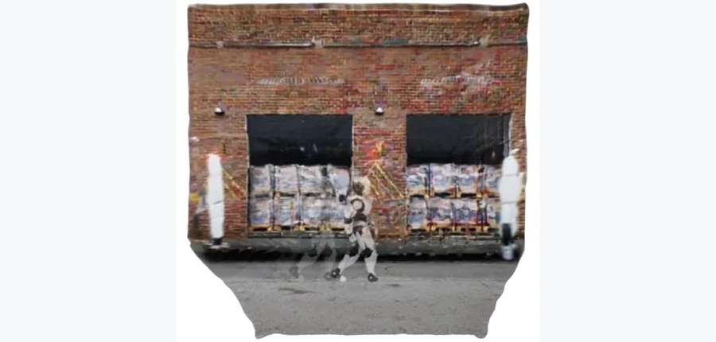 arXiv 2026-10-22 · cs.CV · #17 **[AEON: Unifying Video and 3D World Models](https://arxiv.org/abs/2610.28631)** Weiqi Zhang, Wenyuan Zhang, Yu-Shen Liu, Junsheng Zhou 机构：Tsinghua University（[PDF](https://arxiv.org/pdf/2610.28631)） [Paper](https://arxiv.org/abs/2610.28631) · [图源](https://arxiv.org/pdf/2610.28631) 

中文摘要
用于显式世界仿真的现有世界模型通常走两条不同路线：（1）Sora 等视频生成模型可模拟逼真的外观，但难以保持 3D 一致性；（2）Marble 等 3D 生成模型可产生几何一致的场景，但观测往往静态且真实感较低。本文提出 AEON，统一视频与 3D 世界模型并结合两者优势。其关键是一个在文本或图像条件视频潜空间中运行、同时输出可渲染 4D 图形基元的生成模型；显式世界表示具体为 4D Gaussian Splatting（4DGS）。作者训练一个从单目视频同时预测 4DGS 和相机位姿的 4D 重建模型，作为初始化的 4D 解码器；又设计域适配器，通过视频 VAE 上的蒸馏，把生成式视频潜表示转换为重建式 4D 潜表示。AEON 沿预测相机轨迹渲染 4DGS 来支持基于视频的世界建模，也构建具有场景动力学的持久 4D 环境以进行真实感世界仿真。因此它支持多种世界建模应用，并在标准基准上达到作者报告的最先进表现。 <a href="https://arxiv.org/abs/2610.28631">原摘要来源</a>
 | 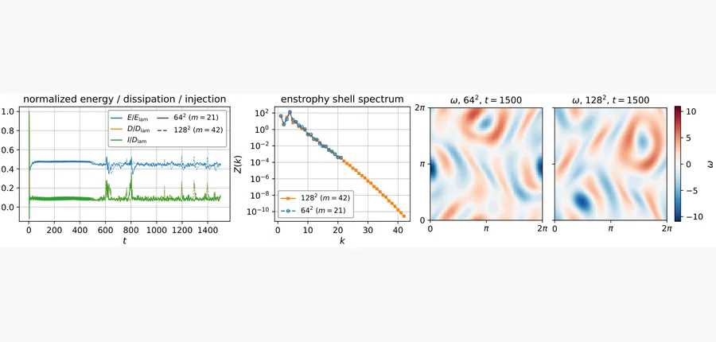 arXiv 2026-10-22 · physics.comp-ph · #18 **[Machine-learned spectral PDE solvers for fluids and plasmas](https://arxiv.org/abs/2610.27317)** Mellow Baixuan Chen, Alan A. Kaptanoglu 机构：New York University / University of Washington（[PDF](https://arxiv.org/pdf/2610.27317)） [Paper](https://arxiv.org/abs/2610.27317) · [图源](https://arxiv.org/html/2610.27317v1/kolm_sanity_combined.png) 

中文摘要
从数据发现控制方程的稀疏回归方法对观测噪声敏感，且不受正向积分时复现数据的约束。作者在求解偏微分方程（PDE）所用的空间离散形式中进行弱形式发现，并通过锚定于观测状态的多步推演求导，同时处理这两个局限。新方法 Weak-form Anchored Rollout for PDEs（WARP）得到一个由机器学习获得的 PDE 求解器。本文聚焦适合谱 Galerkin 求解器的系统。在包括高维湍流仿真的八个流体和等离子体基准系统上，WARP 从新的随机初始条件出发产生数值稳定的推演；相比单步弱形式 SINDy 基线，系数恢复、推演精度和统计量均明显改善。 <a href="https://arxiv.org/abs/2610.27317">原摘要来源</a>
 |
| 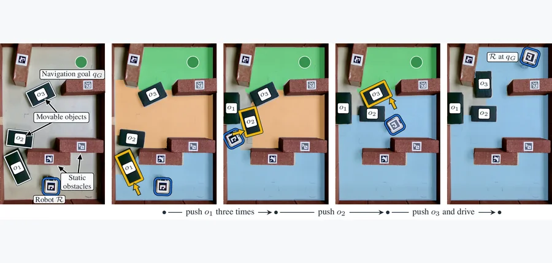 arXiv 2026-10-22 · cs.RO · #19 **[SPAR: Search-trained Push Action Ranker for Efficient Navigation Among Movable Obstacles](https://arxiv.org/abs/2610.28362)** Dhruv Metha Ramesh, Tri-An Nguyen, Junshan Huang, Jingjin Yu, Kostas E. Bekris, Abdeslam Boularias 机构：affiliation 未确认 [Paper](https://arxiv.org/abs/2610.28362) · [图源](https://arxiv.org/html/2610.28362v1/figures/jpeg_300dpi_20260916/overview/flagship.jpg) 

中文摘要
可移动障碍物间导航（NAMO）要求机器人重新摆放阻挡目标路径的物体。对推物机器人而言，进展可能依赖于一个本身尚未打开通道、却为后续开口创造条件的准备性推动；候选序列数量随长度指数增长，使基于物理的搜索代价高。本文提出 Search-trained Push Action Ranker（SPAR），从仿真搜索结果学习推动原语的优先顺序。对每个物体最多两次推动的序列搜索提供监督，区分立即开口和准备性推动。一个用回归与排序损失训练的 Transformer 依据场景几何及可达区域条件下的接触 token 对原语打分。同一模型既在 SPAR Search 中引导模拟器评估，也在 SPAR Policy 中直接选择执行动作；两者都在 NAMO 规划器中求解逐次钥匙孔问题，打开通往相邻自由空间区域的路径。在 300 个成功的仿真双推动钥匙孔问题上，SPAR Search 的模拟器调用中位数比随机搜索少 7.0 倍，规划时间减少 3.8 倍。无需重训，同一排序器还可引导 600 个两次推动内无解的问题：深度上限为五次推动时，在 100 次模拟器调用内达到 50.7% 成功率，而随机搜索为 20.2%。在困难仿真 NAMO 场景中，100 次调用内成功率为 47%，随机搜索为 21%。真实机器人实验里，不依赖物理数字孪生的 SPAR Policy 在 40 次中成功 37 次，SPAR Search 为 33 次，随机搜索为 27 次。 <a href="https://arxiv.org/abs/2610.28362">原摘要来源</a>
 | 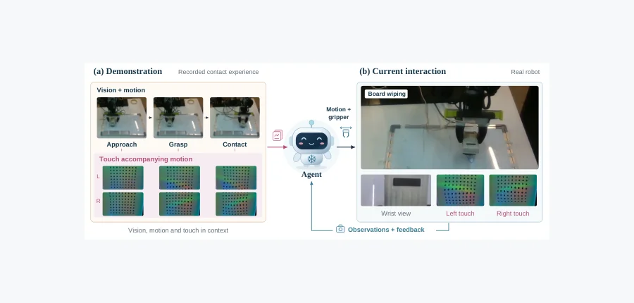 arXiv 2026-10-22 · cs.RO · #20 **[Embodied Task Agents Can Perform Fine Manipulation through Tactile In-Context Learning](https://arxiv.org/abs/2610.27613)** Yubang Wang, Zezheng Huai, Yifei Zhang, Jinhao Wu, Yitong Chen, Haozhe Zhang, Sixian Li, Jingjing Gong, Zhenyang Lin, Ziya… 机构：Fudan University / Shanghai Innovation Institute / Tencent / Zhejiang University / Nanjing University / Jilin University（[PDF](https://arxiv.org/pdf/2610.27613)） [Paper](https://arxiv.org/abs/2610.27613) · [图源](https://arxiv.org/html/2610.27613v1/fig1_overview.png) 

中文摘要
具身任务智能体能否不经特定任务模型训练，仅凭触觉经验完成精细操作？本文通过 Tactile-ETA 研究这一能力：系统借助上下文学习，把触觉经验纳入具身任务智能体。成功的专家示范展示操作中接触如何变化。作者把每段记录的机器人运动与对应相机视角和双侧触觉观测配对；保留运动起点与终点的触觉观测，并在中途触觉图像明显变化时增加两个相邻时间点。智能体结合这些示范与当前视觉、触觉和本体感知，通过通用机器人工具选择动作，不更新模型参数。在四项仿真操作任务中，保持当前感知与执行接口不变，向相同的两个专家示范加入触觉观测，使平均成功率从 15.75% 提高到 24.00%。进一步实验表明性能取决于示范的感知内容和表示；在 Lift Bottle 上比较智能体模型，即使系统配置相同也有显著差异。在真实机器人任务中，对齐视觉与触觉观测的示范将任务成功率从 0% 提高到 60%。结果显示，在上下文中利用触觉经验完成精细操作是可行的，并提示可把具身任务智能体扩展到更多感知输入。 <a href="https://arxiv.org/abs/2610.27613">原摘要来源</a>
 | 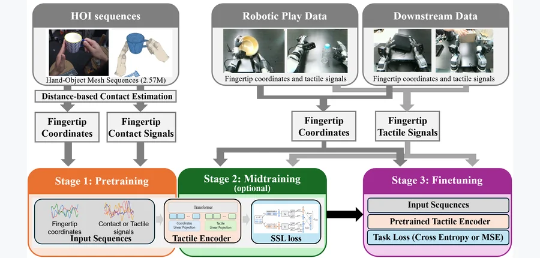 arXiv 2026-10-22 · cs.RO · #21 **[Learning Tactile-Aware Hand Representations from Human Hand-Object Interaction Data](https://arxiv.org/abs/2610.27995)** Yeonguk Yu, Jaehong Kim, Byungok Han 机构：Electronics and Telecommunications Research Institute (ETRI)（[PDF](https://arxiv.org/pdf/2610.27995)） [Paper](https://arxiv.org/abs/2610.27995) · [图源](https://arxiv.org/html/2610.27995v1/figures/framework.png) 

中文摘要
灵巧操作的触觉表示学习常需要大量机器人端采集数据，限制其跨手型和传感器扩展。作者研究大规模人手—物体交互（HOI）数据能否为机器人触觉学习提供有用先验。为此提出 HuTact：在预训练期间无需真实触觉信号，即可从人类 HOI 数据预训练触觉感知的手部表示。HuTact 把从人手运动学到的交互结构迁移至机器人触觉观测，还可用少量未标注的机器人交互数据适配。作者在抓取预测、滑移检测、物体分类和触觉条件策略学习等触觉感知与操作任务上评估。在这些任务中，人类 HOI 预训练提高数据效率，并为下游学习提供较强初始化。尤其在 HOI 预训练后再以未标注机器人探索数据进行中期训练时，HuTact 只用下游 25% 的标注数据，就在抓取预测上达到 88.26% Macro-F1，与用全部标注数据从零训练的 88.23% 相当。这些结果表明，人类交互数据可成为机器人触觉表示学习的一种可扩展互补来源。 <a href="https://arxiv.org/abs/2610.27995">原摘要来源</a>
 |
| 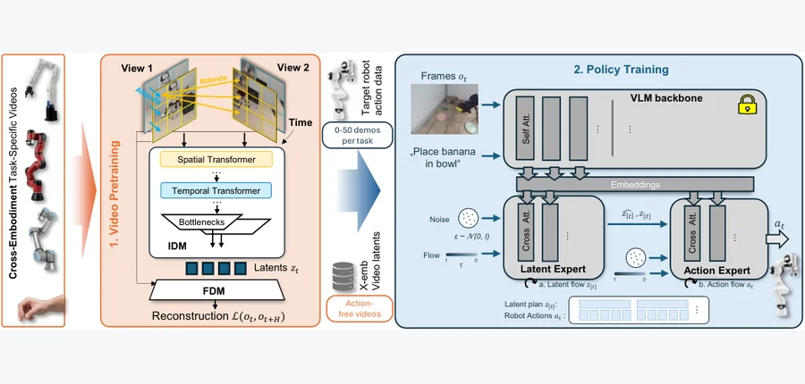 arXiv 2026-10-22 · cs.RO · #22 **[Multi-View Latent Action Pretraining for Cross-Embodiment Robot Learning from Videos](https://arxiv.org/abs/2610.27794)** Oliver Hausdörfer, Felix Minzenmay, Mani Majd, Maximilian P. Christof, Shiyuan Zhang, Angela P. Schoellig 机构：Technical University of Munich / Munich Institute of Robotics and Machine Intelligence / University of Toronto（[PDF](https://arxiv.org/pdf/2610.27794)） [Paper](https://arxiv.org/abs/2610.27794) · [图源](https://arxiv.org/html/2610.27794v1/vpro_method.png) 

中文摘要
无动作标注视频可望替代昂贵的遥操作数据。潜在动作模型（LAM）通过推断帧间抽象动作，把视频转化为监督信号。现有 LAM 仅观察单个相机视角，因而对 6D 机器人动作的解析存在歧义，难以捕捉画面平面外运动和潜在遮挡。作者提出使用同步多相机视角的 LAM，以跨注意力消解深度和遮挡歧义，再压缩成潜在动作。潜在动作输入一个策略，其中潜在专家与动作专家围绕冻结 VLM 主干通过顺序流匹配耦合。作者还在任务特定示范来自其他本体的严格跨本体设置中评估。结果显示，与单视角相比，双视角 LAM 预训练使真实 6D 动作的可解码性提高 17%；把单视角数据扩大两个数量级，仍不足以完全恢复画面平面外运动。下游策略的成功率提升为 +13.5%，而单视角 LAM 为 +6.2%。单个跨本体来源足以实现技能迁移；增加第二视角的效果超过额外增加至多四种本体。该效果还迁移到由人手提供示范的实体平台：在 850 次推演中，相比只用动作数据的策略，成功率提高 +20%。作者指出视频与机器人数据具有互补性，视频学习收益随任务而异。 <a href="https://arxiv.org/abs/2610.27794">原摘要来源</a>
 | 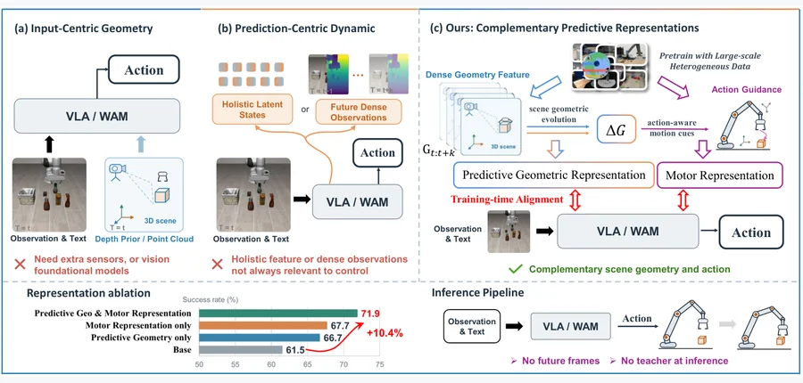 arXiv 2026-10-22 · cs.RO · #23 **[From Predictive Geometry to Action: Learning Complementary Predictive Representations for Embodied Manipulation](https://arxiv.org/abs/2610.28164)** Xiaoxu Xu, Hao Li, Hongtao Zhang, Yili Tang, Jiafei Cao, Junhao Cai, Haoxiang Ma, Weixin Li, Weinan Zhang 机构：Beihang University / Shanghai Artificial Intelligence Laboratory（[PDF](https://arxiv.org/pdf/2610.28164)） [Paper](https://arxiv.org/abs/2610.28164) · [图源](https://arxiv.org/html/2610.28164v1/fig1.png) 

中文摘要
有效操作要求策略不仅理解当前场景几何，还要理解几何在交互中如何演化。现有方法或以当前观测的几何信息增强策略，或把未来预测用作辅助监督，尚未解决如何为动作生成表示预测性几何。本文提出从多视角视频片段学习互补预测表示的两阶段框架。预训练时，冻结的 3D 基础模型提供稠密几何特征；这些特征被压缩为预测性几何表示，并优化以保留场景结构及其时间演化。随后对几何转变施加动作监督，提取强调动作相关转变的互补运动表示。下游后训练阶段，预测性几何通过几何查询迁移，运动表示则引导动作生成路径中的中间特征。未来观测只作为训练时的特权监督，推理时不需要。在 LIBERO、LIBERO-Plus、SimplerEnv 以及真实双臂和单臂任务上，方法持续改进下游策略，其中 WidowX 评估获得 10.4 个百分点的绝对提升。作者还展示了跨多种 VLA 架构和世界动作模型的迁移，未来世界预测与动作预测均有改善；代码将于作者所列网址提供。 <a href="https://arxiv.org/abs/2610.28164">原摘要来源</a>
 | 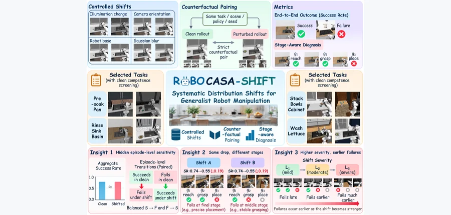 arXiv 2026-10-22 · cs.RO · #24 **[RoboCasa-Shift: Stage-Aware Robustness Evaluation of Vision-Language-Action Policies in Long-Horizon Household Manipulation](https://arxiv.org/abs/2610.27861)** Haocheng Wang, Youquan Liu, Weiyu Guo, Aokai Zhang, Donghang Wu, Hongyu Liu, Sha Zhang, Weidong Yang, Ben Fei 机构：Fudan University / The Chinese University of Hong Kong / Shenzhen Loop Area Institute / University of Chinese Academy of Sciences / Shanghai Jiao Tong University（[PDF](https://arxiv.org/pdf/2610.27861)） [Paper](https://arxiv.org/abs/2610.27861) · [图源](https://arxiv.org/html/2610.27861v1/imgs/V0/Intro_overview_v1.png) 

中文摘要
视觉语言动作（VLA）策略的鲁棒性通常由总体任务成功率概括，掩盖了单次执行在分布偏移下如何变化，以及长时任务中故障何时出现。本文提出基于 RoboCasa365 的诊断性鲁棒基准 RoboCasa-Shift，结合受控单因素偏移、基础设置相同且仅目标扰动不同的成对干净／扰动推演，以及由模拟器状态支持的阶段感知诊断。作者在四项通过预设干净表现门槛的长时任务上评估 GR00T N1.5，覆盖四类扰动因素和三个校准严重程度等级，包括能使该策略完全失败的条件，共进行 1,040 次正式推演。鲁棒反应随因素和任务显著变化，严重程度增加也不总产生单调退化。例如，某相机条件下 $\Delta\mathrm{SR}=0$，但 80 对匹配 episode 中有 8 对结果发生变化。阶段分析还表明，相同的端到端退化可能对应不同执行深度的故障分布。相机 $L_2$ 与高斯模糊 $L_1$ 的 $\Delta\mathrm{SR}$ 都是 0.188，但首阶段故障率分别为 19.0% 和 36.4%。作者认为 VLA 鲁棒性应被视为执行过程中的多维性质，而不是单个端到端性能数值，因而评估协议应同时刻画结果退化、配对结果敏感性和故障进展；代码已公开。 <a href="https://arxiv.org/abs/2610.27861">原摘要来源</a>
 |
| 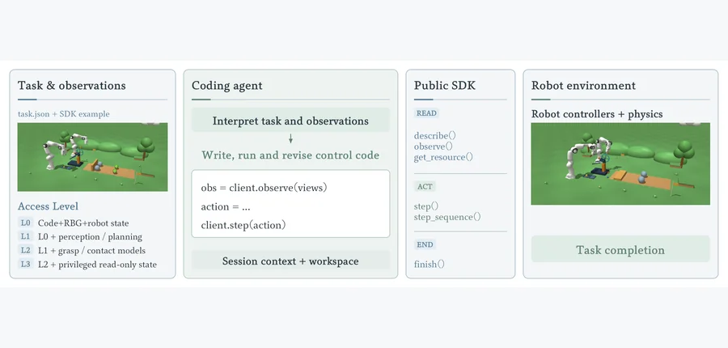 arXiv 2026-10-22 · cs.RO · #25 **[Embodied Playground: A Long-Horizon Agentic Robotics Benchmark for Physical, Strategic, and Spatial Reasoning](https://arxiv.org/abs/2610.27039)** Feng Chen, Pei Zhou, Lixuan He, Yunchao Yao, Li Sun, Shenghua Gao, Mingyu Ding, Kaifeng Zhang, Kaichen Zhou, Yi Ma 机构：University of Hong Kong / Sharpa / Tsinghua University / Stanford University / University of North Carolina at Chapel Hill / Massachusetts Institute of Technology（[PDF](https://arxiv.org/pdf/2610.27039)） [Paper](https://arxiv.org/abs/2610.27039) · [图源](https://arxiv.org/html/2610.27039v1/agent-bench-pipeline.png) 

中文摘要
基础模型为机器人智能体提供了有前景的基础，但长时任务要求模型在相互依赖的阶段中保持连贯推理和可靠物理执行。本文提出 Embodied Playground，用于评估基础模型智能体如何在这类任务中协调物理、策略和空间推理。智能体必须追踪任务进展、满足中间约束，并利用执行反馈修订计划，因为先前动作会改变后续决策。该平台包含 410 个任务环境，覆盖基础操作、序列谜题和多阶段家务活动，并在规划深度、几何约束及物理执行要求上变化。作者整理出 EP-100：跨五个套件和 16 种任务类型的 100 个代表性任务，并提供 EP-Easy、EP-Hard 难度划分和紧凑的 EP-20 子集。统一协议规定观测与工具访问、资源预算、重复试验，以及独立检查目标完成、任务规则遵守和物理有效性。Embodied Playground 为研究基础模型智能体能否在较长任务时域内持续有效推理和行动提供统一框架。 <a href="https://arxiv.org/abs/2610.27039">原摘要来源</a>
 | 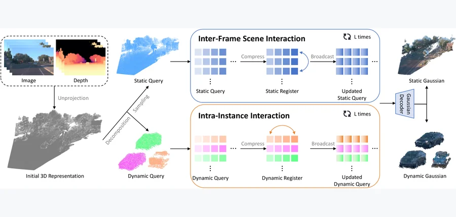 arXiv 2026-10-22 · cs.CV · #26 **[PointForward V2: Point-Aligned Interaction for Feedforward Driving Reconstruction](https://arxiv.org/abs/2610.28120)** Xianqi Wang, Cheng Chi, Yuechuan Pu, Hongcheng Luo, Junda Cheng, Guang Chen, Hangjun Ye, Bing Wang, Xin Yang 机构：Huazhong University of Science and Technology / Xiaomi EV / Hong Kong University of Science and Technology / Beijing Key Laboratory of Intelligent Driving Foundation Models and Simulation（[PDF](https://arxiv.org/pdf/2610.28120)） [Paper](https://arxiv.org/abs/2610.28120) · [图源](https://arxiv.org/html/2610.28120v1/Overview.png) 

中文摘要
动态驾驶场景的前馈重建需要整合跨视角和跨时刻观测，形成连贯的 3D 表示。PointForward 先前通过把图像观测提升为稀疏 3D 查询，在前馈驾驶重建中达到作者报告的最先进水平，显示点对齐场景表示的效果。然而，这些查询基本独立处理，限制时空信息交换；在数万个点查询间直接进行全局注意力又计算代价过高。本文提出 PointForward V2，从点对齐表示推进到点对齐交互。关键是用紧凑的场景结构化寄存器作为查询交互媒介：对静态背景，逐帧 Static Scene Registers 压缩点信息、跨帧通信并把聚合上下文回传给查询；对每个动态实例，不同帧的查询在以物体为中心的规范空间对齐，并通过实例专属 Dynamic Instance Registers 交互。作者还使用结合对齐空间坐标与原始时间戳的 4D 位置编码，使信息在空间对齐的同时保留时间差异。由此，PointForward V2 无需稠密全局注意力，就能直接在提升后的 3D 查询间进行可扩展时空推理。Waymo、nuScenes 与 Argoverse 2 上的实验显示，在大规模驾驶基准中达到作者报告的最先进表现。 <a href="https://arxiv.org/abs/2610.28120">原摘要来源</a>
 | 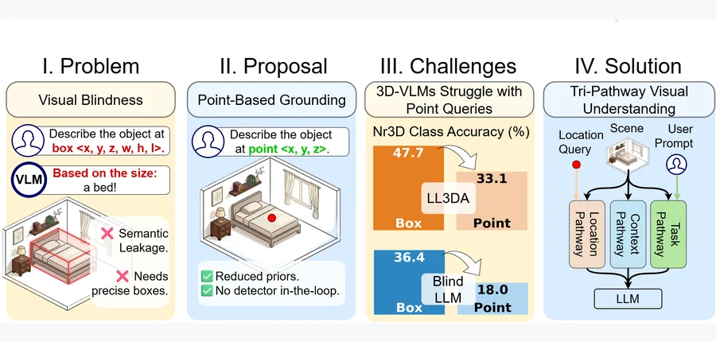 arXiv 2026-10-22 · cs.CV · #27 **[P$^3$-VLM: A Point-based Alternative for Grounded 3D Vision-Language Models](https://arxiv.org/abs/2610.28018)** Anna-Maria Halacheva, Jan-Nico Zaech, Sombit Dey, Luc Van Gool, Danda Pani Paudel 机构：INSAIT / Sofia University St. Kliment Ohridski（[PDF](https://arxiv.org/pdf/2610.28018)） [Paper](https://arxiv.org/abs/2610.28018) · [图源](https://arxiv.org/html/2610.28018v1/fig/p3teaser.drawio.png) 

中文摘要
检查现有 3D VLM 定位基准发现，评估和提示协议中普遍存在“语义泄漏”：大量使用包围盒作为空间提示或表示基元。包围盒高度暗示物体类别，会给模型提供忽略视觉信息的捷径。作者展示，只接受包围盒坐标提示的“盲”LLM 也能表现得出乎意料地好。为进一步分析这一捷径，作者提出基于点的定位提示，以单个 3D 点而非包围盒查询模型。在该协议下，盲 LLM 在 ScanNet Nr3D 上的准确率从 36.4% 降到 18.0%，3D VLM（如 LL3DA）的表现也下降。基于此，作者提出支持点提示的三路径 3D VLM P$^3$-VLM，在这一设置的位置定位描述任务上达到 52.1% 的作者报告的最先进准确率。为实现这一点，作者重设计架构，同时保持无需检测器、以场景为中心且适用于 3D GS 输入。三条互补路径分别感知位置、任务与上下文，使模型不依赖包围盒也能推理场景。点式学习的主要收益是在多种设置下持续改善：P$^3$-VLM 在点式定位上达到作者报告的最先进表现，也改善鲁棒性、分布外泛化和无需定位的场景级 3D VQA 表现，体现其对包围盒捷径依赖减少及视觉空间推理增强。 <a href="https://arxiv.org/abs/2610.28018">原摘要来源</a>
 |
| 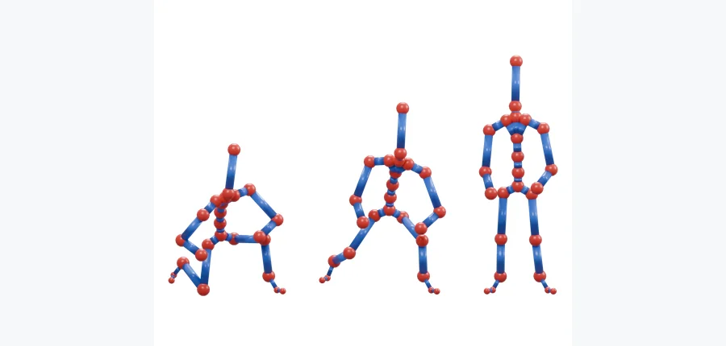 arXiv 2026-10-22 · cs.CV · #28 **[Joints, Camera, Action! Co-Generating 3D Motion and Video for Arbitrary Rigs](https://arxiv.org/abs/2610.28632)** Noam Rotstein, Yoad Tewel, Chen Tessler, Haggai Maron, Gal Chechik, Or Litany, Yoni Kasten, Yuval Atzmon 机构：NVIDIA / Technion – Israel Institute of Technology / Bar-Ilan University（[PDF](https://arxiv.org/pdf/2610.28632)） [Paper](https://arxiv.org/abs/2610.28632) · [图源](https://arxiv.org/pdf/2610.28632) 

中文摘要
视频生成模型如今可描绘十分逼真的运动，但如何把这种运动用于像素之外，例如驱动指定 3D 资产并在其 3D 场景中重放动画，仍不清楚。视频模型能展示猴子跃过横杆，却无法返回可在场景中重放的 3D 跳跃运动。本文提出一个模型，为任意给定的骨架绑定资产直接联合生成视频、3D 运动及用于把运动配准到场景中的相机。此前的视频—运动模型或只处理人体骨架且常增加数十亿参数，或从生成的 2D 姿态图三角化 3D 运动。作者改为把 3D 运动放在支持任意骨架的独立模型中，仅通过少量交叉注意力层连接预训练视频模型。这样，运动模型可先从比配对视频更容易获得和增强的纯运动数据学习骨架如何运动。模型还学习在视频帧中定位各关节，以恢复相机并把 3D 运动放入场景。为跨多种骨架训练，作者用生成式视频编辑器把已动画化的 3D 资产放入适合其动作的场景，并筛选编辑结果，以确保已知运动仍有效。加上人类和机器人视频，总计得到近 20 万训练对。评估显示，模型从文本驱动多样骨架的动画比先视频后运动的流程更忠实，运动也会响应周围场景；它还能把视频转成骨架运动、把骨架运动转成视频，并支持通过关键帧控制 3D 运动。视频和更多结果见作者项目页。 <a href="https://arxiv.org/abs/2610.28632">原摘要来源</a>
 |   |   |
<!-- PAPER_CARDS_END -->

## 检索概况

- **检索窗口**：上次发布（北京时间 2026-10-21 09:14）至本次官方页面核对（北京时间 2026-10-22 09:08）。
- **官方批次**：14 个官方分类页均显示 Wednesday, 21 October 2026；主榜只收 New submissions。
- **筛选**：对 773 个 New ID 按标题与官方摘要筛查，以 3D／物理交叉优先，随后收录有具体机器人任务和实验的具身工作及基础 3D 方法；按 arXiv ID 去重。
- **官方页面总命中**：New **773**、Cross **506**、Replacement **723** 条；New 去重后 **773** 个 ID。
- **本期入选**：**28 篇**；未以泛化 Agent／LLM 论文凑数。
- **摘要与配图**：完整中文摘要及官方英文摘要保存在 `data/enrichment.json`；本期缺图 **0** 篇、缺原摘要 **0** 篇。

## 官方 listing 状态

| 官方分类页 | 最新 listing 日期 | New | Cross | Replacement |
|---|---|---:|---:|---:|
| [cs.CV](https://arxiv.org/list/cs.CV/new?show=2000) | 2026-10-21 | 154 | 29 | 104 |
| [cs.GR](https://arxiv.org/list/cs.GR/new?show=2000) | 2026-10-21 | 2 | 12 | 6 |
| [cs.RO](https://arxiv.org/list/cs.RO/new?show=2000) | 2026-10-21 | 72 | 16 | 38 |
| [cs.AI](https://arxiv.org/list/cs.AI/new?show=2000) | 2026-10-21 | 133 | 188 | 152 |
| [cs.LG](https://arxiv.org/list/cs.LG/new?show=2000) | 2026-10-21 | 134 | 115 | 159 |
| [physics](https://arxiv.org/list/physics/new?show=2000) | 2026-10-21 | 68 | 43 | 66 |
| [cond-mat](https://arxiv.org/list/cond-mat/new?show=2000) | 2026-10-21 | 96 | 29 | 78 |
| [math.OC](https://arxiv.org/list/math.OC/new?show=2000) | 2026-10-21 | 25 | 17 | 35 |
| [math.NA](https://arxiv.org/list/math.NA/new?show=2000) | 2026-10-21 | 20 | 4 | 14 |
| [math.DS](https://arxiv.org/list/math.DS/new?show=2000) | 2026-10-21 | 12 | 11 | 8 |
| [stat.ML](https://arxiv.org/list/stat.ML/new?show=2000) | 2026-10-21 | 16 | 24 | 31 |
| [eess.IV](https://arxiv.org/list/eess.IV/new?show=2000) | 2026-10-21 | 4 | 1 | 7 |
| [eess.SY](https://arxiv.org/list/eess.SY/new?show=2000) | 2026-10-21 | 15 | 14 | 12 |
| [eess.SP](https://arxiv.org/list/eess.SP/new?show=2000) | 2026-10-21 | 22 | 3 | 13 |

## Top papers

> 标题、作者、分类、摘要和论文自述结果均链接官方 arXiv；机构优先由所链 PDF 首页核对，无法确认者明示。相关性、机构强度、阅读优先级、局限与建议均为本日报**推断**。

| # | 论文 | arXiv | 分类 | 作者 | 机构 | 相关性（推断） | 机构强度（推断） | 阅读优先级（推断） |
|---:|---|---|---|---|---|---|---|---|
| 1 | NeoWorld-3: From Pixels to Code-Defined Physical Worlds | [arXiv:2610.27690](https://arxiv.org/abs/2610.27690) | cs.CV | Eachen Soong, Zijian Niu, Haoran Xu, Yihong Dong, Yunbo Wang, Xiaokang Yang | Shanghai Jiao Tong University / Doxi AI（[PDF](https://arxiv.org/pdf/2610.27690)） | 高（3D／物理交叉） | 高 | 高 |
| 2 | Physical Canvas: A Vision Tactile World Model For Robot Policy Evaluation And Learning | [arXiv:2610.28613](https://arxiv.org/abs/2610.28613) | cs.RO | Zebin Xing, Yuhang Zheng, Yupeng Zheng, Yichen Zhang, Zichen Li, Shangqing Zhou, Yujie Zang, Yuchen Liu, Zhongpu Xia, Haoran Li, Qichao Zhang | Institute of Automation, Chinese Academy of Sciences / Anyverse Robotics / Open-Phoenix Team / National University of Singapore / Xi’an Jiaotong University / Beijing Institute of Technology（[PDF](https://arxiv.org/pdf/2610.28613)） | 高（3D／物理交叉） | 高 | 高 |
| 3 | Neural Operator Splitting for Fluid Dynamics in Complex Geometry | [arXiv:2610.27671](https://arxiv.org/abs/2610.27671) | cs.LG | Jianxiang Li, Xi Deng, Hong Chul Nam, Anima Anandkumar | Peking University / California Institute of Technology / New York University（[PDF](https://arxiv.org/pdf/2610.27671)） | 高（3D／物理交叉） | 高 | 高 |
| 4 | RayCo4D: Ray-Conditioned Continuous Motion Model for Monocular 4D Dynamic Reconstruction | [arXiv:2610.28351](https://arxiv.org/abs/2610.28351) | cs.CV | Yuanxiang Ni, Xianliang Huang, Ruihan Hou, Feng Xie, Hao Zhang | Southern University of Science and Technology / Fudan University / East China University of Science and Technology / Beijing Technology and Business University / Shenzhen Institutes of Advanced Technology, Chinese Academy of Sciences（[PDF](https://arxiv.org/pdf/2610.28351)） | 高（3D／物理交叉） | 高 | 高 |
| 5 | GTSM: Gaussian Splatting with Thermal State-Space Dynamics for Spatio-Temporal Thermal Field Reconstruction and Prediction | [arXiv:2610.26918](https://arxiv.org/abs/2610.26918) | cs.CV | Yunpeng Zhao, Haoxiang Zhang, Chao Liu | Fudan University / Tsinghua University（[PDF](https://arxiv.org/pdf/2610.26918)） | 高（3D／物理交叉） | 高 | 高 |
| 6 | BUMP: Body-driven Unified Multi-object Physics for HOI Synthesis | [arXiv:2610.27066](https://arxiv.org/abs/2610.27066) | cs.CV | Wonjung Woo, Hyeonwoo Kim, Hanbyul Joo | Seoul National University（[PDF](https://arxiv.org/pdf/2610.27066)） | 高（3D／物理交叉） | 高 | 高 |
| 7 | SuperMimic: Scaling Humanoid Whole-Body Control with One Differentiable World Model | [arXiv:2610.28480](https://arxiv.org/abs/2610.28480) | cs.RO | Qiayuan Liao, Yiyang Shao, Junfeng Long, Kevin Zakka, Roberto Horowitz, Pieter Abbeel, Koushil Sreenath | University of California, Berkeley（[PDF](https://arxiv.org/pdf/2610.28480)） | 高（3D／物理交叉） | 高 | 高 |
| 8 | NeRF-Inspired Neural Fields for 3D Super-resolution of Reacting-Flows | [arXiv:2610.27284](https://arxiv.org/abs/2610.27284) | physics.flu-dyn | Dakshaka Vishwajith Amarathunga, Shang-Ru Li, Tarek Echekki | North Carolina State University（[PDF](https://arxiv.org/pdf/2610.27284)） | 高（3D／物理交叉） | 高 | 高 |
| 9 | SceneRig: An Agentic System for Simulation-Ready 3D Scene Reconstruction from Single Images | [arXiv:2610.28585](https://arxiv.org/abs/2610.28585) | cs.RO | Rundong Luo, Yunong Liu, Di Cao, Matthew Tancik, Shyamal Buch, Colton Stearns, Wenqi Xian | Luma AI / Cornell University（[PDF](https://arxiv.org/pdf/2610.28585)） | 高（3D／物理交叉） | 中高 | 中高 |
| 10 | DexGraspFlow: Topology-Aware SE(3) Flow Matching for Cross-Embodiment Dexterous Grasp Generation | [arXiv:2610.26962](https://arxiv.org/abs/2610.26962) | cs.RO | Bin Zhou, Boyu Ma, Xinyu Zhou, Jiahua Dong, Chuhao Zhou, Yizhou Liu, Hao Wan, Jianfei Yang | Nanyang Technological University / ROKAE Robotics（[PDF](https://arxiv.org/pdf/2610.26962)） | 高（3D／物理交叉） | 中高 | 中高 |
| 11 | VLM-Guided Contact Retargeting and Generative Partner Modeling for Humanoid-Human Interaction | [arXiv:2610.28523](https://arxiv.org/abs/2610.28523) | cs.RO | Yuto Shibata, Kotaro Amaya, Kashu Yamazaki, Lalit Jayanti, Yoshimitsu Aoki, Mariko Isogawa, Katerina Fragkiadaki | Carnegie Mellon University / Keio AI Research Center / Keio University（[PDF](https://arxiv.org/pdf/2610.28523)） | 高（3D／物理交叉） | 中高 | 中高 |
| 12 | Touch-JEPA: Tactile Representation Learning from Hand-Object Video with Limited Tactile Supervision | [arXiv:2610.28519](https://arxiv.org/abs/2610.28519) | cs.CV | Minseong Kweon, Qiao Feng, Yiming Huang, Lingjie Liu | University of Minnesota / University of Pennsylvania（[PDF](https://arxiv.org/pdf/2610.28519)） | 高（3D／物理交叉） | 中高 | 中高 |
| 13 | EmbodyHOI: Embodiment-Aware Generation of Hand-Object Interactions for Humanoid Dexterous Manipulation | [arXiv:2610.27242](https://arxiv.org/abs/2610.27242) | cs.RO | Chaitanya Chawla, Kartik Sharma, Ananya Bal, Laszlo A. Jeni, Guanya Shi | Carnegie Mellon University（[PDF](https://arxiv.org/pdf/2610.27242)） | 高（3D／物理交叉） | 中高 | 中高 |
| 14 | Learning the 4D World through Point Trajectory Forecasting | [arXiv:2610.28594](https://arxiv.org/abs/2610.28594) | cs.CV | Byungwoo Jeon, Sunghwan Hong, Dohyeon Kim, Jonghoon Lee, Jungwoo Park, Inhee Lee, Doosan Baek, Jinil Kim, Taehyun Lim, Hanbyul Joo, Marc Pollefeys, Saining Xie, Jinwoo Shin | KAIST / ETH Zurich / Seoul National University / New York University / RLWRLD / Physics Sim Lab（[PDF](https://arxiv.org/pdf/2610.28594)） | 高（3D／物理交叉） | 中高 | 中高 |
| 15 | Causal Spatiotemporal State Evolution for Monocular 4D Reconstruction | [arXiv:2610.27594](https://arxiv.org/abs/2610.27594) | cs.CV | Qiaowei Miao, Yijing Guo, Lipei Zhang, Qifeng Cheng, Yuru Xiao, Ziqian Ni, Sheng Yang | Zhejiang University / ShanghaiTech University / University of Cambridge / NIO / Harbin Institute of Technology（[PDF](https://arxiv.org/pdf/2610.27594)） | 高（3D／物理交叉） | 中高 | 中高 |
| 16 | SplatFlux: Feed-Forward 4D Gaussian Reconstruction and Generation from Video Latents | [arXiv:2610.28257](https://arxiv.org/abs/2610.28257) | cs.CV | Runmin Zhang, Binglin Ren, Zhu Yu, Fudong Wang, Jiangke Lin, Yichun Shentu, Si-Yuan Cao, Yi Yuan, Hui-Liang Shen | Zhejiang University / Ant Group（[PDF](https://arxiv.org/pdf/2610.28257)） | 高（3D／物理交叉） | 中高 | 中高 |
| 17 | AEON: Unifying Video and 3D World Models | [arXiv:2610.28631](https://arxiv.org/abs/2610.28631) | cs.CV | Weiqi Zhang, Wenyuan Zhang, Yu-Shen Liu, Junsheng Zhou | Tsinghua University（[PDF](https://arxiv.org/pdf/2610.28631)） | 高（3D／物理交叉） | 中高 | 中高 |
| 18 | Machine-learned spectral PDE solvers for fluids and plasmas | [arXiv:2610.27317](https://arxiv.org/abs/2610.27317) | physics.comp-ph | Mellow Baixuan Chen, Alan A. Kaptanoglu | New York University / University of Washington（[PDF](https://arxiv.org/pdf/2610.27317)） | 高（3D／物理交叉） | 中高 | 中高 |
| 19 | SPAR: Search-trained Push Action Ranker for Efficient Navigation Among Movable Obstacles | [arXiv:2610.28362](https://arxiv.org/abs/2610.28362) | cs.RO | Dhruv Metha Ramesh, Tri-An Nguyen, Junshan Huang, Jingjin Yu, Kostas E. Bekris, Abdeslam Boularias | affiliation 未确认 | 高（3D／物理交叉） | 未评估 | 中高 |
| 20 | Embodied Task Agents Can Perform Fine Manipulation through Tactile In-Context Learning | [arXiv:2610.27613](https://arxiv.org/abs/2610.27613) | cs.RO | Yubang Wang, Zezheng Huai, Yifei Zhang, Jinhao Wu, Yitong Chen, Haozhe Zhang, Sixian Li, Jingjing Gong, Zhenyang Lin, Ziyang Chen, Xipeng Qiu | Fudan University / Shanghai Innovation Institute / Tencent / Zhejiang University / Nanjing University / Jilin University（[PDF](https://arxiv.org/pdf/2610.27613)） | 高（具体具身机器人） | 中高 | 中高 |
| 21 | Learning Tactile-Aware Hand Representations from Human Hand-Object Interaction Data | [arXiv:2610.27995](https://arxiv.org/abs/2610.27995) | cs.RO | Yeonguk Yu, Jaehong Kim, Byungok Han | Electronics and Telecommunications Research Institute (ETRI)（[PDF](https://arxiv.org/pdf/2610.27995)） | 高（具体具身机器人） | 中高 | 中高 |
| 22 | Multi-View Latent Action Pretraining for Cross-Embodiment Robot Learning from Videos | [arXiv:2610.27794](https://arxiv.org/abs/2610.27794) | cs.RO | Oliver Hausdörfer, Felix Minzenmay, Mani Majd, Maximilian P. Christof, Shiyuan Zhang, Angela P. Schoellig | Technical University of Munich / Munich Institute of Robotics and Machine Intelligence / University of Toronto（[PDF](https://arxiv.org/pdf/2610.27794)） | 高（具体具身机器人） | 中高 | 中高 |
| 23 | From Predictive Geometry to Action: Learning Complementary Predictive Representations for Embodied Manipulation | [arXiv:2610.28164](https://arxiv.org/abs/2610.28164) | cs.RO | Xiaoxu Xu, Hao Li, Hongtao Zhang, Yili Tang, Jiafei Cao, Junhao Cai, Haoxiang Ma, Weixin Li, Weinan Zhang | Beihang University / Shanghai Artificial Intelligence Laboratory（[PDF](https://arxiv.org/pdf/2610.28164)） | 高（具体具身机器人） | 中高 | 中高 |
| 24 | RoboCasa-Shift: Stage-Aware Robustness Evaluation of Vision-Language-Action Policies in Long-Horizon Household Manipulation | [arXiv:2610.27861](https://arxiv.org/abs/2610.27861) | cs.RO | Haocheng Wang, Youquan Liu, Weiyu Guo, Aokai Zhang, Donghang Wu, Hongyu Liu, Sha Zhang, Weidong Yang, Ben Fei | Fudan University / The Chinese University of Hong Kong / Shenzhen Loop Area Institute / University of Chinese Academy of Sciences / Shanghai Jiao Tong University（[PDF](https://arxiv.org/pdf/2610.27861)） | 高（具体具身机器人） | 中高 | 中高 |
| 25 | Embodied Playground: A Long-Horizon Agentic Robotics Benchmark for Physical, Strategic, and Spatial Reasoning | [arXiv:2610.27039](https://arxiv.org/abs/2610.27039) | cs.RO | Feng Chen, Pei Zhou, Lixuan He, Yunchao Yao, Li Sun, Shenghua Gao, Mingyu Ding, Kaifeng Zhang, Kaichen Zhou, Yi Ma | University of Hong Kong / Sharpa / Tsinghua University / Stanford University / University of North Carolina at Chapel Hill / Massachusetts Institute of Technology（[PDF](https://arxiv.org/pdf/2610.27039)） | 高（具体具身机器人） | 中高 | 中高 |
| 26 | PointForward V2: Point-Aligned Interaction for Feedforward Driving Reconstruction | [arXiv:2610.28120](https://arxiv.org/abs/2610.28120) | cs.CV | Xianqi Wang, Cheng Chi, Yuechuan Pu, Hongcheng Luo, Junda Cheng, Guang Chen, Hangjun Ye, Bing Wang, Xin Yang | Huazhong University of Science and Technology / Xiaomi EV / Hong Kong University of Science and Technology / Beijing Key Laboratory of Intelligent Driving Foundation Models and Simulation（[PDF](https://arxiv.org/pdf/2610.28120)） | 高（基础 3D） | 中高 | 中高 |
| 27 | P$^3$-VLM: A Point-based Alternative for Grounded 3D Vision-Language Models | [arXiv:2610.28018](https://arxiv.org/abs/2610.28018) | cs.CV | Anna-Maria Halacheva, Jan-Nico Zaech, Sombit Dey, Luc Van Gool, Danda Pani Paudel | INSAIT / Sofia University St. Kliment Ohridski（[PDF](https://arxiv.org/pdf/2610.28018)） | 高（基础 3D） | 中高 | 中高 |
| 28 | Joints, Camera, Action! Co-Generating 3D Motion and Video for Arbitrary Rigs | [arXiv:2610.28632](https://arxiv.org/abs/2610.28632) | cs.CV | Noam Rotstein, Yoad Tewel, Chen Tessler, Haggai Maron, Gal Chechik, Or Litany, Yoni Kasten, Yuval Atzmon | NVIDIA / Technion – Israel Institute of Technology / Bar-Ilan University（[PDF](https://arxiv.org/pdf/2610.28632)） | 高（基础 3D） | 中高 | 中高 |

## 逐篇中文要点

### 1. [NeoWorld-3: From Pixels to Code-Defined Physical Worlds](https://arxiv.org/abs/2610.27690)

- **事实｜方法**：用可执行程序、NeoSDK 和智能体编辑验证循环重建可交互 3D 世界。
- **事实｜验证与结果**：物体与场景重建达到作者报告的强几何、物理可用性；双臂机器人零样本执行重建孪生体中的轨迹。
- **推断｜局限与改进**：应在遮挡和接触密集场景中分别量化几何误差、物理稳定性与真实执行偏差。

### 2. [Physical Canvas: A Vision Tactile World Model For Robot Policy Evaluation And Learning](https://arxiv.org/abs/2610.28613)

- **事实｜方法**：将多视角 RGB、光学触觉、标记位移、状态和动作放入统一生成空间，并用三类冻结奖励模型后训练。
- **事实｜验证与结果**：四项真实任务中，世界模型／真实成功率相关系数均值 0.602→0.885；策略成功率 59.1%→70.8%。
- **推断｜局限与改进**：需检验新物体及新接触模式下奖励模型误差是否诱导策略利用世界模型漏洞。

### 3. [Neural Operator Splitting for Fluid Dynamics in Complex Geometry](https://arxiv.org/abs/2610.27671)

- **事实｜方法**：将流体时间步拆为物理可解释的算子，用条件线性 FNO 和中间数值状态学习。
- **事实｜验证与结果**：2D／3D 平均相对 L2 推演误差相对整步算子分别降低 68%／40%。
- **推断｜局限与改进**：可用边界几何外推与长时守恒误差检验结构保持是否稳定。

### 4. [RayCo4D: Ray-Conditioned Continuous Motion Model for Monocular 4D Dynamic Reconstruction](https://arxiv.org/abs/2610.28351)

- **事实｜方法**：以射线约束 3D 查询、连续时间 SE(3) 节点和加速度过程先验约束单目动态重建。
- **事实｜验证与结果**：在快速运动与断续轨迹下改善结构、时间一致性，并支持连续时间渲染。
- **推断｜局限与改进**：应测量深度噪声和严重遮挡下的运动节点漂移及非刚性残差。

### 5. [GTSM: Gaussian Splatting with Thermal State-Space Dynamics for Spatio-Temporal Thermal Field Reconstruction and Prediction](https://arxiv.org/abs/2610.26918)

- **事实｜方法**：在 3D／4D Gaussian 上增加场景级和局部热状态，并用可微 RK2 推断热场演化。
- **事实｜验证与结果**：真实红外与合成动态热数据上重建和时间外推优于所比基线，也覆盖形变目标。
- **推断｜局限与改进**：需要对比已知热传导方程约束和跨材料热参数迁移。

### 6. [BUMP: Body-driven Unified Multi-object Physics for HOI Synthesis](https://arxiv.org/abs/2610.27066)

- **事实｜方法**：学习人体与驱动物体的有意运动，用物理模拟器生成周围响应物体运动。
- **事实｜验证与结果**：单物体、多物体 HOI 基准与结果条件编辑均展示有效性。
- **推断｜局限与改进**：可报告碰撞冲量、穿透率和新物体质量变化下的交互一致性。

### 7. [SuperMimic: Scaling Humanoid Whole-Body Control with One Differentiable World Model](https://arxiv.org/abs/2610.28480)

- **事实｜方法**：用模拟器日志拟合共享可微世界模型，与人形追踪策略联合训练并通过短程想象推演给出梯度。
- **事实｜验证与结果**：单 GPU 三小时超过作者所比 128 GPU 七天基线；129,514 段运动中失败 25 段。
- **推断｜局限与改进**：应检查接触切换与真实硬件扰动下的模型误差累积及安全边界。

### 8. [NeRF-Inspired Neural Fields for 3D Super-resolution of Reacting-Flows](https://arxiv.org/abs/2610.27284)

- **事实｜方法**：以局部粗网格热化学状态条件化 NeRF 式连续坐标场，实现反应流 3D 超分辨率。
- **事实｜验证与结果**：三轴各八倍粗化下，在未见测试流场上优于三次插值；分层形式减少网格印痕。
- **推断｜局限与改进**：应增加守恒、反应率及跨雷诺数外推指标，防止视觉细节替代物理准确性。

### 9. [SceneRig: An Agentic System for Simulation-Ready 3D Scene Reconstruction from Single Images](https://arxiv.org/abs/2610.28585)

- **事实｜方法**：单图像重建后由智能体在物理模拟器中编辑验证，以恢复稳定且可操作的场景。
- **事实｜验证与结果**：相比基线更准确预测真实策略结果，并更可靠重放无需改轨迹的操作。
- **推断｜局限与改进**：建议分离物体位姿、接触参数和稳定性来源，测试遮挡物体的失败类型。

### 10. [DexGraspFlow: Topology-Aware SE(3) Flow Matching for Cross-Embodiment Dexterous Grasp Generation](https://arxiv.org/abs/2610.26962)

- **事实｜方法**：用运动学树距离引导连杆级 SE(3) 流匹配，再经逆运动学恢复关节配置。
- **事实｜验证与结果**：三种手、30 个物体—手组合平均仿真成功率 95.33%；100 次实体抓取成功率 91%。
- **推断｜局限与改进**：需拆分生成有效率、碰撞安全与动态抓起保持率，检验跨手型泛化。

### 11. [VLM-Guided Contact Retargeting and Generative Partner Modeling for Humanoid-Human Interaction](https://arxiv.org/abs/2610.28523)

- **事实｜方法**：用 VLM 标注语义接触重定向人—人示范，并以生成式伙伴状态处理近身遮挡。
- **事实｜验证与结果**：真实 Unitree G1 仅靠机载感知完成五类富接触交互。
- **推断｜局限与改进**：需分析对伙伴身形、接触力与突发动作的安全泛化。

### 12. [Touch-JEPA: Tactile Representation Learning from Hand-Object Video with Limited Tactile Supervision](https://arxiv.org/abs/2610.28519)

- **事实｜方法**：从视频估计手表面几何，以遮蔽预测预训练触觉表示，再用少量触觉标注锚定。
- **事实｜验证与结果**：三个真人手部基准改善接触与触觉幅值估计，并在无机器人触觉训练数据时迁移到机器人手。
- **推断｜局限与改进**：应按表面可见度和材料变化分层报告接触幅值误差。

### 13. [EmbodyHOI: Embodiment-Aware Generation of Hand-Object Interactions for Humanoid Dexterous Manipulation](https://arxiv.org/abs/2610.27242)

- **事实｜方法**：在冻结 HOI 生成器采样循环中嵌入本体可微 IK，引导可达的手物轨迹。
- **事实｜验证与结果**：G1／H1-2 上手腕误差 8.9→0.6 cm，任务成功率分别 68→79% 与 62→76%。
- **推断｜局限与改进**：低 IK 能量未必带来好策略；应量化接触保持与训练轨迹分布。

### 14. [Learning the 4D World through Point Trajectory Forecasting](https://arxiv.org/abs/2610.28594)

- **事实｜方法**：以持久点 3D 轨迹监督多视角视频世界模型，并联合去噪动作 token。
- **事实｜验证与结果**：点监督改善视频与 3D 运动预测，也提高仿真和实体操作成功率。
- **推断｜局限与改进**：可按点轨迹可见性、跨视角基线与遮挡程度评估行动收益。

### 15. [Causal Spatiotemporal State Evolution for Monocular 4D Reconstruction](https://arxiv.org/abs/2610.27594)

- **事实｜方法**：用有方向状态传播的 CSM 与几何约束前向运动场 UMS 学习单目 4D 表示。
- **事实｜验证与结果**：动态基准的视频深度、相机位姿和光流达到作者报告的最先进表现。
- **推断｜局限与改进**：还需直接测量长时 3D 轨迹、接触与遮挡后的物理一致性。

### 16. [SplatFlux: Feed-Forward 4D Gaussian Reconstruction and Generation from Video Latents](https://arxiv.org/abs/2610.28257)

- **事实｜方法**：把观察和生成视频映射到共同潜空间，前馈解码静动解耦的 4D Gaussian。
- **事实｜验证与结果**：在 3D／4D 重建和生成实验中报告最先进表现。
- **推断｜局限与改进**：建议测量动态概率校准与运动插值对快速非刚性变化的失效。

### 17. [AEON: Unifying Video and 3D World Models](https://arxiv.org/abs/2610.28631)

- **事实｜方法**：通过域适配器把视频生成潜变量蒸馏到 4D 重建潜变量，输出可渲染 4DGS。
- **事实｜验证与结果**：支持沿预测相机轨迹渲染与持久 4D 世界，并在标准基准报告最先进表现。
- **推断｜局限与改进**：应分开评估视频真实感、跨视角几何一致性与动力学可执行性。

### 18. [Machine-learned spectral PDE solvers for fluids and plasmas](https://arxiv.org/abs/2610.27317)

- **事实｜方法**：在谱 Galerkin 离散中用观测锚定的多步推演学习弱形式 PDE。
- **事实｜验证与结果**：八个流体和等离子体系统上提高系数恢复、推演精度和统计量，且新初值推演数值稳定。
- **推断｜局限与改进**：可检查观测噪声、不同空间分辨率与守恒误差的敏感性。

### 19. [SPAR: Search-trained Push Action Ranker for Efficient Navigation Among Movable Obstacles](https://arxiv.org/abs/2610.28362)

- **事实｜方法**：由仿真双推动搜索监督、接触 token 和几何可达区域训练推物原语排序器。
- **事实｜验证与结果**：实体试验 SPAR Policy 成功 37/40，SPAR Search 33/40，随机搜索 27/40。
- **推断｜局限与改进**：建议测量摩擦系数错配、准备性推动的接触误差与规划调用预算。

### 20. [Embodied Task Agents Can Perform Fine Manipulation through Tactile In-Context Learning](https://arxiv.org/abs/2610.27613)

- **事实｜方法**：把专家示范的相机、双侧触觉和动作配对，以触觉变化时间点作上下文供智能体选动作。
- **事实｜验证与结果**：四项仿真任务平均成功率 15.75→24.00%；真实任务 0→60%。
- **推断｜局限与改进**：需区分触觉内容、示范数量和基础模型能力各自贡献。

### 21. [Learning Tactile-Aware Hand Representations from Human Hand-Object Interaction Data](https://arxiv.org/abs/2610.27995)

- **事实｜方法**：从真人 HOI 预训练手部交互表示，再迁移到机器人触觉并用少量无标注交互适配。
- **事实｜验证与结果**：只用 25% 下游标签取得 88.26% 抓取预测 Macro-F1，接近全量从零训练的 88.23%。
- **推断｜局限与改进**：应测试跨传感器、材质与手型时预训练结构是否仍有效。

### 22. [Multi-View Latent Action Pretraining for Cross-Embodiment Robot Learning from Videos](https://arxiv.org/abs/2610.27794)

- **事实｜方法**：用同步双视角 LAM 解决单视角平面外动作与遮挡歧义，并联结潜在、动作专家。
- **事实｜验证与结果**：双视角动作可解码性提高 17%，下游成功率增益 +13.5%；实体 850 次推演优于仅动作策略。
- **推断｜局限与改进**：可检验相机外参误差与不严格同步对跨本体收益的影响。

### 23. [From Predictive Geometry to Action: Learning Complementary Predictive Representations for Embodied Manipulation](https://arxiv.org/abs/2610.28164)

- **事实｜方法**：冻结 3D 基础模型提取多视角几何，预训练预测几何与动作相关运动的互补表示。
- **事实｜验证与结果**：LIBERO 等及实体任务持续改善，WidowX 绝对提升 10.4 个百分点。
- **推断｜局限与改进**：应控制未来观测特权监督和特征规模，分离预测几何的因果贡献。

### 24. [RoboCasa-Shift: Stage-Aware Robustness Evaluation of Vision-Language-Action Policies in Long-Horizon Household Manipulation](https://arxiv.org/abs/2610.27861)

- **事实｜方法**：在 RoboCasa365 上构建单因素偏移、匹配干净／扰动推演与阶段故障诊断。
- **事实｜验证与结果**：GR00T N1.5 的 1,040 次推演显示总体成功率相同也可有成对结果翻转与不同故障阶段。
- **推断｜局限与改进**：建议对新策略重复相同配对设置，报告置信区间与阶段标签稳定性。

### 25. [Embodied Playground: A Long-Horizon Agentic Robotics Benchmark for Physical, Strategic, and Spatial Reasoning](https://arxiv.org/abs/2610.27039)

- **事实｜方法**：提供 410 个长时机器人环境、EP-100／20 子集及物理有效性独立检查协议。
- **事实｜验证与结果**：任务覆盖操作、序列谜题与多阶段家务，控制规划深度、几何约束和执行需求。
- **推断｜局限与改进**：基准尚需报告不同机器人技能库下的可比性及物理验证误差。

### 26. [PointForward V2: Point-Aligned Interaction for Feedforward Driving Reconstruction](https://arxiv.org/abs/2610.28120)

- **事实｜方法**：以静态场景与动态实例寄存器在点对齐 3D 查询之间传递时空信息。
- **事实｜验证与结果**：Waymo、nuScenes、Argoverse 2 大规模驾驶重建基准上报告最先进表现。
- **推断｜局限与改进**：需要测量动态物体接触、极端视角和长时间缺测时的几何稳定性。

### 27. [P$^3$-VLM: A Point-based Alternative for Grounded 3D Vision-Language Models](https://arxiv.org/abs/2610.28018)

- **事实｜方法**：以单个 3D 点替代包围盒提示，揭示 3D VLM 定位中的语义泄漏并设计三路径模型。
- **事实｜验证与结果**：盲 LLM 在 Nr3D 上由 36.4% 降至 18.0%；点式定位描述准确率报告 52.1%。
- **推断｜局限与改进**：应以类别均衡、点采样扰动和跨场景测试确认捷径确已减少。

### 28. [Joints, Camera, Action! Co-Generating 3D Motion and Video for Arbitrary Rigs](https://arxiv.org/abs/2610.28632)

- **事实｜方法**：用独立运动模型与预训练视频模型的少量交叉注意力层共生视频、骨架 3D 运动和相机。
- **事实｜验证与结果**：近 20 万训练对支撑多骨架文本动画、视频／运动双向转换及关键帧控制。
- **推断｜局限与改进**：可测试接触地面与障碍物时的 3D 运动可执行性。

## 今日最值得细读的 5 篇

1. [NeoWorld-3](https://arxiv.org/abs/2610.27690)：可执行场景程序与实体双臂 Real-Sim-Real 验证并列，适合核查物理可用性。
2. [Physical Canvas](https://arxiv.org/abs/2610.28613)：视触觉世界模型把接触预测质量直接关联到策略评估与后训练。
3. [Neural Operator Splitting](https://arxiv.org/abs/2610.27671)：把数值分步结构作为流体神经算子的可检验归纳偏置。
4. [RayCo4D](https://arxiv.org/abs/2610.28351)：连续时间 SE(3) 运动节点为断续轨迹下的 4D 重建提供清晰机制。
5. [DexGraspFlow](https://arxiv.org/abs/2610.26962)：跨手型几何／拓扑建模同时给出仿真和实体抓取证据。

## 低算力可改进论文与具体实验（推断）

1. [GTSM: Gaussian Splatting with Thermal State-Space Dynamics for Spatio-Temporal Thermal Field Reconstruction and Prediction](https://arxiv.org/abs/2610.26918)：把 Gaussian 局部热状态分解为可学习扩散项和稀疏热源项；固定原数据，只训练小型残差热头，对比 RK2 原模型的长时热场误差、热通量连续性与形变外推。冻结 3DGS 主干即可低算力试验；预期提升物理可解释性，风险是热源／材料参数不可辨识。
2. [Neural Operator Splitting for Fluid Dynamics in Complex Geometry](https://arxiv.org/abs/2610.27671)：在分数步算子间插入投影式质量守恒校正，而非扩大 FNO；在小尺寸 2D/3D 流场上逐步累积到长推演，比较相对 L2、质量漂移与边界外推。仅训练轻量校正器；预期降低长时漂移，风险是投影破坏原边界条件。
3. [RayCo4D: Ray-Conditioned Continuous Motion Model for Monocular 4D Dynamic Reconstruction](https://arxiv.org/abs/2610.28351)：为运动节点的加速度先验加入接触事件门控，使接触前后使用不同过程噪声；在固定单目场景子集上人工标注少量事件，对比轨迹漂移和新视角渲染。只优化少量节点参数；预期改善突变运动，风险是事件误检。
4. [NeRF-Inspired Neural Fields for 3D Super-resolution of Reacting-Flows](https://arxiv.org/abs/2610.27284)：在 NFSR 坐标场增加局部守恒残差头，并只在少量切片上监督；使用公开三维火焰子体积比较细尺度重建、组分守恒与推理成本。小体积训练可行；预期减少视觉锐化但物理错误的结构，风险是粗网格边界项不准。
5. [Machine-learned spectral PDE solvers for fluids and plasmas](https://arxiv.org/abs/2610.27317)：将 WARP 的锚定步长按观测噪声自适应选择，而非统一多步长度；在小规模二维流体／等离子体系统上比较系数恢复和新初值长时稳定性。仅扫少量时间窗、复用谱求解器；预期噪声下更稳，风险是过短窗口降低可辨识性。
6. [SPAR: Search-trained Push Action Ranker for Efficient Navigation Among Movable Obstacles](https://arxiv.org/abs/2610.28362)：给 SPAR 的接触 token 加入摩擦系数区间，训练鲁棒排序而非点估计；在少量双推动钥匙孔场景用三档摩擦测试排序反转率、调用次数和成功率。冻结主体仅训练校准头；预期减少 sim-to-real 误选，风险是区间过宽导致保守。
7. [DexGraspFlow: Topology-Aware SE(3) Flow Matching for Cross-Embodiment Dexterous Grasp Generation](https://arxiv.org/abs/2610.26962)：对 DexGraspFlow 生成结果增加低成本接触／桌面碰撞静态筛选，再以小型校正流优化掌心朝向；在一只手和少量未见物体上比较有效率、动态抓起保持率及生成延迟。无需重训主模型；预期过滤物理不可行姿态，风险是静态筛选误杀可恢复抓取。
8. [Touch-JEPA: Tactile Representation Learning from Hand-Object Video with Limited Tactile Supervision](https://arxiv.org/abs/2610.28519)：在 Touch-JEPA 遮蔽采样中按手表面接触不确定性分配位置权重；在一个真人手部基准和小量机器人触觉样本上评估接触判别与幅值误差。冻结视频编码器仅训练读出；预期提高稀缺接触样本效率，风险是几何误差使权重偏置。
9. [SceneRig: An Agentic System for Simulation-Ready 3D Scene Reconstruction from Single Images](https://arxiv.org/abs/2610.28585)：在 SceneRig 编辑循环加入显式支撑接触图与重力稳定性检查；用少量单图像重建场景比较物体位姿误差、稳定时长和策略结果预测。只增加轻量物理检查，无需重训生成器；预期减少视觉正确但物理失稳的场景，风险是接触参数难确定。
10. [Causal Spatiotemporal State Evolution for Monocular 4D Reconstruction](https://arxiv.org/abs/2610.27594)：在 CSM 状态传播加入遮挡置信度门控，并保持 UMS 不变；选短动态视频按遮挡强度评估深度、光流与跨遮挡轨迹漂移。只训练门控层；预期降低错误传播，风险是高遮挡时过度抑制运动信息。

## Replacement 单列

- 本次官方分类页显示 Replacement **723** 条；均未进入 New 主榜。本期未逐版确认到需单列的重大修订，因此不以未经核实的版本变化凑数。
