# 2026-10-23 arXiv 每日论文订阅摘要

<!-- PAPER_CARDS_START -->
## 论文卡片

按原日报排名展示；点击标题或 Paper 查看原文，详细中文分析见下方。

| 论文 | 论文 | 论文 |
|---|---|---|
| 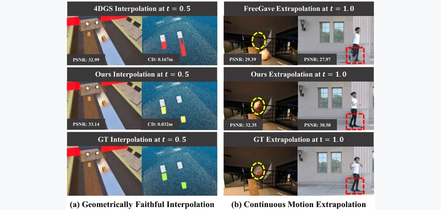 arXiv 2026-10-23 · cs.CV · #1 **[PhyMo: Learning Physical Dynamics with Accurate and Continuous Motion from Multi-View Videos](https://arxiv.org/abs/2610.29107)** Shangjia Liu, Jinxi Li, Siyuan Zhou, Bo Yang, Bing Wang 机构：The Hong Kong Polytechnic University（[PDF](https://arxiv.org/pdf/2610.29107)） [Paper](https://arxiv.org/abs/2610.29107) · [图源](https://arxiv.org/html/2610.29107v1/qua_results.png) 

中文摘要
从多视角视频恢复动态三维场景的几何、外观及支配场景演化的物理运动状态，重要但困难。关键难点在于外观可能具有欺骗性：仅靠渲染监督，模型可能改变颜色或不透明度以补偿错误形变，使观测图像拟合良好，却未恢复真实的演化几何和运动。在快速或局部复杂运动场景中，这尤其严重：错误轨迹在已观测帧上仍可能生成看似合理的图像，却导致不可靠的重建和不连续的未来预测。本文提出 PhyMo，从多视角视频学习演化动力学。其运动感知轨迹表示驱动模型从形变中恢复准确运动，而非依赖外观捷径解释观测运动；连续运动演化模块加入双向运动学连续性约束，促进位移、速度和加速度在时间上的一致演化。两者共同实现几何忠实的插值和连续的运动外推。四个动态场景基准的实验显示，作者报告的方法达到最先进表现。 <a href="https://arxiv.org/abs/2610.29107">原摘要来源</a>
 | 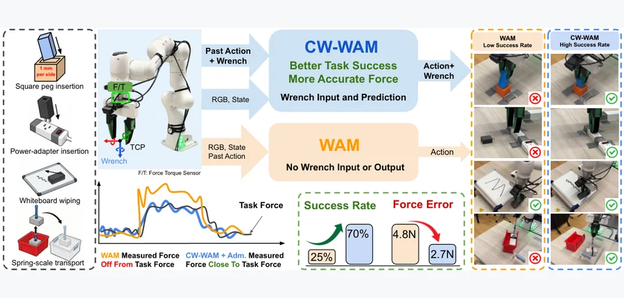 arXiv 2026-10-23 · cs.RO · #2 **[CW-WAM: A Structured Contact-Wrench World Action Model for Force-Sensitive Manipulation](https://arxiv.org/abs/2610.30117)** Houzhu Ding, Xinda Qi, Luqi Wang, Ming Yang 机构：Ant Group（[PDF](https://arxiv.org/pdf/2610.30117)） [Paper](https://arxiv.org/abs/2610.30117) · [图源](https://arxiv.org/html/2610.30117v1/fig01_cw_wam_teaser_short.png) 

中文摘要
力敏感操作需要视觉观测无法直接提供的接触与载荷信息。本文提出 CW-WAM：联合预测视频、运动和接触力矩的世界动作模型。受运动—力混合控制启发，模型包含统一交互模块，把运动和接触力矩都作为建模目标，并预测时间对齐的运动—力矩片段作为控制参考。成对因果注意力组织运动与力矩依赖关系，固定长度的长时力矩记忆保留既往交互信息。预测的力矩片段在慢—快控制系统中充当 20 Hz 外环导纳控制器的力参考，使两次模型查询之间仍有力反馈和平滑运动。相比不输入力矩的 WAM，CW-WAM 改善接触预测，并把单侧间隙 1 mm 的方形插销插入成功率从 25% 提高到 70%，电源适配器插入从 40% 提高到 95%；不同载荷下的提升高度准确性也改善。结合导纳控制器后，插销插入的力参考 RMSE 从 4.8 N 降至 2.7 N，擦拭任务从 2.0 N 降至 1.3 N，成功执行时的力波动也较小。论文提供项目网站。 <a href="https://arxiv.org/abs/2610.30117">原摘要来源</a>
 | 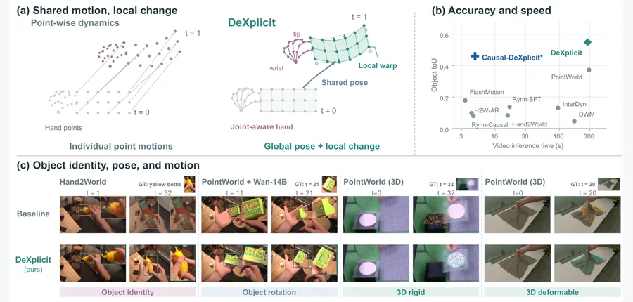 arXiv 2026-10-23 · cs.CV · #3 **[DeXplicit: Making Physical State Explicit in Dexterous Manipulation World Models](https://arxiv.org/abs/2610.30781)** Adam Lee, Mutian Xu, Yukang Cao, Shulin Tian, Ziwei Liu 机构：Nanyang Technological University / University of California, Berkeley（[PDF](https://arxiv.org/pdf/2610.30781)） [Paper](https://arxiv.org/abs/2610.30781) · [图源](https://arxiv.org/html/2610.30781v1/teaser.png) 

中文摘要
机器人在作用于物体前，需要预见手部运动将如何改变物理世界，以及随后场景的外观。现有方法通常在视频生成模型中混合动作条件动力学、相机运动和视觉合成，或以缺少明确物体结构的点轨迹表示动力学。本文提出灵巧操作世界模型 DeXplicit，先在度量三维空间中显式预测世界演化，再渲染视觉结果。给定初始场景与未来手部轨迹，轻量级三维动力学网络预测以物体为中心的运动和形变，提供结构化、有几何依据的未来世界状态。这些预测为视频生成提供支架：外观沿预测的三维运动传递并投影到未来视角，使渲染器专注于补全不确定和新显露的内容，而无需从像素隐式学习动力学。这种显式三维优先的分解还支持高效的因果生成：每个块仅需两步去噪，并以已生成历史为条件。在 HOT3D、OakInk2 和 PhysTwin 上，相比 PointWorld，DeXplicit 将运动点误差降低 27–40%；在共用渲染器条件下，将 HOT3D 上的物体保真指标 IoU+ 提高 47%。两步因果生成设计相较作者的 14B 双向视频合成配置实现 57 倍加速。 <a href="https://arxiv.org/abs/2610.30781">原摘要来源</a>
 |
| 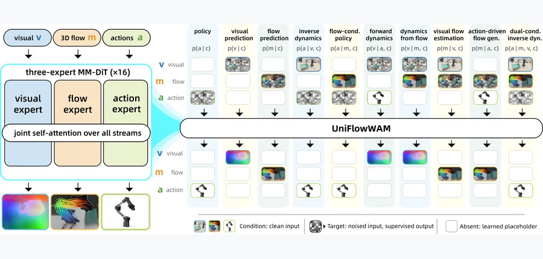 arXiv 2026-10-23 · cs.RO · #4 **[UniFlowWAM: A Unified World-Action Model with Visual Semantics and 4D Geometry](https://arxiv.org/abs/2610.30991)** Jialin Tian, Zhuofan Li, Xinkai Wang, Bokai Lin, Chenyi Wang, Xinyu Zhan, Cewu Lu, Lixin Yang 机构：Shanghai Jiao Tong University / Shanghai Innovation Institute / Noematrix（[PDF](https://arxiv.org/pdf/2610.30991)） [Paper](https://arxiv.org/abs/2610.30991) · [图源](https://arxiv.org/html/2610.30991v1/UniFlowWAM-teaser.png) 

中文摘要
机器人示教记录了机器人所见与所做，却没有说明期间三维世界如何变化。场景级三维流通过追踪三维场景点描述这种变化，使世界表示具有四维几何。此前的流被用作由另一模型转成动作的中间预测、推理时注入的先验，或与动作共同学习的额外输出；在这些设计中，它始终位于策略之外。本文提出 UniFlowWAM，把三维场景流作为与视觉和动作并列的第三模态。其世界表示同时覆盖未来视觉特征中的语义与三维流中的四维几何，并对流施加独立监督。UniFlowWAM 是每种模态各有一个专家、通过联合注意力交换信息的扩散 Transformer；训练采用含十个目标的角色网格，每个目标将每种模态指定为目标、条件或缺席之一。同一模型因此可充当策略、前向与逆向动力学模型，以及未来视觉特征或三维流预测器。作者在仿真的 RoboCasa-GR1、LIBERO、LIBERO-Plus 和四项真实双臂操作任务中评估：RoboCasa-GR1 成功率由无流基础模型的 52.1% 提高至 56.4%；LIBERO 分布内成功率保持 98.1%，LIBERO-Plus 零样本成功率为 87.7%；真实机器人平均成功率为 87.0%，最强基线为 68.5%。 <a href="https://arxiv.org/abs/2610.30991">原摘要来源</a>
 | 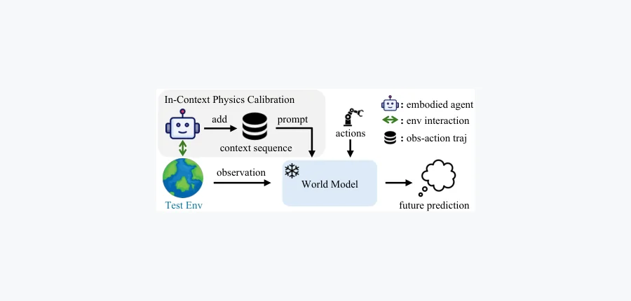 arXiv 2026-10-23 · cs.RO · #5 **[PhysiCalWorld: In-Context Physics Calibration for World Models](https://arxiv.org/abs/2610.30125)** Yunhao Luo, Wentao He, Yinpei Dai, Hyelin Nam, Hongze Fu, Joyce Chai, Nima Fazeli, Jeong Joon Park 机构：University of Michigan（[PDF](https://arxiv.org/pdf/2610.30125)） [Paper](https://arxiv.org/abs/2610.30125) · [图源](https://arxiv.org/html/2610.30125v1/1-teaser-v3.png) 

中文摘要
现有世界模型通常只通过当前图像帧或狭窄的历史窗口感知场景，但这些观测未必显露决定状态转移的物理属性，例如物体的质量分布、关节阻尼或表面摩擦。不为世界模型校准这些因素，预测就容易退回经验先验，在新测试场景中产生严重漂移。本文提出 PhysiCalWorld：通过上下文提示，把动作条件世界模型校准到具体实例的动力学，而无需微调或解析物理建模。方法将测试场景内采集的一段探索性交互视频编码为紧凑的物理描述 token，使后续预测立足于该场景的实际物理行为。PhysiCalWorld 仅用潜空间预测损失端到端训练，不需要物理标签。推理时，描述 token 提取一次即可在多次展开中复用，计算开销可忽略。作者在涵盖多样物理变化的四种环境中评估，显示展开预测准确率和视觉规划成功率显著提高；学得的描述符还形成具有物理结构的潜空间，并能泛化到训练时未见的物理参数范围。 <a href="https://arxiv.org/abs/2610.30125">原摘要来源</a>
 | 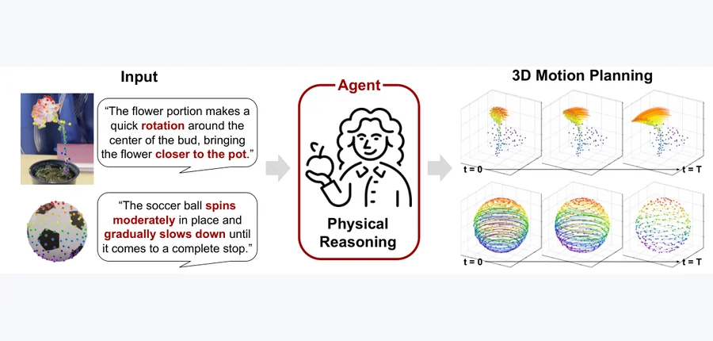 arXiv 2026-10-23 · cs.CV · #6 **[AgentDreamer: Agentic 3D Motion Reasoning for Text-Controllable Physics Simulation](https://arxiv.org/abs/2610.30679)** Mijeong Kim, Suho Park, Junha Park, Bohyung Han 机构：affiliation 未确认 [Paper](https://arxiv.org/abs/2610.30679) · [图源](https://arxiv.org/html/2610.30679v1/figure1_motivation_v3.png) 

中文摘要
本文提出 AgentDreamer，一种通过显式三维运动规划使文本指令与仿真运动对齐的智能体引导优化框架。给定文本指令和场景几何，现成智能体把指令转换为结构化的语义运动先验，指定什么应当移动、向哪个方向移动以及时间顺序。智能体在一系列时间片上用参数函数表示该先验，生成密集三维轨迹。随后优化可微 MPM 仿真器的参数，使其展开尽可能匹配先验，同时遵守场景动力学约束。这让智能体提供来自语言的语义指导，由仿真器将其落实为物理可行的运动。作者还提出 Motion-IG：一种基于遮蔽文本恢复的信息论文本—运动对齐指标。它比较有无仿真运动时恢复被遮蔽的运动相关内容的概率，测量该运动在其余文本和场景上下文之外提供的信息。实验显示，相比基于视频的引导，AgentDreamer 改善文本对齐，使仿真更接近所要求的物理行为。 <a href="https://arxiv.org/abs/2610.30679">原摘要来源</a>
 |
| 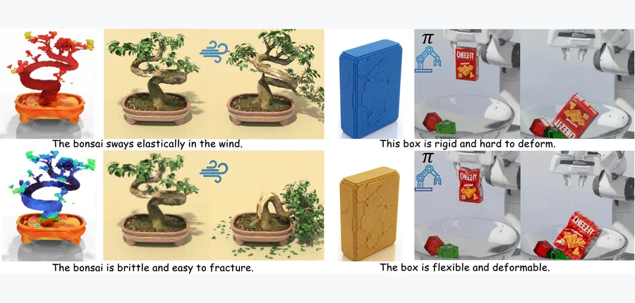 arXiv 2026-10-23 · cs.CV · #7 **[AutoPhyX: Automatic Text-Condition Physics Property Generation](https://arxiv.org/abs/2610.29517)** Bei Huang, Yixin Chen, Hongbin Zha, Yuru Pei, Siyuan Huang 机构：Peking University / Beijing Institute for General Artificial Intelligence / Anqing Normal University（[PDF](https://arxiv.org/pdf/2610.29517)） [Paper](https://arxiv.org/abs/2610.29517) · [Project](https://hb-pencil-zero.github.io/AutoPhyX/) · [图源](https://arxiv.org/html/2610.29517v1/teaser.png) 

中文摘要
高保真的四维物理仿真，需要与不同材料属性相符的准确物理参数。已有方法或依赖计算昂贵的逐场景优化，或仅从视觉输入预测参数；后者存在内在歧义，例如无法只凭外观辨别橡胶的刚度。为此，本文提出 AutoPhyX：根据文本条件预测空间变化物理属性的框架。为获得训练稳健前馈模型所需的细粒度监督，作者先提出部件可控数据生成流程，把复杂三维资产分解为语义不同的组件，并配对物理上合理且多样的参数及相应文本描述。基于该数据集，AutoPhyX 用跨模态调制机制，让文本特征动态调制视觉特征，以实现精确的物理对应。物理属性预测在体素场中表述，因而兼容网格、点云、高斯泼溅和 NeRF 等多种三维表示。实验显示，方法可通过一次前向传播完成物理合理、由文本驱动的参数赋值，在真实场景物体上具有较高准确率和稳健泛化，为未来物理密集的具身及机器人应用奠定基础。 <a href="https://arxiv.org/abs/2610.29517">原摘要来源</a>
 | 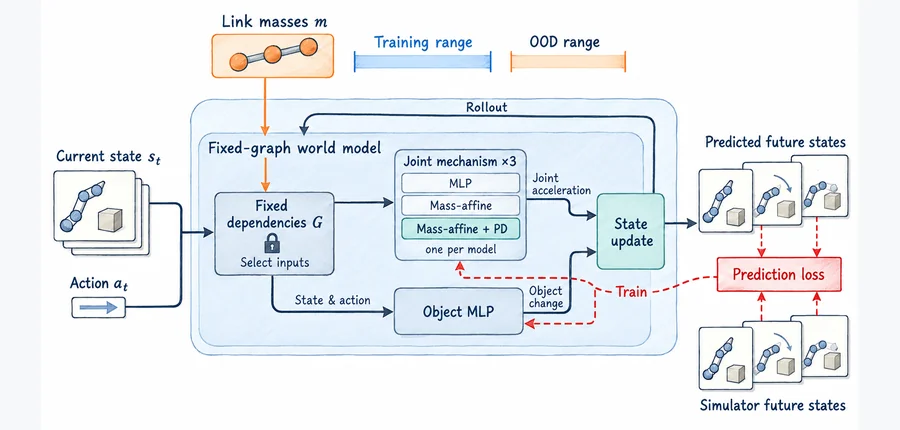 arXiv 2026-10-23 · cs.LG · #8 **[Causal world models under physical parameter shifts](https://arxiv.org/abs/2610.29088)** Chu Lin, Yi Sun 机构：The City College of New York（[PDF](https://arxiv.org/pdf/2610.29088)） [Paper](https://arxiv.org/abs/2610.29088) · [图源](https://arxiv.org/html/2610.29088v1/world_model.png) 

中文摘要
世界模型预测具身系统在动作下如何演化，但物理条件超出训练分布时准确率可能下降。本文研究因果建模的两个方面：预测器可使用哪些输入，以及机制如何计算其影响。在带捷径特征的合成基准上，由成对干预得到的冻结依赖掩码，把完全连接预测器的平均分布外 RMSE 从 1.769 降到 0.697，接近生成器真值掩码的 0.694。对于 CausalWorld 中训练和测试质量范围不重叠的机器人连杆质量外推，作者构建按手指局部建模的世界模型：连杆质量通过显式仿射系数进入惯性和动力学偏置项，动作通过学习型力矩网络或已知 PD 控制器发挥作用，学习型残差捕捉接触相关影响。相比单独训练、质量输入固定在训练均值的对照模型，已知 PD 模型把超范围质量变成稳定的预测增益：150 步展开中，关节时间平均 R² 的中位数从 0.609 升至 0.727，十个任务—种子运行均有改善（双侧精确符号检验 p = 0.002）。在共享的 100 步预测中，学习型力矩模型与最强循环式机器人世界模型配置具有竞争力（关节 R² 中位数 0.755–0.768 对 0.752），而提供超范围质量会使 MLP 和循环预测器显著恶化。结果表明，物理参数进入动力学机制的方式，决定其超范围值帮助还是损害预测。 <a href="https://arxiv.org/abs/2610.29088">原摘要来源</a>
 | 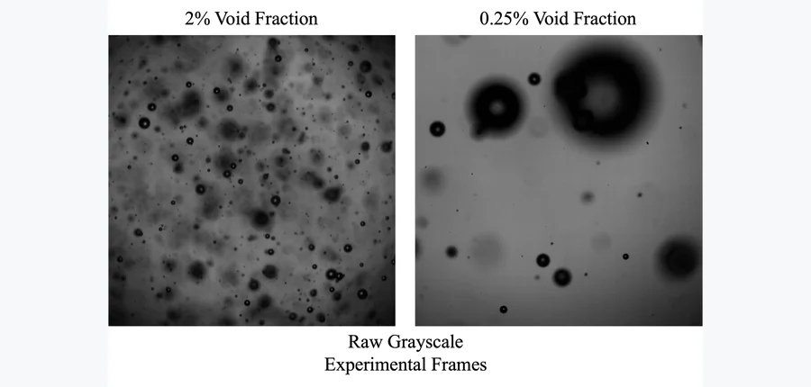 arXiv 2026-10-23 · physics.flu-dyn · #9 **[Monocular 3D bubble reconstruction: DNS-informed ray tracing and deep learning](https://arxiv.org/abs/2610.28908)** Chaitanya S. Nayak, Faizaan Mohammed, Vivek Kumar, Shivam Prajapati, Suhas S. Jain, Cyrus K. Aidun 机构：Georgia Institute of Technology（[PDF](https://arxiv.org/pdf/2610.28908)） [Paper](https://arxiv.org/abs/2610.28908) · [图源](https://arxiv.org/html/2610.28908v1/Data_frames.png) 

中文摘要
气泡尺寸、深度和空间分布影响多相流中的传输与均匀性。单一阴影成像视角无法区分气泡直径与相对焦平面的位移，因为图像特征同时依赖两者；多相机系统又增加光学通道、标定与成本。本文开发单相机、物理引导框架，结合直接数值模拟（DNS）、经验证的蒙特卡罗光线追踪、预处理与焦点条件多任务深度学习，从二维阴影图恢复气泡三维位置及物理等效直径。DNS 解析的气泡标签图在多个焦平面设置下渲染。光线追踪器的阴影成像误差分别低于 3%（强度）、1%（表观尺寸）、15%（模糊）、6%（数值孔径）和 4%（边缘扩散函数形状），运行速度约为 CPU 实现的 30 倍。数据集包含 900 帧和 87,728 个标注实例，按 DNS 时间戳分割以防泄漏，并通过宽深度、受控密度渲染扩展到超过 10⁵ 个裁剪图。多任务网络从裁剪图和焦平面坐标预测带符号深度与直径，在留出数据上达到约 97.6% 的归一化深度准确率；180 个气泡的 DNS—图像—重建闭环测试中，直径误差低于 9.71%（约 90.29% 准确率）。在四个径向平面的实验图像中，每平面有 142–971 个气泡，概率密度函数重叠度为 68–92%，对数概率密度相关系数为 0.72–0.87。在参考焦平面的 11,679 个气泡上，重叠度约 86%，相关系数 0.93，完整分布、D₉₉.₈ 及综合误差均低于 7.7%；这些误差随焦平面距离增大，界定了可恢复性边界。该框架无需立体成像硬件，为密集含气流提供可扩展诊断手段。 <a href="https://arxiv.org/abs/2610.28908">原摘要来源</a>
 |
| 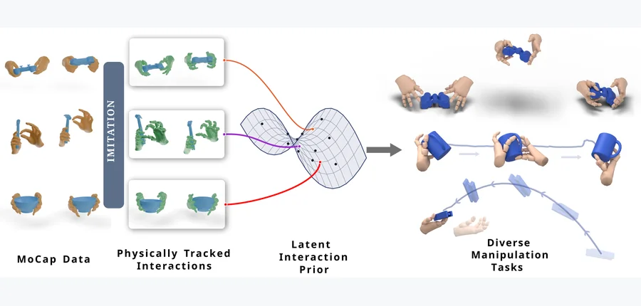 arXiv 2026-10-23 · cs.CV · #10 **[PiHand: Latent Hand-Object Interaction Priors for Physics-Based Policy Learning](https://arxiv.org/abs/2610.31299)** Niklas Berndt, Xianghui Xie, Enes Duran, Yixiao Wang, Gerard Pons-Moll 机构：University of Tübingen / Tübingen AI Center / Max Planck Institute for Informatics / University of California, Berkeley（[PDF](https://arxiv.org/pdf/2610.31299)） [Paper](https://arxiv.org/abs/2610.31299) · [Project](https://virtualhumans.mpi-inf.mpg.de/PiHand/) · [图源](https://arxiv.org/html/2610.31299v1/teaser_600dpi.png) 

中文摘要
合成具有物理依据的灵巧手—物交互，对 VR/AR、游戏和机器人很重要，但细微接触动力学、多样物体几何与目标轨迹需要同时满足，并保持自然抓握，因此仍具挑战。已有方法要么追踪动作捕捉轨迹而难迁移到新物体，要么只使用手部生成先验，无法刻画手与物体的耦合运动，牺牲接触保真度和样本效率。本文提出 PiHand，一种具有物理依据、感知交互的手部运动合成框架。它先在仿真中训练追踪动作捕捉示范的专家策略，再通过目标条件 VAE 将其蒸馏为统一的手—物交互先验，最后在该先验的潜空间内进行有界残差探索以求解多样灵巧操作任务。仅用单一奖励且无需复杂课程训练，即可得到在 GRAB 和 DexYCB 上泛化至未见物体与轨迹的桌面操作策略。同一先验还迁移到训练数据中很少见的接物和双手交接任务。作者报告 PiHand 在所有任务的所有指标上持续优于基线，并计划发布处理后的数据和模型检查点。 <a href="https://arxiv.org/abs/2610.31299">原摘要来源</a>
 | 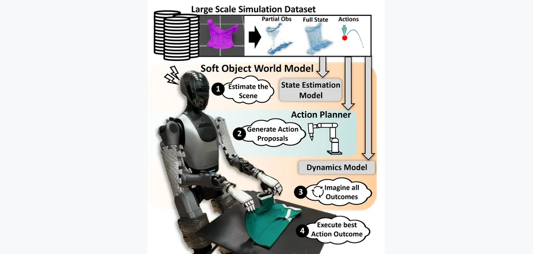 arXiv 2026-10-23 · cs.RO · #11 **[In-Context Learning World Models for Robot Dual-Arm Manipulation of Soft Garment with Partial Observations](https://arxiv.org/abs/2610.30988)** Hengyi Sim, Quentin Rouxel, Dennis Hong, Darwin Caldwell, Fei Chen 机构：The Chinese University of Hong Kong / University of California, Los Angeles / Istituto Italiano di Tecnologia（[PDF](https://arxiv.org/pdf/2610.30988)） [Paper](https://arxiv.org/abs/2610.30988) · [图源](https://arxiv.org/html/2610.30988v1/figs/tienkung4.png) 

中文摘要
稳健操作衣物等软物体是服务及家用机器人所需的重要技能，但高维状态空间与材料相关形变使其困难。人类可根据局部观测在脑中“想象”形状和材料属性，从而预测动作对未来状态的影响；让机器人拥有这类世界模型有望增强其在真实世界中操作不同衣物的泛化能力。然而，学习型世界模型通常需要大量难以采集的真实数据，还须推断支配动力学的潜在属性。本文提出 Soft-Object World Model：以 Transformer 为主干，在大规模仿真软物体交互上训练，执行生成式完整状态估计与动作条件动力学预测，并采取措施减轻 sim-to-real 差距。模型通过对长度可变的局部点云历史进行上下文学习，推断潜在形状与材料线索；无需更新权重，即可跨机器人形态、材料参数、衣物类型与形状及操作协调模式泛化。世界模型还与目标条件动作规划器结合以生成运动。作者在仿真和真实双臂衣物折叠中验证，报告重建保真度、预测准确性和任务成功率的提升。 <a href="https://arxiv.org/abs/2610.30988">原摘要来源</a>
 | 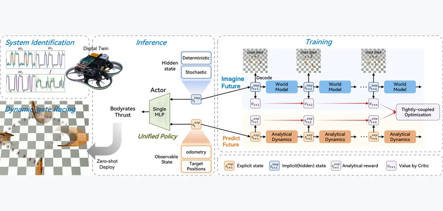 arXiv 2026-10-23 · cs.RO · #12 **[DiffDreamer: Coupling World Models with Differentiable Simulation for Agile Quadrotor Control](https://arxiv.org/abs/2610.31617)** Fanxing Li, Yuxiang Huang, Shengyang Wang, Fangyu Sun, Shuyu Wu, Tianbao Zhang, Dexin Zuo, Yan Yufei, Danping Zou, Wenxian Yu 机构：affiliation 未确认 [Paper](https://arxiv.org/abs/2610.31617) · [图源](https://arxiv.org/html/2610.31617v1/figures/overview.png) 

中文摘要
四旋翼动态门竞速等任务要求智能体预测外部运动，同时保持精确的高频控制。基于世界模型的强化学习可学习潜在动力学并想象未来，但常把环境演化与机器人自身动力学混在同一次学习型展开中，模型偏差会影响策略优化效率。本文提出 DiffDreamer，将学习型世界模型与可微仿真紧密耦合，用于 actor 优化的可微强化学习框架。在每个优化步骤中，学习型世界模型传播捕捉外部动力学和历史相关特征的潜状态，可微仿真器则传播机器人的显式物理状态。作者还把 actor 目标分为面向不可微任务奖励的 critic 路径和面向可微运动奖励的仿真器路径。在激烈跟踪和动态门竞速实验中，相比无模型、基于模型及可微强化学习基线，DiffDreamer 改善训练收敛，最终性能也优于这些基线及经典规划控制方法。消融实验检查奖励分解与里程计条件相对状态表示；作者还提供概念验证性质的真实飞行实验。 <a href="https://arxiv.org/abs/2610.31617">原摘要来源</a>
 |
| 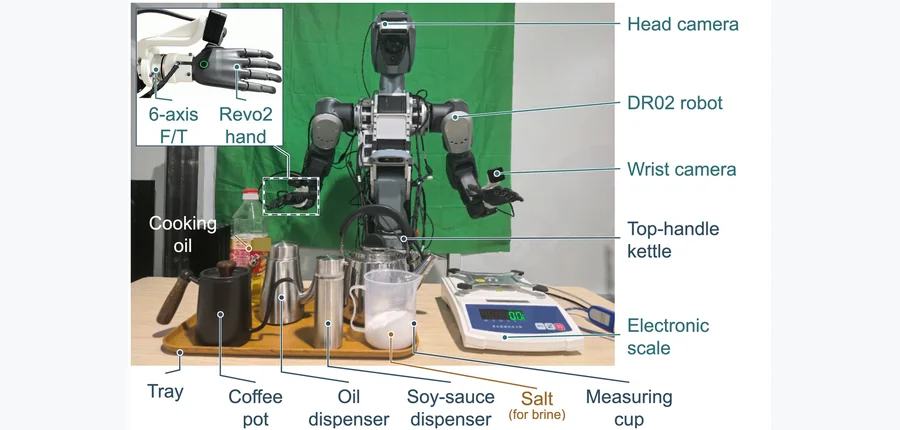 arXiv 2026-10-23 · cs.RO · #13 **[FlowVLA: Learning Flow-Aware Physical Completion for Quantitative Robotic Pouring](https://arxiv.org/abs/2610.29692)** Liwen Yang, Yutian Zhang, Jiaqi Zhai, Li Yang, Tutian Tang, Qiwei Shan, Yancheng Bi, Qiankuan Shangguan, Yangkun Zhu, Ce H… 机构：Zhejiang University / DEEP Robotics / Shanghai Artificial Intelligence Laboratory / Northeastern University / Beijing Zhongguancun Academy（[PDF](https://arxiv.org/pdf/2610.29692)） [Paper](https://arxiv.org/abs/2610.29692) · [图源](https://arxiv.org/html/2610.29692v1/figures/submission/fig_setup_overview_en.jpg) 

中文摘要
稳定倾倒时，图像和机器人姿态可能几乎不变，但转移的质量持续累积，使覆盖整项任务的视觉—语言—动作（VLA）策略难以判断何时回收容器。本文提出 FlowVLA，将运动生成与物理完成度估计分离。共享的 π₀.₅ 动作专家通过边界感知监督学习接近、倾倒和回收；与目标无关的估计器融合视觉、关节、腕部力矩和循环式力信念历史，持续估计已转移质量。当该估计加上预测的余流达到目标质量时，控制器开始回收。在咖啡壶倒水实验中，FlowVLA 的目标均衡平均绝对误差（MacroMAE）为 13.1 g，低于所有受测 VLA 基线。全部尝试中，53.7% 既完成任务又在目标质量的 ±10% 以内结束。同一模型无需重训即可插值到留出的 150 g 和 250 g 目标；作者还用独立训练的模型，在另外三种容器—流体设置下评估这一表述。 <a href="https://arxiv.org/abs/2610.29692">原摘要来源</a>
 | 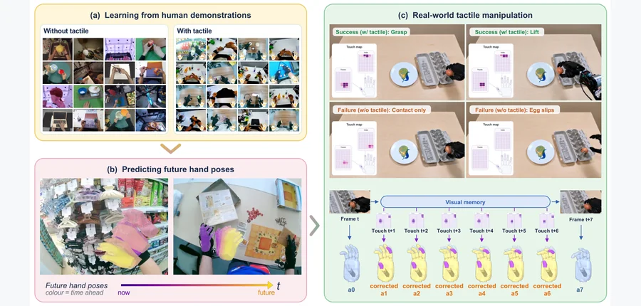 arXiv 2026-10-23 · cs.RO · #14 **[T-WLA: Bridging Slow Vision and Fast Touch](https://arxiv.org/abs/2610.28814)** Kaichen Zhou, Yuzhen Chen, Hannah Yao, Chonghe Jiang, Rao Fu, Xihang Yu, Wei Dai, Bashar Kabbarah, Haoyu Chen, Ishita Golu… 机构：Massachusetts Institute of Technology / Harvard University / University of California, Davis / University of California, Berkeley（[PDF](https://arxiv.org/pdf/2610.28814)） [Paper](https://arxiv.org/abs/2610.28814) · [图源](https://arxiv.org/html/2610.28814v1/fig1.png) 

中文摘要
在富接触操作中，视觉策略更新动作计划之前，接触条件就可能变化。通过视觉策略重新计算计划会增加延迟，而单靠触觉反馈也无法说明应如何根据任务修正正在执行的运动。本文提出 T-WLA：用共享视觉记忆同时引导动作生成和触觉修正的世界—语言—动作架构。每次视觉更新时，视觉分支整合当前图像、任务指令与检索历史，得到用于生成基础动作的视觉记忆。同一记忆被缓存给轻量触觉编辑器，后者结合当前动作片段和新触觉输入，对尚未执行的动作预测残差修正，无需再次运行视觉分支。未来图像和未来压力预测只用于训练监督，鼓励视觉记忆和触觉特征捕捉对动作生成及修正有用的交互动力学。作者在 EgoTouch、Tachin 的触觉条件手部运动预测以及四项真实灵巧操作任务上评估。相比报告中最强基线，T-WLA 将手指关节 MPJPE 降低 30%，真实机器人操作任务平均成功率约 50.0%。论文提供视频与代码链接。 <a href="https://arxiv.org/abs/2610.28814">原摘要来源</a>
 | 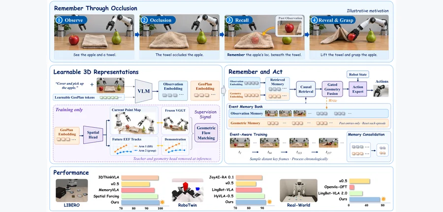 arXiv 2026-10-23 · cs.CV · #15 **[GeoMem-VLA: Internalizing 3D Scene Understanding into Temporal Memory for Vision-Language-Action Models](https://arxiv.org/abs/2610.29866)** Qinfan Zhang, Yifan Luo, Haoyuan Shi, Guanlin Liu, Han Dong, Haozhe Shan, Yong Dai, Xiangcong Ren, Xiaozhu Ju 机构：Beihang University / Renmin University of China / X-Humanoid / University of Science and Technology of China / Fudan University / The Chinese University of Hong Kong, Shenzhen（[PDF](https://arxiv.org/pdf/2610.29866)） [Paper](https://arxiv.org/abs/2610.29866) · [图源](https://arxiv.org/html/2610.29866v1/Teaser_Geo.png) 

中文摘要
几何结构对机器人操作和理解三维世界至关重要。多数 VLA 模型依赖当前观测的二维表示；几何感知方法常要求额外三维信息，而从单次观测独立推断的几何又往往被丢弃，无法累积为持久任务表示。作者的核心见解是，动作生成需要持续更新、与任务相关的紧凑几何抽象，而不必每一步都完整重建可渲染的三维场景。本文提出 GeoMem-VLA：把显式三维监督内化到专用几何 token，并将其作为生成动作的时间记忆，且不直接把 VLM 原有视觉嵌入对齐到教师特征空间。训练时，冻结的几何基础模型通过对当前场景点图和未来末端轨迹的几何流匹配目标监督可学习 GeoPlan token。这些 token 与观测表示记忆整合，历史信息被检索、与当前观测自适应融合，并随着任务推进压缩保留事件帧。推理时，策略检索历史表示并与当前工作表示融合来预测动作，不调用三维教师，也不显式重建场景。在针对基准的下游适配后，GeoMem-VLA 在 LIBERO 的平均成功率为 98.9%，在 RoboTwin 清洁／随机设置分别为 91.10%／91.24%；五项真实任务的平均成功率为 78.0%。结果提示，把三维场景理解内化并记住，可能是机器人控制的有效路径。 <a href="https://arxiv.org/abs/2610.29866">原摘要来源</a>
 |
| 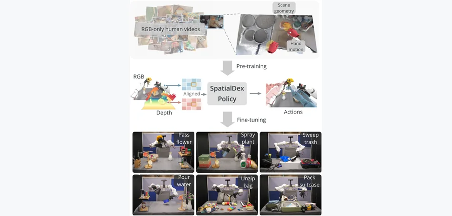 arXiv 2026-10-23 · cs.RO · #16 **[Reconstruction-Augmented Visuomotor Pre-Training of 3D-Grounded Bimanual Dexterity from RGB-Only Human Videos](https://arxiv.org/abs/2610.29716)** Xingyi He, Zhiwen Qiu, Adhitya Polavaram, Yunhao Cao, Cory Fan, Julius Samwer, Saleh Kalantari, Kuan Fang 机构：Cornell University（[PDF](https://arxiv.org/pdf/2610.29716)） [Paper](https://arxiv.org/abs/2610.29716) · [图源](https://arxiv.org/html/2610.29716v1/teaser_v27.png) 

中文摘要
本文提出 SpatialDex：通过重建增强的视觉运动预训练，从仅有 RGB 的人类视频学习具有三维依据的双臂灵巧能力。核心思想是把人类行为与其空间上下文共同学习。方法从每段视频重建场景几何并估计手部运动，再用三维手部估计的手尺寸先验，在视频层面把两者对齐到共同尺度；重建几何既作为策略输入，也作为预测目标。策略通过门控残差融合把预训练视觉语言模型的 token 网格与几何联系起来，同时预测未来场景几何、手腕和手指动作，并根据两只手腕的预测轨迹生成手指运动。方法先在 100 万段人类视频上预训练，再用少量机器人示教微调；在两种机器人形态、九项仿真灵巧任务上比最先进方法高 16.5 个百分点，在六项真实双臂灵巧任务上高 38.3 个百分点。在匹配条件的比较中，使用重建几何预训练，比仅用手部运动预训练的成功率高 14.2 个百分点。 <a href="https://arxiv.org/abs/2610.29716">原摘要来源</a>
 | 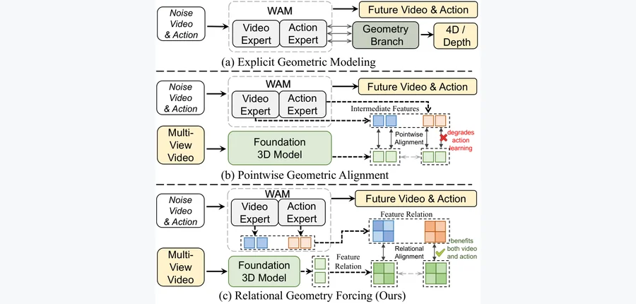 arXiv 2026-10-23 · cs.RO · #17 **[Relational Geometry Forcing for World Action Models](https://arxiv.org/abs/2610.29282)** Yuan Xu, Yixiang Chen, Qisen Ma, Jiabing Yang, Peiyan Li, Kai Wang, Jianhua Yang, Jianlou Si, Jun Huang, Jing Liu, Nianfen… 机构：Institute of Automation, Chinese Academy of Sciences / University of Chinese Academy of Sciences / Alibaba Group / FiveAges（[PDF](https://arxiv.org/pdf/2610.29282)） [Paper](https://arxiv.org/abs/2610.29282) · [图源](https://arxiv.org/html/2610.29282v1/teaser-compare-6_cropped.png) 

中文摘要
世界动作模型（WAM）联合学习视觉动力学与可执行动作，在机器人操作中显示潜力，但其视频与动作目标并未显式约束精细操作所需的三维几何。近期几何感知 WAM 增加深度或四维预测分支；表示对齐方法则用预训练三维基础模型监督中间 WAM 特征。作者发现，逐点特征对齐虽然有利于视频特征，却会损害动作学习，因为密集几何特征目标对紧凑动作特征限制过强。为解决这一问题，本文提出关系几何强制（RGF）：不对齐逐点特征，而是对齐成对特征关系，把冻结三维基础模型的几何先验传给 WAM。具体包括三个互补的关系目标：帧内和跨视角关系将场景几何与多视角对应传给视频特征；动作—时间关系把动作动力学与场景几何演化耦合起来。RGF 仅在训练时使用，无需显式几何分支或额外推理模块。作者在仿真和真实实验中报告，RGF 对多种操作场景和 WAM 范式带来持续增益。 <a href="https://arxiv.org/abs/2610.29282">原摘要来源</a>
 | 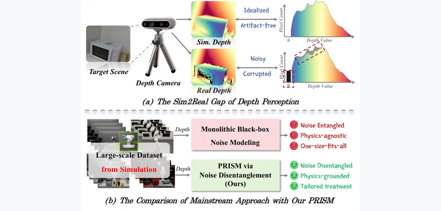 arXiv 2026-10-23 · cs.RO · #18 **[PRISM: Learning Realistic Depth via Physics-Grounded Noise Disentanglement with Semantic-Geometric Collaboration](https://arxiv.org/abs/2610.29432)** Xiujian Liang, Jiacheng Liu, Mingyang Sun, Qichen He, Anda Cheng, Cewu Lu, Jianhua Sun 机构：Fudan University / Shanghai Innovation Institute / Zhejiang University / Shanghai Jiao Tong University / Ant Group（[PDF](https://arxiv.org/pdf/2610.29432)） [Paper](https://arxiv.org/abs/2610.29432) · [图源](https://arxiv.org/html/2610.29432v1/Insight.png) 

中文摘要
真实物理传感具有复杂、异质的噪声模式，显著偏离理想仿真，成为 sim-to-real 迁移的关键瓶颈。已有传感器模型通常把深度噪声视为整体黑箱过程，忽略支配不同错误模态的物理机制。本文提出物理引导范式，把整体噪声分解为互补的两类：感测失效与测量不准确，从而按物理来源分别处理。基于此，作者提出三部分框架 PRISM，蒸馏三维视觉基础模型特征作为丰富的空间语义先验，用于物理推理。针对失效区域固有的稀疏和类别不平衡，方法设计分层正样本优先监督，把多尺度正样本加权目标与保留正样本的动态难例挖掘结合，以准确描绘伪影。多项基准显示 PRISM 在含噪深度合成保真度方面达到作者报告的最先进水平。下游机器人实验进一步显示其真实世界平均成功率为 92.1%，显著高于整体黑箱基线。论文提供项目页链接。 <a href="https://arxiv.org/abs/2610.29432">原摘要来源</a>
 |
| 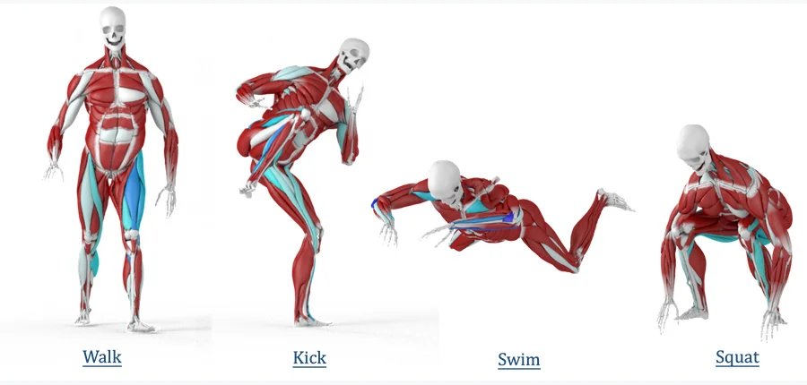 arXiv 2026-10-23 · cs.GR · #19 **[RLMuscle: Muscle-Driven Character Animation via Reinforcement Learning](https://arxiv.org/abs/2610.30033)** Chunlei Li, Siyuan Yu, Yang Gao, Shuai Li, Peng Yu, Aimin Hao, He Wang 机构：Beihang University / Westlake University / University College London（[PDF](https://arxiv.org/pdf/2610.30033)） [Paper](https://arxiv.org/abs/2610.30033) · [图源](https://arxiv.org/html/2610.30033v1/imgs/teaserV3.png) 

中文摘要
肌肉收缩引起的身体形变对角色动画的视觉真实感很重要，但多数三维动画流程需要艺术家手动指定肌肉激活，耗时且无法保证物理真实性。本文提出方法，让强化学习控制器发现逐肌肉激活，从而追踪参考运动，无需手工调节。已有强化学习肌肉控制器止步于一维肌肉模型；本文在强化学习控制循环内保留一维模型作为快速替代，并用三维体积仿真生成最终形变。由于两个阶段共享完全相同的本构定律，肌肉形变由生成运动的同一组激活产生。作者还加入实测肌电图（EMG）先验，把冗余激活解引向真实人类肌肉募集。为获得稳定、高效、真实的仿真，方法为扩展位置动力学（XPBD）提出新型几何多重网格：它建立在粗四面体笼上，通过重心坐标延拓，在四面体网格上闭合 V 循环。GPU 并行求解器把相同的 Hill 型力—长度定律作为基于能量的纤维约束，使逐纤维激活产生真实的肌肉收缩与隆起。作者展示了含 194 块肌肉的人体体积仿真，覆盖行走、踢腿、游泳、过顶深蹲等多种运动，单块 RTX 4090 上整身模型每帧仿真用时 18 ms。工作旨在迈向既视觉可信又有生物力学依据的角色动画，论文提供代码和视频网站。 <a href="https://arxiv.org/abs/2610.30033">原摘要来源</a>
 | 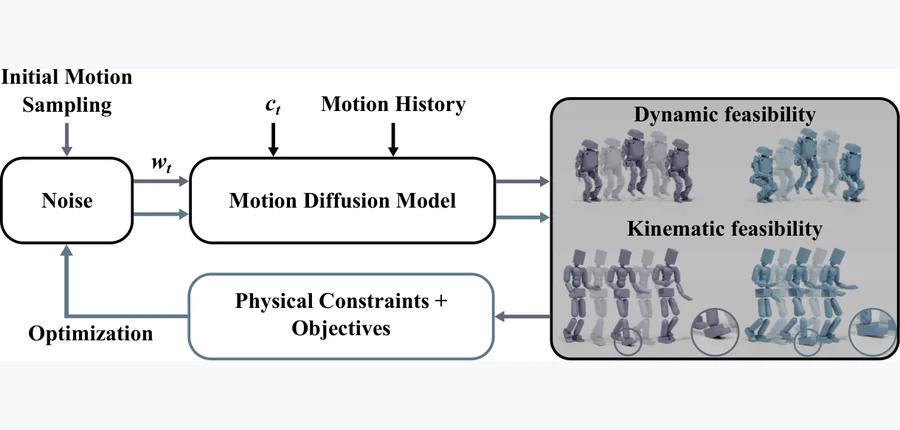 arXiv 2026-10-23 · cs.RO · #20 **[PhysibleMDM: Enforcing Inference-Time Physical Feasibility Constraints on Motion Diffusion Models via Noise Optimization](https://arxiv.org/abs/2610.30500)** Maximilian Stölzle, David Müller, Agon Serifi, Ruben Grandia, Espen Knoop, Moritz Bächer 机构：Disney Research / MIT CSAIL（[PDF](https://arxiv.org/pdf/2610.30500)） [Paper](https://arxiv.org/abs/2610.30500) · [图源](https://arxiv.org/html/2610.30500v1/overview_paper_v11.png) 

中文摘要
运动扩散模型能生成多样且视觉上吸引人的人体运动，但轨迹常违反物理约束，限制其在仿真和控制中的应用。本文提出 PhysibleMDM：在推理时优化扩散噪声以提高输出的物理可行性，无需重训生成模型。作者设计无需完整轨迹仿真即可评估的替代性可行性约束，结合地面穿透、滑动和自碰撞等运动学检查，以及以锥规划形式的逆动力学内循环计算出的动力学可行性测试。所得黑箱噪声优化问题由可分离协方差矩阵自适应进化策略 Sep-CMA-ES 求解，避免依赖昂贵且不连续的梯度；自回归方案串联优化后的片段以合成长运动。在 SMPL 类人模型的 100 种运动风格上，相比未优化的扩散输出，平均地面穿透、自碰撞穿透和地面滑动分别降低 75%、92% 和 74%。在自定义双足机器人 11 段序列上，每序列平均加速度重建误差与平均逆动力学残差的中位降幅分别为 89.5% 和 79.5%。 <a href="https://arxiv.org/abs/2610.30500">原摘要来源</a>
 | 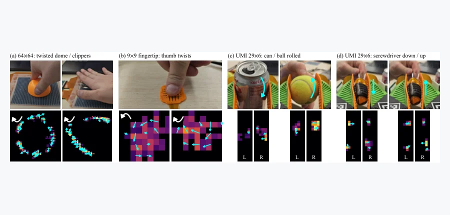 arXiv 2026-10-23 · cs.RO · #21 **[OpenTac: An Open Ecosystem for Customizable, Scalable, and Transferable 3D Tactile Sensing](https://arxiv.org/abs/2610.31661)** Ariel Slepyan, Geeta Chandra Raju Bethala, Jiafeng Gu, Anagha Rajendra Dangle, Yinzhe Zhou, Hongyuan Fu, Jade Sim, Tuhin B… 机构：Johns Hopkins University / Massachusetts Institute of Technology（[PDF](https://arxiv.org/pdf/2610.31661)） [Paper](https://arxiv.org/abs/2610.31661) · [Project](https://opentac.github.io/) · [图源](https://arxiv.org/html/2610.31661v1/tactile_examples_1x4.png) 

中文摘要
本文提出 OpenTac，一种新型传感器及全栈生态，用于高度可定制、可扩展且易于部署在机器人控制与学习中的触觉皮肤。核心贡献有两方面。首先，作者开发具有结构化可形变覆盖层的可扩展电阻式触觉皮肤，把切向载荷转为随空间变化的压力；相邻触觉单元的差分响应可解码局部剪切向量，共模响应则编码法向力。其次，作者提供高度可定制的传感器设计工具，能根据二维轮廓和可展三维表面、甚至文本等抽象描述（如“为 9 码鞋垫设计传感器”）自动生成制造文件。围绕传感器还建立了 CAD 设计工具、仿真器、跨传感器迁移与快速自适应数据采集。作者在多种机器人形态上设计并制造了 30 多种传感器，使用商用高精度力／力矩传感器表征其三维触觉场，并在四种真实机器人形态的富接触反馈控制与操作策略学习中展示应用。对于 1024 单元皮肤，每次更新采样 16 个单元时，自适应采集实现千赫兹级局部读数，比同一传感器的全阵列光栅扫描快 19.2 倍。论文提供硬件、软件和结果视频的链接。 <a href="https://arxiv.org/abs/2610.31661">原摘要来源</a>
 |
| 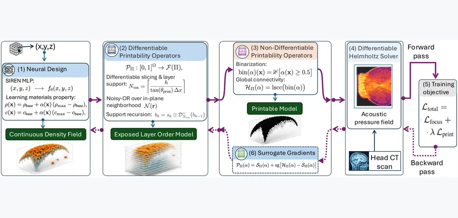 arXiv 2026-10-23 · cs.LG · #22 **[AcoustiPrint: Physics-Guided Neural Design of Manufacturable Acoustic Structures](https://arxiv.org/abs/2610.30411)** Shanmuka Sadhu, Harshvardhan C. Takawale, Yehia Zakaria, Ahmed Allam, Nirupam Roy 机构：University of Maryland, College Park / University of Cincinnati（[PDF](https://arxiv.org/pdf/2610.30411)） [Paper](https://arxiv.org/abs/2610.30411) · [图源](https://arxiv.org/html/2610.30411v1/overview.png) 

中文摘要
增材制造与神经逆向设计使人们能创建操控物理场的复杂三维结构，但设计还须满足离散、不可微的制造约束。现有方法以可微软制造性损失限制设计空间，或在后处理中修正结构，造成物理模型优化的几何与最终制品不一致。本文提出 AcoustiPrint：以隐式神经表示（INR）表示三维几何，并在评估最终响应前让每个候选经过可打印性算子。该算子执行逐层自支撑、离散材料选择和整体连通性检查，保证制造可行。为穿过不可微离散操作反向传播，方法使用替代梯度，并通过自监督可打印性目标逐步把 INR 推向有效设计域。作者将其用于个性化经颅聚焦超声：患者声学属性和头部几何差异会改变波传播，需要患者专属的声聚焦结构。AcoustiPrint 在保证可制造性的同时，通过可微波动物理联合优化三维几何与材料组成。实验显示所得可制造声学结构在聚焦准确性等方面优于密度式和相位式基线，展示了在不可微制造约束与可微物理下进行神经设计的通用方法。 <a href="https://arxiv.org/abs/2610.30411">原摘要来源</a>
 | 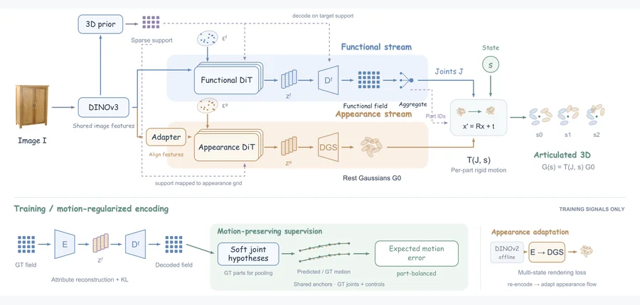 arXiv 2026-10-23 · cs.CV · #23 **[MoRE: Motion-Regularized Encoding for Articulated 3D Generation](https://arxiv.org/abs/2610.30337)** Guantian Zheng, Shan Jin 机构：Manifest Limited / University of Cambridge / Nanyang Technological University（[PDF](https://arxiv.org/pdf/2610.30337)） [Paper](https://arxiv.org/abs/2610.30337) · [图源](https://arxiv.org/html/2610.30337v1/more_pipeline.png) 

中文摘要
从单张图像生成可关节运动的物体，需要恢复其外观及支配部件运动的机构；仅对关节属性进行紧凑编码，并不能保证重建保留由此产生的运动。本文提出 MoRE，即面向关节式三维生成的运动正则编码。MoRE 用轴分类和两个与轴正交的 Plücker 矩系数表示与坐标对齐的关节轴线，消除沿轴选择任意原点的问题。在表示学习中，解码得到的关节假设用于移动相应的三维锚点，其运动与标注关节的运动比较。对关节类型和轴方向的可微期望，将属性重建与其诱发的运动耦合起来。图像条件流学习所得功能潜变量，多状态适配的高斯模型提供外观。推理时，恢复的部件分配与关节使同一组静止姿态高斯发生关节运动，无需对每个状态重新生成物体。在 PartNet-Mobility 和 ACD 上，作者报告相比基线具有更好的部件包围盒一致性、关节状态几何与视觉相似度；关节预测相较 ArtiLatent 降低轴、原点和运动范围误差。受控消融支持关节轴线编码，并显示运动监督可降低锚点运动误差。代码和预训练检查点计划以后发布。 <a href="https://arxiv.org/abs/2610.30337">原摘要来源</a>
 | 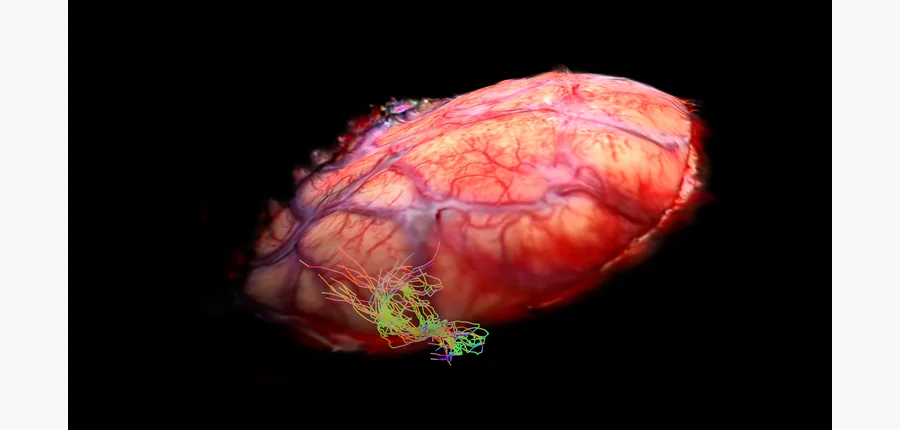 arXiv 2026-10-23 · eess.IV · #24 **[H-2DGS: Height-Field Gaussian Splatting for Sharp and Deformable Neurosurgical Surface Reconstruction](https://arxiv.org/abs/2610.30910)** Zhang Zichuan, Bart Brouwers, Rembrandt Bakker, Maud Landers, Geert-Jan Rutten, Maxime Chamberland 机构：Eindhoven University of Technology / Elisabeth-Tweesteden Hospital（[PDF](https://arxiv.org/pdf/2610.30910)） [Paper](https://arxiv.org/abs/2610.30910) · [图源](https://arxiv.org/html/2610.30910v1/figures/surface_tck_overlay.png) 

中文摘要
神经外科导航常把 MRI 显示为二维切片，使切片中的解剖结构难以与手术显微镜下的皮质表面对应。作者希望建立共同的三维可视化，把肿瘤手术中暴露皮质的照片级重建与全脑 MRI 背景及扩散纤维束成像路径结合。这要求皮质重建成为脑组织周围清晰的边界，而不是遮蔽内部结构的弥散体积。传统三维高斯泼溅（3DGS）能重现观测视角，但在手术视角有限时，不透明度可能分布于厚而几何含糊的带状区域。本文提出高度场二维高斯泼溅 H-2DGS：三阶段流程先聚合稳健的 3DGS 重建，再将深度融合成共享截断符号距离场（TSDF）表面，最后用弯曲、面向表面的高斯基元表示该表面。分离的高度、颜色与不透明度基提供局部几何和外观，邻域过渡目标协调重叠图块。显式表面还支持术后对齐：由 MRI 得到的深度使重建形变，追踪颜色监督与交替优化保持外观。在五例真实神经外科病例上，H-2DGS 实现低多视角深度不一致性、7.97 MB 的紧凑表示及每帧 29–42 ms 的交互式渲染。清晰、可形变的表面可与纤维束成像和 MRI 解剖结构明确整合，包括术后切除腔。 <a href="https://arxiv.org/abs/2610.30910">原摘要来源</a>
 |
| 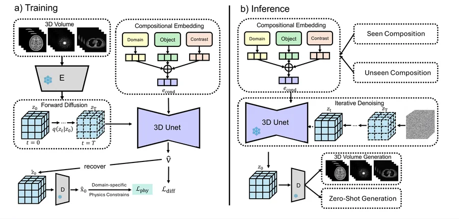 arXiv 2026-10-23 · eess.IV · #25 **[SciFusion: Physics-Guided Compositional Diffusion for Multimodal 3D Scientific Image Generation](https://arxiv.org/abs/2610.30313)** Luoxi Wang, Alessio Quercia, Hanno Scharr, Arya Bangun 机构：Princeton University / Forschungszentrum Jülich（[PDF](https://arxiv.org/pdf/2610.30313)） [Paper](https://arxiv.org/abs/2610.30313) · [图源](https://arxiv.org/html/2610.30313v1/architecture_new.png) 

中文摘要
现有三维生成方法通常面向单一成像模态开发，需要大量模态专属数据，也难利用不同科学成像领域之间的共享结构。本文提出 SciFusion：基于潜扩散主干的统一三维科学图像生成多模态框架，包含两项主要贡献。其一，组合式条件方案将每种模态分解为领域、对象和对比度表示；在相关模态之间共享这些因子，既可跨异质成像领域迁移知识，也可在推理时重新组合，零样本合成未见过的领域—对象—对比度组合。其二，加入领域专属的物理信息目标：用于 MRI 的傅里叶频谱一致性、用于 CT 的 Radon 投影一致性，以及用于电子显微镜的多切片衍射一致性，以鼓励生成样本遵循各模态的成像机制。跨 15 种医学与科学成像模态的实验表明，相比模态专属策略和扁平化多模态条件策略，SciFusion 提升生成保真度及跨领域泛化，并能在未对目标组合训练的情况下零样本合成新组合。结果表明，组合式、物理引导的条件方法可成为统一三维科学图像生成的可扩展框架，尤其适合难以收集大规模训练数据的新兴模态。 <a href="https://arxiv.org/abs/2610.30313">原摘要来源</a>
 | 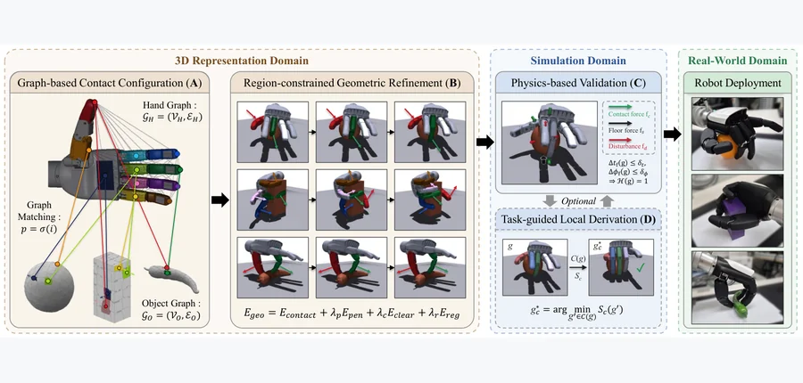 arXiv 2026-10-23 · cs.RO · #26 **[IORA: Irregular Object Immobilization under Restricted Actuation](https://arxiv.org/abs/2610.30969)** Sang-Hun Han, Changyeon Won, JunGyu Lee, Min-Gyu Park, Hae-Gon Jeon 机构：Gwangju Institute of Science and Technology / Yonsei University / Korea Electronics Technology Institute / Polygom（[PDF](https://arxiv.org/pdf/2610.30969)） [Paper](https://arxiv.org/abs/2610.30969) · [图源](https://arxiv.org/html/2610.30969v1/overview_deploy_forces_coloredhand_domains_arrows_v2.png) 

中文摘要
面向任务特定扰动的稳定抓握是机器人操作的重要能力，但多数灵巧抓握合成方法为自由空间中高度驱动的手设计，低自由度手未必能实现所需接触拓扑。另一方面，支撑表面能提供有用的接触力，却通常只被当成几何约束。本文提出面向低自由度耦合手的支撑感知物体固定抓握合成框架。给定不规则物体几何，方法把手和物体的局部表面区域表示为图，并搜索运动学上可行的匹配；随后细化腕部姿态和电机状态以满足几何接触可行性，并通过物理展开验证抓握。以验证过的抓握姿态为起点，可选的任务引导局部搜索改变腕部姿态与电机状态，在附近抓握配置中按指定任务条件选择。多样物体实验显示，该方法生成多种具有高抓握成功率和较强抗扰性的配置；真实实验进一步展示了能在烹饪场景固定物体的、物理上可执行的抓握。 <a href="https://arxiv.org/abs/2610.30969">原摘要来源</a>
 | 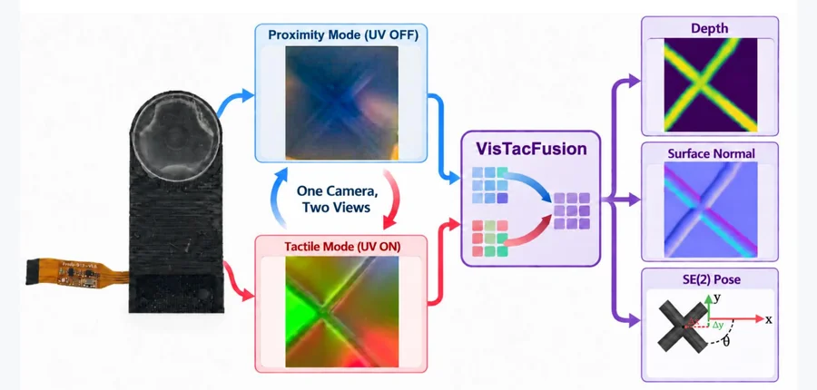 arXiv 2026-10-23 · cs.RO · #27 **[GelSlim 5.0: Unifying Vision and Touch with a Single Fingertip Camera](https://arxiv.org/abs/2610.31334)** Xiangdong Wang, I-Hsuan Huang, Xiaohao Xu, Xili Yi, Nima Fazeli, Xiaonan Huang 机构：University of Michigan（[PDF](https://arxiv.org/pdf/2610.31334)） [Paper](https://arxiv.org/abs/2610.31334) · [图源](https://arxiv.org/html/2610.31334v1/figure1.png) 

中文摘要
视觉和触觉分别提供物体姿态与局部接触几何的互补线索，但外置相机常在接触处被遮挡。本文提出 GelSlim 5.0：一种以单台固定相机和连续紫外响应接触层同时获取视觉与触觉观测的指尖传感器。通过切换照明，相机从共享视角依次获取透过薄膜的视觉图像与对接触敏感的触觉图像，避免相机间外参标定。为融合两种观测，作者提出 VisTacFusion：针对平面物体姿态和接触几何设置独立预测路径的多模态 Transformer。非对称瓶颈融合引入视觉上下文，同时保留用于深度和表面法线估计的触觉空间特征；模态 dropout 允许成对输入或仅用任一模态推理。在来自 12 个已知物体的真实验证数据上，相比同一模型仅用触觉推理，成对输入的深度均方误差、角度误差和位移 L1 误差分别降低 61.2%、72.3% 和 61.3%；相比仅用视觉推理，三个指标分别降低 93.7%、6.1% 和 8.6%。 <a href="https://arxiv.org/abs/2610.31334">原摘要来源</a>
 |
| 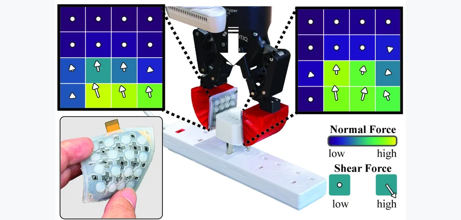 arXiv 2026-10-23 · cs.RO · #28 **[VecTile: A Low-Cost Flexible Tactile Array for 3-DoF Force Sensing](https://arxiv.org/abs/2610.31472)** Jian Hou, Xin Zhou, Adam J. Spiers 机构：Imperial College London（[PDF](https://arxiv.org/pdf/2610.31472)） [Paper](https://arxiv.org/abs/2610.31472) · [图源](https://arxiv.org/html/2610.31472v1/Figure/ICRA_VecTile-01.jpg) 

中文摘要
触觉让机器人获得仅靠视觉难以获取的接触信息。剪切力尤其影响切向接触理解、修正运动和抓握稳定性，但柔性、低成本触觉阵列常只能测法向力。本文提出 VecTile：厚 6 mm、低成本、柔性的三轴力传感阵列。它把压阻层与无源硅胶凸点结合，将法向力和剪切力转化为可区分的压力图案，无需专用设备即可在内部制造；完整的 4×4 阵列系统成本低于 35 美元。作者用有限元分析及硬件实验验证传感机制。在法向力 1–5 N、剪切力最高 1.5 N 的受控单单元测试中，法向与剪切力的均方根误差分别为 0.39 N 和 0.16 N。平面状态下标定的 VecTile 在弯曲时仍保持准确性，五分钟手动标定足以实用。两个应用展示其价值：剪切读数足以在接触后阻止锋利手术刀刺破气球；该传感器还显著改善由 Diffusion Policy 引导的电源插头插入。所有设计与代码计划在论文被接收后发布。 <a href="https://arxiv.org/abs/2610.31472">原摘要来源</a>
 | 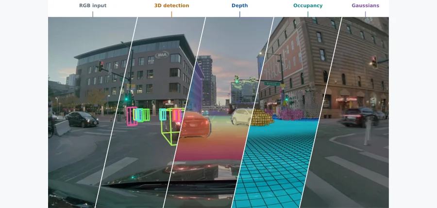 arXiv 2026-10-23 · cs.CV · #29 **[Foundation4D: Towards a unified perception and reconstruction model for autonomous vehicles](https://arxiv.org/abs/2610.30340)** NVIDIA, Sérgio Agostinho, Maximilian Apodaca, Emmanuel Attia, Guillem Braso, George Dong, Ilya Fedorov, Michele Fenzi, Gan… 机构：NVIDIA（[PDF](https://arxiv.org/pdf/2610.30340)） [Paper](https://arxiv.org/abs/2610.30340) · [图源](https://arxiv.org/html/2610.30340v1/teaser-v19-five-bands_compressed.png) 

中文摘要
本文提出 Foundation4D：一种从多相机驾驶视频统一执行几何估计、三维检测、语义占据与高斯重建的前馈模型。共享主干使用分解式时空注意力，高效整合不同相机和时间的观测。视频推理流程通过姿态图优化细化相机轨迹，并跨输入窗口拼接物体轨迹。作者还开发数据标注流程并发布 PAI-Foundation4D 基准，其中 1,253 段驾驶视频具有稠密深度和语义占据标注。在针对各基准微调后，Foundation4D 在所比较方法中取得 Waymo 和 nuScenes 上最低的深度 AbsRel、nuScenes 上最高的检测 mAP，以及 OpenOccupancy 上最高的占据 mIoU。任务组合研究显示检测与几何均获益：将检测与几何和占据联合训练，相较仅训练检测，最高类别的 mAP 提高 1.2 个点；将几何与检测联合训练，相较仅训练几何，相机到车体的平移误差降低 13.4%。作者还把预测的几何和轨迹作为无激光雷达 NuRec 的先验，以支持用于仿真的驾驶场景重建。 <a href="https://arxiv.org/abs/2610.30340">原摘要来源</a>
 | 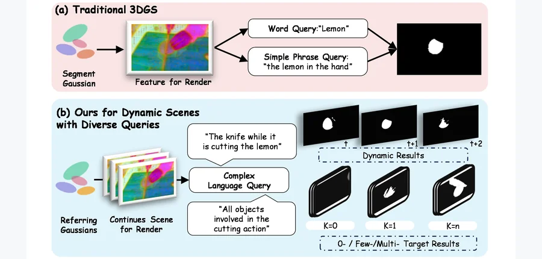 arXiv 2026-10-23 · cs.CV · #30 **[R4DGS: Referring Segmentation in 4D Gaussian Splatting](https://arxiv.org/abs/2610.30326)** Bangpu Chen, Yaxuan Li, Shirui Peng, Xiangtian Si, Liuxin Chu, Xitong Cao, Hongbo Jin, Jiayu Ding 机构：China University of Geosciences / Xinjiang University / University of Nottingham Ningbo China / Peking University（[PDF](https://arxiv.org/pdf/2610.30326)） [Paper](https://arxiv.org/abs/2610.30326) · [图源](https://arxiv.org/html/2610.30326v1/arxiv_fig1.png) 

中文摘要
基于四维高斯泼溅（4DGS）的动态表示已具有较强重建与渲染能力，但对动态场景中复杂自然语言指代的支持仍有限。既有四维高斯方法主要面向渲染动态建模，语义扩展则常依赖针对具体场景的语义优化，或仅在较简单查询上评估。本文研究指代式四维高斯泼溅（R4DGS）任务：在动态四维场景中定位随时间变化、多目标或推理密集的指代表达，以及无目标或含干扰项的表达。作者提出带结构化查询标注的 R4D-Bench-QA 基准，并提出基于 4DGS 的统一框架 ReferGaussian，把底层动态高斯转为持久、可由语言寻址的实体，以免训练方式执行指代推理。它将有掩码支撑的高斯实体组织于 EntityBank，借助多模态大语言模型把复杂查询分解为可追踪的物体短语与结构化指代约束，并在无需针对场景进行语义优化的情况下完成约束感知定位。在 R4D-Bench-QA 与 4D LangSplat 协议上的实验显示，时间目标选择得到改善，时空定位具有竞争力，且无需针对场景的语义训练。论文提供项目资源链接。 <a href="https://arxiv.org/abs/2610.30326">原摘要来源</a>
 |
| 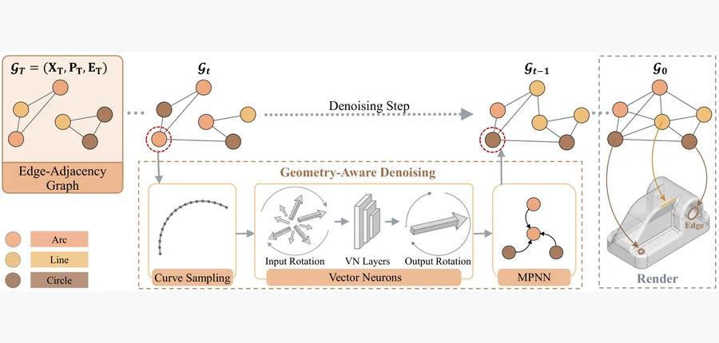 arXiv 2026-10-23 · cs.CV · #31 **[GraphCAD: Geometry-Aware Diffusion on Edge-Adjacency Graphs for CAD Generation](https://arxiv.org/abs/2610.30974)** Wenhao Zheng, Xianggen Liu, Li Yue, Jiancheng Shi, Jiancheng Lv 机构：Sichuan University / Dongfang Electric / Southwest China Research Institute of Electronic Equipment（[PDF](https://arxiv.org/pdf/2610.30974)） [Paper](https://arxiv.org/abs/2610.30974) · [图源](https://arxiv.org/html/2610.30974v1/illu_v4.png) 

中文摘要
计算机辅助设计（CAD）的生成建模，仍面临边界表示（B-rep）中离散拓扑连接与精确空间几何复杂耦合的挑战。既有生成方法多把 CAD 构造表述为序列建模，因此缺乏显式拓扑归纳偏置。本文提出 GraphCAD：以边邻接图（EAG）为中心的几何感知生成框架，EAG 是面向生成任务的新型图式 CAD 表示。GraphCAD 采用混合图扩散联合建模 EAG 的离散与连续成分；几何感知去噪机制把节点属性渲染为空间点集，再由 SE(3) 等变主干编码并融合回节点表示，使生成过程植根于物理空间几何。作者还构建大规模工程 CAD 模型数据集 EAGBench。实验显示 GraphCAD 可生成超过 50 个面的复杂 CAD 模型，在几何保真度及分布对齐方面相较序列式基线达到作者报告的最先进水平。 <a href="https://arxiv.org/abs/2610.30974">原摘要来源</a>
 | 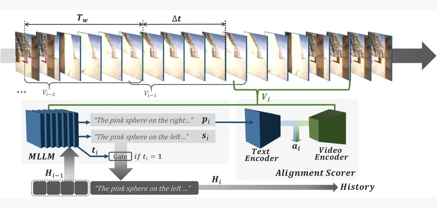 arXiv 2026-10-23 · cs.AI · #32 **[PhysTrace: Interpretable Temporal Evaluation of Physical Consistency in Video Generative Models](https://arxiv.org/abs/2610.31429)** Taekoan Yoo, Wonkyung Jung, Kyunghun Kim, Kyeongbo Kong 机构：Independent Researcher / Pusan National University（[PDF](https://arxiv.org/pdf/2610.31429)） [Paper](https://arxiv.org/abs/2610.31429) · [图源](https://arxiv.org/html/2610.31429v1/fig2.png) 

中文摘要
世界动作模型越来越依赖预训练视频模型，假设它们掌握了可用于预测、规划和动作生成的物理动力学。现有评估检查合理性、探测表示或测量预测意外，却很少指出哪些以历史为条件的物理预期与观测冲突。本文提出 PhysTrace：一种免训练框架，把多模态大语言模型生成的历史条件预期与观测视频窗口对齐，以在时间上定位物理违规并给出可解释描述，无需任务专属探针或分类器。作者还提出 IntPhys2-Timing，为 IntPhys2 增添违规时间区间。PhysTrace 在 IntPhys2-Timing 上跨物理原则取得最高 70.7% 的 Hit Rate，在 IntPhys2 的整体可能／不可能判别准确率上优于所比较方法。将其用于沿预训练扩散／流式视频模型轨迹重建的视频，PhysTrace 揭示物理违规定位中随属性和噪声变化的模式，从而能跨时间步分析物理一致性并提供解释。 <a href="https://arxiv.org/abs/2610.31429">原摘要来源</a>
 | 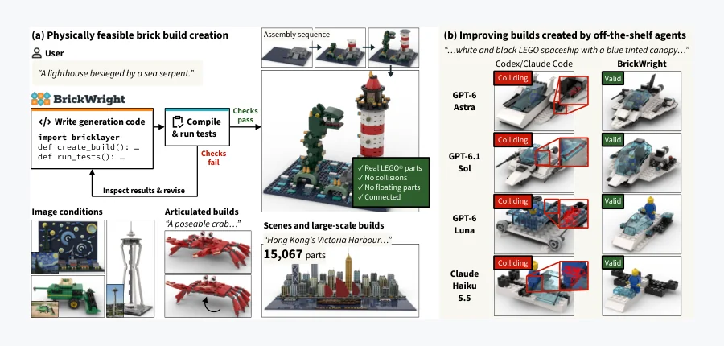 arXiv 2026-10-23 · cs.CV · #33 **[BrickWright: Agentic Creation of Physically Feasible Brick Builds](https://arxiv.org/abs/2610.31651)** Ava Pun, Kevin Dai, Sally Chen, Maxwell Jones, Ruixuan Liu, Kangle Deng, Changliu Liu, Maneesh Agrawala, Deva Ramanan, Jun… 机构：Carnegie Mellon University / Stanford University（[PDF](https://arxiv.org/pdf/2610.31651)） [Paper](https://arxiv.org/abs/2610.31651) · [图源](https://arxiv.org/html/2610.31651v1/teaser.png) 

中文摘要
前沿编码智能体愈发擅长三维建模，但在创建要在现实世界中组装的物体时，仍常产生悬空、碰撞或断开的无效组件。作者认为，提供组装工具和物理可行性验证，足以帮助智能体在遵循输入提示的同时生成物理有效的组件。聚焦乐高积木，本文提出 BrickWright：利用预训练智能体从文本或图像提示生成物理可行积木结构的框架。所谓可行，是指仅使用真实零件、无碰撞或悬空部件，并在可能时形成连通结构。BrickWright 引导智能体使用 BrickLayer Python 工具包编写代码；工具包的易用积木组装 API 相比直接使用原始 LDraw 将推理成本减半，验证器则反馈物理可行性。在 512 个提示样本上，基线智能体的物理有效率从 9%（GPT-6 Luna）到 69%（GPT-6 Astra）不等，使用 BrickWright 后达到 100%；轻量级智能体的提示遵循度提高，较强智能体的遵循度得以保持。方法在文生积木任务上也超过专门模型。代码位于项目页。 <a href="https://arxiv.org/abs/2610.31651">原摘要来源</a>
 |
| 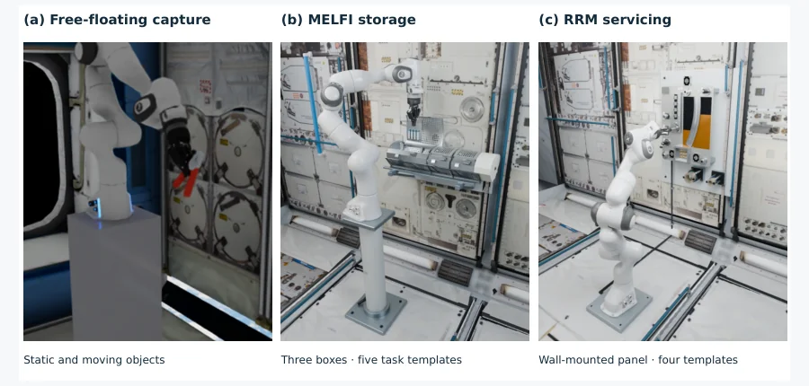 arXiv 2026-10-23 · cs.RO · #34 **[AstroBench: Benchmarking Free-Floating Capture and Space Robotic Manipulation](https://arxiv.org/abs/2610.31064)** Zizhe Wang, Jia Deng, Xin Lu, Zehao Jia, Yi Huang, Yao Zhu 机构：Astroup Lab / Harbin Institute of Technology, Beijing Research Institute（[PDF](https://arxiv.org/pdf/2610.31064)） [Paper](https://arxiv.org/abs/2610.31064) · [图源](https://arxiv.org/html/2610.31064v1/overview.png) 

中文摘要
在航天器内部抓取自由漂浮物体时，机器人须接近会平移、旋转且在接触后改变运动的目标，因此需要超越有支撑物体操作的评测。本文提出 AstroBench：使用固定基座机械臂评估自由漂浮捕获和空间机器人操作的开放基准。任务集结合四种初始运动轨道、基于 MELFI 硬件的样本存放操作，以及基于 Robotic Refueling Mission 的盖子和系留螺钉维护；两个工作单元提供九种任务定义和 29 种任务—目标组合。经过元数据筛选的 Objaverse 资产库提供 8,414 个物体实例以扩展资产，另有五种舱内视觉背景和带版本的任务指令。作者报告两组使用现有检查点、聚焦获取目标的实验：冻结的 π₀.₅ DROID 关节位置策略在 20 种物体身份上，分别捕获 200 个静态目标中的 2 个和 200 个运动目标中的 4 个；另一个实验中，特定于立方体的 ACT 策略分别捕获 10 个静态目标中的 8 个和 10 个运动目标中的 6 个。每组实验保留所记录的观测、动作和捕获配置。结果记录了所测通用检查点的直接迁移困难，以及任务专属的成功捕获行为，并给出研究运动感知与接触敏感控制的具体设置。代码、任务定义和可编辑工作单元资产可获取。 <a href="https://arxiv.org/abs/2610.31064">原摘要来源</a>
 | 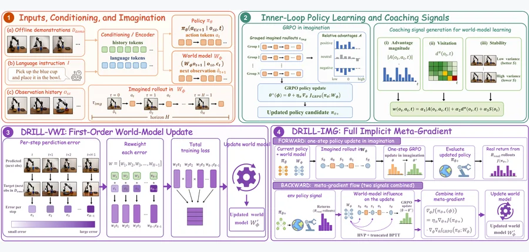 arXiv 2026-10-23 · cs.CV · #35 **[DRILL: Training World Models to Improve Policies, Not Predict Pixels](https://arxiv.org/abs/2610.30814)** Zhaolu Kang, Tailong Luo, Lei Wei, Guangyuan Dong, Sihan Liu, Yingjie He, Siheng Wang, Shuaibo Li, Rongchao Zhang, Zhen Ti… 机构：Tencent Hunyuan / Peking University（[PDF](https://arxiv.org/pdf/2610.30814)） [Paper](https://arxiv.org/abs/2610.30814) · [图源](https://arxiv.org/html/2610.30814v1/drill.png) 

中文摘要
在利用强化学习对视觉—语言—动作（VLA）策略进行后训练时，世界模型越来越常用于减少环境交互，但通常仍以单步像素预测来训练。这里世界模型的职责并非仅渲染视觉逼真的视频，而是从想象展开中产生能改善策略的学习信号；作者表明两者存在显著不匹配：更低的像素 MSE 可能带来更差的策略梯度，而面向策略效用训练的世界模型即使下一帧像素 MSE 高出 17%，仍可得到更好的下游策略。本文提出 Downstream-Return Imagination Learning Loop（DRILL），通过双层优化，在想象展开上的内层 GRPO 更新之后最大化策略回报来更新世界模型。DRILL 有两个实现：DRILL-VWI 是无需额外仿真器展开的闭式替代方法，按照策略访问、组相对 GRPO 优势及模型置信度重加权预测误差；DRILL-IMG 是通过截断 Hessian—向量积对内层更新求导的完整元梯度方法。作者在分数兼容和小残差假设下证明，DRILL-VWI 可恢复 DRILL-IMG 元梯度的局部单步分量。在五个操作仿真器和两个 VLA 主干上，DRILL-IMG 的平均成功率比 WMPO 高 13.1 个百分点、比 RLVR-World 高 7.9 个百分点，并可补充而非取代 RLVR 预训练。作者认为，用于 VLA 强化学习的视频世界模型也可按其产生的策略梯度训练，而不只按像素预测训练。 <a href="https://arxiv.org/abs/2610.30814">原摘要来源</a>
 | 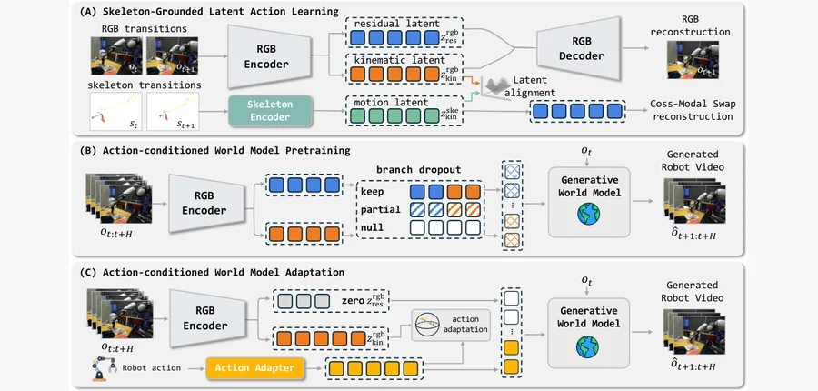 arXiv 2026-10-23 · cs.RO · #36 **[Skeleton-Grounded Latent Action Model for Robot World Models](https://arxiv.org/abs/2610.31474)** Qi Lv, Jiayi Lin, Yuxin Jiang, Jianzong Wang, Xiang Deng, Mike Shou Zheng 机构：Harbin Institute of Technology (Shenzhen) / National University of Singapore / Ping An Tech（[PDF](https://arxiv.org/pdf/2610.31474)） [Paper](https://arxiv.org/abs/2610.31474) · [Project](https://aopolin-lv.github.io/SkeLAM/) · [图源](https://arxiv.org/html/2610.31474v1/overview.png) 

中文摘要
机器人世界模型模拟环境如何随机器人动作演化。潜动作模型通过把视觉变化编码为代理动作，从视频中学习动力学；然而，以重建为目标的潜动作会混合机器人运动、物体反应和其他场景变化，削弱其与机器人控制的对应。本文提出 SkeLAM：用于可控机器人世界建模的骨架引导潜动作模型。SkeLAM 将潜动作分解为受机器人骨架监督约束的运动学分量，以及保留互补视觉动力学的残差分量。跨模态交换重建促使从 RGB 与骨架导出的运动学表示在视频重建时可互换。世界模型通过独立条件路径纳入两种分量，并用分支 dropout 减少对未来导出残差信息的依赖。轻量适配器将机器人动作映射到运动学空间，随后通过世界模型微调，使生成适配预测条件。推理时，模型由当前观测和机器人动作生成未来观测。在 DROID 上，相比 DreamDojo，SkeLAM 的末端执行器平均位移误差（ADE）降低 19.5%，LPIPS 降低 11.1%。运动探测支持运动学专门化，定性结果显示生成展开中的零样本人到机器人运动迁移；策略评估中预测成功率与真实机器人执行测得的成功率一致。 <a href="https://arxiv.org/abs/2610.31474">原摘要来源</a>
 |
| 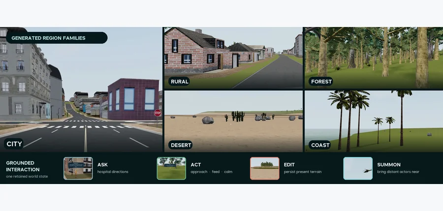 arXiv 2026-10-23 · cs.CV · #37 **[WorldStream: Streaming Interactive 3D Worlds with Hierarchical Planning and Persistent State](https://arxiv.org/abs/2610.28827)** Xiaoxiao Ma, Weiyang Jin, Yanwen Ma, Haoran Li, Zhixiang Wei, Songchun Zhang, Yaowei Li, Junhao Zhuang, Zeyue Xue, Yuming… 机构：University of Science and Technology of China / JoyFuture Academy, JD（[PDF](https://arxiv.org/pdf/2610.28827)） [Paper](https://arxiv.org/abs/2610.28827) · [图源](https://arxiv.org/html/2610.28827v1/figures/teaser-worldstream.jpg) 

中文摘要
本文提出 WorldStream，一种开放式三维世界模型，同时具有三项能力：把可游玩的地形扩展到任何预设地图之外；在运行中的世界里根据开放式语言执行动作；恢复曾到访地点及其编辑。基于类型化决策模型的分层规划器输出结构化决策状态：宏观层在一组地图片上固定聚落、生态、交通和水文结构；微观层依据实测地形和已接受的邻接承诺，将该约定细化为单片语义。确定性的本地代码把已接受规划编译成地形、道路、聚落、植被和实体。流式系统将规划、编译和几何的作用范围分开：沿预测路线提前规划，只在即将移动到的区域编译，并释放用户身后的几何。一个世界记录保留规划、种子、物体身份与可变状态、边界承诺以及按属性组织的编辑，随用户前进和修改而修订；返回旧片时从该记录重编译。交互也以同一记录为依据：模型可以作用于已有实体，包括随行动更新状态的 NPC，编辑当前区域，或给未规划区域附加意图。这些机制共同使世界在有界预算下扩展、跨独立规划的地图片保持连接并可交互。 <a href="https://arxiv.org/abs/2610.28827">原摘要来源</a>
 | 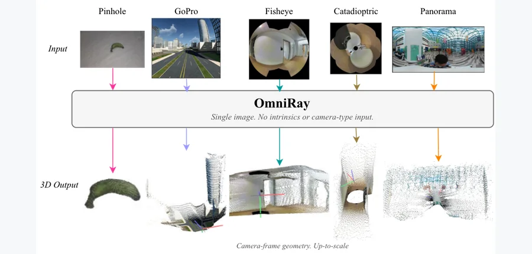 arXiv 2026-10-23 · cs.CV · #38 **[OmniRay: Camera-Agnostic Monocular 3D Reconstruction with Composite Ray Fields](https://arxiv.org/abs/2610.31645)** Namitha Guruprasad, Abhay Yadav, Cheng Peng, Rama Chellappa, Anand Bhattad 机构：Johns Hopkins University / University of Virginia（[PDF](https://arxiv.org/pdf/2610.31645)） [Paper](https://arxiv.org/abs/2610.31645) · [Project](https://nam1410.github.io/omniray/) · [图源](https://arxiv.org/html/2610.31645v1/teaser.drawio_lates.png) 

中文摘要
单目模型可一次从单张图像恢复三维几何，但大多假设针孔相机，对鱼眼和全景镜头产生的广角图像会生成扭曲几何。相机感知模型通过预测逐像素射线场消除此假设，但通常用单一固定基表示总体投影和更细的变化。作者认为，相机几何具有层次复杂性，可用于表示射线。本文提出 OmniRay：一种前馈模型，其射线模块由捕捉径向对称结构的单调径向基、表示平滑偏离的球谐残差及描述剩余局部变化的自由形态残差组成。这些成分作为球面上的连续旋转组合，以适应多样相机几何。给定单张图像，OmniRay 对每个像素预测射线方向与仅差一个尺度的径向距离，从而无需推理时提供相机信息即可恢复三维点云。跨不同相机配置的广泛实验显示，OmniRay 在相机无关的单目三维重建中达到作者报告的最先进水平。 <a href="https://arxiv.org/abs/2610.31645">原摘要来源</a>
 | 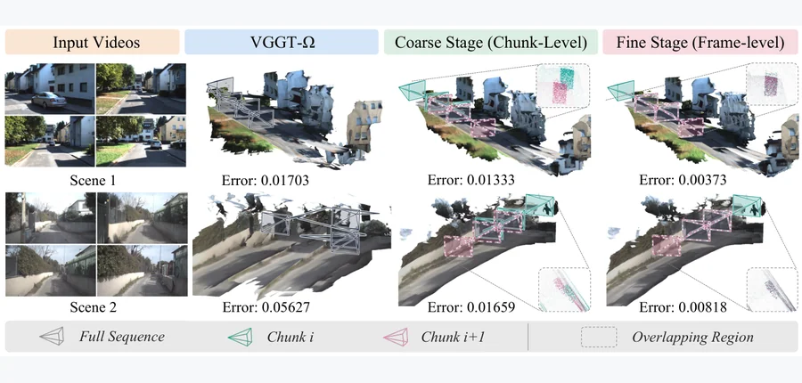 arXiv 2026-10-23 · cs.CV · #39 **[HiP3R: Hierarchical Pose Graphs for Long-Horizon 3D Reconstruction](https://arxiv.org/abs/2610.31635)** Zunnan Xu, Shangchen Zhou, Yihang Luo, Chen Change Loy 机构：Nanyang Technological University / Imperial College London / ACE Robotics（[PDF](https://arxiv.org/pdf/2610.31635)） [Paper](https://arxiv.org/abs/2610.31635) · [Project](https://kkakkkka.github.io/HiP3R/) · [图源](https://arxiv.org/html/2610.31635v1/teaser.png) 

中文摘要
前馈模型能从短视频窗口准确估计相机运动和三维几何，但计算与内存成本使其难以直接处理数千帧序列，长视频须分为重叠片段。这会产生坐标系不一致、共享相机重复估计的独立局部重建；全局一致性要求在整段视频中传播相邻重叠和远距离重访带来的约束，因此自然需要姿态图优化。图层级选择存在权衡：片段级图可高效解决尺度漂移和大环闭合，但刚性变换无法修正内部误差或冲突帧预测；帧级优化更灵活，却难以在全局扩展，也可能破坏度量尺度。HiP3R 以分层姿态图解决该权衡：先优化稳健的片段级 Sim(3) 图，建立全局布局与尺度；再固定布局，为每帧估计一个共享 SE(3) 相机，把重叠窗口预测合并为单条轨迹。多项基准实验表明 HiP3R 可改善相机轨迹和三维重建。方法无需额外训练或微调，适用于基于片段与流式处理的后端。论文提供代码链接。 <a href="https://arxiv.org/abs/2610.31635">原摘要来源</a>
 |
| 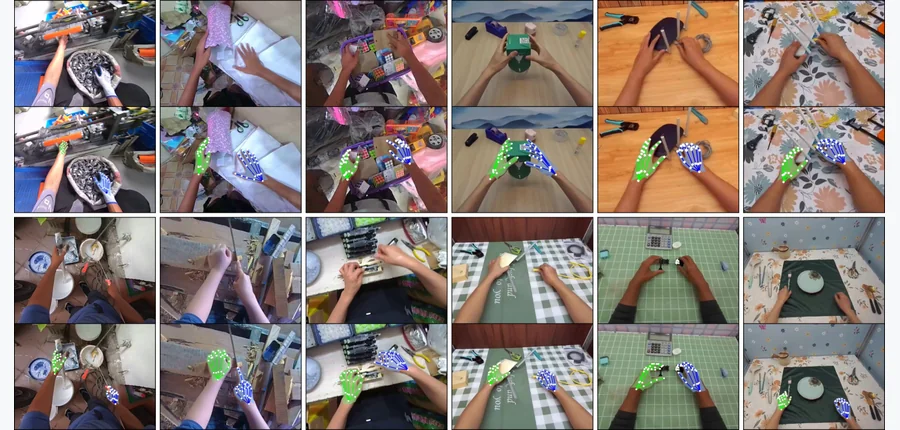 arXiv 2026-10-23 · cs.CV · #40 **[EgoHand: Monocular 3D Hand Reconstruction from Egocentric Video](https://arxiv.org/abs/2610.30293)** Chao-Yeh Chen, Tiffany Chen, Lin Duan, Tianyi Hu, Yu-Hsiang Huang, Umar Iqbal, Jiefeng Li, Edy Lim, Yanchen Liu, Yihan Pan… 机构：NVIDIA（[PDF](https://arxiv.org/pdf/2610.30293)） [Paper](https://arxiv.org/abs/2610.30293) · [图源](https://arxiv.org/html/2610.30293v1/egohand_teaser_mesh_skeleton.png) 

中文摘要
本文提出 EgoHand：一种面向第一视角视频的单目三维手部重建模型，取得作者报告的最先进表现。方法核心是整理包含 1,400 万张图像的高质量训练语料，结合合成数据、野外视频和多相机动作捕捉，在场景多样性与监督质量之间平衡。模型采用 SOMA-Hand 参数化表示，使用 Transformer 编码器处理二维手部裁剪，并加入相机线索和辅助二维分支，以改善几何一致性及图像对齐。在 HOT3D、ARCTIC 和 H2O 上的零样本评估显示较强的域外泛化：关节位置、根部平移和加速度误差均低于所比较基线，推理延迟约为 9.69 ms。盲测用户偏好研究还显示，参与者更偏好 EgoHand 重建的手部姿态，而非 Apple EgoDex 和 Ropedia Xperience-10M 的结果。作者以允许模型免费商业使用的 OpenMDW 许可证发布 EgoHand 模型和源代码。 <a href="https://arxiv.org/abs/2610.30293">原摘要来源</a>
 |   |   |
<!-- PAPER_CARDS_END -->

## 检索概况

- **检索窗口**：上次发布（北京时间 2026-10-22 09:25）至本次官方页面核对（北京时间 2026-10-23 10:45）。
- **官方批次**：检索期间分类页由 Thursday, 22 October 2026 切换到 Friday, 23 October 2026。为不遗漏 22 日正式 New 批次，本期收录两个自上次日报以来的新批次；同一 ID 去重。
- **来源口径**：23 日批次来自 14 个官方 `/new` 分类页；22 日批次的前九个分类来自切换前保存的官方 `/new` 页面，其余五个从官方 `/pastweek` 的 22 日区段按主分类恢复。仅这些 New 条目进入主榜。
- **官方 New 总命中**：22 日 **657**、23 日 **682**，合计 **1339** 个去重 ID；本期按标题和原摘要入选 **40 篇**。
- **Cross／Replacement**：23 日 `/new` 分类页分别显示 Cross **347**、Replacement **593** 条；22 日的五个历史分类页不再提供独立 Cross／Replacement 分段，故不合并成未经核实的两日总数。
- **摘要与配图**：原文及忠实中文译文保存于 `data/enrichment.json`；本期缺图 **0** 篇、缺原摘要 **0** 篇。

## 官方 listing 状态

| 官方分类页 | 22 日 New | 23 日 New | 23 日 Cross | 23 日 Replacement |
|---|---:|---:|---:|---:|
| [cs.CV 23日 New](https://arxiv.org/list/cs.CV/new?show=2000) / [22日历史](https://arxiv.org/list/cs.CV/pastweek?show=2000) | 121 | 102 | 12 | 78 |
| [cs.GR 23日 New](https://arxiv.org/list/cs.GR/new?show=2000) / [22日历史](https://arxiv.org/list/cs.GR/pastweek?show=2000) | 1 | 0 | 3 | 2 |
| [cs.RO 23日 New](https://arxiv.org/list/cs.RO/new?show=2000) / [22日历史](https://arxiv.org/list/cs.RO/pastweek?show=2000) | 69 | 63 | 6 | 38 |
| [cs.AI 23日 New](https://arxiv.org/list/cs.AI/new?show=2000) / [22日历史](https://arxiv.org/list/cs.AI/pastweek?show=2000) | 63 | 103 | 126 | 137 |
| [cs.LG 23日 New](https://arxiv.org/list/cs.LG/new?show=2000) / [22日历史](https://arxiv.org/list/cs.LG/pastweek?show=2000) | 137 | 117 | 88 | 134 |
| [physics 23日 New](https://arxiv.org/list/physics/new?show=2000) / [22日历史](https://arxiv.org/list/physics/pastweek?show=2000) | 78 | 79 | 31 | 46 |
| [cond-mat 23日 New](https://arxiv.org/list/cond-mat/new?show=2000) / [22日历史](https://arxiv.org/list/cond-mat/pastweek?show=2000) | 77 | 77 | 22 | 58 |
| [math.OC 23日 New](https://arxiv.org/list/math.OC/new?show=2000) / [22日历史](https://arxiv.org/list/math.OC/pastweek?show=2000) | 22 | 35 | 6 | 26 |
| [math.NA 23日 New](https://arxiv.org/list/math.NA/new?show=2000) / [22日历史](https://arxiv.org/list/math.NA/pastweek?show=2000) | 21 | 29 | 7 | 10 |
| [math.DS 23日 New](https://arxiv.org/list/math.DS/new?show=2000) / [22日历史](https://arxiv.org/list/math.DS/pastweek?show=2000) | 14 | 16 | 10 | 15 |
| [stat.ML 23日 New](https://arxiv.org/list/stat.ML/new?show=2000) / [22日历史](https://arxiv.org/list/stat.ML/pastweek?show=2000) | 13 | 13 | 13 | 18 |
| [eess.IV 23日 New](https://arxiv.org/list/eess.IV/new?show=2000) / [22日历史](https://arxiv.org/list/eess.IV/pastweek?show=2000) | 3 | 13 | 1 | 3 |
| [eess.SY 23日 New](https://arxiv.org/list/eess.SY/new?show=2000) / [22日历史](https://arxiv.org/list/eess.SY/pastweek?show=2000) | 21 | 24 | 16 | 17 |
| [eess.SP 23日 New](https://arxiv.org/list/eess.SP/new?show=2000) / [22日历史](https://arxiv.org/list/eess.SP/pastweek?show=2000) | 17 | 11 | 6 | 11 |

> 22 日前九类 New 数为当时官方 `/new` 分段计数；后五类由官方 [`pastweek`](https://arxiv.org/list/eess.IV/pastweek?show=2000) 的日期区段按论文主分类恢复。

## Top papers

> 标题、作者、分类、摘要与论文自述结果均链接官方 arXiv；机构由所链 PDF 首页核对，未核实者明示。相关性、机构强度、阅读优先级、局限与建议均为本日报**推断**。

| # | 论文 | arXiv | 分类 | 作者 | 机构 | 相关性（推断） | 机构强度（推断） | 阅读优先级（推断） | 批次 |
|---:|---|---|---|---|---|---|---|---|---|
| 1 | PhyMo: Learning Physical Dynamics with Accurate and Continuous Motion from Multi-View Videos | [arXiv:2610.29107](https://arxiv.org/abs/2610.29107) | cs.CV | Shangjia Liu, Jinxi Li, Siyuan Zhou, Bo Yang, Bing Wang | The Hong Kong Polytechnic University（[PDF](https://arxiv.org/pdf/2610.29107)） | 高（3D／物理交叉） | 中高 | 中高 | 10-22 |
| 2 | CW-WAM: A Structured Contact-Wrench World Action Model for Force-Sensitive Manipulation | [arXiv:2610.30117](https://arxiv.org/abs/2610.30117) | cs.RO | Houzhu Ding, Xinda Qi, Luqi Wang, Ming Yang | Ant Group（[PDF](https://arxiv.org/pdf/2610.30117)） | 高（3D／物理交叉） | 中高 | 中高 | 10-22 |
| 3 | DeXplicit: Making Physical State Explicit in Dexterous Manipulation World Models | [arXiv:2610.30781](https://arxiv.org/abs/2610.30781) | cs.CV | Adam Lee, Mutian Xu, Yukang Cao, Shulin Tian, Ziwei Liu | Nanyang Technological University / University of California, Berkeley（[PDF](https://arxiv.org/pdf/2610.30781)） | 高（3D／物理交叉） | 中高 | 中高 | 10-23 |
| 4 | UniFlowWAM: A Unified World-Action Model with Visual Semantics and 4D Geometry | [arXiv:2610.30991](https://arxiv.org/abs/2610.30991) | cs.RO | Jialin Tian, Zhuofan Li, Xinkai Wang, Bokai Lin, Chenyi Wang, Xinyu Zhan, Cewu Lu, Lixin Yang | Shanghai Jiao Tong University / Shanghai Innovation Institute / Noematrix（[PDF](https://arxiv.org/pdf/2610.30991)） | 高（3D／物理交叉） | 中高 | 中高 | 10-23 |
| 5 | PhysiCalWorld: In-Context Physics Calibration for World Models | [arXiv:2610.30125](https://arxiv.org/abs/2610.30125) | cs.RO | Yunhao Luo, Wentao He, Yinpei Dai, Hyelin Nam, Hongze Fu, Joyce Chai, Nima Fazeli, Jeong Joon Park | University of Michigan（[PDF](https://arxiv.org/pdf/2610.30125)） | 高（3D／物理交叉） | 中高 | 中高 | 10-22 |
| 6 | AgentDreamer: Agentic 3D Motion Reasoning for Text-Controllable Physics Simulation | [arXiv:2610.30679](https://arxiv.org/abs/2610.30679) | cs.CV | Mijeong Kim, Suho Park, Junha Park, Bohyung Han | affiliation 未确认 | 高（3D／物理交叉） | 未评估 | 中高 | 10-23 |
| 7 | AutoPhyX: Automatic Text-Condition Physics Property Generation | [arXiv:2610.29517](https://arxiv.org/abs/2610.29517) | cs.CV | Bei Huang, Yixin Chen, Hongbin Zha, Yuru Pei, Siyuan Huang | Peking University / Beijing Institute for General Artificial Intelligence / Anqing Normal University（[PDF](https://arxiv.org/pdf/2610.29517)） | 高（3D／物理交叉） | 中高 | 中高 | 10-22 |
| 8 | Causal world models under physical parameter shifts | [arXiv:2610.29088](https://arxiv.org/abs/2610.29088) | cs.LG | Chu Lin, Yi Sun | The City College of New York（[PDF](https://arxiv.org/pdf/2610.29088)） | 高（3D／物理交叉） | 中高 | 中高 | 10-22 |
| 9 | Monocular 3D bubble reconstruction: DNS-informed ray tracing and deep learning | [arXiv:2610.28908](https://arxiv.org/abs/2610.28908) | physics.flu-dyn | Chaitanya S. Nayak, Faizaan Mohammed, Vivek Kumar, Shivam Prajapati, Suhas S. Jain, Cyrus K. Aidun | Georgia Institute of Technology（[PDF](https://arxiv.org/pdf/2610.28908)） | 高（3D／物理交叉） | 中高 | 中高 | 10-22 |
| 10 | PiHand: Latent Hand-Object Interaction Priors for Physics-Based Policy Learning | [arXiv:2610.31299](https://arxiv.org/abs/2610.31299) | cs.CV | Niklas Berndt, Xianghui Xie, Enes Duran, Yixiao Wang, Gerard Pons-Moll | University of Tübingen / Tübingen AI Center / Max Planck Institute for Informatics / University of California, Berkeley（[PDF](https://arxiv.org/pdf/2610.31299)） | 高（3D／物理交叉） | 中高 | 中高 | 10-23 |
| 11 | In-Context Learning World Models for Robot Dual-Arm Manipulation of Soft Garment with Partial Observations | [arXiv:2610.30988](https://arxiv.org/abs/2610.30988) | cs.RO | Hengyi Sim, Quentin Rouxel, Dennis Hong, Darwin Caldwell, Fei Chen | The Chinese University of Hong Kong / University of California, Los Angeles / Istituto Italiano di Tecnologia（[PDF](https://arxiv.org/pdf/2610.30988)） | 高（3D／物理交叉） | 中高 | 中高 | 10-23 |
| 12 | DiffDreamer: Coupling World Models with Differentiable Simulation for Agile Quadrotor Control | [arXiv:2610.31617](https://arxiv.org/abs/2610.31617) | cs.RO | Fanxing Li, Yuxiang Huang, Shengyang Wang, Fangyu Sun, Shuyu Wu, Tianbao Zhang, Dexin Zuo, Yan Yufei, Danping Zou, Wenxian Yu | affiliation 未确认 | 高（3D／物理交叉） | 未评估 | 中高 | 10-23 |
| 13 | FlowVLA: Learning Flow-Aware Physical Completion for Quantitative Robotic Pouring | [arXiv:2610.29692](https://arxiv.org/abs/2610.29692) | cs.RO | Liwen Yang, Yutian Zhang, Jiaqi Zhai, Li Yang, Tutian Tang, Qiwei Shan, Yancheng Bi, Qiankuan Shangguan, Yangkun Zhu, Ce Hao, Dong Wei, Qiaojun Yu, Dibo Hou | Zhejiang University / DEEP Robotics / Shanghai Artificial Intelligence Laboratory / Northeastern University / Beijing Zhongguancun Academy（[PDF](https://arxiv.org/pdf/2610.29692)） | 高（3D／物理交叉） | 中高 | 中高 | 10-22 |
| 14 | T-WLA: Bridging Slow Vision and Fast Touch | [arXiv:2610.28814](https://arxiv.org/abs/2610.28814) | cs.RO | Kaichen Zhou, Yuzhen Chen, Hannah Yao, Chonghe Jiang, Rao Fu, Xihang Yu, Wei Dai, Bashar Kabbarah, Haoyu Chen, Ishita Goluguri, Zhiyang Dou, Haonan Chen, Fangneng Zhan, Mengyu Wang, Wojciech Matusik, Antonio Torralba, Paul Pu Liang | Massachusetts Institute of Technology / Harvard University / University of California, Davis / University of California, Berkeley（[PDF](https://arxiv.org/pdf/2610.28814)） | 高（3D／物理交叉） | 中高 | 中高 | 10-22 |
| 15 | GeoMem-VLA: Internalizing 3D Scene Understanding into Temporal Memory for Vision-Language-Action Models | [arXiv:2610.29866](https://arxiv.org/abs/2610.29866) | cs.CV | Qinfan Zhang, Yifan Luo, Haoyuan Shi, Guanlin Liu, Han Dong, Haozhe Shan, Yong Dai, Xiangcong Ren, Xiaozhu Ju | Beihang University / Renmin University of China / X-Humanoid / University of Science and Technology of China / Fudan University / The Chinese University of Hong Kong, Shenzhen（[PDF](https://arxiv.org/pdf/2610.29866)） | 高（3D／物理交叉） | 中高 | 中高 | 10-22 |
| 16 | Reconstruction-Augmented Visuomotor Pre-Training of 3D-Grounded Bimanual Dexterity from RGB-Only Human Videos | [arXiv:2610.29716](https://arxiv.org/abs/2610.29716) | cs.RO | Xingyi He, Zhiwen Qiu, Adhitya Polavaram, Yunhao Cao, Cory Fan, Julius Samwer, Saleh Kalantari, Kuan Fang | Cornell University（[PDF](https://arxiv.org/pdf/2610.29716)） | 高（3D／物理交叉） | 中高 | 中高 | 10-22 |
| 17 | Relational Geometry Forcing for World Action Models | [arXiv:2610.29282](https://arxiv.org/abs/2610.29282) | cs.RO | Yuan Xu, Yixiang Chen, Qisen Ma, Jiabing Yang, Peiyan Li, Kai Wang, Jianhua Yang, Jianlou Si, Jun Huang, Jing Liu, Nianfeng Liu, Yan Huang, Liang Wang | Institute of Automation, Chinese Academy of Sciences / University of Chinese Academy of Sciences / Alibaba Group / FiveAges（[PDF](https://arxiv.org/pdf/2610.29282)） | 高（3D／物理交叉） | 中高 | 中高 | 10-22 |
| 18 | PRISM: Learning Realistic Depth via Physics-Grounded Noise Disentanglement with Semantic-Geometric Collaboration | [arXiv:2610.29432](https://arxiv.org/abs/2610.29432) | cs.RO | Xiujian Liang, Jiacheng Liu, Mingyang Sun, Qichen He, Anda Cheng, Cewu Lu, Jianhua Sun | Fudan University / Shanghai Innovation Institute / Zhejiang University / Shanghai Jiao Tong University / Ant Group（[PDF](https://arxiv.org/pdf/2610.29432)） | 高（3D／物理交叉） | 中高 | 中高 | 10-22 |
| 19 | RLMuscle: Muscle-Driven Character Animation via Reinforcement Learning | [arXiv:2610.30033](https://arxiv.org/abs/2610.30033) | cs.GR | Chunlei Li, Siyuan Yu, Yang Gao, Shuai Li, Peng Yu, Aimin Hao, He Wang | Beihang University / Westlake University / University College London（[PDF](https://arxiv.org/pdf/2610.30033)） | 高（3D／物理交叉） | 中高 | 中高 | 10-22 |
| 20 | PhysibleMDM: Enforcing Inference-Time Physical Feasibility Constraints on Motion Diffusion Models via Noise Optimization | [arXiv:2610.30500](https://arxiv.org/abs/2610.30500) | cs.RO | Maximilian Stölzle, David Müller, Agon Serifi, Ruben Grandia, Espen Knoop, Moritz Bächer | Disney Research / MIT CSAIL（[PDF](https://arxiv.org/pdf/2610.30500)） | 高（3D／物理交叉） | 中高 | 中高 | 10-23 |
| 21 | OpenTac: An Open Ecosystem for Customizable, Scalable, and Transferable 3D Tactile Sensing | [arXiv:2610.31661](https://arxiv.org/abs/2610.31661) | cs.RO | Ariel Slepyan, Geeta Chandra Raju Bethala, Jiafeng Gu, Anagha Rajendra Dangle, Yinzhe Zhou, Hongyuan Fu, Jade Sim, Tuhin Basu, Xinyi Yin, Md Faizal Karim, Gregory Hager, Homanga Bharadhwaj, Anand Bhattad, Krishna Murthy Jatavallabhula, Nitish V. Thakor | Johns Hopkins University / Massachusetts Institute of Technology（[PDF](https://arxiv.org/pdf/2610.31661)） | 高（3D／物理交叉） | 中高 | 中高 | 10-23 |
| 22 | AcoustiPrint: Physics-Guided Neural Design of Manufacturable Acoustic Structures | [arXiv:2610.30411](https://arxiv.org/abs/2610.30411) | cs.LG | Shanmuka Sadhu, Harshvardhan C. Takawale, Yehia Zakaria, Ahmed Allam, Nirupam Roy | University of Maryland, College Park / University of Cincinnati（[PDF](https://arxiv.org/pdf/2610.30411)） | 高（3D／物理交叉） | 中高 | 中高 | 10-23 |
| 23 | MoRE: Motion-Regularized Encoding for Articulated 3D Generation | [arXiv:2610.30337](https://arxiv.org/abs/2610.30337) | cs.CV | Guantian Zheng, Shan Jin | Manifest Limited / University of Cambridge / Nanyang Technological University（[PDF](https://arxiv.org/pdf/2610.30337)） | 高（3D／物理交叉） | 中高 | 中高 | 10-23 |
| 24 | H-2DGS: Height-Field Gaussian Splatting for Sharp and Deformable Neurosurgical Surface Reconstruction | [arXiv:2610.30910](https://arxiv.org/abs/2610.30910) | eess.IV | Zhang Zichuan, Bart Brouwers, Rembrandt Bakker, Maud Landers, Geert-Jan Rutten, Maxime Chamberland | Eindhoven University of Technology / Elisabeth-Tweesteden Hospital（[PDF](https://arxiv.org/pdf/2610.30910)） | 高（3D／物理交叉） | 中高 | 中高 | 10-23 |
| 25 | SciFusion: Physics-Guided Compositional Diffusion for Multimodal 3D Scientific Image Generation | [arXiv:2610.30313](https://arxiv.org/abs/2610.30313) | eess.IV | Luoxi Wang, Alessio Quercia, Hanno Scharr, Arya Bangun | Princeton University / Forschungszentrum Jülich（[PDF](https://arxiv.org/pdf/2610.30313)） | 高（3D／物理交叉） | 中高 | 中高 | 10-23 |
| 26 | IORA: Irregular Object Immobilization under Restricted Actuation | [arXiv:2610.30969](https://arxiv.org/abs/2610.30969) | cs.RO | Sang-Hun Han, Changyeon Won, JunGyu Lee, Min-Gyu Park, Hae-Gon Jeon | Gwangju Institute of Science and Technology / Yonsei University / Korea Electronics Technology Institute / Polygom（[PDF](https://arxiv.org/pdf/2610.30969)） | 高（3D／物理交叉） | 中高 | 中高 | 10-23 |
| 27 | GelSlim 5.0: Unifying Vision and Touch with a Single Fingertip Camera | [arXiv:2610.31334](https://arxiv.org/abs/2610.31334) | cs.RO | Xiangdong Wang, I-Hsuan Huang, Xiaohao Xu, Xili Yi, Nima Fazeli, Xiaonan Huang | University of Michigan（[PDF](https://arxiv.org/pdf/2610.31334)） | 高（3D／物理交叉） | 中高 | 中高 | 10-23 |
| 28 | VecTile: A Low-Cost Flexible Tactile Array for 3-DoF Force Sensing | [arXiv:2610.31472](https://arxiv.org/abs/2610.31472) | cs.RO | Jian Hou, Xin Zhou, Adam J. Spiers | Imperial College London（[PDF](https://arxiv.org/pdf/2610.31472)） | 高（3D／物理交叉） | 中高 | 中高 | 10-23 |
| 29 | Foundation4D: Towards a unified perception and reconstruction model for autonomous vehicles | [arXiv:2610.30340](https://arxiv.org/abs/2610.30340) | cs.CV | NVIDIA, Sérgio Agostinho, Maximilian Apodaca, Emmanuel Attia, Guillem Braso, George Dong, Ilya Fedorov, Michele Fenzi, Gang Huang, Jiahui Huang, Shengyu Huang, Bingxin Ke, Laura Leal-Taixé, Kuan-Ting Lee, Mingxuan Liu, Tian Liu, Tim Meinhardt, Aljoša Ošep, Naveen Kumar Rai, Kefei Ren, Cristiano Saltori, Keqiang Wu, Ning Xu, Fei Xue, Jin-Bey Yu, Lei Zhang, Qunjie Zhou | NVIDIA（[PDF](https://arxiv.org/pdf/2610.30340)） | 高（3D／物理交叉） | 中高 | 中高 | 10-23 |
| 30 | R4DGS: Referring Segmentation in 4D Gaussian Splatting | [arXiv:2610.30326](https://arxiv.org/abs/2610.30326) | cs.CV | Bangpu Chen, Yaxuan Li, Shirui Peng, Xiangtian Si, Liuxin Chu, Xitong Cao, Hongbo Jin, Jiayu Ding | China University of Geosciences / Xinjiang University / University of Nottingham Ningbo China / Peking University（[PDF](https://arxiv.org/pdf/2610.30326)） | 高（3D／物理交叉） | 中高 | 中高 | 10-23 |
| 31 | GraphCAD: Geometry-Aware Diffusion on Edge-Adjacency Graphs for CAD Generation | [arXiv:2610.30974](https://arxiv.org/abs/2610.30974) | cs.CV | Wenhao Zheng, Xianggen Liu, Li Yue, Jiancheng Shi, Jiancheng Lv | Sichuan University / Dongfang Electric / Southwest China Research Institute of Electronic Equipment（[PDF](https://arxiv.org/pdf/2610.30974)） | 高（3D／物理交叉） | 中高 | 中高 | 10-23 |
| 32 | PhysTrace: Interpretable Temporal Evaluation of Physical Consistency in Video Generative Models | [arXiv:2610.31429](https://arxiv.org/abs/2610.31429) | cs.AI | Taekoan Yoo, Wonkyung Jung, Kyunghun Kim, Kyeongbo Kong | Independent Researcher / Pusan National University（[PDF](https://arxiv.org/pdf/2610.31429)） | 高（3D／物理交叉） | 中高 | 中高 | 10-23 |
| 33 | BrickWright: Agentic Creation of Physically Feasible Brick Builds | [arXiv:2610.31651](https://arxiv.org/abs/2610.31651) | cs.CV | Ava Pun, Kevin Dai, Sally Chen, Maxwell Jones, Ruixuan Liu, Kangle Deng, Changliu Liu, Maneesh Agrawala, Deva Ramanan, Jun-Yan Zhu | Carnegie Mellon University / Stanford University（[PDF](https://arxiv.org/pdf/2610.31651)） | 高（3D／物理交叉） | 中高 | 中高 | 10-23 |
| 34 | AstroBench: Benchmarking Free-Floating Capture and Space Robotic Manipulation | [arXiv:2610.31064](https://arxiv.org/abs/2610.31064) | cs.RO | Zizhe Wang, Jia Deng, Xin Lu, Zehao Jia, Yi Huang, Yao Zhu | Astroup Lab / Harbin Institute of Technology, Beijing Research Institute（[PDF](https://arxiv.org/pdf/2610.31064)） | 高（具体具身或基础 3D） | 中高 | 中高 | 10-23 |
| 35 | DRILL: Training World Models to Improve Policies, Not Predict Pixels | [arXiv:2610.30814](https://arxiv.org/abs/2610.30814) | cs.CV | Zhaolu Kang, Tailong Luo, Lei Wei, Guangyuan Dong, Sihan Liu, Yingjie He, Siheng Wang, Shuaibo Li, Rongchao Zhang, Zhen Tian, Richeng Xuan, Zhichao Hu | Tencent Hunyuan / Peking University（[PDF](https://arxiv.org/pdf/2610.30814)） | 高（具体具身或基础 3D） | 中高 | 中高 | 10-23 |
| 36 | Skeleton-Grounded Latent Action Model for Robot World Models | [arXiv:2610.31474](https://arxiv.org/abs/2610.31474) | cs.RO | Qi Lv, Jiayi Lin, Yuxin Jiang, Jianzong Wang, Xiang Deng, Mike Shou Zheng | Harbin Institute of Technology (Shenzhen) / National University of Singapore / Ping An Tech（[PDF](https://arxiv.org/pdf/2610.31474)） | 高（具体具身或基础 3D） | 中高 | 中高 | 10-23 |
| 37 | WorldStream: Streaming Interactive 3D Worlds with Hierarchical Planning and Persistent State | [arXiv:2610.28827](https://arxiv.org/abs/2610.28827) | cs.CV | Xiaoxiao Ma, Weiyang Jin, Yanwen Ma, Haoran Li, Zhixiang Wei, Songchun Zhang, Yaowei Li, Junhao Zhuang, Zeyue Xue, Yuming Li, Zheming Fu, Haoyang Huang, Nan Duan, Feng Zhao | University of Science and Technology of China / JoyFuture Academy, JD（[PDF](https://arxiv.org/pdf/2610.28827)） | 高（具体具身或基础 3D） | 中高 | 中高 | 10-22 |
| 38 | OmniRay: Camera-Agnostic Monocular 3D Reconstruction with Composite Ray Fields | [arXiv:2610.31645](https://arxiv.org/abs/2610.31645) | cs.CV | Namitha Guruprasad, Abhay Yadav, Cheng Peng, Rama Chellappa, Anand Bhattad | Johns Hopkins University / University of Virginia（[PDF](https://arxiv.org/pdf/2610.31645)） | 高（具体具身或基础 3D） | 中高 | 中高 | 10-23 |
| 39 | HiP3R: Hierarchical Pose Graphs for Long-Horizon 3D Reconstruction | [arXiv:2610.31635](https://arxiv.org/abs/2610.31635) | cs.CV | Zunnan Xu, Shangchen Zhou, Yihang Luo, Chen Change Loy | Nanyang Technological University / Imperial College London / ACE Robotics（[PDF](https://arxiv.org/pdf/2610.31635)） | 高（具体具身或基础 3D） | 中高 | 中高 | 10-23 |
| 40 | EgoHand: Monocular 3D Hand Reconstruction from Egocentric Video | [arXiv:2610.30293](https://arxiv.org/abs/2610.30293) | cs.CV | Chao-Yeh Chen, Tiffany Chen, Lin Duan, Tianyi Hu, Yu-Hsiang Huang, Umar Iqbal, Jiefeng Li, Edy Lim, Yanchen Liu, Yihan Pang, Hang Qiu, Jun Saito, Shao Su, Qingsi Wang, Xiufeng Xie | NVIDIA（[PDF](https://arxiv.org/pdf/2610.30293)） | 高（具体具身或基础 3D） | 中高 | 中高 | 10-23 |

## 逐篇中文要点

以下“论文事实”来自所链官方摘要；“判断／建议”是本日报推断，须结合正文和实验设置复核。

### 1. [PhyMo: Learning Physical Dynamics with Accurate and Continuous Motion from Multi-View Videos](https://arxiv.org/abs/2610.29107)

- **论文事实**：运动感知轨迹表示与双向运动学连续性约束共同抑制外观捷径。
- **论文事实**：四个动态场景基准中，作者报告几何插值和运动外推达到最先进表现。
- **判断／建议（推断）**：需检查快速遮挡运动中颜色／不透明度是否仍能替代真实形变。

### 2. [CW-WAM: A Structured Contact-Wrench World Action Model for Force-Sensitive Manipulation](https://arxiv.org/abs/2610.30117)

- **论文事实**：联合预测视频、运动和接触力矩，并以预测力矩驱动 20 Hz 外环导纳控制。
- **论文事实**：方形插销与电源适配器插入成功率分别由 25% 至 70%、40% 至 95%。
- **判断／建议（推断）**：可分开验证接触预测质量与导纳控制器对成功率的贡献。

### 3. [DeXplicit: Making Physical State Explicit in Dexterous Manipulation World Models](https://arxiv.org/abs/2610.30781)

- **论文事实**：以物体中心三维运动和形变先行预测，再把外观运输到未来视角。
- **论文事实**：作者报告在 HOT3D、OakInk2、PhysTwin 上运动点误差较 PointWorld 降低 27–40%。
- **判断／建议（推断）**：值得检查遮挡后新出现区域和接触拓扑变化时，显式三维支架能否保持优势。

### 4. [UniFlowWAM: A Unified World-Action Model with Visual Semantics and 4D Geometry](https://arxiv.org/abs/2610.30991)

- **论文事实**：把三维场景流提升为与视觉、动作并列的监督模态，并设计十目标角色网格。
- **论文事实**：RoboCasa-GR1 成功率从 52.1% 升至 56.4%，四项真实双臂任务平均为 87.0%。
- **判断／建议（推断）**：关键问题是三维流估计误差如何传入策略，尤其在遮挡和接触突变时。

### 5. [PhysiCalWorld: In-Context Physics Calibration for World Models](https://arxiv.org/abs/2610.30125)

- **论文事实**：测试场景的探索性交互被编码成一次性物理描述 token，供多次展开复用。
- **论文事实**：四种环境中，作者报告预测准确率与视觉规划成功率提高，且可外推物理参数范围。
- **判断／建议（推断）**：应量化短探索视频能否辨识质量、摩擦和阻尼的不同组合。

### 6. [AgentDreamer: Agentic 3D Motion Reasoning for Text-Controllable Physics Simulation](https://arxiv.org/abs/2610.30679)

- **论文事实**：语言智能体生成密集三维运动先验，可微 MPM 仿真器优化参数实现物理运动。
- **论文事实**：Motion-IG 用遮蔽文本恢复衡量仿真运动对文本语义的额外信息。
- **判断／建议（推断）**：需要区分文本对齐与物理参数识别是否同时成立，建议逐项检查材料和接触。

### 7. [AutoPhyX: Automatic Text-Condition Physics Property Generation](https://arxiv.org/abs/2610.29517)

- **论文事实**：部件可控数据生成将三维资产组件与物理参数及文本描述配对。
- **论文事实**：一次前馈预测空间变化的物理属性，兼容网格、点云、Gaussian 和 NeRF。
- **判断／建议（推断）**：仅文本条件仍可能不确定，建议输出参数区间而非单点值。

### 8. [Causal world models under physical parameter shifts](https://arxiv.org/abs/2610.29088)

- **论文事实**：让连杆质量以显式仿射系数进入惯性和动力学偏置，并用残差表示接触效应。
- **论文事实**：150 步质量外推中，关节 R² 中位数从 0.609 升至 0.727，十次运行均改善。
- **判断／建议（推断）**：机制结构可能比增加数据量更关键，值得测试摩擦外推。

### 9. [Monocular 3D bubble reconstruction: DNS-informed ray tracing and deep learning](https://arxiv.org/abs/2610.28908)

- **论文事实**：结合 DNS、蒙特卡罗光线追踪和焦点条件多任务网络，从单视角阴影图估计气泡深度与直径。
- **论文事实**：数据集有 900 帧、87,728 个实例；闭环 180 气泡测试直径误差低于 9.71%。
- **判断／建议（推断）**：焦平面距离增加时性能变差，应报告明确的可恢复深度区间。

### 10. [PiHand: Latent Hand-Object Interaction Priors for Physics-Based Policy Learning](https://arxiv.org/abs/2610.31299)

- **论文事实**：先从动作捕捉训练仿真专家，再蒸馏手—物交互先验并在潜空间作有界残差探索。
- **论文事实**：作者报告在 GRAB、DexYCB 及接物、双手交接上优于基线。
- **判断／建议（推断）**：可重点看未见物体几何和摩擦系数下的抓握接触稳定性。

### 11. [In-Context Learning World Models for Robot Dual-Arm Manipulation of Soft Garment with Partial Observations](https://arxiv.org/abs/2610.30988)

- **论文事实**：用局部点云历史上下文推断软衣物的潜在形状与材料，并预测动作条件动力学。
- **论文事实**：仿真和真实双臂折叠验证报告重建、预测和任务成功率改善。
- **判断／建议（推断）**：应分开评估材料外推、部分可见性与双臂协调带来的误差。

### 12. [DiffDreamer: Coupling World Models with Differentiable Simulation for Agile Quadrotor Control](https://arxiv.org/abs/2610.31617)

- **论文事实**：学习型世界模型传播外部动态，显式可微仿真传播四旋翼物理状态。
- **论文事实**：在激烈跟踪与动态门竞速中，作者报告收敛和最终性能改善，并给出真实飞行概念验证。
- **判断／建议（推断）**：重点核对可微模型误差与外部运动预测偏差叠加时的稳定性。

### 13. [FlowVLA: Learning Flow-Aware Physical Completion for Quantitative Robotic Pouring](https://arxiv.org/abs/2610.29692)

- **论文事实**：将 VLA 的运动生成与质量转移完成度估计分离，并预测停止后余流。
- **论文事实**：倒水实验 MacroMAE 为 13.1 g，53.7% 的尝试同时成功且误差在目标 ±10% 内。
- **判断／建议（推断）**：建议把液体黏度和容器口径作为显式不确定因素。

### 14. [T-WLA: Bridging Slow Vision and Fast Touch](https://arxiv.org/abs/2610.28814)

- **论文事实**：缓存视觉记忆供轻量触觉编辑器修正未执行动作，无需重跑视觉分支。
- **论文事实**：手指关节 MPJPE 降低 30%；四项真实灵巧任务平均成功率约 50.0%。
- **判断／建议（推断）**：应测量视觉更新间隔与触觉延迟对接触稳定性的交互。

### 15. [GeoMem-VLA: Internalizing 3D Scene Understanding into Temporal Memory for Vision-Language-Action Models](https://arxiv.org/abs/2610.29866)

- **论文事实**：以三维教师监督 GeoPlan token，并把任务相关几何累积为时间记忆。
- **论文事实**：LIBERO 平均成功率 98.9%，五项真实任务平均 78.0%。
- **判断／建议（推断）**：可对比保留事件帧与均匀抽样记忆，隔离持久几何的作用。

### 16. [Reconstruction-Augmented Visuomotor Pre-Training of 3D-Grounded Bimanual Dexterity from RGB-Only Human Videos](https://arxiv.org/abs/2610.29716)

- **论文事实**：从人类 RGB 视频重建场景与手部运动，共尺度对齐后同时作为策略输入和预测目标。
- **论文事实**：匹配比较下，重建几何预训练比仅手部运动预训练的成功率高 14.2 点。
- **判断／建议（推断）**：需检查手尺寸先验带来的尺度误差如何影响真实双臂抓取。

### 17. [Relational Geometry Forcing for World Action Models](https://arxiv.org/abs/2610.29282)

- **论文事实**：用帧内、跨视角和动作—时间的成对关系传递三维几何先验，而非逐点对齐。
- **论文事实**：训练时施加关系约束，推理时无需增加显式几何分支。
- **判断／建议（推断）**：应对比不同接触密度任务，确定几何约束何时妨碍动作特征。

### 18. [PRISM: Learning Realistic Depth via Physics-Grounded Noise Disentanglement with Semantic-Geometric Collaboration](https://arxiv.org/abs/2610.29432)

- **论文事实**：把深度噪声分为感测失效与测量不准确，并蒸馏三维基础模型的空间语义特征。
- **论文事实**：下游机器人实验报告真实世界平均成功率 92.1%。
- **判断／建议（推断）**：应检验传感器型号和材质变化时两类噪声能否保持可分。

### 19. [RLMuscle: Muscle-Driven Character Animation via Reinforcement Learning](https://arxiv.org/abs/2610.30033)

- **论文事实**：强化学习控制循环使用一维肌肉替代模型，最终以共享本构定律的三维体积仿真生成形变。
- **论文事实**：194 块肌肉人体在单块 RTX 4090 上每帧仿真约 18 ms。
- **判断／建议（推断）**：可分开评估 EMG 先验对激活自然度和运动追踪的贡献。

### 20. [PhysibleMDM: Enforcing Inference-Time Physical Feasibility Constraints on Motion Diffusion Models via Noise Optimization](https://arxiv.org/abs/2610.30500)

- **论文事实**：无需重训扩散模型，在推理时用 Sep-CMA-ES 优化噪声并检查逆动力学可行性。
- **论文事实**：100 种 SMPL 运动中，穿地、自碰撞和滑动均值分别下降 75%、92%、74%。
- **判断／建议（推断）**：长序列拼接可能重新产生接触不连续，值得按步长分层测试。

### 21. [OpenTac: An Open Ecosystem for Customizable, Scalable, and Transferable 3D Tactile Sensing](https://arxiv.org/abs/2610.31661)

- **论文事实**：电阻触觉皮肤利用差分／共模响应分别估计剪切向量和法向力。
- **论文事实**：制造 30 多种传感器，并在四种真实机器人形态验证；1024 单元皮肤的局部读数加速 19.2 倍。
- **判断／建议（推断）**：跨传感器迁移是否保留绝对力标定，是后续控制应用的关键。

### 22. [AcoustiPrint: Physics-Guided Neural Design of Manufacturable Acoustic Structures](https://arxiv.org/abs/2610.30411)

- **论文事实**：在物理波场评估前执行离散可打印性算子，让优化几何与最终制品一致。
- **论文事实**：以个性化经颅聚焦超声验证几何与材料联合优化。
- **判断／建议（推断）**：替代梯度可能偏离真实制造边界，适合用真实打印样本校准。

### 23. [MoRE: Motion-Regularized Encoding for Articulated 3D Generation](https://arxiv.org/abs/2610.30337)

- **论文事实**：用 Plücker 轴线编码和锚点运动监督，使单图关节式三维生成关注实际运动。
- **论文事实**：在 PartNet-Mobility 和 ACD 上报告更好的部件、几何和视觉结果。
- **判断／建议（推断）**：关节轴正确但接触或限位错误时，功能性仍可能失效。

### 24. [H-2DGS: Height-Field Gaussian Splatting for Sharp and Deformable Neurosurgical Surface Reconstruction](https://arxiv.org/abs/2610.30910)

- **论文事实**：把 3DGS 深度融合到 TSDF，再以弯曲、面向表面的高斯表示皮质。
- **论文事实**：五例真实手术中达到 7.97 MB 表示和每帧 29–42 ms 渲染。
- **判断／建议（推断）**：需检验术中大形变和稀疏视角下表面拓扑的稳定性。

### 25. [SciFusion: Physics-Guided Compositional Diffusion for Multimodal 3D Scientific Image Generation](https://arxiv.org/abs/2610.30313)

- **论文事实**：通过领域／对象／对比度分解共享条件，并加入 MRI、CT、电子显微镜各自成像物理损失。
- **论文事实**：跨 15 种成像模态报告保真度、泛化及未见组合零样本合成改善。
- **判断／建议（推断）**：物理一致损失是否保留病理异常等小结构，应单独量化。

### 26. [IORA: Irregular Object Immobilization under Restricted Actuation](https://arxiv.org/abs/2610.30969)

- **论文事实**：把手和物体局部表面表示为图，搜索低自由度耦合手的接触匹配，并利用台面反力。
- **论文事实**：仿真物理展开筛选抓握，真实烹饪场景展示物体固定。
- **判断／建议（推断）**：可把支撑接触的不确定摩擦建模为鲁棒可行域。

### 27. [GelSlim 5.0: Unifying Vision and Touch with a Single Fingertip Camera](https://arxiv.org/abs/2610.31334)

- **论文事实**：一台指尖相机通过切换照明，从共享视角依次采集视觉和触觉观测。
- **论文事实**：12 个物体上，相较仅触觉输入，深度、角度、位移误差分别降低 61.2%、72.3%、61.3%。
- **判断／建议（推断）**：采集非同时性可能影响快速滑动接触，建议测量时间延迟敏感性。

### 28. [VecTile: A Low-Cost Flexible Tactile Array for 3-DoF Force Sensing](https://arxiv.org/abs/2610.31472)

- **论文事实**：6 mm 柔性阵列用压阻层与硅胶凸点把法向、剪切力映射为可区分压力图案。
- **论文事实**：4×4 系统低于 35 美元；单单元法向和剪切 RMSE 分别为 0.39 N、0.16 N。
- **判断／建议（推断）**：应验证不同曲率、磨损和重复装配后的剪切标定漂移。

### 29. [Foundation4D: Towards a unified perception and reconstruction model for autonomous vehicles](https://arxiv.org/abs/2610.30340)

- **论文事实**：一个前馈主干同时做驾驶视频的几何、检测、语义占据和高斯重建。
- **论文事实**：1,253 段密集标注视频用于 PAI-Foundation4D；联合训练使最高类别 mAP 提高 1.2 点。
- **判断／建议（推断）**：动态物体轨迹与场景重建的一致性仍需按物体速度分层检查。

### 30. [R4DGS: Referring Segmentation in 4D Gaussian Splatting](https://arxiv.org/abs/2610.30326)

- **论文事实**：把动态高斯组织为持久、可由语言寻址的实体，并处理多目标及无目标指代。
- **论文事实**：在 R4D-Bench-QA 和 4D LangSplat 协议上报告时间目标选择改善。
- **判断／建议（推断）**：可检验实体在遮挡和交错运动时的身份保持。

### 31. [GraphCAD: Geometry-Aware Diffusion on Edge-Adjacency Graphs for CAD Generation](https://arxiv.org/abs/2610.30974)

- **论文事实**：以边邻接图建模 CAD 拓扑，并把节点几何渲染为点集供 SE(3) 等变网络去噪。
- **论文事实**：EAGBench 上可生成超过 50 个面的 CAD 模型，报告几何和分布指标改善。
- **判断／建议（推断）**：几何相似度之外仍需测量 B-rep 的可编辑性与制造可行性。

### 32. [PhysTrace: Interpretable Temporal Evaluation of Physical Consistency in Video Generative Models](https://arxiv.org/abs/2610.31429)

- **论文事实**：以历史条件物理预期对齐视频窗口，定位并解释生成视频的物理违规。
- **论文事实**：IntPhys2-Timing 上跨物理原则最高 Hit Rate 为 70.7%。
- **判断／建议（推断）**：可测试解释是否真正定位因果违反，还是仅追随显著视觉变化。

### 33. [BrickWright: Agentic Creation of Physically Feasible Brick Builds](https://arxiv.org/abs/2610.31651)

- **论文事实**：让编码智能体使用 BrickLayer 组装 API 和物理验证器迭代生成积木结构。
- **论文事实**：512 个提示样本上，物理有效率从基线的 9–69% 提高到 100%。
- **判断／建议（推断）**：可增加载荷与摩擦测试，区分静态连通性和真实承重稳定性。

### 34. [AstroBench: Benchmarking Free-Floating Capture and Space Robotic Manipulation](https://arxiv.org/abs/2610.31064)

- **论文事实**：设计自由漂浮捕获任务，覆盖四种初始运动轨道、九种任务和 29 种任务—目标组合。
- **论文事实**：冻结 π₀.₅ DROID 策略静态／运动捕获仅 2/200、4/200；立方体专属 ACT 为 8/10、6/10。
- **判断／建议（推断）**：评测应固定观测、动作与捕获配置，避免跨实验直接比较成功率。

### 35. [DRILL: Training World Models to Improve Policies, Not Predict Pixels](https://arxiv.org/abs/2610.30814)

- **论文事实**：用双层优化按策略回报训练世界模型，而非仅最小化下一帧像素误差。
- **论文事实**：五个操作仿真器上，DRILL-IMG 平均成功率比 WMPO 和 RLVR-World 高 13.1、7.9 点。
- **判断／建议（推断）**：可测量模型在策略更新后对分布外动作的梯度偏差。

### 36. [Skeleton-Grounded Latent Action Model for Robot World Models](https://arxiv.org/abs/2610.31474)

- **论文事实**：把潜动作拆为骨架约束运动学分量和保留视觉动态的残差分量。
- **论文事实**：在 DROID 上，末端 ADE 和 LPIPS 相较 DreamDojo 分别降低 19.5%、11.1%。
- **判断／建议（推断）**：需区分真实可控的运动学信号和未来视频泄漏的残差信息。

### 37. [WorldStream: Streaming Interactive 3D Worlds with Hierarchical Planning and Persistent State](https://arxiv.org/abs/2610.28827)

- **论文事实**：分层规划、确定性局部编译和持久世界记录支持流式三维地形与编辑恢复。
- **论文事实**：世界可在有界预算下扩展，跨地图片保持连接并可交互。
- **判断／建议（推断）**：几何持久性之外，可加入重力、碰撞等物理状态一致性测试。

### 38. [OmniRay: Camera-Agnostic Monocular 3D Reconstruction with Composite Ray Fields](https://arxiv.org/abs/2610.31645)

- **论文事实**：用径向基、球谐残差和自由残差逐级表示相机射线场。
- **论文事实**：单图预测射线方向与仅差尺度的深度，无需推理时提供相机类型或内参。
- **判断／建议（推断）**：需检验极端畸变和无纹理区域的尺度／几何耦合误差。

### 39. [HiP3R: Hierarchical Pose Graphs for Long-Horizon 3D Reconstruction](https://arxiv.org/abs/2610.31635)

- **论文事实**：先优化片段级 Sim(3) 图，再固定布局估计共享的逐帧 SE(3) 相机。
- **论文事实**：无需额外训练或微调，可用于片段式和流式三维重建后端。
- **判断／建议（推断）**：对错误回环及跨片段尺度不一致的鲁棒性应单独评测。

### 40. [EgoHand: Monocular 3D Hand Reconstruction from Egocentric Video](https://arxiv.org/abs/2610.30293)

- **论文事实**：结合 1,400 万图像与 SOMA-Hand 参数化表示，重建第一视角三维手部。
- **论文事实**：HOT3D、ARCTIC、H2O 零样本评估显示较低误差，推理延迟约 9.69 ms。
- **判断／建议（推断）**：需要检查手—物遮挡与实际接触约束下的手势可用性。

## 今日最值得细读的 5 篇

1. [PhyMo](https://arxiv.org/abs/2610.29107)：区分真实三维运动与外观捷径，适合细读时间连续性消融。
2. [CW-WAM](https://arxiv.org/abs/2610.30117)：显式力矩预测进入反馈控制，具有具体插入任务与力误差数据。
3. [DeXplicit](https://arxiv.org/abs/2610.30781)：显式三维动力学与视频生成分解，值得核查接触和形变误差。
4. [UniFlowWAM](https://arxiv.org/abs/2610.30991)：把三维流与动作联合建模，包含仿真及真实双臂实验。
5. [PhysiCalWorld](https://arxiv.org/abs/2610.30125)：探索性交互校准物理隐变量，直接关乎世界模型跨材质迁移。

## 低算力可改进论文与具体实验（推断）

以下是方法级研究建议，并非论文已报告的结果；小实验可先用单场景、少量物体或公开轨迹开展。

1. **[PhyMo](https://arxiv.org/abs/2610.29107)**：在轨迹表示中加入接触事件门控的速度连续性项，避免碰撞时过度平滑；在一段有接触的多视角视频上分接触前后测几何和外推误差；冻结渲染主干、只改损失；预期减少突变处漂移，风险是接触检测错误。
2. **[CW-WAM](https://arxiv.org/abs/2610.30117)**：对预测力矩片段输出置信区间，用置信度自适应调节导纳控制增益；在方形插销任务上按间隙和未知载荷分层测成功率、峰值力；只训练小不确定度头；预期降低高误差预测引发的冲击，风险是过低增益使插入过慢。
3. **[PhysiCalWorld](https://arxiv.org/abs/2610.30125)**：将单次探索视频改为两个可选短探测动作，以最大化质量与摩擦描述 token 的可分性；在一个仿真场景中比较随机与主动探测后的 50 步误差；冻结世界模型，只优化动作选择器；预期提高参数外推，风险是探测成本与任务冲突。
4. **[AutoPhyX](https://arxiv.org/abs/2610.29517)**：让文本条件预测物理参数区间，再用一段低成本形变观测收缩区间；在少量橡胶／布料物体上比较前馈单点与区间校准的模拟误差；只拟合小校准器；预期减少外观歧义，风险是观测不足以辨识参数。
5. **[Causal world models](https://arxiv.org/abs/2610.29088)**：把质量的显式动力学入口扩展到摩擦系数，并用接触状态切换残差；在 CausalWorld 对未见摩擦范围做 100 步预测；只训练局部残差，不扩张主干；预期改善参数外推，风险是接触状态估计偏差。
6. **[Monocular 3D bubble reconstruction](https://arxiv.org/abs/2610.28908)**：以焦点不确定度预测代替确定性深度，并在焦外样本上拒答；在已有 DNS 渲染中按离焦距离绘制误差—覆盖率曲线；只加轻量方差头；预期明确可恢复边界，风险是拒答比例过高。
7. **[FlowVLA](https://arxiv.org/abs/2610.29692)**：将余流预测拆为容器几何和流体黏度两个可校准因子；用两个容器和两种流体的少量倾倒测试比较目标质量误差；冻结动作专家，只训练完成度估计器；预期增强跨容器迁移，风险是视觉无法稳定估计黏度。
8. **[DeXplicit](https://arxiv.org/abs/2610.30781)**：为三维运动预测加基于手—物接触事件的残差修正，仅在接触转换帧更新；在 HOT3D 上分接触前后测 moved-point error 与 IoU+；冻结视频渲染器；预期减少接触突变误差，风险是接触标注噪声。
9. **[IORA](https://arxiv.org/abs/2610.30969)**：把台面摩擦设为区间，并对候选抓握做少量极端值物理展开；用几个不规则物体测抗扰动成功率；只增加候选筛选；预期提高未知材质下的固定能力，风险是过保守导致可行抓握减少。
10. **[HiP3R](https://arxiv.org/abs/2610.31635)**：为片段级 Sim(3) 边添加重投影可靠度和可关闭的回环约束；在短视频中注入错误回环，比较轨迹与尺度漂移；无需训练，仅优化小规模姿态图；预期增强长视频鲁棒性，风险是弱纹理真回环被误删。

## Replacement 单列

- 23 日官方分类页显示 Replacement **593** 条，均未进入 New 主榜。22 日历史页面不提供独立 Replacement 分段；本期未逐版确认到需单列的重大修订，因此不以未经核实的版本变化凑数。
