# 2026-10-27 arXiv 每日论文订阅摘要

<!-- PAPER_CARDS_START -->
## 论文卡片

按原日报排名展示；点击标题或 Paper 查看原文，详细中文分析见下方。

| 论文 | 论文 | 论文 |
|---|---|---|
| 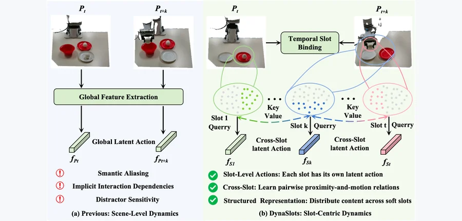 arXiv 2026-10-27 · cs.RO · #1 **[DynaSlots: Slot-Centric 3D Dynamics Pretraining for Robot Manipulation](https://arxiv.org/abs/2610.32330)** Meng Li, Lijiang Chen, Qi Zhao, Jun Jiang, Longhao Zou, Shuchang Lyu, Guangliang Cheng 机构：Beihang University / Pengcheng Laboratory / University of Science and Technology Beijing / University of Liverpool（[PDF](https://arxiv.org/pdf/2610.32330)） [Paper](https://arxiv.org/abs/2610.32330) · [Project](https://zhucezhanghao12345-source.github.io/DynaSlots-Anonymous/) · [图源](https://arxiv.org/html/2610.32330v1/fig1.png) 

中文摘要
机器人操作通常只引起局部变化：拿起杯子会移动杯子，而周围场景基本不变。然而，现有三维视觉预训练方法，包括近期考虑动力学的方法，仍在整个场景层面建模状态转移，把场景中所有物体的运动压缩为单个全局潜在动作。这会混淆多运动部件场景中语义不同的转移，掩盖变化区域间的依赖，也使表征易受任务无关场景内容影响。我们提出 DynaSlots，一种无需动作或标签的预训练框架：它将每帧点云分解为少量时间一致的槽，并在槽而非场景层面建模动力学。时间槽传播模块促进跨帧槽分配一致；逆动力学模型从特征差异中为每个槽提取一个潜在动作；基于扩散的前向动力学模型结合自监督交互头，预测每个槽的未来状态，同时学习成对的邻近与运动关系。在 Meta-World、Adroit 和 RealMan RM65-B 机器人上的实验表明，DynaSlots 优于以场景为单位的先前基线；它在仿真中取得更高成功率，并在真实操作中对场景杂乱和未见物体表现出较强鲁棒性。代码见原文所列链接。 <a href="https://arxiv.org/abs/2610.32330">原摘要来源</a>
 | 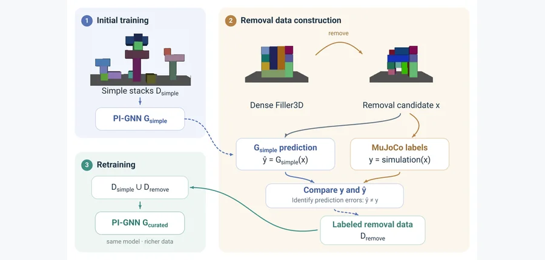 arXiv 2026-10-27 · cs.CV · #2 **[StackGen3D: Stable 3D Block Stack Generation from Multiview Silhouettes](https://arxiv.org/abs/2610.31803)** Xiaopeng Zhang, Luzhe Sun, Yiqing Xu, Matthew R. Walter 机构：University of Chicago / Toyota Technological Institute at Chicago / Stanford University（[PDF](https://arxiv.org/pdf/2610.31803)） [Paper](https://arxiv.org/abs/2610.31803) · [Project](https://ripl.github.io/StackGen3D-web/) · [图源](https://arxiv.org/html/2610.31803v1/fig1.png) 

中文摘要
根据视觉规格生成物理稳定的三维结构，需要同时消解几何歧义并考虑物体间的物理相互作用。我们提出 StackGen3D：给定积木清单和三个正交视角的轮廓，生成稳定的积木组合。方法分两阶段。首先，构建物理信息图神经网络 PI-GNN，建模积木之间的支撑关系，并作为快速稳定性预测器整理多样的稳定结构数据集。随后，在该数据集上训练条件流匹配模型，捕捉与目标轮廓一致的积木配置的多模态分布。推理时，轻量几何选择与细化无需物理仿真即可减少积木互穿。初步实验显示，PI-GNN 从简单堆叠泛化到复杂结构的能力明显优于参数量匹配的多层感知机。对于结构生成，Best-of-10 选择将物理稳定率从 45.3% 提高至 72.4%，同时轮廓 IoU 达到 0.970。结果显示，将关系式物理推理、可扩展的数据整理与条件生成建模结合，可用于创造性的三维组装。项目网站见原文所列链接。 <a href="https://arxiv.org/abs/2610.31803">原摘要来源</a>
 | 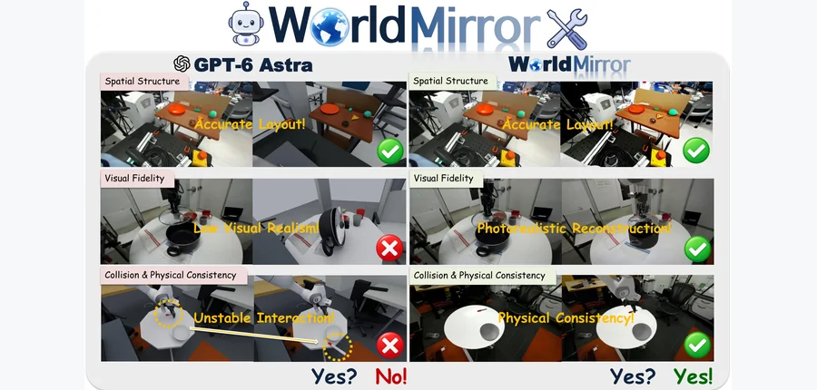 arXiv 2026-10-27 · cs.RO · #3 **[WorldMirror: Agentic Real-to-Sim Generation of Interactive Worlds from In-the-Wild Robot Demonstrations](https://arxiv.org/abs/2610.31834)** Tianling Xu, Weijie Wan, Honghao Su, Kailun Su, Junyuan Tang, Huichi Zhou, Haozheng Zhang, Qi Xiong, Ping Luo, We… 机构：Xspark AI / Tsinghua University / The University of Hong Kong / University College London / Peking University（[PDF](https://arxiv.org/pdf/2610.31834)） [Paper](https://arxiv.org/abs/2610.31834) · [Project](https://worldmirror-page.github.io/) · [图源](https://arxiv.org/html/2610.31834v1/teaser-pdf.png) 

中文摘要
现有仿真机器人学习方法往往需要大量人工工作来构建场景和指定任务，限制了训练规模与数据多样性。自然环境中的机器人示范提供多样且真实的交互观测，但要将其用于仿真，既需高保真视觉重建，也需物理一致的交互。通用智能体能适应不同场景并推理三维空间关系，专用生成模型则可高保真地重建外观和几何。我们提出 WorldMirror，一个从自然环境机器人示范构建可交互数字孪生的智能体式 real-to-sim 框架。核心做法是把构建过程表述为可执行世界程序的迭代细化：编码智能体分解观测场景、规划重建步骤、调度专用图像和三维生成工具，并通过验证反馈修改程序。以相机位姿为锚的场景表示将世界组织为静态视觉背景、支撑几何和可编辑交互资产，同时保持场景、物体与机器人之间的空间关系。智能体用该表示诊断并修正重建误差，使物理一致的交互和轨迹重放成为可能。DROID 上的实验表明，WorldMirror 可重建视觉逼真、几何一致的交互世界，同时保持所记录机器人轨迹的物理有效性。 <a href="https://arxiv.org/abs/2610.31834">原摘要来源</a>
 |
| 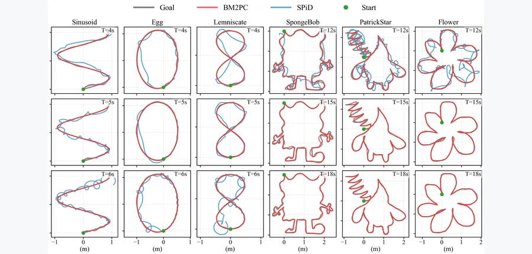 arXiv 2026-10-27 · cs.RO · #4 **[Multimodal MPC via Bayesian Set Optimization for Dynamic Manipulation of Deformable Linear Objects](https://arxiv.org/abs/2610.31852)** Youyuan Long, Gokhan Solak, Arash Ajoudani 机构：Istituto Italiano di Tecnologia（[PDF](https://arxiv.org/pdf/2610.31852)） [Paper](https://arxiv.org/abs/2610.31852) · [Code](https://github.com/Longyouyuan/BM2PC) · [图源](https://arxiv.org/html/2610.31852v1/figures/simulation_traj_tracking.png) 

中文摘要
可形变线状物体 DLO 的动态操作受欠驱动、高维动力学、形变响应滞后和障碍约束下存在多种可行动作等因素影响。本文提出 BM2PC，一种用于敏捷操作 DLO 的贝叶斯多模态模型预测控制框架。它基于“控制即推断”的后验，将多模态规划写成兼顾控制质量与行为多样性的集合优化问题，并以高效的增量更新、较低的额外计算开销维持多种有希望的控制模式。面向真实部署，BM2PC 加入执行动力学模型，预测末端执行器的实际运动，补偿快速操作中的执行偏差。评估包括仿真和硬件中的绳索跟踪、避障，以及仿真扰动抑制。在轨迹跟踪中，无需针对任务训练或微调策略，BM2PC 对未见轨迹的泛化优于学习式基线；真实长时程跟踪中，最长任务的 RMSE 降低 44.0%。在避障中，其性能与现有多模态 MPC 方法相当，规划时间减少 29%–66%。结果表明，该统一 MPC 框架兼具准确动态控制和高效多模态规划。核心实现和补充视频见原文所列链接。 <a href="https://arxiv.org/abs/2610.31852">原摘要来源</a>
 | 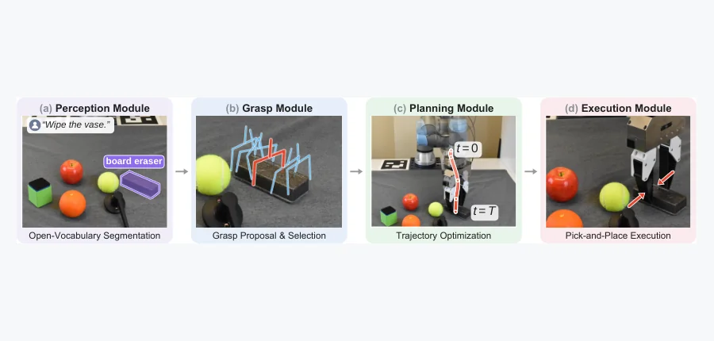 arXiv 2026-10-27 · cs.RO · #5 **[FORCA: A Force-Aware Coding Agent for Contact-Rich Robot Manipulation](https://arxiv.org/abs/2610.31841)** Xiao Tan, Yixuan Wang, Zhexi Wang, Wenzhen Yuan 机构：University of Illinois Urbana-Champaign / Tsinghua University（[PDF](https://arxiv.org/pdf/2610.31841)） [Paper](https://arxiv.org/abs/2610.31841) · [Project](https://tanoom.github.io/forca/) · [图源](https://arxiv.org/html/2610.31841v1/method_skills.png) 

中文摘要
编码智能体可以将语言指令转为机器人程序。对于接触密集型操作，关键难题是生成并改进能响应物理交互的控制逻辑。我们提出 FORCA：它以视觉观测和腕部力／力矩（F/T）测量为输入，编写用于接触探测与力响应运动的 Python 程序。在两次执行之间，智能体结合力记录和视觉结果诊断失败，并同时修改运动逻辑与力反馈控制逻辑。FORCA 不需要示范、任务专用训练或仿真。在五项真实机器人任务中，论文展示了它对三类接触密集型操作的作用：提高操作精度、适应物体或表面属性变化，以及在表面变化和物体运动下调节接触。与同一智能体的纯视觉版本相比，FORCA 提高抓取精度和任务成功率，并减少擦拭与剥离中的接触丢失。 <a href="https://arxiv.org/abs/2610.31841">原摘要来源</a>
 | 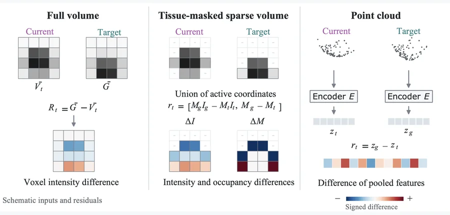 arXiv 2026-10-27 · cs.RO · #6 **[Robotic Optical Coherence Tomography-Guided Geometric Modeling of Soft Tissue: 3D Representations for Data-Driven Closed-Loop Shape Control](https://arxiv.org/abs/2610.32961)** Chaoyu Zhang, Guangshen Ma, Mark Draelos 机构：University of Michigan（[PDF](https://arxiv.org/pdf/2610.32961)） [Paper](https://arxiv.org/abs/2610.32961) · [图源](https://arxiv.org/html/2610.32961v1/figures/residual_conditioning.png) 

中文摘要
在医疗机器人中，数据驱动的软组织形状控制需要通过连续的物理交互使组织达到目标形态。微尺度操作尤其困难：局部形变难以观测、表示和控制，而物理模型可能计算昂贵且难以适应真实环境。光学相干断层成像（OCT）能高分辨率地感知组织形变体积，但条件于目标的控制还需要有效表示当前和期望组织状态。本文提出 OCT 引导的数据驱动闭环组织形状控制框架，从用户引导示范中学习，并依据 OCT 反馈执行。论文研究完整体积、组织掩膜稀疏体积和体素化点云表示，分别考虑有无残差条件，并比较确定性 Explicit 策略与生成式 Diffusion 策略。在 3 自由度深度和 6 自由度方向任务中，对 12 种配置进行 576 次模型组织 rollout 后，OCT 衍生的三维表示均支持两类策略，但性能取决于表示和残差条件。残差条件使完整体积 Diffusion 的方向 Shape RMSE 从 0.748 降至 0.555 mm；带残差的体素化点云 Explicit 在深度和方向控制中分别达到 0.534 和 0.443 mm，在未见中间目标上精度相近且跨部署表现一致。另在离体猪组织上进行了 60 次 rollout，最终几何误差与人类示范相当。结果确立了体积 OCT 可作为确定性和生成式动作模型学习闭环组织形状控制时的当前状态与目标表示。 <a href="https://arxiv.org/abs/2610.32961">原摘要来源</a>
 |
| 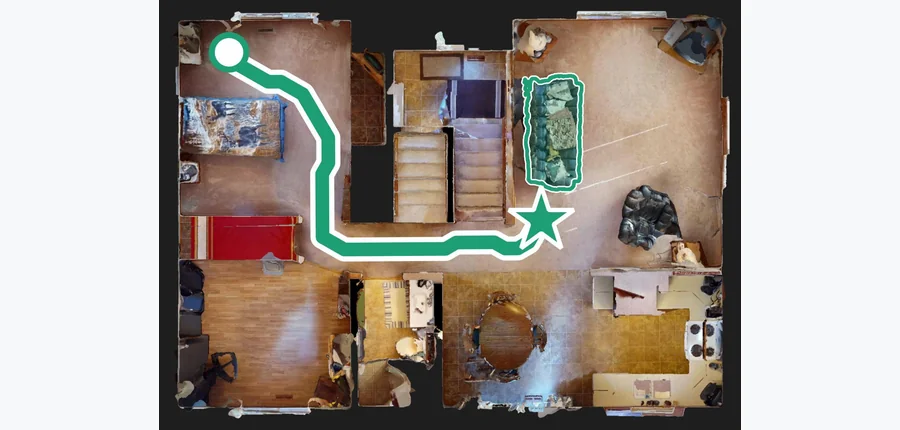 arXiv 2026-10-27 · cs.CV · #7 **[SceneBloom: Agentic Indoor Environment Generation with Realistic and Diverse Layouts for Embodied Learning](https://arxiv.org/abs/2610.32978)** Yuhan Liu, Lianhui Qin, Shenji Wan 机构：New York University / University of California, San Diego（[PDF](https://arxiv.org/pdf/2610.32978)） [Paper](https://arxiv.org/abs/2610.32978) · [Code](https://github.com/Tinaliu0123/scenebloom) · [图源](https://arxiv.org/pdf/2610.32978) 

中文摘要
训练可泛化的具身智能体需要真实、多样且可用于仿真的室内环境。语言引导方法有助于语义规划和物体级推理，却难以精确进行空间定位；视觉生成模型具有合理布局的丰富先验，但其输出仍需几何推理才能成为物理有效的三维场景。我们提出 SceneBloom，一个结合视觉布局采样与“契约”引导三维编译的智能体框架。分层采样器利用扩散先验在功能分区内生成家具布置；编译器利用从每个方案中抽取的关系进行几何拟合和局部位姿修正。在五类房间中，SceneBloom 在比较方法中取得最高视觉质量和物理稳定性，并且是唯一没有检测到网格碰撞和越界物体的方法。其布局分布也比所有比较基线更接近真实房间。用这些真实感场景训练的物体导航策略，在留出的真实扫描场景中的成功率高于用同数量真实训练扫描场景训练的策略。代码见原文所列链接。 <a href="https://arxiv.org/abs/2610.32978">原摘要来源</a>
 | 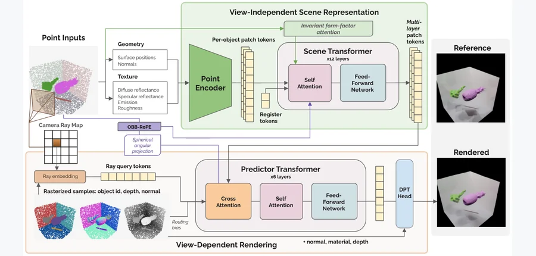 arXiv 2026-10-27 · cs.CV · #8 **[RADIANT: Object-Centric Feed-Forward Global Illumination](https://arxiv.org/abs/2610.32075)** Sarah Zhang, Zhiyang Dou, Minghao Guo, Benjamin Tod Jones, Wojciech Matusik 机构：MIT CSAIL（[PDF](https://arxiv.org/pdf/2610.32075)） [Paper](https://arxiv.org/abs/2610.32075) · [图源](https://arxiv.org/html/2610.32075v1/radiant_overview_diagram.png) 

中文摘要
前馈神经渲染器能够在新三维场景中合成全局光照，无需逐场景优化或运行时光线追踪。现有基于 Transformer 的方法逐三角形分词，使自注意力的复杂度随网格分辨率呈平方增长。然而，宏观辐射传输受底层表面几何和物体布置支配，并不取决于特定网格细分方式，因此需要对离散化不敏感的物体中心表示。我们提出 RADIANT，一种从点输入进行前馈全局光照渲染的物体中心架构。每个物体用固定的 32 个表面块 token 表示，使注意力序列长度与多边形数量解耦。单个网络中，物体间场景 Transformer 建模三维辐射交换，视角解码器在目标相机位姿渲染图像。为避免构建 O(N²) 偏置矩阵，不变形状因子注意力把几何距离和表面朝向嵌入查询与键的点积，用学习得到的面积和材质增益加权，形成 SE(3) 不变内积。无网格连通性时，相机光线利用共享球坐标系中经深度测试的点 splat 引导，对场景 token 做交叉注意力以处理主可见性。在模型容量匹配的 103 万场景基准上，RADIANT 比 RenderFormer 少用 5 倍训练步数达到 25 dB 色调映射 PSNR；训练 60 万步时达到 32.2 dB，分别高出 RenderFormer 3.3 dB、RenderFormer-V2 7.6 dB。对于含 500 个物体的场景，512×512 前向渲染耗时 0.83 秒，计算成本随物体数而非多边形数增长。 <a href="https://arxiv.org/abs/2610.32075">原摘要来源</a>
 | 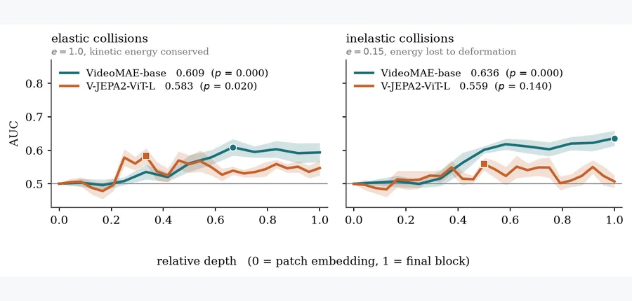 arXiv 2026-10-27 · cs.CV · #9 **[Interpreting Physics in Video Encoders using Multi-Object Interaction Videos](https://arxiv.org/abs/2610.31983)** Ayushi Mehrotra, Sai Vidyaranya Nuthalapati 机构：California Institute of Technology（首作者）；另一作者 affiliation 未确认（[PDF](https://arxiv.org/pdf/2610.31983)） [Paper](https://arxiv.org/abs/2610.31983) · [图源](https://arxiv.org/pdf/2610.31983) 

中文摘要
视频编码器越来越多地被用作物理 AI 的世界模型：策略在潜在空间中展开规划，因此潜在表征所包含的物理信息限制了可规划内容。现有可解释性研究多探查单物体量，而动量传递、恢复系数和摩擦等关系性物理量定义在物体之间，尚未得到检验。我们在双物体设置下探查两个冻结自监督视频编码器 V-JEPA2 和 VideoMAE 的关系性物理属性，并测试其跨环境迁移。初步发现有好有坏：两个编码器都能可靠地区分弹性与非弹性碰撞；与损失动能的碰撞相比，V-JEPA2 自身的预测器更不倾向预测会产生动能的碰撞。只有一个编码器能检测动量违规；V-JEPA2 的动能读出在环境变化后仍有效，VideoMAE 则不然；两个模型均未保有能跨几何变化迁移的摩擦系数。 <a href="https://arxiv.org/abs/2610.31983">原摘要来源</a>
 |
| 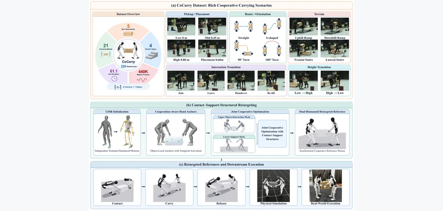 arXiv 2026-10-27 · cs.RO · #10 **[CoCarry: Contact-Support-Structured Retargeting for Dual-Humanoid Cooperative Carrying](https://arxiv.org/abs/2610.32460)** Ziyu Lin, Shihang Du, Tianhang Wang, Xiaodong Liu, Runze Zhang, Zongyou Yu, Haodong Zhang, Alois Knoll, Guang Chen 机构：Tongji University / Shanghai Innovation Institute / RobotScale.AI / AGIBOT / Technical University of Munich（[PDF](https://arxiv.org/pdf/2610.32460)） [Paper](https://arxiv.org/abs/2610.32460) · [图源](https://arxiv.org/html/2610.32460v1/cocarry_overview.png) 

中文摘要
大规模人类动作数据、动作重定向与模仿技术推动了单个人形机器人的全身控制。双人协作搬运更困难，因为成功协作不仅需要各自动作合理，还需要维持跨智能体及智能体与物体的关系，包括共同抓握、相对构型和全身支撑。我们提出 CoCarry 数据集：220 段同步双人序列，覆盖 21 种任务方案、5 种共享物体几何、4 种地形，总计约 61 分钟动作；并提出“接触－支撑结构化重定向”，从名义上的个体动作出发，围绕同一预设物体轨迹联合细化两个人形机器人的动作。协作感知的物体局部手部锚点维持兼容的四手抓握关系，上部物体交互结构与下部支撑结构共同保持相对物体的几何和协调支撑。将全部 220 段 CoCarry 序列重定向到两台 A3 人形机器人后，该方法达到 0.9995 的接触保持率；相对 GMR 和 OmniRetarget，穿透持续时间分别减少 67.0% 和 71.0%，重定向成功率为 100%。在采用 Unitree G1 的 CORE4D 上，接触保持率为 0.9906，测得滑动为零。论文还通过物理仿真和两台实体 A3 机器人的多项真实协作搬运实验验证生成参考动作可用于后续双人形机器人控制。 <a href="https://arxiv.org/abs/2610.32460">原摘要来源</a>
 | 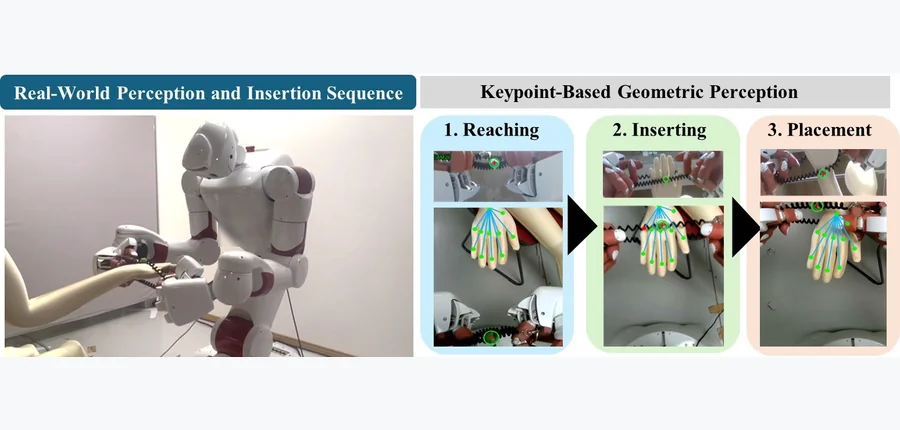 arXiv 2026-10-27 · cs.RO · #11 **[Geometry-Aware Reinforcement Learning for Close-Fitting Wearable Insertion](https://arxiv.org/abs/2610.32143)** Takuma Tsukakoshi, Elle Miller, Tamon Miyake, Namiko Saito, Yushi Wang, Shigeki Sugano, Tetsuya Ogata, Sethu Vijaya… 机构：Waseda University / University of Edinburgh / Microsoft Research Asia（[PDF](https://arxiv.org/pdf/2610.32143)） [Paper](https://arxiv.org/abs/2610.32143) · [图源](https://arxiv.org/html/2610.32143v1/figure/real.jpg) 

中文摘要
机器人辅助穿戴因开口狭窄和肢体可关节运动而格外困难。身体部位与服饰开口的相对位姿稍有偏差，就可能卡住、插入失败或穿戴不完整。为此，我们将穿戴表述为几何感知插入问题，表示身体部位与物体开口之间与任务相关的空间关系，而不依赖可形变物体的完整状态。基于这一表述，提出强化学习框架：分阶段课程逐步引导策略从粗对齐走向插入和最终放置；按手指设计的插入软门控持续反馈每根手指的插入进度，帮助抑制过早插入。论文在刚性和可形变手环穿戴任务上进行组件消融、系统改变初始手部位姿，并在真实机器人上闭环执行学习策略。训练后的可形变任务评估中，完整方法成功率为 84.7 ± 1.2%；插入门控贡献最大，在其基础上加入课程取得最高分。在假人手上，同一完整策略在 20 次真实机器人试验中成功 15 次。 <a href="https://arxiv.org/abs/2610.32143">原摘要来源</a>
 | 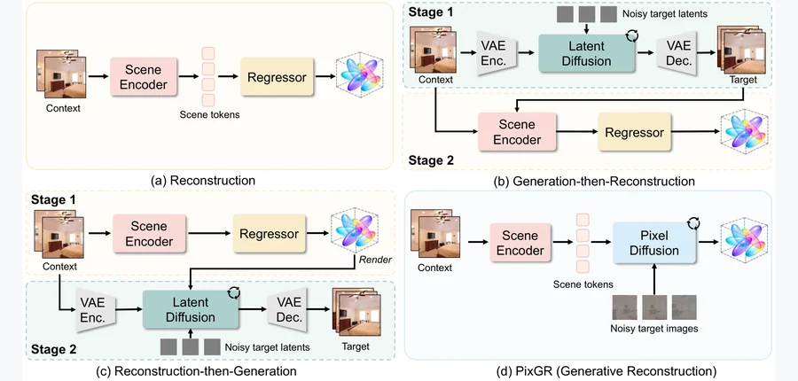 arXiv 2026-10-27 · cs.CV · #12 **[PixGR: Pixel-Space Generative Decoding for Fast Feed-Forward 3D Reconstruction](https://arxiv.org/abs/2610.31908)** Ranran Huang, Wenjing Bian, Weixun Luo, Ye Mao, Krystian Mikolajczyk 机构：Imperial College London / University of Tübingen（[PDF](https://arxiv.org/pdf/2610.31908)） [Paper](https://arxiv.org/abs/2610.31908) · [Project](https://ranrhuang.github.io/pixgr/) · [图源](https://arxiv.org/html/2610.31908v1/pipeline_comparison_v2.png) 

中文摘要
我们提出 PixGR，将轻量像素空间生成建模融入前馈三维 Gaussian 重建，以刻画场景不确定性。上下文观测仅编码一次，得到场景潜在表示；该表示以含噪目标视角为条件进行生成式解码，产生共享的三维 Gaussian 表示。过程采用像素空间流匹配，通过可微渲染的直接像素生成监督，端到端优化三维重建，从而避免以往两阶段流水线中基于 VAE 的潜在压缩及误差传播。为保持前馈效率，PixGR 缓存场景表示，并使用轻量 DiT 解码器迭代推理。实验表明，在观测视角间隔较大和视角外推等困难稀疏视角设置下，PixGR 优于回归式方法；同时保持亚秒级推理，性能可与重得多的预训练生成模型竞争。项目页见原文所列链接。 <a href="https://arxiv.org/abs/2610.31908">原摘要来源</a>
 |
| 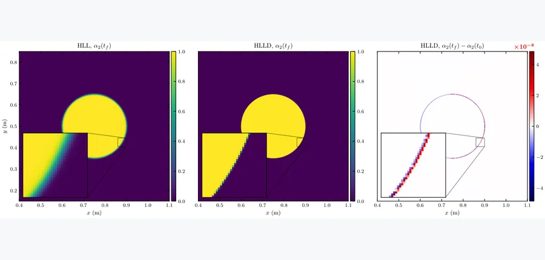 arXiv 2026-10-27 · physics.comp-ph · #13 **[Anchored HLLD: A Riemann solver for a hypoelastic diffuse-interface model of compressible fluid-solid interaction](https://arxiv.org/abs/2610.31958)** Yanjun Zhang, Tim Colonius 机构：California Institute of Technology（[PDF](https://arxiv.org/pdf/2610.31958)） [Paper](https://arxiv.org/abs/2610.31958) · [图源](https://arxiv.org/html/2610.31958v1/s61_cyl_alpha_zoom.png) 

中文摘要
我们为可压缩流固相互作用的多组分低弹性弥散界面模型提出 HLLD 黎曼求解器。该模型无需单独计算界面，偏应力则由守恒律形式之外的客观低弹性率定律推进。模型特有难点是应力演化非守恒；与 Kapila 类模型中常见的体积分数项不同，在解析剪切波后，不能将它留在黎曼求解之外。剪切系数 ρ(G+τxx) 决定已解析剪切波的阻抗，因此属于其特征结构。Anchored HLLD 在每个网格面分别以相邻两个单元中心状态为锚计算两次 HLLD 波扇，并让各单元以锚定于自身状态的通量推进，从而把该系数纳入求解。HLL、HLLC 和 anchored HLLD 构成同一框架内波解析能力递增的三级层次。我们证明其局部结构性质：与重建阶数一致、严格守恒各组分质量；对光滑场，切向动量和能量漂移随网格细化按重建面跳跃的阶数消失。一维测试展示这些性质，并显示不连续场的漂移一阶收敛。在开源求解器 MFC 的一维测试和二维生产仿真中，anchored HLLD 能同时清晰解析材料接触与剪切波，HLLC 只清晰解析接触，HLL 两者均不能；所展示的细化研究趋近精确或半解析解。三维激波与椭球体相互作用示例展示了六个应力分量均起作用时的求解器。 <a href="https://arxiv.org/abs/2610.31958">原摘要来源</a>
 | 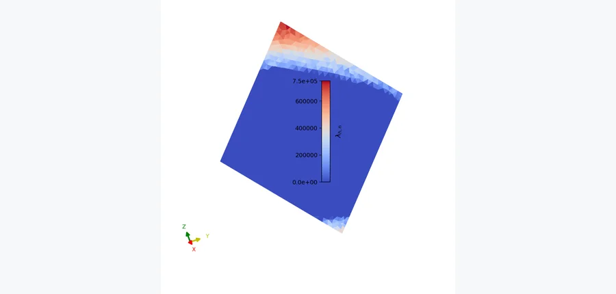 arXiv 2026-10-27 · math.NA · #14 **[An Arbitrary-Order Augmented Lagrangian Discrete De Rham Scheme for Contact Mechanics with Tresca Friction](https://arxiv.org/abs/2610.32471)** Jérôme Droniou, Raman Kumar, Roland Masson 机构：Université de Montpellier / Monash University / Université Côte d’Azur / Inria（[PDF](https://arxiv.org/pdf/2610.32471)） [Paper](https://arxiv.org/abs/2610.32471) · [图源](https://arxiv.org/html/2610.32471v1/F1_lambda_k0_l0_a.png) 

中文摘要
我们设计并分析用于裂隙介质接触力学的任意阶增广拉格朗日离散 de Rham（DDR）多面体格式。裂隙被表示为线弹性基体中余维为一的对象，裂隙壁接触时采用 Tresca 摩擦模型。法向 Signorini 型／牵引约束与 Tresca 摩擦律都被重写为投影恒等式，再合并为单一增广拉格朗日双线性形式。位移由任意多项式次数 k≥0 的 DDR 空间离散，并在裂隙面加入气泡自由度；借由拉格朗日乘子空间与裂隙上离散位移跳跃之间存在离散提升，这些自由度保证稳定性。我们建立抽象误差估计，给出位移和拉格朗日乘子变量的最优阶收敛。大量数值实验验证理论分析，并展示该格式的实际精度与鲁棒性。 <a href="https://arxiv.org/abs/2610.32471">原摘要来源</a>
 | 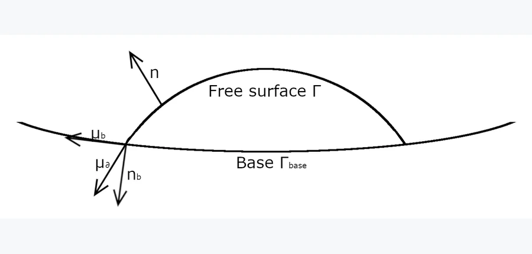 arXiv 2026-10-27 · math.NA · #15 **[An energy-stable parametric finite element framework for surface diffusion with moving contact lines on curved substrates](https://arxiv.org/abs/2610.32270)** Harald Garcke, Robert Nürnberg, Rong Tang 机构：Universität Regensburg / Università di Trento / The Hong Kong Polytechnic University（[PDF](https://arxiv.org/pdf/2610.32270)） [Paper](https://arxiv.org/abs/2610.32270) · [图源](https://arxiv.org/html/2610.32270v1/Figures/curve.png) 

中文摘要
我们针对曲面基底上带移动接触线的固体薄膜表面扩散，提出能量稳定的参数化有限元方法。对薄膜表面和基底面片同时离散，使得可构造无条件能量稳定的线性格式。其非线性变体还保证基底近似的顶点始终附着于真实基底。框架也可纳入薄膜表面与基底各自的各向异性表面能密度，以及不同切向运动。二维与三维空间中的数值实验展示了所提出方法的实用性。 <a href="https://arxiv.org/abs/2610.32270">原摘要来源</a>
 |
| 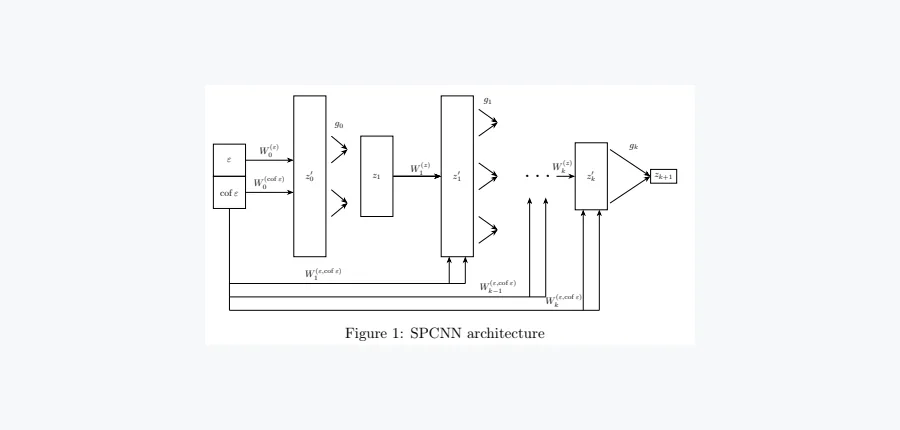 arXiv 2026-10-27 · math.NA · #16 **[Universal neural network approximation of symmetric polyconvex energies and envelopes](https://arxiv.org/abs/2610.32598)** Florian Gammer 机构：University of Regensburg（[PDF](https://arxiv.org/pdf/2610.32598)） [Paper](https://arxiv.org/abs/2610.32598) · [图源](https://arxiv.org/pdf/2610.32598) 

中文摘要
对称多凸性是小应变弹性中弱下半连续性的一个充分条件，也为非（拟）凸能量的松弛提供可处理的下界。由于计算这类函数的经典算法可能代价高，神经网络近似逐渐成为替代方案；难点在于对称多凸性额外要求单调性。我们表明，在基于 ReLU 的输入凸网络上施加相应权重限制，并不能对提升空间中的表示函数提供普适近似。为此，提出对称多凸神经网络 SPCNN，用于本构建模及对称多凸包络近似。其深层架构将凸性与子式空间中表示函数所需的单调性结合。我们证明无需各向同性假设的对称多凸能量普适近似定理，量化提升网络可达到的仿射片段数量，并推导各向同性能量的简化架构。数值例子展示基于应力的回归和双阱势的对称多凸包络近似。该结构按构造保证对称多凸性；拟合能量与包络的精度则通过数值方式评估。 <a href="https://arxiv.org/abs/2610.32598">原摘要来源</a>
 | 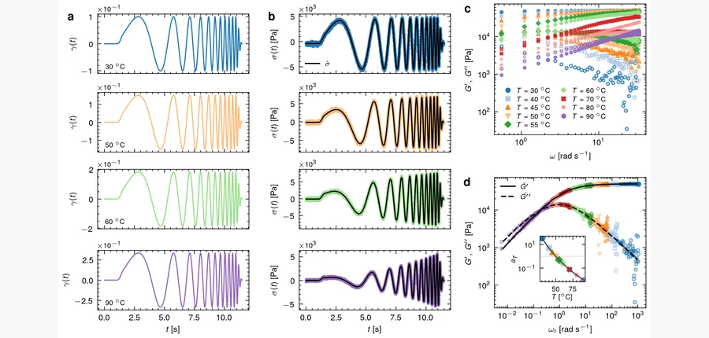 arXiv 2026-10-27 · cond-mat.soft · #17 **[Time-temperature superposition from multi-temperature chirp rheometry of thermorheologically simple materials via physics-informed Gaussian processes](https://arxiv.org/abs/2610.32895)** Isaac Y. Miranda-Valdez, Kourosh Mobredi, Juha Koivisto, Mikko J. Alava 机构：Aalto University / Deltan Labs（[PDF](https://arxiv.org/pdf/2610.32895)） [Paper](https://arxiv.org/abs/2610.32895) · [图源](https://arxiv.org/html/2610.32895v1/fig_master_curve_combined.png) 

中文摘要
从瞬态响应数据推断本构律是软凝聚态物理中的核心逆问题，尤其当相关松弛谱超出单次实验的时间窗时。对于线性黏弹性区间内的热流变简单材料，时温等效（TTS）允许温度缩放特征松弛时间而不改变松弛谱形状，从而约束该问题。我们将这一约束融入基于 chirp 流变测量的时间分辨力学谱物理信息机器学习框架。根据 Boltzmann 叠加原理，将紧凑的分数阶黏弹性模型编码为因果卷积特征，并用稀疏变分高斯过程回归联合拟合多温度 chirp 记录。模型直接从线性黏弹区间测得的时域应力－应变信号推断水平位移因子、本构参数及观测噪声尺度，无需先提取频域谱或手工平移各条曲线。对于合成的 Fractional Maxwell 数据，该方法在 3%–25% 应力噪声水平下，从预设模型库恢复生成数据的本构律和潜在位移因子。用于跨越玻璃转变区间的 DGEBA-IPDA 环氧树脂数据集时，合并似然借助贝叶斯信息准则区分竞争性分数阶流变模型。结果把 TTS 主曲线构建转化为对潜在时间重缩放和线性黏弹性的概率推断，同时指出等方差噪声及信息量较弱的谱区间等局限。 <a href="https://arxiv.org/abs/2610.32895">原摘要来源</a>
 | 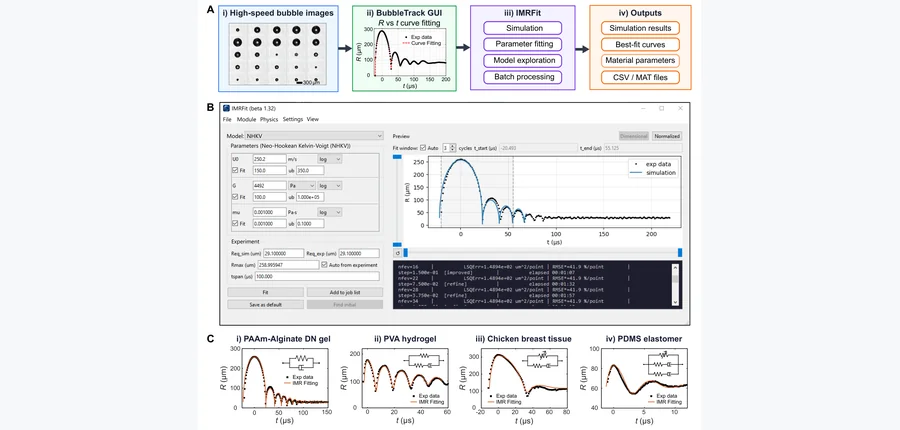 arXiv 2026-10-27 · physics.flu-dyn · #18 **[IMRFit: Interactive Simulation and Constitutive-Model Fitting for Inertial Microcavitation Rheometry](https://arxiv.org/abs/2610.32119)** Sicong Wang, Zixiang Tong, Jin Yang 机构：University of Texas at Austin（[PDF](https://arxiv.org/pdf/2610.32119)） [Paper](https://arxiv.org/abs/2610.32119) · [图源](https://arxiv.org/html/2610.32119v1/fig_IMRFit_overview.png) 

中文摘要
惯性微空化流变测量（IMR）通过微气泡快速膨胀和坍缩来表征软材料的高速率力学响应。典型实验用高速成像得到气泡半径随时间变化的 R(t)，再比较测量响应与耦合气泡动力学和周围介质本构描述的仿真，识别材料参数。这类逆分析需要反复进行前向仿真，并仔细控制实验输入、材料参数与拟合设置。IMRFit 是一款开源 Python 桌面应用，将前向仿真、参数识别和本构模型比较整合进交互环境。用户可以导入实验半径－时间数据，选择气泡动力学方程与本构模型，检查仿真响应，拟合材料参数，并组织批量拟合及参数扫描任务。除其他本构选项外，IMRFit 包含 Neo-Hookean Kelvin-Voigt 和基于广义 Maxwell-Ogden 的模型，还支持通过 JSON 描述符和 Python 求解器入口添加模型。它将拟合时间窗选择、可视化和数据导出纳入同一工作流。 <a href="https://arxiv.org/abs/2610.32119">原摘要来源</a>
 |
| 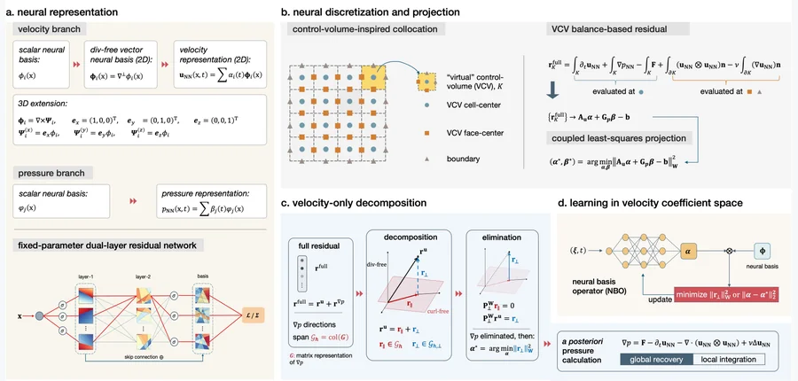 arXiv 2026-10-27 · physics.flu-dyn · #19 **[Solving and Learning Navier-Stokes Dynamics with the Neural Basis Method](https://arxiv.org/abs/2610.32167)** Yuhe Wang, Zhu Wang, Min Wang 机构：Asia Pacific Technology / Texas A&amp;M University / University of South Carolina / University of Houston（[PDF](https://arxiv.org/pdf/2610.32167)） [Paper](https://arxiv.org/abs/2610.32167) · [图源](https://arxiv.org/html/2610.32167v1/fig_overview.jpg) 

中文摘要
物理信息机器学习结合控制方程与学习式表示，已成为流体动力学预测建模的重要方向，但现有形式既不能保证 PDE 残差小就意味着解误差小，也难以随问题规模增长而扩展。我们提出用于 Navier–Stokes 动力学的神经基方法 NBM。它遵循“先表示、后投影”原则：固定的神经基定义表示空间，通过投影控制方程确定展开系数；同一组基也为参数化解流形定义公共坐标，把算子学习改写成参数到系数的映射，并通过移除显式空间依赖提高可扩展性。对于不可压缩流，NBM 得到仅含速度的形式，其残差提供速度误差的后验估计，从而建立经认证、无需数据的系数学习训练目标。理论分析和数值实验展示 NBM 的精度、效率、泛化能力与可扩展性，相对基线有明显改进。 <a href="https://arxiv.org/abs/2610.32167">原摘要来源</a>
 | 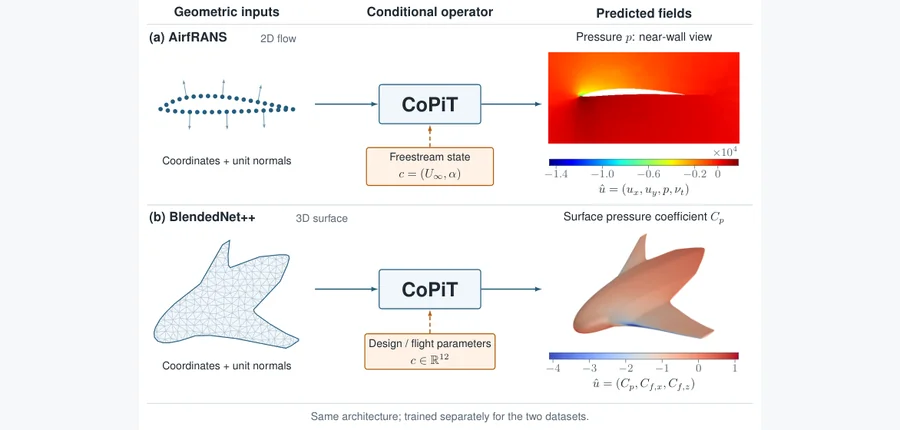 arXiv 2026-10-27 · physics.comp-ph · #20 **[CoPiT: A conditional Position-induced Transformer for aerodynamic field prediction on unstructured meshes](https://arxiv.org/abs/2610.32299)** Junfeng Chen, Yongchen Fan, Zhonghua Qiao, Kailiang Wu 机构：The Hong Kong Polytechnic University / The Hong Kong University of Science and Technology / Southern University of Science and Technology（[PDF](https://arxiv.org/pdf/2610.32299)） [Paper](https://arxiv.org/abs/2610.32299) · [图源](https://arxiv.org/html/2610.32299v1/figure1.png) 

中文摘要
高保真 Reynolds 平均 Navier–Stokes（RANS）仿真是气动分析的常用工具，但在非结构网格上每次求解都很昂贵，使设计探索、优化和多工况评估等多查询任务成本很高。神经算子可以在灵活网格上将几何与运行条件映射到流场；然而，许多架构只是将自由流状态、设计变量等全局参数与逐点输入拼接，其对中间特征的影响并不显式。本文提出 CoPiT，即条件化 Position-induced Transformer：以 PiT 为几何骨干，用多阶段逐特征线性调制（FiLM）注入全局条件向量，在保持基于几何的注意力权重的同时，显式进行参数调制。评估覆盖二维 AirfRANS 翼型流场的少数据与外推设置，以及三维 BlendedNet++ 融合翼身表面。在 AirfRANS 完整数据测试集上，相对 Transolver，CoPiT 的表面和体积损失分别约降低 54% 和 24%；在 BlendedNet++ 上，其总体归一化测试 MSE 为比较基线中最低。匹配消融表明，FiLM 条件化通常优于输入拼接，但最佳注入位置依任务而定。因此 CoPiT 为非结构网格上的参数化气动问题提供了实用的算子学习替代模型。 <a href="https://arxiv.org/abs/2610.32299">原摘要来源</a>
 | 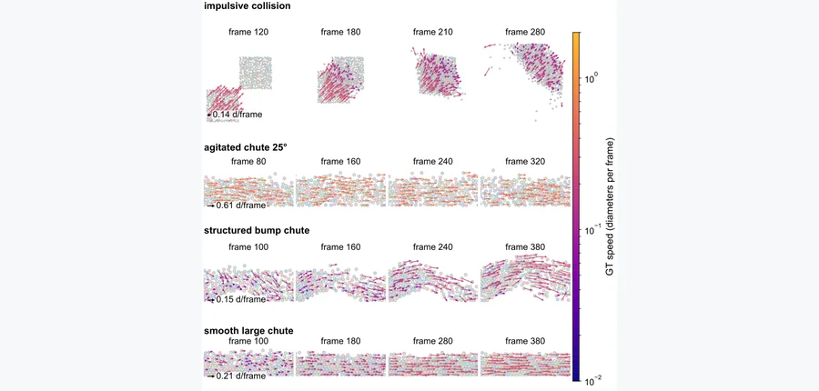 arXiv 2026-10-27 · physics.flu-dyn · #21 **[CBTV: Colour Bean Tracking Velocimetry for Dense Granular Flows](https://arxiv.org/abs/2610.31883)** Kaveeshan Thurairajah, Zhao Pan 机构：University of Waterloo（[PDF](https://arxiv.org/pdf/2610.31883)） [Paper](https://arxiv.org/abs/2610.31883) · [图源](https://arxiv.org/html/2610.31883v1/fig_0_flows.png) 

中文摘要
传统粒子跟踪测速（PTV）一直是研究流体和颗粒流的标准诊断工具。然而，在致密颗粒系统中，粒子两帧间平均位移可接近甚至超过粒子间距，需要极高帧率；相邻粒子还可能一起运动，常见的速度预测在剧烈碰撞后会失效。现有方法难以在不丢失或交换身份的情况下跟踪颗粒。我们提出 Colour Bean Tracking Velocimetry（CBTV），一种利用多色粒子的免训练多轮跟踪方法。它先在互相关运动先验引导下，将相邻彩色粒子的“星座”作为整体匹配，再逐个分配剩余粒子。在有精确真值的 15 种模拟离散元颗粒流的 59 个案例（每帧位移 0.006–9 个粒子直径）上，论文比较了 12 种从经典链接器到图神经网络和 Transformer 的跟踪器配置。对于脉冲碰撞中的每个位移水平，CBTV 都不弱于所有受测跟踪器。其优势集中在粒子每帧移动约半个至两个间距、跨帧连接含糊的致密流中。对于受搅动剪切流，同样利用邻域信息的颜色松弛跟踪器与 CBTV 相当或略优；当连接清晰时，CBTV 接近最优跟踪器；而在每帧位移超过约 2–3 个粒子直径、超出其运动先验范围时，补偿整体运动的跟踪器更准确。对于实验人员，多色致密颗粒流可在无邻域上下文的跟踪器会丢失身份的帧间位移下得到跟踪，降低对极高帧率的需求，且无需训练数据。 <a href="https://arxiv.org/abs/2610.31883">原摘要来源</a>
 |
| 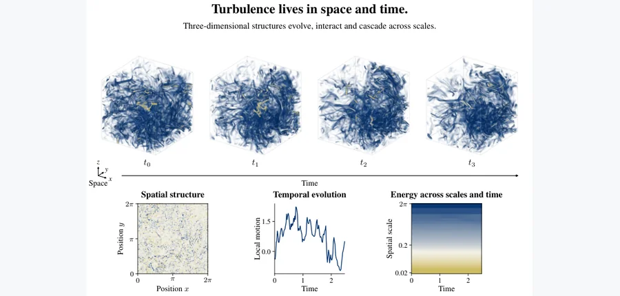 arXiv 2026-10-27 · physics.flu-dyn · #22 **[Let's Do Turbulence Right: In Space and Time!](https://arxiv.org/abs/2610.32601)** Maximilian Plattner, Fabian Paischer, Johannes Brandstetter 机构：Johannes Kepler University Linz / Mistral AI（[PDF](https://arxiv.org/pdf/2610.32601)） [Paper](https://arxiv.org/abs/2610.32601) · [图源](https://arxiv.org/html/2610.32601v1/turbulence-space-time-overview.png) 

中文摘要
三维 Navier–Stokes 方程描述流体湍流这一混沌且非线性的物理现象，其复杂涡结构跨越广泛空间和时间尺度相互作用。要在数值上准确建模多尺度能量级联，必须同时充分解析精细空间结构与流场的连续时间演化。本文使用单次运行超过 28 TB 的大规模时间分辨直接数值模拟，评估数值选择如何影响湍流已解析的（3+1）维物理。基于这一分析，我们研究神经网络如何表示记录下来的湍流运动。结果强调，对于数值记录和学习表示，空间评估与时间评估都可能得出不一致结论。因此，作者呼吁机器学习社区将（3+1）维湍流视为四维现象。 <a href="https://arxiv.org/abs/2610.32601">原摘要来源</a>
 | 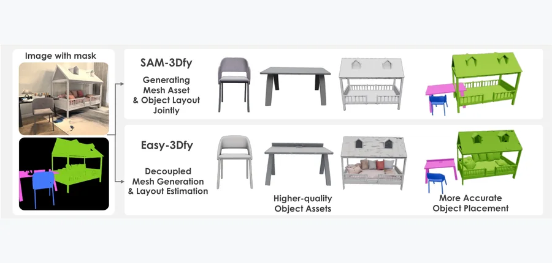 arXiv 2026-10-27 · cs.CV · #23 **[Easy-3Dfy: Object-Level Geometric Composition for Single-Image 3D Scene Construction](https://arxiv.org/abs/2610.32250)** Ziang Zhang, Wenyou Yi, Zehan Wang, Jiachen Xu, Xintong Han, Chunchao Guo, Zhou Zhao 机构：Zhejiang University / Tencent（[PDF](https://arxiv.org/pdf/2610.32250)） [Paper](https://arxiv.org/abs/2610.32250) · [图源](https://arxiv.org/html/2610.32250v1/teaser.png) 

中文摘要
从单张图像构建三维场景是三维视觉的基础问题。SAM-3Dfy 等近期方法可端到端重建三维资产及其场景布局，但细粒度场景几何和资产质量仍有不足。专用三维物体生成器能提供精细物体几何，三维基础模型则具备较强且可泛化的空间理解。我们提出 Easy-3Dfy，一种将物体生成与场景布局估计解耦的组合式流程，使专用模型各展所长。基于 RPF 的对齐器通过建立物体局部网格与局部场景点图之间的几何对应，连接两种能力并恢复物体布局以进行场景组合。该流程不需要完整场景级监督，在 Scene-Maker 和 3D-FUTURE200 上的多项几何指标中持续优于 SAM-3Dfy。结果表明，显式几何组合可以有效结合高质量物体生成与强空间理解，并让流程分别受益于三维物体生成和基础模型的进步。 <a href="https://arxiv.org/abs/2610.32250">原摘要来源</a>
 | 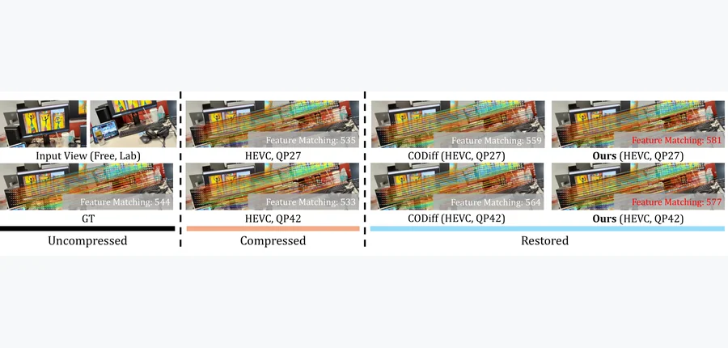 SIGGRAPH Asia 2026 Conference Papers · #24 **[CompMVR: Compression-Aware Multi-View Restoration Using Diffusion Models for Geometrically Consistent 3D Reconstruction](https://arxiv.org/abs/2610.32800)** Dong-hwi Kim, Chaewon Moon, Hojun Song, Dongbeom Kim, Junyeong Jang, Aro Kim, Gahyeon Kim, Heejung Choi, Jehee Kim… 机构：Kyungpook National University / Adobe Research（[PDF](https://arxiv.org/pdf/2610.32800)） [Paper](https://arxiv.org/abs/2610.32800) · [Project](https://mchaewon.github.io/CompMVR-project-page/) · [图源](https://arxiv.org/html/2610.32800v1/Fig1.png) 

中文摘要
真实世界的三维重建流水线常使用经过有损压缩的多视角图像。虽然单图或视频复原已广泛研究压缩伪影，其对多视角几何的影响却很少被考察。我们发现压缩造成的跨视角几何不一致是关键失效模式：随视角变化的伪影干扰特征匹配、稠密对应、相机参数估计，以及新视角合成等下游三维重建任务。为此，提出 CompMVR，一种感知压缩的多视角扩散复原框架，在保持跨视角一致性的同时联合细化压缩视图，并构建压缩数据集以系统评估。与独立优化每张图像的二维感知质量的传统复原方法不同，CompMVR 利用学到的压缩先验和跨视角对应恢复视觉细节，同时提高跨视角几何可靠性。跨多种数据集、编码器和压缩水平的实验表明，复原质量以及新视角合成、相机位姿估计、视角匹配等下游三维任务均有提升。结果将压缩多视角复原确立为独立问题，并显示其对有损压缩条件下三维重建的重要性。代码与数据见原文所列链接。 <a href="https://arxiv.org/abs/2610.32800">原摘要来源</a>
 |
| 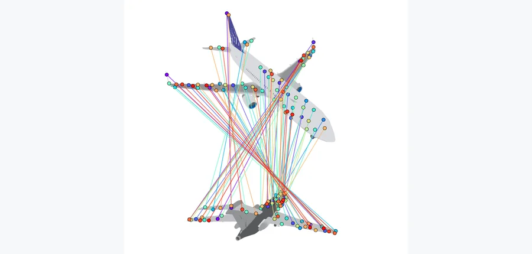 arXiv 2026-10-27 · cs.CV · #25 **[SemGeo-Gen: Unsupervised Generation of Approximate Cross-Instance Semantic-Geometric Correspondences](https://arxiv.org/abs/2610.32663)** Roy Amoyal, Shira Ifergane, Oren Freifeld 机构：Ben-Gurion University of the Negev（[PDF](https://arxiv.org/pdf/2610.32663)） [Paper](https://arxiv.org/abs/2610.32663) · [Project](https://bgu-cs-vil.github.io/SemGeo-Gen/) · [图源](https://arxiv.org/html/2610.32663v1/figures/intro/2d_2d.png) 

中文摘要
我们提出 SemGeo-Gen：从弱对齐的三维物体集合中无监督生成近似跨实例语义－几何监督。目标并非恢复精确逐点对应；不同实例间这种对应通常有歧义，若大规模人工标注则昂贵且不现实。方法自动生成在语义上有意义、几何上一致且足够多样的近似对应，以训练现代对应模型。仅需类别级的粗略旋转对齐，SemGeo-Gen 就将多视角 DINOv2 特征提升到三维，通过连续分段仿射配准对齐物体实例，并用语义一致性筛除候选匹配。所得三维对应可投影到渲染视图，提供无需人工标注且可扩展的 3D–3D、3D–2D 和 2D–2D 监督。用 KeypointNet 的稀疏人工标注验证时，PCK@0.10 为 93%，PCK@0.15 为 97%。使用所生成对应进行合成预训练、再在真实数据上微调后，近期先进语义对应模型在 SPair-71k 上的 PCK@0.10 最多提升 5 个百分点。结果表明，从三维资产生成的近似语义－几何监督可改善真实图像的对应学习，并成为昂贵人工标注的可扩展替代。项目页见原文所列链接。 <a href="https://arxiv.org/abs/2610.32663">原摘要来源</a>
 | 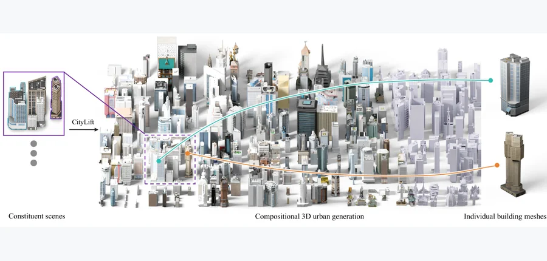 arXiv 2026-10-27 · cs.CV · #26 **[CityLift: Compositional 3D Urban Generation from a Single Image](https://arxiv.org/abs/2610.32728)** Haoran Gong, Jie Feng, Chenxu Wang 机构：Xi’an Jiaotong University / Zhongguancun Academy（[PDF](https://arxiv.org/pdf/2610.32728)） [Paper](https://arxiv.org/abs/2610.32728) · [Project](https://ranhaogong.github.io/CityLift/) · [图源](https://arxiv.org/html/2610.32728v1/citylift_teaser.png) 

中文摘要
从单张图像生成可编辑的三维城市场景，既需要详细建筑资产，也需要协调的空间布置。遮挡与透视歧义使完整建筑几何、相对尺度和位置的一致推断变得困难。我们提出 CityLift：耦合场景级空间建模与建筑级合成，从城市图像生成各自带纹理的建筑网格。首先，场景流与实例流耦合学习建筑形状和位置，在公共坐标系中产生粗略稀疏结构。随后，“生成式空间继承”将每栋建筑的粗占据和场景条件三维特征场映射到局部体积，引导流模型生成更精细的结构；同一坐标映射再把生成的网格放回场景，保持其与场景骨架的空间关系。针对城市图像与单栋三维建筑配对数据稀缺，论文构建 CityLift-5K，含 4,997 个带实例掩膜、建筑网格和位置标注的合成场景。在 CityLift-5K 以及 UrbanScene3D、InstanceBuilding 的场景片段上，实验显示建筑几何和场景组合得到改善。项目页见原文所列链接。 <a href="https://arxiv.org/abs/2610.32728">原摘要来源</a>
 | 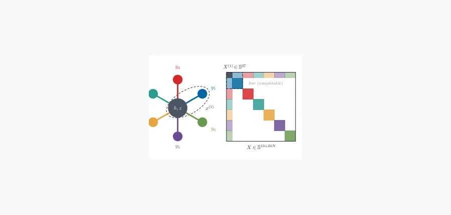 arXiv 2026-10-27 · cs.CV · #27 **[PnP*: A certifiable solver for Perspective-n-Point](https://arxiv.org/abs/2610.31797)** Bang-Shien Chen, Caitrin E. Eaton, David M. Rosen 机构：Northeastern University / Draper（[PDF](https://arxiv.org/pdf/2610.31797)） [Paper](https://arxiv.org/abs/2610.31797) · [图源](https://arxiv.org/pdf/2610.31797) 

中文摘要
由三维－二维对应估计相机位姿的透视 n 点（PnP）问题是计算机视觉最基础的问题之一。现有方法或求解最小问题，或将目标替换成较容易的形式；令人意外的是，针对实际最大似然估计（MLE）目标仍缺乏可扩展、可认证的求解器。我们提出 PnP*，据作者所知首个既能高效计算、又能返回可认证全局最优解的实用求解器。我们证明，在中等噪声下，其底层凸松弛是精确的；据作者所知，这是针对 PnP MLE 的任一种松弛的首个稳定性保证。此外，通过利用弦稀疏结构与商环约简，缩小松弛问题，使其可处理且可扩展。数值验证支持稳定性和可扩展性结果：PnP* 能以超过 10 Hz 的速度返回可证明正确的相机位姿。 <a href="https://arxiv.org/abs/2610.31797">原摘要来源</a>
 |
| 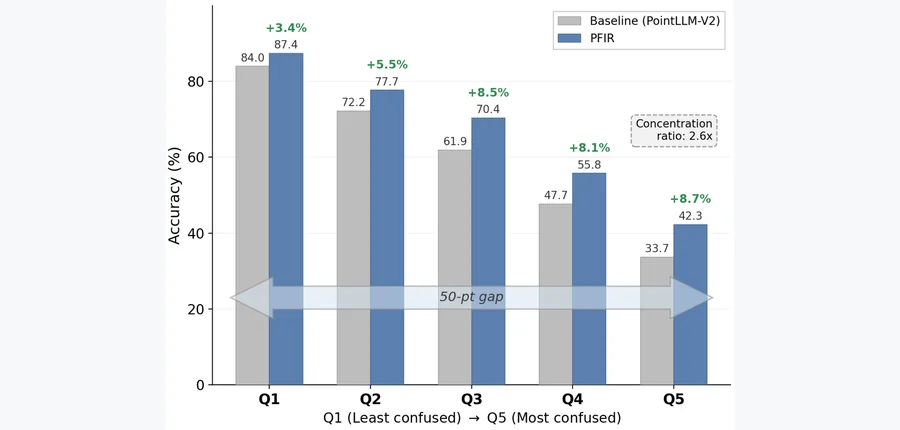 arXiv 2026-10-27 · cs.CV · #28 **[Beyond Pattern Matching in 3D MLLMs: Part-Level Functional Reasoning for Generalizable Recognition](https://arxiv.org/abs/2610.32262)** Weihong Li, Hao Jiang, Yaohua Zha, Tao Dai, Shu-Tao Xia 机构：Tsinghua University / Shenzhen University（[PDF](https://arxiv.org/pdf/2610.32262)） [Paper](https://arxiv.org/abs/2610.32262) · [Code](https://github.com/this233/pfir-3d) · [图源](https://arxiv.org/html/2610.32262v1/figures/demo/figure_b.png) 

中文摘要
三维多模态大模型常通过模式匹配识别物体；当几何相近的物体必须靠功能推理区分时，例如五斗柜与衣柜，这种方法会失效。逐样本几何混淆分数 GCS 揭示了问题：在 ModelNet40 中，基线对最易混淆的 20% 样本准确率为 33.7%，对最不易混淆的 20% 则为 84.0%。我们观察到“功能只是标注”的模式，即功能语言仅修饰已知身份而不参与推断，并假设逆转信息流可使改进集中于最含糊样本。PFIR（用于识别的部件级功能推断）逆转了这一流程。基于 PartNeXt 部件分割，其数据流水线生成 50.7 万个含功能推理链（几何→功能→身份）的问答对；渐进式课程最终采用双目标 GRPO：面向 Objaverse 多样分布的严格功能推理与描述性定位。两个强化学习目标的任务向量几乎正交（cos=0.056），因此可通过任务算术组合。在严格的双重分布外协议（Objaverse→ModelNet40；XYZRGB→仅 XYZ）下，PFIR 将零样本准确率从 60.5% 提高到 66.7%，且收益在几何含糊样本上的集中程度高出 2.6 倍，支持部件级功能推理是提升三维识别泛化的一条有效路径。代码见原文所列链接。 <a href="https://arxiv.org/abs/2610.32262">原摘要来源</a>
 | 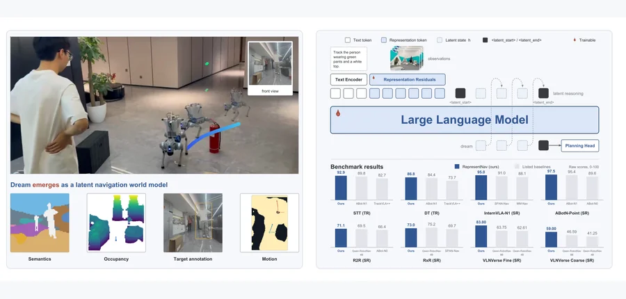 arXiv 2026-10-27 · cs.RO · #29 **[See What I Need, Dream What I Want: A Navigation Foundation Model on a Self-Constructed Representation Space](https://arxiv.org/abs/2610.31762)** Jiawei Chen, Yinxi Wang, Zihan Yang, Meijun Gao, Yaowei Liu, Shuming Zhang, Zecheng Li, Xiangju Mi, Yuxuan Liu, R… 机构：Peking University / University College London / DataCanvas（[PDF](https://arxiv.org/pdf/2610.31762)） [Paper](https://arxiv.org/abs/2610.31762) · [Project](https://wang-yinxi.github.io/representnav/) · [图源](https://arxiv.org/html/2610.31762v1/representnav_teaser_vlnverse.png) 

中文摘要
导航策略应依据什么视觉表示行动？基于视觉基础模型的导航策略，很大程度上把表示设计交由编码器的预训练目标决定。我们提出 RepresentNav，一种建立在“自构建表示空间”上的导航基础模型，该视觉表示由策略自身目标从视觉基础模型中构建。RepresentNav 以 Representation Residuals 构建这一空间：一个紧凑的三层 Transformer 关注多个互补视觉基础模型从浅到深的特征，使策略学会看见导航所需的信息。在同一空间内，它还会“梦见”想要的结果：每次行动前，一条潜在思维链预测片刻后场景的表示。该预测作为联合嵌入预测架构（JEPA），利用下一表示预测损失和目标正则项与策略端到端训练。RepresentNav 在 VLNVerse、VLN-CE R2R、EVT-Bench 及两个点目标基准上取得新的最优结果，收益也迁移到有杂物和行人的实体机器人。在 VLNVerse fine-grained 上成功率达 83.80%，比此前最优高 20.05 个百分点；在 EVT-Bench distracted tracking 上，单相机达到 85.5%（+10.1）。使用相同编码器时，自构建空间明显优于直接拼接输出，并学会不均等地加权各层；其中的“梦境”将碰撞减少四分之一。单个潜在预测可解码为片刻后场景的深度、语义和三维占据，比对真实未来帧应用预训练编码器更准确，尽管训练从未监督占据；展开预测还可跟踪机器人下一秒自身运动，由此形成紧凑的潜在世界模型。 <a href="https://arxiv.org/abs/2610.31762">原摘要来源</a>
 | 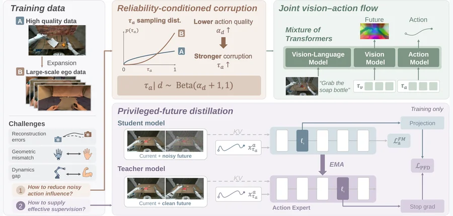 arXiv 2026-10-27 · cs.RO · #30 **[EgoForesight: Effectively Scaling Policy Learning with Noisy Egocentric Actions](https://arxiv.org/abs/2610.31845)** Chubin Zhang, Changyuan Wang, Yirui Wang, Ao Li, Shilin Ma, Yue Su, Cai Zhou, Xiuwei Xu, Tianle Zhang, Yansong Tang 机构：Tsinghua University / JD Future Academy / The University of Hong Kong / MIT / Loopeva（[PDF](https://arxiv.org/pdf/2610.31845)） [Paper](https://arxiv.org/abs/2610.31845) · [Project](https://lin-shan.com/EgoForesight/) · [图源](https://arxiv.org/html/2610.31845v1/pipeline_page1.png) 

中文摘要
扩大策略学习规模需要广泛经验和可靠监督。机器人示范提供高质量轨迹监督，但采集成本高；第一视角视频扩大了任务和环境覆盖范围，但运动重建与重定向会引入含噪动作标签。为解决这一问题，我们提出 EgoForesight，一种联合学习两类数据的视觉－语言－动作框架：削弱不可靠动作标签的影响，并利用示范结果提供补充监督。联合视觉－动作流把未来视觉表示预测与动作生成耦合，将可靠性感知的动作学习与结果驱动的表示迁移统一起来。具体而言，可靠性条件化扰动按来源可信度将动作监督分配到不同噪声水平，可靠性加权回归调节各来源的贡献。作为对含噪标签处理的补充，“特权未来”表示蒸馏利用示范结果监督：指数移动平均教师同时观察当前场景和干净未来，从场景变化编码与动作相关的结构；教师较深层的表示监督接收受扰未来的学生较浅层，提供超越含噪动作标注的结果信息。这些机制使含噪第一视角动作数据的规模扩展更有效。在所测范围内，EgoForesight 的性能随规模增长斜率高于基线；使用 3 万小时预训练数据时，真实世界开环动作 MSE 降低 20.5%，RoboCasa 小样本成功率提高 8.1 个百分点。后训练后，它在仿真和真实世界灵巧操作中也达到较强的绝对性能。 <a href="https://arxiv.org/abs/2610.31845">原摘要来源</a>
 |
| 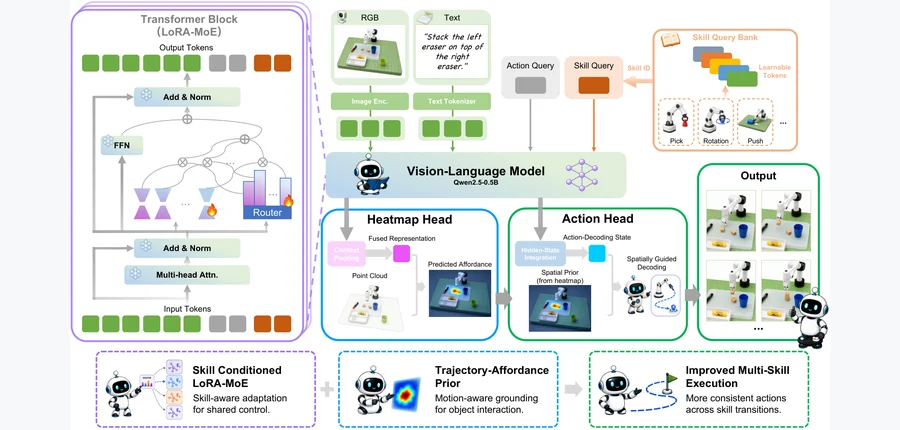 CoRL 2026 · #31 **[MAST-VLA: Skill-Conditioned Adaptation with Trajectory-Affordance Priors for Multi-Skill Robot Manipulation](https://arxiv.org/abs/2610.32312)** Jiachi Yang, Zhiyi Xu, Hongquan Zhang, Xin Tan, Zhizhong Zhang, Jingyu Gong, Yuan Xie 机构：Shanghai Innovation Institute / Tianjin University / East China Normal University / Tongji University（[PDF](https://arxiv.org/pdf/2610.32312)） [Paper](https://arxiv.org/abs/2610.32312) · [图源](https://arxiv.org/html/2610.32312v1/method_overview.png) 

中文摘要
通用机器人操作希望用单一视觉－语言－动作（VLA）策略，在不同场景和指令下执行多种技能。但当前多技能 VLA 往往没有充分建模指令的两个方面：该执行哪种基础技能，以及应在何处、如何接触并移动物体。我们提出 MAST-VLA，一个用于机器人操作的双条件化框架。其在 LLM 主干中引入技能条件化的 LoRA 混合专家（LoRA-MoE）适配器，用技能查询 token 和路由偏置引导低秩专家专门化；同时将预测的 affordance 热图转成动作头所用的图像块级轨迹－可供性空间先验。在 CALVIN ABC→D 跨场景长时程多技能泛化设置中，MAST-VLA 达到论文报告的最优表现：五子任务评估序列的平均完成长度为 4.65。真实机器人多技能序列实验进一步验证了它在真实感知和控制噪声下的可部署性。 <a href="https://arxiv.org/abs/2610.32312">原摘要来源</a>
 | 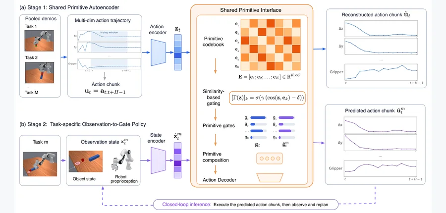 arXiv 2026-10-27 · cs.RO · #32 **[RoboCode: Learning Reusable Action Primitives for Robot Manipulation](https://arxiv.org/abs/2610.32225)** Xianyue Peng, Devi Amarsaikhan, Iman Soltani 机构：affiliation 未确认 [Paper](https://arxiv.org/abs/2610.32225) · [图源](https://arxiv.org/html/2610.32225v1/framework.png) 

中文摘要
近期机器人操作策略通常直接从观测预测连续动作片段，未显式建模动作空间中可复用的结构。然而，不同任务的操作示范常包含反复出现的短时运动模式。我们提出 RoboCode，通过共享的软门控基础动作接口学习这些模式。它不将每段动作分配给单个离散代码，而是将其表示为多个学习到的基础动作的软组合，形成灵活的短时动作中间表示。该接口由跨任务汇集的动作片段学习，再冻结；任务专用状态编码器则学习把当前状态输入映射到共享潜在空间。在五项 ManiSkill 操作任务上，实验回答三个问题：第一，所学接口重建动作片段的平均 MSE 为 0.0187；第二，代码激活分析显示跨任务的结构化代码复用；第三，RoboCode 在所有评估任务上的闭环成功率均为最高或并列最高，平均成功率 75.6%，高于 ACT 的 68.8% 和更大的 Diffusion Policy 基线的 41.6%。结果提示，软门控基础动作码本可作为机器人操作有效且可解释的中间动作表示。 <a href="https://arxiv.org/abs/2610.32225">原摘要来源</a>
 | 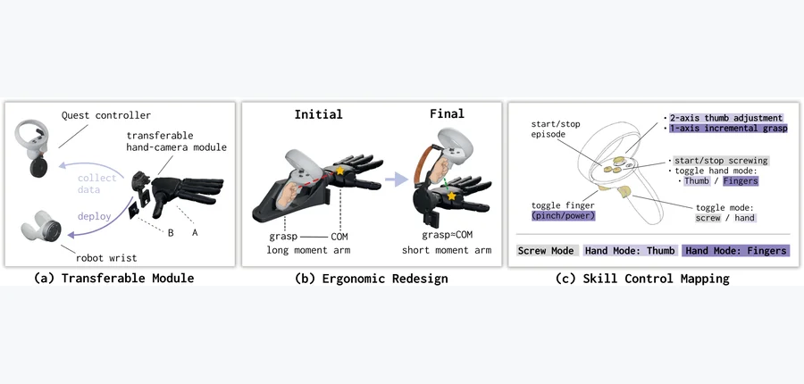 arXiv 2026-10-27 · cs.RO · #33 **[DexPort: A Hand-Held Skill Interface for Dexterous Hand Data Collection](https://arxiv.org/abs/2610.32969)** Amber Xie, Jiawei Fu, Xiaofeng Guo, Carmelo Sferrazza, Guanya Shi, Haozhi Qi 机构：Amazon FAR / Stanford University / University of California, San Diego（[PDF](https://arxiv.org/pdf/2610.32969)） [Paper](https://arxiv.org/abs/2610.32969) · [Project](https://amberxie88.github.io/dexport/) · [图源](https://arxiv.org/html/2610.32969v1/hardware.png) 

中文摘要
高质量示范的采集仍是灵巧操作学习的核心瓶颈。遥操作能记录可执行的机器人动作，但需要完整机器人系统，操作者还必须协调大量手指关节；人类示范较易采集，却需要估计和重定向动作，且不能直接给出机器人动作。本文提出 DexPort，一种用于高自由度机器人手的便携数据采集接口。采集与部署使用同一只机器人手，避免手部形态差距，并同时记录命令关节目标与实测关节状态。核心观察是少量技能就能覆盖广泛灵巧任务。采集时，操作者移动手持接口指定机器人腕部运动，并选择或调整协调手指运动的技能；因此无需独立控制每个关节，同时保留精确抓取和手内操作等行为。论文在无机器人臂的多个真实任务和非结构化环境中收集示范，再用行为克隆直接从记录的腕部运动和手部命令训练视觉运动策略，无需技能标签。评估涵盖四项任务：多种物体的抓取放置、使用手内工具拧螺丝、同时抓握与拉动的抽屉收纳，以及双手扫描。便携设备在实验室与自然环境中采集超过 2,500 条示范。跨任务结果中，使用记录的机器人命令而非状态时，一项对比由 11% 提升到 64%；加入自然环境数据时，任务成功率由 36% 提升到 78%。 <a href="https://arxiv.org/abs/2610.32969">原摘要来源</a>
 |
| 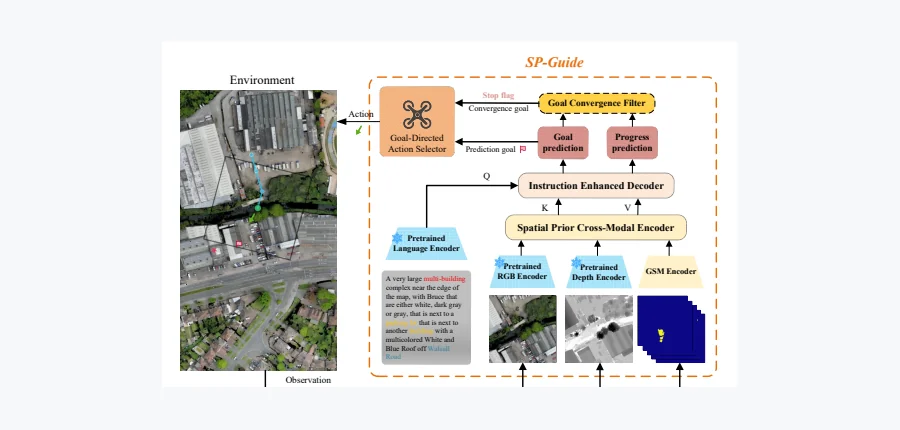 arXiv 2026-10-27 · cs.CV · #34 **[SP-Guide: Enhancing Aerial Vision-Language Navigation with Spatial Priors](https://arxiv.org/abs/2610.32697)** Haoxiang Tang, Dong Zhou, Shen Tan, Minxuan Jiang, Xitong Li 机构：Harbin Institute of Technology / China Electronics Technology Group Corporation（[PDF](https://arxiv.org/pdf/2610.32697)） [Paper](https://arxiv.org/abs/2610.32697) · [图源](https://arxiv.org/pdf/2610.32697) 

中文摘要
空中视觉－语言导航（AVLN）要求无人机在大范围室外场景中，依据局部第一视角观测推理并抵达语言描述的目标。现有方法常把以当前视角为中心的 RGB 观测和全局锚定的历史地图作为通用视觉嵌入融合，只依赖稀疏导航监督学习跨模态空间对齐。我们提出 SP-Guide，一种基于 Transformer 的目标预测框架，用 Spatial Prior Cross-Modal Encoder、Instruction Enhanced Decoder 和用于终点细化的 Goal Convergence Filter 改善对齐。CityNav 基准实验显示，SP-Guide 相对有代表性的基线提高成功率，在未见环境中的收益最大。结果表明，物理定位的空间先验为鲁棒 AVLN 提供有效归纳偏置。 <a href="https://arxiv.org/abs/2610.32697">原摘要来源</a>
 |   |   |
<!-- PAPER_CARDS_END -->

## 检索概况

- **检索窗口**：上次日报核对（北京时间 2026-10-26 09:00）至本次官方页面抓取（北京时间 2026-10-27 09:07–09:10）。
- **官方批次**：14 个目标分类的官方 `/new?show=2000` 页面均显示 **Monday, 26 October 2026**，是上次日报之后的新批次。只从这些页面的 **New submissions** 区域选主榜论文。
- **范围与核实**：优先 cs.CV、cs.GR、cs.RO、cs.AI、cs.LG；并查 physics、cond-mat、math.OC、math.NA、math.DS、stat.ML、eess.IV、eess.SY、eess.SP。根据官方标题和完整摘要逐篇筛选，同一 arXiv ID 去重；机构依据论文 PDF 首页，资源链接逐一打开核实。所有“相关性、机构强度、局限、改进”判断均为本期推断。
- **官方分类页总命中／主榜入选**：New **590／34 篇**；另有 Cross **341** 条、Replacement **593** 条（均为原始分类页记录，不纳入主榜）。34 篇的原摘要和完整中文译文均已核对；缺原摘要 **0** 篇。

## 官方 listing 状态

| 官方分类页 | listing 日期 | New | Cross | Replacement |
|---|---|---:|---:|---:|
| [cs.CV](https://arxiv.org/list/cs.CV/new?show=2000) | 2026-10-26 | 107 | 26 | 72 |
| [cs.GR](https://arxiv.org/list/cs.GR/new?show=2000) | 2026-10-26 | 0 | 2 | 6 |
| [cs.RO](https://arxiv.org/list/cs.RO/new?show=2000) | 2026-10-26 | 53 | 11 | 43 |
| [cs.AI](https://arxiv.org/list/cs.AI/new?show=2000) | 2026-10-26 | 79 | 110 | 132 |
| [cs.LG](https://arxiv.org/list/cs.LG/new?show=2000) | 2026-10-26 | 106 | 92 | 123 |
| [physics](https://arxiv.org/list/physics/new?show=2000) | 2026-10-26 | 58 | 28 | 49 |
| [cond-mat](https://arxiv.org/list/cond-mat/new?show=2000) | 2026-10-26 | 80 | 16 | 63 |
| [math.OC](https://arxiv.org/list/math.OC/new?show=2000) | 2026-10-26 | 26 | 12 | 32 |
| [math.NA](https://arxiv.org/list/math.NA/new?show=2000) | 2026-10-26 | 18 | 8 | 13 |
| [math.DS](https://arxiv.org/list/math.DS/new?show=2000) | 2026-10-26 | 14 | 6 | 10 |
| [stat.ML](https://arxiv.org/list/stat.ML/new?show=2000) | 2026-10-26 | 13 | 16 | 31 |
| [eess.IV](https://arxiv.org/list/eess.IV/new?show=2000) | 2026-10-26 | 1 | 1 | 4 |
| [eess.SY](https://arxiv.org/list/eess.SY/new?show=2000) | 2026-10-26 | 24 | 6 | 5 |
| [eess.SP](https://arxiv.org/list/eess.SP/new?show=2000) | 2026-10-26 | 11 | 7 | 10 |
| **合计（原始分类页计数）** | — | **590** | **341** | **593** |

## Top papers

| # | 标题 | 原文 | 分类 | 作者 | 机构（PDF 核实） | 相关性（推断） | 机构强度（推断） | 阅读优先级（推断） |
|---:|---|---|---|---|---|---|---|---|
| 1 | DynaSlots: Slot-Centric 3D Dynamics Pretraining for Robot Manipulation | [arXiv:2610.32330](https://arxiv.org/abs/2610.32330) | cs.RO | Meng Li, Lijiang Chen, Qi Zhao, Jun Jiang, Longhao Zou, Shuchang Lyu, Guangliang Cheng | Beihang University / Pengcheng Laboratory / University of Science and Technology Beijing / University of Liverpool（[PDF](https://arxiv.org/pdf/2610.32330)） | 高：3D／物理／实体交互 | 中高 | A |
| 2 | StackGen3D: Stable 3D Block Stack Generation from Multiview Silhouettes | [arXiv:2610.31803](https://arxiv.org/abs/2610.31803) | cs.CV | Xiaopeng Zhang, Luzhe Sun, Yiqing Xu, Matthew R. Walter | University of Chicago / Toyota Technological Institute at Chicago / Stanford University（[PDF](https://arxiv.org/pdf/2610.31803)） | 高：3D／物理／实体交互 | 中高 | A |
| 3 | WorldMirror: Agentic Real-to-Sim Generation of Interactive Worlds from In-the-Wild Robot Demonstrations | [arXiv:2610.31834](https://arxiv.org/abs/2610.31834) | cs.RO | Tianling Xu, Weijie Wan, Honghao Su, Kailun Su, Junyuan Tang, Huichi Zhou, Haozheng Zhang, Qi Xiong, Ping Luo, Wenbo Ding, Tianxing Chen, Yue Chen | Xspark AI / Tsinghua University / The University of Hong Kong / University College London / Peking University（[PDF](https://arxiv.org/pdf/2610.31834)） | 高：3D／物理／实体交互 | 中高 | A |
| 4 | Multimodal MPC via Bayesian Set Optimization for Dynamic Manipulation of Deformable Linear Objects | [arXiv:2610.31852](https://arxiv.org/abs/2610.31852) | cs.RO | Youyuan Long, Gokhan Solak, Arash Ajoudani | Istituto Italiano di Tecnologia（[PDF](https://arxiv.org/pdf/2610.31852)） | 高：3D／物理／实体交互 | 中高 | A |
| 5 | FORCA: A Force-Aware Coding Agent for Contact-Rich Robot Manipulation | [arXiv:2610.31841](https://arxiv.org/abs/2610.31841) | cs.RO | Xiao Tan, Yixuan Wang, Zhexi Wang, Wenzhen Yuan | University of Illinois Urbana-Champaign / Tsinghua University（[PDF](https://arxiv.org/pdf/2610.31841)） | 高：3D／物理／实体交互 | 中高 | A |
| 6 | Robotic Optical Coherence Tomography-Guided Geometric Modeling of Soft Tissue: 3D Representations for Data-Driven Closed-Loop Shape Control | [arXiv:2610.32961](https://arxiv.org/abs/2610.32961) | cs.RO | Chaoyu Zhang, Guangshen Ma, Mark Draelos | University of Michigan（[PDF](https://arxiv.org/pdf/2610.32961)） | 高：3D／物理／实体交互 | 中高 | A |
| 7 | SceneBloom: Agentic Indoor Environment Generation with Realistic and Diverse Layouts for Embodied Learning | [arXiv:2610.32978](https://arxiv.org/abs/2610.32978) | cs.CV | Yuhan Liu, Lianhui Qin, Shenji Wan | New York University / University of California, San Diego（[PDF](https://arxiv.org/pdf/2610.32978)） | 高：3D／物理／实体交互 | 中高 | A |
| 8 | RADIANT: Object-Centric Feed-Forward Global Illumination | [arXiv:2610.32075](https://arxiv.org/abs/2610.32075) | cs.CV | Sarah Zhang, Zhiyang Dou, Minghao Guo, Benjamin Tod Jones, Wojciech Matusik | MIT CSAIL（[PDF](https://arxiv.org/pdf/2610.32075)） | 高：3D／物理／实体交互 | 中高 | A |
| 9 | Interpreting Physics in Video Encoders using Multi-Object Interaction Videos | [arXiv:2610.31983](https://arxiv.org/abs/2610.31983) | cs.CV | Ayushi Mehrotra, Sai Vidyaranya Nuthalapati | California Institute of Technology（首作者）；另一作者 affiliation 未确认（[PDF](https://arxiv.org/pdf/2610.31983)） | 高：3D／物理／实体交互 | 中高 | A |
| 10 | CoCarry: Contact-Support-Structured Retargeting for Dual-Humanoid Cooperative Carrying | [arXiv:2610.32460](https://arxiv.org/abs/2610.32460) | cs.RO | Ziyu Lin, Shihang Du, Tianhang Wang, Xiaodong Liu, Runze Zhang, Zongyou Yu, Haodong Zhang, Alois Knoll, Guang Chen | Tongji University / Shanghai Innovation Institute / RobotScale.AI / AGIBOT / Technical University of Munich（[PDF](https://arxiv.org/pdf/2610.32460)） | 高：3D／物理／实体交互 | 中高 | A |
| 11 | Geometry-Aware Reinforcement Learning for Close-Fitting Wearable Insertion | [arXiv:2610.32143](https://arxiv.org/abs/2610.32143) | cs.RO | Takuma Tsukakoshi, Elle Miller, Tamon Miyake, Namiko Saito, Yushi Wang, Shigeki Sugano, Tetsuya Ogata, Sethu Vijayakumar | Waseda University / University of Edinburgh / Microsoft Research Asia（[PDF](https://arxiv.org/pdf/2610.32143)） | 高：3D／物理／实体交互 | 中高 | A |
| 12 | PixGR: Pixel-Space Generative Decoding for Fast Feed-Forward 3D Reconstruction | [arXiv:2610.31908](https://arxiv.org/abs/2610.31908) | cs.CV | Ranran Huang, Wenjing Bian, Weixun Luo, Ye Mao, Krystian Mikolajczyk | Imperial College London / University of Tübingen（[PDF](https://arxiv.org/pdf/2610.31908)） | 高：3D／物理／实体交互 | 中高 | A |
| 13 | Anchored HLLD: A Riemann solver for a hypoelastic diffuse-interface model of compressible fluid-solid interaction | [arXiv:2610.31958](https://arxiv.org/abs/2610.31958) | physics.comp-ph | Yanjun Zhang, Tim Colonius | California Institute of Technology（[PDF](https://arxiv.org/pdf/2610.31958)） | 高：物理建模／估计 | 中高 | A |
| 14 | An Arbitrary-Order Augmented Lagrangian Discrete De Rham Scheme for Contact Mechanics with Tresca Friction | [arXiv:2610.32471](https://arxiv.org/abs/2610.32471) | math.NA | Jérôme Droniou, Raman Kumar, Roland Masson | Université de Montpellier / Monash University / Université Côte d’Azur / Inria（[PDF](https://arxiv.org/pdf/2610.32471)） | 高：物理建模／估计 | 中高 | A |
| 15 | An energy-stable parametric finite element framework for surface diffusion with moving contact lines on curved substrates | [arXiv:2610.32270](https://arxiv.org/abs/2610.32270) | math.NA | Harald Garcke, Robert Nürnberg, Rong Tang | Universität Regensburg / Università di Trento / The Hong Kong Polytechnic University（[PDF](https://arxiv.org/pdf/2610.32270)） | 高：物理建模／估计 | 中高 | A |
| 16 | Universal neural network approximation of symmetric polyconvex energies and envelopes | [arXiv:2610.32598](https://arxiv.org/abs/2610.32598) | math.NA | Florian Gammer | University of Regensburg（[PDF](https://arxiv.org/pdf/2610.32598)） | 高：物理建模／估计 | 中高 | A |
| 17 | Time-temperature superposition from multi-temperature chirp rheometry of thermorheologically simple materials via physics-informed Gaussian processes | [arXiv:2610.32895](https://arxiv.org/abs/2610.32895) | cond-mat.soft | Isaac Y. Miranda-Valdez, Kourosh Mobredi, Juha Koivisto, Mikko J. Alava | Aalto University / Deltan Labs（[PDF](https://arxiv.org/pdf/2610.32895)） | 高：物理建模／估计 | 中高 | A |
| 18 | IMRFit: Interactive Simulation and Constitutive-Model Fitting for Inertial Microcavitation Rheometry | [arXiv:2610.32119](https://arxiv.org/abs/2610.32119) | physics.flu-dyn | Sicong Wang, Zixiang Tong, Jin Yang | University of Texas at Austin（[PDF](https://arxiv.org/pdf/2610.32119)） | 高：物理建模／估计 | 中高 | A |
| 19 | Solving and Learning Navier-Stokes Dynamics with the Neural Basis Method | [arXiv:2610.32167](https://arxiv.org/abs/2610.32167) | physics.flu-dyn | Yuhe Wang, Zhu Wang, Min Wang | Asia Pacific Technology / Texas A&M University / University of South Carolina / University of Houston（[PDF](https://arxiv.org/pdf/2610.32167)） | 高：物理建模／估计 | 中高 | A |
| 20 | CoPiT: A conditional Position-induced Transformer for aerodynamic field prediction on unstructured meshes | [arXiv:2610.32299](https://arxiv.org/abs/2610.32299) | physics.comp-ph | Junfeng Chen, Yongchen Fan, Zhonghua Qiao, Kailiang Wu | The Hong Kong Polytechnic University / The Hong Kong University of Science and Technology / Southern University of Science and Technology（[PDF](https://arxiv.org/pdf/2610.32299)） | 高：物理建模／估计 | 中高 | A |
| 21 | CBTV: Colour Bean Tracking Velocimetry for Dense Granular Flows | [arXiv:2610.31883](https://arxiv.org/abs/2610.31883) | physics.flu-dyn | Kaveeshan Thurairajah, Zhao Pan | University of Waterloo（[PDF](https://arxiv.org/pdf/2610.31883)） | 高：物理建模／估计 | 中高 | B |
| 22 | Let's Do Turbulence Right: In Space and Time! | [arXiv:2610.32601](https://arxiv.org/abs/2610.32601) | physics.flu-dyn | Maximilian Plattner, Fabian Paischer, Johannes Brandstetter | Johannes Kepler University Linz / Mistral AI（[PDF](https://arxiv.org/pdf/2610.32601)） | 高：物理建模／估计 | 中高 | B |
| 23 | Easy-3Dfy: Object-Level Geometric Composition for Single-Image 3D Scene Construction | [arXiv:2610.32250](https://arxiv.org/abs/2610.32250) | cs.CV | Ziang Zhang, Wenyou Yi, Zehan Wang, Jiachen Xu, Xintong Han, Chunchao Guo, Zhou Zhao | Zhejiang University / Tencent（[PDF](https://arxiv.org/pdf/2610.32250)） | 中高：基础 3D | 中高 | B |
| 24 | CompMVR: Compression-Aware Multi-View Restoration Using Diffusion Models for Geometrically Consistent 3D Reconstruction | [arXiv:2610.32800](https://arxiv.org/abs/2610.32800) | cs.CV | Dong-hwi Kim, Chaewon Moon, Hojun Song, Dongbeom Kim, Junyeong Jang, Aro Kim, Gahyeon Kim, Heejung Choi, Jehee Kim, Gianella Cravioto, Sohyun Lee, Gyeongjin Choi, EunHye Jeong, Soo Ye Kim, Jaehyup Lee, Sang-hyo Park | Kyungpook National University / Adobe Research（[PDF](https://arxiv.org/pdf/2610.32800)） | 中高：基础 3D | 中高 | B |
| 25 | SemGeo-Gen: Unsupervised Generation of Approximate Cross-Instance Semantic-Geometric Correspondences | [arXiv:2610.32663](https://arxiv.org/abs/2610.32663) | cs.CV | Roy Amoyal, Shira Ifergane, Oren Freifeld | Ben-Gurion University of the Negev（[PDF](https://arxiv.org/pdf/2610.32663)） | 中高：基础 3D | 中高 | B |
| 26 | CityLift: Compositional 3D Urban Generation from a Single Image | [arXiv:2610.32728](https://arxiv.org/abs/2610.32728) | cs.CV | Haoran Gong, Jie Feng, Chenxu Wang | Xi’an Jiaotong University / Zhongguancun Academy（[PDF](https://arxiv.org/pdf/2610.32728)） | 中高：基础 3D | 中高 | B |
| 27 | PnP*: A certifiable solver for Perspective-n-Point | [arXiv:2610.31797](https://arxiv.org/abs/2610.31797) | cs.CV | Bang-Shien Chen, Caitrin E. Eaton, David M. Rosen | Northeastern University / Draper（[PDF](https://arxiv.org/pdf/2610.31797)） | 中高：基础 3D | 中高 | B |
| 28 | Beyond Pattern Matching in 3D MLLMs: Part-Level Functional Reasoning for Generalizable Recognition | [arXiv:2610.32262](https://arxiv.org/abs/2610.32262) | cs.CV | Weihong Li, Hao Jiang, Yaohua Zha, Tao Dai, Shu-Tao Xia | Tsinghua University / Shenzhen University（[PDF](https://arxiv.org/pdf/2610.32262)） | 中高：基础 3D | 中高 | B |
| 29 | See What I Need, Dream What I Want: A Navigation Foundation Model on a Self-Constructed Representation Space | [arXiv:2610.31762](https://arxiv.org/abs/2610.31762) | cs.RO | Jiawei Chen, Yinxi Wang, Zihan Yang, Meijun Gao, Yaowei Liu, Shuming Zhang, Zecheng Li, Xiangju Mi, Yuxuan Liu, Runzhong Huang, Tianlin Li, Xun Zhang, Zhengyang Wang, Xu Miao, Tong Yang | Peking University / University College London / DataCanvas（[PDF](https://arxiv.org/pdf/2610.31762)） | 中高：具体具身任务 | 中高 | B |
| 30 | EgoForesight: Effectively Scaling Policy Learning with Noisy Egocentric Actions | [arXiv:2610.31845](https://arxiv.org/abs/2610.31845) | cs.RO | Chubin Zhang, Changyuan Wang, Yirui Wang, Ao Li, Shilin Ma, Yue Su, Cai Zhou, Xiuwei Xu, Tianle Zhang, Yansong Tang | Tsinghua University / JD Future Academy / The University of Hong Kong / MIT / Loopeva（[PDF](https://arxiv.org/pdf/2610.31845)） | 中高：具体具身任务 | 中高 | B |
| 31 | MAST-VLA: Skill-Conditioned Adaptation with Trajectory-Affordance Priors for Multi-Skill Robot Manipulation | [arXiv:2610.32312](https://arxiv.org/abs/2610.32312) | cs.RO | Jiachi Yang, Zhiyi Xu, Hongquan Zhang, Xin Tan, Zhizhong Zhang, Jingyu Gong, Yuan Xie | Shanghai Innovation Institute / Tianjin University / East China Normal University / Tongji University（[PDF](https://arxiv.org/pdf/2610.32312)） | 中高：具体具身任务 | 中高 | B |
| 32 | RoboCode: Learning Reusable Action Primitives for Robot Manipulation | [arXiv:2610.32225](https://arxiv.org/abs/2610.32225) | cs.RO | Xianyue Peng, Devi Amarsaikhan, Iman Soltani | affiliation 未确认 | 中高：具体具身任务 | 未评估 | B |
| 33 | DexPort: A Hand-Held Skill Interface for Dexterous Hand Data Collection | [arXiv:2610.32969](https://arxiv.org/abs/2610.32969) | cs.RO | Amber Xie, Jiawei Fu, Xiaofeng Guo, Carmelo Sferrazza, Guanya Shi, Haozhi Qi | Amazon FAR / Stanford University / University of California, San Diego（[PDF](https://arxiv.org/pdf/2610.32969)） | 中高：具体具身任务 | 中高 | B |
| 34 | SP-Guide: Enhancing Aerial Vision-Language Navigation with Spatial Priors | [arXiv:2610.32697](https://arxiv.org/abs/2610.32697) | cs.CV | Haoxiang Tang, Dong Zhou, Shen Tan, Minxuan Jiang, Xitong Li | Harbin Institute of Technology / China Electronics Technology Group Corporation（[PDF](https://arxiv.org/pdf/2610.32697)） | 中高：具体具身任务 | 中高 | B |

## 逐篇中文要点

### 1. [DynaSlots: Slot-Centric 3D Dynamics Pretraining for Robot Manipulation](https://arxiv.org/abs/2610.32330)

- **事实·方法**：把点云帧分解为时间一致的槽，为每槽学习潜在动作、前向动力学和成对交互。
- **事实·结果**：Meta-World、Adroit 及 RealMan RM65-B 评估报告优于场景级基线；真实操作对杂乱和新物体更稳。
- **推断·局限**：局限推断：槽身份在遮挡与高频接触时可能漂移；可加入接触事件约束检验。

### 2. [StackGen3D: Stable 3D Block Stack Generation from Multiview Silhouettes](https://arxiv.org/abs/2610.31803)

- **事实·方法**：以支撑关系 PI-GNN 筛出稳定积木数据，再用条件流匹配从三视角轮廓生成布局。
- **事实·结果**：Best-of-10 将稳定率由 45.3% 提至 72.4%，轮廓 IoU 为 0.970；推理细化无需物理仿真。
- **推断·局限**：局限推断：稳定判别与现实摩擦、重心误差之间的差距需实体堆叠验证。

### 3. [WorldMirror: Agentic Real-to-Sim Generation of Interactive Worlds from In-the-Wild Robot Demonstrations](https://arxiv.org/abs/2610.31834)

- **事实·方法**：让编码智能体迭代修改可执行世界程序，重建相机位姿锚定的支撑几何与交互资产。
- **事实·结果**：DROID 实验报告交互数字孪生保持视觉、几何一致性及记录轨迹的物理有效性。
- **推断·局限**：局限推断：重放有效不等于未见动作下动力学准确；宜加入扰动轨迹测试。

### 4. [Multimodal MPC via Bayesian Set Optimization for Dynamic Manipulation of Deformable Linear Objects](https://arxiv.org/abs/2610.31852)

- **事实·方法**：BM2PC 用贝叶斯集合优化维持多种 DLO 控制模式，并用执行动力学补偿末端偏差。
- **事实·结果**：真实最长跟踪任务 RMSE 降低 44.0%；避障规划时间比比较方法少 29%–66%。
- **推断·局限**：局限推断：对不同线材刚度、摩擦和视觉遮挡的在线适应仍需检验。

### 5. [FORCA: A Force-Aware Coding Agent for Contact-Rich Robot Manipulation](https://arxiv.org/abs/2610.31841)

- **事实·方法**：FORCA 联合视觉和腕部 F/T 信号编写、执行并修订接触探测及力反馈程序。
- **事实·结果**：五项真实机器人任务中，相对同一智能体的纯视觉版提高抓取与任务成功，并减少擦拭、剥离的失接触。
- **推断·局限**：局限推断：成功依赖 F/T 标定与安全阈值；可评估传感器漂移下的稳定性。

### 6. [Robotic Optical Coherence Tomography-Guided Geometric Modeling of Soft Tissue: 3D Representations for Data-Driven Closed-Loop Shape Control](https://arxiv.org/abs/2610.32961)

- **事实·方法**：用 OCT 体积／稀疏体积／体素点云表示当前及目标软组织状态，学习闭环形状控制。
- **事实·结果**：12 配置、576 次模型组织及 60 次离体猪组织 rollout；残差条件使一项方向 Shape RMSE 从 0.748 降至 0.555 mm。
- **推断·局限**：局限推断：组织类型与形变幅度扩展后，表示与控制误差可能变化。

### 7. [SceneBloom: Agentic Indoor Environment Generation with Realistic and Diverse Layouts for Embodied Learning](https://arxiv.org/abs/2610.32978)

- **事实·方法**：分层扩散采样室内家具布局，再用关系约束的三维编译器修正几何及位姿。
- **事实·结果**：五类房间对比中未检出网格碰撞和越界物体；其场景训练的导航策略在留出真实扫描中更成功。
- **推断·局限**：局限推断：无几何碰撞仍不保证可操作性；应检查可达空间和物体稳定性。

### 8. [RADIANT: Object-Centric Feed-Forward Global Illumination](https://arxiv.org/abs/2610.32075)

- **事实·方法**：每物体用 32 个表面块 token，结合形状因子注意力建模三维辐射交换。
- **事实·结果**：103 万场景基准上以少五倍训练步数达 25 dB；500 物体、512×512 渲染耗时 0.83 秒。
- **推断·局限**：局限推断：复杂材质和细小遮挡下固定 token 预算可能不足。

### 9. [Interpreting Physics in Video Encoders using Multi-Object Interaction Videos](https://arxiv.org/abs/2610.31983)

- **事实·方法**：探查冻结 V-JEPA2、VideoMAE 对双物体碰撞、动量、能量和摩擦的关系性编码。
- **事实·结果**：两者均能区分弹性与非弹性碰撞；跨几何变化可迁移的摩擦系数在两者中均未发现。
- **推断·局限**：局限推断：读出失败不能直接证明模型完全没有相关信息，宜改变探针容量验证。

### 10. [CoCarry: Contact-Support-Structured Retargeting for Dual-Humanoid Cooperative Carrying](https://arxiv.org/abs/2610.32460)

- **事实·方法**：提供 220 段双人搬运序列，并以四手物体局部锚点和全身支撑结构联合重定向。
- **事实·结果**：双 A3 重定向接触保持率 0.9995，穿透持续时间相对两基线分别降 67.0% 与 71.0%。
- **推断·局限**：局限推断：不同物体质量及质心偏移会改变共同受力，可补做负载扰动实验。

### 11. [Geometry-Aware Reinforcement Learning for Close-Fitting Wearable Insertion](https://arxiv.org/abs/2610.32143)

- **事实·方法**：将穿戴表述为身体部位与开口的几何关系，结合分阶段课程和手指插入软门控。
- **事实·结果**：可形变评估成功率 84.7±1.2%；假人手真实机器人 20 次中成功 15 次。
- **推断·局限**：局限推断：软门控对衣物刚度、尺寸变化的泛化还需测试。

### 12. [PixGR: Pixel-Space Generative Decoding for Fast Feed-Forward 3D Reconstruction](https://arxiv.org/abs/2610.31908)

- **事实·方法**：在前馈三维 Gaussian 重建中加入像素空间流匹配及轻量 DiT 迭代解码。
- **事实·结果**：稀疏视角、宽基线和外推设置优于回归法，同时保持亚秒推理。
- **推断·局限**：局限推断：直接像素生成可能牺牲跨视角几何一致性，需用深度与重投影误差检验。

### 13. [Anchored HLLD: A Riemann solver for a hypoelastic diffuse-interface model of compressible fluid-solid interaction](https://arxiv.org/abs/2610.31958)

- **事实·方法**：将决定剪切波阻抗的应力系数纳入两次锚定 HLLD 黎曼求解。
- **事实·结果**：一维、二维及三维流固算例中更清晰解析接触与剪切波，并报告局部守恒及收敛性质。
- **推断·局限**：局限推断：复杂材料本构及强界面拓扑变化下的稳定性需扩展验证。

### 14. [An Arbitrary-Order Augmented Lagrangian Discrete De Rham Scheme for Contact Mechanics with Tresca Friction](https://arxiv.org/abs/2610.32471)

- **事实·方法**：用增广拉格朗日 DDR 格式统一处理裂隙法向接触和 Tresca 摩擦。
- **事实·结果**：理论给出位移与乘子的最优阶误差估计，数值实验支持精度和鲁棒性。
- **推断·局限**：局限推断：真实粗糙裂面、非线性弹性中的摩擦参数敏感性值得测试。

### 15. [An energy-stable parametric finite element framework for surface diffusion with moving contact lines on curved substrates](https://arxiv.org/abs/2610.32270)

- **事实·方法**：同时离散薄膜表面与曲面基底，构建移动接触线的能量稳定有限元格式。
- **事实·结果**：线性格式无条件能量稳定；非线性变体还维持近似顶点附着于真实基底。
- **推断·局限**：局限推断：复杂拓扑变化可能超出现有参数化网格的适用范围。

### 16. [Universal neural network approximation of symmetric polyconvex energies and envelopes](https://arxiv.org/abs/2610.32598)

- **事实·方法**：构建按结构保证对称多凸性的神经网络，学习小应变弹性能及其包络。
- **事实·结果**：证明不要求各向同性的普适近似，并展示应力回归与双阱势包络数值例子。
- **推断·局限**：局限推断：理论结构保证不等于有限样本外推准确，应在未见应变路径评估。

### 17. [Time-temperature superposition from multi-temperature chirp rheometry of thermorheologically simple materials via physics-informed Gaussian processes](https://arxiv.org/abs/2610.32895)

- **事实·方法**：把时温等效约束和分数阶黏弹性因果卷积特征纳入稀疏变分高斯过程。
- **事实·结果**：合成 Fractional Maxwell 在 3%–25% 应力噪声下恢复本构及位移因子；环氧数据可区分模型。
- **推断·局限**：局限推断：等方差假设与低信息谱区间会影响可辨识性；可改异方差噪声模型。

### 18. [IMRFit: Interactive Simulation and Constitutive-Model Fitting for Inertial Microcavitation Rheometry](https://arxiv.org/abs/2610.32119)

- **事实·方法**：IMRFit 将微气泡前向仿真、软材料参数识别和本构模型比较集成于 Python 应用。
- **事实·结果**：支持 Neo-Hookean Kelvin-Voigt、广义 Maxwell-Ogden 等模型及批量拟合、参数扫描。
- **推断·局限**：局限推断：模型选型的唯一性与实验噪声敏感性需用真实重复测量评估。

### 19. [Solving and Learning Navier-Stokes Dynamics with the Neural Basis Method](https://arxiv.org/abs/2610.32167)

- **事实·方法**：用固定神经基表示解、将 Navier–Stokes 方程投影到系数空间学习参数映射。
- **事实·结果**：不可压缩流的残差提供速度误差后验估计；理论和数值实验报告优于基线。
- **推断·局限**：局限推断：基底在边界或流态剧变时能否保持有效，需跨几何检验。

### 20. [CoPiT: A conditional Position-induced Transformer for aerodynamic field prediction on unstructured meshes](https://arxiv.org/abs/2610.32299)

- **事实·方法**：CoPiT 在几何注意力骨干中以多阶段 FiLM 显式注入自由流及设计条件。
- **事实·结果**：AirfRANS 上表面、体积损失相对 Transolver 约降 54%、24%；另测三维 BlendedNet++。
- **推断·局限**：局限推断：外推工况的物理守恒与误差校准应独立测试。

### 21. [CBTV: Colour Bean Tracking Velocimetry for Dense Granular Flows](https://arxiv.org/abs/2610.31883)

- **事实·方法**：CBTV 先匹配彩色颗粒邻域星座，再分配剩余粒子，免训练跟踪致密颗粒流。
- **事实·结果**：59 个离散元案例、12 类跟踪器对比；优势集中在每帧位移约半个至两个粒间距时。
- **推断·局限**：局限推断：颜色可分性和真实光照噪声可能影响身份保持。

### 22. [Let's Do Turbulence Right: In Space and Time!](https://arxiv.org/abs/2610.32601)

- **事实·方法**：用单次超 28 TB 的时间分辨 DNS 考察三维湍流的空间与时间解析误差。
- **事实·结果**：作者报告数值记录与学习表示的空间评价、时间评价均可能不一致。
- **推断·局限**：局限推断：可在小规模流场上设计时空联合指标，但大 DNS 成本限制复现。

### 23. [Easy-3Dfy: Object-Level Geometric Composition for Single-Image 3D Scene Construction](https://arxiv.org/abs/2610.32250)

- **事实·方法**：拆开单图三维物体生成与场景布局估计，用几何对应对齐局部网格和场景点图。
- **事实·结果**：Scene-Maker、3D-FUTURE200 上多项几何指标持续优于 SAM-3Dfy。
- **推断·局限**：局限推断：遮挡严重时局部点图对应可能不稳，需分层评估。

### 24. [CompMVR: Compression-Aware Multi-View Restoration Using Diffusion Models for Geometrically Consistent 3D Reconstruction](https://arxiv.org/abs/2610.32800)

- **事实·方法**：CompMVR 联合复原压缩多视角图像，并以跨视角对应约束几何一致性。
- **事实·结果**：多数据集、编码器和压缩水平下，新视角合成、位姿估计与匹配任务均报告改善。
- **推断·局限**：局限推断：视觉细节恢复可能产生伪对应，需检查几何置信度。

### 25. [SemGeo-Gen: Unsupervised Generation of Approximate Cross-Instance Semantic-Geometric Correspondences](https://arxiv.org/abs/2610.32663)

- **事实·方法**：从弱对齐三维物体中提升 DINOv2 多视角特征，经分段仿射配准生成语义几何对应。
- **事实·结果**：KeypointNet 上 PCK@0.10 为 93%、PCK@0.15 为 97%；SPair-71k 最多增 5 个 PCK@0.10 点。
- **推断·局限**：局限推断：类别外物体和非刚性结构可能削弱配准质量。

### 26. [CityLift: Compositional 3D Urban Generation from a Single Image](https://arxiv.org/abs/2610.32728)

- **事实·方法**：CityLift 耦合场景流和实例流，再以空间继承生成独立可编辑的建筑网格。
- **事实·结果**：构建 4,997 场景的 CityLift-5K，并在其及其他城市场景片段上改善几何和布局。
- **推断·局限**：局限推断：单视图隐藏立面的不确定性应显式量化。

### 27. [PnP*: A certifiable solver for Perspective-n-Point](https://arxiv.org/abs/2610.31797)

- **事实·方法**：PnP* 利用弦稀疏与商环约简求解实际 MLE 目标的可认证凸松弛。
- **事实·结果**：证明中等噪声下松弛精确；数值实验报告超过 10 Hz 的可证明正确位姿。
- **推断·局限**：局限推断：异常对应与非高斯噪声可能突破认证假设。

### 28. [Beyond Pattern Matching in 3D MLLMs: Part-Level Functional Reasoning for Generalizable Recognition](https://arxiv.org/abs/2610.32262)

- **事实·方法**：PFIR 用部件分割和几何→功能→身份推理链训练三维识别，并组合双目标 GRPO。
- **事实·结果**：双重 OOD 协议下零样本准确率 60.5%→66.7%，收益在几何含糊样本更集中。
- **推断·局限**：局限推断：功能文本监督可能引入类别先验；需物理可用性测试。

### 29. [See What I Need, Dream What I Want: A Navigation Foundation Model on a Self-Constructed Representation Space](https://arxiv.org/abs/2610.31762)

- **事实·方法**：RepresentNav 从多层视觉基础模型特征自构建空间，并以 JEPA 预测下一潜在表示。
- **事实·结果**：VLNVerse fine-grained 成功率 83.80%，高先前最优 20.05 点；预测使碰撞减少约四分之一。
- **推断·局限**：局限推断：潜在预测遇到长时程动态障碍时可能积累误差。

### 30. [EgoForesight: Effectively Scaling Policy Learning with Noisy Egocentric Actions](https://arxiv.org/abs/2610.31845)

- **事实·方法**：EgoForesight 以可靠性条件化扰动和未来结果蒸馏学习含噪第一视角动作。
- **事实·结果**：3 万小时预训练下真实开环动作 MSE 降 20.5%，RoboCasa 小样本成功率增 8.1 点。
- **推断·局限**：局限推断：大数据规模下收益难归因单一模块，应做匹配预算消融。

### 31. [MAST-VLA: Skill-Conditioned Adaptation with Trajectory-Affordance Priors for Multi-Skill Robot Manipulation](https://arxiv.org/abs/2610.32312)

- **事实·方法**：MAST-VLA 以技能条件化 LoRA-MoE 和轨迹可供性热图双重条件化动作头。
- **事实·结果**：CALVIN ABC→D 五子任务序列平均完成长度 4.65，并报告真实多技能序列实验。
- **推断·局限**：局限推断：热图与实际接触轨迹的偏差需要力觉或接触真值验证。

### 32. [RoboCode: Learning Reusable Action Primitives for Robot Manipulation](https://arxiv.org/abs/2610.32225)

- **事实·方法**：RoboCode 以软门控基础动作码本组合短动作片段，跨任务学习后冻结接口。
- **事实·结果**：五项 ManiSkill 中平均成功率 75.6%，对比 ACT 68.8% 和较大 Diffusion Policy 41.6%。
- **推断·局限**：局限推断：码本能否迁移到新机器人形态及接触任务仍待实验。

### 33. [DexPort: A Hand-Held Skill Interface for Dexterous Hand Data Collection](https://arxiv.org/abs/2610.32969)

- **事实·方法**：DexPort 用部署时同一只机器人手的便携接口采集腕部及手指命令，减少形态差距。
- **事实·结果**：采集超 2,500 条示范；所报告对比中命令代替状态使 11%→64%，野外数据使 36%→78%。
- **推断·局限**：局限推断：手持操作员动作与完整机械臂动力学的差异需跨平台验证。

### 34. [SP-Guide: Enhancing Aerial Vision-Language Navigation with Spatial Priors](https://arxiv.org/abs/2610.32697)

- **事实·方法**：SP-Guide 在空中视觉语言导航中加入空间先验编码、指令解码和终点收敛过滤。
- **事实·结果**：CityNav 上相对代表基线提高成功率，收益在未见环境最明显。
- **推断·局限**：局限推断：户外大范围视角变化及定位误差下的先验鲁棒性需验证。

## 今日最值得细读的 5 篇

1. **[DynaSlots](https://arxiv.org/abs/2610.32330)**：将三维动力学从整场景拆成局部槽，值得检查交互头是否学到接触因果关系。
2. **[StackGen3D](https://arxiv.org/abs/2610.31803)**：把支撑物理纳入生成前的数据整理，且有稳定率与轮廓指标可直接检验。
3. **[WorldMirror](https://arxiv.org/abs/2610.31834)**：从机器人示范重建可执行交互世界，关键是如何验证未见动作的物理有效性。
4. **[BM2PC](https://arxiv.org/abs/2610.31852)**：可形变线状物体的多模态 MPC 兼顾快速规划与硬件动态跟踪。
5. **[Interpreting Physics in Video Encoders](https://arxiv.org/abs/2610.31983)**：直接审问世界模型潜在表示中的碰撞、动量和摩擦，并给出跨环境边界。

## 低算力可改进论文与具体实验（均为推断）

| 论文 | 方法级改进 | 小实验与指标 | 低算力原因 | 预期收益与风险 |
|---|---|---|---|---|
| [DynaSlots](https://arxiv.org/abs/2610.32330) | 在槽间交互头加入“接触开始／结束”稀疏事件门控，避免仅由邻近度推断作用。 | 两物体推动／碰撞小点云集，比较跨遮挡槽身份、接触 F1 和动作预测误差。 | 冻结点云骨干，仅训练门控与前向头。 | 或能减少伪交互；风险是事件标注与真实接触不同步。 |
| [StackGen3D](https://arxiv.org/abs/2610.31803) | 在 PI-GNN 的支撑边上加入摩擦裕量及重心投影不确定性，作风险感知筛选。 | 3–5 块积木仿真并实体抽样，评估稳固率、IoU 与 sim-to-real 偏差。 | 小图网络与少量积木即可验证。 | 或改善现实稳定性；风险是保守筛选损害造型多样性。 |
| [WorldMirror](https://arxiv.org/abs/2610.31834) | 给世界程序增加可辨识的物体质量／摩擦后验，并用少量扰动重放更新。 | 一件推拉物体、三种材质，比较未见推力下位移和接触轨迹。 | 仅改一个交互资产和短轨迹。 | 或提升未见动作可信度；风险是单轨迹无法辨识多参数。 |
| [BM2PC](https://arxiv.org/abs/2610.31852) | 给多模态控制集合加在线刚度置信区间，以预测残差调节候选模式宽度。 | 两种绳索刚度、一次障碍变化，比较 RMSE、规划时间与失稳次数。 | 使用原 MPC，不训练大策略。 | 或加强跨线材适应；风险是错误置信度抑制有用模式。 |
| [FORCA](https://arxiv.org/abs/2610.31841) | 在代码生成前加小型 F/T 标定与滞回阈值状态机，将阈值作为可检验参数。 | 擦拭／插入各一任务，注入零点漂移，测成功率和最大接触力。 | 只需复用程序与少量真实 rollout。 | 或降低漂移引发的失接触；风险是过保守导致任务停滞。 |
| [SceneBloom](https://arxiv.org/abs/2610.32978) | 将导航可达性和操作空间裕量作为 3D 编译器的局部修正约束。 | 20 个小房间，测碰撞、可达目标比例与导航成功率。 | 可复用现有布局与简易路径规划器。 | 或使场景更可交互；风险是布局多样性收缩。 |
| [PixGR](https://arxiv.org/abs/2610.31908) | 在像素流匹配中加入低分辨率跨视角深度／特征重投影一致性损失。 | 稀疏两视图小场景，比较 PSNR、重投影误差和秒级推理时间。 | 只微调解码器与低分辨约束。 | 或减少漂亮但几何不一致的视图；风险是模糊细节。 |
| [视频编码器物理探针](https://arxiv.org/abs/2610.31983) | 用摩擦受控的配对视频和接触事件对齐探针，区分“未编码”与“线性不可读”。 | 合成双物体少量材质组合，比较线性／小 MLP 探针跨几何 R²。 | 冻结 V-JEPA2／VideoMAE，仅训练探针。 | 或明确摩擦信息边界；风险是探针容量带来伪可读性。 |
| [TTS 高斯过程](https://arxiv.org/abs/2610.32895) | 将等方差观测噪声替换为随时间／温度变化的低秩异方差核。 | 合成 Fractional Maxwell 及一条环氧数据，比较位移因子误差和不确定度校准。 | 稀疏 GP 与短时间序列足够。 | 或改善弱谱区间估计；风险是额外参数降低可辨识性。 |
| [CoPiT](https://arxiv.org/abs/2610.32299) | 对 FiLM 条件化输出加廉价的边界通量与总力一致性惩罚。 | AirfRANS 小子集跨攻角测试，比较 MSE、升阻力误差及守恒残差。 | 冻结主干、微调小型条件化模块。 | 或提升外推物理可靠性；风险是近似通量约束误导学习。 |

## 图片与摘要核对

- 34 篇均有官方 arXiv 原摘要与逐篇中文译文；卡片中的可展开“中文摘要”应与 Top papers 一一对应。
- 配图由官方 arXiv HTML 原图优先获取，缺图时用官方 PDF 提取；逐张核对后 34/34 均有可辨认且与论文对应的真实图：29 张取自官方 arXiv HTML，5 张取自官方 PDF（其中 3 张人工从 PDF 页面裁取）；缺图 **0** 篇。

## Replacement 单列

官方页面另列 **593** 条 Replacement 原始记录。本期没有完成逐版差异核实的重大 Replacement，因此不将它们混入 New 主榜或作未经证实的重大修订报道。
