# 2026-10-28 arXiv 每日论文订阅摘要

<!-- PAPER_CARDS_START -->
## 论文卡片

按原日报排名展示；点击标题或 Paper 查看原文，详细中文分析见下方。

| 论文 | 论文 | 论文 |
|---|---|---|
| 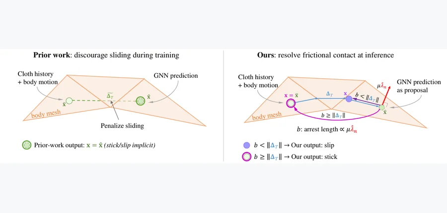 arXiv 2026-10-28 · cs.CV · #1 **[Explicit Frictional Contact Modeling in Neural Garment Simulation](https://arxiv.org/abs/2610.33492)** Thanh-Nguyen Truong, Vu-Hoang Tran, Ching-Chun Huang 机构：National Yang Ming Chiao Tung University / Ho Chi Minh City University of Technology and Engineering（[PDF](https://arxiv.org/pdf/2610.33492)） [Paper](https://arxiv.org/abs/2610.33492) · [图源](https://arxiv.org/html/2610.33492v1/261023_fig1_remake.png) 

中文摘要
图神经网络（GNN）通过基于物理的自监督高效模拟服装，但通常将身体与服装间的摩擦隐含在模型或训练能量中，推理时无法设置摩擦系数 μ；即使用特定系数的摩擦项重新训练，所测试的 GNN 对 μ 也几乎没有响应。基于优化的求解器会依据支配接触的反作用力决定每个接触点的黏着或滑动状态，但每一步都要重新优化服装状态；单次前向训练目标中的摩擦项只是对滑动的固定权重惩罚，训练后的权重在推理时不施加逐接触的库仑条件。因此，我们在预测后显式处理摩擦：模块化接触算子接入冻结的预测器，无需重新训练或迭代求解；它估计法向载荷，沿穿过身体三角面片的路径施加闭式库仑修正，并以线性化膜波将诱发运动传至布料。在 HOOD 和 ContourCraft 上，随着 μ 增大，该方法使黏着单调增加、滑动单调减少，响应趋势接近参考求解器，而针对不同系数重新训练的模型响应近乎不变；同时保持低穿透和与参考一致的拉伸，运行时间为求解器的八分之一。 <a href="https://arxiv.org/abs/2610.33492">原摘要来源</a>
 | 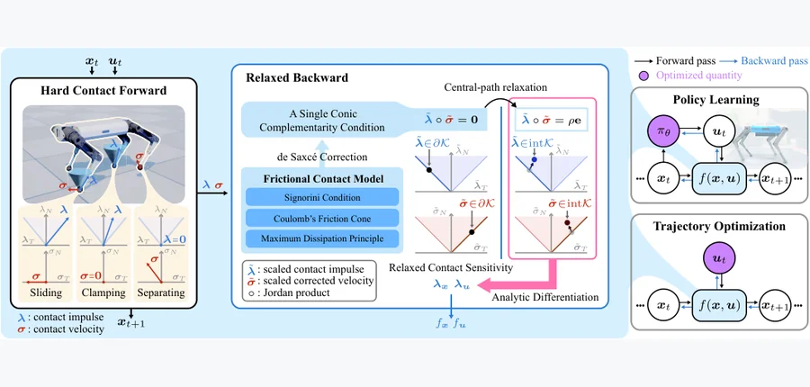 arXiv 2026-10-28 · cs.RO · #2 **[Differentiable Contact Dynamics for Legged Locomotion: Policy Learning and Contact-Implicit Trajectory Optimization](https://arxiv.org/abs/2610.35852)** Gijeong Kim, Seungbin Oh, Dongyun Kang, Hae-Won Park 机构：KAIST（[PDF](https://arxiv.org/pdf/2610.35852)） [Paper](https://arxiv.org/abs/2610.35852) · [图源](https://arxiv.org/html/2610.35852v1/Fig_pipeline_v4light.png) 

中文摘要
本文提出一种用于摩擦接触的平滑解析梯度，并将其用于足式运动的策略学习和接触隐式轨迹优化。精确接触灵敏度虽有闭式形式，但只描述当前接触模式内的变化，无法提供指向相邻模式的一阶信息。所提梯度仅在反向传播中替换该灵敏度，正向仍使用硬接触求解，因而实际轨迹保持可行。方法对经 de Saxcé 修正、描述库仑摩擦的二阶锥互补问题施加中心路径松弛，使分离、夹持和滑动模式的定义条件平滑。以硬接触解为初值做一次牛顿迭代，得到中心路径上的评估点。该灵敏度在接触模式切换时连续，并在松弛趋零时收敛到精确灵敏度。使用 100,000 个样本、在台式机上训练不足 2 分钟，利用该梯度学得的策略无需微调即可迁移至硬件；机器人在小跑策略下可承受推搡并穿越碎屑和湿滑地面。在轨迹优化中，该梯度找到精确梯度和 Signorini 松弛梯度未找到的富接触解。项目页面见原文链接。 <a href="https://arxiv.org/abs/2610.35852">原摘要来源</a>
 | 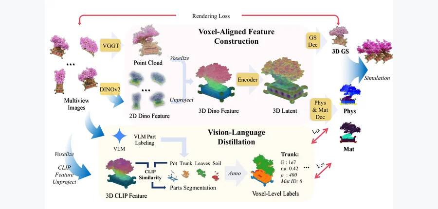 arXiv 2026-10-28 · cs.CV · #3 **[PhysCreator: Creating Physically-Attributed 3D Assets at Will](https://arxiv.org/abs/2610.34473)** Shiyan Zheng, Ming Li, Lei Han, Xiangyu Xu 机构：Xi’an Jiaotong University / The Chinese University of Hong Kong, Shenzhen / Discover Robotics（[PDF](https://arxiv.org/pdf/2610.34473)） [Paper](https://arxiv.org/abs/2610.34473) · [图源](https://arxiv.org/html/2610.34473v1/model.png) 

中文摘要
图像生成三维资产已能达到很高的保真度，但现有表示大多是静态的，无法刻画动态交互下物理上合理的行为。我们提出 PhysCreator，一个从图像直接生成具有空间变化物理属性、可用于仿真的三维表示的统一框架。不同于把物理属性作为事后简单预测或对每个实例做昂贵优化的方法，我们把物理属性估计纳入统一的三维表示学习。方法将图像观测提升至空间结构化的三维表示，构建与体素对齐的潜在空间，以前馈方式联合建模和推断几何、外观及物理属性。为了在缺少密集物理真值标注的情况下扩展训练，方法采用视觉语言蒸馏，将视觉语言模型的材料语义先验转为有空间定位的体素级监督。实验表明，与先前方法相比，该方法在视觉质量、物理合理性和泛化方面表现更好。 <a href="https://arxiv.org/abs/2610.34473">原摘要来源</a>
 |
| 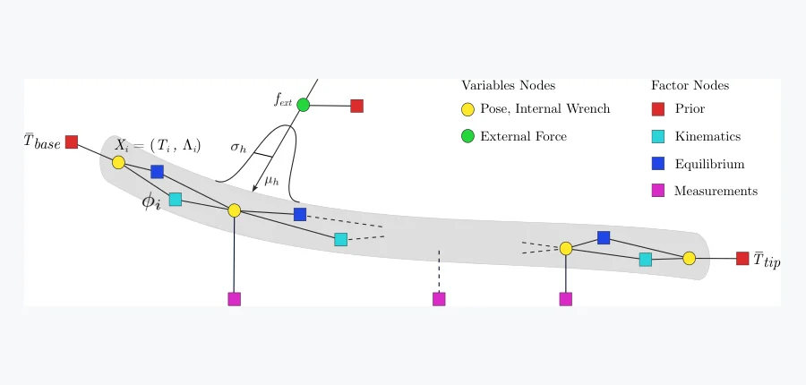 arXiv 2026-10-28 · cs.RO · #4 **[3D-Force Estimation for Dual-arm Manipulation of Deformable Linear Objects via Factor Graphs](https://arxiv.org/abs/2610.35058)** Annika Delucchi, Vincenzo Di Paola, Bruno Marco Quadrelli, Matteo Zoppi 机构：University of Genova / Jet Propulsion Laboratory, California Institute of Technology（[PDF](https://arxiv.org/pdf/2610.35058)） [Paper](https://arxiv.org/abs/2610.35058) · [图源](https://arxiv.org/html/2610.35058v1/rod-graph-legend2.png) 

中文摘要
可形变线状物体（DLO）欠驱动，因而难以估计作用在其上的力；可靠的接触估计又是精确控制和安全操作的关键。不同于已有方法，本文采用概率表述，用条件分布连接 DLO 状态与传感器数据。具体而言，因子图在重建其形状的同时，估计作用于 DLO 的三维力的大小、方向和位置。电缆、电线等 DLO 通常细长且不被直接驱动，应变片和执行器读数往往不适用。为此，方法只使用一种传感信息进行测试，以形成适用于更多任务的通用技术。实验在 DLO 沿预设路径运动且受到外力时向测量加入噪声，结果仍能准确估计这些外力。 <a href="https://arxiv.org/abs/2610.35058">原摘要来源</a>
 | 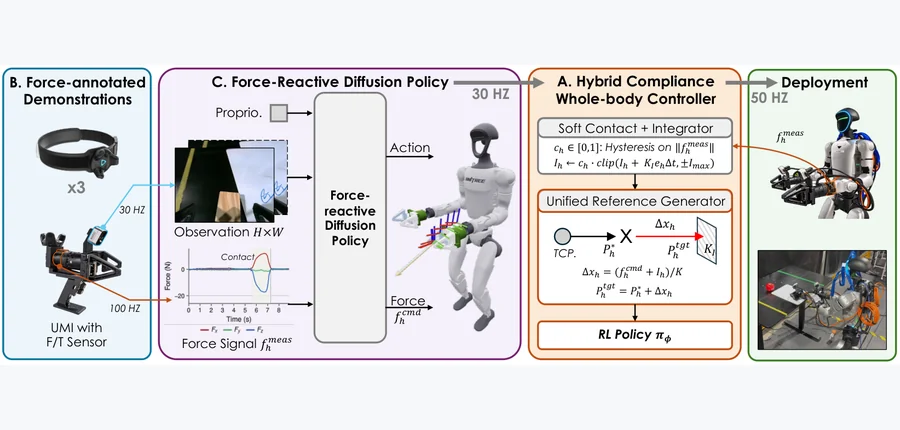 arXiv 2026-10-28 · cs.RO · #5 **[Learning Force-Reactive Humanoid Loco-Manipulation](https://arxiv.org/abs/2610.35862)** Sihang Li, Xiaofeng Guo, Jinkun Cao, Charlie Cheng, Ruihan Yang, Chen Feng, Guanya Shi, Haozhi Qi 机构：Amazon FAR / New York University / Carnegie Mellon University / University of Chicago（[PDF](https://arxiv.org/pdf/2610.35862)） [Paper](https://arxiv.org/abs/2610.35862) · [图源](https://arxiv.org/html/2610.35862v1/main.png) 

中文摘要
许多日常任务既要控制运动，也要控制接触力。对于人形机器人，接触力往往需要双手与全身协调，单靠运动学轨迹无法规定。因此，我们提出 FLORE，一个学习力响应式人形机器人移动操作的框架。方法用两个带力传感器的 UMI 式手持夹爪记录手部运动和接触力矩，并用可穿戴追踪器记录身体运动，采集无需机器人的示范。力响应式扩散策略以视觉、本体感觉和测得的力矩为输入，预测动作及每只手的力指令。带力跟踪的混合柔顺全身控制器在保持平衡的同时执行指令：它对真实力／力矩传感器测得的力误差积分，使每只手沿指令方向准确跟踪力，并在其他方向保持柔顺。仿真中，控制器可跟踪大小和方向不同的双手力指令，全身运动精度损失很小。在机器人上的三项富接触任务中，力响应式策略有 80% 的运行成功，而使用相同示范训练、相同控制器执行的纯位置策略成功率为 26.7%。更多信息见原文网站。 <a href="https://arxiv.org/abs/2610.35862">原摘要来源</a>
 | 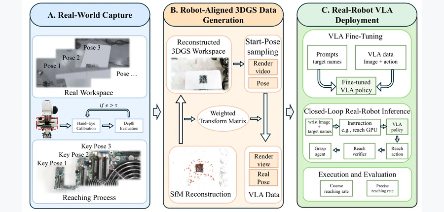 arXiv 2026-10-28 · cs.RO · #6 **[Robot-Aligned 3D Gaussian Splatting for Precise Reaching with Wrist-Camera VLA Policies](https://arxiv.org/abs/2610.35626)** Zuoxu Wang, Xiao Liang 机构：Texas A&amp;M University（[PDF](https://arxiv.org/pdf/2610.35626)） [Paper](https://arxiv.org/abs/2610.35626) · [图源](https://arxiv.org/html/2610.35626v1/workflow.png) 

中文摘要
高效采集机器人数据仍是视觉语言动作（VLA）策略学习的主要瓶颈，尤其对需要精确末端定位和相机动作对齐的任务如此。在电子废弃物拆解中，机器人面对密集、外观相似的零件，这一问题更严重；许多零件细薄、反光或机械结构复杂，难以制作准确的物体网格与接触模型，因此完整数字孪生仿真也很困难。本文聚焦接触前的到达动作，提出基于三维高斯泼溅（3DGS）的腕部相机 VLA 适配数据生成流程。方法以 3DGS 重建真实工作区，从与机器人对齐的位姿渲染多样的腕部相机观测，再配对平滑且结构化的到达轨迹，为 VLA 微调提供视觉动作监督。此外，指令条件到达验证器估计目标邻近程度，并在物理交互前可靠终止。主板拆解实验表明，仅凭腕部相机观测、无需外部侧视相机即可精确到达。采用 π0.5 时，1,500 条生成轨迹在三个目标上的精确到达成功率为 80.0%，相比之下 150 条遥操作示范为 58.7%，而主动人工采集用时不到 10 分钟。项目网站见原文链接。 <a href="https://arxiv.org/abs/2610.35626">原摘要来源</a>
 |
| 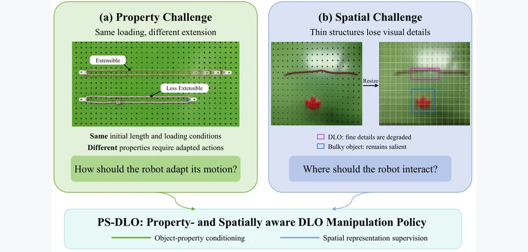 arXiv 2026-10-28 · cs.RO · #7 **[PS-DLO: Property- and Spatially Aware Deformable Linear Object Manipulation Policy](https://arxiv.org/abs/2610.34147)** Mengdi Li, Boxian Yao, Xiyu Zhu, Yifan Yang, Yunfan Lou, Xuan Han, Tao Liu, Zhibo Pang 机构：University of Chinese Academy of Sciences / Peking University / Space Engineering University（[PDF](https://arxiv.org/pdf/2610.34147)） [Paper](https://arxiv.org/abs/2610.34147) · [图源](https://arxiv.org/html/2610.34147v1/teasor.png) 

中文摘要
可形变线状物体（DLO）同时带来感知和控制难题：其细长几何难以精确定位，形变又取决于物体特有的物理属性。为此，我们提出 PS-DLO，一种兼顾物理属性和空间信息的 DLO 操作策略。首先，对比式图像文本学习把初始观测映射到 DLO 属性的类别描述，为动作生成提供显式的物理和结构先验。其次，SAM3 从未来观测中提取由掩码引导的特征，并将其蒸馏进策略的动作专家，以编码与任务相关的 DLO 区域及后续形态。我们在单臂和双臂平台上的九项真实任务中评估该方法，分别为两种本体训练共享的多任务策略。PS-DLO 平均成功率为 68.9%，比最强基线高 20.0 个百分点。在蝴蝶结解结的泛化实验中，七种视觉变化条件里有六种超过基线。结果表明，结合物体属性先验与未来空间监督可提升多任务 DLO 操作及对视觉变化的稳健性。 <a href="https://arxiv.org/abs/2610.34147">原摘要来源</a>
 | 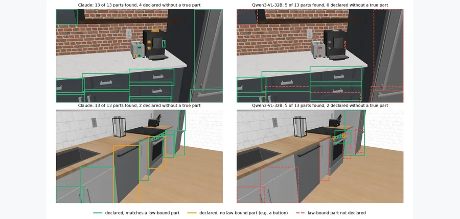 arXiv 2026-10-28 · cs.RO · #8 **[Open-World Law-to-Action: Vision-Language Priors and Touch for Parts with Hidden Physics](https://arxiv.org/abs/2610.33705)** Mohamed A. Mabrok 机构：Qatar University（[PDF](https://arxiv.org/pdf/2610.33705)） [Paper](https://arxiv.org/abs/2610.33705) · [图源](https://arxiv.org/html/2610.33705v1/figures/ow_declare.png) 

中文摘要
面对从未见过的家庭环境，机器人需要打开门、抽屉、盖子和水龙头，但图像无法揭示它们的物理特性。“轻轻地把抽屉打开一半”之类的指令取决于部件能移动多远、阻力如何、又有哪些锁止条件。我们提出 Open-World Law-to-Action（L2A）：视觉语言模型（VLM）为每个可动部件提议运动方式、运动规律项和可能的锁止因素；每项提议都成为带有概率下限的先验，因此触觉证据始终可以推翻它。机器人通过带闭式证据的贝叶斯线性回归在线识别单自由度或双自由度部件的规律，并保留“未见部件或运动锁住目标”的假设。我们证明单靠触觉不能排除该假设，推导何时值得再观察一次，并指出部件单向运动时常载荷与摩擦无法区分。所有实验均在仿真中完成，在部分场景开发、在留出场景上各运行一次。新厨房任务中，依靠 VLM 提议完成 80% 的任务，而所有部件已知时为 98%；提议物理项使需要新项的物体成功次数从 400 次中的 353 次升至 378–383 次；再次观察使混合场景成功次数从 366 次中的 284 次升至 329 次。一个不读取仿真器信息的移动机器人在新场景完成 100 个请求中的 70 个，而在两次留出测试之间修改一次后、由仿真器告知每个框对应部件的对照为 62 个。 <a href="https://arxiv.org/abs/2610.33705">原摘要来源</a>
 | 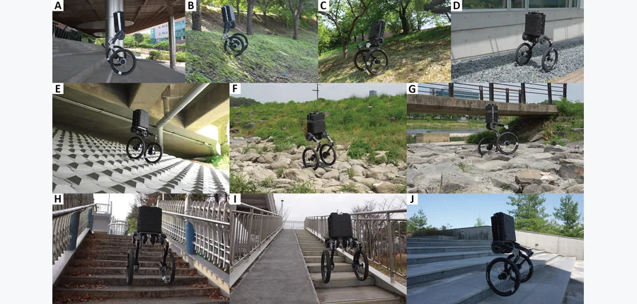 arXiv 2026-10-28 · cs.RO · #9 **[RAIWAY: A Large-Wheeled Bipedal Robot with Contact-Informed Blind Locomotion](https://arxiv.org/abs/2610.33172)** Kyungmin Nam, Jiseong Lee, Donghyuk Choi, Jeongsoo Park, Woojin Kim, Jemin Hwangbo 机构：KAIST（[PDF](https://arxiv.org/pdf/2610.33172)） [Paper](https://arxiv.org/abs/2610.33172) · [图源](https://arxiv.org/html/2610.33172v1/fig/fig1.jpg) 

中文摘要
我们介绍 RAIWAY，一台自主研制、配备 20 英寸轮子的双足轮式机器人，以及一种用于不规则、非连续地形滚动行走的接触信息控制方法。这种运动主要受局部轮地接触支配，而接触难以直接测量，且取决于地形几何之外的因素。框架利用仿真中可用的接触信息，把多接触事件蒸馏为潜在表示；部署时，控制器仅从本体感觉在线推断该表示，无需接触传感。真实实验中，系统穿越陡坡、砾石、带凸点表面和岩石地形，并在测试的室外楼梯上连续爬升，台阶高度最高为 15 cm。在该平台的困难室内外环境中，控制器也优于没有接触信息机制的基线。视频见原文链接。 <a href="https://arxiv.org/abs/2610.33172">原摘要来源</a>
 |
| 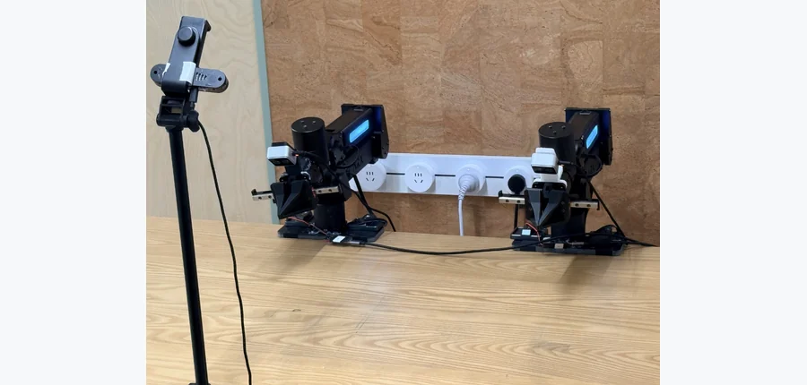 arXiv 2026-10-28 · cs.RO · #10 **[How High Can GPT-6 Astra Climb in Contact-Rich Manipulation? PhysLadder: A Hierarchical, Matched Sim-Real Benchmark for Physical Interaction](https://arxiv.org/abs/2610.34527)** Haibao Yu, Jiaqi Meng, Zijian Zhang, Bowen Jing, Lei Yang, Yue Hu, Chenchen Ge, Yiming Hou, Chenbo Xin, Dawen Ye, Haifang… 机构：Tuojing Intelligence / The University of Hong Kong / Chinese Academy of Sciences / Nanyang Technological University / University of Michigan / Southeast University / Sapient Intelligence / SimpleAI / MBZUAI / Stanford University / Imperial College London / Tsinghua University / Carnegie Mellon University（[PDF](https://arxiv.org/pdf/2610.34527)） [Paper](https://arxiv.org/abs/2610.34527) · [图源](https://arxiv.org/html/2610.34527v1/assets/real_world_setup/panel_a_setup_overview.jpg) 

中文摘要
我们提出 PhysLadder，一个评估富接触操作中物理交互能力的分层、仿真与真实环境匹配的基准。16 项家庭任务覆盖三个递进层级：接触选择与几何对齐（L1）、持续接触中的力调节（L2），以及协调接触重构与力调节（L3）。每项任务都建立在物理和视觉相匹配的仿真与真实环境中，使用共同的任务定义和成功标准。我们对 GPT-6 Astra 做零样本评估，每个任务在每种环境中试验三次。真实成功率从 L1 的 80.0% 降至 L2 的 47.6% 和 L3 的 0.0%；对应的仿真成功率为 66.7%、47.6% 和 0.0%。16 项任务中有 10 项的仿真与真实成功次数相同，其余六项相差一次（三次试验中）。在两类环境里，空间推理、接触选择、力调节和协调方面反复出现的困难，常使局部物理进展无法累积为任务完成。这些发现刻画了 Astra 随交互要求提高而呈现的能力边界；对该模型而言，结果支持用匹配仿真作为可重复、可扩展的测试平台，研究阻碍可靠操作的持续且协调的物理交互。 <a href="https://arxiv.org/abs/2610.34527">原摘要来源</a>
 | 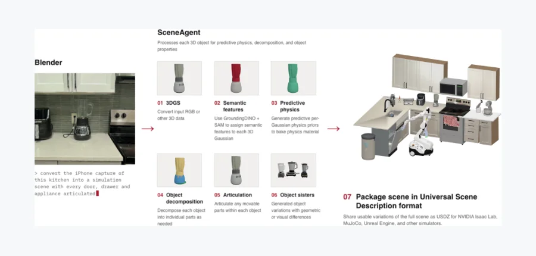 arXiv 2026-10-28 · cs.RO · #11 **[SceneAgent: An Agentic Pipeline from 3D and 4D Captures to Simulation Environments](https://arxiv.org/abs/2610.34745)** Luke Hollis, Tianxing Fan, Heng Yang 机构：Harvard University（[PDF](https://arxiv.org/pdf/2610.34745)） [Paper](https://arxiv.org/abs/2610.34745) · [图源](https://arxiv.org/html/2610.34745v1/fig1_pipeline.png) 

中文摘要
视觉采集能提供细致的场景外观，但将其变成可交互仿真环境，还需物体重建、物理建模以及中间错误修复。我们提出 SceneAgent，一条通过仿真器中的视觉检查与修复协调这些步骤的智能体式流程。它处理三维高斯泼溅（3DGS）、摄影测量、LiDAR 采集、AI 生成的 3DGS 场景以及动态场景的 4D 视频，结合物体分割、物理参数估计、部件分解、关节建模和可形变仿真。为支持策略学习，SceneAgent 生成多样的物体变体（“数字姐妹”）和脚本化示范。在 GraspClutter6D 的杂乱料箱场景中，对所有可评分输出的编码智能体，不论是否使用其技能，SceneAgent 都提高了 1 cm 阈值下的 F1；其重建也优于 SimFoundry：所有智能体配置的 F1 均超过 SimFoundry，最佳为 60.75%，后者为 6.9%。在 4DCodeBench 的三个动态场景上，SceneAgent 将 Gemini 4 Argon 的平均动态 IoU 从 0.86% 提高至 99.09%。文中还展示了多种仿真交互及向真实机器人的初步策略迁移。 <a href="https://arxiv.org/abs/2610.34745">原摘要来源</a>
 | 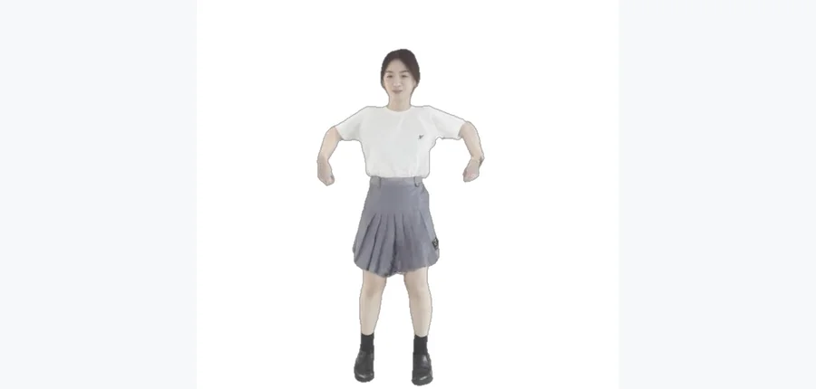 arXiv 2026-10-28 · cs.GR · #12 **[Single Camera based Simulation and Try-on Ready Avatar Modeling](https://arxiv.org/abs/2610.34223)** Honghu Chen, Bo Peng, Jun Xiang, Jingtao Zhou, Xujing Chen, Juyong Zhang 机构：University of Science and Technology of China（[PDF](https://arxiv.org/pdf/2610.34223)） [Paper](https://arxiv.org/abs/2610.34223) · [图源](https://arxiv.org/pdf/2610.34223) 

中文摘要
仅用单台相机重建并渲染高保真、可动画化、可试穿的虚拟人物，对许多应用很重要。然而，现有可试穿人物重建方法很难仅凭单目视频或单张图像达到这一目标，主要因为：一是常用单层同时表示衣物与身体，忽视两者不同的运动特性；二是单相机输入通常无法完整覆盖衣物和身体。为此，我们提出物理集成的双层 GS-Mesh 表示，结合二维生成数据，从单目视频甚至单张图像重建解耦的三维着装人物。二维生成方法虽能依据给定位姿序列生成视频，却难以保持帧间一致。我们将生成数据的帧间不一致分解为几何和外观两部分，并借助三维表示确保最终重建和渲染具有三维一致性及时间连贯性。与依赖多视角重建的三维服装迁移方法，以及多数利用扩散模型做图像服装编辑、但不支持新视角或新姿态合成的二维方法相比，该方法只需单目视频甚至单图，就能在虚拟试穿和新姿态动画中生成视觉上合理的布料动态。这推进了单相机条件下具有合理布料动态的虚拟试穿。 <a href="https://arxiv.org/abs/2610.34223">原摘要来源</a>
 |
| 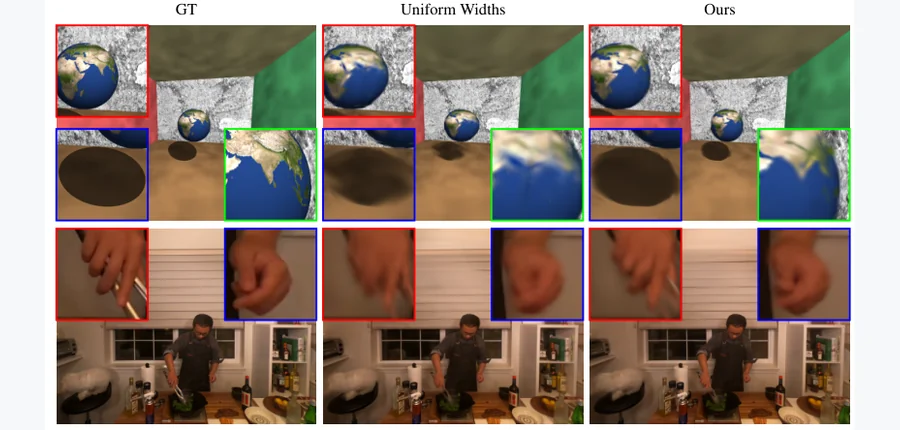 arXiv 2026-10-28 · cs.GR · #13 **[GaussianSpline: Adaptive Bézier Splines for Highly Dynamic 4D Gaussian Splatting](https://arxiv.org/abs/2610.35224)** Tom Yachil, Andrei Sharf 机构：Ben-Gurion University of the Negev（[PDF](https://arxiv.org/pdf/2610.35224)） [Paper](https://arxiv.org/abs/2610.35224) · [图源](https://arxiv.org/html/2610.35224v1/teaser.png) 

中文摘要
我们提出 GaussianSpline，一种动态 4D 高斯泼溅方法，用自适应、非均匀的分段三次 Bézier 样条表示每个高斯的运动。不同于全局形变、固定阶多项式或均匀参数化样条，GaussianSpline 联合学习 Bézier 控制点与每条高斯轨迹的时间分段。该表示为剧烈运动区域分配更多时间容量，同时为近静态区域保留紧凑轨迹，从而高保真重建复杂而快速变化的运动。为同时实现全局平滑和局部自适应，方法通过控制点上的反射式约束，使相邻 Bézier 段满足 G¹ 连续性；这样既得到平滑、完全可微的轨迹，也保留非均匀时间参数化的灵活性。在 Neural 3D Video、Google Immersive 和合成场景上的实验表明，该方法在动态高度不均匀且困难的场景中显著提升重建质量，在一般动态场景中也与最先进的 4D 高斯泼溅方法保持有竞争力的表现。 <a href="https://arxiv.org/abs/2610.35224">原摘要来源</a>
 | 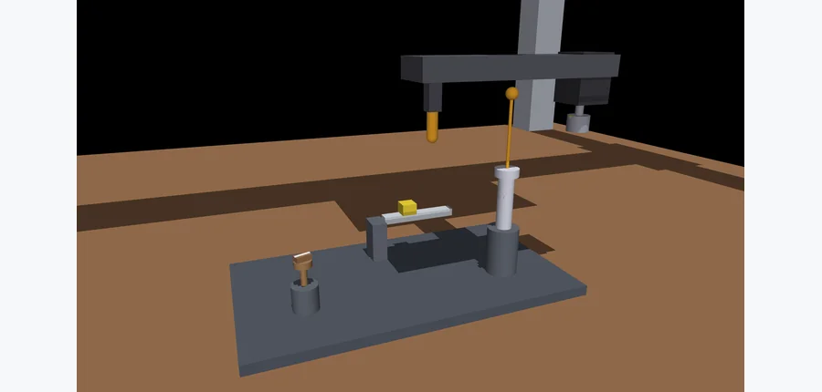 arXiv 2026-10-28 · eess.SY · #14 **[Hybrid-time PINNs: Discontinuity-Aware Physics-Informed Neural Networks for Learning Hybrid Dynamical Systems](https://arxiv.org/abs/2610.33562)** Shivanshu Tripathi, Maziar Raissi 机构：University of California, Riverside（[PDF](https://arxiv.org/pdf/2610.33562)） [Paper](https://arxiv.org/abs/2610.33562) · [图源](https://arxiv.org/html/2610.33562v1/figs/mujoco_pin_cell.png) 

中文摘要
混合动力系统在连续流动中会于离散事件处发生跳变。物理信息神经网络（PINN）在拟合数据时约束已知动力学，但单个网络在时间上平滑，无法表示跳变。我们证明，PINN 越贴近跳变，其物理损失就必然越大。为此提出混合时间 PINN（HT-PINN）：对混合时间域的每个连续区间分配一个网络，同时联合训练网络、跳变时刻和未知参数；跳变次数与模式序列通过枚举确定。HT-PINN 能恢复弹跳球的跳变次数和恢复系数。在机器人通过弹簧把压配销从壳体中拉出的 MuJoCo 拆解仿真中，它确定跳变次数及模式序列，并估计静摩擦和动摩擦系数，误差分别为 0.1% 和 1.7%。 <a href="https://arxiv.org/abs/2610.33562">原摘要来源</a>
 | 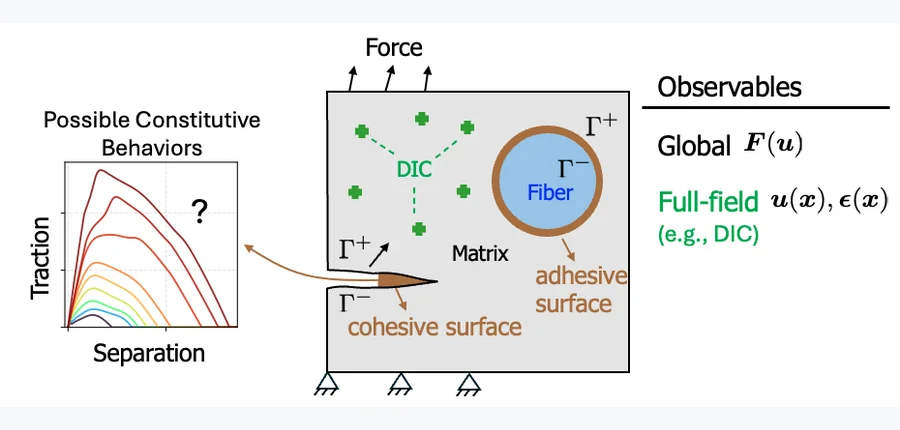 arXiv 2026-10-28 · physics.comp-ph · #15 **[A Differentiable Framework for Inverse Identification of Heterogeneous Cohesive Laws](https://arxiv.org/abs/2610.33711)** Sida Hao, Jinkyo Han, Bahador Bahmani 机构：Northwestern University（[PDF](https://arxiv.org/pdf/2610.33711)） [Paper](https://arxiv.org/abs/2610.33711) · [图源](https://arxiv.org/html/2610.33711v1/pics/overview_fig.png) 

中文摘要
本文开发了一种基于内禀黏聚区表述的可微有限元框架，从整体力－位移历史和空间稀疏的应变测量中识别牵引－分离规律。框架用受物理约束的神经网络表示灵活且符合热力学结构的黏聚规律，并通过自动微分和考虑界面损伤历史依赖演化的离散伴随法计算灵敏度。为了识别空间异质的黏聚行为，我们从代表性牵引－分离历史构建共享、低维的黏聚规律族，将学得的本构先验扩展到不可逆界面损伤。该表示利用共同本构结构与参数共享减少未知量、正则化逆问题，同时允许局部黏聚行为通过潜在坐标随空间变化。双悬臂梁和纤维－基体复合材料的数值研究表明，准确复现整体力－位移响应并不必然意味着准确恢复底层黏聚规律；即使可行响应受学得先验约束，加入空间分辨的应变测量仍显著改善本构识别。与传统双线性黏聚模型和贝叶斯优化的比较，进一步展示学得本构表示及伴随识别在高维逆问题中的优势。 <a href="https://arxiv.org/abs/2610.33711">原摘要来源</a>
 |
| 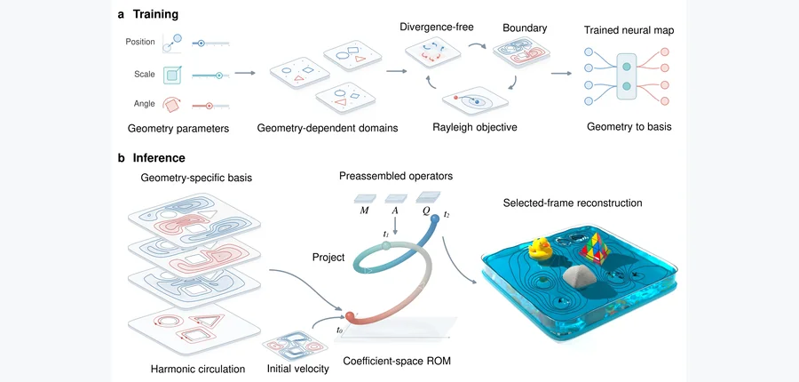 arXiv 2026-10-28 · physics.flu-dyn · #16 **[Neural Eigenfluid Bases: Spectral Objectives, Gauge, and Topology](https://arxiv.org/abs/2610.33925)** Baiming Zhang, Shiying Xiong, Zhecheng Wang 机构：Zhejiang University / University of Toronto（[PDF](https://arxiv.org/pdf/2610.33925)） [Paper](https://arxiv.org/abs/2610.33925) · [图源](https://arxiv.org/html/2610.33925v1/method_overview.png) 

中文摘要
降阶模型用少量空间模态表示复杂流动，以简化流体仿真。基于 Laplacian Eigenfluids，我们提出 Neural Eigenfluid Bases（NEB），一种基函数可在空间任意位置求值的神经表示。方法通过微分提升和势函数边界条件直接施加不可压缩及不可穿透边界条件，再用几何局部正交化和 Rayleigh 最小化学习有序基。我们连接势空间与速度空间中的学习，并推导谱方差关系，解释为何两种目标虽具有相同的精确正谱，却会以不同权重处理近似模态。规范固定减少势函数学习所需的空间导数数量，Dirichlet 能量损失则学习绕障碍物的独立环流场。使用 1024 个模态，两种目标在周期性涡旋合并中都将速度误差保持在 1% 以下。对于障碍物周围的随机流动，基于势函数的学习比相同规模的数值 Laplacian 基捕捉更多初始能量，最终误差更低。降阶状态比完整参考模型约小一千倍。三维测试区分空间重建误差与系数演化误差；复用同一基时，预计算的 Galerkin 算子支持毫秒级更新。这为连续流场重建和高效降阶仿真提供了受物理约束的基。 <a href="https://arxiv.org/abs/2610.33925">原摘要来源</a>
 | 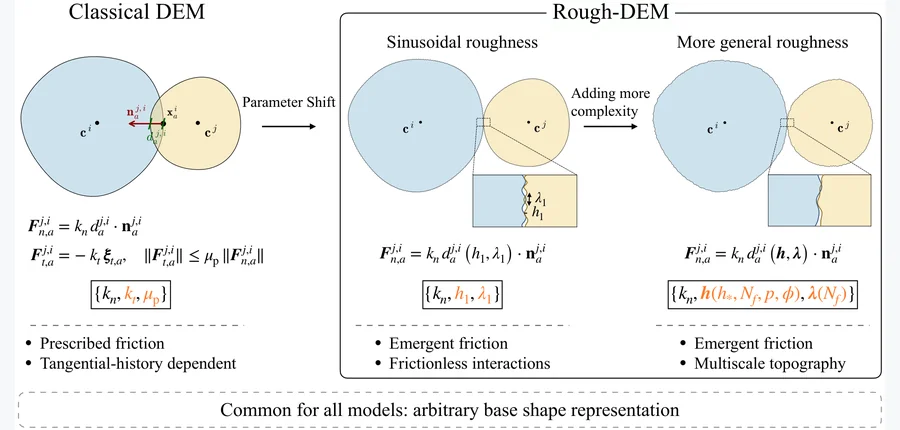 arXiv 2026-10-28 · physics.comp-ph · #17 **[A neural accelerated roughness-resolved Discrete Element Method (Rough-DEM) for modeling granular systems](https://arxiv.org/abs/2610.33363)** Xiwei Pan, Liuchi Li 机构：Princeton University（[PDF](https://arxiv.org/pdf/2610.33363)） [Paper](https://arxiv.org/abs/2610.33363) · [图源](https://arxiv.org/html/2610.33363v2/from_smooth_to_rough.png) 

中文摘要
离散元法（DEM）是建模和理解干颗粒介质基本力学行为的重要工具；这类无序材料系统广受地球物理、化工等领域关注。现有 DEM 框架的核心通常是 Amontons–Coulomb 型经验摩擦律，用于描述颗粒间摩擦。受摩擦学研究启发，我们提出根本不同的粗糙度解析 DEM（Rough-DEM）：不使用摩擦律，而是显式解析每个颗粒的表面形貌，让摩擦从表面微凸体之间的集体无摩擦相互作用中涌现。这是以更高计算成本换取更直接的物理机制。为缓解成本，方法引入类似 FE² 的算法及基于特征线性调制（FiLM）的神经网络替代模型，并在 GPU 上并行加速接触计算。关键的是，在二维框架中，我们展示了简单表面形貌表示即可恢复基于两体的 Amontons–Coulomb 式摩擦行为；同时发现，当前 DEM 框架在相同模型复杂度下未必能捕捉某些基于多体的摩擦行为，特别是安息角。文章最后讨论 Rough-DEM 的未来方向，以及它在悬浮液流变和超材料力学等新应用中的可能性。 <a href="https://arxiv.org/abs/2610.33363">原摘要来源</a>
 | 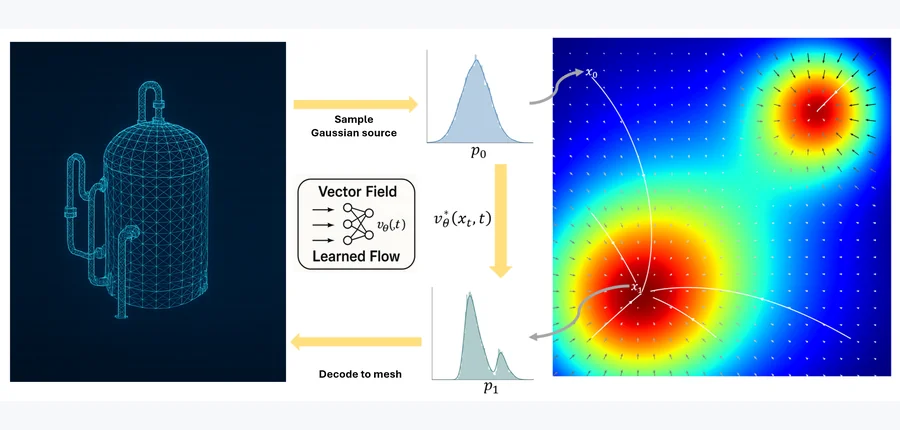 arXiv 2026-10-28 · physics.flu-dyn · #18 **[Flow Mesh: A Velocity-Regularized Flow Matching Framework for Stable Distributional Modeling of Physical Fields on Unstructured Meshes](https://arxiv.org/abs/2610.33204)** Siddharth Verma, Jaewan Park, Jay Phil Yoo, Kazuma Kobayashi, Souvik Chakraborty, Syed Bahauddin Alam 机构：Indian Institute of Technology Bombay / University of Illinois Urbana-Champaign / Indian Institute of Technology Delhi（[PDF](https://arxiv.org/pdf/2610.33204)） [Paper](https://arxiv.org/abs/2610.33204) · [图源](https://arxiv.org/html/2610.33204v1/flowmatchingschematic_0926.png) 

中文摘要
热流体场分布支撑核反应堆冷却通道、工业换热器等能源设施的分析与运行，但用计算流体力学（CFD）获得这些分布需要成本极高的仿真集合；复杂几何还要求使用非结构网格，而面向规则网格的生成模型难以处理。我们提出 FlowMesh：结合置换不变的网格编码、确定性潜在流匹配，以及对学习到的输运速度施加 L1 惩罚。它直接在固定的非结构网格上生成全场样本，无需辅助网格插值或随机去噪链。对顶盖驱动腔、压水堆子通道和换热器数据集，使用六个匹配的训练随机种子评估时，FlowMesh 的宏平均概率密度函数覆盖率达到 91.7%–97.0%，比架构受控的潜在扩散模型高 11.6–45.4 个百分点。潜在速度正则化使反应堆流动的覆盖率提高 3.8 个百分点、换热器流动提高 1.1 个百分点，同时令温度场的 Kullback–Leibler 散度降低 1.7–2.4 倍。每个全场样本用时 1.23±0.15 秒，相比 CFD 的墙钟时间快 585–1902 倍。因此，FlowMesh 使固定几何能源系统中大规模生成式热流体状态表征具备计算可行性，为数据驱动分析和数字孪生开发奠定基础。 <a href="https://arxiv.org/abs/2610.33204">原摘要来源</a>
 |
| 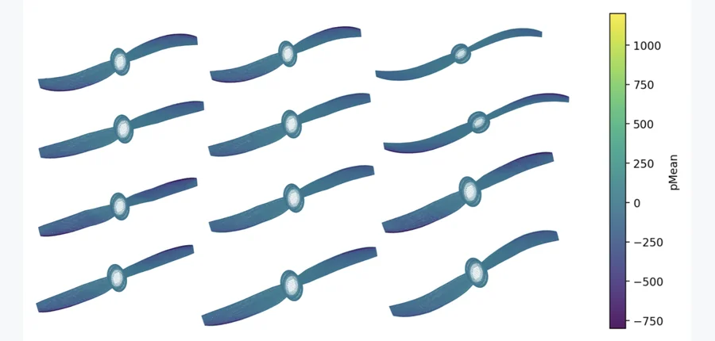 arXiv 2026-10-28 · cs.LG · #19 **[FG-ConvNO: A Geometry-Aware Neural Operator for Propeller CFD Prediction](https://arxiv.org/abs/2610.33456)** Yichen Di, Valentin Duruisseaux, Di Zhou, Xinyi Li, Daniel Leibovici, Jean Kossaifi, Anima Anandkumar 机构：Tsinghua University / California Institute of Technology / University of Tennessee / NVIDIA（[PDF](https://arxiv.org/pdf/2610.33456)） [Paper](https://arxiv.org/abs/2610.33456) · [图源](https://arxiv.org/html/2610.33456v1/propeller_samples.png) 

中文摘要
计算流体力学（CFD）对现代工程设计十分重要，但一次高保真仿真可能耗费数千 CPU／GPU 小时甚至更多。机器学习科学建模近来产生了可用少得多计算量近似流场与物理量的替代框架；但多数方法需要大规模同质数据或简单几何，在复杂且数据稀缺的配置上存在严重泛化差距。为此，我们提出因子化几何卷积神经算子（FG-ConvNO），在有限训练数据下稳健预测螺旋桨表面压力。方法引入几何感知编码、高效的基于插值的解码和辅助的全局物理量监督，并加入使用离散－连续卷积的 DISCO 模块，使模型不依赖特定离散化。在程序生成的螺旋桨 CFD 数据集上，FG-ConvNO 的表面压力和整体推力预测准确度均最高。几何编码和简化架构提高稳定性，随机顶点子采样增强稳健性。总体而言，向基于网格的卷积算子加入几何先验，减少复杂螺旋桨几何上的过拟合，并改善小数据条件下的泛化。 <a href="https://arxiv.org/abs/2610.33456">原摘要来源</a>
 | 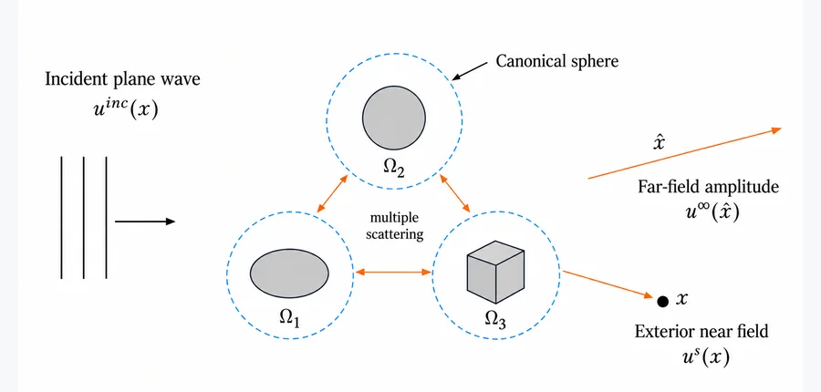 arXiv 2026-10-28 · math.NA · #20 **[ESPC-Transolver: An Equivalent-Surface Physics-Guided Coupling-Aware Transolver for 3D Multiple Scattering](https://arxiv.org/abs/2610.34246)** Guoqing Zhao, Liang Li, Xing Li, Hao Kuang 机构：University of Electronic Science and Technology of China（[PDF](https://arxiv.org/pdf/2610.34246)） [Paper](https://arxiv.org/abs/2610.34246) · [图源](https://arxiv.org/html/2610.34246v1/figure1_scattering_directory_supplied.png) 

中文摘要
跨几何泛化尤其困难：以几何为条件的多重散射替代模型既要从几何特征推断未见物体的散射属性，又要准确捕捉反复波交换产生的复杂、相位敏感相互作用。我们提出 ESPC-Transolver，一种等效表面物理引导、考虑耦合的 Transolver，把局部散射响应表示与物体间相互作用建模分开。对每个声硬散射体，在共享的球面波激励下构造标准散射压力响应；局部 Dirichlet-to-Neumann（DtN）映射和模态散射转换把响应表示在包围球面上，在不同几何间提供物理一致的输入通道。共享的物体局部 Transolver 块编码这些响应和入射场迹，考虑相对位置的切片注意力建模物体间耦合。由局部算子恢复的预测界面压力与法向通量定义等效源，以重建外部近场和远场散射。方法在固定频率的三维声学多重散射问题上，与几何条件预测器和其他神经网络骨干比较；它在熟悉几何族的留出实例上有更低的散射场预测误差，对未见的 Peanut 和 Torus 几何也能有效泛化。外场重建复现多重散射干涉图案，将跨几何的界面预测与近场压力、远场散射恢复联系起来。 <a href="https://arxiv.org/abs/2610.34246">原摘要来源</a>
 | 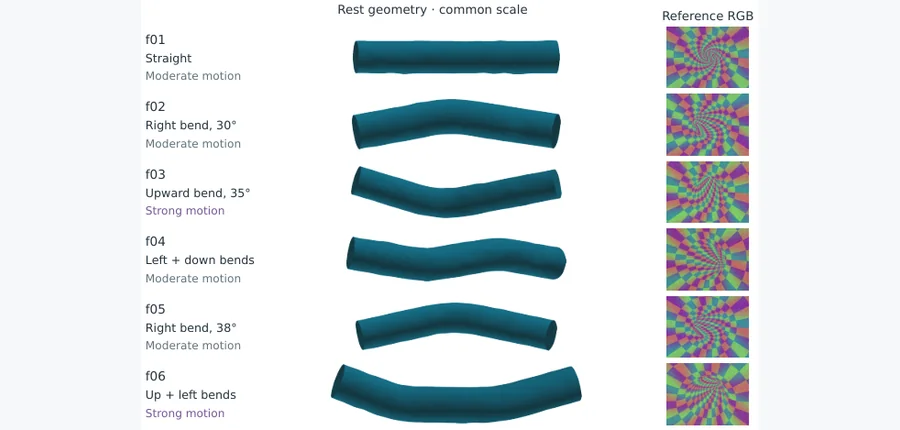 arXiv 2026-10-28 · cs.CV · #21 **[Synthetic Deformable Tubular Benchmark: A mechanically annotated dataset for evaluating deformable 3D reconstruction](https://arxiv.org/abs/2610.35621)** Íñigo Cirauqui-Viloria 机构：Universidad de Zaragoza（[PDF](https://arxiv.org/pdf/2610.35621)） [Paper](https://arxiv.org/abs/2610.35621) · [图源](https://arxiv.org/html/2610.35621v1/Fig01_component01.png) 

中文摘要
评估可形变三维重建，需要能关联相机运动、表面形变、材料对应关系和图像外观的真值。我们介绍 Synthetic Deformable Tubular Benchmark，它由开源工具 LumenMorph 生成，可用于创建、标注和评估管状场景。公开数据包含 5,580 张 RGB 图像。基准的基础设置在六类场景中交叉组合三种表面运动条件及运动／静止相机；匹配的外观变体仅覆盖四类场景中运动相机的有限元动作。文档化的公开与评测接口提供相机位姿、几何、深度、形变场、持久材料对应关系和离散有限元记录。持久三角面身份与材料权重使用户能跨帧追踪同一表面位置，并查询其三维轨迹。独立实现的几何和力学检查评估标注与生成模型的一致性。Structure-from-Motion、光流及已知几何下的位移插值研究表明，该资源能区分配准覆盖率与几何精度，揭示相机及表面运动的影响，并检验力学先验的收益与失配。公开读取器、评测约定及可配置生成器支持复用和扩展。数据完整性、固定环境可重复性以及保留预测的评分重放各有不同的验证范围。该基准提供受控合成参考，但不声称具备解剖或临床真实性。 <a href="https://arxiv.org/abs/2610.35621">原摘要来源</a>
 |
| 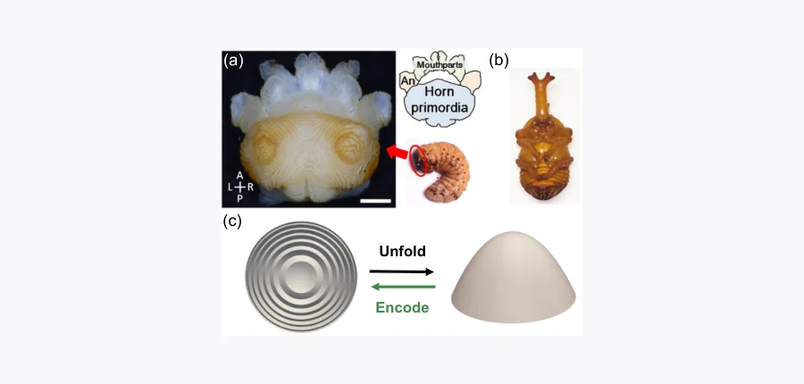 arXiv 2026-10-28 · cond-mat.soft · #22 **[Inverse origami inspired by insect morphogenesis: geometric design of wrinkle structures for curved surface formation](https://arxiv.org/abs/2610.34903)** Kentaro Morikawa, Yuuki Shimizu, Nen Saito, Yasuhiro Inoue 机构：Kyoto University / University of Toyama / University of Tsukuba（[PDF](https://arxiv.org/pdf/2610.34903)） [Paper](https://arxiv.org/abs/2610.34903) · [图源](https://arxiv.org/html/2610.34903v1/intro.png) 

中文摘要
昆虫在幼虫变为蛹的变态过程中，其外骨骼会突然形成复杂的三维形状。这一变化由体内预先形成的褶皱结构在内部压力下展开产生。受此启发，我们研究一种用于制造曲面的逆折纸策略。传统折纸通过折叠平面薄片形成三维物体；这里则通过展开预制褶皱形成曲面。核心设计问题是从指定的目标曲面反推褶皱结构。关键想法是把褶皱结构看作单向拉伸场，规定每一点在展开时产生的伸长。我们先从目标曲面的几何推导该场，再将其转化为空间变化的褶皱方向与间距，使褶皱展开为目标形状。所得数值设计近似目标曲面的内禀度量。我们通过多个目标曲面的数值构造、力学展开仿真和 3D 打印原型展示该方法。这项工作为在褶皱中编码指定曲面形状提供了受生物启发的几何设计原理，也提供了设计制造可展开曲面的框架。 <a href="https://arxiv.org/abs/2610.34903">原摘要来源</a>
 | 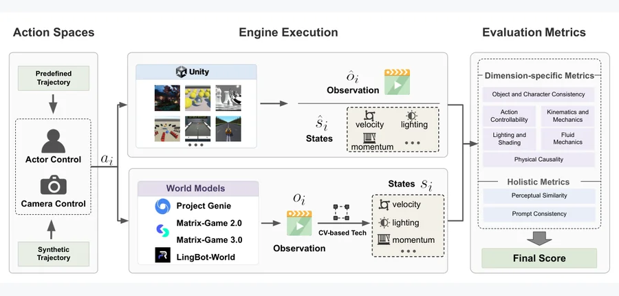 arXiv 2026-10-28 · cs.CV · #23 **[WMEval: Evaluating Interactive World Models Grounded on Physical Simulations](https://arxiv.org/abs/2610.33894)** Lanxiang Hu, Yixin Huang, Abhilash Shankarampeta, Zilin Dai, Yuyuan Wu, Kun Qian, Junze Liu, Arvind Srinivasan, Mingjia Hu… 机构：UC San Diego / Unity（[arXiv HTML](https://arxiv.org/html/2610.33894)） [Paper](https://arxiv.org/abs/2610.33894) · [图源](https://arxiv.org/html/2610.33894v2/overviewv3.2.png) 

中文摘要
交互式世界模型在机器人、游戏引擎和沉浸式数字孪生等高要求应用中很有潜力，但现有基准主要关注感知相似性，忽视对实际用途关键的物理因果一致性。我们提出 WMEval，一项用基于 Unity 的物理仿真评估交互式世界模型的综合基准。以 Unity 作为高保真真值参照，评测从感知层面的视觉判断扩展到下游应用所需的客观状态验证。WMEval 涵盖九个不同场景，评估动作可控性、场景和角色一致性、提示遵循、运动学、流体力学、物理因果性及光照。通过在仿真器和世界模型中执行匹配的动作序列，它既能在感知层面，也能以仿真状态为参照在物理因果层面评测。对现有先进模型的实验发现，多项标准感知指标无法显露、却对真实部署至关重要的维度仍有明显改进空间。代码见原文链接。 <a href="https://arxiv.org/abs/2610.33894">原摘要来源</a>
 | 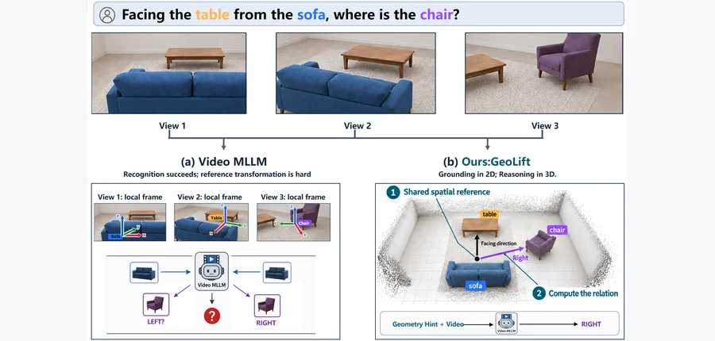 arXiv 2026-10-28 · cs.CV · #24 **[GeoLift: Grounding Video Spatial Reasoning in Explicit 3D Maps](https://arxiv.org/abs/2610.33558)** Xinglin Li, TingTing Long, Jingzhi Zhou, Jiajing Chen, Jian Yang, Jin Xie 机构：Nankai University / Peking University / Amazon / Nanjing University（[PDF](https://arxiv.org/pdf/2610.33558)） [Paper](https://arxiv.org/abs/2610.33558) · [图源](https://arxiv.org/html/2610.33558v1/figures/geo_lift_hilight.png) 

中文摘要
视频空间推理要求多模态大语言模型（MLLM）理解物体在不同视角下如何排列和关联。模型虽能识别单帧物体，却难以整合观测完成复杂空间任务。我们以路径规划为代表任务，发现所需转弯越多，现有模型准确率下降越明显；在需要至少三次转弯的路径上，一些模型接近随机猜测。这说明仅识别地标不够，还必须跨视角连接观测，在共享空间中追踪地标布局。为此，我们提出免训练的 GeoLift：用前馈三维重建把各帧检测的物体映射到共享的度量三维场景。它结合冻结的 MLLM 做二维定位和预训练几何模型做场景重建，再利用称为 superpoints 的共享几何区域，在无需学习式匹配器的情况下关联跨视角同一物体。重建地图支持显式计算空间关系和多步路径，并为估计距离及尺寸提供几何证据。所有模型权重冻结时，GeoLift 将 Qwen3-VL-4B 在 VSI-Bench 上的平均分从 55.4% 提高到 64.1%，其中路径规划准确率从 30.9% 提高到 53.6%；在 MindCube 上达到 59.8%。结果表明，用共享三维地图连接帧级物体定位，无需任务特定训练也能改善复杂空间推理。 <a href="https://arxiv.org/abs/2610.33558">原摘要来源</a>
 |
| 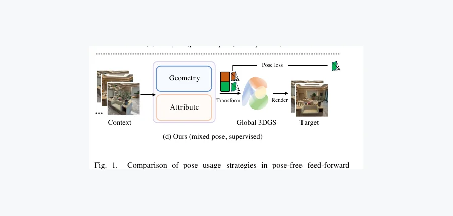 arXiv 2026-10-28 · cs.CV · #25 **[SG-Splat: Stable Geometry Learning under Pose Uncertainty for Pose-Free 3D Gaussian Splatting](https://arxiv.org/abs/2610.35361)** Xiaohan Lu, Jiaqi Zhang, Weijia Jiang, Siwei Ma 机构：Peking University / Migu Interactive Entertainment（[PDF](https://arxiv.org/pdf/2610.35361)） [Paper](https://arxiv.org/abs/2610.35361) · [图源](https://arxiv.org/pdf/2610.35361) 

中文摘要
三维高斯泼溅（3DGS）是实时新视角合成和三维场景重建的有前景表示。实际部署中的无位姿前馈 3DGS 可从未标定位姿的图像直接重建高斯，但对残余位姿误差敏感；这些误差扰动标准空间中的高斯变换，给几何及属性学习带来噪声监督。我们提出 SG-Splat，通过提高对位姿不确定性的稳健性，稳定无位姿前馈 3DGS 中的高斯学习。方法把几何估计与高斯属性预测拆为两个分支，减少位姿敏感几何与属性之间的误差耦合；又提出从粗到细的细化流程，包括流引导位姿细化（FGPR）和残差引导几何修正（RGC），在属性重建前改善几何对齐。FGPR 使用基于光流的相关特征和可微束调整修正相机位姿；RGC 根据 FGPR 产生的深度残差修正初始点图，获得更可靠的高斯中心。双路径训练策略混合真值与预测位姿用于标准空间变换，既为高斯属性提供干净监督，也增强几何对残余位姿误差的稳健性。在 DL3DV 与 RealEstate10K 上的广泛实验表明，SG-Splat 在新视角合成和位姿估计方面均达到最先进表现。 <a href="https://arxiv.org/abs/2610.35361">原摘要来源</a>
 | 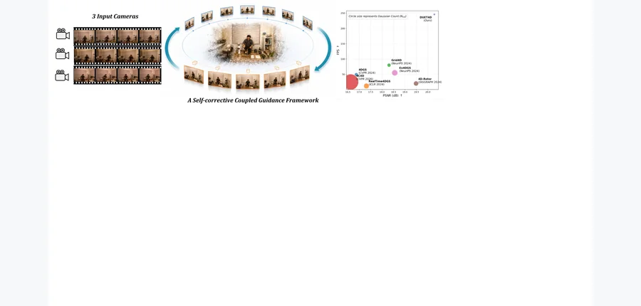 arXiv 2026-10-28 · cs.CV · #26 **[DUET4D: Self-Corrective Coupled Guidance for Sparse-View 4D Reconstruction](https://arxiv.org/abs/2610.35002)** Beizhen Zhao, Nanjie Yao, Boyi Fu, Qingsong Yan, Haofan Ren, Kaiyong Zhao, Hao Wang 机构：The Hong Kong University of Science and Technology (Guangzhou) / XGRIDS（[PDF](https://arxiv.org/pdf/2610.35002)） [Paper](https://arxiv.org/abs/2610.35002) · [图源](https://arxiv.org/html/2610.35002v1/teaser.png) 

中文摘要
只有少量相机时，稀疏视角 4D 重建高度欠约束。生成先验可补足缺失外观，但视频模型用于迭代重建时计算成本过高，而单视角模型产生的伪观测在时间上不一致；直接把不确定的生成输出吸收到高斯优化中，又容易产生冗余基元和漂浮伪影。为此，我们提出 DUET4D，一种用于稀疏视角 4D 高斯泼溅的自纠正耦合引导框架。其核心是让 4D 表示反过来引导生成先验，产生时空一致的监督。首先，方法从当前高斯证据构造序列对齐，引导潜在空间中的恢复；然后用序列保真重采样把生成监督提升到高斯空间，有选择地识别反复得到支持的基元。修正后的表示在下一轮恢复中提供更可靠的高斯证据。广泛实验表明，DUET4D 显著改善渲染质量与效率。 <a href="https://arxiv.org/abs/2610.35002">原摘要来源</a>
 | 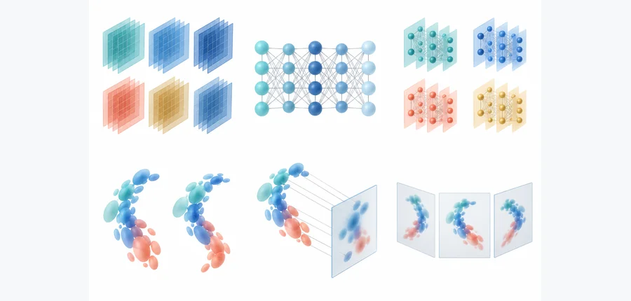 arXiv 2026-10-28 · cs.CV · #27 **[DimFlow: Bidirectional Grid-Expert Learning for Dynamic Gaussian Reconstruction](https://arxiv.org/abs/2610.34952)** Gabriel Adineera, Jinoh Kim 机构：Texas A&amp;M University-Commerce（[PDF](https://arxiv.org/pdf/2610.34952)） [Paper](https://arxiv.org/abs/2610.34952) · [图源](https://arxiv.org/pdf/2610.34952) 

中文摘要
动态高斯重建需要紧凑的场景特征，以支持几何和外观的协同变化。因子化网格可高效查询局部信息，但准确插值本身不能确保动态属性在时空上相容。我们提出 DimFlow，通过多分辨率网格与基于坐标的专家分支双向交互来学习这些特征。特征层面的对抗对齐连接两者的分布，自适应融合传递互补信息，带激活掩码的残差反馈则在训练中细化网格。四个属性专家在高斯渲染前分别组织形变、旋转、不透明度和时间信息。在 D-NeRF、HyperNeRF 与 DAVIS 的汇总比较中，DimFlow 达到 39.73 dB PSNR，比 4D-GS 高 1.92 dB，同时与后者报告的 85 FPS 渲染速度相当；模型大小为 18.9 MB，对照的 4D-GS 为 18.3 MB。组件和属性专家消融表明，特征对齐、自适应交换和时间处理具有互补贡献。 <a href="https://arxiv.org/abs/2610.34952">原摘要来源</a>
 |
| 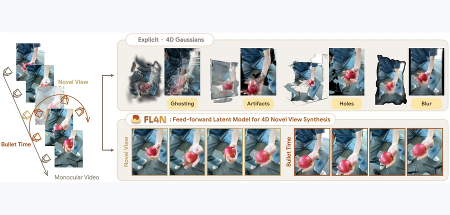 arXiv 2026-10-28 · cs.CV · #28 **[FL4N: Feed-forward Latent Model for 4D Novel View Synthesis](https://arxiv.org/abs/2610.35854)** Eunbeen Hong, Hyeonseo Yu, Honggyu An, Jooho Son, Hyunah Ko, Soowon Son, Chaehyun Kim, Jahyeok Koo, Jisoo Kim, Junhwa Hur… 机构：KAIST / Google DeepMind（[PDF](https://arxiv.org/pdf/2610.35854)） [Paper](https://arxiv.org/abs/2610.35854) · [图源](https://arxiv.org/html/2610.35854v1/teaser.png) 

中文摘要
4D 新视角合成（NVS）要在不同视角和时间渲染动态场景，必须联合推断三维结构与时间动力学。现有单目前馈方法常依赖显式 4D 高斯表示，容易出现时间不一致和严重渲染伪影。我们提出 FL4N，作者称其为首个前馈潜在 4D NVS 模型。它不依赖显式 4D 基元，而是在时空统一的潜在表示中编码 4D 场景先验。核心观点是：在预训练静态潜在先验之上，以残差学习时间动力学，可用有限的动态训练数据有效建模 4D 场景。因此，方法设计轻量动态编码器，利用静态场景特征将物体运动与相机视差解耦。仅使用图像合成目标训练时，FL4N 达到最先进的 4D NVS 质量并能实时渲染。学得的潜在表示可泛化到真实视频，并将视角与时间解耦。 <a href="https://arxiv.org/abs/2610.35854">原摘要来源</a>
 | 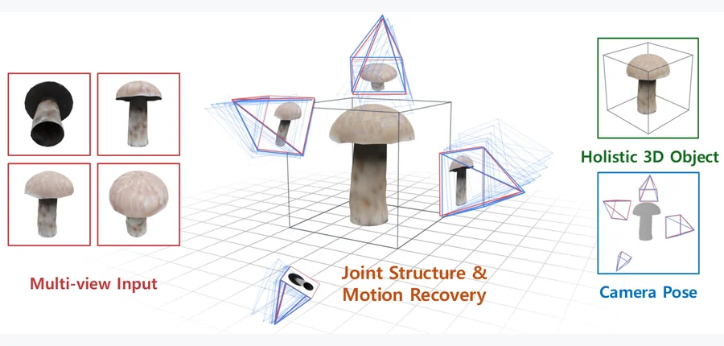 arXiv 2026-10-28 · cs.CV · #29 **[Generative Structure from Motion with Native 3D Diffusion](https://arxiv.org/abs/2610.35522)** Haobin Duan, Binbin Huang, Mochu Xiang, Yiqun Zhao, Zibo Zhao, Yi Ma, Shenghua Gao 机构：The University of Hong Kong / Transengram / Tencent（[arXiv HTML](https://arxiv.org/html/2610.35522)） [Paper](https://arxiv.org/abs/2610.35522) · [图源](https://arxiv.org/html/2610.35522v1/teaser.png) 

中文摘要
从少量未标定视角恢复物体三维结构和相机运动，是计算机视觉的基础问题。经典 Structure-from-Motion 可恢复与输入图像一致的三维几何，却不能补全未见区域；原生三维生成方法能生成合理的物体，却未必忠于输入图像。简单串联重建与生成会使两阶段误差传播，难以同时满足数据分布与输入约束。我们提出 GenSfM，把基于图像的三维重建与原生三维扩散模型结合。具体而言，多模态扩散 Transformer 通过共享自注意力，联合去噪形状潜变量和各视角位姿潜变量，以观测视角约束生成几何，同时用物体级先验推断未见区域。紧凑的三维原生 UV 体 token 化使增加视角时联合序列仍保持较小；位姿感知阶段在恢复的相机位姿处采样逐体素图像特征，细化几何与纹理。在 Toys4k 和 GSO 上使用四个未标定视角时，相比强原生三维生成基线，GenSfM 将新视角 PSNR 提高 3.2–4.5 dB，中位 Chamfer 距离降低 2.8–3.8 倍；在不使用外部位姿估计骨干、事后优化或已知内参的条件下，输入视角位姿的 Acc@5° 超过 96%。项目页面见原文链接。 <a href="https://arxiv.org/abs/2610.35522">原摘要来源</a>
 | 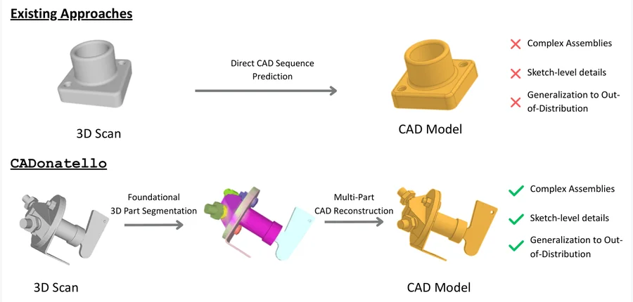 arXiv 2026-10-28 · cs.CV · #30 **[CADonatello: Towards Real-World Multi-Part 3D CAD Reconstruction](https://arxiv.org/abs/2610.33575)** Ahmet Serdar Karadeniz, Dimitrios Mallis, Parsa Akbari Chianeh, Kseniya Cherenkova, Anis Kacem, Djamila Aouada 机构：University of Luxembourg / Artec 3D（[PDF](https://arxiv.org/pdf/2610.33575)） [Paper](https://arxiv.org/abs/2610.33575) · [图源](https://arxiv.org/html/2610.33575v1/teaser_v2.png) 

中文摘要
现有从三维扫描重建 CAD 的方法在标准基准上表现不错，但真实物体常有多个部件，扫描也带噪，性能因此下降。重要原因是现有 CAD 重建数据集以单部件模型和干净几何输入为主，限制了学习模型在真实条件下的泛化。我们提出 CADonatello，一种从真实三维扫描重建参数化 CAD 的部件感知框架。方法先用基础规模的三维部件分割模型把输入几何拆为结构上有意义的组件，再对每个组件独立使用截面驱动流程，先参数化草图、再做拉伸重建。为提高扫描截面参数化的稳健性，我们还提出 CC3D Cross-Sections 数据集，将真实扫描中栅格化的截面图像与对齐 CAD 模型导出的参数化草图配对，支持从干净 CAD 草图向扫描截面图像的域适配。广泛实验表明，该方法提高了对带噪扫描的泛化，并在多个真实 CAD 逆向工程基准上可靠重建复杂多部件物体。 <a href="https://arxiv.org/abs/2610.33575">原摘要来源</a>
 |
| 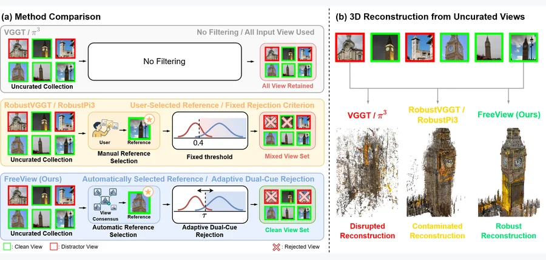 arXiv 2026-10-28 · cs.CV · #31 **[FreeView: Robust 3D Reconstruction from Uncurated Views](https://arxiv.org/abs/2610.33656)** Junho Kim, Hyunyoung Choi, Seongwon Lee 机构：Kookmin University（[PDF](https://arxiv.org/pdf/2610.33656)） [Paper](https://arxiv.org/abs/2610.33656) · [图源](https://arxiv.org/html/2610.33656v1/figure/preview.png) 

中文摘要
从未经整理的图像集合重建连贯的三维场景，常因无关或视角不重叠的图像而困难。近期研究表明，前馈重建模型内部具有可用于剔除干扰视角的一致性信号；但依赖参考图像的过滤必须先有一张干净参考，在实际集合中未必存在。我们提出 FreeView，一种无需训练的框架，联合选择过滤参考并从未经整理的集合中排除干扰视角。FreeView 利用集合级共识识别有代表性的可靠参考，再结合互补的视觉和几何证据，针对每个输入集合自适应地剔除视角。该方法在外观和视点变化显著时保留有用视角，同时排除干扰。它可与 VGGT 和 pi³ 集成，无需人工整理参考或手动校准剔除阈值。多个数据集上的广泛实验表明，FreeView 保留干净视角并排除干扰视角的比例较高，使未整理图像的三维重建更可靠。 <a href="https://arxiv.org/abs/2610.33656">原摘要来源</a>
 | 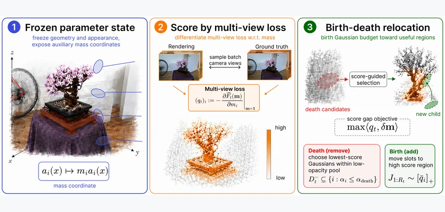 arXiv 2026-10-28 · cs.CV · #32 **[Birth-Death Structural Learning for 3D Gaussian Splatting](https://arxiv.org/abs/2610.34344)** Quan Tran Hong, Long Nguyen-Chi, Binh T. Nguyen 机构：VinUniversity（[PDF](https://arxiv.org/pdf/2610.34344)） [Paper](https://arxiv.org/abs/2610.34344) · [图源](https://arxiv.org/html/2610.34344v1/main_pipeline_2.png) 

中文摘要
三维高斯泼溅（3DGS）已成为实时新视角合成的常用表示，但质量与效率的权衡仍高度依赖自适应密度控制。现有克隆、分裂和裁剪规则使用位置梯度、不透明度及图像空间误差等代理信号；这些信号虽有效，却不能直接回答何处增添高斯才能降低多视角重建损失、删去哪些基元代价最小。我们提出 3DGS 的一阶变分出生－死亡控制，用从重建损失推导的变分分数替代启发式结构决策。每次结构更新时，方法冻结当前高斯集合，为各基元附加辅助质量坐标，并对这些坐标求多视角损失的导数。我们证明该分数是 Splat Regression Model 的一阶变分坐标，为出生－死亡操作提供严格的局部下降替代量：高分高斯被选为新增位置，低分且低不透明度的高斯被删去。在标准 3DGS 基准上，把该分数接入 3DGS-MCMC 后获得最先进的重建质量，优于现有方法，尤其在高斯数量受限时收益明显。工作为用基于梯度的变分指标替代 3DGS 代理启发式提供了证据。 <a href="https://arxiv.org/abs/2610.34344">原摘要来源</a>
 | 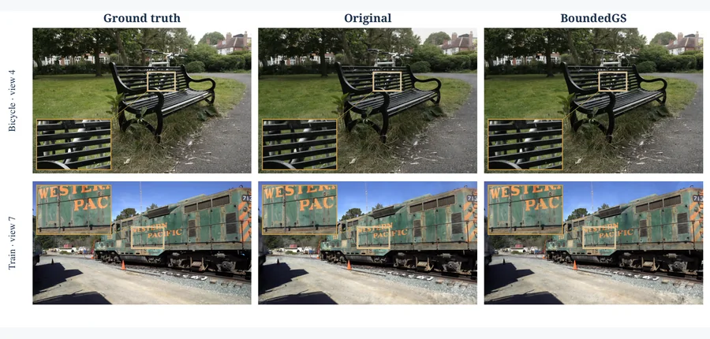 arXiv 2026-10-28 · cs.CV · #33 **[BoundedGS: Memory-Efficient High-Resolution Training for 3D Gaussian Splatting](https://arxiv.org/abs/2610.34233)** Xiaobin Deng, Changyu Diao, Min Li, Duanqing Xu 机构：Zhejiang University（[PDF](https://arxiv.org/pdf/2610.34233)） [Paper](https://arxiv.org/abs/2610.34233) · [图源](https://arxiv.org/html/2610.34233v1/qualitative_comparison.png) 

中文摘要
高分辨率三维高斯泼溅训练会增加像素与高斯瓦片的交集数量，使栅格化缓存与投影及梯度状态共存时的峰值内存变大。完整视角更新会累积整张图的梯度；每个局部区域贡献收集后，便可释放其前向和反向缓存。BoundedGS 将栅格化和投影的反向传播分开，并依据实测负载限制活跃的局部栅格化工作集。候选索引式投影与紧凑梯度存储处理此改动暴露出的视角级峰值；CPU 辅助结构重建和受限图像供给管理渲染以外的资源。在高斯数量固定约 600 万的分辨率扫描中，1K 到 16K 的实测渲染工作集保持在 1.073–1.077 GiB；在 11K 下，预热后一次处理用时 19.79 秒，完整图像执行为 21.76 秒。五个原生 5K 户外场景的完整训练中，平均渲染工作集从 9.97 降至 1.76 GiB，减少 82.3%；重建质量相近，训练时间从 36.7 缩短至 33.9 分钟。项目页面见原文链接。 <a href="https://arxiv.org/abs/2610.34233">原摘要来源</a>
 |
| 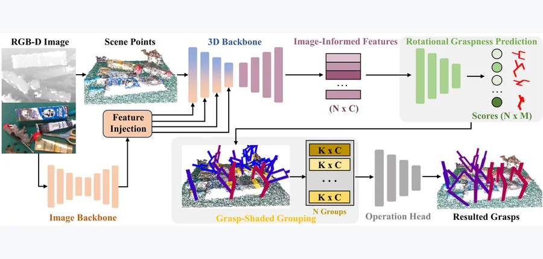 arXiv 2026-10-28 · cs.RO · #34 **[MMGNet: Multi-Modal 6-DoF Grasp Synthesis for Cluttered Scenes](https://arxiv.org/abs/2610.34893)** Rui Cao, Jia-Hui Pan, Yichuan Li, Yunfan Yu, Chi-Wing Fu, Jiangliu Wang, Yun-Hui Liu 机构：The Chinese University of Hong Kong / Shenzhen Technology University（[PDF](https://arxiv.org/pdf/2610.34893)） [Paper](https://arxiv.org/abs/2610.34893) · [图源](https://arxiv.org/html/2610.34893v1/framework.png) 

中文摘要
抓取是机器人操作的基础能力。场景级六自由度抓取生成依赖点云提供度量几何，但真实点云经常有噪声、缺失或过度平滑；RGB 图像虽提供物体区域、边界和外观线索，仍有两个瓶颈妨碍它们用于场景表示与局部抓取推理。我们提出多模态抓取生成网络 MMGNet，通过分层的图像到三维特征注入和旋转抓取度建模解决这些瓶颈。分层注入在三维表示形成的各阶段整合多尺度图像特征；旋转抓取度先联合预测抓取接近方向和平面内旋转，再通过抓取阴影式分组组织受图像信息引导的局部特征。消融表明两模块带来互补收益。MMGNet 在 GraspNet-1Billion 的 RealSense 设置下平均 AP 达 60.34，超过所有比较方法；真实实验中，在对抗性抓取物体上比 AnyGrasp 的抓取成功率高 8.46 个百分点。作者表示代码、模型和数据将在发表时发布。 <a href="https://arxiv.org/abs/2610.34893">原摘要来源</a>
 | 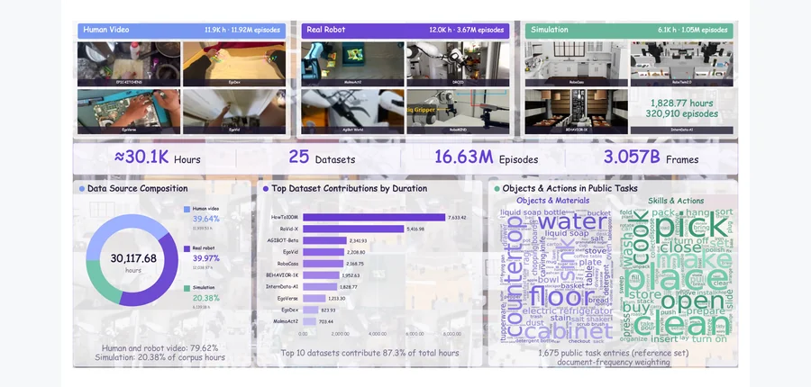 arXiv 2026-10-28 · cs.RO · #35 **[RynnVLA-Latent: Scaling Robotic Manipulation Foundation Models with 3D-Grounded Latent Actions](https://arxiv.org/abs/2610.34356)** Haoyu Zhao, Xingyue Zhao, Zhian Su, Bohan Hou, Yinzhou Tang, Fengyi Wang, Kehan Li, Yuming Jiang, Siteng Huang, Xin Li, Zh… 机构：DAMO Academy, Alibaba Group / Hong Kong Embodied AI Lab / The Chinese University of Hong Kong / Hupan Lab / PUMC（[PDF](https://arxiv.org/pdf/2610.34356)） [Paper](https://arxiv.org/abs/2610.34356) · [图源](https://arxiv.org/html/2610.34356v1/vla_datasets.png) 

中文摘要
扩展视觉语言动作（VLA）模型受到带动作标注示范稀缺、机器人本体间控制空间不兼容的限制。我们提出 RynnVLA-Latent，把异质交互视频转为可扩展的机器人策略预训练监督。核心模型 RynnLAM 从视觉转移学习连续、三维定位的潜在动作，无需原生机器人控制信号；残差式未来特征预测、相机运动补偿的三维流监督及相机运动解耦，共同促使表示捕捉与控制有关的运动，而非仅学习外观变化。方法将 RynnLAM 应用于 30.1K 小时的人类、机器人和仿真视频，得到 745.52M 个潜在动作描述符。随后 RynnVLA-Latent 用流匹配从视觉观测和语言预测潜在动作块，再把预训练骨干及动作专家适配到各本体的机器人动作。所得 4B 策略在 LIBERO 上成功率为 98.8%，无需基准特定适配在 LIBERO-Plus 上为 84.7%，在 VLABench 五个赛道上平均为 51.9%，在 RoboTwin 2.0 双臂基准上平均为 88.6%。在灵巧手和移动夹爪平台的六项真实操作任务中，它也达到比较方法中观察到的最高成功率。结合表示消融和数据扩展结果，这些发现显示潜在动作监督有望超越原生动作标注数据，扩展机器人策略学习。 <a href="https://arxiv.org/abs/2610.34356">原摘要来源</a>
 | 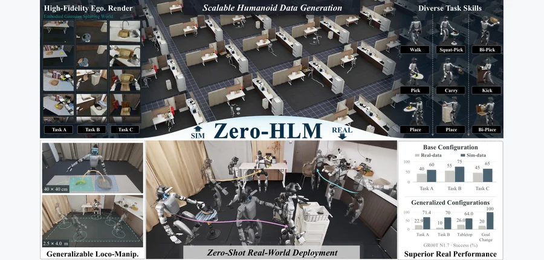 arXiv 2026-10-28 · cs.RO · #36 **[Zero-HLM: Generalizable Humanoid Loco-Manipulation without Real Robot Data](https://arxiv.org/abs/2610.35075)** Dianyi Yang, Mengya Liu, Zhumei Wang, Yu Liu, Xiaochen Zhang, Yixuan Li, Le Ma, Yuhang Yang, Weiqi Huang, Wei Liang, Baoxi… 机构：Beijing Institute of Technology / BIGAI / Tsinghua University / Delta Intelligence（[PDF](https://arxiv.org/pdf/2610.35075)） [Paper](https://arxiv.org/abs/2610.35075) · [图源](https://arxiv.org/html/2610.35075v1/iclr_figure_final.png) 

中文摘要
通用的人形机器人移动操作学习受制于昂贵的真实示范。仿真可扩展数据来源，但需要视觉逼真、具备物理机制的场景，以及可执行的全身动作。我们提出 Zero-HLM，一个把手机采集和仿真源示范转为可扩展训练数据的 real-to-sim-to-real 框架。高斯引导的智能体式真实到仿真重建使视觉场景与物理场景对齐；动作－环境共同适配利用运行反馈修正全身参考与交互几何。我们为三个 Unitree G1 任务生成 4,800 条经物理验证的示范，用于零样本迁移。仅用仿真训练的 GR00T N1.7 平均完整任务成功率为 66.7%，真实数据训练为 46.7%。在泛化配置上，扩展仿真训练使合并成功率从基于真实数据训练的基础策略的 23% 升至 69%，无需额外真实示范。项目页面见原文链接。 <a href="https://arxiv.org/abs/2610.35075">原摘要来源</a>
 |
| 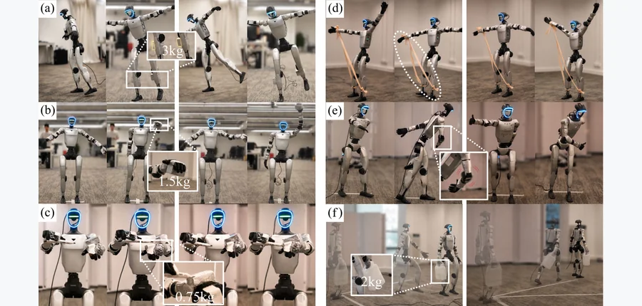 arXiv 2026-10-28 · cs.RO · #37 **[HumanoidNDM: Closing the Training-Deployment Gap of Motion Tracking via Humanoid Neural Dynamics Model](https://arxiv.org/abs/2610.34126)** Chao Chen, Zhenrong Wang, Jilong Wang, Yusen Feng, Jiangran Lyu, Li Yi, He Wang 机构：Peking University / Chinese Academy of Sciences / Galbot / Beijing Academy of Artificial Intelligence / Tsinghua University（[PDF](https://arxiv.org/pdf/2610.34126)） [Paper](https://arxiv.org/abs/2610.34126) · [图源](https://arxiv.org/html/2610.34126v1/Teaser.png) 

中文摘要
人形机器人运动跟踪近来取得显著进展，但真实部署不可避免地遇到额外物理扰动或仿真建模不准造成的动力学差距，形成明显的训练－部署落差；高效利用真实数据微调是稳健部署的最后关键步骤。我们提出 HumanoidNDM，一种由真实数据训练的神经动力学模型驱动的在线人形运动跟踪微调框架。数据采集阶段使用带自适应强度的低频参考扰动，在部署可行性与探索效率之间取得平衡。模型训练阶段结合可微前向运动学，在欧氏空间训练基于历史和本体感觉的稳健神经动力学模型，免去昂贵的动作捕捉系统。策略微调阶段直接通过模型梯度反向传播微调策略，提高数据效率。在 Unitree G1 上的物理验证表明，HumanoidNDM 可快速适配多类真实扰动；作者称其为首个无需动作捕捉的人形跟踪策略在线微调框架。 <a href="https://arxiv.org/abs/2610.34126">原摘要来源</a>
 | 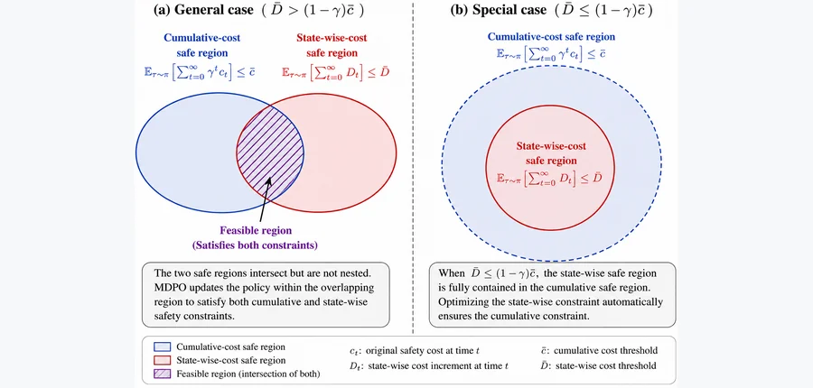 arXiv 2026-10-28 · cs.RO · #38 **[MDPO: Multi-constraint Dexterous Policy Optimization with Reinforcement Learning](https://arxiv.org/abs/2610.33480)** Ao Zhou, Zongyou Yu, Ke Wu, Tao Xu, Junqiao Zhao, Wenchao Ding, Alois Knoll, Guang Chen 机构：Tongji University / Shanghai Innovation Institute / Fudan University / TARS Robotics / Technical University of Munich（[PDF](https://arxiv.org/pdf/2610.33480)） [Paper](https://arxiv.org/abs/2610.33480) · [图源](https://arxiv.org/html/2610.33480v1/figure/relationship.png) 

中文摘要
灵巧操作需要高维控制策略完成复杂的富接触任务，同时满足关节限位、不安全手指构型、机械臂碰撞及物体交互不稳定等多种安全要求。约束强化学习为纳入这些要求提供了原则性框架，但现有灵巧操作方法主要关注累积代价约束，难以同时处理多种异质约束。我们提出用于安全灵巧操作的多约束灵巧策略优化（MDPO）。方法先将操作表述为同时包含累积代价与逐状态代价约束的多约束优化问题，再把多约束投影纳入策略优化：针对各约束的策略投影，将追求任务表现的中间策略映射到累积和逐状态约束规定的可行域。ReDMan 上包括安全关节控制、手指安全及抓取任务的广泛实验显示，与基线相比，MDPO 在保持有竞争力的任务表现时满足约束更好。代码见原文链接。 <a href="https://arxiv.org/abs/2610.33480">原摘要来源</a>
 | 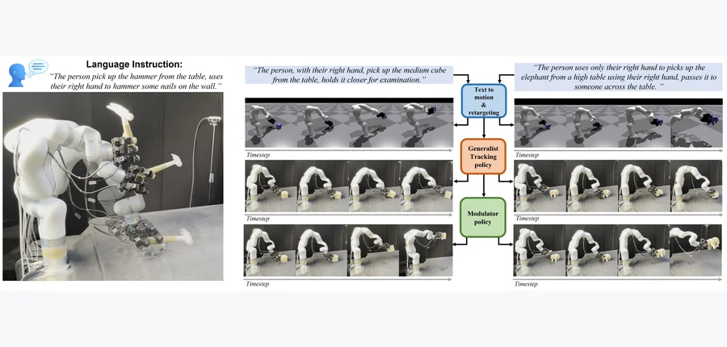 arXiv 2026-10-28 · cs.RO · #39 **[AdaDexTrack: Dynamic Modulation for Adaptive and Generalizable Dexterous Manipulation Tracking](https://arxiv.org/abs/2610.33852)** Jianibieke Adalibieke, Qianwei Han, Xueyi Liu, Yuzhe Qin, Li Yi 机构：Shanghai Qi Zhi Institute / Tsinghua University / UC San Diego（[PDF](https://arxiv.org/pdf/2610.33852)） [Paper](https://arxiv.org/abs/2610.33852) · [图源](https://arxiv.org/html/2610.33852v1/figs/teasor_x9.jpg) 

中文摘要
语言是自然的机器人指令方式，但把一句指令变成长时程、富接触的手物交互仍很难：合成参考有噪声，人到机器人的重定向带来本体偏差，固定参考跟踪又会让小误差累积。我们提出 AdaDexTrack，一种调制器进入闭环的语言条件操作跟踪框架。蒸馏得到的通用跟踪器承载技能，而紧密对齐的调制器执行三类反馈修正：持续调整跟踪目标的参考调制、在线适配物体表示以调用合适技能的物体潜变量调制，以及微调执行目标的状态相关位置调制。跟踪器通过大规模专用到通用蒸馏，在语言条件手物轨迹语料上学习；调制器则用相同任务目标进行强化学习，以确保两者耦合。在大规模评估中，该方法在未见轨迹和未见物体集合上的平均跟踪误差与成功率均持续优于先前最先进方法；真实硬件上还展示了零样本仿真到真实迁移，调制器相对仅用跟踪器有明显收益。AdaDexTrack 将语言条件灵巧操作表述为受调制的闭环跟踪，通过同步调整参考、物体潜变量和位置目标，减少噪声文本参考导致的漂移。 <a href="https://arxiv.org/abs/2610.33852">原摘要来源</a>
 |
| 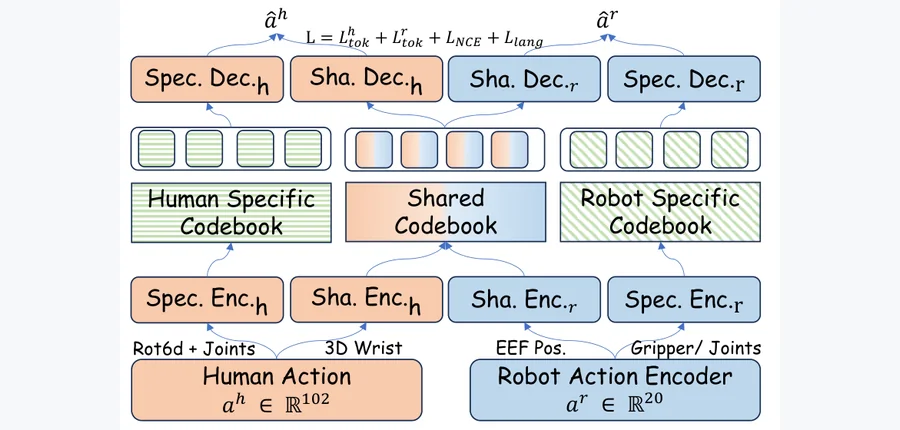 arXiv 2026-10-28 · cs.RO · #40 **[EXE: Egocentric Cross-Embodiment Pretraining via Factorized Latent Actions for VLA Models](https://arxiv.org/abs/2610.33685)** Qingyuan Cai, Bo Zhang, Yongzhen Huang, Jianyu Chen 机构：ROBOTERA / Beijing Normal University / Tsinghua University（[PDF](https://arxiv.org/pdf/2610.33685)） [Paper](https://arxiv.org/abs/2610.33685) · [图源](https://arxiv.org/html/2610.33685v1/tokenizer.png) 

中文摘要
视觉语言动作（VLA）模型受机器人数据稀缺限制。第一视角人类操作视频丰富、多样且富含语义，也天然记录操作意图，但人与机器人本体差距妨碍提取与动作有关的表示。从动作执行看，人手与机器人共享到达、抓取、放置等操作原语，却有不同的本体运动学。因此，第一视角视频预训练可学习可迁移技能的共享动作表示，同时应拆出人类特有运动模式，避免干扰机器人策略学习。我们提出 EXE，一种第一视角跨本体预训练框架，从人类第一视角视频学习因子化潜在动作表示，分离共享操作先验与本体特有信号。借助共享动作空间，机器人策略从多样人类示范获得可泛化的操作语义，而不受人类特定运动学偏置影响。这些共享知识可跨不同运动学结构迁移，使同一预训练同时惠及平行夹爪和灵巧手。相较无预训练基线，EXE 在 RoboTwin 2.0、RoboCasa GR1 和真实操作任务上持续取得收益。 <a href="https://arxiv.org/abs/2610.33685">原摘要来源</a>
 | 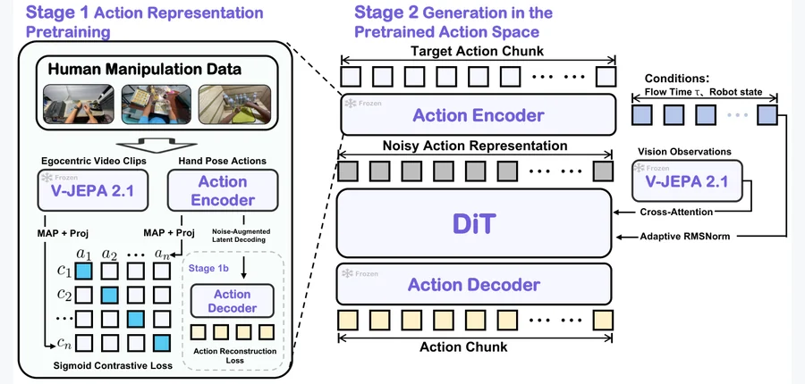 arXiv 2026-10-28 · cs.RO · #41 **[Scaling Dexterous Manipulation via Action Representation Pretraining](https://arxiv.org/abs/2610.34453)** Yanjinghao Xu, Jiexin Zhang, Huan Zhao, Jianjia Mo, Zhenghao Yin, Dingkang Liang, Xiang Bai, Han Ding 机构：Huazhong University of Science and Technology（[PDF](https://arxiv.org/pdf/2610.34453)） [Paper](https://arxiv.org/abs/2610.34453) · [图源](https://arxiv.org/html/2610.34453v1/fig2_method.png) 

中文摘要
大规模视觉、语言和视频预训练显著提高了机器人操作模型的感知与泛化能力，但复杂灵巧操作的动作生成仍受机器人示范稀缺限制。有限的机器人示范必须同时用于学习动作表示和任务条件动作分布，难以充分学好表示，进而限制下游生成模型产出复杂灵巧动作。为此，我们提出动作表示预训练与生成（ARPG），显式区分表示学习与动作生成：先用大规模人类操作数据预训练动作表示编码器，再冻结编码器，用一个紧凑的 130M 参数生成骨干在编码空间学习任务条件动作分布。实验表明，ARPG 在 DexJoCo 基准上达到最先进表现，并把双手灵巧操作的平均成功率从 π0.5 的 10.1% 提高至 44.7%。扩展实验还表明，覆盖更广的人类操作行为能有效提高下游表现。结果显示，动作表示预训练为提升复杂灵巧操作能力提供了一个独立的扩展维度。 <a href="https://arxiv.org/abs/2610.34453">原摘要来源</a>
 | 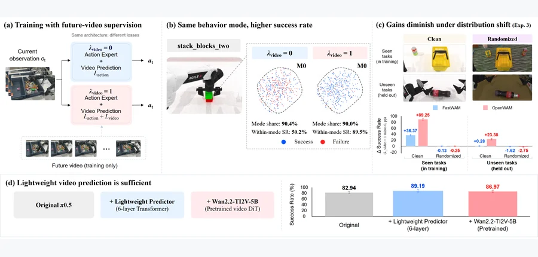 arXiv 2026-10-28 · cs.RO · #42 **[What Does World Modeling Actually Improve in Robot Action Learning?](https://arxiv.org/abs/2610.34593)** Hanwen Cui, Yuanyuan Li, Qing Guo, Zhida Zhang, Chao Chen, Xi Chen, Jie Cao 机构：Chinese Academy of Sciences / University of Chinese Academy of Sciences / Geekplus / Central South University（[PDF](https://arxiv.org/pdf/2610.34593)） [Paper](https://arxiv.org/abs/2610.34593) · [图源](https://arxiv.org/html/2610.34593v1/figures/fig1_23_editable.png) 

中文摘要
世界动作模型（WAM）将未来视频预测与机器人动作学习结合，但仅看任务成功率提升，无法知道预测监督怎样影响执行行为，也无法判断收益能否延续到任务和环境变化中。我们分别在 FastWAM 与 OpenWAM 内做受控的未来视频预测损失消融，在每个模型族中保持架构、初始化、机器人训练数据与训练步数一致。在已见任务的干净条件下，预测监督分别使成功率提高 24.38 和 72.91 个百分点。轨迹聚类进一步显示，若干粗粒度轨迹簇内部的成功率也提高，包括簇频率几乎不变的情况，说明收益并非仅体现为轨迹模式出现比例变化。然而，这些收益在分布变化下并不稳定：未见任务上的提升随模型和任务而异；在所评估的环境随机化中，两个模型的成功率都很低，预测监督没有一致优势。我们还将未来视频预测作为 π0.5 的辅助训练目标：一个仅在训练时使用的轻量 Transformer 预测器使成功率从 82.94% 提高到 89.19%。这些发现支持未来视频预测作为动作学习的有效辅助监督，同时区分了熟悉任务执行改善与可靠迁移，并表明在所评估设置下，收益不一定依赖大型预训练视频扩散 Transformer（DiT）。 <a href="https://arxiv.org/abs/2610.34593">原摘要来源</a>
 |
| 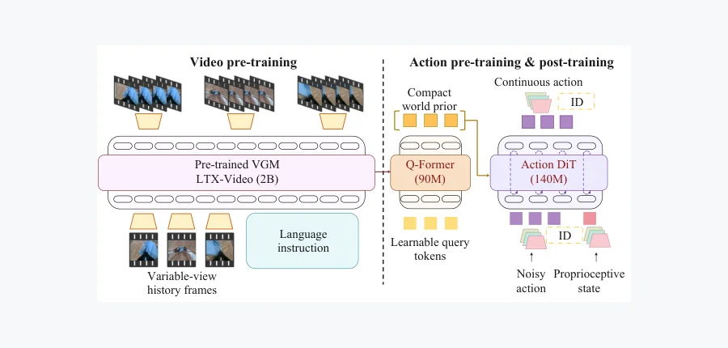 arXiv 2026-10-28 · cs.RO · #43 **[X-World: Transferring Video Priors to Variable-View Robot Control](https://arxiv.org/abs/2610.34105)** Chun Gu, Xiaofei Wei, Yiming Chen, Juntong Zhang, Li Zhang 机构：Fudan University / Shanghai Innovation Institute / Logos Intelligence Lab（[PDF](https://arxiv.org/pdf/2610.34105)） [Paper](https://arxiv.org/abs/2610.34105) · [图源](https://arxiv.org/html/2610.34105v1/overview.png) 

中文摘要
视频扩散模型可为机器人控制提供交互表示，但迁移这些表示时需协调可变的相机输入、异质动作接口和闭环执行。我们提出 X-World，通过固定长度 token 序列把视频先验传递给共享动作专家。残差式跨视角注意力分支在保留预训练视频骨干原有自注意力路径的同时，将其扩展至一、二或三个视角；按层对齐的 Q-Former 汇聚骨干特征，数据集特定模块则在原生状态／动作接口与共享动作专家之间映射。训练将视频适配与纯动作预训练分开，后者冻结视频骨干，随后在目标域联合后训练。策略只需一次骨干前向传播提取视频特征，并以异步动作分块执行。在 LIBERO 上，X-World 平均成功率为 98.5%；其 LIBERO 训练的检查点无需额外适配，在 LIBERO-Plus 上达到 76.5%。七类变化的细分结果显示，它在机器人、语言、光照和布局扰动上有收益，但相对 OpenVLA-OFT，在相机、背景和噪声变化下较弱。六项真实双臂任务中，每项 20 次试验，平均成功率为 81.7%。在测试的消融中，去掉视频适配或跨视角融合造成最大成功率下降。 <a href="https://arxiv.org/abs/2610.34105">原摘要来源</a>
 | 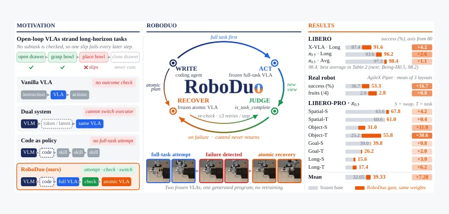 arXiv 2026-10-28 · cs.RO · #44 **[RoboDuo: Attempt, Check and Atomic Recovery through Code for Vision-Language-Action Models](https://arxiv.org/abs/2610.34108)** Jie Wang, Bo Zhang, Renzhi Lu, Jianyu Chen 机构：Robotera / Huazhong University of Science and Technology / Tsinghua University（[PDF](https://arxiv.org/pdf/2610.34108)） [Paper](https://arxiv.org/abs/2610.34108) · [图源](https://arxiv.org/html/2610.34108v1/roboduo_teaser.png) 

中文摘要
视觉语言动作（VLA）模型从语言指令和当前观测直接生成动作，却不会检查指令是否已完成；长时程任务中的一次失败因此可能不被发现，导致整项任务未完成。然而，失败的运行常已部分完成任务，未完成步骤也往往是示范中反复出现的可复用原子技能，因此可组合原子技能进行恢复。我们提出 RoboDuo，一个以代码连接编码智能体与两个 VLA 的闭环双系统框架。智能体编写程序，让完整任务 VLA 先尝试任务并检查是否完成；失败时由原子 VLA 完成剩余步骤。智能体本身不输出动作，只决定由哪个 VLA 执行，因此无需更新现有完整任务 VLA 权重即可包装使用。为训练原子 VLA 和具备完成检查能力的编码智能体，我们从同一组 LIBERO 示范构建 LIBERO-Atomic、LIBERO-Code 和 LIBERO-Judge。RoboDuo 在 LIBERO 和 LIBERO-PRO 上持续改善 X-VLA 与 π0.5，长时程任务收益最大；在真实机器人上还能恢复冻结完整任务 VLA 的失败运行。 <a href="https://arxiv.org/abs/2610.34108">原摘要来源</a>
 | 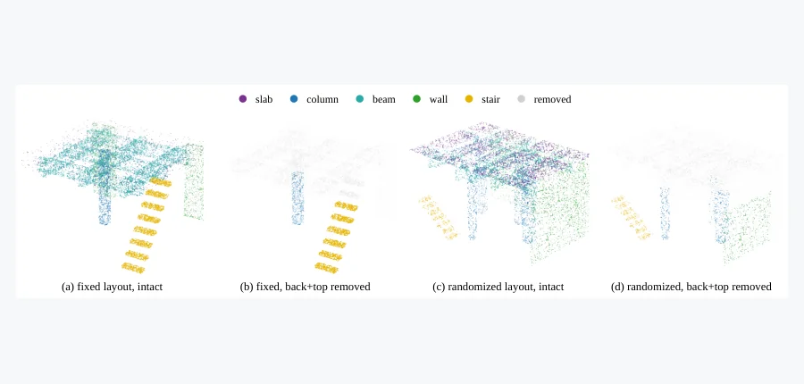 arXiv 2026-10-28 · cs.RO · #45 **[Cut a Wall, See a Wall: Identity Substitution in Occluded Point-Cloud Perception for Construction Robots](https://arxiv.org/abs/2610.34040)** Tsung-Lung Yang 机构：affiliation 未确认 [Paper](https://arxiv.org/abs/2610.34040) · [图源](https://arxiv.org/html/2610.34040v1/fig1.png) 

中文摘要
施工机器人必须标注只看到一部分的建筑构件。我们发现，当测试时的遮挡抹去整片场景区域，而训练时只遮住物体局部时，点云分割网络不只是漏掉被遮挡构件，还会重标它们，错误集中到单一的吸收类。在固定合成布局中，柱类别吸收至多 70% 的测试点；在随机布局中，吸收类转为楼梯，三个训练随机种子下其预测占比是真实占比的 4.5–5.4 倍。基线 mIoU 降至固定布局的 0.15–0.27、随机布局的 0.36–0.72，一个测试集中最多有 269 个完整物体消失。每点加入 14 个手工几何特征（GPE）后，mIoU 恢复至 0.54–0.92，在每次运行中消除了 64–100% 的整物体丢失；对 PointNet++ 和 PTv3 式 Transformer，在两种布局下均有效，在真实 S3DIS 扫描中则将整面墙丢失从 10 次降至 0。基于预测的竣工柱检查中，GPE 把正确检查视角的比例从 17–58% 提升至 71–92%。对固定、随机和真实场景的特征置乱说明，每个类别依赖训练数据中稳定的线索：按高度分层的板梁依赖位置，位置变化后的墙和楼梯依赖内在形状。遮挡增强也是提高 mIoU 的有力对照，但在所有设置中都丢失更多完整物体，例如 25–35 个对 0 个。 <a href="https://arxiv.org/abs/2610.34040">原摘要来源</a>
 |
| 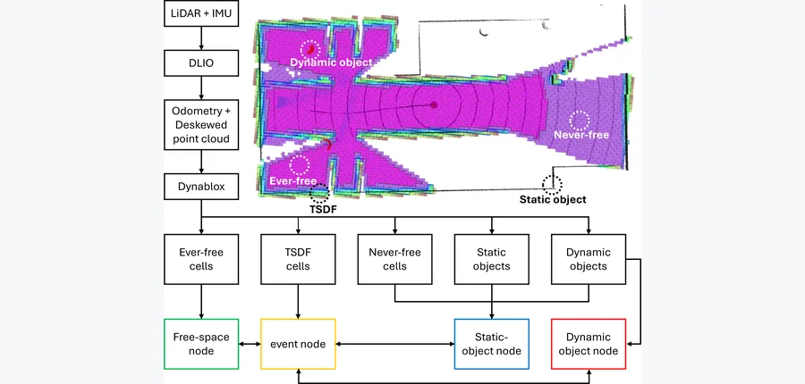 arXiv 2026-10-28 · cs.RO · #46 **[T-ConSG: A LiDAR-Based Real-Time Temporal Construction Scene Graph for Dynamic and Evolving Environments](https://arxiv.org/abs/2610.34041)** Yilong Chen, Yong K. Cho 机构：Georgia Institute of Technology（[PDF](https://arxiv.org/pdf/2610.34041)） [Paper](https://arxiv.org/abs/2610.34041) · [图源](https://arxiv.org/html/2610.34041v1/figs/workflow.png) 

中文摘要
动态且持续变化的环境给机器人建图和场景理解带来困难，尤其施工现场同时存在移动人员、临时障碍和持久结构变化。动态或长期 SLAM 可检测运动与环境变化，但输出主要是度量表示，难以支持更高层的时空推理。本文提出基于 LiDAR 的实时施工时间场景图 T-ConSG，联合表示自由空间区域、静态物体、动态物体和环境事件，并用空间关系边和事件参与边连接。框架从 LiDAR 几何证据增量构建图，追踪动态物体，同时保留持久的自由空间和静态物体信息。累积空间证据的变化进一步表示为显式安装和移除事件，使图既覆盖短时动态，也覆盖持久环境演化。文章通过三个互补应用展示该表示：砌砖测试平台上的动态感知导航、ConSLAM 数据集上的施工进度监测，以及合成施工环境中的在线变化检测。结果表明，T-ConSG 能统一组织时空信息，支持机器人在同时具有短时动态和持久变化的环境中推理。 <a href="https://arxiv.org/abs/2610.34041">原摘要来源</a>
 | 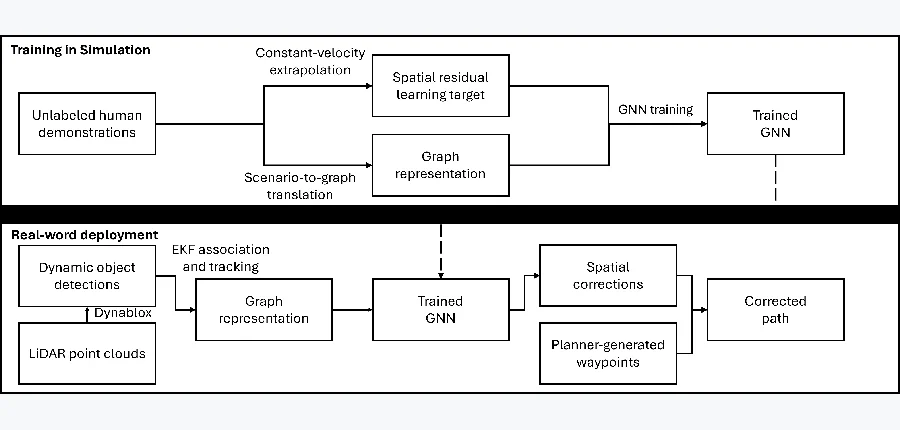 arXiv 2026-10-28 · cs.RO · #47 **[Learning Interaction-Aware Path Corrections from Unlabeled Trajectories: A LiDAR-Based Sim-to-Real GNN Framework for Construction Robots](https://arxiv.org/abs/2610.34060)** Yilong Chen, Yong K. Cho 机构：Georgia Institute of Technology（[PDF](https://arxiv.org/pdf/2610.34060)） [Paper](https://arxiv.org/abs/2610.34060) · [图源](https://arxiv.org/html/2610.34060v1/figs/overall.png) 

中文摘要
在工人附近运行的施工机器人，需要预判人的运动，并应对动态、非结构化场地。现有社会导航方法依赖手工交互规则、带标注示范或机器人特定控制策略，限制了可扩展性和迁移性。我们提出实时、纯 LiDAR 框架，从无标签轨迹示范学习考虑交互的路径修正。常速度外推生成残差学习目标，图神经网络（GNN）建模机器人、行人与目标之间的关系。部署时，扩展卡尔曼滤波器追踪 LiDAR 检测并构建动态图，GNN 通过与规划器无关的接口修正规划器生成的路点。在砌砖试验中，GNN 使路径不规则度降低 39.2%，最小碰撞时间（TTC）提高；在 Dynablox 序列中，最小 TTC 提高 38.3%，路径比基线更短、更平滑。消融支持使用 1.0 秒预测区间，并验证目标上下文、反射增强和特征归一化的益处。 <a href="https://arxiv.org/abs/2610.34060">原摘要来源</a>
 | 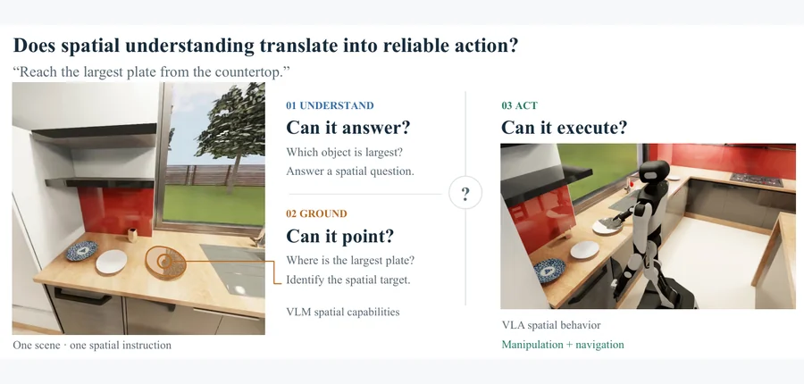 arXiv 2026-10-28 · cs.RO · #48 **[Behavior Spatial Benchmark: Evaluating Spatial Understanding for Robotics](https://arxiv.org/abs/2610.34051)** Sirui Chen, Huang Huang, Qineng Wang, Wenlong Huang, Manling Li, Ruohan Zhang, Li Fei-Fei, Jiajun Wu 机构：Stanford University / Northwestern University（[PDF](https://arxiv.org/pdf/2610.34051)） [Paper](https://arxiv.org/abs/2610.34051) · [图源](https://arxiv.org/html/2610.34051v1/fig_teaser_illustrated.png) 

中文摘要
机器人任务需把空间语言定位到物理场景，但仅凭任务成功无法判断是否真正遵循空间指令。我们提出基于 BEHAVIOR-1K 的 BEHAVIOR-Spatial 基准，测量空间问答、点目标定位和机器人动作，以考察 VLM 的空间理解如何关联 VLA 行为。基准包含 49 项活动中的 3,256 个空间问题、14 项操作任务中的 1,240 个定位查询，以及覆盖这 14 项操作和 10 项导航任务的动作评估。操作协议测试留出配置，并在固定训练布局中改变所要求的目标，以评估指令遵循。基线在留出配置上达到 41.6%，但指令改变后仅为 16.1%。VLM 适配与机器人数据预训练的改善有限；提供真实视觉目标线索可把两项比例分别提高到 60.3% 与 38.0%。感知评测揭示 VLM 问答、定位准确率与 VLA 操作表现之间存在随策略而异的相关性。这些发现支持在任务完成之外评估空间指令遵循，并研究空间感知表现何时能转化为机器人行为。项目网站见原文链接。 <a href="https://arxiv.org/abs/2610.34051">原摘要来源</a>
 |
| 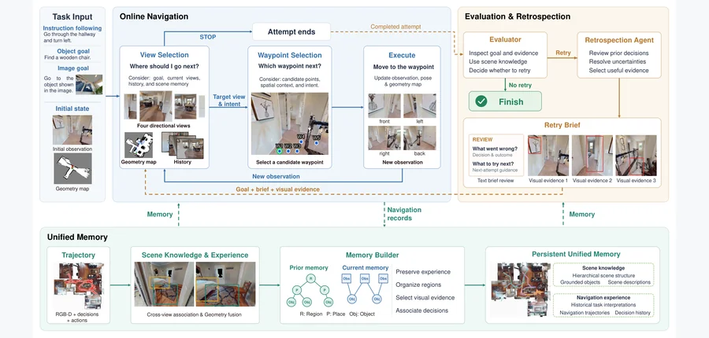 arXiv 2026-10-28 · cs.RO · #49 **[RetroNav: Scene-Grounded Retrospection and Retry for Self-Evolving Lifelong Navigation](https://arxiv.org/abs/2610.35172)** Diantao Tu, Yangdong Liu, Niannian Dai, Mengqi Rong, Shuhan Shen 机构：Chinese Academy of Sciences / University of Chinese Academy of Sciences（[PDF](https://arxiv.org/pdf/2610.35172)） [Paper](https://arxiv.org/abs/2610.35172) · [图源](https://arxiv.org/html/2610.35172v1/pipeline.png) 

中文摘要
现有机器人导航主要关注孤立任务，忽视在多次导航中积累知识和经验的需要。近期终身导航方法虽探索跨任务知识积累，却多关注场景知识，较少把历史导航经验与场景证据连接，限制了从错误中反思并改善后续决策。为此，我们提出 RetroNav，一种无需训练的自演进导航框架，结合导航、记忆积累和失败反思。统一记忆系统连接几何与语义场景知识及历史导航经验，并区分客观观测与任务相关解释。每次尝试后，独立评估器判断是否需要重试；若需要，反思智能体结合累积的场景知识和导航记录回看历史决策，生成有证据支撑的重试简报，引导下一次尝试。RetroNav 在五个导航基准上达到最先进表现。作者表示将按原文链接开源该方法。 <a href="https://arxiv.org/abs/2610.35172">原摘要来源</a>
 |   |   |
<!-- PAPER_CARDS_END -->

## 检索概况

- **检索窗口**：北京时间 2026-10-27 09:29 至 2026-10-28 09:00；以下为官方 2026-10-27（Tuesday）New 批次。
- **规则**：只从官方 New submissions 选主榜，同一 arXiv ID 去重；按标题与完整摘要筛查。3D／物理交叉优先，其次是基础 3D 与有明确任务、方法或实验的具身论文。
- **官方分类页总命中／主榜入选**：New **1238／49 篇**；Cross **773** 条、Replacement **1279** 条（分类页原始记录，均不入主榜）。
- **缺失**：原摘要 0 篇；配图与机构核验见文末。

| 官方分类页 | listing 日期 | New | Cross | Replacement |
|---|---|---:|---:|---:|
| [cs.CV](https://arxiv.org/list/cs.CV/new?show=2000) | 2026-10-27 | 235 | 55 | 193 |
| [cs.GR](https://arxiv.org/list/cs.GR/new?show=2000) | 2026-10-27 | 2 | 5 | 3 |
| [cs.RO](https://arxiv.org/list/cs.RO/new?show=2000) | 2026-10-27 | 118 | 20 | 82 |
| [cs.AI](https://arxiv.org/list/cs.AI/new?show=2000) | 2026-10-27 | 172 | 261 | 278 |
| [cs.LG](https://arxiv.org/list/cs.LG/new?show=2000) | 2026-10-27 | 226 | 200 | 271 |
| [physics](https://arxiv.org/list/physics/new?show=2000) | 2026-10-27 | 125 | 55 | 102 |
| [cond-mat](https://arxiv.org/list/cond-mat/new?show=2000) | 2026-10-27 | 130 | 39 | 109 |
| [math.OC](https://arxiv.org/list/math.OC/new?show=2000) | 2026-10-27 | 39 | 30 | 61 |
| [math.NA](https://arxiv.org/list/math.NA/new?show=2000) | 2026-10-27 | 41 | 17 | 44 |
| [math.DS](https://arxiv.org/list/math.DS/new?show=2000) | 2026-10-27 | 34 | 11 | 35 |
| [stat.ML](https://arxiv.org/list/stat.ML/new?show=2000) | 2026-10-27 | 25 | 33 | 48 |
| [eess.IV](https://arxiv.org/list/eess.IV/new?show=2000) | 2026-10-27 | 19 | 6 | 9 |
| [eess.SY](https://arxiv.org/list/eess.SY/new?show=2000) | 2026-10-27 | 35 | 28 | 23 |
| [eess.SP](https://arxiv.org/list/eess.SP/new?show=2000) | 2026-10-27 | 37 | 13 | 21 |

## Top papers

| # | 论文 | arXiv | 分类 | 作者 | 机构 | 相关性（推断） | 机构强度（推断） | 优先级（推断） |
|---:|---|---|---|---|---|---|---|---|
| 1 | Explicit Frictional Contact Modeling in Neural Garment Simulation | [arXiv:2610.33492](https://arxiv.org/abs/2610.33492) | cs.CV | Thanh-Nguyen Truong, Vu-Hoang Tran, Ching-Chun Huang | National Yang Ming Chiao Tung University / Ho Chi Minh City University of Technology and Engineering（[PDF](https://arxiv.org/pdf/2610.33492)） | 高：3D／物理或接触机制 | 中（推断） | A |
| 2 | Differentiable Contact Dynamics for Legged Locomotion: Policy Learning and Contact-Implicit Trajectory Optimization | [arXiv:2610.35852](https://arxiv.org/abs/2610.35852) | cs.RO | Gijeong Kim, Seungbin Oh, Dongyun Kang, Hae-Won Park | KAIST（[PDF](https://arxiv.org/pdf/2610.35852)） | 高：3D／物理或接触机制 | 强（推断） | A |
| 3 | PhysCreator: Creating Physically-Attributed 3D Assets at Will | [arXiv:2610.34473](https://arxiv.org/abs/2610.34473) | cs.CV | Shiyan Zheng, Ming Li, Lei Han, Xiangyu Xu | Xi’an Jiaotong University / The Chinese University of Hong Kong, Shenzhen / Discover Robotics（[PDF](https://arxiv.org/pdf/2610.34473)） | 高：3D／物理或接触机制 | 强（推断） | A |
| 4 | 3D-Force Estimation for Dual-arm Manipulation of Deformable Linear Objects via Factor Graphs | [arXiv:2610.35058](https://arxiv.org/abs/2610.35058) | cs.RO | Annika Delucchi, Vincenzo Di Paola, Bruno Marco Quadrelli, Matteo Zoppi | University of Genova / Jet Propulsion Laboratory, California Institute of Technology（[PDF](https://arxiv.org/pdf/2610.35058)） | 高：3D／物理或接触机制 | 强（推断） | A |
| 5 | Learning Force-Reactive Humanoid Loco-Manipulation | [arXiv:2610.35862](https://arxiv.org/abs/2610.35862) | cs.RO | Sihang Li, Xiaofeng Guo, Jinkun Cao, Charlie Cheng, Ruihan Yang, Chen Feng, Guanya Shi, Haozhi Qi | Amazon FAR / New York University / Carnegie Mellon University / University of Chicago（[PDF](https://arxiv.org/pdf/2610.35862)） | 高：3D／物理或接触机制 | 中（推断） | A |
| 6 | Robot-Aligned 3D Gaussian Splatting for Precise Reaching with Wrist-Camera VLA Policies | [arXiv:2610.35626](https://arxiv.org/abs/2610.35626) | cs.RO | Zuoxu Wang, Xiao Liang | Texas A&M University（[PDF](https://arxiv.org/pdf/2610.35626)） | 高：3D／物理或接触机制 | 中（推断） | A |
| 7 | PS-DLO: Property- and Spatially Aware Deformable Linear Object Manipulation Policy | [arXiv:2610.34147](https://arxiv.org/abs/2610.34147) | cs.RO | Mengdi Li, Boxian Yao, Xiyu Zhu, Yifan Yang, Yunfan Lou, Xuan Han, Tao Liu, Zhibo Pang | University of Chinese Academy of Sciences / Peking University / Space Engineering University（[PDF](https://arxiv.org/pdf/2610.34147)） | 高：3D／物理或接触机制 | 强（推断） | A |
| 8 | Open-World Law-to-Action: Vision-Language Priors and Touch for Parts with Hidden Physics | [arXiv:2610.33705](https://arxiv.org/abs/2610.33705) | cs.RO | Mohamed A. Mabrok | Qatar University（[PDF](https://arxiv.org/pdf/2610.33705)） | 高：3D／物理或接触机制 | 中（推断） | A |
| 9 | RAIWAY: A Large-Wheeled Bipedal Robot with Contact-Informed Blind Locomotion | [arXiv:2610.33172](https://arxiv.org/abs/2610.33172) | cs.RO | Kyungmin Nam, Jiseong Lee, Donghyuk Choi, Jeongsoo Park, Woojin Kim, Jemin Hwangbo | KAIST（[PDF](https://arxiv.org/pdf/2610.33172)） | 高：3D／物理或接触机制 | 强（推断） | A |
| 10 | How High Can GPT-6 Astra Climb in Contact-Rich Manipulation? PhysLadder: A Hierarchical, Matched Sim-Real Benchmark for Physical Interaction | [arXiv:2610.34527](https://arxiv.org/abs/2610.34527) | cs.RO | Haibao Yu, Jiaqi Meng, Zijian Zhang, Bowen Jing, Lei Yang, Yue Hu, Chenchen Ge, Yiming Hou, Chenbo Xin, Dawen Ye, Haifang Qin, Jin Li, Weitao Zhou, Jianing Qiu, Jiankai Sun, Dandan Zhang, Zaiqing Nie, Ping Luo, Ding Zhao | Tuojing Intelligence / The University of Hong Kong / Chinese Academy of Sciences / Nanyang Technological University / University of Michigan / Southeast University / Sapient Intelligence / SimpleAI / MBZUAI / Stanford University / Imperial College London / Tsinghua University / Carnegie Mellon University（[PDF](https://arxiv.org/pdf/2610.34527)） | 高：3D／物理或接触机制 | 强（推断） | A |
| 11 | SceneAgent: An Agentic Pipeline from 3D and 4D Captures to Simulation Environments | [arXiv:2610.34745](https://arxiv.org/abs/2610.34745) | cs.RO | Luke Hollis, Tianxing Fan, Heng Yang | Harvard University（[PDF](https://arxiv.org/pdf/2610.34745)） | 高：3D／物理或接触机制 | 强（推断） | A |
| 12 | Single Camera based Simulation and Try-on Ready Avatar Modeling | [arXiv:2610.34223](https://arxiv.org/abs/2610.34223) | cs.GR | Honghu Chen, Bo Peng, Jun Xiang, Jingtao Zhou, Xujing Chen, Juyong Zhang | University of Science and Technology of China（[PDF](https://arxiv.org/pdf/2610.34223)） | 高：3D／物理或接触机制 | 强（推断） | A |
| 13 | GaussianSpline: Adaptive Bézier Splines for Highly Dynamic 4D Gaussian Splatting | [arXiv:2610.35224](https://arxiv.org/abs/2610.35224) | cs.GR | Tom Yachil, Andrei Sharf | Ben-Gurion University of the Negev（[PDF](https://arxiv.org/pdf/2610.35224)） | 高：3D／物理或接触机制 | 中（推断） | A |
| 14 | Hybrid-time PINNs: Discontinuity-Aware Physics-Informed Neural Networks for Learning Hybrid Dynamical Systems | [arXiv:2610.33562](https://arxiv.org/abs/2610.33562) | eess.SY | Shivanshu Tripathi, Maziar Raissi | University of California, Riverside（[PDF](https://arxiv.org/pdf/2610.33562)） | 高：3D／物理或接触机制 | 中（推断） | A |
| 15 | A Differentiable Framework for Inverse Identification of Heterogeneous Cohesive Laws | [arXiv:2610.33711](https://arxiv.org/abs/2610.33711) | physics.comp-ph | Sida Hao, Jinkyo Han, Bahador Bahmani | Northwestern University（[PDF](https://arxiv.org/pdf/2610.33711)） | 高：3D／物理或接触机制 | 强（推断） | A |
| 16 | Neural Eigenfluid Bases: Spectral Objectives, Gauge, and Topology | [arXiv:2610.33925](https://arxiv.org/abs/2610.33925) | physics.flu-dyn | Baiming Zhang, Shiying Xiong, Zhecheng Wang | Zhejiang University / University of Toronto（[PDF](https://arxiv.org/pdf/2610.33925)） | 高：3D／物理或接触机制 | 强（推断） | A |
| 17 | A neural accelerated roughness-resolved Discrete Element Method (Rough-DEM) for modeling granular systems | [arXiv:2610.33363](https://arxiv.org/abs/2610.33363) | physics.comp-ph | Xiwei Pan, Liuchi Li | Princeton University（[PDF](https://arxiv.org/pdf/2610.33363)） | 高：3D／物理或接触机制 | 强（推断） | A |
| 18 | Flow Mesh: A Velocity-Regularized Flow Matching Framework for Stable Distributional Modeling of Physical Fields on Unstructured Meshes | [arXiv:2610.33204](https://arxiv.org/abs/2610.33204) | physics.flu-dyn | Siddharth Verma, Jaewan Park, Jay Phil Yoo, Kazuma Kobayashi, Souvik Chakraborty, Syed Bahauddin Alam | Indian Institute of Technology Bombay / University of Illinois Urbana-Champaign / Indian Institute of Technology Delhi（[PDF](https://arxiv.org/pdf/2610.33204)） | 高：3D／物理或接触机制 | 中（推断） | A |
| 19 | FG-ConvNO: A Geometry-Aware Neural Operator for Propeller CFD Prediction | [arXiv:2610.33456](https://arxiv.org/abs/2610.33456) | cs.LG | Yichen Di, Valentin Duruisseaux, Di Zhou, Xinyi Li, Daniel Leibovici, Jean Kossaifi, Anima Anandkumar | Tsinghua University / California Institute of Technology / University of Tennessee / NVIDIA（[PDF](https://arxiv.org/pdf/2610.33456)） | 高：3D／物理或接触机制 | 强（推断） | A |
| 20 | ESPC-Transolver: An Equivalent-Surface Physics-Guided Coupling-Aware Transolver for 3D Multiple Scattering | [arXiv:2610.34246](https://arxiv.org/abs/2610.34246) | math.NA | Guoqing Zhao, Liang Li, Xing Li, Hao Kuang | University of Electronic Science and Technology of China（[PDF](https://arxiv.org/pdf/2610.34246)） | 高：3D／物理或接触机制 | 中（推断） | A |
| 21 | Synthetic Deformable Tubular Benchmark: A mechanically annotated dataset for evaluating deformable 3D reconstruction | [arXiv:2610.35621](https://arxiv.org/abs/2610.35621) | cs.CV | Íñigo Cirauqui-Viloria | Universidad de Zaragoza（[PDF](https://arxiv.org/pdf/2610.35621)） | 高：3D／物理或接触机制 | 中（推断） | A |
| 22 | Inverse origami inspired by insect morphogenesis: geometric design of wrinkle structures for curved surface formation | [arXiv:2610.34903](https://arxiv.org/abs/2610.34903) | cond-mat.soft | Kentaro Morikawa, Yuuki Shimizu, Nen Saito, Yasuhiro Inoue | Kyoto University / University of Toyama / University of Tsukuba（[PDF](https://arxiv.org/pdf/2610.34903)） | 高：3D／物理或接触机制 | 中（推断） | A |
| 23 | WMEval: Evaluating Interactive World Models Grounded on Physical Simulations | [arXiv:2610.33894](https://arxiv.org/abs/2610.33894) | cs.CV | Lanxiang Hu, Yixin Huang, Abhilash Shankarampeta, Zilin Dai, Yuyuan Wu, Kun Qian, Junze Liu, Arvind Srinivasan, Mingjia Huo, Will Lin, Kai Zhong, Weiqi Zhang, Tian Wang, Qingjun Cui, Tajana Rosing, Hao Zhang | UC San Diego / Unity（[arXiv HTML](https://arxiv.org/html/2610.33894)） | 高：3D／物理或接触机制 | 强（推断） | A |
| 24 | GeoLift: Grounding Video Spatial Reasoning in Explicit 3D Maps | [arXiv:2610.33558](https://arxiv.org/abs/2610.33558) | cs.CV | Xinglin Li, TingTing Long, Jingzhi Zhou, Jiajing Chen, Jian Yang, Jin Xie | Nankai University / Peking University / Amazon / Nanjing University（[PDF](https://arxiv.org/pdf/2610.33558)） | 高：基础三维方法 | 强（推断） | B |
| 25 | SG-Splat: Stable Geometry Learning under Pose Uncertainty for Pose-Free 3D Gaussian Splatting | [arXiv:2610.35361](https://arxiv.org/abs/2610.35361) | cs.CV | Xiaohan Lu, Jiaqi Zhang, Weijia Jiang, Siwei Ma | Peking University / Migu Interactive Entertainment（[PDF](https://arxiv.org/pdf/2610.35361)） | 高：基础三维方法 | 强（推断） | B |
| 26 | DUET4D: Self-Corrective Coupled Guidance for Sparse-View 4D Reconstruction | [arXiv:2610.35002](https://arxiv.org/abs/2610.35002) | cs.CV | Beizhen Zhao, Nanjie Yao, Boyi Fu, Qingsong Yan, Haofan Ren, Kaiyong Zhao, Hao Wang | The Hong Kong University of Science and Technology (Guangzhou) / XGRIDS（[PDF](https://arxiv.org/pdf/2610.35002)） | 高：基础三维方法 | 中（推断） | B |
| 27 | DimFlow: Bidirectional Grid-Expert Learning for Dynamic Gaussian Reconstruction | [arXiv:2610.34952](https://arxiv.org/abs/2610.34952) | cs.CV | Gabriel Adineera, Jinoh Kim | Texas A&M University-Commerce（[PDF](https://arxiv.org/pdf/2610.34952)） | 高：基础三维方法 | 中（推断） | B |
| 28 | FL4N: Feed-forward Latent Model for 4D Novel View Synthesis | [arXiv:2610.35854](https://arxiv.org/abs/2610.35854) | cs.CV | Eunbeen Hong, Hyeonseo Yu, Honggyu An, Jooho Son, Hyunah Ko, Soowon Son, Chaehyun Kim, Jahyeok Koo, Jisoo Kim, Junhwa Hur, Seungryong Kim | KAIST / Google DeepMind（[PDF](https://arxiv.org/pdf/2610.35854)） | 高：基础三维方法 | 强（推断） | B |
| 29 | Generative Structure from Motion with Native 3D Diffusion | [arXiv:2610.35522](https://arxiv.org/abs/2610.35522) | cs.CV | Haobin Duan, Binbin Huang, Mochu Xiang, Yiqun Zhao, Zibo Zhao, Yi Ma, Shenghua Gao | The University of Hong Kong / Transengram / Tencent（[arXiv HTML](https://arxiv.org/html/2610.35522)） | 高：基础三维方法 | 强（推断） | B |
| 30 | CADonatello: Towards Real-World Multi-Part 3D CAD Reconstruction | [arXiv:2610.33575](https://arxiv.org/abs/2610.33575) | cs.CV | Ahmet Serdar Karadeniz, Dimitrios Mallis, Parsa Akbari Chianeh, Kseniya Cherenkova, Anis Kacem, Djamila Aouada | University of Luxembourg / Artec 3D（[PDF](https://arxiv.org/pdf/2610.33575)） | 高：基础三维方法 | 中（推断） | B |
| 31 | FreeView: Robust 3D Reconstruction from Uncurated Views | [arXiv:2610.33656](https://arxiv.org/abs/2610.33656) | cs.CV | Junho Kim, Hyunyoung Choi, Seongwon Lee | Kookmin University（[PDF](https://arxiv.org/pdf/2610.33656)） | 高：基础三维方法 | 中（推断） | B |
| 32 | Birth-Death Structural Learning for 3D Gaussian Splatting | [arXiv:2610.34344](https://arxiv.org/abs/2610.34344) | cs.CV | Quan Tran Hong, Long Nguyen-Chi, Binh T. Nguyen | VinUniversity（[PDF](https://arxiv.org/pdf/2610.34344)） | 高：基础三维方法 | 中（推断） | B |
| 33 | BoundedGS: Memory-Efficient High-Resolution Training for 3D Gaussian Splatting | [arXiv:2610.34233](https://arxiv.org/abs/2610.34233) | cs.CV | Xiaobin Deng, Changyu Diao, Min Li, Duanqing Xu | Zhejiang University（[PDF](https://arxiv.org/pdf/2610.34233)） | 高：基础三维方法 | 强（推断） | B |
| 34 | MMGNet: Multi-Modal 6-DoF Grasp Synthesis for Cluttered Scenes | [arXiv:2610.34893](https://arxiv.org/abs/2610.34893) | cs.RO | Rui Cao, Jia-Hui Pan, Yichuan Li, Yunfan Yu, Chi-Wing Fu, Jiangliu Wang, Yun-Hui Liu | The Chinese University of Hong Kong / Shenzhen Technology University（[PDF](https://arxiv.org/pdf/2610.34893)） | 中高：具体具身贡献 | 强（推断） | B |
| 35 | RynnVLA-Latent: Scaling Robotic Manipulation Foundation Models with 3D-Grounded Latent Actions | [arXiv:2610.34356](https://arxiv.org/abs/2610.34356) | cs.RO | Haoyu Zhao, Xingyue Zhao, Zhian Su, Bohan Hou, Yinzhou Tang, Fengyi Wang, Kehan Li, Yuming Jiang, Siteng Huang, Xin Li, Zhenyu Zeng, Mingxiu Chen, Deli Zhao, Zhongyu Li | DAMO Academy, Alibaba Group / Hong Kong Embodied AI Lab / The Chinese University of Hong Kong / Hupan Lab / PUMC（[PDF](https://arxiv.org/pdf/2610.34356)） | 中高：具体具身贡献 | 强（推断） | B |
| 36 | Zero-HLM: Generalizable Humanoid Loco-Manipulation without Real Robot Data | [arXiv:2610.35075](https://arxiv.org/abs/2610.35075) | cs.RO | Dianyi Yang, Mengya Liu, Zhumei Wang, Yu Liu, Xiaochen Zhang, Yixuan Li, Le Ma, Yuhang Yang, Weiqi Huang, Wei Liang, Baoxiong Jia, Siyuan Huang | Beijing Institute of Technology / BIGAI / Tsinghua University / Delta Intelligence（[PDF](https://arxiv.org/pdf/2610.35075)） | 中高：具体具身贡献 | 强（推断） | B |
| 37 | HumanoidNDM: Closing the Training-Deployment Gap of Motion Tracking via Humanoid Neural Dynamics Model | [arXiv:2610.34126](https://arxiv.org/abs/2610.34126) | cs.RO | Chao Chen, Zhenrong Wang, Jilong Wang, Yusen Feng, Jiangran Lyu, Li Yi, He Wang | Peking University / Chinese Academy of Sciences / Galbot / Beijing Academy of Artificial Intelligence / Tsinghua University（[PDF](https://arxiv.org/pdf/2610.34126)） | 中高：具体具身贡献 | 强（推断） | B |
| 38 | MDPO: Multi-constraint Dexterous Policy Optimization with Reinforcement Learning | [arXiv:2610.33480](https://arxiv.org/abs/2610.33480) | cs.RO | Ao Zhou, Zongyou Yu, Ke Wu, Tao Xu, Junqiao Zhao, Wenchao Ding, Alois Knoll, Guang Chen | Tongji University / Shanghai Innovation Institute / Fudan University / TARS Robotics / Technical University of Munich（[PDF](https://arxiv.org/pdf/2610.33480)） | 中高：具体具身贡献 | 强（推断） | B |
| 39 | AdaDexTrack: Dynamic Modulation for Adaptive and Generalizable Dexterous Manipulation Tracking | [arXiv:2610.33852](https://arxiv.org/abs/2610.33852) | cs.RO | Jianibieke Adalibieke, Qianwei Han, Xueyi Liu, Yuzhe Qin, Li Yi | Shanghai Qi Zhi Institute / Tsinghua University / UC San Diego（[PDF](https://arxiv.org/pdf/2610.33852)） | 中高：具体具身贡献 | 强（推断） | B |
| 40 | EXE: Egocentric Cross-Embodiment Pretraining via Factorized Latent Actions for VLA Models | [arXiv:2610.33685](https://arxiv.org/abs/2610.33685) | cs.RO | Qingyuan Cai, Bo Zhang, Yongzhen Huang, Jianyu Chen | ROBOTERA / Beijing Normal University / Tsinghua University（[PDF](https://arxiv.org/pdf/2610.33685)） | 中高：具体具身贡献 | 强（推断） | B |
| 41 | Scaling Dexterous Manipulation via Action Representation Pretraining | [arXiv:2610.34453](https://arxiv.org/abs/2610.34453) | cs.RO | Yanjinghao Xu, Jiexin Zhang, Huan Zhao, Jianjia Mo, Zhenghao Yin, Dingkang Liang, Xiang Bai, Han Ding | Huazhong University of Science and Technology（[PDF](https://arxiv.org/pdf/2610.34453)） | 中高：具体具身贡献 | 中（推断） | B |
| 42 | What Does World Modeling Actually Improve in Robot Action Learning? | [arXiv:2610.34593](https://arxiv.org/abs/2610.34593) | cs.RO | Hanwen Cui, Yuanyuan Li, Qing Guo, Zhida Zhang, Chao Chen, Xi Chen, Jie Cao | Chinese Academy of Sciences / University of Chinese Academy of Sciences / Geekplus / Central South University（[PDF](https://arxiv.org/pdf/2610.34593)） | 中高：具体具身贡献 | 强（推断） | B |
| 43 | X-World: Transferring Video Priors to Variable-View Robot Control | [arXiv:2610.34105](https://arxiv.org/abs/2610.34105) | cs.RO | Chun Gu, Xiaofei Wei, Yiming Chen, Juntong Zhang, Li Zhang | Fudan University / Shanghai Innovation Institute / Logos Intelligence Lab（[PDF](https://arxiv.org/pdf/2610.34105)） | 中高：具体具身贡献 | 强（推断） | B |
| 44 | RoboDuo: Attempt, Check and Atomic Recovery through Code for Vision-Language-Action Models | [arXiv:2610.34108](https://arxiv.org/abs/2610.34108) | cs.RO | Jie Wang, Bo Zhang, Renzhi Lu, Jianyu Chen | Robotera / Huazhong University of Science and Technology / Tsinghua University（[PDF](https://arxiv.org/pdf/2610.34108)） | 中高：具体具身贡献 | 强（推断） | B |
| 45 | Cut a Wall, See a Wall: Identity Substitution in Occluded Point-Cloud Perception for Construction Robots | [arXiv:2610.34040](https://arxiv.org/abs/2610.34040) | cs.RO | Tsung-Lung Yang | affiliation 未确认 | 中高：具体具身贡献 | 未判定（推断） | B |
| 46 | T-ConSG: A LiDAR-Based Real-Time Temporal Construction Scene Graph for Dynamic and Evolving Environments | [arXiv:2610.34041](https://arxiv.org/abs/2610.34041) | cs.RO | Yilong Chen, Yong K. Cho | Georgia Institute of Technology（[PDF](https://arxiv.org/pdf/2610.34041)） | 中高：具体具身贡献 | 强（推断） | B |
| 47 | Learning Interaction-Aware Path Corrections from Unlabeled Trajectories: A LiDAR-Based Sim-to-Real GNN Framework for Construction Robots | [arXiv:2610.34060](https://arxiv.org/abs/2610.34060) | cs.RO | Yilong Chen, Yong K. Cho | Georgia Institute of Technology（[PDF](https://arxiv.org/pdf/2610.34060)） | 中高：具体具身贡献 | 强（推断） | B |
| 48 | Behavior Spatial Benchmark: Evaluating Spatial Understanding for Robotics | [arXiv:2610.34051](https://arxiv.org/abs/2610.34051) | cs.RO | Sirui Chen, Huang Huang, Qineng Wang, Wenlong Huang, Manling Li, Ruohan Zhang, Li Fei-Fei, Jiajun Wu | Stanford University / Northwestern University（[PDF](https://arxiv.org/pdf/2610.34051)） | 中高：具体具身贡献 | 强（推断） | B |
| 49 | RetroNav: Scene-Grounded Retrospection and Retry for Self-Evolving Lifelong Navigation | [arXiv:2610.35172](https://arxiv.org/abs/2610.35172) | cs.RO | Diantao Tu, Yangdong Liu, Niannian Dai, Mengqi Rong, Shuhan Shen | Chinese Academy of Sciences / University of Chinese Academy of Sciences（[PDF](https://arxiv.org/pdf/2610.35172)） | 中高：具体具身贡献 | 强（推断） | B |

## 逐篇中文要点

### 1. [Explicit Frictional Contact Modeling in Neural Garment Simulation](https://arxiv.org/abs/2610.33492)

- **事实·方法**：冻结布料 GNN 后接模块化接触算子，以法向载荷和闭式库仑修正显式处理逐接触摩擦。
- **事实·结果**：HOOD 与 ContourCraft 上黏着／滑动随 μ 单调变化，运行时间为参考求解器的八分之一。
- **推断·局限**：应测试多层衣物、复杂自接触及摩擦系数空间变化时，线性化膜波近似是否稳定。

### 2. [Differentiable Contact Dynamics for Legged Locomotion: Policy Learning and Contact-Implicit Trajectory Optimization](https://arxiv.org/abs/2610.35852)

- **事实·方法**：仅反向传播使用中心路径平滑的库仑接触梯度，正向仍保留硬接触求解。
- **事实·结果**：10 万样本、台式机不足 2 分钟训练的策略无需微调迁移硬件；轨迹优化找到对照梯度错过的富接触解。
- **推断·局限**：需比较接触模式频繁切换与强非光滑地形下梯度偏差和轨迹可行性。

### 3. [PhysCreator: Creating Physically-Attributed 3D Assets at Will](https://arxiv.org/abs/2610.34473)

- **事实·方法**：将图像提升为体素对齐潜在三维表示，联合推断几何、外观和空间变化的物理属性。
- **事实·结果**：摘要报告视觉质量、物理合理性及泛化优于先前方法。
- **推断·局限**：材料语义蒸馏可能把视觉类别当作真实本构参数，需用同外观异材料物体检验。

### 4. [3D-Force Estimation for Dual-arm Manipulation of Deformable Linear Objects via Factor Graphs](https://arxiv.org/abs/2610.35058)

- **事实·方法**：用因子图联合重建可形变线状物体形状及三维外力大小、方向和位置。
- **事实·结果**：在加入噪声的预设路径实验中，摘要称外力被准确估计，且只用一种感测信息。
- **推断·局限**：多接触或遮挡时力的位置与大小可能不可辨识，需报告后验不确定性。

### 5. [Learning Force-Reactive Humanoid Loco-Manipulation](https://arxiv.org/abs/2610.35862)

- **事实·方法**：以双手力感知示范训练力响应扩散策略，由混合柔顺全身控制器执行每手力指令。
- **事实·结果**：三项真实富接触任务成功率 80%，同示范同控制器的纯位置策略为 26.7%。
- **推断·局限**：应在传感器漂移和未知接触法向下检验力误差积分的稳定性。

### 6. [Robot-Aligned 3D Gaussian Splatting for Precise Reaching with Wrist-Camera VLA Policies](https://arxiv.org/abs/2610.35626)

- **事实·方法**：用机器人位姿对齐的 3DGS 渲染腕部视角，配对结构化到达轨迹并训练终止验证器。
- **事实·结果**：1,500 条生成轨迹使 π0.5 三目标精确到达率达 80.0%，150 条遥操作示范为 58.7%。
- **推断·局限**：结论只覆盖接触前到达；反光零件的三维重建误差及接触阶段仍需单独评估。

### 7. [PS-DLO: Property- and Spatially Aware Deformable Linear Object Manipulation Policy](https://arxiv.org/abs/2610.34147)

- **事实·方法**：将 DLO 属性的图文先验和未来掩码空间特征蒸馏进动作专家。
- **事实·结果**：九项真实任务平均成功率 68.9%，比最强基线高 20.0 个百分点。
- **推断·局限**：类别式属性描述可能不足以刻画连续刚度与摩擦，宜测量属性误判时的策略退化。

### 8. [Open-World Law-to-Action: Vision-Language Priors and Touch for Parts with Hidden Physics](https://arxiv.org/abs/2610.33705)

- **事实·方法**：用 VLM 提议可动部件的物理规律，触觉在线贝叶斯识别并在必要时主动再次观察。
- **事实·结果**：新厨房中 VLM 提议方案完成 80% 任务；二次观察使混合场景成功数由 284／366 增至 329／366。
- **推断·局限**：所有实验证据均在仿真中；真实铰链、锁止与传感噪声的可辨识性待检验。

### 9. [RAIWAY: A Large-Wheeled Bipedal Robot with Contact-Informed Blind Locomotion](https://arxiv.org/abs/2610.33172)

- **事实·方法**：将仿真的多轮地接触事件蒸馏为潜变量，部署时仅从本体感觉在线推断。
- **事实·结果**：真实平台穿越砾石与岩石等地形，并爬上测试中最高 15 cm 的室外台阶。
- **推断·局限**：应分离接触潜变量与地形视觉先验的贡献，并报告不同轮胎／载荷的迁移。

### 10. [How High Can GPT-6 Astra Climb in Contact-Rich Manipulation? PhysLadder: A Hierarchical, Matched Sim-Real Benchmark for Physical Interaction](https://arxiv.org/abs/2610.34527)

- **事实·方法**：用视觉与物理匹配的仿真／真实任务，分层测量接触选择、持续力调节及接触重构。
- **事实·结果**：GPT-6 Astra 在真实 L1／L2／L3 上分别成功 80.0%／47.6%／0.0%，每任务每环境三次试验。
- **推断·局限**：每任务三次试验的不确定性较大，后续应补多次重复和跨模型对照。

### 11. [SceneAgent: An Agentic Pipeline from 3D and 4D Captures to Simulation Environments](https://arxiv.org/abs/2610.34745)

- **事实·方法**：把 3DGS、摄影测量、LiDAR 与 4D 视频转为含物理参数、关节和可形变交互的仿真场景。
- **事实·结果**：GraspClutter6D 最佳 1 cm F1 为 60.75% 对 SimFoundry 的 6.9%；三动态场景均值 IoU 由 0.86% 到 99.09%。
- **推断·局限**：部分策略迁移仍属初步结果，需检查几何指标改善是否转化为真实接触任务收益。

### 12. [Single Camera based Simulation and Try-on Ready Avatar Modeling](https://arxiv.org/abs/2610.34223)

- **事实·方法**：用物理集成的双层 GS-Mesh 将身体与衣物解耦，并用二维生成数据弥补单相机覆盖不足。
- **事实·结果**：摘要报告单目视频甚至单图输入下，新姿态动画与虚拟试穿具有视觉上合理的布料动态。
- **推断·局限**：应以测量的布料运动和接触真值验证“物理集成”能否超越视觉合理性。

### 13. [GaussianSpline: Adaptive Bézier Splines for Highly Dynamic 4D Gaussian Splatting](https://arxiv.org/abs/2610.35224)

- **事实·方法**：为每个动态高斯联合学习非均匀时间分段与 Bézier 控制点，并约束相邻段 G¹ 连续。
- **事实·结果**：三个数据来源上的实验显示，快速且非均匀运动场景的重建质量明显改善。
- **推断·局限**：分段密度可能被纹理变化误导，宜按速度／加速度真值检验轨迹分配。

### 14. [Hybrid-time PINNs: Discontinuity-Aware Physics-Informed Neural Networks for Learning Hybrid Dynamical Systems](https://arxiv.org/abs/2610.33562)

- **事实·方法**：每个连续流动区间分配一个 PINN，联合估计跳变时间、模式序列与物理参数。
- **事实·结果**：机器人拆解 MuJoCo 实验中，静／动摩擦系数误差分别为 0.1%／1.7%。
- **推断·局限**：模式序列依靠枚举；事件密集时组合成本与跳变漏检值得测试。

### 15. [A Differentiable Framework for Inverse Identification of Heterogeneous Cohesive Laws](https://arxiv.org/abs/2610.33711)

- **事实·方法**：通过可微有限元、热力学结构化神经本构和离散伴随法识别空间异质黏聚规律。
- **事实·结果**：数值实验显示整体力－位移拟合不保证规律恢复；加入空间应变测量明显改善识别。
- **推断·局限**：应量化稀疏应变测点位置对不可辨识区域与噪声敏感性的影响。

### 16. [Neural Eigenfluid Bases: Spectral Objectives, Gauge, and Topology](https://arxiv.org/abs/2610.33925)

- **事实·方法**：以微分提升和边界条件约束神经流体基，再用局部正交化与 Rayleigh 目标排序模态。
- **事实·结果**：1024 模态在周期涡合并中速度误差低于 1%，降阶状态约为全模型的千分之一。
- **推断·局限**：需在变化的三维障碍物几何上测试基复用和系数演化误差。

### 17. [A neural accelerated roughness-resolved Discrete Element Method (Rough-DEM) for modeling granular systems](https://arxiv.org/abs/2610.33363)

- **事实·方法**：显式解析颗粒表面粗糙度，使摩擦由微凸体的无摩擦相互作用产生，并以 GPU 神经替代模型加速。
- **事实·结果**：二维实验恢复了两体 Amontons–Coulomb 式摩擦，也发现传统 DEM 难表征的多体安息角行为。
- **推断·局限**：二维结果不能直接外推三维颗粒堆积；需对真实粗糙度分布和接触网络验证。

### 18. [Flow Mesh: A Velocity-Regularized Flow Matching Framework for Stable Distributional Modeling of Physical Fields on Unstructured Meshes](https://arxiv.org/abs/2610.33204)

- **事实·方法**：在固定非结构网格上结合置换不变编码、潜在流匹配和输运速度 L1 正则生成热流体全场。
- **事实·结果**：三数据集的宏平均概率密度覆盖率为 91.7%–97.0%，单样本用时 1.23±0.15 秒。
- **推断·局限**：固定网格限制跨几何迁移，应比较改变边界条件和网格拓扑后的分布校准。

### 19. [FG-ConvNO: A Geometry-Aware Neural Operator for Propeller CFD Prediction](https://arxiv.org/abs/2610.33456)

- **事实·方法**：以几何编码、插值解码、DISCO 卷积和整体推力辅助监督构建螺旋桨 CFD 神经算子。
- **事实·结果**：程序生成数据集上，摘要报告表面压力与整体推力预测均为比较方法中最准确。
- **推断·局限**：应将训练几何族与测试几何族严格分开，检验稀疏数据下的外推真实性。

### 20. [ESPC-Transolver: An Equivalent-Surface Physics-Guided Coupling-Aware Transolver for 3D Multiple Scattering](https://arxiv.org/abs/2610.34246)

- **事实·方法**：用等效表面 DtN 映射统一不同散射体的局部输入，再以相对位置注意力建模物体间波耦合。
- **事实·结果**：固定频率三维声学测试中，对已见几何族留出实例误差更低，并泛化到未见 Peanut 与 Torus 几何。
- **推断·局限**：需测试跨频率和更密集散射体布置，评估局部算子近似的失效范围。

### 21. [Synthetic Deformable Tubular Benchmark: A mechanically annotated dataset for evaluating deformable 3D reconstruction](https://arxiv.org/abs/2610.35621)

- **事实·方法**：发布带相机、形变、材料对应和有限元记录的管状场景合成重建基准。
- **事实·结果**：数据含 5,580 张 RGB 图像，并提供独立的几何／力学一致性检查。
- **推断·局限**：基准明确不主张解剖真实性；真实内窥镜域的外观和材料差距需另行验证。

### 22. [Inverse origami inspired by insect morphogenesis: geometric design of wrinkle structures for curved surface formation](https://arxiv.org/abs/2610.34903)

- **事实·方法**：把目标曲面反推为单向拉伸场，再转为随位置变化的褶皱方向与间距。
- **事实·结果**：通过数值构造、力学展开仿真和 3D 打印原型展示多个目标曲面的形成。
- **推断·局限**：应测量材料滞后和制造误差对目标内禀度量偏差的影响。

### 23. [WMEval: Evaluating Interactive World Models Grounded on Physical Simulations](https://arxiv.org/abs/2610.33894)

- **事实·方法**：在九个 Unity 物理场景中执行匹配动作，联合评估世界模型的视觉相似性和状态级物理因果一致性。
- **事实·结果**：评测覆盖动作可控性、运动学、流体、物理因果及光照，实验发现感知指标隐藏了显著缺陷。
- **推断·局限**：Unity 状态也只是参考仿真，应在真实接触与材料条件下检验评测可迁移性。

### 24. [GeoLift: Grounding Video Spatial Reasoning in Explicit 3D Maps](https://arxiv.org/abs/2610.33558)

- **事实·方法**：用冻结的二维定位模型和前馈三维重建构建共享度量地图，以 superpoints 关联跨视角物体。
- **事实·结果**：Qwen3-VL-4B 的 VSI-Bench 平均分 55.4%→64.1%，其中路径规划 30.9%→53.6%。
- **推断·局限**：应检验动态物体和长路径累积定位误差是否破坏跨视角关联。

### 25. [SG-Splat: Stable Geometry Learning under Pose Uncertainty for Pose-Free 3D Gaussian Splatting](https://arxiv.org/abs/2610.35361)

- **事实·方法**：分离位姿敏感的几何与高斯属性分支，结合光流位姿细化、深度残差修正和双路径监督。
- **事实·结果**：DL3DV 与 RealEstate10K 实验报告新视角合成和位姿估计的最先进表现。
- **推断·局限**：应在大基线位移、低纹理场景下测量位姿误差传播到几何的程度。

### 26. [DUET4D: Self-Corrective Coupled Guidance for Sparse-View 4D Reconstruction](https://arxiv.org/abs/2610.35002)

- **事实·方法**：以当前 4D 高斯证据引导生成恢复，并用序列保真重采样筛选反复得到支持的基元。
- **事实·结果**：摘要报告稀疏视角 4D 重建的渲染质量与效率均有明显提升。
- **推断·局限**：应量化生成伪观测不确定性，测试遮挡后重新出现的结构是否被错误删去。

### 27. [DimFlow: Bidirectional Grid-Expert Learning for Dynamic Gaussian Reconstruction](https://arxiv.org/abs/2610.34952)

- **事实·方法**：使多分辨率网格与坐标专家双向交换信息，并分别处理形变、旋转、不透明度和时间属性。
- **事实·结果**：D-NeRF、HyperNeRF、DAVIS 汇总 PSNR 为 39.73 dB，比 4D-GS 高 1.92 dB，模型 18.9 MB。
- **推断·局限**：速度与质量比较依赖对照报告，宜统一硬件和训练预算重新评测。

### 28. [FL4N: Feed-forward Latent Model for 4D Novel View Synthesis](https://arxiv.org/abs/2610.35854)

- **事实·方法**：在预训练静态潜在先验上以残差学习动态，用轻量编码器分离物体运动与相机视差。
- **事实·结果**：摘要称仅用图像合成目标训练即可实时渲染，并在真实视频上泛化。
- **推断·局限**：需用运动真值检验潜在分离是否真正对应物体动力学，而非仅改善渲染。

### 29. [Generative Structure from Motion with Native 3D Diffusion](https://arxiv.org/abs/2610.35522)

- **事实·方法**：以共享注意力联合去噪三维形状与各视角位姿潜变量，并采样图像特征细化几何纹理。
- **事实·结果**：四个未标定视角下，新视角 PSNR 提高 3.2–4.5 dB，中位 Chamfer 距离降低 2.8–3.8 倍。
- **推断·局限**：应测试透明／反光物体及对称几何下位姿与生成先验的歧义。

### 30. [CADonatello: Towards Real-World Multi-Part 3D CAD Reconstruction](https://arxiv.org/abs/2610.33575)

- **事实·方法**：先把真实扫描分成有结构意义的部件，再从截面草图参数化并拉伸重建 CAD。
- **事实·结果**：CC3D Cross-Sections 支持干净草图到扫描截面的适配，摘要报告真实多部件逆向工程性能改善。
- **推断·局限**：零件接缝与遮挡会影响分割，需逐部件测量参数可编辑性和装配一致性。

### 31. [FreeView: Robust 3D Reconstruction from Uncurated Views](https://arxiv.org/abs/2610.33656)

- **事实·方法**：通过集合级共识自动选干净参考，再组合视觉和几何证据剔除无关视角。
- **事实·结果**：在 VGGT 和 pi³ 上无需训练集成，多个数据集显示较高的干净视角保留与干扰剔除率。
- **推断·局限**：视角集合若分成多个同规模场景簇，单一参考可能偏置重建；应测多簇输入。

### 32. [Birth-Death Structural Learning for 3D Gaussian Splatting](https://arxiv.org/abs/2610.34344)

- **事实·方法**：对高斯附加质量坐标，求多视角损失的一阶变分分数以决定新增和裁剪位置。
- **事实·结果**：接入 3DGS-MCMC 后在标准基准达到所报告的最先进质量，紧预算下收益最大。
- **推断·局限**：局部下降分数不保证长期结构最优，宜比较新增－裁剪循环的稳定性。

### 33. [BoundedGS: Memory-Efficient High-Resolution Training for 3D Gaussian Splatting](https://arxiv.org/abs/2610.34233)

- **事实·方法**：按实测负载限制局部栅格化缓存，并用紧凑梯度存储与 CPU 辅助结构重建管理峰值。
- **事实·结果**：五个 5K 场景渲染工作集均值从 9.97 降至 1.76 GiB，训练时间 36.7→33.9 分钟。
- **推断·局限**：需报告总系统 RAM 与 CPU 传输开销，避免把 GPU 工作集下降等同总体资源下降。

### 34. [MMGNet: Multi-Modal 6-DoF Grasp Synthesis for Cluttered Scenes](https://arxiv.org/abs/2610.34893)

- **事实·方法**：分层注入 RGB 特征至三维点云表示，并联合预测抓取接近方向及平面内旋转。
- **事实·结果**：GraspNet-1Billion RealSense 平均 AP 为 60.34；真实对抗抓取比 AnyGrasp 成功率高 8.46 点。
- **推断·局限**：在严重遮挡与深度缺失时，图像边界可能误导抓取，应按可见比例分层测试。

### 35. [RynnVLA-Latent: Scaling Robotic Manipulation Foundation Models with 3D-Grounded Latent Actions](https://arxiv.org/abs/2610.34356)

- **事实·方法**：从人类、机器人与仿真视频学习相机运动补偿的三维潜在动作，再预训练 VLA 动作块预测。
- **事实·结果**：30.1K 小时视频产生 745.52M 描述符；4B 策略在 LIBERO／LIBERO-Plus 成功率 98.8%／84.7%。
- **推断·局限**：规模巨大，需在等算力和等数据预算下区分三维监督与数据量本身的贡献。

### 36. [Zero-HLM: Generalizable Humanoid Loco-Manipulation without Real Robot Data](https://arxiv.org/abs/2610.35075)

- **事实·方法**：把手机采集、智能体式 3DGS 场景重建与动作－环境共同适配结合，生成仿真人形示范。
- **事实·结果**：4,800 条物理验证示范使三项 Unitree G1 任务的平均完整成功率达 66.7%，真实数据训练对照为 46.7%。
- **推断·局限**：应拆开视觉重建和交互几何修正的收益，并报告失败接触类型。

### 37. [HumanoidNDM: Closing the Training-Deployment Gap of Motion Tracking via Humanoid Neural Dynamics Model](https://arxiv.org/abs/2610.34126)

- **事实·方法**：由真实数据训练可微神经动力学模型，再用模型梯度在线微调人形运动跟踪策略。
- **事实·结果**：Unitree G1 实验证明可在无需动作捕捉的条件下快速适配多类扰动。
- **推断·局限**：模型偏差可能在微调中放大，应给出真实采样预算与安全回退指标。

### 38. [MDPO: Multi-constraint Dexterous Policy Optimization with Reinforcement Learning](https://arxiv.org/abs/2610.33480)

- **事实·方法**：将灵巧操作建为同时含累积和逐状态约束的问题，对中间策略执行逐约束投影。
- **事实·结果**：ReDMan 安全关节、手指与抓取任务中，约束满足优于基线，任务表现仍有竞争力。
- **推断·局限**：应测多约束冲突时可行域为空的行为及真实硬件安全边界。

### 39. [AdaDexTrack: Dynamic Modulation for Adaptive and Generalizable Dexterous Manipulation Tracking](https://arxiv.org/abs/2610.33852)

- **事实·方法**：以蒸馏通用跟踪器承载技能，闭环调制参考、物体潜变量和位置目标。
- **事实·结果**：未见轨迹／物体测试优于先前方法，真实硬件上调制器提升零样本迁移表现。
- **推断·局限**：需区分哪类反馈修正解决重定向误差，哪类仅补偿跟踪器弱点。

### 40. [EXE: Egocentric Cross-Embodiment Pretraining via Factorized Latent Actions for VLA Models](https://arxiv.org/abs/2610.33685)

- **事实·方法**：从第一视角人类视频学习因子化潜在动作，分离共享操作先验和人类本体特有运动。
- **事实·结果**：RoboTwin 2.0、RoboCasa GR1 与真实操作中，均优于无预训练基线。
- **推断·局限**：应在相同人类视频和机器人示范预算下比较共享／本体分解的独立作用。

### 41. [Scaling Dexterous Manipulation via Action Representation Pretraining](https://arxiv.org/abs/2610.34453)

- **事实·方法**：先用大规模人类操作预训练动作编码器，再冻结它，用 130M 参数骨干生成任务条件动作。
- **事实·结果**：DexJoCo 达所报告的最先进表现；双手灵巧操作平均成功率由 π0.5 的 10.1% 升至 44.7%。
- **推断·局限**：要检验编码器冻结在未见手型、物体尺度及接触模式下的表示瓶颈。

### 42. [What Does World Modeling Actually Improve in Robot Action Learning?](https://arxiv.org/abs/2610.34593)

- **事实·方法**：在 FastWAM 与 OpenWAM 内匹配架构、初始化、数据及步数，消融未来视频预测损失。
- **事实·结果**：已见任务干净条件成功率分别提高 24.38 和 72.91 点；环境随机化下无一致优势。
- **推断·局限**：应把动作分布漂移与视觉预测误差分开，避免将已见任务收益推断为泛化。

### 43. [X-World: Transferring Video Priors to Variable-View Robot Control](https://arxiv.org/abs/2610.34105)

- **事实·方法**：以跨视角残差注意力、按层 Q-Former 和共享动作专家迁移视频扩散模型先验。
- **事实·结果**：LIBERO 平均成功率 98.5%，六项真实双臂任务每项 20 次试验，平均 81.7%。
- **推断·局限**：对相机、背景和噪声变化仍弱于 OpenVLA-OFT，宜针对视角扰动做受控适配。

### 44. [RoboDuo: Attempt, Check and Atomic Recovery through Code for Vision-Language-Action Models](https://arxiv.org/abs/2610.34108)

- **事实·方法**：编码智能体生成程序，让完整任务 VLA 尝试并检查结果，失败时调用原子 VLA 续做。
- **事实·结果**：LIBERO 和 LIBERO-PRO 上改善 X-VLA 与 π0.5，真实机器人上能恢复冻结 VLA 的失败运行。
- **推断·局限**：完成检查器若误报，可能触发错误补救；应报告误判与恢复成本。

### 45. [Cut a Wall, See a Wall: Identity Substitution in Occluded Point-Cloud Perception for Construction Robots](https://arxiv.org/abs/2610.34040)

- **事实·方法**：对点云分割输入加入每点 14 个手工几何特征，缓解整片区域遮挡导致的类别替换。
- **事实·结果**：固定／随机布局 mIoU 恢复至 0.54–0.92，真实 S3DIS 整墙丢失从 10 次降为 0。
- **推断·局限**：几何特征在不同建筑尺度和传感器密度下可能失稳，需跨工地验证。

### 46. [T-ConSG: A LiDAR-Based Real-Time Temporal Construction Scene Graph for Dynamic and Evolving Environments](https://arxiv.org/abs/2610.34041)

- **事实·方法**：从 LiDAR 几何证据增量构建包含自由空间、静态／动态物体及安装／移除事件的时间场景图。
- **事实·结果**：三项应用覆盖动态导航、施工进度监测和在线变化检测。
- **推断·局限**：应测试长期地图更新时错误事件累积对路径规划的影响。

### 47. [Learning Interaction-Aware Path Corrections from Unlabeled Trajectories: A LiDAR-Based Sim-to-Real GNN Framework for Construction Robots](https://arxiv.org/abs/2610.34060)

- **事实·方法**：从无标签轨迹构造常速度残差目标，以动态图 GNN 修正规划器路点。
- **事实·结果**：砌砖试验路径不规则度降 39.2%，Dynablox 最小碰撞时间提高 38.3%。
- **推断·局限**：常速度目标在加速行人场景下可能失准，需按运动突变分层评测。

### 48. [Behavior Spatial Benchmark: Evaluating Spatial Understanding for Robotics](https://arxiv.org/abs/2610.34051)

- **事实·方法**：在 BEHAVIOR-1K 上分别测空间问答、点目标定位及实际机器人动作。
- **事实·结果**：包含 3,256 问题、1,240 定位查询；操作基线在留出配置／变更指令下为 41.6%／16.1%。
- **推断·局限**：应报告感知分数与动作成功的任务级关联，避免以问答指标代替执行证据。

### 49. [RetroNav: Scene-Grounded Retrospection and Retry for Self-Evolving Lifelong Navigation](https://arxiv.org/abs/2610.35172)

- **事实·方法**：用统一记忆关联几何／语义场景知识与历史导航，失败后生成证据支撑的重试简报。
- **事实·结果**：摘要报告五个导航基准达到最先进表现，且框架无需训练。
- **推断·局限**：重试增加交互成本；应同时报告首试成功率和单位成功的额外步数。

## 今日最值得细读的 5 篇

1. [Explicit Frictional Contact Modeling in Neural Garment Simulation](https://arxiv.org/abs/2610.33492)：冻结预测器后施加逐接触库仑条件，适合细看其法向载荷估计与线性化传播。
2. [Differentiable Contact Dynamics for Legged Locomotion](https://arxiv.org/abs/2610.35852)：正向硬接触、反向平滑梯度的划分清楚，且有短时训练与硬件结果。
3. [PhysCreator](https://arxiv.org/abs/2610.34473)：图像到空间变化物理属性的三维资产生成；应重点核实属性真值和仿真可用性。
4. [SceneAgent](https://arxiv.org/abs/2610.34745)：把 3D／4D 采集转为含物理交互的仿真环境，几何指标提升很大，真实迁移仍属初步。
5. [A Differentiable Framework for Inverse Identification of Heterogeneous Cohesive Laws](https://arxiv.org/abs/2610.33711)：整体力－位移拟合与真实本构识别之间的差异有直接方法启发。

## 低算力可改进论文与具体实验（均为推断）

1. **[神经服装显式摩擦](https://arxiv.org/abs/2610.33492)**：**方法改法**：给模块化接触算子的法向载荷估计加入置信区间，低置信接触使用保守库仑修正。**小实验**：冻结 HOOD 预测器，在两种布料与三档摩擦系数上比较滑移、穿透和耗时。**低算力原因**：只改后处理算子。**预期收益（推断）**：减少载荷误判带来的过黏着。**风险（推断）**：保守修正可能增加滑移。
2. **[可微接触梯度](https://arxiv.org/abs/2610.35852)**：**方法改法**：按接触模式边界距离自适应调整中心路径松弛量。**小实验**：在二维腿部／滑块接触上用 1,000 条短轨迹比较固定与自适应松弛的梯度方向和成功率。**低算力原因**：复用解析梯度和小系统。**预期收益（推断）**：在切换处保留学习信号，稳定区减小偏差。**风险（推断）**：边界距离估计本身可能不稳。
3. **[DLO 三维力估计](https://arxiv.org/abs/2610.35058)**：**方法改法**：在因子图中加入力位置－大小可辨识性诊断，低信息时主动选择下一观测视角。**小实验**：合成一力／两力线缆路径，比较固定和主动观测的力误差及后验宽度。**低算力原因**：小规模图优化与几何仿真。**预期收益（推断）**：减少多解时的错误确信。**风险（推断）**：视角变化可能影响操作连续性。
4. **[混合时间 PINN](https://arxiv.org/abs/2610.33562)**：**方法改法**：用接触残差的变化点候选替代全模式枚举，再对少数候选做联合优化。**小实验**：弹跳球与 MuJoCo 插销任务增加跳变次数和噪声，测恢复率与运行时间。**低算力原因**：仅训练短时、小网络。**预期收益（推断）**：缓解模式枚举的组合成本。**风险（推断）**：候选遗漏会锁定错误模式。
5. **[异质黏聚规律识别](https://arxiv.org/abs/2610.33711)**：**方法改法**：用伴随灵敏度和局部 Fisher 信息选择稀疏应变测点。**小实验**：双悬臂梁合成数据中固定四个测点预算，比较均匀与信息驱动选点的规律恢复误差。**低算力原因**：复用有限元与伴随求导，无需大模型训练。**预期收益（推断）**：更少测点识别空间异质性。**风险（推断）**：选点依赖初始本构假设。
6. **[Neural Eigenfluid Bases](https://arxiv.org/abs/2610.33925)**：**方法改法**：为相近障碍物几何加入边界条件修正层，复用主体神经基。**小实验**：二维通道中移动单个圆障碍，比较重训、直接复用与修正层的散度和速度误差。**低算力原因**：冻结主体基，只优化小修正层。**预期收益（推断）**：降低跨几何重建成本。**风险（推断）**：拓扑改变时修正层可能失效。
7. **[Rough-DEM](https://arxiv.org/abs/2610.33363)**：**方法改法**：给 FiLM 接触替代模型加入非负耗散和力矩平衡约束。**小实验**：二维两粒和小颗粒堆上比较安息角、接触功与运行时间。**低算力原因**：只训练局部接触代理。**预期收益（推断）**：改善多体接触能量一致性。**风险（推断）**：过强约束可能压低摩擦多样性。
8. **[FlowMesh](https://arxiv.org/abs/2610.33204)**：**方法改法**：加入局部重心坐标网格传输，使潜在流在轻微变形的网格间共享。**小实验**：对顶盖驱动腔的少量网格扰动，测 PDF 覆盖、守恒误差和时间。**低算力原因**：小网格与冻结生成骨干。**预期收益（推断）**：突破固定网格限制。**风险（推断）**：插值可能抹平边界层。
9. **[逆折纸曲面](https://arxiv.org/abs/2610.34903)**：**方法改法**：把褶皱方向和间距的制造误差纳入稳健逆设计。**小实验**：两种目标曲面上扰动褶皱间距，比较目标内禀度量误差和展开成功率。**低算力原因**：小规模几何优化与薄片仿真。**预期收益（推断）**：提高原型对打印误差的容忍度。**风险（推断）**：稳健设计可能牺牲细节。
10. **[WMEval](https://arxiv.org/abs/2610.33894)**：**方法改法**：增加接触事件时间偏差与因果顺序指标，而非只比较最终状态。**小实验**：在两个 Unity 场景中人为扰乱碰撞时刻、保持相近像素，测新旧指标区分度。**低算力原因**：仅扩展评测脚本。**预期收益（推断）**：识别视觉相似但物理顺序错误的世界模型。**风险（推断）**：仿真事件标签未必覆盖真实接触。

## 图片与摘要核对

入选 **49 篇**，Top papers **49 行**；完整原摘要与卡片内中文译文 **49／49**。真实论文图 **49／49**（arXiv HTML 46、官方 PDF 3），缺图 **0**；机构未确认 **1** 篇（2610.34040，PDF 仅写“National University”，无法可靠定位）。所有图片均逐张比对论文标题、内容与官方图源；2610.35361 从 PDF 第一页图 1 裁取，以提高缩略图可读性。

## Replacement 单列

Replacement 栏目共有 1,279 条原始记录、928 个去重 ID。对 [PhyMo](https://arxiv.org/abs/2610.29107)、[ForceDelta-VLA](https://arxiv.org/abs/2609.18242)、[UniWorld](https://arxiv.org/abs/2610.32381)、[LocoManiLab](https://arxiv.org/abs/2610.30876) 和 [Geometry Meets Physics](https://arxiv.org/abs/2610.03363) 的官方 v1／最新版摘要作了版本对照，未核实到足以单列的新增核心结论；未对全部替换稿做全文差异审查。它们均不进入 New 主榜。
