# 2026-10-29 arXiv 每日论文订阅摘要

<!-- PAPER_CARDS_START -->
## 论文卡片

按原日报排名展示；点击标题或 Paper 查看原文，详细中文分析见下方。

| 论文 | 论文 | 论文 |
|---|---|---|
| 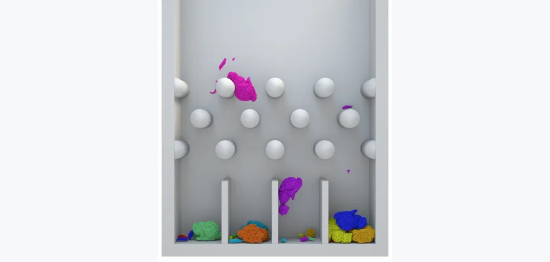 arXiv 2026-10-29 · cs.GR · #1 **[Total Deformation-based MPM for Perfectly Elastic Solid Simulation with Strong Deformations](https://arxiv.org/abs/2610.36945)** Timna Böttcher , Rick Ridder , Jan Bender 机构：RWTH Aachen University（[PDF](https://arxiv.org/pdf/2610.36945)） [Paper](https://arxiv.org/abs/2610.36945) · [图源](https://arxiv.org/html/2610.36945v1/BunnyGalton_MPM_255_HR.png) 

中文摘要
我们提出一种用于完全弹性固体的新型 MPM 求解器，可从大形变中恢复，并自然处理接触。典型 MPM 即使未在弹性模型中加入塑性，也会出现物体断裂的数值破裂。先前方法通过在参考构型的固定网格上计算力解决这一问题，却难与标准碰撞处理兼容。我们的方法仍在当前网格计算弹性力，在避免数值破裂的同时便于加入 MPM 常用的网格碰撞处理。我们还直接从粒子位置与固定参考网格计算形变，无需基于速度梯度更新，因此可加入粒子级碰撞处理与零能模式抑制，减轻非线性形变伪影。结果能够高效模拟弹性物体在接触下发生大形变的复杂场景。 <a href="https://arxiv.org/abs/2610.36945">原摘要来源</a>
 | 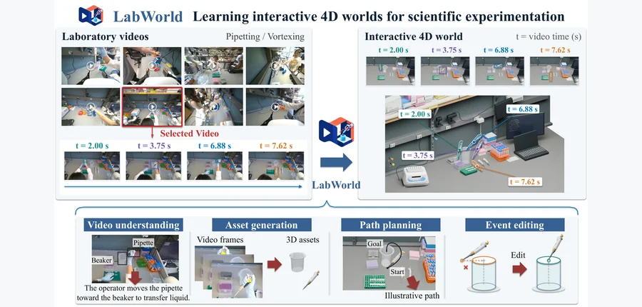 arXiv 2026-10-29 · cs.CV · #2 **[LabWorld: Learning Interactive 4D Worlds for Scientific Experimentation](https://arxiv.org/abs/2610.36592)** Suozhi Huang , Kelsey Fu , Binxu Li , Luna Lyu , Kaize Wu , Wenbo Lu , David Smerkous , Jiahan Li , Siqi Zhu , Zhizhou Sha… 机构：Princeton University / Stanford University / University of Chicago / New York University / Oregon State University / University of Illinois Urbana-Champaign / University of Texas at Austin（[PDF](https://arxiv.org/pdf/2610.36592)） [Paper](https://arxiv.org/abs/2610.36592) · [图源](https://arxiv.org/html/2610.36592v1/fig1_zx_new.png) 

中文摘要
自主科学智能体既要推理实验，也要与执行实验的物理环境交互。现有实验室模拟器依赖手工资产与预定义流程，实验视频虽记录真实设备、布局和交互，却将这些信息隐含在像素中。我们提出 LabWorld：从单目 RGB 视频重建可交互四维实验室世界的智能体驱动 Real2Sim 框架，恢复可复用三维资产、度量场景、随时间变化的物体状态及流程事件。多帧观测为资产和场景重建提供互补证据；运动重建结合视觉、几何观测以及编码交互时空要求的事件约束。在实验室采集的移液和涡旋混合视频上，相比通用智能体及专用重建基线，移液的平均 Mask IoU 为 0.501，领先最强基线 0.033；涡旋混合的平均 Tube-Length-Normalized PCK-AUC 为 0.638，领先 0.035。在五段移液视频中，事件条件重建使满足的建模物理约束比例由 14.3%（5/35）升至 100%（35/35）。所得世界把几何、运动、关节和事件作为显式可编辑状态，用于回放、检查及未来的具身科学系统。 <a href="https://arxiv.org/abs/2610.36592">原摘要来源</a>
 | 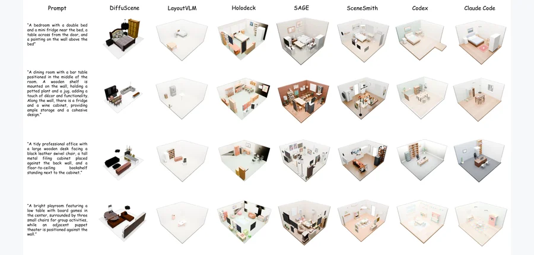 arXiv 2026-10-29 · cs.CV · #3 **[ScIntBench: Physical Interaction Plausibility in 3D Scene Generation](https://arxiv.org/abs/2610.37326)** Wendi Ying , Daochang Liu , Leonid Sigal , Ajmal Saeed Mian 机构：The University of Western Australia / University of British Columbia / Canada CIFAR AI Chair（[PDF](https://arxiv.org/pdf/2610.37326)） [Paper](https://arxiv.org/abs/2610.37326) · [图源](https://arxiv.org/html/2610.37326v1/figure2.png) 

中文摘要
现有文本条件三维室内场景生成评测主要关注语义保真与静止时的物理有效性，对交互时的物理可靠性评估不足。我们提出以交互就绪性为中心的统一基准 ScIntBench：在物理仿真中执行规定的推动、打开和表面探测等操作，并测量任务成功、能力与进度、交互后完整性及动态合理性；多视角语义和静态物理评测用于补充并解释交互结果。我们在 10 类房间中系统评估 12 个先进场景生成系统。结果显示，语义和静态物理表现强并不保证交互就绪：一个静态合理性近乎完美的系统只完成 11.54% 的交互；12 个系统中有 7 个生成的场景无法支持任何交互；最好系统也仅在 36.92% 的规定任务中成功。生成可交互场景的关键挑战是提供必要的物理交互能力，并在主动操作下保持可靠物理行为。 <a href="https://arxiv.org/abs/2610.37326">原摘要来源</a>
 |
| 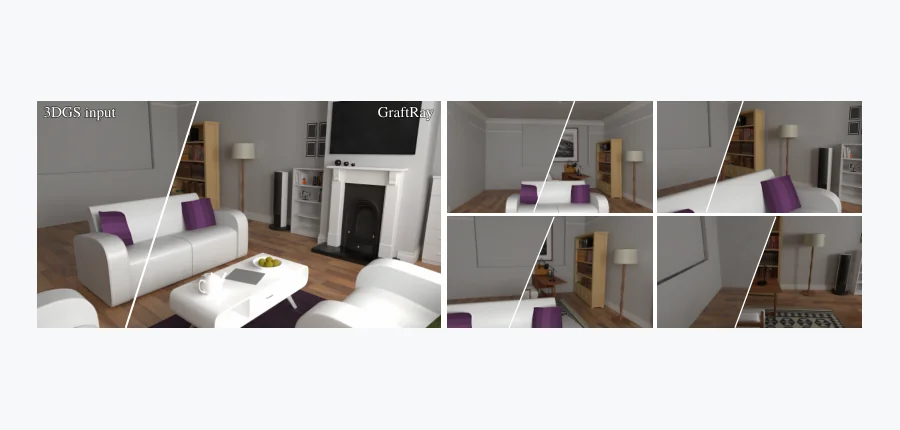 arXiv 2026-10-29 · cs.CV · #4 **[GraftRay: Physically Based Mesh Insertion into Gaussian Splatting Scenes via Path Tracing](https://arxiv.org/abs/2610.37036)** Jinxin Ai , Matthias Niessner 机构：Technical University of Munich（[PDF](https://arxiv.org/pdf/2610.37036)） [Paper](https://arxiv.org/abs/2610.37036) · [图源](https://arxiv.org/html/2610.37036v1/fig_teaser_v9.png) 

中文摘要
将虚拟物体插入二维或三维高斯泼溅（2DGS/3DGS）重建的场景，对内容创作、AR 和合成数据很重要；真实插入还要求物体受场景照明，并向场景投下合理阴影。现有方法或在图像空间协调外观而牺牲多视角一致性，或在插入点以环境贴图近似照明，无法表示主导室内照明的窗户、灯具等近场面光源。我们提出 GraftRay，用于把网格物体以物理一致方式插入 2DGS 或 3DGS 室内场景。方法借助扩散先验恢复场景材质和表面法线，显式建模空间扩展的发光体，并闭式求解其辐亮度；混合渲染器联合对场景高斯与插入网格进行路径追踪，得到跨视角一致的明暗、间接反射与软阴影。在 FIPT 上，GraftRay 的渲染保真度和阴影精度优于 ComGS、EAG-PT 等近期基线，同时保持有竞争力的渲染效率。 <a href="https://arxiv.org/abs/2610.37036">原摘要来源</a>
 | 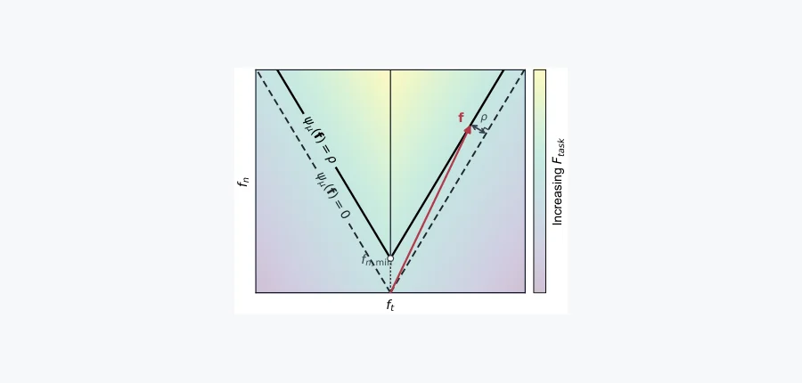 arXiv 2026-10-29 · cs.RO · #5 **[Keeping Contact: Task-Adaptive Friction Margins for Bimanual Non-Prehensile Manipulation](https://arxiv.org/abs/2610.36961)** Qian Ying Lee , Lin Yang , Domenico Campolo 机构：Nanyang Technological University（[PDF](https://arxiv.org/pdf/2610.36961)） [Paper](https://arxiv.org/abs/2610.36961) · [Project](https://keeping-contact.github.io/) · [图源](https://arxiv.org/html/2610.36961v1/friction_cone_full_2d.png) 

中文摘要
非抓持操作要保持接触，仅满足名义摩擦锥可行性并不足够：刚进入锥内与远离锥边界的力都可行，但抗滑动和接触丢失的裕量不同。本文用有符号摩擦距离度量力空间中的摩擦裕量，并由双臂倾斜时平衡枢轴力矩偏差所需的力修正推导任务自适应裕量。该裕量被嵌入一系列二阶锥规划，每个倾角对应全局最优接触力解。优化器使物体绕环境枢轴平衡，同时让机器人和枢轴接触力远离名义摩擦边界。优化结果显示可解释的力重分配及对物体属性变化的适应；真实实验在属性变化和模型失配下成功执行，与固定裕量、无裕量对照说明任务自适应的重要性。这支持有符号摩擦距离作为双臂非抓持操作保持接触的力规划机制。 <a href="https://arxiv.org/abs/2610.36961">原摘要来源</a>
 | 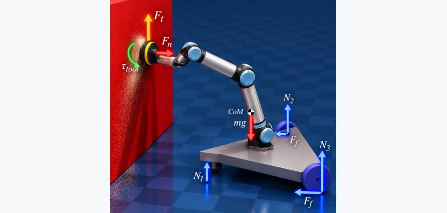 arXiv 2026-10-29 · cs.RO · #6 **[On Shaky Ground: Characterising Non-Rigid Base Effects in Mobile Manipulation](https://arxiv.org/abs/2610.36725)** Zongyuan Zhang , Christopher Lehnert , Will N. Browne , Jonathan M. Roberts 机构：Queensland University of Technology（[PDF](https://arxiv.org/pdf/2610.36725)） [Paper](https://arxiv.org/abs/2610.36725) · [图源](https://arxiv.org/html/2610.36725v1/Figures/hero_figure_crop.jpg) 

中文摘要
移动机械臂能把接触任务扩展到固定机器人工作空间之外，但底座也必须承受任务产生的力。轻量平台的底座运动和支撑柔顺性可能改变工件处实际产生的力与运动，而其持续接触时的表现尚未充分刻画。本文以打磨为案例，结合探索性仿真和两种轻量、无驱动轮式测试平台的实验，研究非刚性底座效应。接触力、工具运动和底座振动的联合测量显示：即使持续接触，也有显著任务误差；在底座与地面阻力低时，100 N 指令只实现 54–70%，工具中心点误差可达 100 mm。接触中增加底座与地面阻力改善力实现并阻止工具继续位移，而测试条件下底座振动与力跟踪误差没有一致关系。结果说明非刚性底座会影响接触任务，并应联合检查力、运动和振动。 <a href="https://arxiv.org/abs/2610.36725">原摘要来源</a>
 |
| 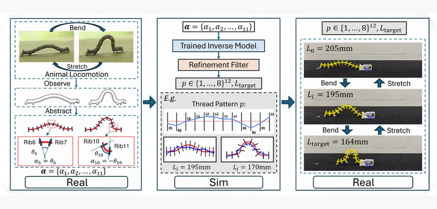 arXiv 2026-10-29 · cs.RO · #7 **[From Biological Curves to Soft Modular Robots: Learning-Based Inverse Design with Uncertainty-Guided Refinement](https://arxiv.org/abs/2610.36681)** Dixiang Wang , Minghao Zha , Arifur Rahman , Yinhong Qin , Yitao Jiang , Shiyang Lu , Zebing Mao , Muhao Chen , Luyang Zhao 机构：affiliation 未确认 [Paper](https://arxiv.org/abs/2610.36681) · [图源](https://arxiv.org/html/2610.36681v1/Figures/Full_frame.png) 

中文摘要
从鳗鱼摆动游泳到尺蠖弓身，动物具有丰富的变形行为；用模块化软体机器人复现这些形状有望形成多用途仿生系统，但目标形状到可行机器人构型的转换很难。已有缆驱模块化软体机器人逆设计依赖昂贵的物理建模与组合搜索。我们提出基于学习的真实到仿真再到真实框架，通过代理辅助逆设计和不确定性引导细化，把生物曲线转换为机器人构型。方法结合学习式逆预测、定向候选探索和快速前向代理模型评估。前向代理把形变预测时间从 1.53×10^5 ms 降至 0.0008 ms，约快 1.9×10^8 倍；逆设计时间从 1.99×10^6 ms 降至 4.18 ms。对来自未见穿线模式的 5,000 个测试样本，代理评估下的形状重建成功率为 93%；四种仿生机器人的实体展示进一步说明曲线可转化为可实现的机器人形状。 <a href="https://arxiv.org/abs/2610.36681">原摘要来源</a>
 | 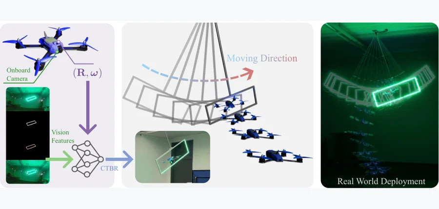 arXiv 2026-10-29 · cs.RO · #8 **[Learning Visuomotor Quadrotor Flight Through Dynamic Narrow Gaps via Differentiable Simulation](https://arxiv.org/abs/2610.37557)** Riccardo Bianco , Yunfan Ren , Jiaxu Xing , Davide Scaramuzza 机构：University of Zurich（[PDF](https://arxiv.org/pdf/2610.37557)） [Paper](https://arxiv.org/abs/2610.37557) · [图源](https://arxiv.org/html/2610.37557v1/test.png) 

中文摘要
让四旋翼穿过运动中的狭窄间隙，需要厘米级空间对齐与精确时序。我们提出直接用机载视觉和惯性测量输出总推力与机体角速度指令的控制策略。由于时序、位置、姿态或可视性的小误差就会碰撞，成功状态只在很窄的可行流形上；先前方法依赖特权状态、教师、规划器或蒸馏。我们构造可微的运动间隙表述：以到时变间隙平面的有符号距离控制居中、对齐和平滑碰撞项，把稀疏穿越事件变为密集路径目标。视觉特征到指令的策略从随机初始化单阶段训练，不用教师、规划器或蒸馏。合成与真实实验中，路径梯度在精度关键任务上明显优于得分函数梯度；单 GPU 训练数分钟后仿真成功率达 99.3%。策略无需适配直接迁移真实四旋翼，在不同初始条件下凭机载传感穿过动态窄缝，10 次实体试验成功率为 80%。 <a href="https://arxiv.org/abs/2610.37557">原摘要来源</a>
 | 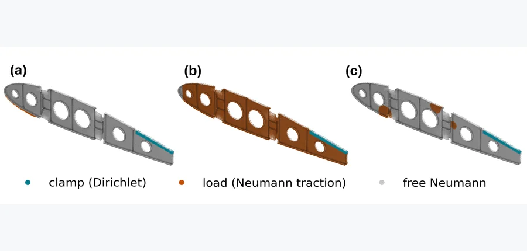 arXiv 2026-10-29 · math.NA · #9 **[AMOR: Adaptive Modal Operator Refinement for Operator Learning on Arbitrary Meshes and Irregular 3D Geometries](https://arxiv.org/abs/2610.37485)** David Voderholzer , Leonard Vetter , Thomas O'Leary-Roseberry 机构：Lawrence Berkeley National Laboratory / ETH Zürich / Karlsruhe Institute of Technology / The Ohio State University（[PDF](https://arxiv.org/pdf/2610.37485)） [Paper](https://arxiv.org/abs/2610.37485) · [图源](https://arxiv.org/html/2610.37485v1/Figures/Aircraft_Rib_v2.png) 

中文摘要
科学工程中的参数化 PDE 常定义在含孔洞或复杂边界的不规则网格上，而 FNO 等常用算子代理依赖结构化几何的快速计算核。我们提出 AMOR，用降维基块替代 FNO 的傅里叶谱卷积，并以统一编解码接口支持数据驱动或预定义输入输出基，因此无需改动即可用于任意网格。其谱参数化不依赖空间维度的张量积，在三维时比谱权重随模态数 m 的三次方增长的 FNO 更有利；我们证明它是连续算子的通用逼近器。二维结构网格上，它整体与 FNO 竞争并优于 PCANet：非线性扩散和 Helmholtz 更好，但静态快照基使其在时变 Kolmogorov 流上不及 FNO。三维线性弹性静力学中，它以较低推理成本达到或超过 FNO 精度；湍流盖驱腔流则落后。在不规则网格上，相比 Geo-FNO，机翼和弹性问题相对 L² 误差分别降低 31% 和 42%。在拓扑非平凡的三维飞机肋骨网格上，三种物理载荷条件下也保持良好表现。 <a href="https://arxiv.org/abs/2610.37485">原摘要来源</a>
 |
| 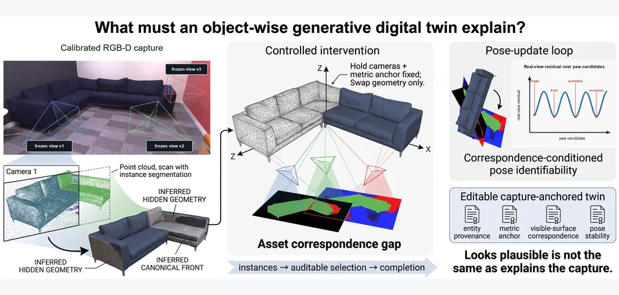 arXiv 2026-10-29 · cs.CV · #10 **[ObjectTwin: Measuring the Asset Correspondence Gap for Capture-Anchored Digital Twins](https://arxiv.org/abs/2610.35904)** Zhenghe Guo 机构：Zhejiang University（[PDF](https://arxiv.org/pdf/2610.35904)） [Paper](https://arxiv.org/abs/2610.35904) · [图源](https://arxiv.org/html/2610.35904v1/figures/asset_correspondence_motivation.png) 

中文摘要
物体级重建越来越多地把生成网格插入已捕获场景，作为观测物体的可编辑替身；这要求在捕获时的度量状态下，替身复现同一实例的校准观测，而现有独立资产分数和位姿估计没有衡量这一点。我们提出 ObjectTwin，一种以扫描为依据的测量协议：固定实例、相机、扫描投影的可见支撑、记录深度、度量锚点和评估分母，只替换物体表示。由此定义的资产对应差距，是生成物体相对扫描可见几何损失的观测一致性，并不把扫描视为完整物理真值。在两个室内 RGB-D 捕获域和两个生成后端上，生成资产即使可见且已锚定，替换后 MaskIoU 仍下降 0.302–0.497。所有测试的场景级估计均为正，同输入的生成器偏好则会随捕获域反转。覆盖率和重叠深度分析定位了可见支撑与表面位置的差异；所测保守位姿优化不能系统性恢复一致性。结果确立捕获对应性为生成资产质量与更强物理或任务评测之间可单独测量的接口。 <a href="https://arxiv.org/abs/2610.35904">原摘要来源</a>
 | 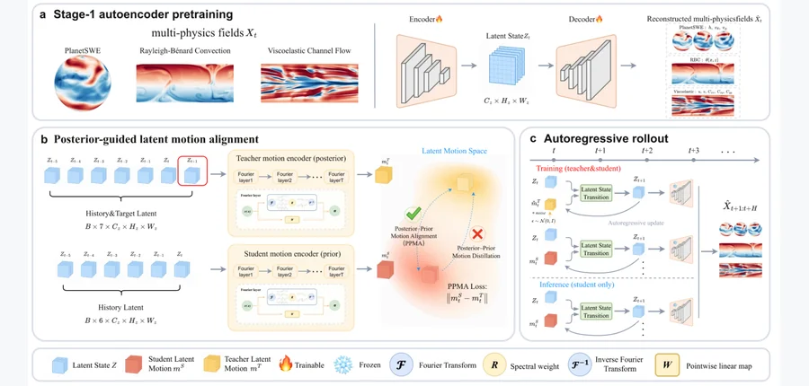 arXiv 2026-10-29 · physics.flu-dyn · #11 **[FAMIR: Future-aligned latent dynamics for complex-flow forecasting](https://arxiv.org/abs/2610.36515)** Yuxuan Chen , Yan Wang , Haotian Cheng , Hongna Zhang , Wenhua Zhang , Yuke Li , Xiaobin Li , Fengchen Li 机构：Tianjin University / Yangtze University / Harbin Engineering University（[PDF](https://arxiv.org/pdf/2610.36515)） [Paper](https://arxiv.org/abs/2610.36515) · [图源](https://arxiv.org/html/2610.36515v1/framework_author.png) 

中文摘要
学习式流动代理会递归使用自身预测，因而相位、幅度与输运误差逐步累积；训练时却已知真实的下一状态。我们提出 FAMIR，用已实现的未来状态塑造驱动更新的信号，而非只监督预测状态。在冻结自动编码器的潜在网格上，未来条件教师与仅用历史的学生分别推断运动张量，并共享同一个残差转移。后验—先验运动对齐联合对齐两者；以预测结果馈入的多步目标训练学生自身的滚动过程，部署时只保留学生。在黏弹性通道流、Rayleigh–Bénard 对流和行星浅水流上，相比三个规模相近的直接潜在预测器和延迟嵌入线性参考，FAMIR 在 10 步的完整前缀归一化均方根误差为 1.003%、1.055%、0.620%，20 步为 1.661%、1.683%、1.036%，均更低。黏弹性流的优势在第一步最大，另外两种流随预测跨度增加而增大；40 步预测的涨落剖面和概率密度更接近参考。无教师时运动条件学生已优于直接预测器；浅水流中，预测馈入的滚动训练至关重要，联合对齐明显优于对固定教师蒸馏（1.036% 对 1.874%）。固定状态干预表明更新依赖状态特定的运动，部署学生的单步精度与获知未来的教师相当。 <a href="https://arxiv.org/abs/2610.36515">原摘要来源</a>
 | 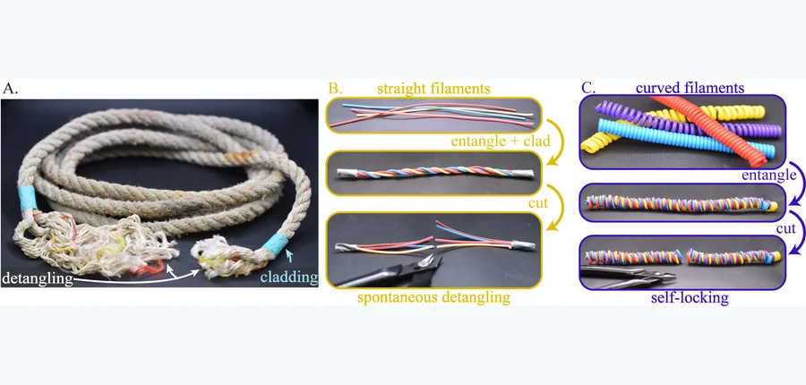 arXiv 2026-10-29 · cond-mat.soft · #12 **[No friction required: Self-locking in entangled assemblies of curved filaments](https://arxiv.org/abs/2610.36330)** Benjamin R. Greenvall , Jay van den Berg , Ross E. Meinhart , Patrick A. Staudenmayer , Alfred J. Crosby , Gregory M. Grason 机构：University of Massachusetts Amherst / Williams College（[PDF](https://arxiv.org/pdf/2610.36330)） [Paper](https://arxiv.org/abs/2610.36330) · [图源](https://arxiv.org/html/2610.36330v1/fig1_combined.png) 

中文摘要
纤维相互缠绕形成绳索、针织物等具有适应性力学性质的结构，但没有成分间吸引键时这些结构如何保持完整，仍是材料科学的基本问题。与绳状结构必须依靠外载和纤维间摩擦防止自发解缠的传统观点不同，我们表明内禀弯曲纤维的集合可仅凭抵抗形状变化的弹力与防止重叠、无牵引的排斥力保持完整。对无摩擦的内禀螺旋纤维集合模型分析显示，纤维数和偏好形状决定拥挤产生的弹性预应力，进而造成自锁缠绕，或通过类孤子解缠前沿自发散开。我们用有摩擦纤维的实验和仿真检验自发解缠的推广断裂判据及形状弹性代价的作用，还发现一类无论摩擦多大都不能自锁的束状结构。这种纯弹性凝聚机制有助于理解更广泛的缠绕结构，并为可受刺激装配与拆解的主动纤维材料提供设计原则。 <a href="https://arxiv.org/abs/2610.36330">原摘要来源</a>
 |
| 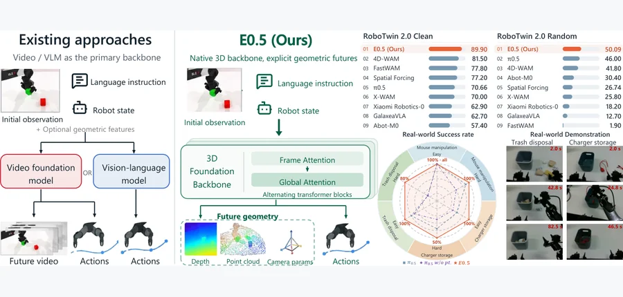 arXiv 2026-10-29 · cs.RO · #13 **[E0.5: From Reconstructive to Future-Predictive 3D Foundations for Robotic World-Action Modeling](https://arxiv.org/abs/2610.36011)** X-Era AI Lab Team : Jianhao Lai , Zhihao Zhan , Zhiquan Liao , Qichang Li , Shubin Chen , Zhiyuan Liu , Hongsen Lei , Jian… 机构：X-Era.AI（[PDF](https://arxiv.org/pdf/2610.36011)） [Paper](https://arxiv.org/abs/2610.36011) · [图源](https://arxiv.org/html/2610.36011v1/overview.png) 

中文摘要
世界动作模型（WAM）通常以视频基础模型或视觉语言模型为主干，即使加入 VGGT 等三维模型提取的几何特征，三维几何仍只是辅助输入或预测目标。我们提出直接建立在三维基础模型上的几何原生世界动作模型 E0.5：以三维模型为世界建模和动作预测的主干表示，并联合预测未来三维状态与动作，以学习几何世界动力学。无需具身数据预训练时，E0.5 在 RoboTwin 2.0 干净和随机化设置的成功率分别为 89.90% 和 50.09%。随后在 AgiBotWorld-Beta 超过 16 万条机器人轨迹上联合预训练动作与未来几何，使 AgileX Piper 和 Zerith H1 的真实操作平均成功率分别提高约 15 和 7 个百分点。结果显示几何原生基础模型有望获取机器人交互知识并迁移到实体操作；E0.5 属于 VWA 世界动作模型家族。 <a href="https://arxiv.org/abs/2610.36011">原摘要来源</a>
 | 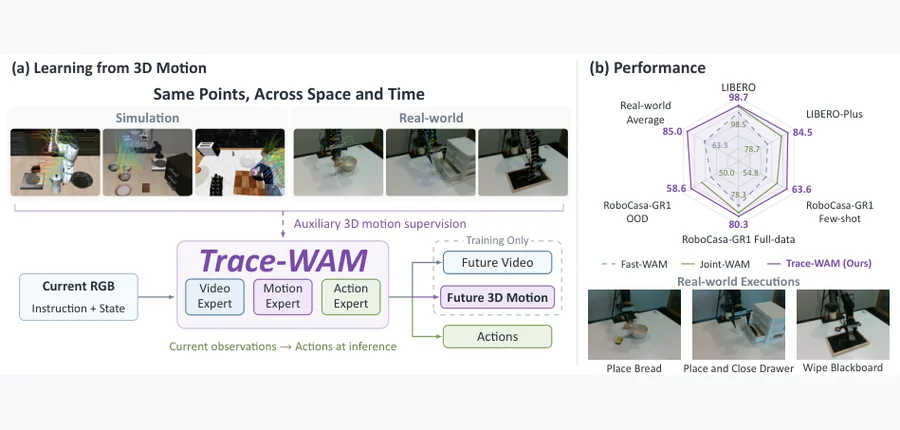 arXiv 2026-10-29 · cs.RO · #14 **[Trace-WAM: Learning to Act via 3D Motion Prediction for World Action Models](https://arxiv.org/abs/2610.36840)** Xu Hu , Changjie Wu , Linzhe Shi , Hang Zhang , Chen Yang , Lingjun Zhang , Guowen Zhang , Mu Xu , Junran Peng , Qing Li… 机构：The Hong Kong Polytechnic University / Amap, Alibaba Group / Tsinghua University / Chinese Academy of Sciences / University of Science and Technology Beijing（[PDF](https://arxiv.org/pdf/2610.36840)） [Paper](https://arxiv.org/abs/2610.36840) · [图源](https://arxiv.org/html/2610.36840v1/motionwam_teaser.png) 

中文摘要
世界动作模型通过联合预测未来视觉与动作学习机器人控制表示，但操作主要依赖机器人及相关物体的变化，而未来视频还要重建整个场景的外观与背景。我们提出 Trace-WAM，在视频—动作学习中加入未来三维运动预测辅助目标，同时监督时间点对应、图像平面位移和深度变化，以描述操作中的交互动力学与空间变化。三分支 Mixture-of-Transformer（Tri-MoT）联合学习视频预测、运动预测与动作生成；运动专家从当前视觉特征预测未来轨迹，塑造动作表示。动作专家不消耗预测轨迹，所以推理仍采用当前观测的一次视觉前向传播，再进行动作去噪。RoboCasa-GR1、LIBERO 和 LIBERO-Plus 实验显示较强的同分布表现与分布外泛化，在少示范和分布偏移时相对 Fast-WAM 的收益尤其明显。 <a href="https://arxiv.org/abs/2610.36840">原摘要来源</a>
 | 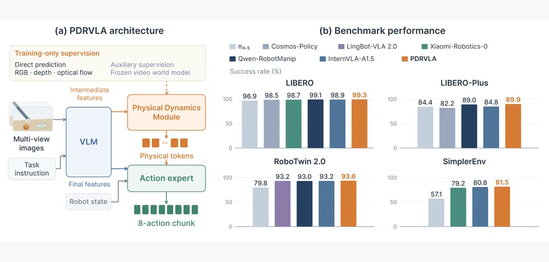 arXiv 2026-10-29 · cs.RO · #15 **[PDRVLA: A Vision-Language-Action Model with Physical Dynamics Representations](https://arxiv.org/abs/2610.37381)** Hanqing Wang , Zhaotian Cai , Ruichuan An , Bohan Zeng , Tao Zhang , Yilin Chen , Xu Jiang , Kaiquan Chen , Chongyang Wu… 机构：Peking University / JD.com（[PDF](https://arxiv.org/pdf/2610.37381)） [Paper](https://arxiv.org/abs/2610.37381) · [图源](https://arxiv.org/html/2610.37381v1/intro_overview_v3.png) 

中文摘要
视觉语言动作（VLA）模型根据视觉与语言生成机器人动作，但物理动力学理解有限；视频世界模型虽能表示场景动力学，在线生成视频却增加控制延迟。我们提出 PDRVLA：轻量 Physical Dynamics Module 从视觉语言特征提取物理 token，以无需在线视频生成的方式条件化动作。模块直接预测未来 RGB、深度和光流特征，并接受冻结的预训练视频世界模型辅助监督。训练完全使用公开数据，借助人到机器人合成、子任务标注和具身思维链（ECoT）标注扩展。在四个仿真基准上，PDRVLA 的成功率分别为 LIBERO 99.3%、LIBERO-Plus 89.9%、RoboTwin 2.0 93.6%、SimplerEnv 81.5%。消融显示世界模型监督改善未来预测，并评估子任务条件、未来物体位姿监督及 ECoT 训练对动作成功的影响。 <a href="https://arxiv.org/abs/2610.37381">原摘要来源</a>
 |
| 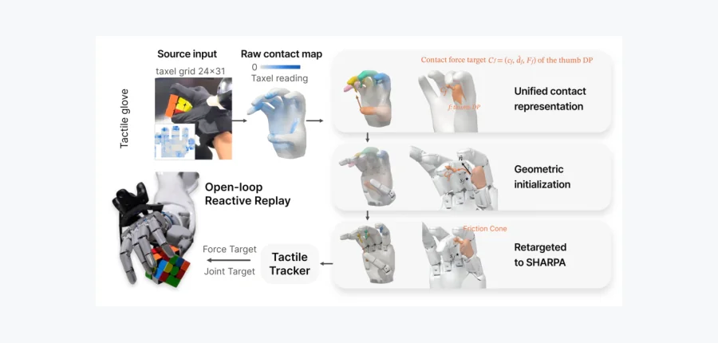 arXiv 2026-10-29 · cs.RO · #16 **[CARD: Contact-Anchored Retargeting for Dexterous Manipulation](https://arxiv.org/abs/2610.36539)** Cunxi Dai , Botao He , Francois R Hogan , Wei Pan , Rao Fu , Wen-Han Hsieh , Ruoshi Liu , Jitendra Malik , Guanya Shi , Ak… 机构：Carnegie Mellon University / Amazon Frontier AI &amp; Robotics / University of Maryland / UC Berkeley（[PDF](https://arxiv.org/pdf/2610.36539)） [Paper](https://arxiv.org/abs/2610.36539) · [图源](https://arxiv.org/html/2610.36539v1/fig_source_data.png) 

中文摘要
传统遥操作、动觉示教和可穿戴外骨骼让人经由机器人本体动作，限制了人类灵巧性的利用；重定向可绕过此限制，但现有方法多只转移运动学，忽略任务成败所需的真实接触动力学。我们提出 CARD，一种无需模拟器和物体模型、以保留接触力目标为核心的人到机器人灵巧操作重定向框架。它用共享的手—接触表示整合视频、动作捕捉和触觉手套数据，在运动学之外生成显式接触力目标；触觉跟踪控制器在硬件开环回放中维持目标。对无触觉的视频，还提出视频到接触模型 Vid-HACO，并报告新的最佳结果。在视频、手套、动捕数据和 GRAB 上，CARD 保持了 43–78% 接触帧的接触，而运动学及物体感知重定向方法分别不到 10% 和 22.5%。将其加入基于物理的重定向后，GRAB 严格任务成功率从 12% 升至 32%；硬件回放表明触觉跟踪对复现示范力十分关键。 <a href="https://arxiv.org/abs/2610.36539">原摘要来源</a>
 | 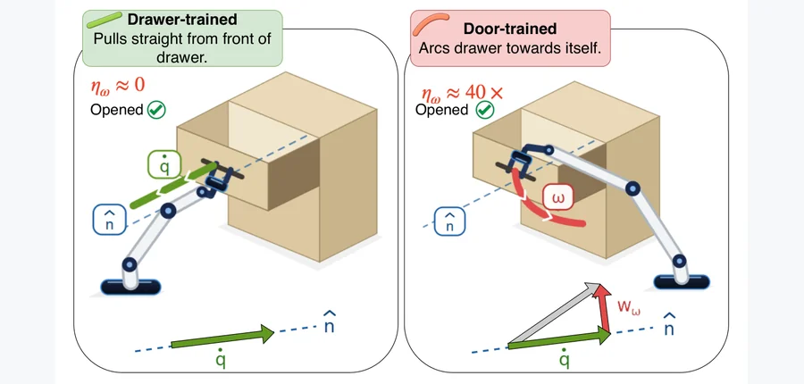 arXiv 2026-10-29 · cs.RO · #17 **[Kinematic Constraint-Referenced Evaluation for Articulated Object Manipulation](https://arxiv.org/abs/2610.37550)** Baptiste Bonin , Caro Strickland , Audrey Durand 机构：Université Laval / Mila / CIFAR（[PDF](https://arxiv.org/pdf/2610.37550)） [Paper](https://arxiv.org/abs/2610.37550) · [图源](https://arxiv.org/html/2610.37550v1/figure-CRS-v2.png) 

中文摘要
机器人操作策略通常按二元任务成功评估，无法判断命令动作是否符合物体关节的运动学约束。我们提出 Constraint-Referenced Strategy（CRS）：把末端执行器的命令扭量投影到物体关节轴，区分沿关节的有效进展与偏离约束的浪费。CRS 需要关节模型及由其推导的关节跟随脚本控制器，不需要记录示范或学习式裁判。对 74 个仿真关节物体，成功率只将三种迁移失败合并为较低数值，CRS 的两个通道则给出各自不同的特征。门上训练的行为克隆策略在 110 次抽屉测试中打开 59 次，但这些成功执行的离轴旋转命令约为抽屉训练策略成功执行时的 40 倍（1.27 对 0.032 rad/s）。以同一关节轴评分的脚本控制器为参照，关节轴误差在 30° 内时 CRS 的判断不变；绝对阈值约能容忍 8°。 <a href="https://arxiv.org/abs/2610.37550">原摘要来源</a>
 | 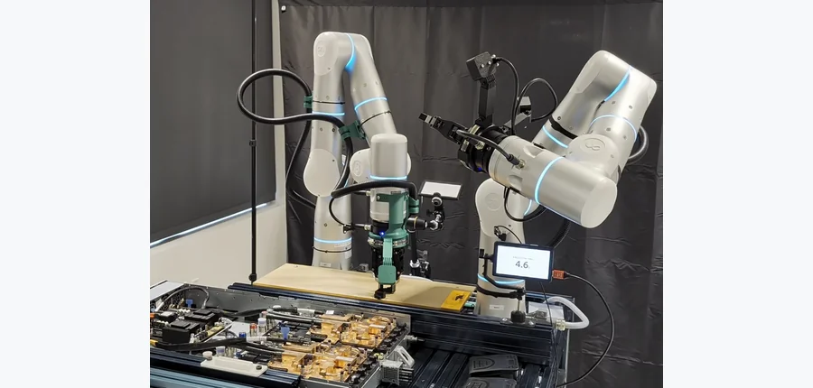 arXiv 2026-10-29 · cs.RO · #18 **[cuArms: GPU-Accelerated Conflict-Based Planning for Multi-Arm Manipulation](https://arxiv.org/abs/2610.36250)** Philip Huang , Fabio Ramos , Jiaoyang Li , Caelan Garrett , Lars Johannsmeier 机构：NVIDIA / Carnegie Mellon University / University of Sydney（[arXiv HTML](https://arxiv.org/html/2610.36250)） [Paper](https://arxiv.org/abs/2610.36250) · [Project](https://cuarms.github.io/) · [图源](https://arxiv.org/html/2610.36250v1/figs/results/gb300_handover_pick_crop.png) 

中文摘要
多臂操作有望提高吞吐、效率和灵巧性，但现有共享工作单元中的任务分配、调度、联合运动规划或学习策略往往过慢、依赖领域假设，或难随机器人数量及任务时长扩展。我们提出 cuArms，一种与 GPU 并行性共同设计的基于冲突的规划器：利用各机器人的可复用多模态路网分解搜索空间，并通过惰性搜索解决冲突与死锁。高层调度器提出候选任务骨架，再由 cuArms 落地为协调操作计划，以联合优化任务分配、日程、运动和操作技能。实验显示该方法建立新的最佳表现，可实时得到初始解并持续改善运动质量与调度，且不需要学习方法所需的数日领域专用训练；仿真与真实工业任务有视频。 <a href="https://arxiv.org/abs/2610.36250">原摘要来源</a>
 |
| 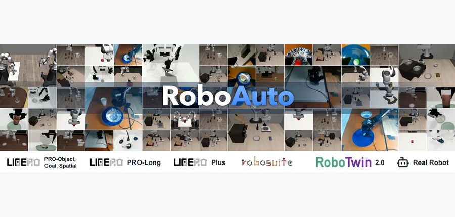 arXiv 2026-10-29 · cs.RO · #19 **[RoboAuto: Autonomous Robot Program Search through Multi-Level Physical Understanding](https://arxiv.org/abs/2610.36533)** Buzhao Liu , Jianing Ye , Xiu Yuan , Yangtong Feng , Chengsong Huang , Tyler Dinh , Yevgeniy Vorobeychik , Ning Zhang , Ch… 机构：Washington University in St. Louis（[PDF](https://arxiv.org/pdf/2610.36533)） [Paper](https://arxiv.org/abs/2610.36533) · [Project](https://roboauto-ai.github.io/) · [图源](https://arxiv.org/html/2610.36533v1/first_teaser.png) 

中文摘要
LLM 自主智能体能反复生成、评估和改进可执行方案；在机器人操作中，Code-as-Policy 让它们搜索模块化、可编辑程序，但有效搜索仍需理解物体如何操作、场景几何如何约束动作以及交互成败原因。我们提出 RoboAuto，以物体、场景和交互三个层次组织物理理解。层级知识库将可执行技能、由具身数据和在线解题学得的物体可供性、空间关系及动作效果结合；场景锚定识别相关物体并解析关键动作量；多阶段规划通过自设计实验检查各阶段预期效果，并主动区分物理假设。五组基准上，RoboAuto 在短程 LIBERO-PRO 的成功率为 89.1%，在 LIBERO-PRO Long 和 LIBERO-Plus 的平均成功率超过 ASPIRE 的两倍；三项需要精细操作的真实机器人长程任务上也超过 ASPIRE 和 π0.5。知识库可跨模拟器和机器人本体迁移，程序搜索表现随其规模提高。 <a href="https://arxiv.org/abs/2610.36533">原摘要来源</a>
 | 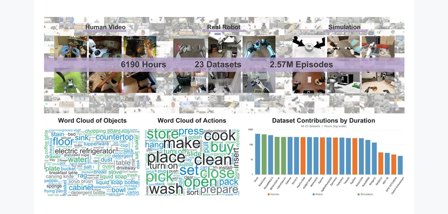 arXiv 2026-10-29 · cs.RO · #20 **[RynnWorld-Latent: A Cross-Embodiment World Model Conditioned on Universal Latent Actions](https://arxiv.org/abs/2610.36791)** Haoyu Zhao , Yinzhou Tang , Zixuan Wang , Minghao Zhu , Dongchi Huang , Xingyue Zhao , Qin Zhao , Kehan Li , Siteng Huang… 机构：DAMO Academy, Alibaba Group / Hong Kong Embodied AI Lab / CUHK / Hupan Lab（[PDF](https://arxiv.org/pdf/2610.36791)） [Paper](https://arxiv.org/abs/2610.36791) · [图源](https://arxiv.org/html/2610.36791v1/world_datasets.png) 

中文摘要
从异构交互视频学习可控世界动力学很难，因为机器人本体的动作空间不兼容，而人类视频没有原生控制标签。我们提出 RynnWorld-Latent，以 RynnLAM 的三维锚定潜在动作为共享条件接口，联合预训练人类交互视频、机器人示范与仿真滚动轨迹，而无需统一原生动作空间。基于预训练视频 Transformer，方法结合全局动作 token 与恒等初始化的局部路径，使动作与未来视频潜变量对齐。在约 5.535 亿帧的 23 个数据集上预训练，再面向目标机器人后训练。它支持两种数据生成路线：数字遥操作用目标机器人指令生成动作—视频示范；潜在动作合成把来源运动转移到编辑后的初始帧，并将结果与重定向的伪机器人动作配对。实验报告公开基准及两个实体平台的视频预测指标改善，相同初始观测下不同动作序列的定性动作跟随；合成数据中期训练提高 LIBERO 和 LIBERO-Plus 的策略成功率，两种路线在测试设置中均优于只用真实示范训练的实体策略。 <a href="https://arxiv.org/abs/2610.36791">原摘要来源</a>
 | 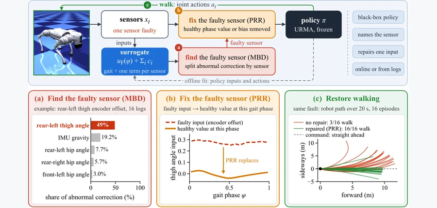 arXiv 2026-10-29 · cs.RO · #21 **[When Black-Box Robot Policies Fail: Online Sensor Diagnosis and Repair with a Transparent Surrogate](https://arxiv.org/abs/2610.36852)** Marc Ziegler , Batu Özen , Sami Mentes , Thomas Waschulzik , Alois Knoll 机构：Technical University of Munich / Siemens Mobility（[PDF](https://arxiv.org/pdf/2610.36852)） [Paper](https://arxiv.org/abs/2610.36852) · [图源](https://arxiv.org/html/2610.36852v1/fig_overview_single_block.png) 

中文摘要
机器人基础模型的动作仍依赖可能失效的传感器；当策略冻结或无法访问内部时，能否从外部诊断并修复受损输入？本文测试一种把周期性步态与传感器相关修正分开的结构化代理模型，用它指导冻结运动策略的输入修复。在仿真 Go2 上，离线诊断将行走成功从 640 次中的 259 次提高到 429 次；在线修复达到 382/640，并且在 64 次保留的无故障测试中未触发。匹配的梯度提升树代理虽同样能预测干净动作，却未检测到高于不修复的改进。Go1 和 ANYmal C 上分别拟合也改善行走，带相位的梯度表现更好。证据仍限于一个策略和部分筛查的仿真故障组；机器人基础模型与硬件验证尚待进行。 <a href="https://arxiv.org/abs/2610.36852">原摘要来源</a>
 |
| 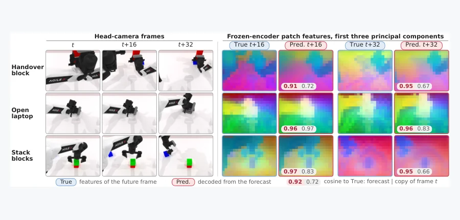 arXiv 2026-10-29 · cs.RO · #22 **[GAWM: A Compact Latent World-Action Model for Multi-Task Robot Manipulation](https://arxiv.org/abs/2610.37091)** Yang Liu , Xiaoli Liu , Liuzhao Li , Yuduo Song , Muyuan Liu , Xiang Gao 机构：Genisom AI（[arXiv HTML](https://arxiv.org/html/2610.37091)） [Paper](https://arxiv.org/abs/2610.37091) · [Code](https://github.com/gaoxiang12/ga-wm) · [图源](https://arxiv.org/html/2610.37091v1/foresight_pca.png) 

中文摘要
世界动作模型通过未来观测预测辅助机器人策略学习，但多数依赖十亿参数级视觉语言或视频生成主干，训练与推理昂贵。本文提出紧凑多任务世界动作模型 GAWM（Geometry-Aware World Model），在冻结的 DINOv3 编码器潜在空间中预测未来观测。它把每个相机视角压缩为少量 token；轻量预测器以任务而非动作为条件，在两个未来时域预测 token，并用未来帧的密集 patch 特征监督，使其编码未来场景的空间布局；动作解码器从当前与预测 token 直接回归未来动作片段。GAWM 少于一亿参数、无需机器人或视频预训练，在 RoboTwin 2.0 上超过十亿参数世界动作模型，在 LIBERO 上与十亿参数 VLA 相当。双臂机器人保留示范中的动作预测误差低于微调十亿参数 VLA，推理延迟也更低。消融表明训练数据或时间有限时，潜在世界模型明显改善表现。 <a href="https://arxiv.org/abs/2610.37091">原摘要来源</a>
 | 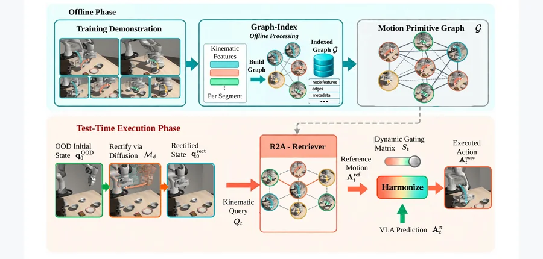 arXiv 2026-10-29 · cs.RO · #23 **[Retrieve to Act: Motion Primitive Graph Retrieval for Robust VLA Execution](https://arxiv.org/abs/2610.37215)** Pham Tri Quang , Bao-Ngoc Dao , Minh Duc Nguyen , Duc-Duy Nguyen , Hung T. Ho , Linh Dang Le , Trong-Bao Ho , Thien-Loc Ha… 机构：VinUniversity / VinRobotics / Hanoi University of Science and Technology / DFKI / University of Oldenburg / University of Arkansas / Technical University of Darmstadt（[arXiv HTML](https://arxiv.org/html/2610.37215)） [Paper](https://arxiv.org/abs/2610.37215) · [Project](https://retrieve2act.github.io/r2a/) · [图源](https://arxiv.org/html/2610.37215v1/R2A_v7.png) 

中文摘要
视觉语言动作（VLA）策略虽有语义泛化能力，执行时却易受分布外视觉变化影响。我们提出 Retrieve to Act（R2A），把分布外稳健性表述为几何运动基元检索问题：离线将成功训练示范组织为时空运动基元图；推理时，依赖查询的图神经网络在图中定位当前执行并检索结构兼容的未来运动基元。可学习的逐维门控把检索到的几何先验与冻结 VLA 的预测动作协调，纠正空间轨迹，同时保留局部反应性。对 GR00T N1.7、π0.5 和 StableVLA 的实验显示多种场景干扰下稳健性提高；LIBERO-Plus、RoboTwin2.0-Plus 仿真基准的绝对成功率最多提高 12 个百分点，真实部署最多提高 40 个百分点，无需微调基础策略。 <a href="https://arxiv.org/abs/2610.37215">原摘要来源</a>
 | 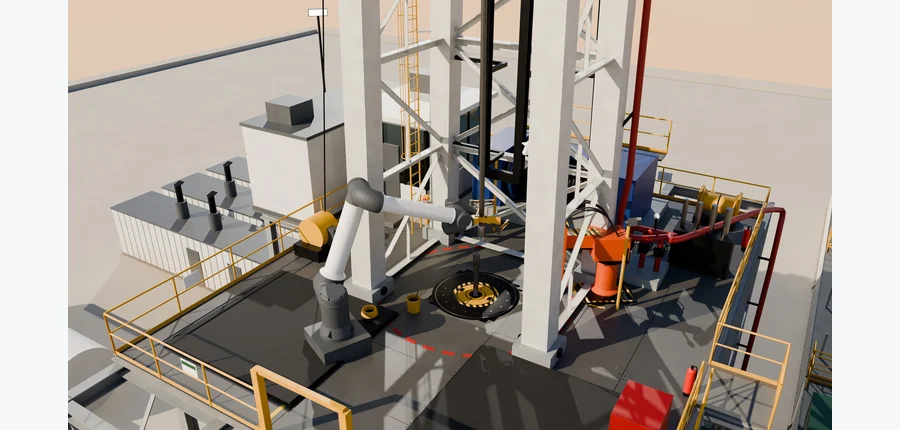 arXiv 2026-10-29 · cs.RO · #24 **[Predict the Swing, Match the Speed: Robotic Pipe Stabbing With Learned Stereo Vision and Residual Reinforcement Learning](https://arxiv.org/abs/2610.37535)** Mohamed Ashraf Mostafa , Taher El-Fakharany , Samir Khaled 机构：Al-Azhar University / Future University in Egypt（[PDF](https://arxiv.org/pdf/2610.37535)） [Paper](https://arxiv.org/abs/2610.37535) · [图源](https://arxiv.org/html/2610.37535v1/fig/rig_overview.jpg) 

中文摘要
将管节接入井口时，悬吊管道会摆动并以相应速度撞击固定导向器。机器人系统 StabBot 预测摆动并匹配管道速度：由管柱参数调节的摆锤卡尔曼滤波器在双目图像中跟踪管节；六轴机械臂以开放 V 形滚轮头同速接近，通过触碰确认最后几毫米，针对偏心悬吊对准销端，并随管道下放保持侧向柔顺。ResNet-18 关键点网络在三维中定位管、销端和接箍口，残差强化学习策略细化捕获。在 200 组成对随机任务、九种从 2-3/8 英寸油管到 20 英寸套管的规格中，StabBot 全部接入且管道只接触滚轮；传统固定导向器成功率为 74%。接触速度中位数由 18.4 降至 2.3 cm/s，峰值头—管力中位数由 11.3 降至 1.4 kN，200 次中力都更低（Wilcoxon p&lt;10^-30）。网络在每双目帧 2.3 ms 内以 0.4 mm 中位误差定位管道；加入 20 mm 噪声、300 ms 延迟、85% 丢帧、20 mm 标定偏差、20 cm 悬吊偏移和 40 cm 摆动时仍保持 100% 成功。所有结果来自四分之一 Froude 缩尺的 MuJoCo 模型，并按全尺度报告。 <a href="https://arxiv.org/abs/2610.37535">原摘要来源</a>
 |
| 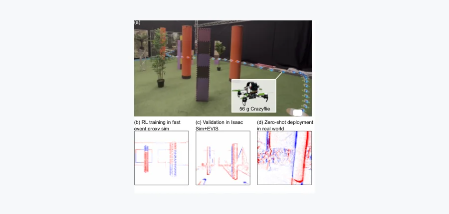 arXiv 2026-10-29 · cs.RO · #25 **[Rendering-Free Event Frame Simulation for Fast Reinforcement Learning of Autonomous Robot Navigation](https://arxiv.org/abs/2610.37543)** Dequan Ou , Austin Lopez , Quentin Missinne , Christophe De Wagter , Guido C.H.E. de Croon 机构：Delft University of Technology（[arXiv HTML](https://arxiv.org/html/2610.37543)） [Paper](https://arxiv.org/abs/2610.37543) · [Code](https://github.com/tudelft/rendering-free-event-nav) · [图源](https://arxiv.org/html/2610.37543v1/figure1_paper_v3.png) 

中文摘要
事件相机低延迟、高动态范围且只耗毫瓦级功率，适合在障碍密集环境中飞行的小型无人机；但现有模拟器通常先渲染真实感图像再转换为事件，使大规模强化学习很慢。我们提出解析事件模拟器，依据事件相机测量的运动对比边缘，直接从场景几何和自运动合成事件流，无需视觉渲染。单 GPU 生成一帧 64×64 事件观测需 17 微秒，比先进渲染流水线快 400 多倍，使目标导向避障的端到端强化学习在 30 分钟内收敛，训练速度比渲染事件快三个数量级。策略零样本迁移到基于物理的光线追踪 Isaac Sim 事件模拟；在训练中未见的中等难度拥挤路线（可通行概率约 0.57）上以平均 2.4 m/s 目标速度达到 83% 成功率，模拟纹理密集室内厅堂中为 70%。策略量化为 1.2 MB int8 网络，在搭载 Prophesee GenX320 事件相机及 OpenMV N6 微控制器的 56 克 Crazyflie 上完全机载运行。无需微调、外部处理或定位，三条真实障碍路线分别完成 5/5、5/6、4/6 次飞行，平均成功率 82%。 <a href="https://arxiv.org/abs/2610.37543">原摘要来源</a>
 | 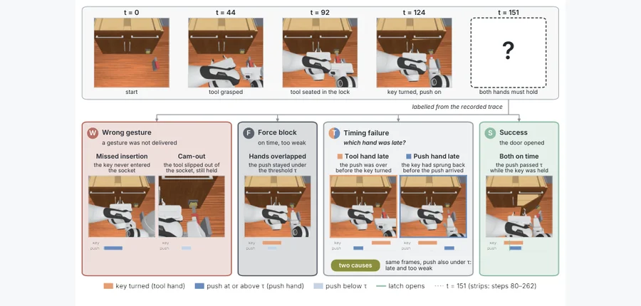 arXiv 2026-10-29 · cs.RO · #26 **[Which Hand Was Late? Diagnosis for Robot Failure Recovery in Bimanual Tool Use](https://arxiv.org/abs/2610.37533)** Baptiste Bonin , Caro Strickland , Audrey Durand 机构：Université Laval / Mila / CIFAR（[PDF](https://arxiv.org/pdf/2610.37533)） [Paper](https://arxiv.org/abs/2610.37533) · [图源](https://arxiv.org/html/2610.37533v1/overview.png) 

中文摘要
机器人操作故障诊断越来越多使用视觉语言模型，通常在单臂、由成功示范扰动形成的故障上训练评测；双臂工具使用还会发生工具仍被握住却脱离插口、两只手动作都正确但时序不一致，以及同时由多个原因造成失败。本文在一个仿真双臂工具任务中，以记录轨迹读取真实故障原因，测量不同传感通道可识别哪些原因：工具滑脱可由工具手判断，哪只手迟到需两臂信息；单手传感器只能读自己的延迟及另一手的部分信息；当工具手迟到时，被动感知无法判断此次失败是否还因推力过弱。在两次尝试内，遇不可识别原因就升级的修复策略，修复故障数与获知真实原因的策略相同。VLM 内部状态几乎完美携带迟到手的信息，但回答是否报告它取决于提问措辞；携带信息的方向并不比随机方向更接近答案读取方向。 <a href="https://arxiv.org/abs/2610.37533">原摘要来源</a>
 | 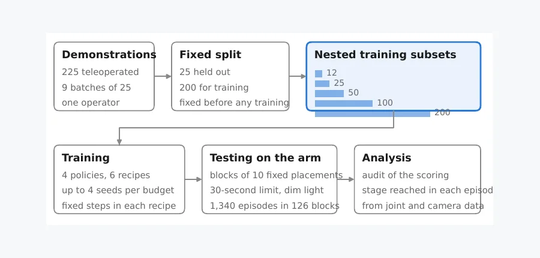 arXiv 2026-10-29 · cs.RO · #27 **[From 12 to 200 Demonstrations: How ACT, Diffusion Policy, SmolVLA and π0.5 Scale on a Low-Cost Arm](https://arxiv.org/abs/2610.37170)** Simon Cowling 机构：fysical.ai（[PDF](https://arxiv.org/pdf/2610.37170)） [Paper](https://arxiv.org/abs/2610.37170) · [图源](https://arxiv.org/pdf/2610.37170) 

中文摘要
我们以一项含干扰物的拾放任务，分别用 12、25、50、100 和 200 条嵌套遥操作示范训练 ACT、Diffusion Policy、SmolVLA 和 π0.5，每种策略采用固定训练方案；所有模型在实体 SO-101 手臂的固定物体摆放上测试，共 126 组、1,340 次评分回合。从零训练的 ACT 由 12 条示范时 40 次中成功 1 次，升至 100 条时成功 37 次。动作专家微调的 π0.5 在少数据时最好，12 条为 16/40、25 条为 28/40，之后维持约 70%；100 条以上 ACT 领先，但本研究未充分确定差距。SmolVLA 和 Diffusion Policy 的峰值约 50%，并受不启动问题影响：SmolVLA 有 47% 回合机械臂不动；Diffusion Policy 在裁去示范开头的静止段前也几乎不启动。对 π0.5，微调方案比数据量更重要：LoRA 成功 4/110，动作专家微调为 130/200。按启动、触球、搬运和送达四阶段分析，ACT 随数据增加的失败从接近转到抓取再到消失，π0.5 剩余失败集中在抓取。十回合组的测量噪声很大，同一检查点两次测试平均差 2/10；研究还分离随机种子差异、核对人工评分。各方案训练长度固定，数据量和数据被看到的次数共同变化，结论按这一混杂因素加以限定。 <a href="https://arxiv.org/abs/2610.37170">原摘要来源</a>
 |
| 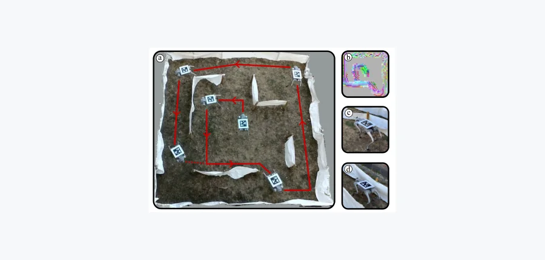 arXiv 2026-10-29 · cs.RO · #28 **[Remember Where You Walk: Learning Spatial Memory for End-to-End Legged Robot Exploration](https://arxiv.org/abs/2610.37203)** Leon Magnus , Nico Bohlinger , Jan Peters , Oleg Arenz 机构：Technical University of Darmstadt / Robotics Institute Germany / DFKI / hessian.AI（[PDF](https://arxiv.org/pdf/2610.37203)） [Paper](https://arxiv.org/abs/2610.37203) · [图源](https://arxiv.org/html/2610.37203v1/real_figure.png) 

中文摘要
人形及其他足式机器人在复杂环境中，需要记住已离开视野、很久后才有用的信息。端到端强化学习常用 LSTM 等记忆网络，但长时段信息保留不足。我们提出面向机器人导航、基于 Hadamard 记忆的 Local Spatial Matrix Memory（LSMM），让智能体在按位置索引的记忆单元存储通用任务相关信息，实现灵活且有空间锚定的记忆。自主迷宫探索中，LSMM 的覆盖率与强循环网络和有限历史基线相当，但它是唯一记住迷宫布局的架构，布局重建误差降低到三分之一。 <a href="https://arxiv.org/abs/2610.37203">原摘要来源</a>
 | 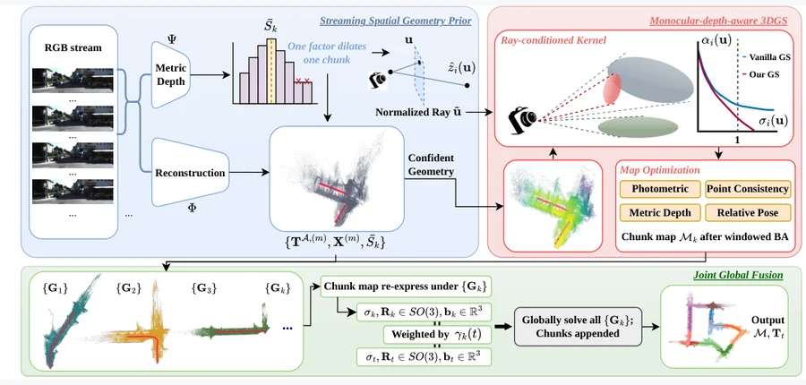 arXiv 2026-10-29 · cs.RO · #29 **[SG^2SLAM: Spatial Geometry-Informed 3D Gaussian Splatting SLAM for Monocular Outdoor Navigation](https://arxiv.org/abs/2610.36312)** Ziang Guo , Didar Seyidov , Yixiao Zhou , Xuefeng Zhang , Ali Alridha Abdulkarim , Chen Min , Zufeng Zhang , Dzmitry Tsets… 机构：Skolkovo Institute of Science and Technology / Chinese Academy of Sciences / The University of Hong Kong / Tsinghua University（[PDF](https://arxiv.org/pdf/2610.36312)） [Paper](https://arxiv.org/abs/2610.36312) · [图源](https://arxiv.org/html/2610.36312v1/Diagram.png) 

中文摘要
单目室外导航需要稳健相机位姿估计和致密可通行地图；3DGS SLAM 以显式可微参数化与闭式投影支持这一任务。然而典型系统依赖二维像素到三维点的关联恢复几何，模块化 SLAM 容易将跟踪误差吸收到地图，造成级联退化。我们提出 SG²SLAM，把流式空间几何与射线条件 3DGS 核耦合：流式空间几何用片段级度量先验替代逐帧跨维对应，从同一来源监督跟踪与建图；射线条件核为每个基元加入感知单目视角的观察方向子空间。空间几何和位姿联合优化，以获得全局一致的地图与轨迹。在 KITTI 和 Waymo Open 的单目室外导航实验中，SG²SLAM 超过逐帧关联基线；代码将在论文获接收后公开。 <a href="https://arxiv.org/abs/2610.36312">原摘要来源</a>
 |  arXiv 2026-10-29 · cs.RO · #30 **[Rollback: Experience Backtracking in World Models for Policy Improvement](https://arxiv.org/abs/2610.36068)** Jiayi Luo , Yang Zhang , Liliang Chen , Nan Wang , Chen Gao , Boxiang Qiu , Zhuoxuan Li , Baorui Peng , Chuankang Li , Yux… 机构：AgiBot / Beihang University / National University of Singapore（[PDF](https://arxiv.org/pdf/2610.36068)） [Paper](https://arxiv.org/abs/2610.36068) · [图源](https://arxiv.org/html/2610.36068v1/teaser.png) 

中文摘要
动作条件世界模型可减少实体交互来改进机器人策略，但现有方法多把它当成只能正向运行的物理环境替身，未用其回退到过去决策点并探索反事实未来的能力。我们提出 Rollback：回退关键决策点、分支尝试替代动作、对比结果，把成功归因到单个决策；只在关键位置想象，并把反事实结果蒸馏成细粒度动作监督，无需另学价值模型。系统结合分布式世界模型搜索与异步真实机器人执行，让实体经验持续校正世界模型，世界模型再改进策略。作者将模型侧称为测试时物理锚定：世界模型充当训练环境，受它训练的策略产生的真实转移又经轻量 LoRA 流程修正其动力学。三项真实任务中，相对最强基线，取出积木、投球和桌面冰壶的成功率绝对提高 10.67%、11.11% 和 11.85%，训练过程也更稳定。尽管初始遥操作示范表现远低于人类，8 小时训练后投球与桌面冰壶的平均成功率超过人类参与者。 <a href="https://arxiv.org/abs/2610.36068">原摘要来源</a>
 |
| 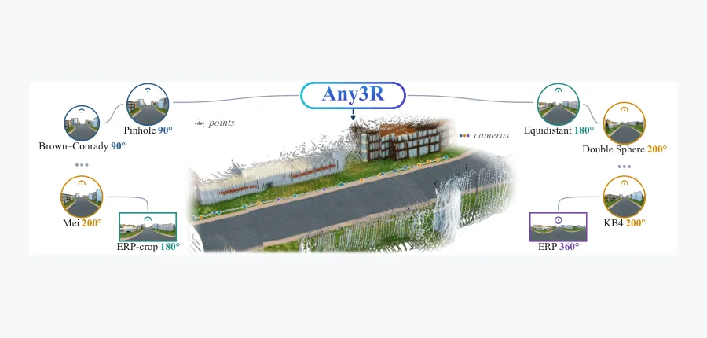 arXiv 2026-10-29 · cs.CV · #31 **[Any3R: Feedforward 3D Reconstruction from Any Camera Type](https://arxiv.org/abs/2610.36150)** Jingong Chen , Qingwen Zhang , Youming Deng , Chulwoo Pack , Olaf Wysocki , Boris Jutzi , Kwanghee Won , Kyle Gao 机构：South Dakota State University / Aalto University / KTH Royal Institute of Technology / Cornell University / University of Cambridge / Karlsruhe Institute of Technology（[PDF](https://arxiv.org/pdf/2610.36150)） [Paper](https://arxiv.org/abs/2610.36150) · [图源](https://arxiv.org/html/2610.36150v1/any3r_teaser.png) 

中文摘要
前馈几何基础模型可从图像集恢复相机位姿和稠密几何，但通常假设针孔成像；位置编码和训练损失都把像素位置绑定到空间方向，依赖镜头模型。我们用每像素单位方向构成的稠密射线场同时条件化两者，它描述任意中心相机，无需镜头类型、畸变系数或视场上限。角坐标为每个视角的旋转位置编码提供实际射线夹角，立体角权重按像素在球面覆盖面积缩放点损失，使编码与监督均不依赖镜头。Any3R 因此能前馈处理各种中心相机，并在场景中混合多种相机类型，无需逐镜头重新训练。对来自三个数据集的 13 种中心相机，在各方法都用自身预测位姿重建的基准上，Any3R 的准确性最稳定；它可用于异构众包和历史影像的规模化三维重建。 <a href="https://arxiv.org/abs/2610.36150">原摘要来源</a>
 | 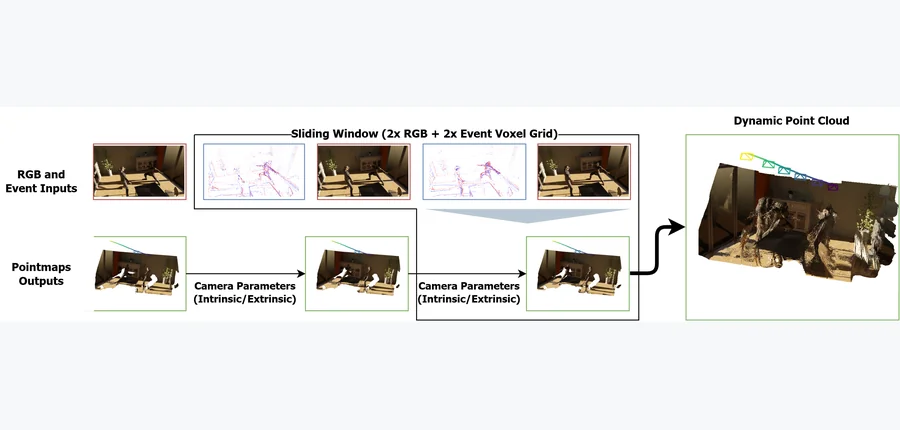 arXiv 2026-10-29 · cs.CV · #32 **[4D Reconstruction with Events &amp; RGB](https://arxiv.org/abs/2610.36610)** Dulanga Weerakoon , Darshana Rathnayake , Van Minh Do , Hemanth Sabbella , Kaichen Zhou , Fangneng Zhan , Alok Prakash , S… 机构：Singapore-MIT Alliance for Research &amp; Technology / Massachusetts Institute of Technology / Singapore Management University（[PDF](https://arxiv.org/pdf/2610.36610)） [Paper](https://arxiv.org/abs/2610.36610) · [图源](https://arxiv.org/html/2610.36610v1/images/Event4D_teaser.png) 

中文摘要
单个移动相机的动态三维场景随时间重建（4D）对机器人和 AR/VR 很重要，但先进前馈方法只用 RGB 帧，易受快速或非均匀相机与物体运动下的模糊、时间混叠影响。事件相机以微秒分辨率异步报告像素亮度变化，可补充 RGB；能否少改架构地加入现有流水线尚不清楚。本文是初步研究：给 RGB 版 4D 重建模型 Monst3R 增加一个事件输入分支，其余架构不变。三个基准数据集上，简单 RGB—事件融合相对 RGB 单模态平均降低 Abs Rel 3.4%；敏感性分析显示运动越大收益越明显，物体高速运动且 RGB 重建最差时增益最大。这些早期结果提示轻量、非侵入式事件融合可改善 4D 重建稳健性，未来仍需更全面的架构研究。 <a href="https://arxiv.org/abs/2610.36610">原摘要来源</a>
 | 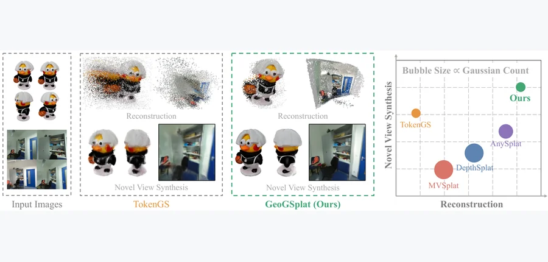 arXiv 2026-10-29 · cs.CV · #33 **[GeoGSplat: Geometry-Grounded Non-Pixel-Aligned Gaussian Splatting](https://arxiv.org/abs/2610.36760)** Jiale Wang , Chen Zhao , Haoyang Zhang , Yanhao Wu , Fei He , Yanhu Shan , Rui Wu , Wei Ke , Tong Zhang 机构：Xi’an Jiaotong University / EPFL / Horizon Robotics / University of Chinese Academy of Sciences（[PDF](https://arxiv.org/pdf/2610.36760)） [Paper](https://arxiv.org/abs/2610.36760) · [Project](https://comedy0913.github.io/projects/geogsplat/) · [图源](https://arxiv.org/html/2610.36760v1/fig_1.png) 

中文摘要
前馈高斯泼溅能高效新视角合成，但像素对齐预测使基元数随图像分辨率和视角数增加，带来冗余与计算开销。非像素对齐方法固定高斯数目，却因缺少显式射线和深度约束而错放中心，在大视角变化下产生伪影。我们提出几何锚定的非像素对齐前馈模型 GeoGSplat：双分支编码器构造 Anchor 和 Triplane，分别捕获粗三维结构与细场景特征；层级解码器逐步解码稠密三维点和高斯基元，支持三维重建与新视角合成。在 DTU 和 NRGBD 上，GeoGSplat 的两项任务均超过先进的像素对齐和非像素对齐方法；目标视角越远离输入相机，其几何锚定优势越明显。 <a href="https://arxiv.org/abs/2610.36760">原摘要来源</a>
 |
| 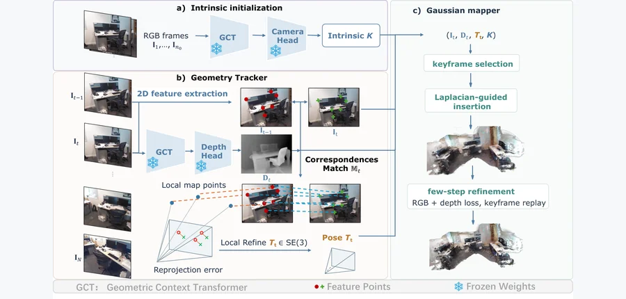 arXiv 2026-10-29 · cs.CV · #34 **[LingGS: Decoupling Feed-Forward Geometry Prediction from Camera Tracking for High-Fidelity Gaussian SLAM](https://arxiv.org/abs/2610.36853)** Da Li , Yihan Zang , Ivan Viola , Zeyu Wang , Dominik Engel 机构：King Abdullah University of Science and Technology / Hong Kong University of Science and Technology (Guangzhou)（[PDF](https://arxiv.org/pdf/2610.36853)） [Paper](https://arxiv.org/abs/2610.36853) · [图源](https://arxiv.org/html/2610.36853v1/overview.png) 

中文摘要
单目 RGB 高斯 SLAM 在有限优化预算下，难以同时实现高质量重建和及时相机跟踪。我们提出在线系统，将学习到的几何先验与显式几何相机跟踪结合；后者的跟踪精度可显著超过学习式相机预测。冻结的流式三维基础模型充当虚拟 RGB-D 传感器，从单目视频估计深度；显式几何求解器用特征重投影估计相机运动；流式高斯建图器把观测整合为致密场景表示。不同流式几何主干上的测试表明几何跟踪均提高位姿精度。室内与室外数据集实验中，重建质量优于已有方法；单张 RTX 4090 上约 7 FPS，吞吐为所测先前 SLAM 系统的 2–3 倍。 <a href="https://arxiv.org/abs/2610.36853">原摘要来源</a>
 | 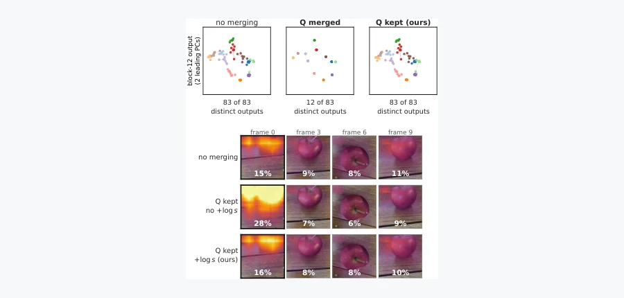 arXiv 2026-10-29 · cs.CV · #35 **[GPA-VGGT: Geometry-Preserving Acceleration of VGGT](https://arxiv.org/abs/2610.37000)** Muyeol Sung , Jangwon Kim , Jongwoo Lim 机构：Seoul National University（[PDF](https://arxiv.org/pdf/2610.37000)） [Paper](https://arxiv.org/abs/2610.37000) · [图源](https://arxiv.org/html/2610.37000v1/query.png) 

中文摘要
VGGT 等前馈几何模型可一次前向传播从一个到数百个视角恢复相机参数、深度图和点图，但全局注意力随帧数呈二次增长，主导长序列运行时间。已有免训练 token 合并加速常牺牲精度。我们提出无需训练的 GPA-VGGT：在前几层以帧内注意力加共享跨帧 K/V 替换全局注意力；其余层只合并键和值并保留全部查询，补回合并键代表的 token 注意力权重，再把匹配度量随机投影至 128 维降低匹配成本。在多种多视角几何任务中，GPA-VGGT 达到与既有方法相当的免训练加速，同时保留精确几何估计所需信息；AUC@3 指标下，位姿精度保留 VGGT 的 99% 以上。 <a href="https://arxiv.org/abs/2610.37000">原摘要来源</a>
 |  arXiv 2026-10-29 · cs.CV · #36 **[Learning to Code the World: Harness Evolution for Compositional 3D Reconstruction](https://arxiv.org/abs/2610.37046)** Haoyu Yao , Chenguo Lin , Ruize Du , Yadong Mu 机构：Peking University（[PDF](https://arxiv.org/pdf/2610.37046)） [Paper](https://arxiv.org/abs/2610.37046) · [Project](https://haoyu-agent.github.io/SceneEvolve/) · [图源](https://arxiv.org/html/2610.37046v1/figures/opening.png) 

中文摘要
从真实图像重建可编辑、可组合三维场景，需要联合推断几何、物体结构与空间关系。我们提出 SceneEvolve：用可执行代码表示三维场景，并围绕小型开源智能体演化执行框架。SceneAct 提供由参数化基元、层级组合及语义空间关系组成的组合动作接口；SceneHarness-RSI 利用较强教师智能体，根据开发集重建反馈迭代演化框架。演化期间模型参数、动作语义和执行后端固定。所得可复用流程使小模型无需参数更新或教师协助便能重建未见场景。在两个域内和一个域外数据集上，使用 Qwen3.8-27B 的 SceneEvolve 改善四项重建指标，平均推理时间比基础模型减少 47.0%。作者还报告，相比大型专有 GPT-5.6-Sol，重建质量高 32.3%、等价部署成本低 59.8%；该框架迁移至 Kimi-K3 后，重建表现与 GPT-6-Astra 相当。 <a href="https://arxiv.org/abs/2610.37046">原摘要来源</a>
 |
| 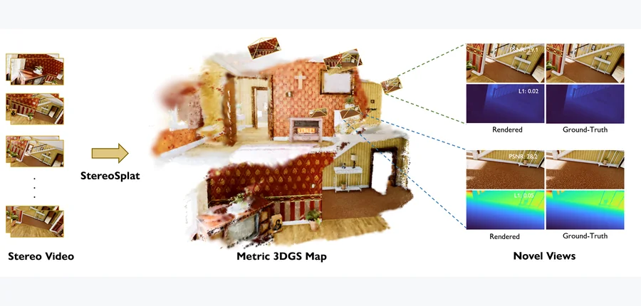 arXiv 2026-10-29 · cs.GR · #37 **[StereoSplat: Metric-Scale Novel View Synthesis via Stereo-Grounded Gaussian Splatting](https://arxiv.org/abs/2610.35902)** Vladimir Yugay , Denis Rozumny , Theo Gevers , Elias Vansteenkiste , Martin R. Oswald , Diogo C. Luvizon 机构：University of Amsterdam / Meta（[arXiv HTML](https://arxiv.org/html/2610.35902)） [Paper](https://arxiv.org/abs/2610.35902) · [图源](https://arxiv.org/html/2610.35902v1/figures/teaser.png) 

中文摘要
我们提出专为双目视频设计的前馈三维高斯泼溅架构 StereoSplat，以实现可靠的度量尺度新视角合成。不同于忽略双目成对性质的单目方法，它从双目基础主干提取多尺度稠密潜特征与视差，交给专用高斯解码器。解码器以跨视角特征融合和门控深度细化，将表示直接转成逐像素三维高斯；可学习的深度自适应聚合在逆深度空间聚类、合并重叠视角中的冗余基元，同时保留细节。方法还提出 XRStereo：包含多种相机架构、匹配真实平台硬件的大规模合成双目视频数据集。模型只用合成数据训练，在多个困难基准上，相比已有方法显著改善渲染新视角的深度精度，同时保持高质量合成；它还能零样本迁移真实双目视频，可用于混合现实、自动驾驶和机器人。 <a href="https://arxiv.org/abs/2610.35902">原摘要来源</a>
 | 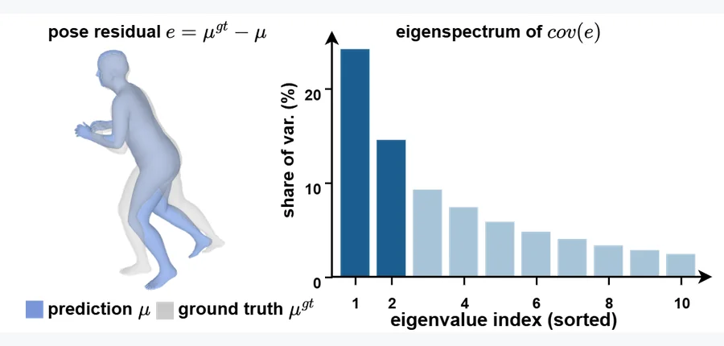 arXiv 2026-10-29 · cs.CV · #38 **[UT-HMR: Uncertainty-Guided Temporal Modeling for Robust 3D Human Mesh Recovery](https://arxiv.org/abs/2610.36203)** Zhibo Wang , Sirisha Rambhatla , Yuhao Chen , Maria Koshkina , David Clausi 机构：University of Waterloo（[PDF](https://arxiv.org/pdf/2610.36203)） [Paper](https://arxiv.org/abs/2610.36203) · [图源](https://arxiv.org/html/2610.36203v1/figs/low_rank_evidence.png) 

中文摘要
单目三维人体网格恢复在远距离、遮挡和运动模糊等弱观测下不可靠，体育场景尤其存在不同三维姿态有相似二维投影的歧义；直接由全图恢复所有人的单阶段方法更甚。我们提出 UT-HMR，据作者所知是首个捕获关节间相关姿态不确定性的单阶段 HMR 框架。每个人物 query 预测完整 SMPL 姿态上的高斯分布，协方差用紧凑低秩加对角形式表示，转为逐关节精度权重实施异方差监督，而推理保持确定性。时间早期融合在姿态解码前引入邻帧证据，以消除不确定性所刻画的歧义。使用轻量 ViT-B 主干，UT-HMR 在冰球 VIP-HockeyPose-v2 和足球 WorldPose 上达到最佳结果，MPJPE、PA-MPJPE 和 PVE 最多分别降低 4.7%、3.8%、5.6%；在 3DPW 上相比更大主干和更高分辨率方法仍有竞争力。 <a href="https://arxiv.org/abs/2610.36203">原摘要来源</a>
 | 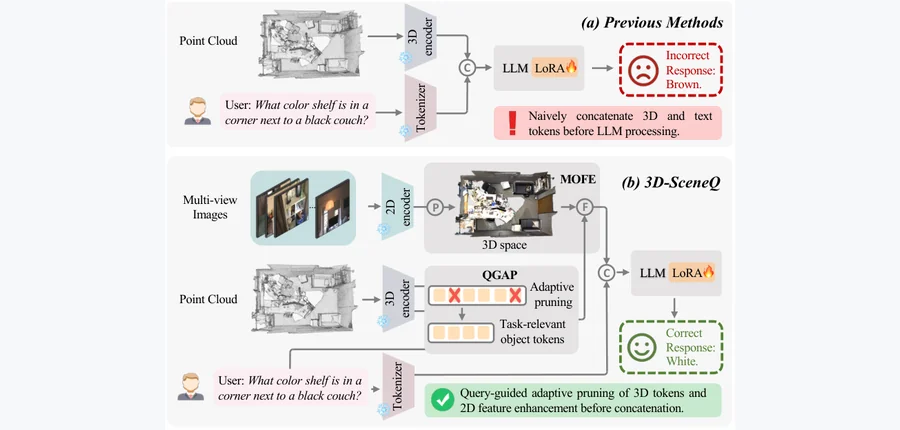 arXiv 2026-10-29 · cs.CV · #39 **[3D-SceneQ: Empowering 3D LLM With Query-Guided Adaptive Pruning and Multi-Modal Feature Enhancement](https://arxiv.org/abs/2610.37202)** Yongqi Shan , Lu Zhang , Jiazuo Yu , Yunzhi Zhuge , Huchuan Lu 机构：Dalian University of Technology（[PDF](https://arxiv.org/pdf/2610.37202)） [Paper](https://arxiv.org/abs/2610.37202) · [图源](https://arxiv.org/html/2610.37202v1/compare.png) 

中文摘要
现有三维场景理解方法通常把大量三维物体 token 与文本串接交给 LLM，但任务无关物体带来噪声、降低推理准确率并增加幻觉；单用点云又缺少二维模态提供的颜色、材质、纹理和高层上下文语义。我们提出 3D-SceneQ，将自适应 token 剪枝与多模态语义增强结合，用于三维场景理解、推理和锚定。Query-Guided Adaptive Pruning（QGAP）模块通过可学习潜查询，按指令意图选择任务相关物体；Multi-modal Object-level Feature Enhancement（MOFE）模块将预训练模型的二维特征嵌入三维物体表示，补充物体级语义。多个基准上优于现有先进方法，例如 Scan2Cap 的 CIDEr 提高 5.7、SQA3D 的 EM@1 提高 17.0。 <a href="https://arxiv.org/abs/2610.37202">原摘要来源</a>
 |
| 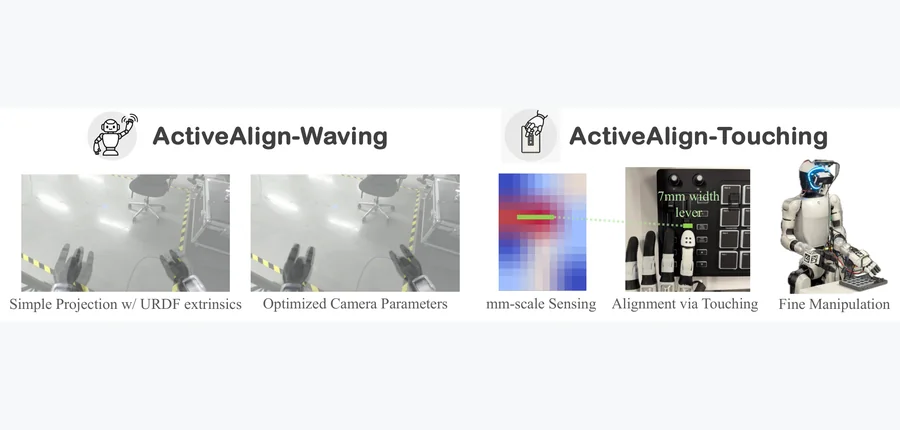 arXiv 2026-10-29 · cs.RO · #40 **[ActiveAlign: Aligning Egocentric Manipulation via Active Perception](https://arxiv.org/abs/2610.36859)** Ri-Zhao Qiu , Bowen Wen , Yifeng Jiang , Chen Tessler , Eric Heiden , Xue Bin Peng , Xiaolong Wang , Stan Birchfield , Erw… 机构：NVIDIA / UC San Diego（[PDF](https://arxiv.org/pdf/2610.36859)） [Paper](https://arxiv.org/abs/2610.36859) · [图源](https://arxiv.org/html/2610.36859v1/teaser_v4.png) 

中文摘要
Real2Sim2Real 为规划、可解释性和安全执行提供结构化世界表示，但被动感知常因观测不全造成真实到仿真的差距。我们提出 ActiveAlign，利用交互中的主动感知对齐：ActiveAlign-Waving 借助手部主动运动和可微渲染完成手眼标定；ActiveAlign-Touching 通过触觉反馈细化物体对齐，达到毫米级精度。两模块共同缩小对齐差距。实验展示 Waving 可为未标定的开放机器人操作数据整理仿真环境；在真实 Unitree G1 上，ActiveAlign 支持按按钮、移动滑块等毫米级物体精细操作。 <a href="https://arxiv.org/abs/2610.36859">原摘要来源</a>
 |   |   |
<!-- PAPER_CARDS_END -->

## 检索概况

- **检索窗口**：北京时间 2026-10-28 09:00 至 2026-10-29 09:00；以下为官方 Wednesday, 28 October 2026 New 批次。
- **规则**：主榜仅纳入官方 New submissions，按 arXiv ID 去重，并按标题及完整摘要核对。先列三维与物理交叉，再列有具体机器人方法／实验的具身工作和基础三维方法。
- **官方分类页总命中／入选**：New **771／40 篇**；Cross **437** 条，Replacement **731** 条（分类页原始记录，不进入主榜）。
- **缺失**：原摘要 **0** 篇；配图及机构核验结果见文末。

| 官方分类页 | listing 日期 | New | Cross | Replacement |
|---|---|---:|---:|---:|
| [cs.CV](https://arxiv.org/list/cs.CV/new?show=2000) | 2026-10-28 | 127 | 29 | 89 |
| [cs.GR](https://arxiv.org/list/cs.GR/new?show=2000) | 2026-10-28 | 6 | 4 | 1 |
| [cs.RO](https://arxiv.org/list/cs.RO/new?show=2000) | 2026-10-28 | 76 | 9 | 40 |
| [cs.AI](https://arxiv.org/list/cs.AI/new?show=2000) | 2026-10-28 | 95 | 159 | 153 |
| [cs.LG](https://arxiv.org/list/cs.LG/new?show=2000) | 2026-10-28 | 149 | 88 | 200 |
| [physics](https://arxiv.org/list/physics/new?show=2000) | 2026-10-28 | 86 | 45 | 66 |
| [cond-mat](https://arxiv.org/list/cond-mat/new?show=2000) | 2026-10-28 | 115 | 20 | 63 |
| [math.OC](https://arxiv.org/list/math.OC/new?show=2000) | 2026-10-28 | 28 | 13 | 29 |
| [math.NA](https://arxiv.org/list/math.NA/new?show=2000) | 2026-10-28 | 14 | 9 | 9 |
| [math.DS](https://arxiv.org/list/math.DS/new?show=2000) | 2026-10-28 | 17 | 9 | 16 |
| [stat.ML](https://arxiv.org/list/stat.ML/new?show=2000) | 2026-10-28 | 15 | 22 | 35 |
| [eess.IV](https://arxiv.org/list/eess.IV/new?show=2000) | 2026-10-28 | 5 | 3 | 3 |
| [eess.SY](https://arxiv.org/list/eess.SY/new?show=2000) | 2026-10-28 | 18 | 15 | 16 |
| [eess.SP](https://arxiv.org/list/eess.SP/new?show=2000) | 2026-10-28 | 20 | 12 | 11 |

## Top papers

| # | 论文 | arXiv | 分类 | 作者 | 机构 | 相关性（推断） | 机构强度（推断） | 优先级（推断） |
|---:|---|---|---|---|---|---|---|---|
| 1 | Total Deformation-based MPM for Perfectly Elastic Solid Simulation with Strong Deformations | [arXiv:2610.36945](https://arxiv.org/abs/2610.36945) | cs.GR | Timna Böttcher , Rick Ridder , Jan Bender | RWTH Aachen University（[PDF](https://arxiv.org/pdf/2610.36945)） | 高：三维／物理或接触机制 | 中（推断） | A |
| 2 | LabWorld: Learning Interactive 4D Worlds for Scientific Experimentation | [arXiv:2610.36592](https://arxiv.org/abs/2610.36592) | cs.CV | Suozhi Huang , Kelsey Fu , Binxu Li , Luna Lyu , Kaize Wu , Wenbo Lu , David Smerkous , Jiahan Li , Siqi Zhu , Zhizhou Sha , Jiacheng Guo , Zhixuan Liang , Shilong Liu , Le Cong , Mengdi Wang | Princeton University / Stanford University / University of Chicago / New York University / Oregon State University / University of Illinois Urbana-Champaign / University of Texas at Austin（[PDF](https://arxiv.org/pdf/2610.36592)） | 高：三维／物理或接触机制 | 强（推断） | A |
| 3 | ScIntBench: Physical Interaction Plausibility in 3D Scene Generation | [arXiv:2610.37326](https://arxiv.org/abs/2610.37326) | cs.CV | Wendi Ying , Daochang Liu , Leonid Sigal , Ajmal Saeed Mian | The University of Western Australia / University of British Columbia / Canada CIFAR AI Chair（[PDF](https://arxiv.org/pdf/2610.37326)） | 高：三维／物理或接触机制 | 强（推断） | A |
| 4 | GraftRay: Physically Based Mesh Insertion into Gaussian Splatting Scenes via Path Tracing | [arXiv:2610.37036](https://arxiv.org/abs/2610.37036) | cs.CV)  | Jinxin Ai , Matthias Niessner | Technical University of Munich（[PDF](https://arxiv.org/pdf/2610.37036)） | 高：三维／物理或接触机制 | 强（推断） | A |
| 5 | Keeping Contact: Task-Adaptive Friction Margins for Bimanual Non-Prehensile Manipulation | [arXiv:2610.36961](https://arxiv.org/abs/2610.36961) | cs.RO | Qian Ying Lee , Lin Yang , Domenico Campolo | Nanyang Technological University（[PDF](https://arxiv.org/pdf/2610.36961)） | 高：三维／物理或接触机制 | 中（推断） | A |
| 6 | On Shaky Ground: Characterising Non-Rigid Base Effects in Mobile Manipulation | [arXiv:2610.36725](https://arxiv.org/abs/2610.36725) | cs.RO | Zongyuan Zhang , Christopher Lehnert , Will N. Browne , Jonathan M. Roberts | Queensland University of Technology（[PDF](https://arxiv.org/pdf/2610.36725)） | 高：三维／物理或接触机制 | 中（推断） | A |
| 7 | From Biological Curves to Soft Modular Robots: Learning-Based Inverse Design with Uncertainty-Guided Refinement | [arXiv:2610.36681](https://arxiv.org/abs/2610.36681) | cs.RO)  | Dixiang Wang , Minghao Zha , Arifur Rahman , Yinhong Qin , Yitao Jiang , Shiyang Lu , Zebing Mao , Muhao Chen , Luyang Zhao | affiliation 未确认 | 高：三维／物理或接触机制 | 未判定（推断） | A |
| 8 | Learning Visuomotor Quadrotor Flight Through Dynamic Narrow Gaps via Differentiable Simulation | [arXiv:2610.37557](https://arxiv.org/abs/2610.37557) | cs.RO | Riccardo Bianco , Yunfan Ren , Jiaxu Xing , Davide Scaramuzza | University of Zurich（[PDF](https://arxiv.org/pdf/2610.37557)） | 高：三维／物理或接触机制 | 中（推断） | A |
| 9 | AMOR: Adaptive Modal Operator Refinement for Operator Learning on Arbitrary Meshes and Irregular 3D Geometries | [arXiv:2610.37485](https://arxiv.org/abs/2610.37485) | math.NA)  | David Voderholzer , Leonard Vetter , Thomas O'Leary-Roseberry | Lawrence Berkeley National Laboratory / ETH Zürich / Karlsruhe Institute of Technology / The Ohio State University（[PDF](https://arxiv.org/pdf/2610.37485)） | 高：三维／物理或接触机制 | 强（推断） | A |
| 10 | ObjectTwin: Measuring the Asset Correspondence Gap for Capture-Anchored Digital Twins | [arXiv:2610.35904](https://arxiv.org/abs/2610.35904) | cs.CV | Zhenghe Guo | Zhejiang University（[PDF](https://arxiv.org/pdf/2610.35904)） | 高：三维／物理或接触机制 | 中（推断） | A |
| 11 | FAMIR: Future-aligned latent dynamics for complex-flow forecasting | [arXiv:2610.36515](https://arxiv.org/abs/2610.36515) | physics.flu-dyn | Yuxuan Chen , Yan Wang , Haotian Cheng , Hongna Zhang , Wenhua Zhang , Yuke Li , Xiaobin Li , Fengchen Li | Tianjin University / Yangtze University / Harbin Engineering University（[PDF](https://arxiv.org/pdf/2610.36515)） | 高：三维／物理或接触机制 | 中（推断） | A |
| 12 | No friction required: Self-locking in entangled assemblies of curved filaments | [arXiv:2610.36330](https://arxiv.org/abs/2610.36330) | cond-mat.soft | Benjamin R. Greenvall , Jay van den Berg , Ross E. Meinhart , Patrick A. Staudenmayer , Alfred J. Crosby , Gregory M. Grason | University of Massachusetts Amherst / Williams College（[PDF](https://arxiv.org/pdf/2610.36330)） | 高：三维／物理或接触机制 | 中（推断） | A |
| 13 | E0.5: From Reconstructive to Future-Predictive 3D Foundations for Robotic World-Action Modeling | [arXiv:2610.36011](https://arxiv.org/abs/2610.36011) | cs.RO | X-Era AI Lab Team : Jianhao Lai , Zhihao Zhan , Zhiquan Liao , Qichang Li , Shubin Chen , Zhiyuan Liu , Hongsen Lei , Jianman Lin , Xiaoxin Lin , Ke Gong , Baiyue Gu , Shiming Chen , Junlin He , Longqi Yang , Junrong Xiao , Haolin Luo , Xiaojuan Su , Jianfeng Li , Yu Luo , Xu Sun , Likui Zhang , Jusheng Zhang , Qinhan Lyu , Tianshui Chen , Liang Lin , Guangrun Wang | X-Era.AI（[PDF](https://arxiv.org/pdf/2610.36011)） | 高：三维／物理或接触机制 | 中（推断） | A |
| 14 | Trace-WAM: Learning to Act via 3D Motion Prediction for World Action Models | [arXiv:2610.36840](https://arxiv.org/abs/2610.36840) | cs.RO | Xu Hu , Changjie Wu , Linzhe Shi , Hang Zhang , Chen Yang , Lingjun Zhang , Guowen Zhang , Mu Xu , Junran Peng , Qing Li , Zhaoxiang Zhang | The Hong Kong Polytechnic University / Amap, Alibaba Group / Tsinghua University / Chinese Academy of Sciences / University of Science and Technology Beijing（[PDF](https://arxiv.org/pdf/2610.36840)） | 高：三维／物理或接触机制 | 强（推断） | A |
| 15 | PDRVLA: A Vision-Language-Action Model with Physical Dynamics Representations | [arXiv:2610.37381](https://arxiv.org/abs/2610.37381) | cs.RO)  | Hanqing Wang , Zhaotian Cai , Ruichuan An , Bohan Zeng , Tao Zhang , Yilin Chen , Xu Jiang , Kaiquan Chen , Chongyang Wu , Haoran Li , Fan Yang , Mingan Lin , Wentao Zhang , Zenan Zhou , Youzheng Wu | Peking University / JD.com（[PDF](https://arxiv.org/pdf/2610.37381)） | 高：三维／物理或接触机制 | 强（推断） | A |
| 16 | CARD: Contact-Anchored Retargeting for Dexterous Manipulation | [arXiv:2610.36539](https://arxiv.org/abs/2610.36539) | cs.RO | Cunxi Dai , Botao He , Francois R Hogan , Wei Pan , Rao Fu , Wen-Han Hsieh , Ruoshi Liu , Jitendra Malik , Guanya Shi , Akash Sharma | Carnegie Mellon University / Amazon Frontier AI & Robotics / University of Maryland / UC Berkeley（[PDF](https://arxiv.org/pdf/2610.36539)） | 高：三维／物理或接触机制 | 强（推断） | A |
| 17 | Kinematic Constraint-Referenced Evaluation for Articulated Object Manipulation | [arXiv:2610.37550](https://arxiv.org/abs/2610.37550) | cs.RO)  | Baptiste Bonin , Caro Strickland , Audrey Durand | Université Laval / Mila / CIFAR（[PDF](https://arxiv.org/pdf/2610.37550)） | 中高：具体具身贡献 | 中（推断） | B |
| 18 | cuArms: GPU-Accelerated Conflict-Based Planning for Multi-Arm Manipulation | [arXiv:2610.36250](https://arxiv.org/abs/2610.36250) | cs.RO)  | Philip Huang , Fabio Ramos , Jiaoyang Li , Caelan Garrett , Lars Johannsmeier | NVIDIA / Carnegie Mellon University / University of Sydney（[arXiv HTML](https://arxiv.org/html/2610.36250)） | 中高：具体具身贡献 | 强（推断） | B |
| 19 | RoboAuto: Autonomous Robot Program Search through Multi-Level Physical Understanding | [arXiv:2610.36533](https://arxiv.org/abs/2610.36533) | cs.RO)  | Buzhao Liu , Jianing Ye , Xiu Yuan , Yangtong Feng , Chengsong Huang , Tyler Dinh , Yevgeniy Vorobeychik , Ning Zhang , Chongjie Zhang | Washington University in St. Louis（[PDF](https://arxiv.org/pdf/2610.36533)） | 中高：具体具身贡献 | 中（推断） | B |
| 20 | RynnWorld-Latent: A Cross-Embodiment World Model Conditioned on Universal Latent Actions | [arXiv:2610.36791](https://arxiv.org/abs/2610.36791) | cs.RO | Haoyu Zhao , Yinzhou Tang , Zixuan Wang , Minghao Zhu , Dongchi Huang , Xingyue Zhao , Qin Zhao , Kehan Li , Siteng Huang , Xin Li , Zhenyu Zeng , Mingxiu Chen , Deli Zhao , Zhongyu Li | DAMO Academy, Alibaba Group / Hong Kong Embodied AI Lab / CUHK / Hupan Lab（[PDF](https://arxiv.org/pdf/2610.36791)） | 中高：具体具身贡献 | 强（推断） | B |
| 21 | When Black-Box Robot Policies Fail: Online Sensor Diagnosis and Repair with a Transparent Surrogate | [arXiv:2610.36852](https://arxiv.org/abs/2610.36852) | cs.RO | Marc Ziegler , Batu Özen , Sami Mentes , Thomas Waschulzik , Alois Knoll | Technical University of Munich / Siemens Mobility（[PDF](https://arxiv.org/pdf/2610.36852)） | 中高：具体具身贡献 | 强（推断） | B |
| 22 | GAWM: A Compact Latent World-Action Model for Multi-Task Robot Manipulation | [arXiv:2610.37091](https://arxiv.org/abs/2610.37091) | cs.RO | Yang Liu , Xiaoli Liu , Liuzhao Li , Yuduo Song , Muyuan Liu , Xiang Gao | Genisom AI（[arXiv HTML](https://arxiv.org/html/2610.37091)） | 中高：具体具身贡献 | 中（推断） | B |
| 23 | Retrieve to Act: Motion Primitive Graph Retrieval for Robust VLA Execution | [arXiv:2610.37215](https://arxiv.org/abs/2610.37215) | cs.RO)  | Pham Tri Quang , Bao-Ngoc Dao , Minh Duc Nguyen , Duc-Duy Nguyen , Hung T. Ho , Linh Dang Le , Trong-Bao Ho , Thien-Loc Ha , Tan Q. Nguyen , Tuan Dam , Vu N. Duong , Daniel Sonntag , Ngan Le , Khoa D. Doan , Jan Peters , An Thai Le , Duy M. H. Nguyen , Vien Anh Ngo | VinUniversity / VinRobotics / Hanoi University of Science and Technology / DFKI / University of Oldenburg / University of Arkansas / Technical University of Darmstadt（[arXiv HTML](https://arxiv.org/html/2610.37215)） | 中高：具体具身贡献 | 中（推断） | B |
| 24 | Predict the Swing, Match the Speed: Robotic Pipe Stabbing With Learned Stereo Vision and Residual Reinforcement Learning | [arXiv:2610.37535](https://arxiv.org/abs/2610.37535) | cs.RO | Mohamed Ashraf Mostafa , Taher El-Fakharany , Samir Khaled | Al-Azhar University / Future University in Egypt（[PDF](https://arxiv.org/pdf/2610.37535)） | 中高：具体具身贡献 | 中（推断） | B |
| 25 | Rendering-Free Event Frame Simulation for Fast Reinforcement Learning of Autonomous Robot Navigation | [arXiv:2610.37543](https://arxiv.org/abs/2610.37543) | cs.RO | Dequan Ou , Austin Lopez , Quentin Missinne , Christophe De Wagter , Guido C.H.E. de Croon | Delft University of Technology（[arXiv HTML](https://arxiv.org/html/2610.37543)） | 中高：具体具身贡献 | 强（推断） | B |
| 26 | Which Hand Was Late? Diagnosis for Robot Failure Recovery in Bimanual Tool Use | [arXiv:2610.37533](https://arxiv.org/abs/2610.37533) | cs.RO)  | Baptiste Bonin , Caro Strickland , Audrey Durand | Université Laval / Mila / CIFAR（[PDF](https://arxiv.org/pdf/2610.37533)） | 中高：具体具身贡献 | 中（推断） | B |
| 27 | From 12 to 200 Demonstrations: How ACT, Diffusion Policy, SmolVLA and π0.5 Scale on a Low-Cost Arm | [arXiv:2610.37170](https://arxiv.org/abs/2610.37170) | cs.RO | Simon Cowling | fysical.ai（[PDF](https://arxiv.org/pdf/2610.37170)） | 中高：具体具身贡献 | 中（推断） | B |
| 28 | Remember Where You Walk: Learning Spatial Memory for End-to-End Legged Robot Exploration | [arXiv:2610.37203](https://arxiv.org/abs/2610.37203) | cs.RO | Leon Magnus , Nico Bohlinger , Jan Peters , Oleg Arenz | Technical University of Darmstadt / Robotics Institute Germany / DFKI / hessian.AI（[PDF](https://arxiv.org/pdf/2610.37203)） | 中高：具体具身贡献 | 中（推断） | B |
| 29 | SG^2SLAM: Spatial Geometry-Informed 3D Gaussian Splatting SLAM for Monocular Outdoor Navigation | [arXiv:2610.36312](https://arxiv.org/abs/2610.36312) | cs.RO | Ziang Guo , Didar Seyidov , Yixiao Zhou , Xuefeng Zhang , Ali Alridha Abdulkarim , Chen Min , Zufeng Zhang , Dzmitry Tsetserukou | Skolkovo Institute of Science and Technology / Chinese Academy of Sciences / The University of Hong Kong / Tsinghua University（[PDF](https://arxiv.org/pdf/2610.36312)） | 中高：具体具身贡献 | 强（推断） | B |
| 30 | Rollback: Experience Backtracking in World Models for Policy Improvement | [arXiv:2610.36068](https://arxiv.org/abs/2610.36068) | cs.RO)  | Jiayi Luo , Yang Zhang , Liliang Chen , Nan Wang , Chen Gao , Boxiang Qiu , Zhuoxuan Li , Baorui Peng , Chuankang Li , Yuxiang Yan , Si Liu , Qingyun Sun , Shuicheng Yan , Maoqing Yao , Jianxin Li , Guanghui Ren | AgiBot / Beihang University / National University of Singapore（[PDF](https://arxiv.org/pdf/2610.36068)） | 中高：具体具身贡献 | 强（推断） | B |
| 31 | Any3R: Feedforward 3D Reconstruction from Any Camera Type | [arXiv:2610.36150](https://arxiv.org/abs/2610.36150) | cs.CV | Jingong Chen , Qingwen Zhang , Youming Deng , Chulwoo Pack , Olaf Wysocki , Boris Jutzi , Kwanghee Won , Kyle Gao | South Dakota State University / Aalto University / KTH Royal Institute of Technology / Cornell University / University of Cambridge / Karlsruhe Institute of Technology（[PDF](https://arxiv.org/pdf/2610.36150)） | 高：基础三维方法 | 中（推断） | B |
| 32 | 4D Reconstruction with Events & RGB | [arXiv:2610.36610](https://arxiv.org/abs/2610.36610) | cs.CV | Dulanga Weerakoon , Darshana Rathnayake , Van Minh Do , Hemanth Sabbella , Kaichen Zhou , Fangneng Zhan , Alok Prakash , Sanjay E. Sarma , Archan Misra , Paul Pu Liang | Singapore-MIT Alliance for Research & Technology / Massachusetts Institute of Technology / Singapore Management University（[PDF](https://arxiv.org/pdf/2610.36610)） | 高：基础三维方法 | 强（推断） | B |
| 33 | GeoGSplat: Geometry-Grounded Non-Pixel-Aligned Gaussian Splatting | [arXiv:2610.36760](https://arxiv.org/abs/2610.36760) | cs.CV | Jiale Wang , Chen Zhao , Haoyang Zhang , Yanhao Wu , Fei He , Yanhu Shan , Rui Wu , Wei Ke , Tong Zhang | Xi’an Jiaotong University / EPFL / Horizon Robotics / University of Chinese Academy of Sciences（[PDF](https://arxiv.org/pdf/2610.36760)） | 高：基础三维方法 | 中（推断） | B |
| 34 | LingGS: Decoupling Feed-Forward Geometry Prediction from Camera Tracking for High-Fidelity Gaussian SLAM | [arXiv:2610.36853](https://arxiv.org/abs/2610.36853) | cs.CV)  | Da Li , Yihan Zang , Ivan Viola , Zeyu Wang , Dominik Engel | King Abdullah University of Science and Technology / Hong Kong University of Science and Technology (Guangzhou)（[PDF](https://arxiv.org/pdf/2610.36853)） | 高：基础三维方法 | 强（推断） | B |
| 35 | GPA-VGGT: Geometry-Preserving Acceleration of VGGT | [arXiv:2610.37000](https://arxiv.org/abs/2610.37000) | cs.CV | Muyeol Sung , Jangwon Kim , Jongwoo Lim | Seoul National University（[PDF](https://arxiv.org/pdf/2610.37000)） | 高：基础三维方法 | 强（推断） | B |
| 36 | Learning to Code the World: Harness Evolution for Compositional 3D Reconstruction | [arXiv:2610.37046](https://arxiv.org/abs/2610.37046) | cs.CV | Haoyu Yao , Chenguo Lin , Ruize Du , Yadong Mu | Peking University（[PDF](https://arxiv.org/pdf/2610.37046)） | 高：基础三维方法 | 强（推断） | B |
| 37 | StereoSplat: Metric-Scale Novel View Synthesis via Stereo-Grounded Gaussian Splatting | [arXiv:2610.35902](https://arxiv.org/abs/2610.35902) | cs.GR)  | Vladimir Yugay , Denis Rozumny , Theo Gevers , Elias Vansteenkiste , Martin R. Oswald , Diogo C. Luvizon | University of Amsterdam / Meta（[arXiv HTML](https://arxiv.org/html/2610.35902)） | 高：基础三维方法 | 强（推断） | B |
| 38 | UT-HMR: Uncertainty-Guided Temporal Modeling for Robust 3D Human Mesh Recovery | [arXiv:2610.36203](https://arxiv.org/abs/2610.36203) | cs.CV | Zhibo Wang , Sirisha Rambhatla , Yuhao Chen , Maria Koshkina , David Clausi | University of Waterloo（[PDF](https://arxiv.org/pdf/2610.36203)） | 高：基础三维方法 | 中（推断） | B |
| 39 | 3D-SceneQ: Empowering 3D LLM With Query-Guided Adaptive Pruning and Multi-Modal Feature Enhancement | [arXiv:2610.37202](https://arxiv.org/abs/2610.37202) | cs.CV | Yongqi Shan , Lu Zhang , Jiazuo Yu , Yunzhi Zhuge , Huchuan Lu | Dalian University of Technology（[PDF](https://arxiv.org/pdf/2610.37202)） | 高：基础三维方法 | 中（推断） | B |
| 40 | ActiveAlign: Aligning Egocentric Manipulation via Active Perception | [arXiv:2610.36859](https://arxiv.org/abs/2610.36859) | cs.RO)  | Ri-Zhao Qiu , Bowen Wen , Yifeng Jiang , Chen Tessler , Eric Heiden , Xue Bin Peng , Xiaolong Wang , Stan Birchfield , Erwin Coumans | NVIDIA / UC San Diego（[PDF](https://arxiv.org/pdf/2610.36859)） | 高：三维／物理或接触机制 | 强（推断） | B |

## 逐篇中文要点

### 1. [Total Deformation-based MPM for Perfectly Elastic Solid Simulation with Strong Deformations](https://arxiv.org/abs/2610.36945)

- **事实·方法**：在当前网格算弹力，同时以粒子位置和固定参考网格直接求形变，支持网格及粒子碰撞。
- **事实·结果**：论文报告大形变弹性体可在接触下避免数值破裂并抑制零能伪影。
- **推断·局限**：还需量化复杂自接触和不同网格分辨率下的守恒误差与耗时。

### 2. [LabWorld: Learning Interactive 4D Worlds for Scientific Experimentation](https://arxiv.org/abs/2610.36592)

- **事实·方法**：从单目实验视频恢复资产、度量场景、时变状态及程序事件，并加入交互时空约束。
- **事实·结果**：移液 Mask IoU 0.501，涡旋 PCK-AUC 0.638；五段移液视频的建模约束满足率由 5/35 升至 35/35。
- **推断·局限**：需要用未见器具与遮挡场景验证事件约束是否仍可迁移。

### 3. [ScIntBench: Physical Interaction Plausibility in 3D Scene Generation](https://arxiv.org/abs/2610.37326)

- **事实·方法**：在物理仿真中执行推动、打开、探测，评测三维场景的交互就绪性。
- **事实·结果**：12 个系统中 7 个无法支持任何交互；最佳系统的规定任务成功率仅 36.92%。
- **推断·局限**：仿真器的接触参数可能影响排序，应做跨引擎和真实物体验证。

### 4. [GraftRay: Physically Based Mesh Insertion into Gaussian Splatting Scenes via Path Tracing](https://arxiv.org/abs/2610.37036)

- **事实·方法**：恢复高斯场景的材质、法线与近场面光源，联合路径追踪高斯和插入网格。
- **事实·结果**：FIPT 上渲染保真度与阴影精度优于所测 ComGS、EAG-PT 基线。
- **推断·局限**：材质先验误差及动态光源变化可能损害物理一致性，需受控测试。

### 5. [Keeping Contact: Task-Adaptive Friction Margins for Bimanual Non-Prehensile Manipulation](https://arxiv.org/abs/2610.36961)

- **事实·方法**：用有符号摩擦距离定义任务自适应裕量，并在二阶锥规划中优化双臂倾斜接触力。
- **事实·结果**：优化和实体实验报告了对物体属性变化及模型失配的适应，固定裕量对照较弱。
- **推断·局限**：可测试在线摩擦估计偏差与接触切换时裕量约束的鲁棒性。

### 6. [On Shaky Ground: Characterising Non-Rigid Base Effects in Mobile Manipulation](https://arxiv.org/abs/2610.36725)

- **事实·方法**：以打磨任务联合测量轻量移动机械臂的接触力、工具位移与底座振动。
- **事实·结果**：低底座地面阻力时 100 N 指令仅实现 54–70%，工具误差可达 100 mm。
- **推断·局限**：两个无驱动轮式平台的结果需扩展到驱动底座与不同地面。

### 7. [From Biological Curves to Soft Modular Robots: Learning-Based Inverse Design with Uncertainty-Guided Refinement](https://arxiv.org/abs/2610.36681)

- **事实·方法**：用逆预测、前向代理和不确定性引导候选细化，将生物曲线转成软体机器人构型。
- **事实·结果**：5,000 个未见穿线测试样本的代理评估形状成功率为 93%，另展示四种实体机器人。
- **推断·局限**：应直接比较实体形状误差与代理评估误差，防止模型选择偏差。

### 8. [Learning Visuomotor Quadrotor Flight Through Dynamic Narrow Gaps via Differentiable Simulation](https://arxiv.org/abs/2610.37557)

- **事实·方法**：把动态窄缝穿越写为可微密集路径目标，单阶段训练机载视觉到控制指令策略。
- **事实·结果**：单 GPU 数分钟训练后仿真成功率 99.3%；真实四旋翼 10 次试验成功率 80%。
- **推断·局限**：实体样本少，需扩大风扰、速度和狭缝运动范围。

### 9. [AMOR: Adaptive Modal Operator Refinement for Operator Learning on Arbitrary Meshes and Irregular 3D Geometries](https://arxiv.org/abs/2610.37485)

- **事实·方法**：用降维基算子块替代 FNO 谱卷积，适配任意网格和三维复杂边界。
- **事实·结果**：不规则机翼与弹性问题对 Geo-FNO 的相对 L² 误差分别下降 31% 和 42%，但湍流腔流落后 FNO。
- **推断·局限**：可用随时间更新的局部基修复时变流场不足。

### 10. [ObjectTwin: Measuring the Asset Correspondence Gap for Capture-Anchored Digital Twins](https://arxiv.org/abs/2610.35904)

- **事实·方法**：固定相机、扫描投影支持、深度和锚点，只替换三维资产来测捕获对应差距。
- **事实·结果**：两个 RGB-D 域的生成资产 MaskIoU 损失 0.302–0.497，保守位姿细化未系统恢复。
- **推断·局限**：应检验差距与下游接触或操作失败的相关性。

### 11. [FAMIR: Future-aligned latent dynamics for complex-flow forecasting](https://arxiv.org/abs/2610.36515)

- **事实·方法**：未来条件教师与历史学生共享潜在运动转移，并以多步预测馈入训练学生。
- **事实·结果**：三种流场的 10/20 步误差均低于所测直接预测器；40 步统计更接近参考。
- **推断·局限**：需要检验长跨度边界条件变化下的稳定性和守恒性。

### 12. [No friction required: Self-locking in entangled assemblies of curved filaments](https://arxiv.org/abs/2610.36330)

- **事实·方法**：通过无摩擦螺旋纤维模型分析弹性预应力导致的自锁与解缠。
- **事实·结果**：实验和仿真支持纯弹性凝聚机制，并发现摩擦再大也不能自锁的构型。
- **推断·局限**：可把理论边界用于机器人软抓持或编织结构的可控设计。

### 13. [E0.5: From Reconstructive to Future-Predictive 3D Foundations for Robotic World-Action Modeling](https://arxiv.org/abs/2610.36011)

- **事实·方法**：以三维基础模型为主干，联合预测未来三维状态与机器人动作。
- **事实·结果**：RoboTwin 2.0 两设置成功率 89.90%/50.09%；具身预训练后两实体平台平均成功率提高约 15/7 个百分点。
- **推断·局限**：需拆分三维主干、未来几何预测和大规模预训练的各自贡献。

### 14. [Trace-WAM: Learning to Act via 3D Motion Prediction for World Action Models](https://arxiv.org/abs/2610.36840)

- **事实·方法**：以三维点轨迹、像面位移和深度变化监督世界动作模型的运动分支。
- **事实·结果**：RoboCasa-GR1、LIBERO 与 LIBERO-Plus 显示同分布和偏移条件下的收益。
- **推断·局限**：可按物体接触阶段评估运动监督是否真正改善操作动力学。

### 15. [PDRVLA: A Vision-Language-Action Model with Physical Dynamics Representations](https://arxiv.org/abs/2610.37381)

- **事实·方法**：用轻量物理 token 模块预测未来 RGB、深度、光流特征，避免控制时生成视频。
- **事实·结果**：四个仿真基准成功率分别为 99.3%、89.9%、93.6%、81.5%。
- **推断·局限**：需比较仅用深度或光流监督与真实接触参数变化下的收益。

### 16. [CARD: Contact-Anchored Retargeting for Dexterous Manipulation](https://arxiv.org/abs/2610.36539)

- **事实·方法**：用手—接触表示重定向人类示范，同时生成接触力目标并以触觉控制器跟踪。
- **事实·结果**：保持 43–78% 的接触帧；加入物理重定向后 GRAB 严格成功率由 12% 升至 32%。
- **推断·局限**：视频推断力目标可能不唯一，需检验多材质和滑移下的误差。

### 17. [Kinematic Constraint-Referenced Evaluation for Articulated Object Manipulation](https://arxiv.org/abs/2610.37550)

- **事实·方法**：把末端扭量投影到关节轴，分开有效关节进度与离轴浪费。
- **事实·结果**：74 个仿真关节物体上可区分三类迁移失败；门策略成功开抽屉时离轴旋转约为专用策略的 40 倍。
- **推断·局限**：关节轴估计是先决条件，应测试不完整几何与多自由度关节。

### 18. [cuArms: GPU-Accelerated Conflict-Based Planning for Multi-Arm Manipulation](https://arxiv.org/abs/2610.36250)

- **事实·方法**：GPU 并行冲突搜索结合单臂可复用路网和高层任务骨架。
- **事实·结果**：论文报告实时初始解、持续改进的多臂规划与仿真和真实工业任务演示。
- **推断·局限**：应比较动态障碍与任务临时插入时的重规划延迟。

### 19. [RoboAuto: Autonomous Robot Program Search through Multi-Level Physical Understanding](https://arxiv.org/abs/2610.36533)

- **事实·方法**：把物体可供性、场景锚定和交互实验纳入机器人程序搜索。
- **事实·结果**：短程 LIBERO-PRO 成功率 89.1%，两类长程基准平均成功率超过 ASPIRE 两倍。
- **推断·局限**：需控制知识库规模与试验次数，检验收益是否来自额外执行预算。

### 20. [RynnWorld-Latent: A Cross-Embodiment World Model Conditioned on Universal Latent Actions](https://arxiv.org/abs/2610.36791)

- **事实·方法**：以三维锚定潜在动作统一人类、机器人及仿真视频的世界模型条件接口。
- **事实·结果**：在 23 个数据集约 5.535 亿帧预训练；所测合成训练路线提升仿真与实体策略成功率。
- **推断·局限**：应测小数据条件下动作接口收益，分离规模与表示效果。

### 21. [When Black-Box Robot Policies Fail: Online Sensor Diagnosis and Repair with a Transparent Surrogate](https://arxiv.org/abs/2610.36852)

- **事实·方法**：用分离周期步态和传感修正的透明代理，对冻结行走策略做故障诊断与输入修复。
- **事实·结果**：仿真 Go2 离线诊断从 259/640 提至 429/640，在线修复为 382/640。
- **推断·局限**：结果限于一个策略与部分筛查故障，需硬件和多策略验证。

### 22. [GAWM: A Compact Latent World-Action Model for Multi-Task Robot Manipulation](https://arxiv.org/abs/2610.37091)

- **事实·方法**：冻结 DINOv3、压缩多视角 token，在两个未来时域预测潜特征并回归动作片段。
- **事实·结果**：少于一亿参数且无机器人预训练，在 RoboTwin 2.0 超过所测十亿参数 WAM。
- **推断·局限**：需明确在相同训练数据、观测视角与延迟预算下的比较。

### 23. [Retrieve to Act: Motion Primitive Graph Retrieval for Robust VLA Execution](https://arxiv.org/abs/2610.37215)

- **事实·方法**：从成功示范建立时空运动基元图，测试时检索并门控修正冻结 VLA 动作。
- **事实·结果**：所测仿真基准最多提高 12 个百分点，真实部署最多提高 40 个百分点。
- **推断·局限**：检索库的覆盖率与错误检索风险需要按任务阶段量化。

### 24. [Predict the Swing, Match the Speed: Robotic Pipe Stabbing With Learned Stereo Vision and Residual Reinforcement Learning](https://arxiv.org/abs/2610.37535)

- **事实·方法**：双目跟踪管道摆动并匹配接触速度，以残差强化学习细化六轴机械臂捕获。
- **事实·结果**：200 次缩尺 MuJoCo 随机任务均成功，固定导向器为 74%；接触速度与力均下降。
- **推断·局限**：全部结果为仿真，需实体管道及尺度效应验证。

### 25. [Rendering-Free Event Frame Simulation for Fast Reinforcement Learning of Autonomous Robot Navigation](https://arxiv.org/abs/2610.37543)

- **事实·方法**：由几何和自运动直接合成事件流，无需先渲染图像，再训练机载避障策略。
- **事实·结果**：64×64 事件帧单 GPU 17 微秒；三条真实路线分别成功 5/5、5/6、4/6 次。
- **推断·局限**：应扩大真实试验数量并评估强纹理与光照变化。

### 26. [Which Hand Was Late? Diagnosis for Robot Failure Recovery in Bimanual Tool Use](https://arxiv.org/abs/2610.37533)

- **事实·方法**：分析双臂工具任务中视觉、单手与双手传感对故障原因的可识别性。
- **事实·结果**：两次尝试内，遇不可识别原因就升级的修复策略与获知真实原因的策略修复数相同。
- **推断·局限**：需在实体双臂任务上检查模拟故障可识别性边界。

### 27. [From 12 to 200 Demonstrations: How ACT, Diffusion Policy, SmolVLA and π0.5 Scale on a Low-Cost Arm](https://arxiv.org/abs/2610.37170)

- **事实·方法**：以 12 至 200 条嵌套示范比较四种模仿学习策略，在实体 SO-101 上做 1,340 次回合。
- **事实·结果**：ACT 在 100 条时达 37/40；π0.5 少数据时较强，但微调方案影响大于示范量。
- **推断·局限**：训练长度固定导致数据量与遍历次数混杂，需等步数控制。

### 28. [Remember Where You Walk: Learning Spatial Memory for End-to-End Legged Robot Exploration](https://arxiv.org/abs/2610.37203)

- **事实·方法**：用按位置索引的 Hadamard 空间矩阵记忆支持足式机器人长期探索。
- **事实·结果**：迷宫覆盖率匹配强基线，布局重建误差降至三分之一。
- **推断·局限**：应比较大尺度真实环境中的定位漂移与记忆容量。

### 29. [SG^2SLAM: Spatial Geometry-Informed 3D Gaussian Splatting SLAM for Monocular Outdoor Navigation](https://arxiv.org/abs/2610.36312)

- **事实·方法**：以片段级度量几何先验联合监督单目相机跟踪和 3DGS 建图。
- **事实·结果**：KITTI 与 Waymo Open 上超过所测逐帧关联基线。
- **推断·局限**：需要检验动态交通参与者与强光照变化对地图一致性的影响。

### 30. [Rollback: Experience Backtracking in World Models for Policy Improvement](https://arxiv.org/abs/2610.36068)

- **事实·方法**：把世界模型回退到关键决策点，分支比较反事实动作并蒸馏动作级监督。
- **事实·结果**：三项实体任务对最强基线绝对成功率提高 10.67、11.11、11.85 个百分点。
- **推断·局限**：应控制模型搜索计算和真实交互量，拆分反事实机制贡献。

### 31. [Any3R: Feedforward 3D Reconstruction from Any Camera Type](https://arxiv.org/abs/2610.36150)

- **事实·方法**：用逐像素射线场条件化位置编码和损失，统一多种中心相机重建。
- **事实·结果**：三数据集 13 种中心相机上，在各方法自估位姿条件下准确性最稳定。
- **推断·局限**：仍需测试非中心相机和严重标定漂移。

### 32. [4D Reconstruction with Events & RGB](https://arxiv.org/abs/2610.36610)

- **事实·方法**：给 Monst3R 增加事件分支，其余 4D 重建架构保持不变。
- **事实·结果**：三个基准上平均 Abs Rel 较 RGB 基线下降 3.4%，高速物体运动时收益最大。
- **推断·局限**：初步结果需要更完整的架构消融与真实事件传感器偏差测试。

### 33. [GeoGSplat: Geometry-Grounded Non-Pixel-Aligned Gaussian Splatting](https://arxiv.org/abs/2610.36760)

- **事实·方法**：Anchor 加 Triplane 结合粗几何与细特征，层级解码非像素对齐高斯。
- **事实·结果**：DTU、NRGBD 的重建与新视角合成优于所测基线，远视角优势更大。
- **推断·局限**：需要在动态场景和稀疏视角下量化几何误差与速度。

### 34. [LingGS: Decoupling Feed-Forward Geometry Prediction from Camera Tracking for High-Fidelity Gaussian SLAM](https://arxiv.org/abs/2610.36853)

- **事实·方法**：冻结三维主干估深度，显式重投影解位姿，流式高斯建图。
- **事实·结果**：单张 RTX 4090 上约 7 FPS，吞吐为所测既有 SLAM 的 2–3 倍。
- **推断·局限**：应检验快速运动时深度误差是否传入位姿和地图。

### 35. [GPA-VGGT: Geometry-Preserving Acceleration of VGGT](https://arxiv.org/abs/2610.37000)

- **事实·方法**：前层采用帧内注意力加共享跨帧 K/V，后层仅合并 K/V 并校正注意力质量。
- **事实·结果**：免训练加速下 AUC@3 位姿精度保留 VGGT 的 99% 以上。
- **推断·局限**：应报告高帧数与弱重叠序列的绝对延迟和内存。

### 36. [Learning to Code the World: Harness Evolution for Compositional 3D Reconstruction](https://arxiv.org/abs/2610.37046)

- **事实·方法**：固定模型和动作语义，由教师反馈演化可执行三维场景重建框架。
- **事实·结果**：作者报告 Qwen3.8-27B 的四项指标改善、推理时间降低 47.0%。
- **推断·局限**：需复核专有模型对照预算和模型版本，避免执行框架不公平比较。

### 37. [StereoSplat: Metric-Scale Novel View Synthesis via Stereo-Grounded Gaussian Splatting](https://arxiv.org/abs/2610.35902)

- **事实·方法**：双目主干提取视差与多尺度特征，门控深度细化并在逆深度空间合并高斯。
- **事实·结果**：纯合成训练改善渲染视角的深度精度，并零样本迁移真实双目视频。
- **推断·局限**：应比较双目基线在不同相机基线长度与标定误差下的尺度稳定性。

### 38. [UT-HMR: Uncertainty-Guided Temporal Modeling for Robust 3D Human Mesh Recovery](https://arxiv.org/abs/2610.36203)

- **事实·方法**：以低秩加对角协方差表示关节相关姿态不确定性，再融合邻帧证据。
- **事实·结果**：冰球与足球基准的 MPJPE、PA-MPJPE、PVE 最多分别降低 4.7%、3.8%、5.6%。
- **推断·局限**：应检验不确定性校准与遮挡程度、相机距离的关系。

### 39. [3D-SceneQ: Empowering 3D LLM With Query-Guided Adaptive Pruning and Multi-Modal Feature Enhancement](https://arxiv.org/abs/2610.37202)

- **事实·方法**：按查询剪枝三维物体 token，并用二维特征增强点云物体语义。
- **事实·结果**：Scan2Cap CIDEr 提高 5.7，SQA3D EM@1 提高 17.0。
- **推断·局限**：需比较剪枝与特征增强各自收益及被误删物体导致的失败。

### 40. [ActiveAlign: Aligning Egocentric Manipulation via Active Perception](https://arxiv.org/abs/2610.36859)

- **事实·方法**：主动挥手配合可微渲染校准手眼，主动触碰细化物体对齐。
- **事实·结果**：在真实 Unitree G1 上展示毫米级物体的按钮和滑块精细操作。
- **推断·局限**：需量化主动探测次数与接触风险、最终位姿误差的关系。

## 今日最值得细读的 5 篇

1. [Total Deformation-based MPM](https://arxiv.org/abs/2610.36945)：当前网格碰撞与无数值断裂的完全弹性体求解能直接用于接触模拟。
2. [LabWorld](https://arxiv.org/abs/2610.36592)：单目实验视频中的几何、事件与动作约束同时可编辑，适合检查 Real2Sim 的真实可操作性。
3. [ScIntBench](https://arxiv.org/abs/2610.37326)：直接执行交互检验三维生成场景，揭示静态合理性指标遗漏的失败。
4. [CARD](https://arxiv.org/abs/2610.36539)：把接触力纳入人手到机器人重定向，可细读视频力估计与触觉回放的因果贡献。
5. [Keeping Contact](https://arxiv.org/abs/2610.36961)：以有符号摩擦裕量约束双臂非抓持操作，有可解析的低算力延展空间。

## 低算力可改进论文与方法级实验建议

以下均为**推断性研究建议**，并非原论文结果。每项小实验应使用原论文公开场景或可复现的简化任务。

### 1. [Total Deformation-based MPM for Perfectly Elastic Solid Simulation with Strong Deformations](https://arxiv.org/abs/2610.36945)

- **方法改法（推断）**：用局部粒子邻域的接触拓扑置信度自适应混合粒子碰撞与网格碰撞。
- **小实验（推断）**：两个弹性块的扭转、自接触和恢复任务，扫描网格间距。
- **低算力原因（推断）**：只增加局部碰撞权重，无需重训大模型；**预期收益（推断）**：减少稀网格接触伪影；**风险（推断）**：拓扑置信度可能在薄片处失效。

### 2. [Keeping Contact: Task-Adaptive Friction Margins for Bimanual Non-Prehensile Manipulation](https://arxiv.org/abs/2610.36961)

- **方法改法（推断）**：让摩擦裕量随触觉滑移残差在线更新，而非固定由物体属性预估。
- **小实验（推断）**：双臂倾斜三种摩擦材料，注入 20% 摩擦系数偏差。
- **低算力原因（推断）**：只增加一个标量滤波器和原 SOCP；**预期收益（推断）**：降低接触丢失率；**风险（推断）**：噪声可能使裕量抖动。

### 3. [LabWorld: Learning Interactive 4D Worlds for Scientific Experimentation](https://arxiv.org/abs/2610.36592)

- **方法改法（推断）**：把流程事件约束从硬判定改为带置信度的可微时间窗。
- **小实验（推断）**：五段移液视频中遮挡针头帧，比较事件满足率与轨迹误差。
- **低算力原因（推断）**：仅优化低维事件时间与物体位姿；**预期收益（推断）**：减少错误事件触发的重建偏移；**风险（推断）**：软约束过弱会失去物理可操作性。

### 4. [ScIntBench: Physical Interaction Plausibility in 3D Scene Generation](https://arxiv.org/abs/2610.37326)

- **方法改法（推断）**：在静态场景评分中加入最少接触动作的反事实失败检测。
- **小实验（推断）**：每个房间只执行开门、推椅和探测三动作，比较全基准排序。
- **低算力原因（推断）**：少量仿真动作即可获得信号；**预期收益（推断）**：快速筛掉不可交互场景；**风险（推断）**：动作集可能偏向特定房型。

### 5. [AMOR: Adaptive Modal Operator Refinement for Operator Learning on Arbitrary Meshes and Irregular 3D Geometries](https://arxiv.org/abs/2610.37485)

- **方法改法（推断）**：给 AMOR 加在线局部基更新，以缓解时变流动的静态基不足。
- **小实验（推断）**：二维 Kolmogorov 流和小型三维盖驱腔，比较固定与更新基。
- **低算力原因（推断）**：只更新少量模态系数；**预期收益（推断）**：改善长程流场误差；**风险（推断）**：局部基切换可能不连续。

### 6. [FAMIR: Future-aligned latent dynamics for complex-flow forecasting](https://arxiv.org/abs/2610.36515)

- **方法改法（推断）**：对学生运动张量加入离散散度约束。
- **小实验（推断）**：低分辨率浅水流 40 步滚动，对照守恒误差与 NRMSE。
- **低算力原因（推断）**：冻结自动编码器，只改潜在小网络损失；**预期收益（推断）**：减轻长程输运漂移；**风险（推断）**：过强约束可能压制真实非守恒项。

### 7. [CARD: Contact-Anchored Retargeting for Dexterous Manipulation](https://arxiv.org/abs/2610.36539)

- **方法改法（推断）**：将视频接触力目标表为区间，触觉回放时做在线投影。
- **小实验（推断）**：GRAB 的两种滑移材质和低分辨率触觉回放。
- **低算力原因（推断）**：只在控制器端加凸投影；**预期收益（推断）**：减少错误单点力估计造成的滑移；**风险（推断）**：宽区间可能降低精度。

### 8. [ActiveAlign: Aligning Egocentric Manipulation via Active Perception](https://arxiv.org/abs/2610.36859)

- **方法改法（推断）**：用触碰后的位姿残差选择下一次主动探测点。
- **小实验（推断）**：两个按钮和滑块任务，限制三次触碰，比较均匀探测。
- **低算力原因（推断）**：只优化少量候选接触点；**预期收益（推断）**：减少对齐所需动作；**风险（推断）**：接触本身可能扰动物体。

### 9. [4D Reconstruction with Events & RGB](https://arxiv.org/abs/2610.36610)

- **方法改法（推断）**：按事件密度自适应门控 RGB 与事件分支。
- **小实验（推断）**：在高速运动和静态片段混合序列中测 Abs Rel。
- **低算力原因（推断）**：仅训练小门控层；**预期收益（推断）**：避免低事件区域噪声拖累重建；**风险（推断）**：事件密度不等于可靠性。

### 10. [GPA-VGGT: Geometry-Preserving Acceleration of VGGT](https://arxiv.org/abs/2610.37000)

- **方法改法（推断）**：按跨帧几何重叠估计分配 K/V 合并预算。
- **小实验（推断）**：短序列室内和弱重叠户外序列，比较 AUC@3、显存、延迟。
- **低算力原因（推断）**：免训练，只改 token 选择；**预期收益（推断）**：保持困难视角精度同时节省内存；**风险（推断）**：重叠估计错误会删关键 token。

## Replacement 与核验说明

- **值得注意的 Replacement（推断）**：[CraftSPH: A composable framework for differentiable smoothed particle hydrodynamics implemented in PyTorch](https://arxiv.org/abs/2609.38208v2)，physics.comp-ph / cs.LG / math.NA。与 [v1](https://arxiv.org/abs/2609.38208v1) 的官方摘要相比，v2 更具体报告 Poiseuille 流、上升气泡和二维／三维溃坝的正向验证，以及 Taylor–Green 涡的运动黏度和盖驱腔流的 Reynolds 数反演；并指出计算图纳入哪些操作会影响梯度。此为修订稿，不计入 New 主榜；“值得注意”是编辑判断。
- 入选 **40** 篇，Top papers **40** 行；完整原摘要及卡片中文译文 **40／40**。
- 机构未确认 **1** 篇；PDF 首页或官方 HTML 的来源链接列于表格。
- 真实论文图 **40／40**（官方 arXiv HTML 39，官方 PDF 图 1 裁取 1），缺图 **0**；40 张缩略图已逐张对照论文主题与图源，未使用占位图。8 个 Code/Project 链接已打开核对；Any3R 摘要给出的项目链接返回 404，未放入卡片。
