# 2026-11-01 arXiv 每日论文订阅摘要

<!-- PAPER_CARDS_START -->
## 论文卡片

按原日报排名展示；点击标题或 Paper 查看原文，详细中文分析见下方。

| 论文 | 论文 | 论文 |
|---|---|---|
| 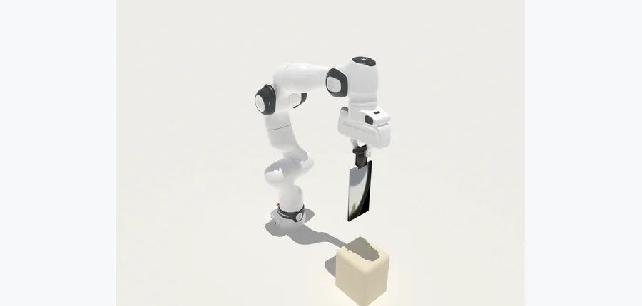 arXiv 2026-11-01 · [arXiv:2610.39975](https · #1 **[Mastering Multi-State Dynamics: Continuum Damage and Viscoplastic MPM for RL-Based Dexterous Manipulation](https://arxiv.org/abs/2610.39975)** [cs.GR](https://arxiv.org/abs/2610.39975) 机构：[Yusen Feng , Shangbo Luan](https://arxiv.org/abs/2610.39975) [Paper](https://arxiv.org/abs/2610.39975) · [图源](https://arxiv.org/html/2610.39975v1/figures/tofu_setting.png) 

中文摘要
多状态材料的机器人操作需要一种既能处理大形变、拓扑变化及工具与材料双向接触，又足够快以支持在线强化学习的仿真器。我们提出 MG-CD-MPM，一种以工具为中心、对 CD-MPM 进行局部扩展的方法。隐式 Ginzburg–Landau 相场损伤系统在局部区域上求解：采用预条件共轭梯度法，并以几何多重网格 V-cycle 为预条件器。背景 MPM 离散仍保持均匀，仅将损伤求解局部化。双向刚性工具耦合把 MPM 接触冲量转为作用于工具的力和力矩，使策略直接感知材料阻力。所得类 Gym 仿真器通过统一的逐粒子本构层涵盖软固体、脆性材料、颗粒介质以及黏塑性或半流体介质。我们在六个场景中展示切割、挖取和铲动，结合脚本化工具运动与在两个切割任务上训练的 PPO 策略。 <a href="https://arxiv.org/abs/2610.39975">原摘要来源</a>
 | 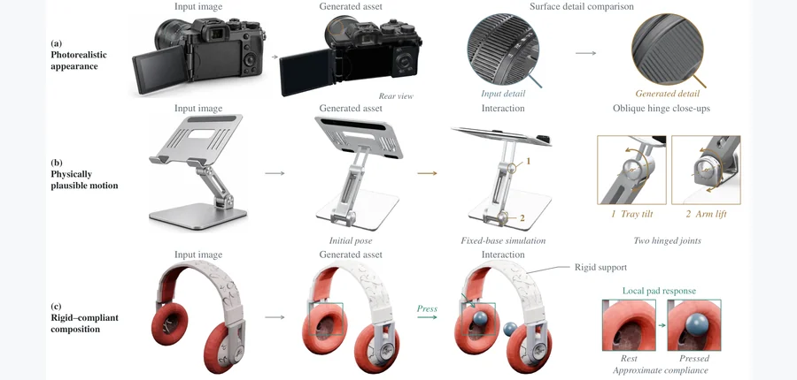 arXiv 2026-11-01 · [arXiv:2610.39924](https · #2 **[PhysAg3D: Bridging 3D Generative and Agentic Models for High-Fidelity and Physically-Interactive Assets](https://arxiv.org/abs/2610.39924)** [cs.CV](https://arxiv.org/abs/2610.39924) 机构：[Bi'an Du , Fanpeng Meng , Jiemin Fang , Chen Yang , Pufan Li , Daizong Liu , Qi Tian , Wei Hu](https://arxiv.org/abs/2610.39924) [Paper](https://arxiv.org/abs/2610.39924) · [图源](https://arxiv.org/html/2610.39924v1/teaserdba_mfp.png) 

中文摘要
从单张图像生成可交互三维资产，既要求外观真实、忠实于图中物体，也要求物理行为合理；细致几何本身并不能决定物体如何运动或形变。我们提出 PhysAg3D，将三维生成模型与智能体推理和工具使用结合。视觉语言智能体先从图像推断语义部件、候选交互和物理先验；三维生成器再从同一图像生成带纹理的完整物体网格。分层交互表示把这些可修订先验与机构及其控制的生成表面联系起来，组织交互构建和细化。智能体在该表示和网格观测引导下使用几何及物理工具，构建部件、关节、可形变区域和表面绑定，同时保留有用的生成几何与材质。渲染交互和执行测量在固定预算内指导定向修订。框架同时支持刚性关节运动与柔顺形变。在真实照片和外部基准上的定量与定性评估显示，所得资产具有细节、与图像对齐且交互合理；消融实验支持有界细化和源表面保留的作用。论文提供项目页链接。 <a href="https://arxiv.org/abs/2610.39924">原摘要来源</a>
 | 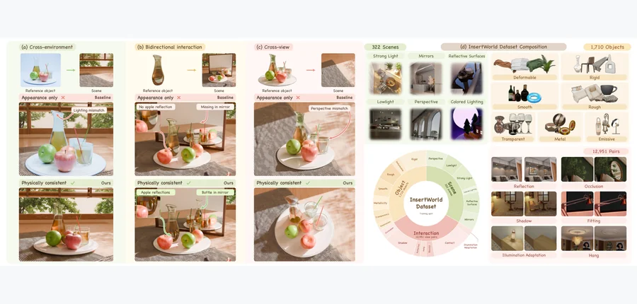 arXiv 2026-11-01 · [arXiv:2610.40453](https · #3 **[PhysInsert: Physically Plausible Object Insertion with Geometric Priors and Bidirectional Object-Scene Interactions](https://arxiv.org/abs/2610.40453)** [cs.CV](https://arxiv.org/abs/2610.40453) 机构：[Yue Gong , Le Zhang , Rui Chen , Song Chang , Xiaochao Qu , Luoqi Liu , Ting Liu , Yebin Liu](https://arxiv.org/abs/2610.40453) [Paper](https://arxiv.org/abs/2610.40453) · [图源](https://arxiv.org/html/2610.40453v1/motivation.png) 

中文摘要
我们提出 PhysInsert：一种基于参考图像、同时调整物体及其周围场景的物理合理物体插入框架。现有方法常依赖掩码输入、生成式配对或视角变化有限的训练对，使姿态、光照适配及物体与场景的双向交互缺乏充分约束。我们构建 Insert World 数据集，包含跨视角与光照条件下严格对齐的 Blender 渲染反事实图像对和物体参考图。基于这些数据，Geometry-Guided Adaptation 在目标场景特征监督下耦合 VGGT 几何分支与图像、文本分支，引导空间一致的插入。互补的二维 Object-Scene Spatial Supervision 同时监督物体占据和环境变化，并通过图文注意力把空间指令锚定在物体区域。我们还提出 PhysInsert-Bench，设置需要超越外观复制、适应光照与姿态的跨环境和跨视角案例。在 PhysInsert-Bench 和 DreamBooth 上的实验显示图像保真度提高；用户研究还显示放置更准确，光照融合、透视与姿态合理性更好。 <a href="https://arxiv.org/abs/2610.40453">原摘要来源</a>
 |
| 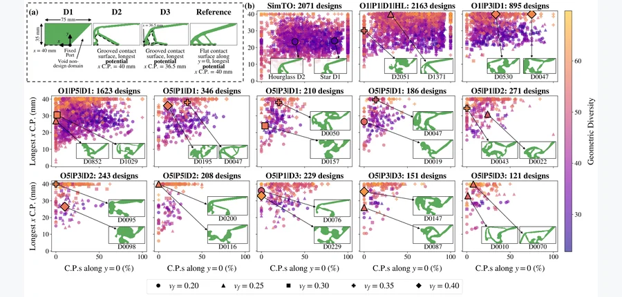 arXiv 2026-11-01 · [arXiv:2610.39560](https · #4 **[SimTO-Robust: Automated Design of Soft Grippers Robust to Grasp Pose and Object Geometry](https://arxiv.org/abs/2610.39560)** [cs.RO](https://arxiv.org/abs/2610.39560) 机构：[Kurt Enkera , Joshua Pinskier , Marcus Gallagher , David Howard](https://arxiv.org/abs/2610.39560) [Paper](https://arxiv.org/abs/2610.39560) · [图源](https://arxiv.org/html/2610.39560v1/contact_points_scatter_all_experiments.png) 

中文摘要
非结构化环境中的机器人夹爪必须在感知和定位存在误差时，稳健抓取不同形状、尺寸的物体。通过机械设计而非复杂控制获得稳健性的软夹爪是可行路径，但现有计算设计框架尚未明确针对多种物体几何和抓取姿态优化形态。我们提出 SimTO-Robust，扩展仿真驱动拓扑优化（SimTO），对多个物体及姿态的抓取进行仿真，并汇总接触力指导夹爪形态优化。我们生成 6,646 种设计，并对其中 24 种进行实体测试，同时测试 10 种专用 SimTO 设计、两种刚性基线夹爪和一种常规拓扑优化生成的通用软夹爪。全部 37 个夹爪在包含五种几何特征丰富的物体、六种抓取姿态的拾取放置任务中测试，过程中施加逐渐增强的外部扰动。平均而言，SimTO-Robust 设计比专用 SimTO 和刚性基线更可靠地完成任务；其中最佳设计承受的扰动也超过所有其他受测夹爪。结果表明，把多样化抓取条件纳入仿真驱动拓扑优化，是提高真实世界软夹爪稳健性的简便有效方法，也说明机械设计能够支撑稳健抓取。 <a href="https://arxiv.org/abs/2610.39560">原摘要来源</a>
 | 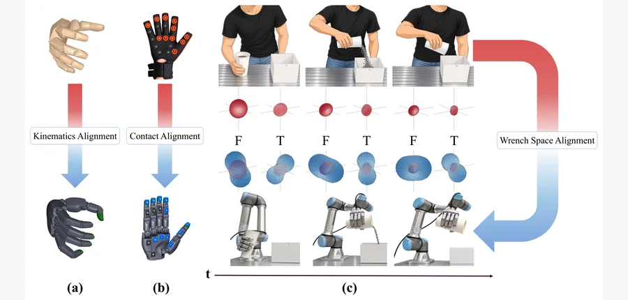 arXiv 2026-11-01 · [arXiv:2610.39582](https · #5 **[Kinematic-Tactile Aligned Dexterous Retargeting with Contact Wrench Space Alignment](https://arxiv.org/abs/2610.39582)** [cs.RO](https://arxiv.org/abs/2610.39582) 机构：[Xinyuan He , Ziheng Xu , Yueyuan Chen , Yufan Ye , Yuanshuo Tan , Huiming Pan , Jianjun Meng , Shuo Jiang , Peter B. Shull](https://arxiv.org/abs/2610.39582) [Paper](https://arxiv.org/abs/2610.39582) · [图源](https://arxiv.org/html/2610.39582v1/intro_crop.png) 

中文摘要
人类演示为灵巧操作策略学习提供自然且可扩展的数据来源，但现有重定向方法主要迁移人体运动学，很少保留跨具身的触觉交互信息。我们提出一个运动学与触觉对齐的三阶段分层灵巧重定向框架，使用以物体为中心的接触力螺旋空间，作为人手与机器人手之间触觉对齐的物理表示。框架先对齐手部运动学和接触几何，再由触觉力与接触几何构造人手力螺旋支撑轮廓；随后优化机器人指尖力目标以覆盖该轮廓，并将其转为关节位置修正，得到可直接回放的机器人手轨迹。我们在三种倒液条件下进行仿真和真实机器人实验。真实机器人实验中，该方法达到 96.7% 的回放成功率，力螺旋迁移保真度高于代表性重定向基线。该框架为从人类演示向机器人手迁移有物理依据的运动学和触觉信息提供了路径。 <a href="https://arxiv.org/abs/2610.39582">原摘要来源</a>
 | 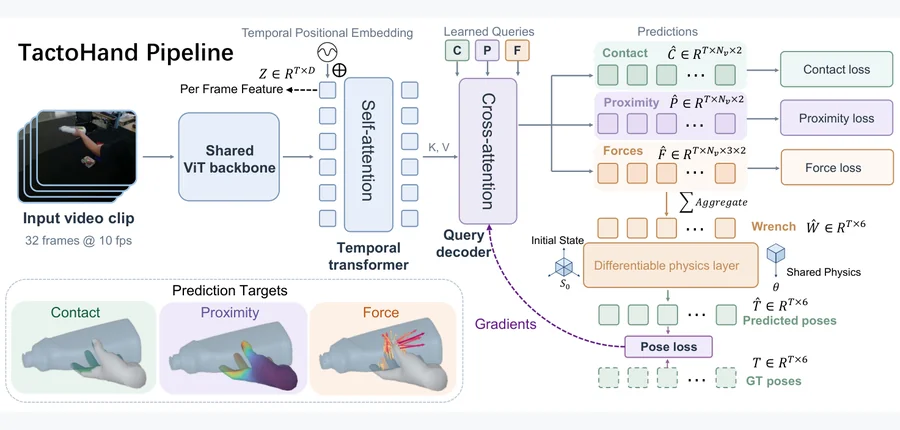 arXiv 2026-11-01 · [arXiv:2610.39585](https · #6 **[TactoHand: Learning Geometry-Based Dense Hand-Surface Interaction Fields from Video](https://arxiv.org/abs/2610.39585)** [cs.CV](https://arxiv.org/abs/2610.39585) 机构：[Ziheng Xi , Weibo Li , Jiayi Yu , Sipeng Zheng , Wanpeng Zhang , Haiweng Xu , Hao Luo , Chuan Mao , Zongqing Lu](https://arxiv.org/abs/2610.39585) [Paper](https://arxiv.org/abs/2610.39585) · [图源](https://arxiv.org/html/2610.39585v1/pipeline.png) 

中文摘要
理解人与世界的交互，需要表示手部表面的物理作用。触觉传感能捕捉这些作用，但大规模采集触觉数据需要专门硬件。我们提出 TactoHand，从单目视频预测手部表面的三种稠密交互场：接触、邻近性和三维力。我们从一个经筛选、源视频约 5,000 万帧的集合中，针对合格训练数据生成基于几何的接触与邻近标签，以及从运动导出的力标签。TactoHand 用时序 Transformer 跨帧汇集视觉证据，再以三个学习查询解码对应的手表面场；可微物理层还利用观测到的物体运动约束力预测。在域内和域外基准上，TactoHand 的接触与邻近估计优于已有方法；物理监督降低运动 rollout 中的位置和旋转误差，预测的接触与邻近场也改善下游手物重建。结果展示了无需采集触觉测量、以低成本大规模学习手表面交互场的路径。论文称代码将在所给网址发布。 <a href="https://arxiv.org/abs/2610.39585">原摘要来源</a>
 |
| 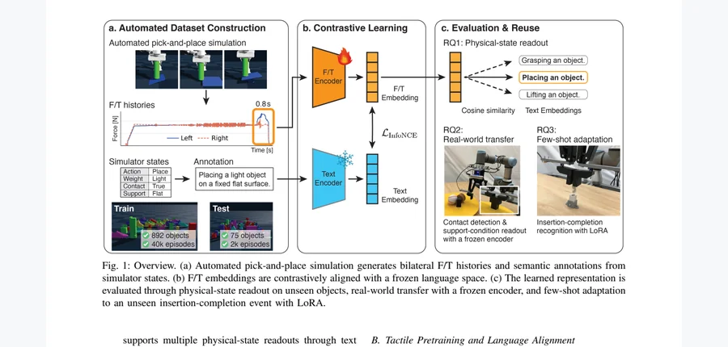 arXiv 2026-11-01 · [arXiv:2610.39314](https · #7 **[Language-Grounded Force/Torque Pretraining for Extrinsic Contact Perception](https://arxiv.org/abs/2610.39314)** [cs.RO](https://arxiv.org/abs/2610.39314) 机构：[Kazuki Takahashi , Hiroaki Murakami , Ryota Sakuma , Mitsuhiro Kamezaki , Matthew Ishige , Yoshihiro Kawahara](https://arxiv.org/abs/2610.39314) [Paper](https://arxiv.org/abs/2610.39314) · [图源](https://arxiv.org/pdf/2610.39314) 

中文摘要
精细操作要求机器人识别被抓物体何时与环境接触或改变接触，但这种外部接触未必能从视觉或局部接触几何直接观察到。力和力矩信号包含相关信息，却也随物体重量、抓取方式和机器人运动变化，因此其能否形成可复用的物理状态表示尚不明确。我们表明：利用模拟拾取放置交互生成的监督，把双侧六轴力／力矩历史与冻结的语言空间对齐，可以预训练出语义结构化的物理表示。在仿真中的未见物体上，该表示支持通过文本原型读取机器人动作、物体重量和抓取交互。在真实放置任务中，无标签校准无需更新编码器即可识别接触与支撑状态，优于竖直力符号翻转规则基线。对于预训练中没有出现的连接器插入事件，低秩适配比从头训练更有效地利用数据。结果表明，力／力矩历史既可直接读取已知物理状态，也能高效适配新的外部接触事件。 <a href="https://arxiv.org/abs/2610.39314">原摘要来源</a>
 | 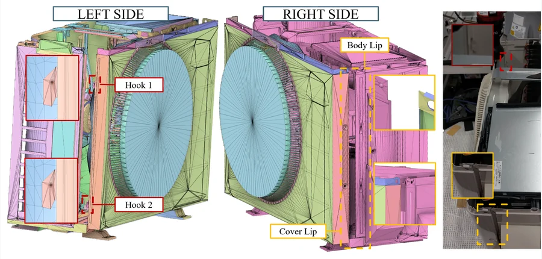 arXiv 2026-11-01 · [arXiv:2610.38513](https · #8 **[Force-Driven Hook Disassembly via Constraint-Aware Object-Centric Reinforcement Learning](https://arxiv.org/abs/2610.38513)** [cs.RO](https://arxiv.org/abs/2610.38513) 机构：[Nadeen Elhadad , Takuya Kiyokawa , Kensuke Harada](https://arxiv.org/abs/2610.38513) [Paper](https://arxiv.org/abs/2610.38513) · [图源](https://arxiv.org/html/2610.38513v1/images/aircon_constraintswithreal.png) 

中文摘要
报废产品日益增多，推动自动拆解需求；但钩形连接方向多变、受力后会形变且几何被遮挡，仅凭视觉难以确定无损拆解方向。本文提出约束感知强化学习框架，根据接触力在线推断可行抽出方向。策略在简化的销孔配对上，以机器人无关、物体中心坐标的仿真训练，再零样本部署至实体机器人，并迁移到未见过的多阶段约束连接。由于瞬时接触力有噪声且局部含糊，策略结合粒子滤波信念，获得时间整合的方向信息，减少重复探索运动。方法在四项真实任务上验证，从销孔配对到报废空调的内风扇与前盖。完整方法的成功率分别为 100%、100%、90% 和 75%，每项任务的路径效率均最高；相对不使用信念的策略，空调前盖成功率从 45% 提高到 75%。结果说明，基于力的强化学习可以在没有产品专用模型或演示的条件下实现拆解。 <a href="https://arxiv.org/abs/2610.38513">原摘要来源</a>
 | 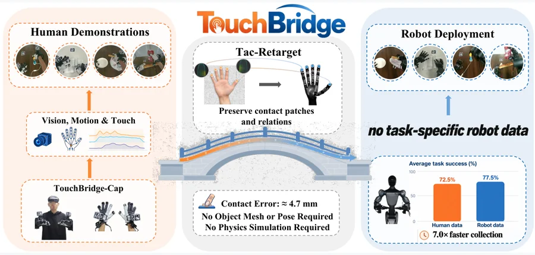 arXiv 2026-11-01 · [arXiv:2610.40349](https · #9 **[TouchBridge: Tactile-Conditioned Human-to-Robot Transfer for Dexterous Manipulation](https://arxiv.org/abs/2610.40349)** [cs.RO](https://arxiv.org/abs/2610.40349) 机构：[Haozhe Zhang , Gu Zhang , Zirui Zou , Yuzheng Chen , Jinlong Wu , Zixuan Hu , Jianke Zhang , Yucheng Hu , Zhecheng Yuan , Huazhe Xu](https://arxiv.org/abs/2610.40349) [Paper](https://arxiv.org/abs/2610.40349) · [Project](https://touchbridge2026.github.io/) · [图源](https://arxiv.org/html/2610.40349v1/teaser_new.png) 

中文摘要
人类演示是灵巧机器人操作高效且可扩展的数据来源，但传感方式与手部形态差异使丰富接触交互的迁移变得困难。我们提出 TouchBridge，一个软硬件协同设计的人到机器人数据转换框架。可穿戴的人类演示接口和对应机器人接口，在视觉与指尖触觉传感上建立跨具身对应关系。所提出的 Tac-Retarget 利用实测接触对齐指尖接触斑块，并保留其在单手内及双手之间的空间关系。与物体感知或仿真式迁移流程不同，Tac-Retarget 重定向时无需物体网格、物体姿态估计或物理仿真，可直接且可扩展地把人类演示转成机器人域训练数据。结合视觉合成及相机锚定的动作转换，TouchBridge 生成机器人域演示，用于微调预训练视觉语言动作（VLA）模型。在四项真实的丰富接触任务中，仅用 TouchBridge 转换的人类演示微调的策略平均成功率为 72.5%，等量遥操作机器人演示为 77.5%，而人类演示采集速度快 7.0 倍。在相同策略和训练配置下，Tac-Retarget 比 DexPilot 和 UniDex 分别高 25.0 和 42.5 个百分点。 <a href="https://arxiv.org/abs/2610.40349">原摘要来源</a>
 |
| 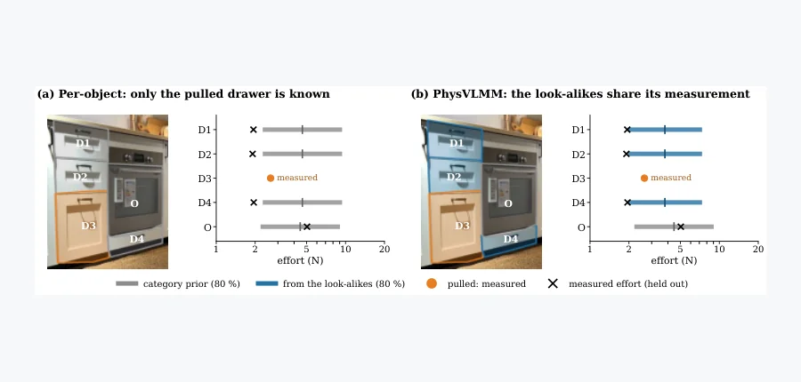 arXiv 2026-11-01 · [arXiv:2610.40539](https · #10 **[PhysVLMM: Interaction-Conditioned Physical Belief Maps for Articulated Objects in Robot Scene Maps](https://arxiv.org/abs/2610.40539)** [cs.RO](https://arxiv.org/abs/2610.40539) 机构：[Dibyendu Ghosh](https://arxiv.org/abs/2610.40539) [Paper](https://arxiv.org/abs/2610.40539) · [图源](https://arxiv.org/html/2610.40539v1/concept.png) 

中文摘要
移动机器人需要打开门和抽屉，但场景地图通常只记录物体是什么、是否移动过，未记录拉动后会如何响应。本文提出 PhysVLMM：为 Vision-Language-Motion Map 中每个可关节运动部件维护物理信念，并以地图更新与查询两种算法回答规划器的问题。仅观察部件运动在理论上无法识别其动力学；一次有测量的拉动也只识别被拉部件且仅限一个方向。因此，PhysVLMM 把该方向保留为后验分布而非点估计，用闭式形式将每次拉动的证据传给地图中未触碰的相似部件，并在给定风险下回答动作是否会成功或选择弃答。在 18 户住宅的真实门和抽屉上，它在留出拉动中以 86% 的比例识别关节类型（学习式单视图方法为 48%），预测拉动响应的误差比可微仿真低 41%（CRPS 0.323 对 0.544），每例速度快四个数量级（13 毫秒对 230 秒）。后验使最终位置误差从 0.460 降至 0.270；共享使未触碰部件的力误差从 56% 降至 42%；在 0.02–0.30 的各个给定风险水平上，误判安全的比例均保持在界限内。把同一住宅所有已测部件合并与按相似组共享一样有效，简化变体对被拉部件停止位置的预测至少同样准确。 <a href="https://arxiv.org/abs/2610.40539">原摘要来源</a>
 | 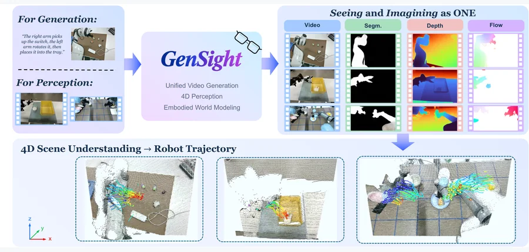 arXiv 2026-11-01 · [arXiv:2610.39232](https · #11 **[Seeing and Imagining as One: Unified Video Generation and 4D Perception for Embodied World Modeling](https://arxiv.org/abs/2610.39232)** [cs.CV](https://arxiv.org/abs/2610.39232) 机构：[Haitang Feng , Zhuoman Liu , Zhennan Wang , Sheng Wang , Juelin Li , Chengzhi Zhao , Hexiang Wei , Lin Shao](https://arxiv.org/abs/2610.39232) [Paper](https://arxiv.org/abs/2610.39232) · [图源](https://arxiv.org/html/2610.39232v1/teaser.png) 

中文摘要
具身世界模型不仅应想象合理未来，也应感知演化世界中的几何、语义和运动结构。我们提出 GenSight：在单个预训练视频扩散 Transformer 中统一未来视频生成与稠密感知的具身世界模型。GenSight 对视频、深度、具身主体分割和相对首帧的二维光流使用统一时空表示；基于共享 DiT 骨干，通过轻量任务调制在同一架构中预测各模态，所有任务在统一的速度预测空间中联合优化。推理时，它支持两种互补模式：带对齐稠密预测的多步未来视频生成，以及从已观测视频进行单步稠密感知。通过统一模态表示、模型架构与预测空间，GenSight 避免各模态独立的流程，在共享表示中耦合外观、几何、语义和运动，促进跨模态一致性，并使稠密感知受益于视频生成学到的时空先验。模型在跨多种机器人具身形态和人手交互的具身操作数据上训练，在视频生成和稠密四维感知上均表现良好，显示统一“观察”与“想象”对具身世界建模的作用。 <a href="https://arxiv.org/abs/2610.39232">原摘要来源</a>
 | 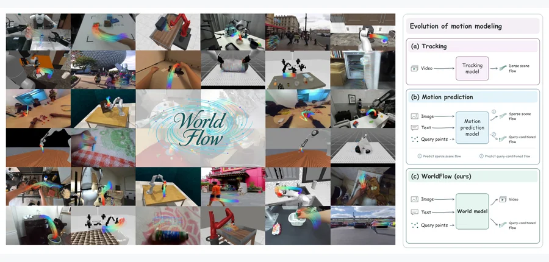 arXiv 2026-11-01 · [arXiv:2610.39278](https · #12 **[WorldFlow: Joint Video and 3D Motion Prediction via Large-Scale Pretraining](https://arxiv.org/abs/2610.39278)** [cs.CV](https://arxiv.org/abs/2610.39278) 机构：[Yuhao Lu , Jiongxu Chen , Hexiang Wei , Jiajin Wu , Juelin Li , Mingjian Liang , Fan Yang , Zhuowei Liang , Zihao Liu , Zhennan Wang , Sheng Wang , Lin Shao](https://arxiv.org/abs/2610.39278) [Paper](https://arxiv.org/abs/2610.39278) · [Project](https://worldflow-rbs.github.io/) · [图源](https://arxiv.org/html/2610.39278v1/teaser.png) 

中文摘要
预测未来物理状态是具身智能的核心难题。现有视频世界模型让三维动力学保持隐式；基于动作的形式受特定机器人构型限制；三维运动预测模型仅用光流监督，对物理动力学提供的学习信号有限。为此，我们提出 WorldFlow，一种联合预测未来视频和基于查询的三维轨迹的生成式世界模型。将三维运动参数化为与视频网格对齐的连续位移 token 后，统一的 Mixture-of-Transformers（MoT）骨干在 rectified-flow 目标下联合去噪两种模态。该形式把显式几何动力学与视觉演化耦合，以利用预训练视频模型中的物理常识。我们在跨仿真与真实域的 144 万个物体级样本混合集上训练，并提出 WorldFlowBench：来自 11 个数据源、覆盖仿真和真实交互及空间推理任务的 1,678 个评估样本。在全部三个评估集上，WorldFlow 的平均位移误差（ADE）和最终位移误差（FDE）均是受测学习式方法中最低的；在 SpatialCog 上 ADE 为 0.060 米，比最强外部基线低 54.2%。相对仅用光流的变体，ADE 和 FDE 分别降低 55.9% 与 68.5%。论文提供项目页链接。 <a href="https://arxiv.org/abs/2610.39278">原摘要来源</a>
 |
| 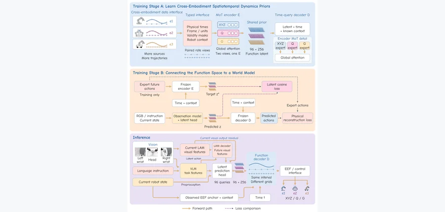 arXiv 2026-11-01 · [arXiv:2610.40401](https · #13 **[Continuous-Action World Models: Learning Cross-Embodiment Spatiotemporal Dynamics Priors](https://arxiv.org/abs/2610.40401)** [cs.RO](https://arxiv.org/abs/2610.40401) 机构：[Liangyu Li , Qingwen Liu](https://arxiv.org/abs/2610.40401) [Paper](https://arxiv.org/abs/2610.40401) · [图源](https://arxiv.org/html/2610.40401v1/main_figure_v6.png) 

中文摘要
我们提出 Continuous-Action World Models（CoAWM），学习跨具身形态的时空动力学先验，以支持不同机器人及执行频率下的动作生成。核心是一个捕捉机器人动作空间与时间结构的共享潜在函数空间。学习分两阶段进行：先通过函数预训练把不同具身形态、采样频率的轨迹映射到共同表示，利用动作重建和不同时间采样视图间的一致性学习共享动力学先验；容纳异构机器人轨迹也扩大了可用于预训练的数据来源，便于扩展到更大、更多样的数据集。第二阶段将预训练函数空间连接到世界模型骨干，使观测、语言指令和当前机器人状态能够条件化潜在动作函数预测。单个解码器接受任意查询时间，返回对应末端执行器动作。通过分离共享动力学先验、任务条件动作选择和时间采样，该方法为跨具身与控制频率迁移机器人经验提供统一基础。 <a href="https://arxiv.org/abs/2610.40401">原摘要来源</a>
 | 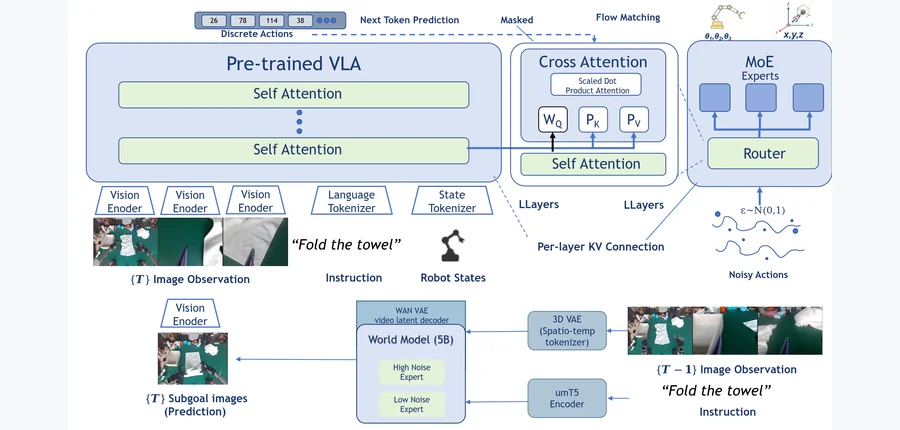 arXiv 2026-11-01 · [arXiv:2610.39528](https · #14 **[PRIME W0: Physical Priors from World Models for Embodied Manipulation](https://arxiv.org/abs/2610.39528)** [cs.RO](https://arxiv.org/abs/2610.39528) 机构：[Huabin Peng , Fagang Jin , Yancong Wei , Tengfei Ma , Chuhang Liu , Chao Yu , Liqing Chen](https://arxiv.org/abs/2610.39528) [Paper](https://arxiv.org/abs/2610.39528) · [图源](https://arxiv.org/html/2610.39528v1/figures/model_structure.png) 

中文摘要
视觉语言动作（VLA）模型擅长执行指令，但多数仍是前馈式的：只根据当前观测生成动作，丢弃长时序上下文及 VLM 表示的层级结构。我们提出 PRIME W0，一种分层条件流匹配框架，结合三项设计弥补这一缺口：（1）将预训练 VLM 每层的 KV 注入自适应 MoE 动作专家；（2）通过异步世界模型预测子目标图像，以及 DINOv2 历史帧语义桥，加入动力学感知条件；（3）使用具有尊重机器人运动学耦合的协方差结构噪声的 Action Dynamic Manifold（ADM）流匹配。PRIME W0 经过四阶段训练：VLM 预训练、DAT/NTP 视觉运动预训练、组装带世界模型注入的 DiT 流匹配解码器，以及端到端监督微调。在 LIBERO 和真实机器人基准上取得论文所称的先进结果，系统消融验证了各架构组成的作用。 <a href="https://arxiv.org/abs/2610.39528">原摘要来源</a>
 | 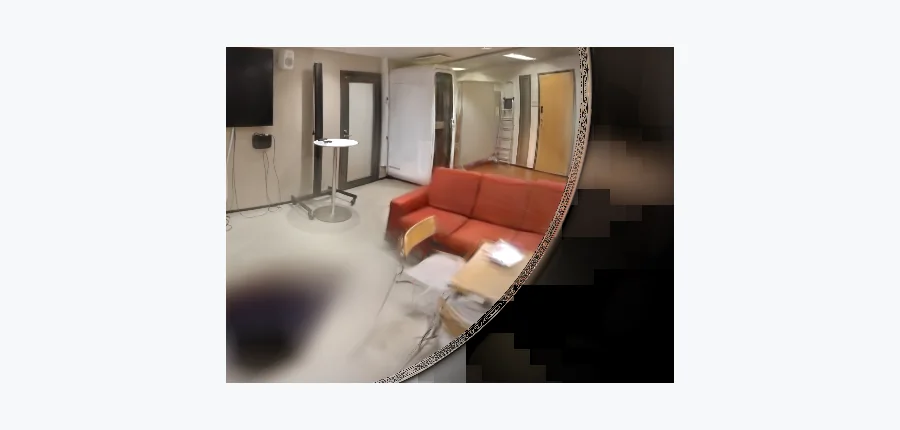 arXiv 2026-11-01 · [arXiv:2610.37818](https · #15 **[GOFish: Full Field-of-View Gaussian Splatting and Mesh Extraction](https://arxiv.org/abs/2610.37818)** [cs.CV](https://arxiv.org/abs/2610.37818) 机构：[Allen Tu , Meher Gitika Karumuri , Shifan Zhu , Hailing Wang , Yen-Liang Lin , David Held , Matthias Zwicker , Tom Goldstein](https://arxiv.org/abs/2610.37818) [Paper](https://arxiv.org/abs/2610.37818) · [Project](https://3dgofish.github.io/) · [图源](https://arxiv.org/html/2610.37818v1/figures/failures_c_3dgut.png) 

中文摘要
机器人、自动驾驶车辆和消费级 360° 相机使用鱼眼镜头获取宽视场。可用于仿真的数字孪生需要覆盖完整视场的照片级渲染及对齐的碰撞网格。此前鱼眼 Gaussian Splatting 方法仅光栅化至 180° 且不生成网格，Gaussian 表面重建方法则假设训练图像来自针孔相机。我们提出 GOFish：首个直接以鱼眼图像训练、光栅化超过 180° 视场并从同一场景提取对齐网格的三维 Gaussian Splatting 表面重建方法。校准式致密化恢复整个视场的表面；Calibrated Mip Filtering 与 Wide-Angle Appearance Modeling 防止像素模糊和镜头光照衰减被写入场景与网格。在 200° 的 FIORD 和 205° 的 FullCircle 基准上，GOFish 相对最佳先前方法的 PSNR 分别提高 2.28 和 1.97 dB；它也在各鱼眼渲染基线自身视场内超过它们，并在 FIORD 和 ScanNet++ 主集上达到最高网格 F-score。Gaussian 场景与网格共同形成无需 LiDAR、可用于仿真的数字孪生，可实时渲染、覆盖完整视场进行光线追踪，并提供碰撞几何。 <a href="https://arxiv.org/abs/2610.37818">原摘要来源</a>
 |
| 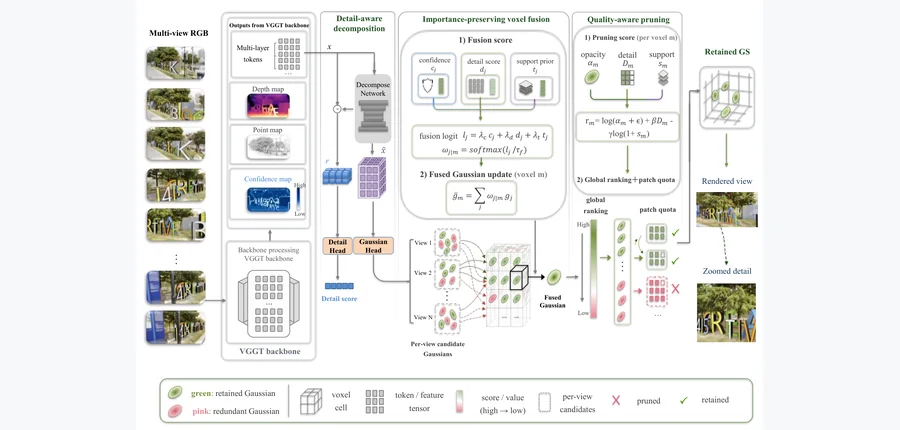 arXiv 2026-11-01 · [arXiv:2610.38278](https · #16 **[BudSplat: Feed-forward 3D Gaussian Splatting under a Rendering Budget](https://arxiv.org/abs/2610.38278)** [cs.CV](https://arxiv.org/abs/2610.38278) 机构：[Muyu Xu , Fangneng Zhan , Yu Wei , Ling Shao , Shijian Lu](https://arxiv.org/abs/2610.38278) [Paper](https://arxiv.org/abs/2610.38278) · [图源](https://arxiv.org/html/2610.38278v1/pipeline.png) 

中文摘要
前馈式三维 Gaussian Splatting 通过直接从输入图像预测 Gaussian 基元，成为逐场景优化之外的快速新视角合成方案。但从稀疏视图扩展到提供更多几何约束的稠密多视图时，候选 Gaussian 数量迅速增长，渲染效率成为瓶颈。现有方案难以可靠识别冗余基元，使重复观测区域产生大量重复基元、渲染成本增加而画质收益有限。我们提出 BudSplat：在受限基元数量下学习保留最有价值 Gaussian 的紧凑前馈式 3DGS 框架。其一是从多层视觉 token 提取的细节感知重要性分数，显式标出剪枝可能损害感知质量的区域，并可注入体素融合以在多视图聚合中保留高价值局部贡献。其二是质量感知 Gaussian 剪枝，联合渲染贡献与细节重要性选取紧凑基元集，通过局部配额重分配避免把过多基元分给大面积冗余区域。在 RE10K、DL3DV 和 ACID 上，BudSplat 展现了有利的渲染质量与效率权衡。 <a href="https://arxiv.org/abs/2610.38278">原摘要来源</a>
 | 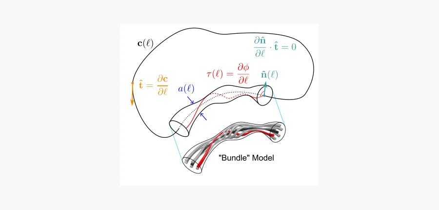 arXiv 2026-11-01 · [arXiv:2610.39064](https · #17 **[From Dye to Dynamics: Quantitative Measurements of Fluid Flows from Vortex Geometry](https://arxiv.org/abs/2610.39064)** [physics.flu-dyn](https://arxiv.org/abs/2610.39064) 机构：[Dustin Kleckner , Kevin Collins , Cole Cooper](https://arxiv.org/abs/2610.39064) [Paper](https://arxiv.org/abs/2610.39064) · [图源](https://arxiv.org/html/2610.39064v1/model.png) 

中文摘要
涡量和染料等被动示踪物都被流体输运，但输运细节存在微妙差异；因此尽管实验中常用染料追踪涡旋运动，染料一般不能直接用于此目的。本文表明，在适当条件下，染料能够准确追踪涡丝的中心线。我们进一步表明，能量、螺旋度等若干重要流体量可以由涡旋中心线的形状计算。因此，以染料追踪的涡旋可作为在多种实验场景测量流体运动性质的有价值工具。文中还讨论了未来可用于提取更详细涡旋信息的技术。 <a href="https://arxiv.org/abs/2610.39064">原摘要来源</a>
 | 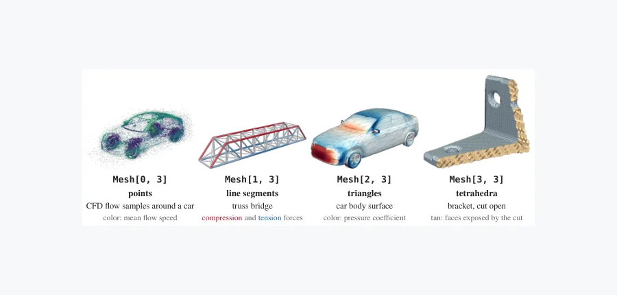 arXiv 2026-11-01 · [arXiv:2610.39072](https · #18 **[PhysicsNeMo-Mesh: GPU-Native Meshes and Simulation Cases for Physics AI](https://arxiv.org/abs/2610.39072)** [physics.comp-ph](https://arxiv.org/abs/2610.39072) 机构：[Peter D. Sharpe , Corey Adams , Negin Sobhani , Sanjay Choudhry](https://arxiv.org/abs/2610.39072) [Paper](https://arxiv.org/abs/2610.39072) · [图源](https://arxiv.org/html/2610.39072v1/mesh_dimensions.png) 

中文摘要
PhysicsNeMo-Mesh 是开源 PhysicsNeMo 库中的网格模块。它提供类似 PyVista 的网格处理，但在 GPU 上批量运行，且位于 PyTorch 自动微分计算图内。类似面向非结构化网格的 xarray，它为数据赋予语义：点、单元和整体网格上的场具有名称与形状；一个 simulation case 保留完整 PDE 问题规范，包括边界条件及其指定值。它针对物理仿真机器学习中的三项问题：样本相对每次前向计算过大，I/O 限制 GPU 利用率；传统预处理昂贵，只能在数据整理时固定执行，无法随模型与流程变化；高级等变与原生网格架构所需信息通常在整理时被丢弃。快速 GPU 网格处理使按需预处理可行：在一块 GB200 GPU 上，网格操作比使用 72 线程的 VTK 快 6.2–1,068 倍；加载完整 case 比读取相应 VTK 文件快 8.0–88 倍（读相同字段时为 8.0 倍）。与训练重叠时，对于单步 127 毫秒的 Transolver，预处理只占吞吐量的 2.1%。因此，PhysicsNeMo 的公开流程可让同一份 DrivAerML 数据服务 Transolver、GeoTransolver 和 GLOBE。PhysicsNeMo-Mesh 结合中间数组存储的速度与 VTK 等归档格式的灵活性。形状和壁面条件同时变化时，逐边界条件把导热误差从 87% 降至 6–9%；保留场的阶数及具名边界，也保留下一代架构需要的语义结构。 <a href="https://arxiv.org/abs/2610.39072">原摘要来源</a>
 |
| 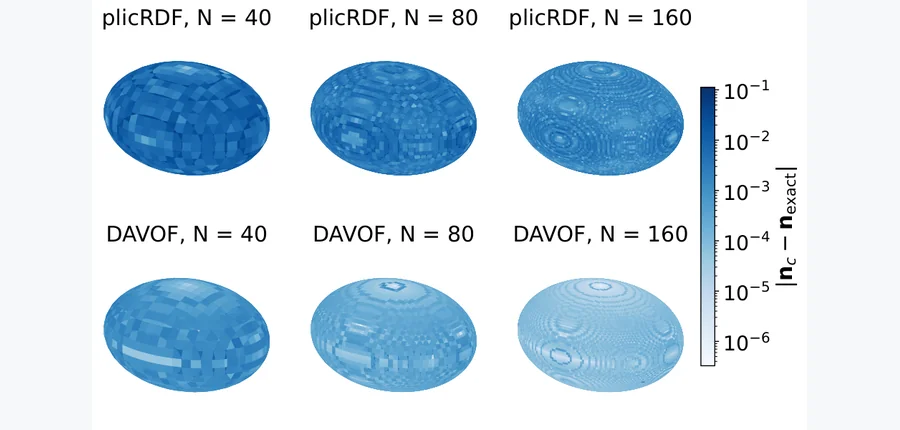 arXiv 2026-11-01 · [arXiv:2610.38863](https · #19 **[Dual Area-Volume-of-Fluid (DAVOF): co-advecting volume and face-area fractions for a closed-form, cell-local interface normal and position on unstructured meshes](https://arxiv.org/abs/2610.38863)** [physics.comp-ph](https://arxiv.org/abs/2610.38863) 机构：[Tomislav Marić](https://arxiv.org/abs/2610.38863) [Paper](https://arxiv.org/abs/2610.38863) · [图源](https://arxiv.org/html/2610.38863v1/plic_ellipsoid.png) 

中文摘要
在非结构化多面体网格上，几何流体体积分数法（VOF）通常从邻域单元体积分数重建界面方向；不规则单元或伪小液滴会使其退化，而由此得到的曲率会驱动毛细流中的寄生流。我们在每个单元体积分数之外，一致地输运各面被液体覆盖的面积分数。由面积与体积分数，闭式方程首次在 VOF 中无需邻居或迭代就恢复单元界面法向与位置：法向来自对本单元面的一个求和及液体子体积上的散度定理，位置来自第二个方程。对于六面体、扰动单元及多面体中的平面，两式均精确。对球与椭球，法向精度阶随面分数，位置在各种状态和网格上为二阶；由一环恢复法向拟合的二次曲面给出收敛曲率，而对照模型没有这一性质。通过平面裁切输运的环法向，对单元及其一环联合区域使用同一恒等式，可稳定状态，使球体移动超过 3.3 个直径仍有界且守恒；误差在面分数上为一阶，符合裁切律，并达到 plicRDF 的位置与形状误差水平。初步的逐单元抛物面输运实现由法向确定坐标架、一环确定曲率张量、体积分数确定位置；在 N=32–128 的分辨率序列上，球体运动保持有界和守恒，面分数每周期的收敛阶在精确法向下为 2.8、在一环二次曲面法向下为 2.1。循环的精度阶受输入法向限制；得到二阶输运法向是研究目标。本文是后续方法开发的基础。 <a href="https://arxiv.org/abs/2610.38863">原摘要来源</a>
 | 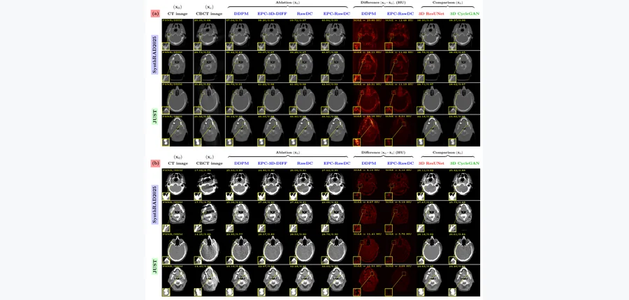 arXiv 2026-11-01 · [arXiv:2610.40046](https · #20 **[EPC-RawDC: Equivariant Physics Constrained 3D Diffusion with Raw Data Consistency for CBCT to CT Image Synthesis](https://arxiv.org/abs/2610.40046)** [cs.CV](https://arxiv.org/abs/2610.40046) 机构：[Alzahra Altalib , Chunhui Li , Alessandro Perelli](https://arxiv.org/abs/2610.40046) [Paper](https://arxiv.org/abs/2610.40046) · [图源](https://arxiv.org/html/2610.40046v1/Fig2.png) 

中文摘要
锥形束 CT（CBCT）广泛用于图像引导与自适应放疗，但散射、噪声、重建伪影和不准确的亨氏单位限制其定量使用。现有 CBCT 到 CT 的扩散方法主要由图像驱动，对底层采集物理利用有限。我们提出 EPC-RawDC，一种条件化三维潜在扩散框架，把体积生成建模与从同一扫描仪特定 CBCT 前向模型得到的两类约束结合。第一，几何等变投影约束利用 CBCT 前向算子的旋转等变性，通过相应变换的参考投影监督生成 CT；第二，原始数据一致性在训练时以单次采集的含噪投影测量提供扫描特定监督。框架在扫描仪几何和投影来源不同的两个独立临床队列上评估：JUST 使用 Elekta 系统采集的临床原始 CBCT 投影，SynthRAD2025 使用 Varian 几何与泊松光子统计从参考 CT 模拟投影。EPC-RawDC 在两队列均达到 SSIM 0.97；相对 DDPM，SynthRAD2025 与 JUST 的 PSNR 分别提高 2.66 和 2.10 dB，平均 MAE 分别降低 20.3% 和 19.0%。在 SynthRAD2025 上，投影一致性误差和等变误差分别降低 55.0% 与 41.4%。结果表明，结合体积扩散先验、扫描仪几何和扫描特定投影测量，可在模拟与实测投影域提高定量 CBCT 到 CT 合成。论文称代码将在发表后于所给网址提供。 <a href="https://arxiv.org/abs/2610.40046">原摘要来源</a>
 |  arXiv 2026-11-01 · [arXiv:2610.38405](https · #21 **[SpaceAct: Benchmarking 3D Spatial and Temporal Reasoning via Closed-Loop Action and Active Perception](https://arxiv.org/abs/2610.38405)** [cs.RO](https://arxiv.org/abs/2610.38405) 机构：[Chenglong Shi , Zekai Yuan , Yue Song , Jon Pu , Will Wu](https://arxiv.org/abs/2610.38405) [Paper](https://arxiv.org/abs/2610.38405) · [图源](https://arxiv.org/pdf/2610.38405) 

中文摘要
要在三维空间中解决问题而非仅描述图像，多模态大语言模型（MLLM）需要三维时空推理：从遮挡的二维视角重建三维几何、预测物理动力学并执行精确的闭环动作。已有研究通常测试静态图像上的被动视觉问答或符号规划，无需执行，或直接提供特权坐标，忽略碰撞、静力学和时序。我们提出 SpaceAct，通过闭环物理动作与主动感知评估三维时空推理的交互式基准，并提出 Spatiotemporal Active-Probing Agent（SAPA）框架。基准基于拼接积木和机械谜题，含六大类、36 个任务族的 108 个经验证实例，不提供特权坐标，并设有 +plan、+state、no-camera、blind 和 L7 levers 等诊断模式。在积木搭桥或穿孔任务中，模型旋转相机以消除遮挡、读取场景内标尺，在扫掠碰撞和静力学检查下输出六自由度姿态，并用分屏回滚反馈自我纠正；动态任务在思考期间暂停时间并给出五帧频闪画面。10 个前沿 MLLM 在最难的 44 个实例上得分为 4.8–79.1，七个模型在六自由度任务上的解决率不超过 27.3%。对前三名模型，提供参考规划（+plan）弥合 44% 的差距，但每回合仍有 5.2 次碰撞；提供精确三维状态（+state）弥合 90% 的差距，碰撞降至 0.5 次。对另外四个模型，+plan 使平均得分从 10.9 升至 35.3，+state 升至 81.8；46% 的失败属于碰撞或观察循环。SpaceAct 和 SAPA 把评测推进到闭环物理交互，显示即便规划有效，MLLM 仍受三维视觉锚定和动作细化限制，也为主动多视角探索和显式三维锚定提供测试平台。 <a href="https://arxiv.org/abs/2610.38405">原摘要来源</a>
 |
| 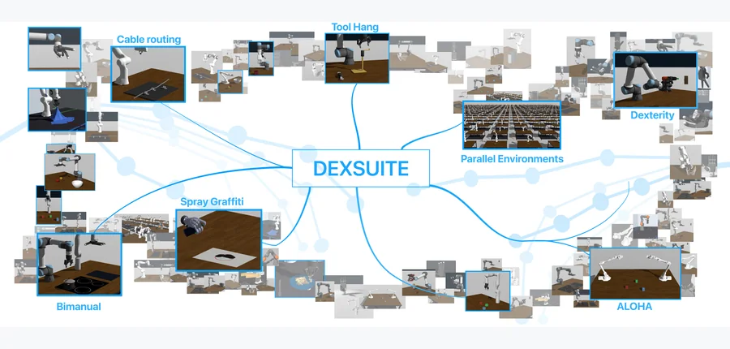 arXiv 2026-11-01 · [arXiv:2610.37799](https · #22 **[DexSuite: An All-in-One Framework for Dexterous Manipulation Across Arms, Hands, and Tasks](https://arxiv.org/abs/2610.37799)** [cs.RO](https://arxiv.org/abs/2610.37799) 机构：[Anas Houssaini , Hugo He , Junming Shi , Amin Abyaneh , Ricardo Chahine , Shuo Wen , Mohamad H. Danesh , Charles-Étienne Fréchette , Mariana Sosa Guzman , Mathias Desrochers , Rayan Houssaini , Adam Landa , Theophile Soulie , Charlotte Morissette , Annie Tims , Martino Russi , Jonathan Lussier , Gregory Dudek , Doina Precup , Julen Urain , Hsiu-Chin Lin , David Meger](https://arxiv.org/abs/2610.37799) [Paper](https://arxiv.org/abs/2610.37799) · [Project](https://dexsuiteorg.github.io/) · [图源](https://arxiv.org/html/2610.37799v1/assets/concept.jpg) 

中文摘要
达到人类水平的灵巧性仍是机器人核心难题，但很少有仿真框架覆盖灵巧操作的完整流程，从机器人配置、灵巧演示采集到策略评估。我们提出基于 Genesis 仿真器的一体化灵巧操作框架 DexSuite。它提供 30 项任务，将 10 种机械臂和 12 种末端执行器（从平行夹爪到灵巧手）组合为超过 100 种单臂机器人及数千种双臂组合，并提供标准化环境 API、集成遥操作和模拟触觉感知。我们还定义了覆盖不同接触复杂度与任务时长的 16 个任务－具身组合基准，发布由人类遥操作、脚本专家和学习策略产生的 4,700 个仿真成功回合。DexSuite 开源，作者希望社区在此基础上继续开发；论文给出的项目网址提供视频与数据集。 <a href="https://arxiv.org/abs/2610.37799">原摘要来源</a>
 | 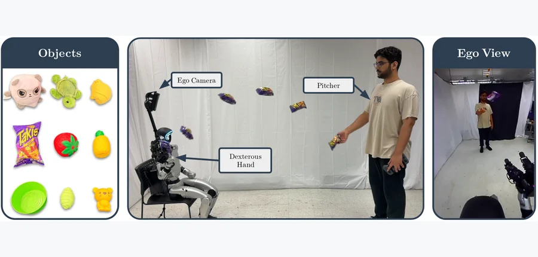 arXiv 2026-11-01 · [arXiv:2610.39044](https · #23 **[Catch It All!: Generalizable Dynamic Catching with a Dexterous Hand](https://arxiv.org/abs/2610.39044)** [cs.RO](https://arxiv.org/abs/2610.39044) 机构：[Arth Shukla , Kehlani Fay , Huaze Liu , Darin Djapri , Alexiy Buynitsky , Nicklas Hansen](https://arxiv.org/abs/2610.39044) [Paper](https://arxiv.org/abs/2610.39044) · [Project](https://arth-shukla.github.io/catch-it-all/) · [图源](https://arxiv.org/html/2610.39044v1/fig1_overview_clean_unblurred_oct.png) 

中文摘要
接住任意物体要求机器人对未见过的投掷物泛化，并在有噪声的视觉观测下实时适应不可预测的接触动力学。本文提出 Catch It All!，一种面向人形机器人的 sim-to-real 接球框架，仅用一台第一人称相机，就能对物理属性不同的未见物体执行下手与上手接球。学习到的策略对几何、可形变性、弹性和物理属性各异的未见物体泛化。精心设计的抓取奖励让抓取根据物体姿态与形状实时调整；考虑安全的课程学习支持在硬件极限附近以高频率执行动作，包括低至 5 Nm 的腕部力矩限制。系统零样本部署在 Unitree G1 上，使用一台第一人称相机，成功接住训练中未见的九种物体，包括低反弹毛绒玩具、半可形变玩具和薯片袋，以及接触时高回弹的刚弹性物体。 <a href="https://arxiv.org/abs/2610.39044">原摘要来源</a>
 | 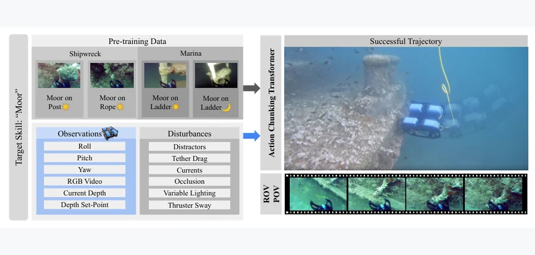 arXiv 2026-11-01 · [arXiv:2610.38199](https · #24 **[Embodied at Sea: Imitation Learning for Multi-Task Underwater Manipulation](https://arxiv.org/abs/2610.38199)** [cs.RO](https://arxiv.org/abs/2610.38199) 机构：[Greta Perez-Haiek (1), Luca Macesanu (1), Kevin Angers (1), Mohammed Imam (1), Timothy Gambin (2), Christopher Clark (1) ((1) New York University, (2) University of Malta)](https://arxiv.org/abs/2610.38199) [Paper](https://arxiv.org/abs/2610.38199) · [Project](https://lair-research-nyu.github.io/Embodied-at-Sea/) · [图源](https://arxiv.org/html/2610.38199v1/embodied-at-sea-Pull_Figure.png) 

中文摘要
行为克隆在陆地机器人操作中展示了泛化潜力，但海水视觉畸变和动态水流造成严重域偏移，阻碍通用架构用于水下实地操作。为此，作者在平静及湍流水域采集 1,616 个水下操作回合，训练 14 个具有不同本体感觉观测配置的通用视觉语言动作（VLA）模型（DynamicVLA）。在泳池中的三项任务和 1,260 次可评分硬件 rollout 上，10 个模型优于基线，最好模型的总体成功率（含部分成功）达到 93.3%。论文还报告一项案例研究：在海洋考古与保育的抓取、系泊两项任务上，比较单任务 Action Chunking Transformer（ACT）和通用 SmolVLA 策略。实验由 ROV 在马耳他二战沉船 Coralita X127 及 Manoel Island Marina 周边执行；共采集 748 个回合并评估 508 次可评分硬件 rollout。ACT 的汇总成功率显著高于 SmolVLA（47.9% 对 7.9%），在考古现场最成功的任务上达到 66.7%。作者开源用于采集数据、训练模型和在 ROV 上部署策略的 BLUEMBODIED KIT，以支持海洋实地机器人的具身智能研究。 <a href="https://arxiv.org/abs/2610.38199">原摘要来源</a>
 |
| 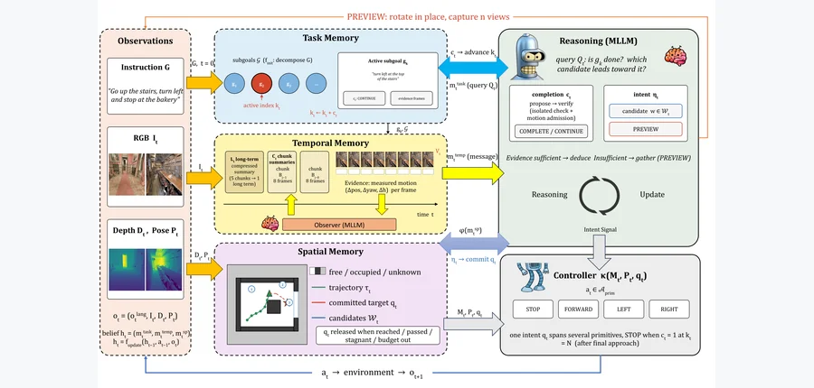 arXiv 2026-11-01 · [arXiv:2610.38318](https · #25 **[What Should a Navigator Remember? Spatiotemporal Memory for Zero-Shot Vision-Language Navigation](https://arxiv.org/abs/2610.38318)** [cs.RO](https://arxiv.org/abs/2610.38318) 机构：[Yuhang Peng , Zhikai Wang , Ziyi Wang , Jiaru Zhong , Xiaoji Zheng , Jingzhi Huang , Yi Wang , Jiangtao Gong](https://arxiv.org/abs/2610.38318) [Paper](https://arxiv.org/abs/2610.38318) · [图源](https://arxiv.org/html/2610.38318v1/FrameworkOverview.png) 

中文摘要
零样本视觉语言导航（VLN）要求智能体在未进行导航专用训练时利用历史观测。我们研究一个约 8B 规模导航系统应保留哪些信息，以及如何组织这些信息供后续决策。系统结合指令进度、锚定于位姿的分层压缩观测历史和累积几何，形成互补的任务、时间与空间记忆。一个 8B 观察模型总结观测，一个 8B 推理模型利用记忆选择航点意图或请求额外视角，再由几何控制器执行目标。语义信息视角支持区分保留证据、让推理模型能够访问证据，以及获取新观测。在 R2R-CE val-unseen 上，完整系统在受测 Qwen3 零样本基线中达到最高表现；移除时间记忆会降低成功率，并使平均路径长度从 16.9 米骤增至 39.1 米；移除空间地图与规划模块也降低成功率。Unitree Go2 在走廊和办公室的真实实验中，该零样本方法成功率高于经后训练的基线，显示在受测真实场景中更好的迁移。补充评估 LAW2 利用配对指令干预测试行为响应，考察终点成功之外的指令遵循能力。这些结果支持为使用较小开放模型的零样本导航保留结构化的任务进度、观测历史与几何。 <a href="https://arxiv.org/abs/2610.38318">原摘要来源</a>
 | 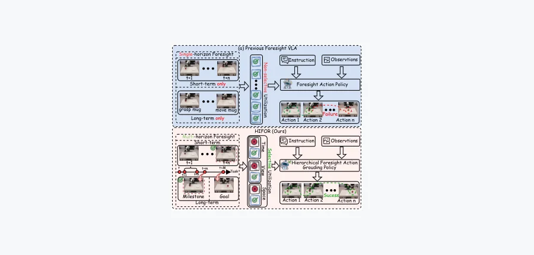 arXiv 2026-11-01 · [arXiv:2610.40373](https · #26 **[HiFOR: Hierarchical Foresight with Action-Guided World Grounding for Vision-Language-Action Model](https://arxiv.org/abs/2610.40373)** [cs.CV](https://arxiv.org/abs/2610.40373) 机构：[Rongxing Ding , Hongyu Qu , Kehong Wu , Xudong Wang , Fan Zhang , Xinguang Xiang , Xiangbo Shu](https://arxiv.org/abs/2610.40373) [Paper](https://arxiv.org/abs/2610.40373) · [图源](https://arxiv.org/html/2610.40373v1/motivation-new.png) 

中文摘要
视觉语言动作（VLA）模型结合视觉感知、语言理解与动作生成，在机器人操作中表现出潜力；近期方法又引入未来预测，以增强对环境动力学和任务进度的理解。但已有方法常把短期动力学和长期任务目标分别建模，并直接把预测未来输入动作策略，未充分判断这些信息与当前动作要求是否相关。我们提出 HiFOR：带有动作引导世界检索的分层前瞻框架。Hierarchical Foresight Prediction 通过 Hierarchical Dependency Mask（HDM）联合预测短期状态演化、语义里程碑和最终目标状态，在不同时间跨度之间建立依赖。Structure-Aware Latent World Modeling 按时间跨度、视角和空间维度组织未来潜在表示，以便细粒度检索。Action-Guided Factorized World Retrieval 则在去噪过程中根据不断演化的动作表示，自适应取回结构化潜在世界中相关的未来信息，为动作生成提供定向指导。两个仿真基准及六项真实机器人操作任务上的广泛实验支持该方法的有效性。 <a href="https://arxiv.org/abs/2610.40373">原摘要来源</a>
 | 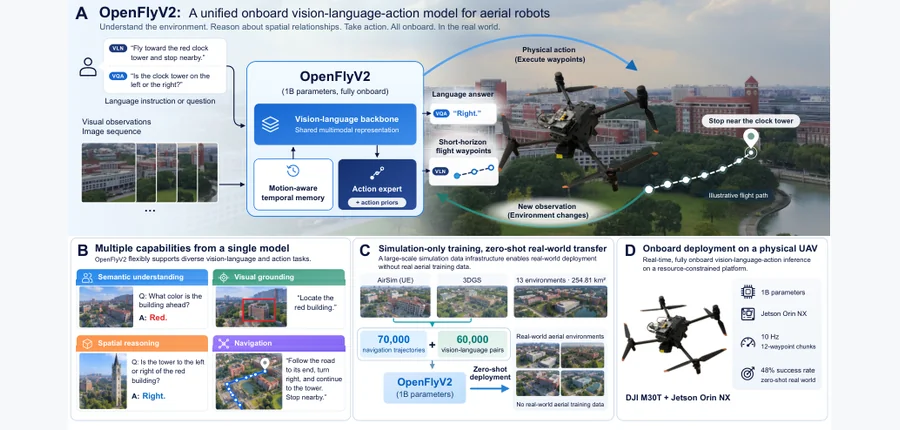 arXiv 2026-11-01 · [arXiv:2610.39287](https · #27 **[OpenFlyV2: An onboard vision-language-action model for aerial perception and navigation](https://arxiv.org/abs/2610.39287)** [cs.RO](https://arxiv.org/abs/2610.39287) 机构：[Junli Liu , Zhongrui You , Chenhui Li , Zhen Li , Yuyang Tian , Qizhen Chen , Delin Qu , Haoming Song , Dong Wang , Xuelong Li , Zhigang Wang , Bin Zhao](https://arxiv.org/abs/2610.39287) [Paper](https://arxiv.org/abs/2610.39287) · [图源](https://arxiv.org/html/2610.39287v1/OpenFlyV2_Fig1_v3.png) 

中文摘要
人类认知可依靠共享的感知基础理解环境、关注被指代对象、推理空间关系并采取行动。要让空中机器人具备类似功能仍有困难：现有系统常为单项能力定制、依赖机外计算，或无法在资源受限平台上维持闭环运行。我们提出 OpenFlyV2，一种统一的机载视觉语言动作架构，借助共享视觉语言表示，在单一模型中支持语义理解、语言锚定感知、空间推理与连续飞行控制。紧凑动作专家把共享多模态上下文转成短期飞行航点；运动感知时序记忆和动作先验降低闭环执行的计算成本。作者构建一个基于仿真的数据集，包含约 70,000 条导航轨迹及 60,000 对视觉语言指令－回答。OpenFlyV2 在 NVIDIA Jetson Orin NX 上完全机载地以 10 Hz 生成动作块，每块包含 12 个航点。它从仿真零样本迁移到实体四旋翼，在四种真实环境中无需真实飞行训练数据即达到 48% 的导航成功率。结果显示，广泛的视觉语言能力与连续闭环飞行可在资源受限的空中平台上共存。论文称代码将在所给网址公开。 <a href="https://arxiv.org/abs/2610.39287">原摘要来源</a>
 |
| 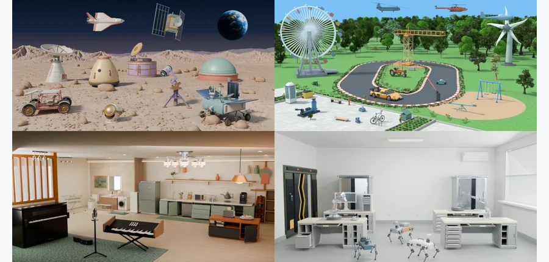 arXiv 2026-11-01 · [arXiv:2610.40333](https · #28 **[RFW-A: Agentic Procedural Generation of 400K Articulated Assets over 500 Categories](https://arxiv.org/abs/2610.40333)** [cs.CV](https://arxiv.org/abs/2610.40333) 机构：[Yuanbo Lyu , Changjian Pan , Saining Zhang , Yi Yang , Peishuo Li , Zhiheng Li , Jialu Liu , Junhao Chen , Jiawei Weng , Yupeng Gao , Weiqing Xiao , Wenyi Li , Jiarui Guo , Rui Zhang , Jingrun Du , Weiyi Lin , Zenan Meng , Hu Wei , Lin Qu , Zongzheng Zhang , Hao Zhao , Chaojian Li](https://arxiv.org/abs/2610.40333) [Paper](https://arxiv.org/abs/2610.40333) · [Project](https://brain-labbb.github.io/RFW_A_web/) · [图源](https://arxiv.org/html/2610.40333v1/teaser.png) 

中文摘要
高质量可关节运动资产对具身感知、仿真和操作很重要，但大规模构建仍很困难。人工标注和程序建模耗费大量人力；近期智能体系统通过程序合成自动构建资产，却要对每个新资产重复昂贵的推理和修订。本文观察到，同一类别的资产尽管结构与外观各异，仍可共享构建逻辑。因此，智能体合成与程序生成互补：智能体构建可复用程序，程序执行则在多个样本间复用逻辑。作者提出 RFW-A，将二者结合为一种新型可关节资产生成范式。从现有可关节程序出发，RFW-A 把可复用组件及其依赖组织为类别级生成器。智能体在采样配置与运动状态下测试并修订生成器；生成器构建和验证后，程序执行即可生成多样资产，不再产生模型调用或 token 费用。生成器编写的估计 API 成本平均为 10.62 美元，在 200 个资产上摊销为每个 0.05 美元，而所采样的逐资产智能体合成基线为每个 1.24 美元。作者据此构建 RFW-A-400K，包含跨 500 多个类别的 40 多万个可用于仿真的可关节资产。实验显示其结构和运动学有效性较高，且可在物理仿真器间稳定执行。除了资产有效性，RFW-A-400K 训练还能改善已见与未见类别的部件级关节估计；在仿真中利用检索和程序编辑资产训练的策略，也能零样本迁移到真实可关节物体。 <a href="https://arxiv.org/abs/2610.40333">原摘要来源</a>
 | 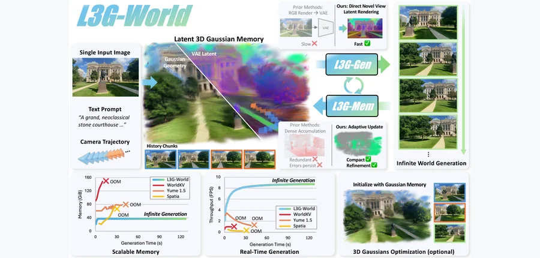 arXiv 2026-11-01 · [arXiv:2610.40614](https · #29 **[L3G-World: Real-Time Infinite World Generation with Latent 3D Gaussian Memory](https://arxiv.org/abs/2610.40614)** [cs.CV](https://arxiv.org/abs/2610.40614) 机构：[Jinhyeok Choi , JoungBin Lee , Jongmin Lee , Minkyeong Jeon , Jiyoung Kim , Kaeun Han , Yoonjin Yoon , Seungryong Kim](https://arxiv.org/abs/2610.40614) [Paper](https://arxiv.org/abs/2610.40614) · [Project](https://cvlab-kaist.github.io/L3G-World/) · [图源](https://arxiv.org/html/2610.40614v1/l3g_teaser.png) 

中文摘要
交互式世界模型按用户动作生成视觉内容，但长期探索中实时保持空间一致性仍有挑战。现有方法依赖时间上下文或显式三维记忆；二者因记忆随生成流长度增长而难以扩展。显式三维记忆还需先渲染 RGB 再重新编码以条件化潜在视频生成器，阻碍实时生成。本文提出 Latent 3D Gaussian Memory（L3G），结合前馈重建效率与紧凑、可快速渲染的场景表示。在此基础上，L3G-World 让记忆更新器与视频扩散 Transformer（DiT）自回归地交替工作，生成空间一致的世界。更新器在新观测区域生成 Gaussian 并细化已有 Gaussian，使记忆随场景范围而非视频流长度增长。每个 Gaussian 还存储一个 VAE 潜在特征，令记忆可直接渲染到 DiT 潜在空间，无需重新 VAE 编码。实验显示，L3G-World 在生成质量和长期空间一致性上达到论文所称的先进水平；相对各指标上效率最高的先前三维记忆基线，三维基元最多减少 38.6 倍、记忆更新快 3.2 倍、记忆渲染快 359 倍，实现 9 FPS 实时世界生成。 <a href="https://arxiv.org/abs/2610.40614">原摘要来源</a>
 | 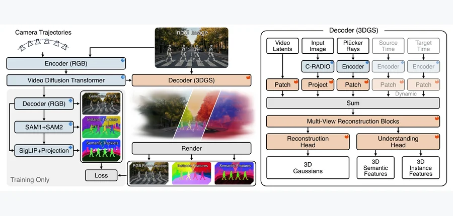 arXiv 2026-11-01 · [arXiv:2610.40495](https · #30 **[LucidLyra: Feed-Forward Generative 3D Scene Reconstruction and Joint Understanding via Multi-Task Distillation](https://arxiv.org/abs/2610.40495)** [cs.CV](https://arxiv.org/abs/2610.40495) 机构：[Oliver Hahn , Rodrigo Marcuzzi , Sangeetha Grama Srinivasan , Alessandro Burzio , Sherwin Bahmani , Jiahui Huang , Stefan Roth , Shengyu Huang , Qunjie Zhou , Laura Leal-Taixé](https://arxiv.org/abs/2610.40495) [Paper](https://arxiv.org/abs/2610.40495) · [Project](https://research.nvidia.com/labs/sil/projects/lucidlyra/) · [图源](https://arxiv.org/html/2610.40495v1/semantic_lyra_architecture_draft_v5.png) 

中文摘要
我们提出 LucidLyra：一种从视频潜在变量以前馈方式生成三维场景，并使其语义与实例可直接查询的框架。生成式三维重建虽然能从单张图像合成虚拟环境，但机器人与物理 AI 等下游应用不仅需要视觉真实，还需要场景语义与物体身份。现有三维理解方法则需要实拍多视图场景、泛化有限，或依赖昂贵的逐场景处理和优化。为缩小这一差距，方法把相机可控视频扩散模型及冻结的二维视觉基础模型中的互补知识蒸馏到统一模型中，联合推断编码几何、外观、开放词汇语义和类别无关实例线索的三维 Gaussian。所得场景无需逐场景优化即可支持新视角渲染、开放词汇分割和物体分组；训练既不需要人工三维标注，也不需要实拍多视图数据。在精选的合成与真实图像条件化基准上，方法超过将先进 3DGS 分割方法与生成式三维场景重建组合的基线，同时保持重建质量。其潜在表示还可自然扩展至单目视频，随时间重建结构化动态三维场景。LucidLyra 将可渲染但无结构的输出转为可查询三维世界，可用于三维场景编辑、三维资产挖掘和机器人仿真。 <a href="https://arxiv.org/abs/2610.40495">原摘要来源</a>
 |
| 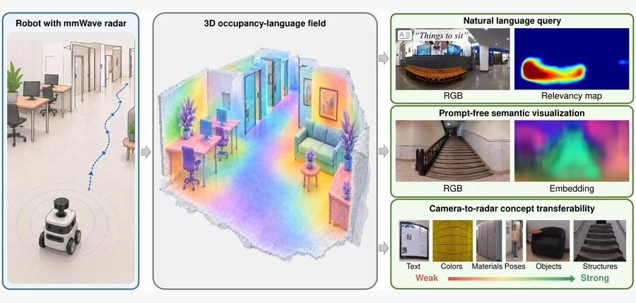 arXiv 2026-11-01 · [arXiv:2610.37929](https · #31 **[3D Occupancy-Language Fields from mmWave Radar](https://arxiv.org/abs/2610.37929)** [cs.RO](https://arxiv.org/abs/2610.37929) 机构：[Haowen Lai , Zhiwei Zheng , Mingmin Zhao](https://arxiv.org/abs/2610.37929) [Paper](https://arxiv.org/abs/2610.37929) · [图源](https://arxiv.org/html/2610.37929v1/teaser.png) 

中文摘要
雷达能够恢复场景几何并识别预定义类别，但这些输出尚不能支撑开放式语言查询所需的持久空间表示；这种查询要求将不同视角观测关联到相同物理位置。我们提出 TextRadar：从全景雷达观测构建场景级三维占据－语言场。该场在表面位置结合占据与尺度相关语言特征，使重建场景可以用新描述查询。单帧雷达蒸馏模型从每次雷达观测预测对齐的距离与语言特征，再借助雷达估计的位姿，在新场景中仅用雷达注册这些预测并重建场。约 20,000 条跨七栋建筑的同步观测实验展示了场景级自然语言查询和无需提示词的语义可视化。对相机到雷达概念迁移的分析显示，结构、材料与人体姿态的一致性强于颜色和印刷文字。 <a href="https://arxiv.org/abs/2610.37929">原摘要来源</a>
 | 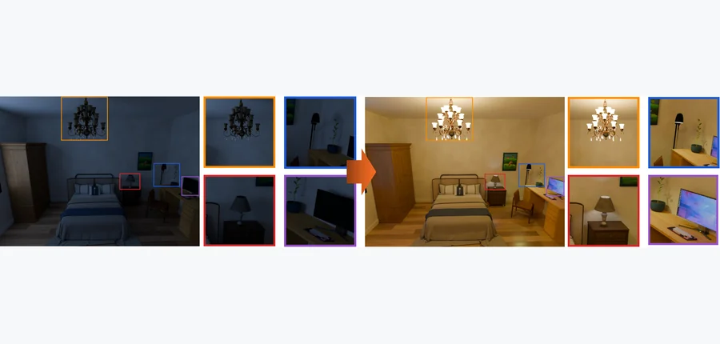 arXiv 2026-11-01 · [arXiv:2610.39038](https · #32 **[LightGenBench: A Benchmark for 3D Emission Generation](https://arxiv.org/abs/2610.39038)** [cs.CV](https://arxiv.org/abs/2610.39038) 机构：[Dongchen Yang , Xingguang Yan , Manolis Savva](https://arxiv.org/abs/2610.39038) [Paper](https://arxiv.org/abs/2610.39038) · [Project](https://3dlg-hcvc.github.io/lightgenbench/) · [图源](https://arxiv.org/html/2610.39038v1/teaser_on_off.png) 

中文摘要
近期生成方法能生成几何细致、纹理丰富的三维资产，但这些资产只反射光线，不会自行发光。我们研究“发光生成”这一新任务：由三维资产的几何、非发光材质及一个渲染视图，预测其表面随位置变化的 RGB 发光。为支持该任务，我们提出 LightGenBench。基准有三项贡献：整理 3.7 万个由艺术家制作、以 UV、体素和多视图形式表示的发光资产；建立 UV 域、稀疏体素、多视图与分割式生成四类基线；设计同时测量资产“哪里发光”和“怎样发光”的评估协议，并辅以不同发光强度渲染图的用户研究比较。四类方法中，稀疏体素基线 TRELLIS.2-Emission 表现最佳，因为直接在三维中生成发光避免 UV 空间的碎裂伪影和多视图生成看不到遮挡发光部位等问题。但它的 IoU 也只有 0.271，说明该任务远未解决。作者希望 LightGenBench 使发光生成成为可基准化的三维生成问题。 <a href="https://arxiv.org/abs/2610.39038">原摘要来源</a>
 | 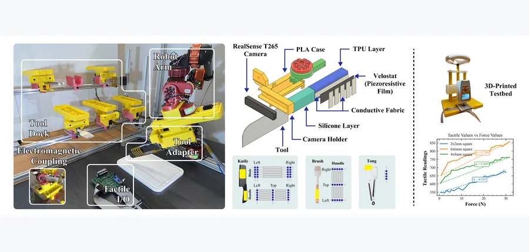 arXiv 2026-11-01 · [arXiv:2610.40646](https · #33 **[SwapBot: Tool-Centric Robot Manipulation via Interchangeable End-Effectors and Tactile Sensing](https://arxiv.org/abs/2610.40646)** [cs.RO](https://arxiv.org/abs/2610.40646) 机构：[Yunchu Zhang , Ray Song , Junhan Jiao , Liyiming Ke , Yuchen Yang , Ruihan Gao , Emma Romig , Siddhartha Srinivasa , Yiyue Luo](https://arxiv.org/abs/2610.40646) [Paper](https://arxiv.org/abs/2610.40646) · [图源](https://arxiv.org/html/2610.40646v1/figures/System.jpg) 

中文摘要
日常环境中的机器人操作大量涉及工具使用。煎豆腐等看似简单的家务，也需要在丰富接触交互中用不同工具完成用力切割、轻柔刷涂和精确放置，因此机器人需要自主更换并使用合适工具。我们提出 SwapBot：一种模块化、以工具为中心的末端执行器系统，用低成本适配器快速将常见家用工具转为机器人末端执行器。它以固定的机器人侧耦合接口和低成本工具侧适配器为统一设计原则，支持包括可关节工具在内的多种工具及多个机器人平台，而非追求单一万能夹爪。每个适配器集成紧凑触觉传感器，支持快速自主更换，并连接直观遥操作系统以高效采集演示。用户研究表明，遥操作时 SwapBot 降低任务完成时间和操作者负担。利用机器人上采集的演示，作者训练模仿学习策略，成功完成煎豆腐、拌沙拉、翻肉等工具任务。消融显示，相对仅 RGB 策略，触觉增强演示使丰富接触技能的成功率提高 15–25 个百分点。结果表明，模块化且具触觉的工具是提高机器人操作稳健性与能力的实用途径。论文提供项目网站链接。 <a href="https://arxiv.org/abs/2610.40646">原摘要来源</a>
 |
| 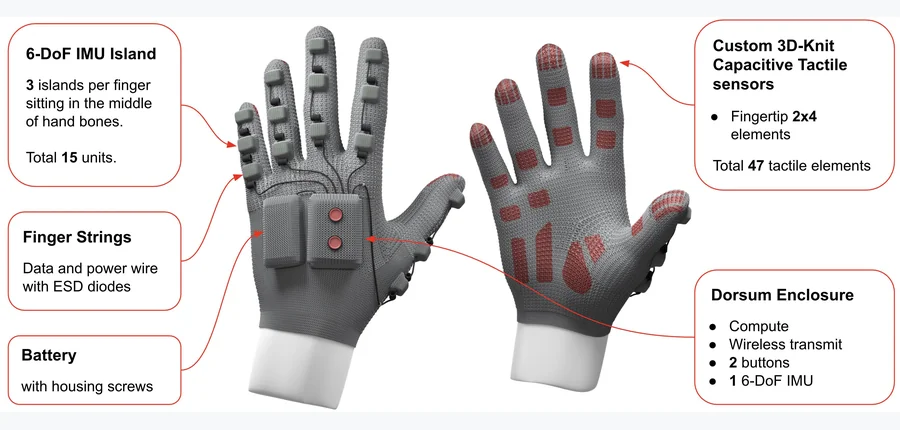 arXiv 2026-11-01 · [arXiv:2610.39076](https · #34 **[Tactus: Tactile &amp; Pose Sensing Glove for Natural Dexterity Data Collection](https://arxiv.org/abs/2610.39076)** [cs.RO](https://arxiv.org/abs/2610.39076) 机构：[Li Guan , Rachael Granberry , Sahar Aseeri , Sahar Rostami , Taylor Niehues , Sai Dhanooshi Marri , Mia Huang , Dingtian Zhang , Ziyi Kou , Jason Pursel , Eric Whitmire , Vatsal Mehta , Ashish Deshpande , Tristan Trutna , Reed Belcher , Emelia Black , Julian Blake , Roger Boldu , Sean Bonaventure , Einar Boyovich , Jordan Brennan , Elizabeth Casillas , David Christensen , Tyler Christensen , Nicholas Colonnese , Stuart Dealey , Gaige DeHaven , Katie Doran , Chris Doughty , Robert Drury , Silvia Espino , Gabriel Geyne , Beth Goodrich , Kyra Gould , Joe Grisso , Susana Guerrero , Andrew Gwozdziowski , Monica Ha , Ehsan Hajiesmaili , Kate Healy , Rose Hope , Michael Hurst , Claire Ikemiya , Daisy Isibor , Rick James , Yashasvi Joginapally , Samuel Johnson , Tyler Jorgensen , Kristy Jost , Ben Kamath , Slava Karulin , Alexander Keener , Woo Kim , Alison Krauskopf , Ankit Kumar , Joshua Lang , Lizzy Li , Cameron Lynch , Daniel Ma , Hector Martinon , Christina Matos , Keagan McCurdy , Lee Mincey , Stuart Nezlek , Tiffany Nguyen , James O'Hara , Jason Osborne , Jacky Pai , Roham Pardakhtim , David Perek , Alexandre Poulin , Nick Raines , Salwa Rasheed , Leah Resneck , Kevin Rhodes , Ergys Ristani , Douglas Roberts , Anik Sarker , Harrison Scarborough , Jonas Schmidtler , Brian Shieh , Benjamin Shuman , Garrett Simard , Forrest Smith , Udara Somarathna , Eliot Sosin , Jonathan Stewart , Kristine Strom , Adam Swett , Hal Talbot-Mantooth , Julia Tanner , Sai Sharan Thirunagari , Curtis Torrey , Simge Uzun , Eileen Wachs , Rylan Wasson , Henry Wei , Jesse White , Beau Woodbyrne , Antonio Woods](https://arxiv.org/abs/2610.39076) [Paper](https://arxiv.org/abs/2610.39076) · [图源](https://arxiv.org/html/2610.39076v1/figures/main.jpg) 

中文摘要
采集同时具有准确接触力和手部姿态的自然人类操作演示，对机器人灵巧操作策略和基础世界模型学习很重要；但现有可穿戴设备尚未同时提供校准过的指尖力感知、抗遮挡手部追踪，并保持不妨碍自然操作的形态。我们提出 Tactus，一款织物集成感知手套，协同优化三项设计：（1）薄而贴合的三维针织形态，指尖叠层厚度 1.5 毫米，尽量减少对自然操作的干扰；（2）根据实证接触研究，在操作相关区域布置电容式触觉传感器；（3）IMU 融合的姿态追踪，在手物遮挡最严重、操作数据最有价值的时刻保持准确。Tactus 提供跨手套一致性校准流程及用于修正个体差异的逐次会话校准。作者提出触觉力回归和手部姿态估计的标准化基准协议，对 Tactus 与两款商用触觉手套进行据称首次此类定量跨平台比较。Tactus 在 95% 置信度下的最小可检测力为 0.59 N，比商用基线低 1.6–2.7 倍，跨参与者一致性为 0.87；操作遮挡最严重时，指尖关键点的相对误差为 11.0 毫米。作者展示这些信号共同支持物体属性估计、滑移检测和手物交互的代表性记录，提供接触感知操作策略与世界模型所需保真度的演示数据。 <a href="https://arxiv.org/abs/2610.39076">原摘要来源</a>
 | 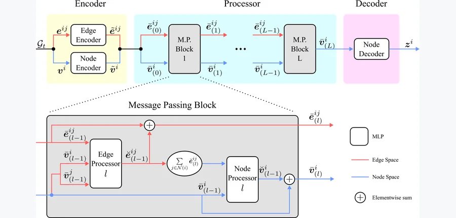 arXiv 2026-11-01 · [arXiv:2610.37986](https · #35 **[Predicting Sparse Observables in Parameterized Unsteady Flows Using Coarse-Mesh Graph Neural Networks](https://arxiv.org/abs/2610.37986)** [cs.LG](https://arxiv.org/abs/2610.37986) 机构：[Brener Ramos , William R. Wolf , Tarcísio C. D. Oliveira , Scott T. M. Dawson](https://arxiv.org/abs/2610.37986) [Paper](https://arxiv.org/abs/2610.37986) · [图源](https://arxiv.org/html/2610.37986v1/figs/architecture_schematic.png) 

中文摘要
当应用只需要选定自由度时，为高维非线性流构建完整状态代理模型通常没有必要。我们提出直接在粗网格上使用图神经网络（GNN）、跳过全状态重建的降阶模型。应用于跨雷诺数／瑞利数范围的参数化二维与三维受限圆柱绕流及非均匀加热腔体时，模型能泛化到未见条件，准确预测稀疏探针位置的量和积分量。粗网格 GNN 匹配或超过细网格代理模型，同时降低训练时间和内存，即使对三维混沌动力学也如此。由频谱变化引导的动力学感知自适应采样，在成本可忽略的情况下使最大误差相对均匀采样降低一个数量级。粗网格训练还使加入噪声的多步展开可行，从而改善长时自回归预测。该方法以更低成本超过参数化 DMD、稀疏 MLP、U-Net 和傅里叶神经算子，并可从稀疏观测进行系统辨识与状态估计。结果表明，粗网格表示、自适应采样和加噪展开训练可在无需求解器分辨率重建的情况下，高效建模参数化非稳态流动。 <a href="https://arxiv.org/abs/2610.37986">原摘要来源</a>
 |   |
<!-- PAPER_CARDS_END -->

## 检索概况

- **检索窗口**：北京时间 2026-10-30 09:00 至 2026-11-01 09:00；官方最新批次为 **Friday, 30 October 2026**。
- **筛选规则**：仅从下列官方分类页的 New submissions 入主榜，按 arXiv ID 去重；逐篇按标题与完整摘要核对。先列三维与物理交叉，再列有明确机器人任务、方法或实验的具身论文及基础三维方法。
- **官方分类页总命中／入选**：New **1230／35 篇**；Cross **725** 条，Replacement **1099** 条。分类页计数为原始记录；本期 35 篇主榜 ID 互不重复。
- **标注**：方法、实验结果和数字均来自各论文的官方摘要；“相关性”“机构强度”“局限与改进”是编辑推断，不代表作者结论。机构以 PDF 首页或官方 HTML 核实，无法确认时明写。

| 官方分类页 | listing 日期 | New | Cross | Replacement |
|---|---|---:|---:|---:|
| [cs.CV](https://arxiv.org/list/cs.CV/new?show=2000) | 2026-10-30 | 197 | 36 | 141 |
| [cs.GR](https://arxiv.org/list/cs.GR/new?show=2000) | 2026-10-30 | 7 | 7 | 8 |
| [cs.RO](https://arxiv.org/list/cs.RO/new?show=2000) | 2026-10-30 | 109 | 20 | 60 |
| [cs.AI](https://arxiv.org/list/cs.AI/new?show=2000) | 2026-10-30 | 158 | 234 | 213 |
| [cs.LG](https://arxiv.org/list/cs.LG/new?show=2000) | 2026-10-30 | 213 | 159 | 236 |
| [physics](https://arxiv.org/list/physics/new?show=2000) | 2026-10-30 | 144 | 69 | 108 |
| [cond-mat](https://arxiv.org/list/cond-mat/new?show=2000) | 2026-10-30 | 178 | 56 | 123 |
| [math.OC](https://arxiv.org/list/math.OC/new?show=2000) | 2026-10-30 | 46 | 38 | 51 |
| [math.NA](https://arxiv.org/list/math.NA/new?show=2000) | 2026-10-30 | 52 | 12 | 34 |
| [math.DS](https://arxiv.org/list/math.DS/new?show=2000) | 2026-10-30 | 20 | 14 | 22 |
| [stat.ML](https://arxiv.org/list/stat.ML/new?show=2000) | 2026-10-30 | 24 | 30 | 50 |
| [eess.IV](https://arxiv.org/list/eess.IV/new?show=2000) | 2026-10-30 | 8 | 7 | 8 |
| [eess.SY](https://arxiv.org/list/eess.SY/new?show=2000) | 2026-10-30 | 39 | 26 | 30 |
| [eess.SP](https://arxiv.org/list/eess.SP/new?show=2000) | 2026-10-30 | 35 | 17 | 15 |

## Top papers

| # | 论文 | arXiv | 分类 | 作者 | 机构 | 相关性（推断） | 机构强度（推断） | 优先级（推断） |
|---:|---|---|---|---|---|---|---|---|
| 1 | [Mastering Multi-State Dynamics: Continuum Damage and Viscoplastic MPM for RL-Based Dexterous Manipulation](https://arxiv.org/abs/2610.39975) | [arXiv:2610.39975](https://arxiv.org/abs/2610.39975) | [cs.GR](https://arxiv.org/abs/2610.39975) | [Yusen Feng , Shangbo Luan](https://arxiv.org/abs/2610.39975) | Peking University（[PDF](https://arxiv.org/pdf/2610.39975)） | 高：三维物理／接触机制 | 强（推断） | A |
| 2 | [PhysAg3D: Bridging 3D Generative and Agentic Models for High-Fidelity and Physically-Interactive Assets](https://arxiv.org/abs/2610.39924) | [arXiv:2610.39924](https://arxiv.org/abs/2610.39924) | [cs.CV](https://arxiv.org/abs/2610.39924) | [Bi'an Du , Fanpeng Meng , Jiemin Fang , Chen Yang , Pufan Li , Daizong Liu , Qi Tian , Wei Hu](https://arxiv.org/abs/2610.39924) | Peking University / Guangdong Laboratory of Artificial Intelligence and Digital Economy (SZ) / Huawei / Wuhan University（[PDF](https://arxiv.org/pdf/2610.39924)） | 高：三维物理／接触机制 | 强（推断） | A |
| 3 | [PhysInsert: Physically Plausible Object Insertion with Geometric Priors and Bidirectional Object-Scene Interactions](https://arxiv.org/abs/2610.40453) | [arXiv:2610.40453](https://arxiv.org/abs/2610.40453) | [cs.CV](https://arxiv.org/abs/2610.40453) | [Yue Gong , Le Zhang , Rui Chen , Song Chang , Xiaochao Qu , Luoqi Liu , Ting Liu , Yebin Liu](https://arxiv.org/abs/2610.40453) | Beihang University / MT Lab, Meitu Inc. / Tsinghua University（[HTML](https://arxiv.org/html/2610.40453)） | 高：三维物理／接触机制 | 强（推断） | A |
| 4 | [SimTO-Robust: Automated Design of Soft Grippers Robust to Grasp Pose and Object Geometry](https://arxiv.org/abs/2610.39560) | [arXiv:2610.39560](https://arxiv.org/abs/2610.39560) | [cs.RO](https://arxiv.org/abs/2610.39560) | [Kurt Enkera , Joshua Pinskier , Marcus Gallagher , David Howard](https://arxiv.org/abs/2610.39560) | CSIRO Data61 / The University of Queensland（[PDF](https://arxiv.org/pdf/2610.39560)） | 高：三维物理／接触机制 | 中（推断） | A |
| 5 | [Kinematic-Tactile Aligned Dexterous Retargeting with Contact Wrench Space Alignment](https://arxiv.org/abs/2610.39582) | [arXiv:2610.39582](https://arxiv.org/abs/2610.39582) | [cs.RO](https://arxiv.org/abs/2610.39582) | [Xinyuan He , Ziheng Xu , Yueyuan Chen , Yufan Ye , Yuanshuo Tan , Huiming Pan , Jianjun Meng , Shuo Jiang , Peter B. Shull](https://arxiv.org/abs/2610.39582) | Shanghai Jiao Tong University / Tongji University / The Chinese University of Hong Kong, Shenzhen（[PDF](https://arxiv.org/pdf/2610.39582)） | 高：三维物理／接触机制 | 中（推断） | A |
| 6 | [TactoHand: Learning Geometry-Based Dense Hand-Surface Interaction Fields from Video](https://arxiv.org/abs/2610.39585) | [arXiv:2610.39585](https://arxiv.org/abs/2610.39585) | [cs.CV](https://arxiv.org/abs/2610.39585) | [Ziheng Xi , Weibo Li , Jiayi Yu , Sipeng Zheng , Wanpeng Zhang , Haiweng Xu , Hao Luo , Chuan Mao , Zongqing Lu](https://arxiv.org/abs/2610.39585) | Tsinghua University / Peking University / BeingBeyond（[PDF](https://arxiv.org/pdf/2610.39585)） | 高：三维物理／接触机制 | 强（推断） | A |
| 7 | [Language-Grounded Force/Torque Pretraining for Extrinsic Contact Perception](https://arxiv.org/abs/2610.39314) | [arXiv:2610.39314](https://arxiv.org/abs/2610.39314) | [cs.RO](https://arxiv.org/abs/2610.39314) | [Kazuki Takahashi , Hiroaki Murakami , Ryota Sakuma , Mitsuhiro Kamezaki , Matthew Ishige , Yoshihiro Kawahara](https://arxiv.org/abs/2610.39314) | The University of Tokyo（[PDF](https://arxiv.org/pdf/2610.39314)） | 高：三维物理／接触机制 | 中（推断） | A |
| 8 | [Force-Driven Hook Disassembly via Constraint-Aware Object-Centric Reinforcement Learning](https://arxiv.org/abs/2610.38513) | [arXiv:2610.38513](https://arxiv.org/abs/2610.38513) | [cs.RO](https://arxiv.org/abs/2610.38513) | [Nadeen Elhadad , Takuya Kiyokawa , Kensuke Harada](https://arxiv.org/abs/2610.38513) | The University of Osaka / AIST（[PDF](https://arxiv.org/pdf/2610.38513)） | 高：三维物理／接触机制 | 中（推断） | A |
| 9 | [TouchBridge: Tactile-Conditioned Human-to-Robot Transfer for Dexterous Manipulation](https://arxiv.org/abs/2610.40349) | [arXiv:2610.40349](https://arxiv.org/abs/2610.40349) | [cs.RO](https://arxiv.org/abs/2610.40349) | [Haozhe Zhang , Gu Zhang , Zirui Zou , Yuzheng Chen , Jinlong Wu , Zixuan Hu , Jianke Zhang , Yucheng Hu , Zhecheng Yuan , Huazhe Xu](https://arxiv.org/abs/2610.40349) | Tsinghua University / Zhejiang University / Nanyang Technological University / Hunan University / Peking University（[PDF](https://arxiv.org/pdf/2610.40349)） | 高：三维物理／接触机制 | 强（推断） | A |
| 10 | [PhysVLMM: Interaction-Conditioned Physical Belief Maps for Articulated Objects in Robot Scene Maps](https://arxiv.org/abs/2610.40539) | [arXiv:2610.40539](https://arxiv.org/abs/2610.40539) | [cs.RO](https://arxiv.org/abs/2610.40539) | [Dibyendu Ghosh](https://arxiv.org/abs/2610.40539) | affiliation 未确认 | 高：三维物理／接触机制 | 未确认（推断） | A |
| 11 | [Seeing and Imagining as One: Unified Video Generation and 4D Perception for Embodied World Modeling](https://arxiv.org/abs/2610.39232) | [arXiv:2610.39232](https://arxiv.org/abs/2610.39232) | [cs.CV](https://arxiv.org/abs/2610.39232) | [Haitang Feng , Zhuoman Liu , Zhennan Wang , Sheng Wang , Juelin Li , Chengzhi Zhao , Hexiang Wei , Lin Shao](https://arxiv.org/abs/2610.39232) | RoboScience / Nanjing University / The Hong Kong Polytechnic University / National University of Singapore（[PDF](https://arxiv.org/pdf/2610.39232)） | 高：三维世界／几何 | 强（推断） | A |
| 12 | [WorldFlow: Joint Video and 3D Motion Prediction via Large-Scale Pretraining](https://arxiv.org/abs/2610.39278) | [arXiv:2610.39278](https://arxiv.org/abs/2610.39278) | [cs.CV](https://arxiv.org/abs/2610.39278) | [Yuhao Lu , Jiongxu Chen , Hexiang Wei , Jiajin Wu , Juelin Li , Mingjian Liang , Fan Yang , Zhuowei Liang , Zihao Liu , Zhennan Wang , Sheng Wang , Lin Shao](https://arxiv.org/abs/2610.39278) | RoboScience / National University of Singapore（[PDF](https://arxiv.org/pdf/2610.39278)） | 高：三维世界／几何 | 强（推断） | A |
| 13 | [Continuous-Action World Models: Learning Cross-Embodiment Spatiotemporal Dynamics Priors](https://arxiv.org/abs/2610.40401) | [arXiv:2610.40401](https://arxiv.org/abs/2610.40401) | [cs.RO](https://arxiv.org/abs/2610.40401) | [Liangyu Li , Qingwen Liu](https://arxiv.org/abs/2610.40401) | Tongji University（[PDF](https://arxiv.org/pdf/2610.40401)） | 高：三维世界／几何 | 中（推断） | A |
| 14 | [PRIME W0: Physical Priors from World Models for Embodied Manipulation](https://arxiv.org/abs/2610.39528) | [arXiv:2610.39528](https://arxiv.org/abs/2610.39528) | [cs.RO](https://arxiv.org/abs/2610.39528) | [Huabin Peng , Fagang Jin , Yancong Wei , Tengfei Ma , Chuhang Liu , Chao Yu , Liqing Chen](https://arxiv.org/abs/2610.39528) | Lumos SZ Lab Team / Lumos Robotics / THU / CUHK / NTU（按 PDF 原文缩写）（[PDF](https://arxiv.org/pdf/2610.39528)） | 高：三维世界／几何 | 中（推断） | A |
| 15 | [GOFish: Full Field-of-View Gaussian Splatting and Mesh Extraction](https://arxiv.org/abs/2610.37818) | [arXiv:2610.37818](https://arxiv.org/abs/2610.37818) | [cs.CV](https://arxiv.org/abs/2610.37818) | [Allen Tu , Meher Gitika Karumuri , Shifan Zhu , Hailing Wang , Yen-Liang Lin , David Held , Matthias Zwicker , Tom Goldstein](https://arxiv.org/abs/2610.37818) | Amazon / University of Maryland, College Park / University of Massachusetts Amherst / Northeastern University / Carnegie Mellon University（[PDF](https://arxiv.org/pdf/2610.37818)） | 高：三维世界／几何 | 强（推断） | A |
| 16 | [BudSplat: Feed-forward 3D Gaussian Splatting under a Rendering Budget](https://arxiv.org/abs/2610.38278) | [arXiv:2610.38278](https://arxiv.org/abs/2610.38278) | [cs.CV](https://arxiv.org/abs/2610.38278) | [Muyu Xu , Fangneng Zhan , Yu Wei , Ling Shao , Shijian Lu](https://arxiv.org/abs/2610.38278) | Nanyang Technological University / Hong Kong University of Science and Technology / UCAS-Terminus AI Lab（[PDF](https://arxiv.org/pdf/2610.38278)） | 高：三维世界／几何 | 中（推断） | B |
| 17 | [From Dye to Dynamics: Quantitative Measurements of Fluid Flows from Vortex Geometry](https://arxiv.org/abs/2610.39064) | [arXiv:2610.39064](https://arxiv.org/abs/2610.39064) | [physics.flu-dyn](https://arxiv.org/abs/2610.39064) | [Dustin Kleckner , Kevin Collins , Cole Cooper](https://arxiv.org/abs/2610.39064) | University of California, Merced（[PDF](https://arxiv.org/pdf/2610.39064)） | 高：三维物理／接触机制 | 中（推断） | B |
| 18 | [PhysicsNeMo-Mesh: GPU-Native Meshes and Simulation Cases for Physics AI](https://arxiv.org/abs/2610.39072) | [arXiv:2610.39072](https://arxiv.org/abs/2610.39072) | [physics.comp-ph](https://arxiv.org/abs/2610.39072) | [Peter D. Sharpe , Corey Adams , Negin Sobhani , Sanjay Choudhry](https://arxiv.org/abs/2610.39072) | NVIDIA Corporation（[PDF](https://arxiv.org/pdf/2610.39072)） | 高：三维物理／接触机制 | 强（推断） | B |
| 19 | [Dual Area-Volume-of-Fluid (DAVOF): co-advecting volume and face-area fractions for a closed-form, cell-local interface normal and position on unstructured meshes](https://arxiv.org/abs/2610.38863) | [arXiv:2610.38863](https://arxiv.org/abs/2610.38863) | [physics.comp-ph](https://arxiv.org/abs/2610.38863) | [Tomislav Marić](https://arxiv.org/abs/2610.38863) | Technical University of Darmstadt（[PDF](https://arxiv.org/pdf/2610.38863)） | 高：三维物理／接触机制 | 中（推断） | B |
| 20 | [EPC-RawDC: Equivariant Physics Constrained 3D Diffusion with Raw Data Consistency for CBCT to CT Image Synthesis](https://arxiv.org/abs/2610.40046) | [arXiv:2610.40046](https://arxiv.org/abs/2610.40046) | [cs.CV](https://arxiv.org/abs/2610.40046) | [Alzahra Altalib , Chunhui Li , Alessandro Perelli](https://arxiv.org/abs/2610.40046) | University of Dundee / Jordan University of Science and Technology / University of Glasgow（[PDF](https://arxiv.org/pdf/2610.40046)） | 高：三维物理／接触机制 | 中（推断） | B |
| 21 | [SpaceAct: Benchmarking 3D Spatial and Temporal Reasoning via Closed-Loop Action and Active Perception](https://arxiv.org/abs/2610.38405) | [arXiv:2610.38405](https://arxiv.org/abs/2610.38405) | [cs.RO](https://arxiv.org/abs/2610.38405) | [Chenglong Shi , Zekai Yuan , Yue Song , Jon Pu , Will Wu](https://arxiv.org/abs/2610.38405) | Tencent HY（[PDF](https://arxiv.org/pdf/2610.38405)） | 相关：具身机器人任务 | 中（推断） | B |
| 22 | [DexSuite: An All-in-One Framework for Dexterous Manipulation Across Arms, Hands, and Tasks](https://arxiv.org/abs/2610.37799) | [arXiv:2610.37799](https://arxiv.org/abs/2610.37799) | [cs.RO](https://arxiv.org/abs/2610.37799) | [Anas Houssaini , Hugo He , Junming Shi , Amin Abyaneh , Ricardo Chahine , Shuo Wen , Mohamad H. Danesh , Charles-Étienne Fréchette , Mariana Sosa Guzman , Mathias Desrochers , Rayan Houssaini , Adam Landa , Theophile Soulie , Charlotte Morissette , Annie Tims , Martino Russi , Jonathan Lussier , Gregory Dudek , Doina Precup , Julen Urain , Hsiu-Chin Lin , David Meger](https://arxiv.org/abs/2610.37799) | Mila / McGill University / Hugging Face / Kinova / Amazon FAR（[PDF](https://arxiv.org/pdf/2610.37799)） | 相关：具身机器人任务 | 强（推断） | B |
| 23 | [Catch It All!: Generalizable Dynamic Catching with a Dexterous Hand](https://arxiv.org/abs/2610.39044) | [arXiv:2610.39044](https://arxiv.org/abs/2610.39044) | [cs.RO](https://arxiv.org/abs/2610.39044) | [Arth Shukla , Kehlani Fay , Huaze Liu , Darin Djapri , Alexiy Buynitsky , Nicklas Hansen](https://arxiv.org/abs/2610.39044) | UC San Diego / Harvey Mudd College（[PDF](https://arxiv.org/pdf/2610.39044)） | 相关：具身机器人任务 | 中（推断） | B |
| 24 | [Embodied at Sea: Imitation Learning for Multi-Task Underwater Manipulation](https://arxiv.org/abs/2610.38199) | [arXiv:2610.38199](https://arxiv.org/abs/2610.38199) | [cs.RO](https://arxiv.org/abs/2610.38199) | [Greta Perez-Haiek (1), Luca Macesanu (1), Kevin Angers (1), Mohammed Imam (1), Timothy Gambin (2), Christopher Clark (1) ((1) New York University, (2) University of Malta)](https://arxiv.org/abs/2610.38199) | New York University / L-Università ta’ Malta（[PDF](https://arxiv.org/pdf/2610.38199)） | 相关：具身机器人任务 | 中（推断） | B |
| 25 | [What Should a Navigator Remember? Spatiotemporal Memory for Zero-Shot Vision-Language Navigation](https://arxiv.org/abs/2610.38318) | [arXiv:2610.38318](https://arxiv.org/abs/2610.38318) | [cs.RO](https://arxiv.org/abs/2610.38318) | [Yuhang Peng , Zhikai Wang , Ziyi Wang , Jiaru Zhong , Xiaoji Zheng , Jingzhi Huang , Yi Wang , Jiangtao Gong](https://arxiv.org/abs/2610.38318) | Shanghai Jiao Tong University / The Hong Kong Polytechnic University / Tsinghua University（[PDF](https://arxiv.org/pdf/2610.38318)） | 相关：具身机器人任务 | 强（推断） | B |
| 26 | [HiFOR: Hierarchical Foresight with Action-Guided World Grounding for Vision-Language-Action Model](https://arxiv.org/abs/2610.40373) | [arXiv:2610.40373](https://arxiv.org/abs/2610.40373) | [cs.CV](https://arxiv.org/abs/2610.40373) | [Rongxing Ding , Hongyu Qu , Kehong Wu , Xudong Wang , Fan Zhang , Xinguang Xiang , Xiangbo Shu](https://arxiv.org/abs/2610.40373) | Nanjing University of Science and Technology / National University of Singapore / Shenyang Institute of Automation, CAS / The Chinese University of Hong Kong（[PDF](https://arxiv.org/pdf/2610.40373)） | 相关：三维方法 | 中（推断） | B |
| 27 | [OpenFlyV2: An onboard vision-language-action model for aerial perception and navigation](https://arxiv.org/abs/2610.39287) | [arXiv:2610.39287](https://arxiv.org/abs/2610.39287) | [cs.RO](https://arxiv.org/abs/2610.39287) | [Junli Liu , Zhongrui You , Chenhui Li , Zhen Li , Yuyang Tian , Qizhen Chen , Delin Qu , Haoming Song , Dong Wang , Xuelong Li , Zhigang Wang , Bin Zhao](https://arxiv.org/abs/2610.39287) | Shanghai Artificial Intelligence Laboratory / Northwestern Polytechnical University / Beihang University / Shanghai Jiao Tong University / Zhejiang University / University of Science and Technology of China / TeleAI（[PDF](https://arxiv.org/pdf/2610.39287)） | 相关：具身机器人任务 | 中（推断） | B |
| 28 | [RFW-A: Agentic Procedural Generation of 400K Articulated Assets over 500 Categories](https://arxiv.org/abs/2610.40333) | [arXiv:2610.40333](https://arxiv.org/abs/2610.40333) | [cs.CV](https://arxiv.org/abs/2610.40333) | [Yuanbo Lyu , Changjian Pan , Saining Zhang , Yi Yang , Peishuo Li , Zhiheng Li , Jialu Liu , Junhao Chen , Jiawei Weng , Yupeng Gao , Weiqing Xiao , Wenyi Li , Jiarui Guo , Rui Zhang , Jingrun Du , Weiyi Lin , Zenan Meng , Hu Wei , Lin Qu , Zongzheng Zhang , Hao Zhao , Chaojian Li](https://arxiv.org/abs/2610.40333) | Alibaba Group / Tsinghua University / Peking University / Nanyang Technological University / Nanjing University / Hong Kong University of Science and Technology（[PDF](https://arxiv.org/pdf/2610.40333)） | 高：三维世界／几何 | 强（推断） | B |
| 29 | [L3G-World: Real-Time Infinite World Generation with Latent 3D Gaussian Memory](https://arxiv.org/abs/2610.40614) | [arXiv:2610.40614](https://arxiv.org/abs/2610.40614) | [cs.CV](https://arxiv.org/abs/2610.40614) | [Jinhyeok Choi , JoungBin Lee , Jongmin Lee , Minkyeong Jeon , Jiyoung Kim , Kaeun Han , Yoonjin Yoon , Seungryong Kim](https://arxiv.org/abs/2610.40614) | KAIST AI / Ewha Womans University / KAIST Urban AI Institute（[PDF](https://arxiv.org/pdf/2610.40614)） | 高：三维世界／几何 | 强（推断） | B |
| 30 | [LucidLyra: Feed-Forward Generative 3D Scene Reconstruction and Joint Understanding via Multi-Task Distillation](https://arxiv.org/abs/2610.40495) | [arXiv:2610.40495](https://arxiv.org/abs/2610.40495) | [cs.CV](https://arxiv.org/abs/2610.40495) | [Oliver Hahn , Rodrigo Marcuzzi , Sangeetha Grama Srinivasan , Alessandro Burzio , Sherwin Bahmani , Jiahui Huang , Stefan Roth , Shengyu Huang , Qunjie Zhou , Laura Leal-Taixé](https://arxiv.org/abs/2610.40495) | NVIDIA / TU Darmstadt / Università degli Studi di Modena e Reggio Emilia / ELIZA / hessian.AI（[HTML](https://arxiv.org/html/2610.40495)） | 高：三维世界／几何 | 强（推断） | B |
| 31 | [3D Occupancy-Language Fields from mmWave Radar](https://arxiv.org/abs/2610.37929) | [arXiv:2610.37929](https://arxiv.org/abs/2610.37929) | [cs.RO](https://arxiv.org/abs/2610.37929) | [Haowen Lai , Zhiwei Zheng , Mingmin Zhao](https://arxiv.org/abs/2610.37929) | University of Pennsylvania（[PDF](https://arxiv.org/pdf/2610.37929)） | 高：三维世界／几何 | 强（推断） | B |
| 32 | [LightGenBench: A Benchmark for 3D Emission Generation](https://arxiv.org/abs/2610.39038) | [arXiv:2610.39038](https://arxiv.org/abs/2610.39038) | [cs.CV](https://arxiv.org/abs/2610.39038) | [Dongchen Yang , Xingguang Yan , Manolis Savva](https://arxiv.org/abs/2610.39038) | Simon Fraser University（[PDF](https://arxiv.org/pdf/2610.39038)） | 高：三维世界／几何 | 中（推断） | B |
| 33 | [SwapBot: Tool-Centric Robot Manipulation via Interchangeable End-Effectors and Tactile Sensing](https://arxiv.org/abs/2610.40646) | [arXiv:2610.40646](https://arxiv.org/abs/2610.40646) | [cs.RO](https://arxiv.org/abs/2610.40646) | [Yunchu Zhang , Ray Song , Junhan Jiao , Liyiming Ke , Yuchen Yang , Ruihan Gao , Emma Romig , Siddhartha Srinivasa , Yiyue Luo](https://arxiv.org/abs/2610.40646) | University of Washington（[PDF](https://arxiv.org/pdf/2610.40646)） | 相关：具身机器人任务 | 强（推断） | B |
| 34 | [Tactus: Tactile & Pose Sensing Glove for Natural Dexterity Data Collection](https://arxiv.org/abs/2610.39076) | [arXiv:2610.39076](https://arxiv.org/abs/2610.39076) | [cs.RO](https://arxiv.org/abs/2610.39076) | [Li Guan , Rachael Granberry , Sahar Aseeri , Sahar Rostami , Taylor Niehues , Sai Dhanooshi Marri , Mia Huang , Dingtian Zhang , Ziyi Kou , Jason Pursel , Eric Whitmire , Vatsal Mehta , Ashish Deshpande , Tristan Trutna , Reed Belcher , Emelia Black , Julian Blake , Roger Boldu , Sean Bonaventure , Einar Boyovich , Jordan Brennan , Elizabeth Casillas , David Christensen , Tyler Christensen , Nicholas Colonnese , Stuart Dealey , Gaige DeHaven , Katie Doran , Chris Doughty , Robert Drury , Silvia Espino , Gabriel Geyne , Beth Goodrich , Kyra Gould , Joe Grisso , Susana Guerrero , Andrew Gwozdziowski , Monica Ha , Ehsan Hajiesmaili , Kate Healy , Rose Hope , Michael Hurst , Claire Ikemiya , Daisy Isibor , Rick James , Yashasvi Joginapally , Samuel Johnson , Tyler Jorgensen , Kristy Jost , Ben Kamath , Slava Karulin , Alexander Keener , Woo Kim , Alison Krauskopf , Ankit Kumar , Joshua Lang , Lizzy Li , Cameron Lynch , Daniel Ma , Hector Martinon , Christina Matos , Keagan McCurdy , Lee Mincey , Stuart Nezlek , Tiffany Nguyen , James O'Hara , Jason Osborne , Jacky Pai , Roham Pardakhtim , David Perek , Alexandre Poulin , Nick Raines , Salwa Rasheed , Leah Resneck , Kevin Rhodes , Ergys Ristani , Douglas Roberts , Anik Sarker , Harrison Scarborough , Jonas Schmidtler , Brian Shieh , Benjamin Shuman , Garrett Simard , Forrest Smith , Udara Somarathna , Eliot Sosin , Jonathan Stewart , Kristine Strom , Adam Swett , Hal Talbot-Mantooth , Julia Tanner , Sai Sharan Thirunagari , Curtis Torrey , Simge Uzun , Eileen Wachs , Rylan Wasson , Henry Wei , Jesse White , Beau Woodbyrne , Antonio Woods](https://arxiv.org/abs/2610.39076) | Meta Reality Labs Research（[PDF](https://arxiv.org/pdf/2610.39076)） | 相关：具身机器人任务 | 中（推断） | B |
| 35 | [Predicting Sparse Observables in Parameterized Unsteady Flows Using Coarse-Mesh Graph Neural Networks](https://arxiv.org/abs/2610.37986) | [arXiv:2610.37986](https://arxiv.org/abs/2610.37986) | [cs.LG](https://arxiv.org/abs/2610.37986) | [Brener Ramos , William R. Wolf , Tarcísio C. D. Oliveira , Scott T. M. Dawson](https://arxiv.org/abs/2610.37986) | University of Campinas / Illinois Institute of Technology（[PDF](https://arxiv.org/pdf/2610.37986)） | 相关：三维方法 | 中（推断） | B |

## 逐篇要点

### 1. [Mastering Multi-State Dynamics: Continuum Damage and Viscoplastic MPM for RL-Based Dexterous Manipulation](https://arxiv.org/abs/2610.39975)
- **方法事实**：以局部几何多重网格求解相场损伤，背景 MPM 网格保持均匀，并把材料接触冲量反馈为工具力／力矩。（[原摘要](https://arxiv.org/abs/2610.39975)）
- **结果事实**：六个场景覆盖切割、挖取与铲动；PPO 仅在两个切割任务中训练。（[原摘要](https://arxiv.org/abs/2610.39975)）
- **局限与改进（推断）**：局部损伤区域的选取及跨材料参数迁移尚需更系统检验；可在相同时间预算下测不同材料切换时的稳定性。

### 2. [PhysAg3D: Bridging 3D Generative and Agentic Models for High-Fidelity and Physically-Interactive Assets](https://arxiv.org/abs/2610.39924)
- **方法事实**：单图像生成网格后，以分层交互表示把语义部件、关节、可形变区域及其表面绑定起来，并在固定预算内修订。（[原摘要](https://arxiv.org/abs/2610.39924)）
- **结果事实**：真实照片和外部基准的定量、定性评估支持图像对齐和交互合理性；消融涉及有界修订与表面保留。（[原摘要](https://arxiv.org/abs/2610.39924)）
- **局限与改进（推断）**：交互合理性可能依赖智能体先验；建议用同一资产的未见外力和接触序列测试物理参数可辨识性。

### 3. [PhysInsert: Physically Plausible Object Insertion with Geometric Priors and Bidirectional Object-Scene Interactions](https://arxiv.org/abs/2610.40453)
- **方法事实**：VGGT 几何分支与图文分支联合引导物体插入，同时监督物体占据和环境变化。（[原摘要](https://arxiv.org/abs/2610.40453)）
- **结果事实**：Insert World 提供跨视角、跨光照反事实配对；PhysInsert-Bench 与用户研究报告更好的放置和光照整合。（[原摘要](https://arxiv.org/abs/2610.40453)）
- **局限与改进（推断）**：二维图像的物理合理性不等于动态交互正确；可用插入后碰撞、支撑和遮挡一致性作独立检验。

### 4. [SimTO-Robust: Automated Design of Soft Grippers Robust to Grasp Pose and Object Geometry](https://arxiv.org/abs/2610.39560)
- **方法事实**：对多个物体与抓取姿态汇总接触力，驱动软夹爪形态的仿真拓扑优化。（[原摘要](https://arxiv.org/abs/2610.39560)）
- **结果事实**：6,646 种设计中实体测了 24 种；共 37 个夹爪在五种物体、六种姿态和外扰下对比，最佳设计抗扰较强。（[原摘要](https://arxiv.org/abs/2610.39560)）
- **局限与改进（推断）**：物体与扰动覆盖仍有限；可把抓取不确定性分布纳入目标而非只用离散姿态集合。

### 5. [Kinematic-Tactile Aligned Dexterous Retargeting with Contact Wrench Space Alignment](https://arxiv.org/abs/2610.39582)
- **方法事实**：以物体中心的接触力螺旋支撑空间对齐人手与机器人手，再将指尖力目标转为关节修正。（[原摘要](https://arxiv.org/abs/2610.39582)）
- **结果事实**：三种倒液条件下，真实机器人回放成功率为 96.7%，力螺旋迁移保真度优于对比方法。（[原摘要](https://arxiv.org/abs/2610.39582)）
- **局限与改进（推断）**：倒液任务对滑移和多点接触的覆盖有限；可测不同摩擦系数下的支撑空间失配。

### 6. [TactoHand: Learning Geometry-Based Dense Hand-Surface Interaction Fields from Video](https://arxiv.org/abs/2610.39585)
- **方法事实**：从单目视频学习接触、邻近与三维力三种稠密手表面场，并用可微物理层约束预测力。（[原摘要](https://arxiv.org/abs/2610.39585)）
- **结果事实**：训练源集合约 5,000 万帧；物理监督降低 rollout 位置及旋转误差，输出场改善手物重建。（[原摘要](https://arxiv.org/abs/2610.39585)）
- **局限与改进（推断）**：由运动推导的力标签可能受遮挡与物体参数误差影响；建议报告不同质量估计误差下的力场校准。

### 7. [Language-Grounded Force/Torque Pretraining for Extrinsic Contact Perception](https://arxiv.org/abs/2610.39314)
- **方法事实**：将双侧六轴力／力矩历史与冻结语言空间对齐，形成可由文本原型读取的物理状态表示。（[原摘要](https://arxiv.org/abs/2610.39314)）
- **结果事实**：真实放置任务无需更新编码器即可识别接触与支撑；未见的连接器插入事件通过低秩适配提升低数据学习。（[原摘要](https://arxiv.org/abs/2610.39314)）
- **局限与改进（推断）**：应检验不同机器人运动与物体重量同时变化时，语言原型是否仍能区分真正的外部接触。

### 8. [Force-Driven Hook Disassembly via Constraint-Aware Object-Centric Reinforcement Learning](https://arxiv.org/abs/2610.38513)
- **方法事实**：物体中心策略以接触力在线探索抽出方向，粒子滤波信念整合噪声方向证据。（[原摘要](https://arxiv.org/abs/2610.38513)）
- **结果事实**：四项真实拆解任务成功率为 100%、100%、90%、75%；空调前盖相对无信念策略从 45% 升至 75%。（[原摘要](https://arxiv.org/abs/2610.38513)）
- **局限与改进（推断）**：可在低力阈值与不同钩材质下测探索损伤和成功率的权衡。

### 9. [TouchBridge: Tactile-Conditioned Human-to-Robot Transfer for Dexterous Manipulation](https://arxiv.org/abs/2610.40349)
- **方法事实**：用实测指尖接触对齐人手与机器人手的接触斑块，无需物体网格、姿态或仿真即可转换演示。（[原摘要](https://arxiv.org/abs/2610.40349)）
- **结果事实**：四项真实任务平均成功率为 72.5%，等量机器人遥操作演示为 77.5%；人类演示采集快 7 倍。（[原摘要](https://arxiv.org/abs/2610.40349)）
- **局限与改进（推断）**：跨具身接触斑块映射或依赖传感器覆盖；可按缺失指尖和接触面积变化分层评估。

### 10. [PhysVLMM: Interaction-Conditioned Physical Belief Maps for Articulated Objects in Robot Scene Maps](https://arxiv.org/abs/2610.40539)
- **方法事实**：对可关节部件保留受限方向的物理后验，把一次拉动证据传给未触碰的相似部件，并在给定风险下回答或弃答。（[原摘要](https://arxiv.org/abs/2610.40539)）
- **结果事实**：18 户住宅真实门抽屉上，关节类型识别为 86%，响应预测 CRPS 为 0.323；风险 0.02–0.30 时误判安全率在界限内。（[原摘要](https://arxiv.org/abs/2610.40539)）
- **局限与改进（推断）**：相似部件共享在异质铰链和摩擦条件下可能失效；应加入共享置信度门控。

### 11. [Seeing and Imagining as One: Unified Video Generation and 4D Perception for Embodied World Modeling](https://arxiv.org/abs/2610.39232)
- **方法事实**：一个视频扩散 Transformer 联合预测视频、深度、具身主体分割和相对首帧二维光流。（[原摘要](https://arxiv.org/abs/2610.39232)）
- **结果事实**：模型同时支持多步未来生成及单步稠密感知，并在多机器人具身和人手交互数据上评估。（[原摘要](https://arxiv.org/abs/2610.39232)）
- **局限与改进（推断）**：摘要未给出接触动力学或可执行动作约束的量化结果；可补物体接触前后的几何一致性测试。

### 12. [WorldFlow: Joint Video and 3D Motion Prediction via Large-Scale Pretraining](https://arxiv.org/abs/2610.39278)
- **方法事实**：统一 MoT 在 rectified-flow 目标下联合去噪未来视频与基于查询的三维位移 token。（[原摘要](https://arxiv.org/abs/2610.39278)）
- **结果事实**：以 144 万物体样本训练；在 SpatialCog 上 ADE 为 0.060 米，比最强外部基线低 54.2%，也显著优于仅用光流变体。（[原摘要](https://arxiv.org/abs/2610.39278)）
- **局限与改进（推断）**：训练规模很大；可在冻结视频骨干下用小型三维轨迹头检验几何监督的边际收益。

### 13. [Continuous-Action World Models: Learning Cross-Embodiment Spatiotemporal Dynamics Priors](https://arxiv.org/abs/2610.40401)
- **方法事实**：共享潜在函数空间先对齐跨具身、跨采样率轨迹，再由世界模型条件化预测任意查询时间的末端动作。（[原摘要](https://arxiv.org/abs/2610.40401)）
- **结果事实**：摘要给出两阶段学习结构，但未报告具体基准数值。（[原摘要](https://arxiv.org/abs/2610.40401)）
- **局限与改进（推断）**：跨机器人动作语义和控制频率可能仍不齐；建议在相同任务上测试插值与外推频率的误差。

### 14. [PRIME W0: Physical Priors from World Models for Embodied Manipulation](https://arxiv.org/abs/2610.39528)
- **方法事实**：将逐层 VLM KV、异步世界模型子目标图像和协方差结构动作噪声结合为分层条件流匹配。（[原摘要](https://arxiv.org/abs/2610.39528)）
- **结果事实**：通过四阶段训练，在 LIBERO 和真实机器人基准报告先进表现，摘要未给具体数值。（[原摘要](https://arxiv.org/abs/2610.39528)）
- **局限与改进（推断）**：组件和训练阶段较多；可在固定算力下消融历史帧桥与协方差噪声各自对长时任务的贡献。

### 15. [GOFish: Full Field-of-View Gaussian Splatting and Mesh Extraction](https://arxiv.org/abs/2610.37818)
- **方法事实**：直接从鱼眼图像训练三维 Gaussian 表面，在超过 180° 视场渲染，并从同一场景提取对齐碰撞网格。（[原摘要](https://arxiv.org/abs/2610.37818)）
- **结果事实**：在 FIORD 200° 和 FullCircle 205° 上，PSNR 分别较最佳先前方法高 2.28 与 1.97 dB，网格 F-score 也领先所报基准。（[原摘要](https://arxiv.org/abs/2610.37818)）
- **局限与改进（推断）**：渲染指标并不能完全反映碰撞网格可用性；应在机器人规划中测网格穿透率和接触位置误差。

### 16. [BudSplat: Feed-forward 3D Gaussian Splatting under a Rendering Budget](https://arxiv.org/abs/2610.38278)
- **方法事实**：融合多视图时用细节感知重要性分数保留局部基元，再按渲染贡献与细节联合剪枝。（[原摘要](https://arxiv.org/abs/2610.38278)）
- **结果事实**：在 RE10K、DL3DV、ACID 上报告画质与效率的有利权衡。（[原摘要](https://arxiv.org/abs/2610.38278)）
- **局限与改进（推断）**：预算分配可进一步考虑动态区域与几何边界；目前摘要聚焦静态渲染效率。

### 17. [From Dye to Dynamics: Quantitative Measurements of Fluid Flows from Vortex Geometry](https://arxiv.org/abs/2610.39064)
- **方法事实**：推导在适当条件下从染料追踪涡丝中心线，并由中心线形状估计能量和螺旋度等流体量。（[原摘要](https://arxiv.org/abs/2610.39064)）
- **结果事实**：论文强调染料输运与涡量输运并不相同，讨论了未来提取更细涡旋信息的方法。（[原摘要](https://arxiv.org/abs/2610.39064)）
- **局限与改进（推断）**：适用条件边界是关键；可在已知数值流场中系统量化染料扩散与涡核中心线偏差。

### 18. [PhysicsNeMo-Mesh: GPU-Native Meshes and Simulation Cases for Physics AI](https://arxiv.org/abs/2610.39072)
- **方法事实**：在 GPU 和 PyTorch 自动微分内批量处理带具名场、边界条件与 PDE 规范的非结构化网格。（[原摘要](https://arxiv.org/abs/2610.39072)）
- **结果事实**：单块 GB200 上网格操作比 72 线程 VTK 快 6.2–1,068 倍；逐边界条件使导热误差从 87% 降至 6–9%。（[原摘要](https://arxiv.org/abs/2610.39072)）
- **局限与改进（推断）**：硬件优势不应被等同于模型改进；可在较小 GPU 上测试保留边界语义带来的误差收益。

### 19. [Dual Area-Volume-of-Fluid (DAVOF): co-advecting volume and face-area fractions for a closed-form, cell-local interface normal and position on unstructured meshes](https://arxiv.org/abs/2610.38863)
- **方法事实**：同时输运单元体积分数与面湿润面积分数，用单元内闭式恒等式恢复界面法向和位置。（[原摘要](https://arxiv.org/abs/2610.38863)）
- **结果事实**：平面情形下公式精确；球体平移超过 3.3 个直径仍有界守恒，初步抛物面实现展示分辨率收敛。（[原摘要](https://arxiv.org/abs/2610.38863)）
- **局限与改进（推断）**：作者指出输运法向达到二阶仍是研究目标；可先在简单涡旋平流中隔离法向误差来源。

### 20. [EPC-RawDC: Equivariant Physics Constrained 3D Diffusion with Raw Data Consistency for CBCT to CT Image Synthesis](https://arxiv.org/abs/2610.40046)
- **方法事实**：把扫描仪前向模型的旋转等变投影约束和单次采集原始投影一致性加入三维潜在扩散。（[原摘要](https://arxiv.org/abs/2610.40046)）
- **结果事实**：两个独立队列 SSIM 均为 0.97；相对 DDPM 的 PSNR 分别提高 2.66 与 2.10 dB，平均 MAE 分别降低 20.3% 与 19.0%。（[原摘要](https://arxiv.org/abs/2610.40046)）
- **局限与改进（推断）**：几何标定误差会直接影响一致性损失；可用受控投影角度扰动检验方法稳健性。

### 21. [SpaceAct: Benchmarking 3D Spatial and Temporal Reasoning via Closed-Loop Action and Active Perception](https://arxiv.org/abs/2610.38405)
- **方法事实**：SpaceAct 用主动视角、六自由度动作、碰撞和静力学检查评估闭环三维时空推理。（[原摘要](https://arxiv.org/abs/2610.38405)）
- **结果事实**：108 个实例覆盖 36 个任务族；在最难的 44 例中，10 个 MLLM 得分 4.8–79.1，精确三维状态显著降低碰撞。（[原摘要](https://arxiv.org/abs/2610.38405)）
- **局限与改进（推断）**：诊断显示三维视觉锚定是瓶颈；可用低成本显式几何缓存而非更大模型测试改进。

### 22. [DexSuite: An All-in-One Framework for Dexterous Manipulation Across Arms, Hands, and Tasks](https://arxiv.org/abs/2610.37799)
- **方法事实**：DexSuite 基于 Genesis 整合灵巧操作环境、遥操作、模拟触觉和标准化 API。（[原摘要](https://arxiv.org/abs/2610.37799)）
- **结果事实**：30 个任务、10 种机械臂、12 种末端执行器、16 个基准组合及 4,700 个仿真成功回合。（[原摘要](https://arxiv.org/abs/2610.37799)）
- **局限与改进（推断）**：当前数据全为仿真成功回合；真实接触差异和失败轨迹仍需单独评估。

### 23. [Catch It All!: Generalizable Dynamic Catching with a Dexterous Hand](https://arxiv.org/abs/2610.39044)
- **方法事实**：单目第一人称视觉与安全课程学习支撑灵巧手实时接球，覆盖不同几何、形变和回弹。（[原摘要](https://arxiv.org/abs/2610.39044)）
- **结果事实**：Unitree G1 零样本接住训练外九种物体，含毛绒、半可形变和刚弹性投掷物。（[原摘要](https://arxiv.org/abs/2610.39044)）
- **局限与改进（推断）**：摘要未给逐物体成功率；应按接触时速度、回弹系数和抓取时延分层报告。

### 24. [Embodied at Sea: Imitation Learning for Multi-Task Underwater Manipulation](https://arxiv.org/abs/2610.38199)
- **方法事实**：水下操作数据训练多种 VLA，并在泳池、沉船与码头进行硬件 rollout。（[原摘要](https://arxiv.org/abs/2610.38199)）
- **结果事实**：泳池最好模型总体成功率含部分成功为 93.3%；海洋实地案例中 ACT 与 SmolVLA 汇总成功率为 47.9% 对 7.9%。（[原摘要](https://arxiv.org/abs/2610.38199)）
- **局限与改进（推断）**：“含部分成功”与现场完全成功不可混排；应明确水流强度和视觉清晰度的影响。

### 25. [What Should a Navigator Remember? Spatiotemporal Memory for Zero-Shot Vision-Language Navigation](https://arxiv.org/abs/2610.38318)
- **方法事实**：把任务进度、位姿锚定历史和累积几何组织为互补记忆，由观察模型、推理模型和几何控制器协同导航。（[原摘要](https://arxiv.org/abs/2610.38318)）
- **结果事实**：移除时间记忆使平均路径从 16.9 米增至 39.1 米；真实 Go2 测试中在走廊和办公室高于受测后训练基线。（[原摘要](https://arxiv.org/abs/2610.38318)）
- **局限与改进（推断）**：双 8B 模型仍有算力成本；可测试更小观察器与事件触发记忆更新的最小充分配置。

### 26. [HiFOR: Hierarchical Foresight with Action-Guided World Grounding for Vision-Language-Action Model](https://arxiv.org/abs/2610.40373)
- **方法事实**：按时间跨度、视角和空间维度组织预测未来，再按动作去噪中的需求检索相关状态。（[原摘要](https://arxiv.org/abs/2610.40373)）
- **结果事实**：两个仿真基准和六项真实机器人操作任务支持 HiFOR 的有效性；摘要未给具体数值。（[原摘要](https://arxiv.org/abs/2610.40373)）
- **局限与改进（推断）**：可将未来检索限制在接触阶段，观察是否在降低算力的同时保持动作精度。

### 27. [OpenFlyV2: An onboard vision-language-action model for aerial perception and navigation](https://arxiv.org/abs/2610.39287)
- **方法事实**：共享视觉语言表示与紧凑动作专家生成短期航点，配合时序记忆和动作先验在机载闭环运行。（[原摘要](https://arxiv.org/abs/2610.39287)）
- **结果事实**：Jetson Orin NX 以 10 Hz 生成每块 12 个航点；四种真实环境零样本导航成功率 48%。（[原摘要](https://arxiv.org/abs/2610.39287)）
- **局限与改进（推断）**：48% 说明真实迁移仍有空间；可按动态障碍和定位漂移分解失误。

### 28. [RFW-A: Agentic Procedural Generation of 400K Articulated Assets over 500 Categories](https://arxiv.org/abs/2610.40333)
- **方法事实**：智能体编写并测试类别级可复用程序，后续通过程序执行生成多样可关节资产。（[原摘要](https://arxiv.org/abs/2610.40333)）
- **结果事实**：40 多万个资产、500 多个类别；作者估算 200 个资产摊销后 API 成本每件 0.05 美元，对照逐件合成为 1.24 美元。（[原摘要](https://arxiv.org/abs/2610.40333)）
- **局限与改进（推断）**：程序复用可能掩盖类内长尾结构；可按关节类型与接触可行性分层检验资产质量。

### 29. [L3G-World: Real-Time Infinite World Generation with Latent 3D Gaussian Memory](https://arxiv.org/abs/2610.40614)
- **方法事实**：潜在三维 Gaussian 记忆直接渲染到视频 DiT 潜在空间，记忆随场景范围而非生成流长度增长。（[原摘要](https://arxiv.org/abs/2610.40614)）
- **结果事实**：相对先前高效三维记忆基线，各指标最多减少 38.6 倍基元、加快 3.2 倍更新和 359 倍渲染，实现 9 FPS。（[原摘要](https://arxiv.org/abs/2610.40614)）
- **局限与改进（推断）**：摘要聚焦视觉空间一致性；可增加往返路径上的几何闭环误差与物体持久性测量。

### 30. [LucidLyra: Feed-Forward Generative 3D Scene Reconstruction and Joint Understanding via Multi-Task Distillation](https://arxiv.org/abs/2610.40495)
- **方法事实**：蒸馏视频扩散模型与二维视觉模型，使前馈生成的三维 Gaussian 同时携带几何、外观、开放词汇语义和实例线索。（[原摘要](https://arxiv.org/abs/2610.40495)）
- **结果事实**：无需人工三维标注或实拍多视图数据；所报基准上优于重建加 3DGS 分割组合基线。（[原摘要](https://arxiv.org/abs/2610.40495)）
- **局限与改进（推断）**：生成场景的实例分组能否支撑接触规划仍未由摘要证明；可测试碰撞几何与语义标签同步误差。

### 31. [3D Occupancy-Language Fields from mmWave Radar](https://arxiv.org/abs/2610.37929)
- **方法事实**：从全景毫米波雷达观测重建三维占据－语言场，用雷达估计位姿将距离和语言特征对齐。（[原摘要](https://arxiv.org/abs/2610.37929)）
- **结果事实**：跨七栋建筑约两万条同步观测支持自然语言查询；结构、材料和人体姿态比颜色、文字更易迁移。（[原摘要](https://arxiv.org/abs/2610.37929)）
- **局限与改进（推断）**：雷达空间分辨率可能限制细小可操作部件；可按物体尺寸和遮挡程度报告查询误差。

### 32. [LightGenBench: A Benchmark for 3D Emission Generation](https://arxiv.org/abs/2610.39038)
- **方法事实**：提出从资产几何、非发光材质和渲染视图生成三维表面 RGB 发光的基准及四类方法。（[原摘要](https://arxiv.org/abs/2610.39038)）
- **结果事实**：3.7 万艺术家资产中，稀疏体素基线最好，但 IoU 仅 0.271。（[原摘要](https://arxiv.org/abs/2610.39038)）
- **局限与改进（推断）**：可优先研究发光区域的三维可见性约束，避免多视图方法漏掉被遮挡的发光面。

### 33. [SwapBot: Tool-Centric Robot Manipulation via Interchangeable End-Effectors and Tactile Sensing](https://arxiv.org/abs/2610.40646)
- **方法事实**：低成本工具侧适配器与固定机器人侧接口支持自主换工具，适配器集成触觉传感。（[原摘要](https://arxiv.org/abs/2610.40646)）
- **结果事实**：工具任务含煎豆腐、拌沙拉和翻肉；触觉增强演示相对 RGB 策略提高成功率 15–25 个百分点。（[原摘要](https://arxiv.org/abs/2610.40646)）
- **局限与改进（推断）**：不同工具的力学作用差别大；可用共享接触状态编码器降低逐工具演示需求。

### 34. [Tactus: Tactile & Pose Sensing Glove for Natural Dexterity Data Collection](https://arxiv.org/abs/2610.39076)
- **方法事实**：薄型三维针织手套结合电容触觉与 IMU 融合姿态追踪，兼顾自然操作和遮挡条件下测量。（[原摘要](https://arxiv.org/abs/2610.39076)）
- **结果事实**：在 95% 置信度下最小可检测力为 0.59 N；操作时指尖关键点相对误差 11.0 毫米。（[原摘要](https://arxiv.org/abs/2610.39076)）
- **局限与改进（推断）**：未来可测传感器长期漂移对滑移检测及物体属性估计的影响。

### 35. [Predicting Sparse Observables in Parameterized Unsteady Flows Using Coarse-Mesh Graph Neural Networks](https://arxiv.org/abs/2610.37986)
- **方法事实**：直接在粗网格上用 GNN 预测稀疏流场观测和积分量，避免全状态重建。（[原摘要](https://arxiv.org/abs/2610.37986)）
- **结果事实**：在二维／三维参数化流中，频谱引导采样使最大误差相对均匀采样降低一个数量级，且训练时间与内存下降。（[原摘要](https://arxiv.org/abs/2610.37986)）
- **局限与改进（推断）**：可检验频谱采样能否在边界条件突变或涡脱落频率漂移时维持优势。

## 今日最值得细读的 5 篇

1. [MG-CD-MPM](https://arxiv.org/abs/2610.39975)：相场损伤、接触冲量与在线操作策略处于同一求解环，可直接检查仿真误差如何影响切割决策。
2. [PhysAg3D](https://arxiv.org/abs/2610.39924)：把图像生成网格与可编辑关节、形变和执行反馈接起来，适合审视“可交互资产”是否有真实物理约束。
3. [SimTO-Robust](https://arxiv.org/abs/2610.39560)：多物体、多姿态优化和 37 个实体夹爪的扰动测试，为软体结构设计提供具体对照。
4. [Kinematic-Tactile Retargeting](https://arxiv.org/abs/2610.39582)：用接触力螺旋支撑而非仅运动学进行跨手迁移，有清楚的真实倒液验证。
5. [WorldFlow](https://arxiv.org/abs/2610.39278)：把未来视频和显式三维轨迹联合预测，可重点检查三维监督是否真改善物理运动而非仅提高视觉质量。

## 低算力可改进论文

以下为方法级研究建议，均属编辑推断；小实验规模和预期收益尚未验证。

| 论文 | 具体方法改法 | 可执行小实验 | 低算力原因 | 预期收益与风险（推断） |
|---|---|---|---|---|
| [MG-CD-MPM](https://arxiv.org/abs/2610.39975) | 用损伤梯度和接触冲量联合触发局部相场区域更新，并在其他区域延迟更新。 | 六场景中的两项切割任务，固定 PPO 步数，对比原局部区域与自适应区域的耗时、断裂位置和任务成功率。 | 只改求解区域调度，沿用原本构与策略。 | 可能减少求解成本；风险是延迟更新造成裂纹传播滞后。 |
| [SimTO-Robust](https://arxiv.org/abs/2610.39560) | 把离散抓取姿态平均接触力改为尾部风险目标，优先惩罚最差 20% 的姿态。 | 在五个物体、六个姿态的原设置上，用同样仿真调用数比较设计的最差姿态抓取率。 | 复用既有仿真样本，只改聚合目标。 | 可能改善长尾稳健性；风险是平均性能下降。 |
| [Kinematic-Tactile Retargeting](https://arxiv.org/abs/2610.39582) | 在力螺旋覆盖目标中加入摩擦锥不确定性区间，防止把不可实现的指尖力转成关节修正。 | 三种倒液场景中扰动摩擦系数，比较滑移率、回放成功率与接触力偏差。 | 优化变量少，主要修改约束。 | 可能提高跨物体泛化；风险是过保守导致动作幅度不足。 |
| [TactoHand](https://arxiv.org/abs/2610.39585) | 用物体质量区间替代固定质量约束，对力场输出加预测区间。 | 冻结视觉骨干，在少量有力测量的视频上比较固定质量和区间质量的力校准、rollout 误差。 | 只训练小型校准头。 | 可能减少伪标签偏差；风险是区间过宽使力预测失去辨别力。 |
| [Force/Torque Pretraining](https://arxiv.org/abs/2610.39314) | 对六轴历史做重力与惯性分量残差化，再与文本原型对齐。 | 在模拟拾放中交叉改变物体重量与机械臂速度，对比原模型的外部接触分类错误率。 | 仅增加解析预处理与小规模线性适配。 | 可能提升跨运动条件的可复用性；风险是动力学模型误差引入伪残差。 |
| [Hook Disassembly](https://arxiv.org/abs/2610.38513) | 让粒子滤波探索动作同时考虑信息增益和最大允许接触力。 | 在销孔与空调前盖任务上固定探索次数，测成功率、路径长度和峰值力。 | 不改 PPO 主干，只改 belief 决策奖励。 | 可能减少损伤性探索；风险是保守探索找不到可行方向。 |
| [PhysVLMM](https://arxiv.org/abs/2610.40539) | 对相似部件共享加入基于关节类型和力响应残差的门控。 | 从 18 户数据构造异质门抽屉混组，比较原共享与门控共享的 CRPS 和误判安全率。 | 后验层改动，使用原 18 户记录。 | 可能减少错误迁移；风险是门控过严损失数据共享优势。 |
| [GOFish](https://arxiv.org/abs/2610.37818) | 把网格提取阈值按视角覆盖和 Gaussian 不确定性自适应调整。 | FIORD 小子集上固定训练模型，比较碰撞网格 F-score、穿透率和重提取耗时。 | 无需重训主网络，仅改后处理。 | 可能改善低覆盖区域碰撞几何；风险是表面孔洞增加。 |
| [DAVOF](https://arxiv.org/abs/2610.38863) | 用局部二次拟合估计输运法向的误差并仅在高曲率单元启动校正。 | 球体平移与二维涡旋平流的小网格分辨率序列，测守恒、法向阶和寄生流。 | 纯数值小网格实验。 | 可能接近二阶输运法向；风险是曲率噪声放大。 |
| [Coarse-Mesh GNN](https://arxiv.org/abs/2610.37986) | 将频谱引导采样改为在线频率漂移检测，触发局部加密时间点。 | 三维圆柱流小网格中改变雷诺数，固定采样预算，比较最大探针误差与长期 rollout。 | 粗网格及稀疏探针训练。 | 可能更好覆盖突变流态；风险是频率估计延迟。 |

## 重大 Replacement

本批次 Replacement 共 838 个互异 ID（14 个分类页的原始 Replacement 记录可交叉出现）。按标题筛出 117 个可能相关的条目，并对高相关候选核对版本摘要；以下一篇相对紧邻上一版本有实质性新增。

| 论文 | 版本变化 | 核实到的新增信息 |
|---|---|---|
| [WNM-3D: A World Navigation Model with 3D Scene Conditioning for Closed-Loop VLN](https://arxiv.org/abs/2608.07267v3) | [v2](https://arxiv.org/abs/2608.07267v2) → [v3](https://arxiv.org/abs/2608.07267v3) | v3 摘要新增 VLN-CE 跨视觉域比较及实体机器人闭环部署，并重写了 3D Scene-to-Token Adapter 与训练阶段消融的表述；属于旧 ID 的 Replacement，**不计入主榜 35 篇**。 |

## 完整性检查

- 主榜 **35** 个互异官方 New ID；Top papers **35** 行，三列卡片 **35** 张，卡片可展开“中文摘要” **35** 个。
- `data/enrichment.json` 为每篇保存官方英文摘要、完整中文译文和原摘要来源；缺原摘要 **0** 篇。
- 真实论文配图 **35/35**，均有 `image_source`；缺图 **0** 篇。缩略图已逐张目视核对，其中一张从官方 PDF Figure 1 裁取以替换过暗的自动提取图。
- PDF 首页或官方 HTML 核实机构 **34** 篇；**1** 篇显示“affiliation 未确认”。
