# 2026-11-02 arXiv 每日论文订阅摘要

<!-- PAPER_CARDS_START -->
## 论文卡片

按原日报排名展示；点击标题或 Paper 查看原文，详细中文分析见下方。

| 论文 | 论文 | 论文 |
|---|---|---|
| 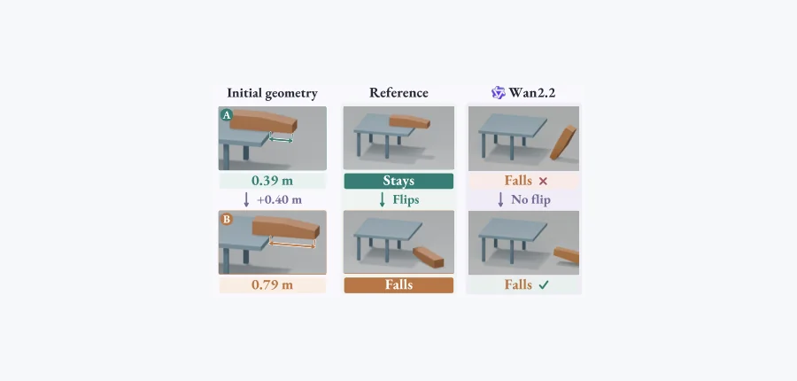 arXiv 2026-11-02 · cs.CV · #1 **[GeoFlip: Benchmarking Geometry-Sensitive Physics in Video Generation](https://arxiv.org/abs/2610.42002)** [Yuqi Li, Junming Liu, Bowen Hu, Ruize Niu, Huiran Duan, Yingli Tian, Hao Wu](https://arxiv.org/abs/2610.42002) 机构：City University of New York / University of Melbourne / Sun Yat-sen University / Chinese University of Hong Kong / Carnegie Mellon University（[PDF](https://arxiv.org/pdf/2610.42002)） [Paper](https://arxiv.org/abs/2610.42002) · [图源](https://arxiv.org/html/2610.42002v1/asset01_geometry_motivation.png) 

中文摘要
视频生成模型能够合成逼真的运动，但能否正确响应初始几何的变化？我们提出 GeoFlip，一个以几何变化导致物理结果翻转为核心的视频生成基准。在保持物理设置和文本提示相同的条件下，GeoFlip 对支撑范围、物体位置和机构配置施加受控干预，构造参照事件相反的配对场景，例如保持稳定与下落或倾倒。这些配对测试模型能否把首帧几何差异转化为正确的物理演化。基准包含六类物理现象中的 482 对场景和 964 个参照视频；参照结果通过程序化场景构建、物理仿真以及对物理事件的数值验证与核查确立。我们从事件正确性、结构完整性和参照视频相似性三个维度评估 16 个图生视频模型，并检查评估结果与独立视觉语言评审器的一致性。在所有模型共有的 442 个条件上，按任务平均的最高事件正确率只有 27.98%，显示出几何条件下物理生成的明显局限。不同模型擅长的物理机制不同，三个评估维度也反映不同能力。典型失败包括忽略几何变化、生成错误物体运动、使刚体弯曲，以及引入额外部件。评审器之间的排序相关性在事件正确性上达到 0.906，在结构完整性上达到 0.929。GeoFlip 将受控几何干预、可验证的物理参照和多维评估结合起来，衡量视频生成从视觉真实走向几何条件物理一致性的进展。 <a href="https://arxiv.org/abs/2610.42002">原摘要来源</a>
 | 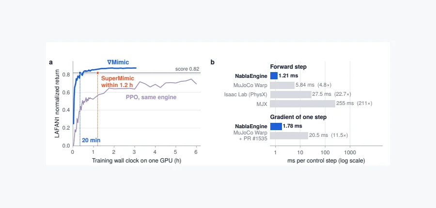 arXiv 2026-11-02 · cs.RO · #2 **[$\nabla$Mimic: Ultra-Efficient Humanoid Control with Differentiable Simulation](https://arxiv.org/abs/2610.41654)** [Weyl Lu, Yubei Chen](https://arxiv.org/abs/2610.41654) 机构：University of California, Davis（[PDF](https://arxiv.org/pdf/2610.41654)） [Paper](https://arxiv.org/abs/2610.41654) · [Code](https://github.com/OamIcs/NablaMimic) · [图源](https://arxiv.org/pdf/2610.41654) 

中文摘要
机器人策略学习主要使用 PPO 等零阶方法，把仿真器视为黑箱，因此需要大量样本。一阶策略学习对动力学求导，但在接触丰富的全身控制中很少成功，因为梯度会爆炸。近期一种世界模型方法利用学习模型的替代梯度，表明导数信息能显著提高人形运动跟踪效率。我们表明，消除两个障碍后，仿真器自身的精确梯度效果更好：接触动力学并非处处可微，在某些事件附近导数发散，造成少量无界梯度样本；此外仿真器的伴随计算必须重放接触求解，代价很高。∇Mimic 在反向传播的每一步用相对中位数的逐样本梯度裁剪限制这些样本，并通过对梯度导出的动作目标进行多步回归，重复利用每个昂贵的仿真窗口，使各动作目标独立于梯度尺度而有界。面向 Unitree G1 的可微 GPU 仿真引擎 NablaEngine 降低了计算成本：它以融合的逐世界内核计算 MuJoCo 完整接触动力学，并以单个大型内核计算完整控制步的伴随；其解析梯度与 float64 有限差分一致，速度比可用的 MuJoCo Warp 伴随快 11.5 倍。在单 GPU 上用单一策略跟踪全部 40 段 LAFAN1 全身动作时，∇Mimic 在 20 分钟达到先进世界模型方法报告的 0.82 分，而后者需 1.2 小时；1.8 小时达到 0.874。标准一阶基线 SHAC 因梯度爆炸在数分钟内停止。我们开源 NablaEngine 和 ∇Mimic，作为一阶人形策略学习基础设施。 <a href="https://arxiv.org/abs/2610.41654">原摘要来源</a>
 | 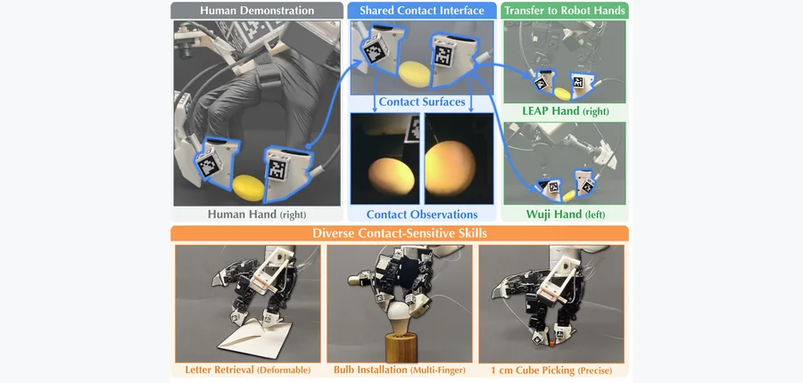 arXiv 2026-11-02 · cs.RO · #3 **[Contact Imitation Interface: Transferring Dexterous Skills by Showing How Contact Unfolds](https://arxiv.org/abs/2610.41028)** [Zhixuan Xu, Yichen Li, Bingchen Wu, Rui Wang, Yiwen Hou, Zixuan Liu, Tianyu Qiu, Lin Shao](https://arxiv.org/abs/2610.41028) 机构：National University of Singapore / RoboScience / South China University of Technology（[PDF](https://arxiv.org/pdf/2610.41028)） [Paper](https://arxiv.org/abs/2610.41028) · [Project](https://nus-lins-lab.github.io/CIMIWeb/) · [图源](https://arxiv.org/html/2610.41028v1/teaser.png) 

中文摘要
无需机器人的人类演示有望扩展灵巧操作数据。关键挑战是在保留演示者自然灵巧性的同时，生成可迁移到机器人手、以接触为依据的观测和动作。我们提出接触模仿接口 CIMI，包含以接触为依据的演示接口和学习接口。演示接口结合共享接触几何与指尖 RGB 视图，采用接触对齐优先的重定向，并重投影更宽视角的场景图像。学习接口引入分层策略：接触表面规划器预测相对接触表面轨迹，控制器协调腕部与手指命令以改善接触对齐。CIMI 结合接触观测、重定向与动作表示，在 LEAP 和 Wuji 的六组手与任务组合中，相比基线策略将最终阶段平均成功率提高至少 50 个百分点。硬件设计和软件已公开。 <a href="https://arxiv.org/abs/2610.41028">原摘要来源</a>
 |
| 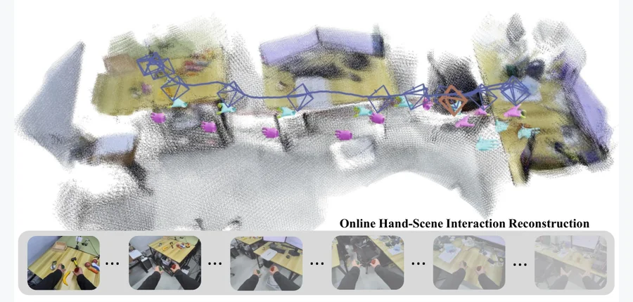 arXiv 2026-11-02 · cs.CV · #4 **[EgoHSI3R: Online 4D Hand-Scene Interaction Reconstruction from Egocentric Video](https://arxiv.org/abs/2610.40832)** [Mingzhi Pei, Zhangchen Ye, Ruoqu Chen, Liu Cao, Mengdi Xu](https://arxiv.org/abs/2610.40832) 机构：Tsinghua University（[PDF](https://arxiv.org/pdf/2610.40832)） [Paper](https://arxiv.org/abs/2610.40832) · [图源](https://arxiv.org/html/2610.40832v1/teaser_demo.png) 

中文摘要
第一人称视频为具身学习提供大量手与场景交互数据，但需要在共同的三维世界中一致地恢复手、相机和场景。现有方法通常只关注相机坐标系中的手或世界坐标系中的手轨迹，没有联合恢复场景点图和交互信息。因此，将这些专门预测拼成完整重建通常需要逐序列优化。我们提出 EgoHSI3R，一个从第一人称单目视频在线重建四维手与场景交互的统一前馈框架。为了联合恢复这些组成部分，框架维护循环更新的场景表示，随时间累积几何证据，并提供共享世界空间与尺度。我们引入融合预训练手部先验和局部场景上下文的手中心提示，让 MANO 顶点查询关注场景特征，预测逐顶点稠密接触。这些设计使单一网络能够联合估计相机运动、稠密场景几何、世界坐标系中的双手 MANO 模型及逐顶点手部接触。尽管以因果方式运行，EgoHSI3R 在 ARCTIC 上获得所评方法中最低的世界坐标系手关节误差，推理速度快于现有世界坐标系手重建流程，并具有有竞争力的相机和场景重建精度。 <a href="https://arxiv.org/abs/2610.40832">原摘要来源</a>
 | 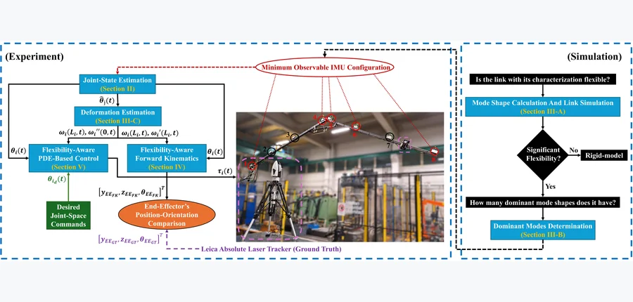 arXiv 2026-11-02 · cs.RO · #5 **[Flexibility-Aware Robotic Manipulation: Deformation Estimation, Kinematics, and Control via Distributed Inertial Measurement](https://arxiv.org/abs/2610.41702)** [Amir Hossein Barjini, Sadeq Yaqubi, Pauli Mustalahti, Jouni Mattila](https://arxiv.org/abs/2610.41702) 机构：Tampere University（[PDF](https://arxiv.org/pdf/2610.41702)） [Paper](https://arxiv.org/abs/2610.41702) · [图源](https://arxiv.org/html/2610.41702v1/Methodology_2.png) 

中文摘要
柔性机器人连杆违背刚体假设，单靠关节测量不足以保证操作精度。本文提出柔性感知操作框架，将结构动力学直接连接到传感、运动学与控制。方法不预设稠密惯性测量单元（IMU）网络，而是依据响应收敛和激励带宽准则，先识别各柔性连杆的主导振动模态。在模态可观测性满秩的条件下，保留 m 个模态只需 m 个独立斜率测量和一个参考 IMU，由此确定最小可观测 IMU 配置。利用这些测量重建连续连杆形变，再将其纳入柔性感知正向运动学和由形变信息驱动的偏微分方程控制器。液压单连杆和双连杆机械臂实验评估了该框架。在长臂双连杆平台上，所提运动学的末端执行器均方根误差分别为 0.0107 m、0.0194 m 和 0.0102 rad，所用传感器少于分段刚体方法。闭环到达实验进一步展示了 IMU 估计关节状态与重建形变在所提控制器中的实时集成。结果表明，主导模态信息能够决定传感需求，并支持实时柔性感知机器人操作。 <a href="https://arxiv.org/abs/2610.41702">原摘要来源</a>
 | 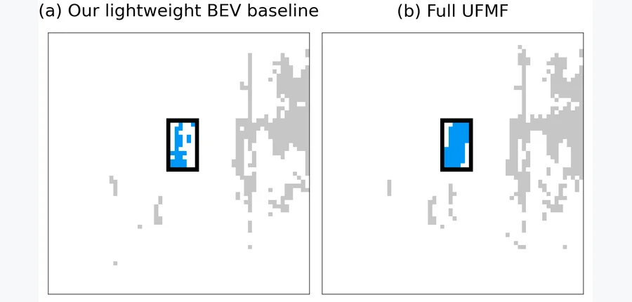 arXiv 2026-11-02 · cs.CV · #6 **[UFMF: Radar-Guided Kinematic Priors for Real-Time 4D Occupancy Forecasting](https://arxiv.org/abs/2610.40947)** [Zeping Zhang, Zhuoya Zhao, Robert Laganière](https://arxiv.org/abs/2610.40947) 机构：University of Ottawa（[PDF](https://arxiv.org/pdf/2610.40947)） [Paper](https://arxiv.org/abs/2610.40947) · [图源](https://arxiv.org/html/2610.40947v1/images/teaser_realdata.png) 

中文摘要
实时四维占据预测必须在严格延迟预算下可靠外推自车与周围交通参与者的运动。近期占据世界模型借助生成解码器和三维体积建模提高长时预测保真度，但计算成本限制实时部署。轻量 BEV 预测器满足延迟要求，却常在较长预测时域模糊或抑制快速运动目标。我们提出实时预测器 UFMF，在保留无注意力的对角状态空间时序核心的同时，于轻量模型易失效之处注入针对性的运动学和几何结构。雷达引导、速度感知的动态先验 VADP 将未来位移分解为线性外推与随时域变化的学习残差。所得逐单元流场在 rollout 时传输紧凑的动态潜在子空间。两项辅助训练约束与此互补：世界坐标系动态监督保持跨预测时域轨迹连贯性，按类别条件化的垂直轮廓监督则正则化从 BEV 到三维的提升。UFMF 在单张 RTX 4090 上以 122 FPS 运行，在 nuScenes 上达到 0.45 的快速位移 mIoU，并以远低于近期占据世界模型的计算成本取得更好结果。 <a href="https://arxiv.org/abs/2610.40947">原摘要来源</a>
 |
| 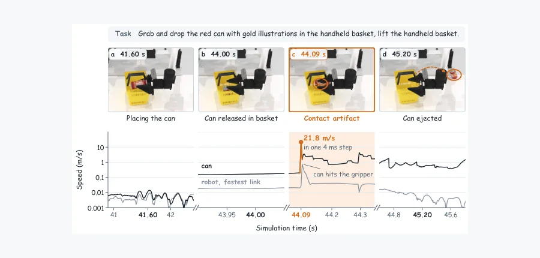 arXiv 2026-11-02 · cs.RO · #7 **[When the Simulator Fails, Not the Policy: Auditing Contact Artifacts in Simulated Robot Benchmarks](https://arxiv.org/abs/2610.41857)** [Alex Zhou, Junhao Wu, Xueyang Zhou, Yixiao Huo, Hongcheng Gao, Di Zhu, Zhenghao Zhang, Yongchao Chen](https://arxiv.org/a… 机构：Tsinghua University / University of Chinese Academy of Sciences（[PDF](https://arxiv.org/pdf/2610.41857)） [Paper](https://arxiv.org/abs/2610.41857) · [Code](https://github.com/ALEXander22568/simuguard) · [图源](https://arxiv.org/html/2610.41857v1/fig1_ejection.png) 

中文摘要
仿真基准按成功率评价机器人策略，每个失败回合都会计为策略失败。然而其中许多失败源于仿真器；我们找到并修复了一个原因。在仿真中测试视觉语言动作模型和世界动作模型时，我们发现策略常已放好物体，仿真器随后却把它弹出；基准自身的脚本演示也会以同样方式失败。我们提出适用于 LIBERO、RoboTwin、RoboCasa 和 RoboDojo 的审计插件 SimuGuard，它不改变评价流程，而是在每个物理步记录状态，标记接触时出现快于机器人接触或重力所能解释的物体运动。它能逐位重放记录的回合，并只改变一个仿真参数重新运行。借此，我们把 RoboTwin 中的这类回合追踪到物理引擎的碰撞检测：对相距一至两厘米的几何体，引擎报告约两厘米的穿透，求解器遂以每秒数米的速度把物体弹出。原因是距离算法用固定面积阈值丢弃三角形，而厘米尺度的有效三角形也低于该阈值。仅修改这个常数后，含此伪影的回合由每 100 个中的 12 个降至零，五个容器任务的成功率由 89% 升至 98%。因此仿真成功率包含仿真器造成的失败。使用 PhysX 5.3.1 或更早版本的基准应在修复后的引擎中重跑；无法修改引擎时，应同时报告所有标记回合分别算失败或成功形成的成功率区间：LingBot-VA 所报告的 83.1% 对应 75.8% 至 98.5%。 <a href="https://arxiv.org/abs/2610.41857">原摘要来源</a>
 | 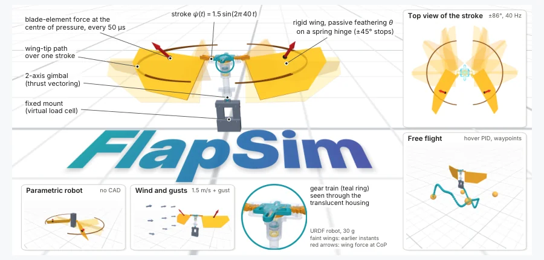 arXiv 2026-11-02 · cs.RO · #8 **[FlapSim: A Composable MuJoCo Simulation Platform and Reduced-Order Aerodynamic Model Hierarchy for Flapping-Wing Robotics](https://arxiv.org/abs/2610.40902)** [Mingshan He](https://arxiv.org/abs/2610.40902) 机构：Institute of Science Tokyo（[PDF](https://arxiv.org/pdf/2610.40902)） [Paper](https://arxiv.org/abs/2610.40902) · [图源](https://arxiv.org/html/2610.40902v1/figure1.png) 

中文摘要
扑翼仿真必须同时处理高频拍翼空气动力学和与飞行控制、强化学习相关的较慢动力学。我们提出 FlapSim，一个模块化开源 MuJoCo 仿真平台，在确定性流程中结合机器人描述、机翼几何与可组合空气动力学模型。在覆盖频率、云台、风、频率阶跃、阵风和跨机器人平板翼工况的 48 个留出场景中，我们把以 1 ms 步长运行的五种降阶配置与步长 50 μs 的准定常叶素参照模型比较。内置悬停周期平均基线实现 67.51 倍 CPU 加速，但平均力与力矩保真度只有 0.6593。结合多速率的 21 子步时钟同步、三维线性／二次入流和阵风耦合、解析叶素几何缩放，以及锁相的 1f–6f 谐波后，五模块模型以 65.19 倍加速将平均保真度提升至 0.9646。省去显式阶跃瞬态滞后状态的四模块模型以 67.98 倍加速达到 0.9662 保真度。受控消融表明，扑翼谐波在频率变化时尤其重要，使留出频率阶跃工况的保真度提高 0.3176。传递函数分析解释了这一现象：频率变化时，固定窗口周期平均仍保留谐波贡献，所以周期内重建也改善滤波后的力与力矩。一旦纳入相位对齐和谐波合成，显式瞬态滞后状态在该基准上不再带来额外收益。这些结果刻画了空气动力学模型层级的精度与算力权衡，并指出时间同步、入流、几何和谐波表示是降阶扑翼仿真的关键。 <a href="https://arxiv.org/abs/2610.40902">原摘要来源</a>
 | 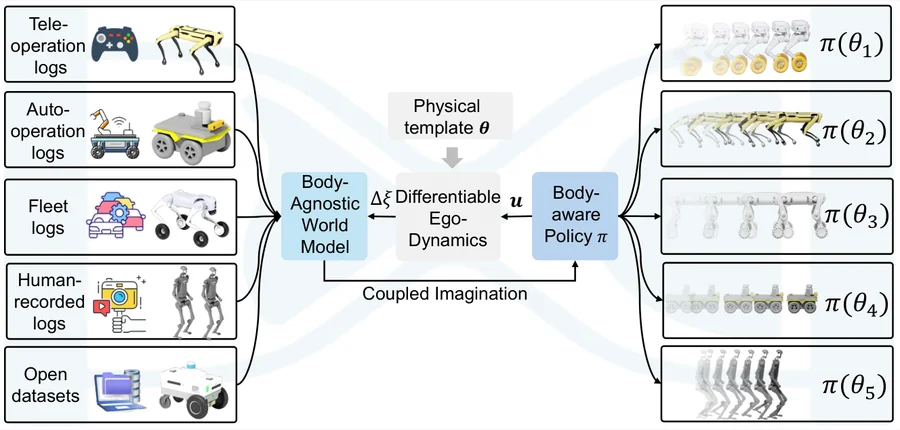 arXiv 2026-11-02 · cs.RO · #9 **[Cross-Embodiment Motion Planning by Coupling Body-Agnostic World Model with Differentiable Ego-Dynamics](https://arxiv.org/abs/2610.41330)** [Zhidong Wang, Zirui Li, Haoran Xu, Yujie Yan, Zitong Shan, Jingsong Liang, Han Yu, Chen Lv](https://arxiv.org/abs/2610.41… 机构：Nanyang Technological University（[PDF](https://arxiv.org/pdf/2610.41330)） [Paper](https://arxiv.org/abs/2610.41330) · [图源](https://arxiv.org/html/2610.41330v1/fig_teaser.png) 

中文摘要
障碍环境中的运动规划依赖机器人具身形态：可行的自由空间和可执行命令取决于各机器人的几何与动力学。现有跨具身策略或输出忽略这些差异的归一化命令，或通过逐机器人训练与蒸馏补偿。世界模型原则上可汇集跨具身数据，但命令条件模型将潜在动力学绑定到单一动作空间，姿态条件模型又缺少从命令到具身运动的映射。在平坦地面上，具身形态仅通过相机自身运动影响规划器的观测。本文提出沙漏形架构 Hourglass，在这一接口处分解跨具身规划：身体无关的世界模型与每个机器人从命令映射到相机自身运动的可微自身动力学仅在此耦合。世界模型使用跨具身和相机安装方式汇集的数据训练；各机器人的自身动力学是已识别物理参数的降阶模板。在接口处一次性学习参数条件化的通用策略：每次想象步先滚动模板再滚动世界模型，通过各机器人模板训练，使策略感知具身差异。在五种运动类型的七个仿真机器人上，通用策略使用同一世界模型，比模仿学习和扩散策略基线的成功率高 3.8–10.6 个百分点；无需专门训练便与逐机器人专家相当，在没有在线地图的条件下与参数条件化 MPPI 教师相差 1.4–2.8 个百分点。用三分钟遥操作驾驶识别参数后，合成数据训练的模型零样本迁移到训练中未见的真实滑移转向机器人，在未见室内场景中导航。 <a href="https://arxiv.org/abs/2610.41330">原摘要来源</a>
 |
| 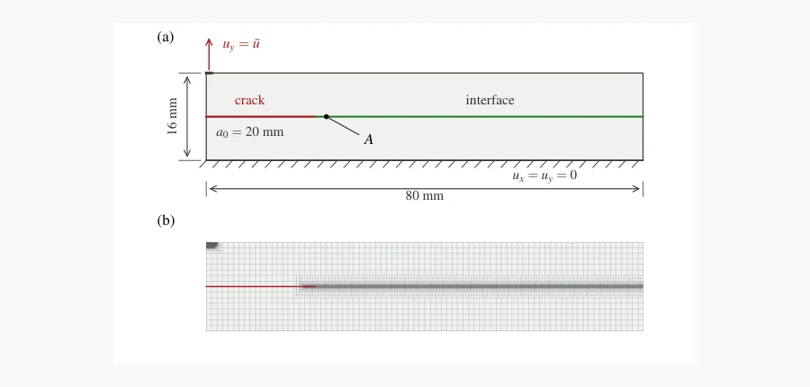 arXiv 2026-11-02 · physics.comp-ph · #10 **[A variational phase-field theory of cohesive fracture at finite deformation](https://arxiv.org/abs/2610.41662)** [Ye Feng](https://arxiv.org/abs/2610.41662) 机构：Northwestern Polytechnical University（[PDF](https://arxiv.org/pdf/2610.41662)） [Paper](https://arxiv.org/abs/2610.41662) · [图源](https://arxiv.org/html/2610.41662v1/fig07.png) 

中文摘要
本文建立一种在有限形变下运动学与变分形式一致的黏聚断裂相场理论。理论引入独立的柔度损伤场，能够容纳弥散分布和奇异集中，使相场不再同时承担描述裂纹几何与材料退化的双重任务。形变梯度的秩一加性分解，通过独立的裂纹应变场和参考法向场显式表示分离。所有场由单一最小势能原理控制，一致耦合非线性体形变、裂纹张开及裂纹面旋转。一维能量比较表明，最小化倾向于使柔度损伤与裂纹应变形成 Dirac 型集中。因此，在有限相场长度下，强位移不连续可自然出现而无需预先指定，同时相场保持连续。集中能量恢复尖锐裂纹黏聚区模型精确的体—界面结构。因此，一般的客观超弹性体势能及允许的混合模式黏聚律可独立指定，名义牵引—分离律不受体材料定律或相场长度影响。弥散损伤可与集中裂纹并存，在成核期间保留用于体能量松弛的形变模式。二维和三维例子在大拉伸、有限旋转及复杂裂纹路径下验证该理论。值得注意的是，在黏聚区外，计算得到的裂尖附近 Cauchy 应力与 Long 等人（2011）的解析 1/r 裂尖渐近解十分接近。 <a href="https://arxiv.org/abs/2610.41662">原摘要来源</a>
 | 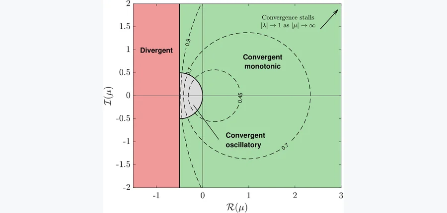 arXiv 2026-11-02 · physics.comp-ph · #11 **[A Momentum-weighted Interface Stabilization Approach for Fluid-Structure Interaction with Strong Added-Mass Effects](https://arxiv.org/abs/2610.42034)** [Nihar Bhardwaj Darbhamulla, Xiaoyu Mao, Aditya Narkhede, David Brown, Rajeev K. Jaiman](https://arxiv.org/abs/2610.42034) 机构：University of British Columbia / Synopsys（[PDF](https://arxiv.org/pdf/2610.42034)） [Paper](https://arxiv.org/abs/2610.42034) · [图源](https://arxiv.org/html/2610.42034v1/mu_regions.png) 

中文摘要
分区流固耦合（FSI）方案可以复用已优化的独立求解器，但在流体附加质量效应很强、尤其结构惯性相对于流体惯性较小时可能失稳。本文通过线性化 FSI 问题的定点分析，将不稳定性追溯到整体耦合系统与 Dirichlet–Neumann 分区系统的界面压力 Schur 补不一致。基于这一分析，我们提出动量加权界面稳定化 MWIS：使用由流体和结构界面动量算子构造的算子，增强流体子问题的界面压力块。该增强在构造上保持一致性，收敛时趋于零，从而恢复整体耦合解。由单元度量推导的稀疏对角近似，把求解器间的数据交换限制在与常规界面耦合数据相近的规模，同时只需对独立求解器作少量修改。线性模型和已建立的非线性 FSI 基准数值实验表明，在标准 Dirichlet–Neumann 方案发散的强附加质量工况中，该方法提高了耦合稳健性。 <a href="https://arxiv.org/abs/2610.42034">原摘要来源</a>
 | 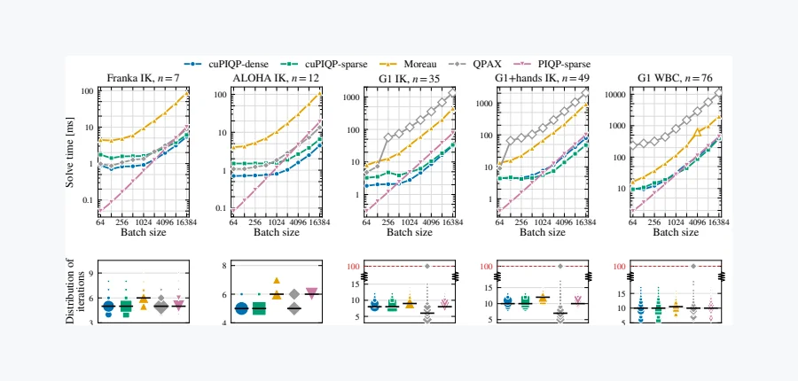 arXiv 2026-11-02 · math.OC · #12 **[CuPIQP: A Batched and Differentiable QP Solver on GPUs for Robot Learning and Control](https://arxiv.org/abs/2610.41021)** [Fenglong Song, Roland Schwan, Yuwen Chen, Yuning Jiang, Colin N. Jones](https://arxiv.org/abs/2610.41021) 机构：EPFL / Dartmouth College / ETH Zürich（[PDF](https://arxiv.org/pdf/2610.41021)） [Paper](https://arxiv.org/abs/2610.41021) · [图源](https://arxiv.org/pdf/2610.41021) 

中文摘要
二次规划（QP）是逆运动学、全身控制和模型预测控制等机器人任务的基本模块。将这些方法扩展到大规模机器人学习与控制，需要同时求解大量 QP，并在端到端学习中对解求导。因此，高效批量优化是把成熟的模型方法带入 GPU 机器人流程的关键。我们提出 cuPIQP，一个基于近端内点法的 GPU 批量可微 QP 求解器，统一支持稠密、稀疏和多阶段问题。求解器利用独立 QP 之间及各问题内部结构的并行性，同时保留逐问题的数值更新和终止决策。在每批最多 16,384 个 QP 的基准中，相比 Moreau 的求解时间最多快 18.8 倍，相比八核 PIQP 最多快 4.26 倍。在一项端到端学习任务中，cuPIQP 使训练速度相比 QPAX 提高 4.6 倍、相比 Moreau 提高 7.8 倍。通过降低计算成本，cuPIQP 为将模型优化集成到大规模机器人学习与控制提供高效可复用的基础设施。 <a href="https://arxiv.org/abs/2610.41021">原摘要来源</a>
 |
| 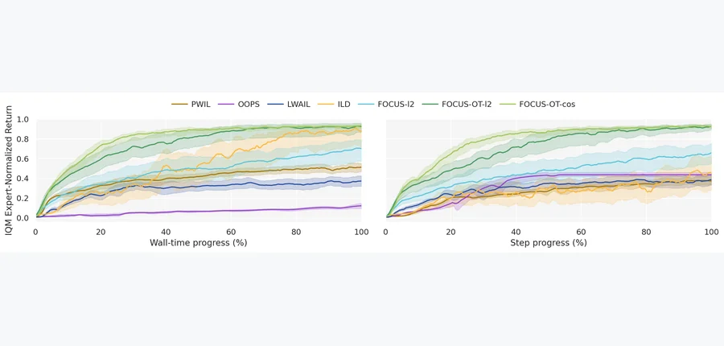 arXiv 2026-11-02 · cs.LG · #13 **[FOCUS: First-Order Control Using Optimal Transport Supervision for Imitation from Observations](https://arxiv.org/abs/2610.41540)** [João A. Cândido Ramos, Lionel Blondé, Hugues Vinzant, Jacopo Castellini, Alexandros Kalousis](https://arxiv.org/abs/26… 机构：University of Geneva / HES-SO（[PDF](https://arxiv.org/pdf/2610.41540)） [Paper](https://arxiv.org/abs/2610.41540) · [图源](https://arxiv.org/html/2610.41540v1/media/aggregate_iqm95ci_horizontal_light.png) 

中文摘要
仅由观测进行模仿学习，必须从只有状态且时间未对齐的演示中恢复行为。可微仿真器提供沿轨迹的策略梯度，但对长而接触丰富的轨迹求导可能使优化不稳定。我们提出 FOCUS，将局部最优传输对齐与短时域可微 actor–critic 学习结合。FOCUS 用强调局部兼容匹配的软 best-of-K 目标，将智能体 rollout 窗口匹配到多个抽样的专家片段。所得传输成本提供可微模仿奖励，学习得到的 critic 则在 rollout 时域之外引导价值估计。FOCUS 既不要求时间对齐的轨迹，也不要求与专家对齐的初始化或 teacher forcing。在 DFlex 的接触丰富运动任务中，包括由 152 个肌肉激活量控制的肌肉骨骼人形模型，FOCUS 相比对抗式观测模仿方法和此前的可微模仿基线，提高了样本效率与训练稳定性。 <a href="https://arxiv.org/abs/2610.41540">原摘要来源</a>
 | 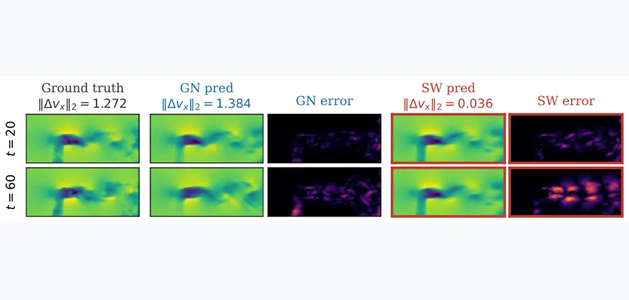 arXiv 2026-11-02 · cs.LG · #14 **[Frozen in Time: How a Physics Foundation Model Forgets Under Sim-to-Real Adaptation](https://arxiv.org/abs/2610.40857)** [Haaris Mian, Miles Cranmer, Alessandro Favero, Payel Mukhopadhyay](https://arxiv.org/abs/2610.40857) 机构：University of Cambridge / Polymathic AI（[PDF](https://arxiv.org/pdf/2610.40857)） [Paper](https://arxiv.org/abs/2610.40857) · [Code](https://github.com/haarisamian/walrus-forgetting-paper) · [图源](https://arxiv.org/html/2610.40857v1/fig_sw_vs_gn_rollout.png) 

中文摘要
科学基础模型（SciFM）在广泛的偏微分方程任务中表现突出，并能通过额外微调高效适应未见数据分布。与其他神经架构一样，微调存在灾难性遗忘风险：适应新任务会损害模型原有知识。我们研究连续介质动力学 SciFM Walrus-1.3B 在两阶段仿真到现实适应中的遗忘：先在圆柱绕流仿真上微调，再适应同一系统的实验数据。我们发现，仿真微调迅速降低模型在原始预训练数据集上的 rollout 表现，仅 20 个 epoch 后单步误差最高增大 35 倍。随后适应真实数据，又进一步损害仿真任务表现。我们分析数据集依赖性和任务表示相似性等可能的遗忘驱动因素。接着表明，在真实数据微调期间只回放 1% 的仿真数据，就能恢复大部分损失的仿真性能，同时保留对实验动力学的有效适应。结果指出，灾难性遗忘是 SciFM 仿真到现实适应的实际障碍，而轻量回放策略可以显著改善知识保持。 <a href="https://arxiv.org/abs/2610.40857">原摘要来源</a>
 | 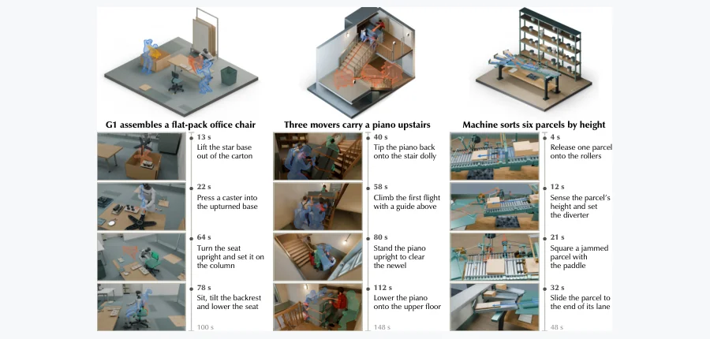 arXiv 2026-11-02 · cs.CV · #15 **[DyCraft: An Agentic System for Long-Horizon 4D Scene Generation](https://arxiv.org/abs/2610.40754)** [Jeff Tan, Hang Dai, Zeqian Long, Yanzhe Lyu, R. Kenny Jones, Shangzhe Wu, Chen Geng, Jiajun Wu](https://arxiv.org/abs/261… 机构：Stanford University / University of Cambridge（[PDF](https://arxiv.org/pdf/2610.40754)） [Paper](https://arxiv.org/abs/2610.40754) · [Project](https://dy-craft.github.io/) · [图源](https://arxiv.org/html/2610.40754v1/teaser.png) 

中文摘要
前沿编程智能体虽然能生成高质量三维场景和关节资产，却难以创建连贯的长时动画。使用通用执行框架时，它们经常生成物理上不合理的结果，如物体互相穿透、缺少支撑或运动不自然。此类智能体难以修复错误，因为它们往往一次性编写完整动画脚本，难以验证作品并拆解复杂时空约束。借鉴人类动画师的做法，我们提出 DyCraft，将动画三维场景生成分解为编程智能体更可靠地解决的步骤。DyCraft 先把用户提示扩展为详细计划并构建静态场景，然后生成关键动画姿态的三维故事板；每帧都是智能体可以独立构建和调试的静态三维场景。故事板把问题拆为已验证的起点与终点状态对，使智能体能够借助一组运动创作工具编写两者之间的局部运动。我们在 24 项涵盖人形机器人、人和动物角色及物理机构的长时多镜头动画任务上评估 DyCraft。与 Codex 中原生 GPT-6 智能体及先前智能体基线相比，DyCraft 显著减少物理违规，生成质量更高且更常获人类评审偏好的三维动画场景。 <a href="https://arxiv.org/abs/2610.40754">原摘要来源</a>
 |
| 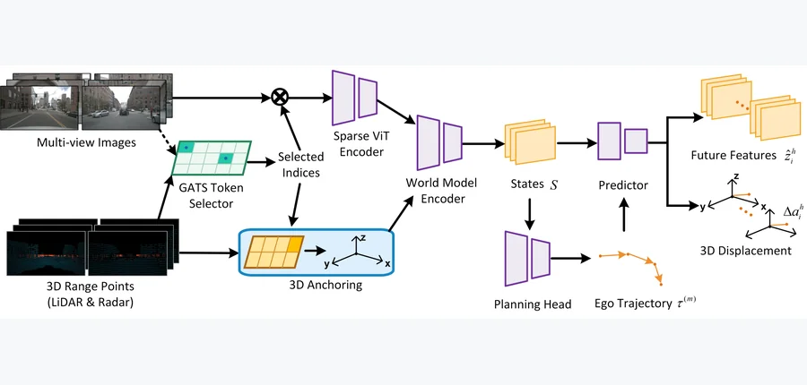 arXiv 2026-11-02 · cs.CV · #16 **[Let LiDAR Decide Where to Look: Geometry-Measured Token Selection for Efficient Sparse Latent World Models](https://arxiv.org/abs/2610.40935)** [Zeping Zhang, Zhuoya Zhao, Robert Laganière](https://arxiv.org/abs/2610.40935) 机构：University of Ottawa（[PDF](https://arxiv.org/pdf/2610.40935)） [Paper](https://arxiv.org/abs/2610.40935) · [图源](https://arxiv.org/html/2610.40935v1/fig/arch.jpg) 

中文摘要
以视觉为中心的自动驾驶模型每帧编码数千个图像 token，但其中很多描绘天空、建筑或空路面，与规划无关。这些 token 还会稀释规划器注意力：我们发现随机丢弃 75% token 已优于稠密模型，因为规划器能集中处理余下的驾驶关键内容。基于这一发现，我们提出几何感知 token 选择 GATS，在视觉骨干网络运行前，利用 LiDAR 和雷达点投影选择少量图像 token。选择器依据实测三维几何而非视觉特征工作，因此骨干网络只编码被选中的图块，端到端 FLOPs 最多降低 18 倍。每个保留的 token 都获得来自 LiDAR 点的三维锚点，送入无须框标注的自监督潜在世界模型，预测未来特征和三维位移。在 25% token 预算下，GATS 在 nuScenes 上取得 0.520 m 的 3 秒 L2 位移误差，在 NAVSIM 上取得 88.9 EPDMS；以总 FLOPs 减少 6.6 倍的代价超过稠密基线的 0.573 m／85.9。在极低的 10% 预算下（24 GFLOPs，降低 18 倍），它在 nuScenes 上仍以 0.537 m 对 0.573 m 的 L2 误差、在 NAVSIM 上以 87.9 对 85.9 的 EPDMS 优于稠密基线。在 739 个意图关键场景中，GATS 覆盖 95.8% 的危险车辆，碰撞率为 0.09%，比稠密模型的 0.34% 低 73.5%。 <a href="https://arxiv.org/abs/2610.40935">原摘要来源</a>
 | 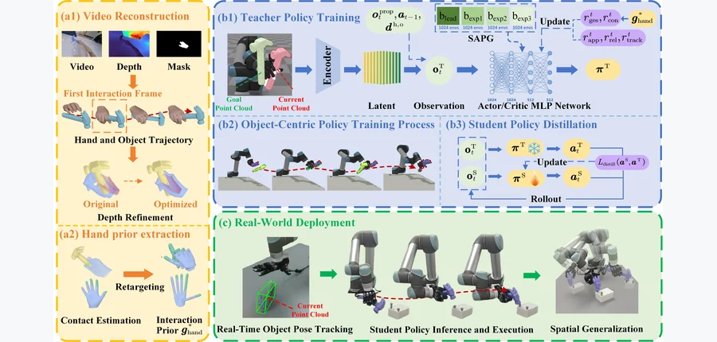 arXiv 2026-11-02 · cs.RO · #17 **[HandMimicX: Learning Human-Like Dexterous Manipulation via an Object-Centric Policy from Egocentric Videos](https://arxiv.org/abs/2610.41336)** [Zihan Gao, Yufei Liu, Yuhong Zhang, Zhen Yu, Xinhao Huang, Zhinan You, Kai W. Ho, Zipeng Ye, Peng Jiao, Haoqian Wang](htt… 机构：Tsinghua University / TsingTec / Meituan / Chinese University of Hong Kong, Shenzhen / NVIDIA（[PDF](https://arxiv.org/pdf/2610.41336)） [Paper](https://arxiv.org/abs/2610.41336) · [图源](https://arxiv.org/html/2610.41336v1/figs/pipeline_handmimicx_v6.jpg) 

中文摘要
从人类视频学习灵巧操作仍是开放问题，尤其难在把单次演示转成可跨空间位置泛化的机器人技能，同时保持物理上合理、类似人类的交互。不同于强调模仿手部运动的既有工作，我们提出以物体为中心的框架，从第一人称人类 RGB-D 视频获取灵巧技能。在此框架中，我们用物体运动定义强化学习目标，使底层技能与特定手轨迹解耦，并对手与物体的交互状态施加约束，以促进更符合解剖结构的手部姿态。大量仿真和真实机器人实验表明，该方法支持从人类视频高效学习，并将技能泛化迁移到新的空间配置。 <a href="https://arxiv.org/abs/2610.41336">原摘要来源</a>
 | 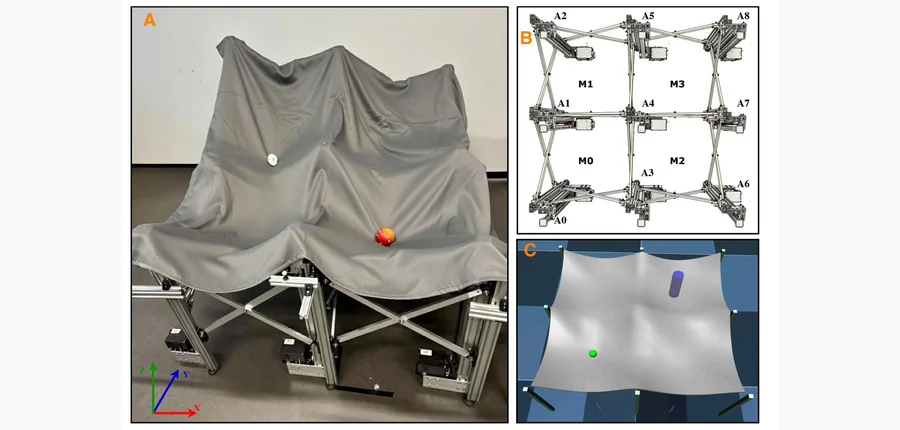 arXiv 2026-11-02 · cs.RO · #18 **[Suspended-Fabric Robotic Manipulation Surfaces: Modelling, Design Space, and Multimodular Extensio](https://arxiv.org/abs/2610.41982)** [Pratik Ingle, Jørn Lambertsen, Kasper Støy, Andres Faiña](https://arxiv.org/abs/2610.41982) 机构：IT University of Copenhagen（[PDF](https://arxiv.org/pdf/2610.41982)） [Paper](https://arxiv.org/abs/2610.41982) · [图源](https://arxiv.org/html/2610.41982v1/fig/platform.png) 

中文摘要
机器人操作表面（RMS）通过形变承托物体的表面来移动物体。近来一类 RMS 将连续织物悬挂在稀疏的竖直线性执行器网格上，降低执行器密度；但如何设计这类表面以在各处控制物体、如何扩展到可跨模块传递物体并并行操作的平台，仍有待解决。本文提出可快速计算的悬挂织物可分离悬链线模型，既能由执行器高度求出表面形状，也能由期望局部坡度反求执行器高度。闭式逆解使简单 PID 控制器能够在织物上定位物体；模型还将织物长度、模块跨度和执行器行程联系到可达工作空间，给出织物最小长度下界及设计图表。方法进一步扩展到相邻模块共享执行器的多模块平台。在一个 2×2 原型上，我们展示仅用九个执行器，就能在 1 m² 工作空间内跨模块传递厘米尺度物体，并将其定位到 0.03 m 范围内；这使多物体操作成为可能，并为并行操作打开路径。 <a href="https://arxiv.org/abs/2610.41982">原摘要来源</a>
 |
| 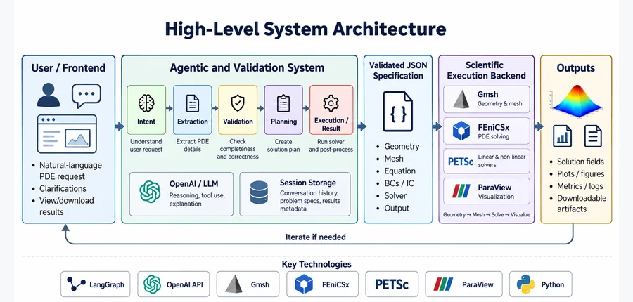 arXiv 2026-11-02 · cs.AI · #19 **[From 1D Benchmarks to Complex 3D Geometries: Can Agents Reliably Specify Problems for Automated PDE Simulation?](https://arxiv.org/abs/2610.41267)** [Akshat Jani, Sakhinana Sagar Srinivas, Venkataramana Runkana](https://arxiv.org/abs/2610.41267) 机构：Tata Research Development and Design Centre（[PDF](https://arxiv.org/pdf/2610.41267)） [Paper](https://arxiv.org/abs/2610.41267) · [图源](https://arxiv.org/html/2610.41267v1/results/overall_system_diagram.png) 

中文摘要
将工程需求转为仿真，必须使几何、物理、边界条件和数值设置相互一致。近期智能体辅助系统可自动配置仿真，但仅能成功执行并不足以说明规格保留了原问题意图，或正确处理缺失信息。我们研究智能体能否可靠构建完整可执行的 JSON 规格，用于自动创建几何、划分网格、求解偏微分方程和导出结果。工作流程将模型提取与确定性科学及能力检查、明确澄清、以及保留无关已接受字段的经验证局部修补结合。我们分别评估规格正确性、执行完成情况和数值验证。在 120 项与模板相关的请求上，完整流程首轮规格和决策正确率为 98.3%，而有模式辅助的单次生成是 92.5%，仅模型生成是 82.5%，分别提高 5.8 和 15.8 个百分点。对需要澄清或拒绝的 42 项请求，没有错误地判定为可执行。组件消融显示科学检查和条件修补各自的贡献。另有下游研究覆盖一维、二维和三维的稳态与非稳态、线性与非线性问题，包括复杂三维机翼几何中的流动和弹性。30 个案例图库展示从保留的 JSON 规格自动执行；12 个精选真实用户到结果测试中，有 9 个同时完成规格、执行、导出和数值参照验证（75.0%）。这些结果支持在测试范围内由工程师审查、可追溯的仿真辅助；新回应的回归问题也表明一致性需要进一步改善。 <a href="https://arxiv.org/abs/2610.41267">原摘要来源</a>
 | 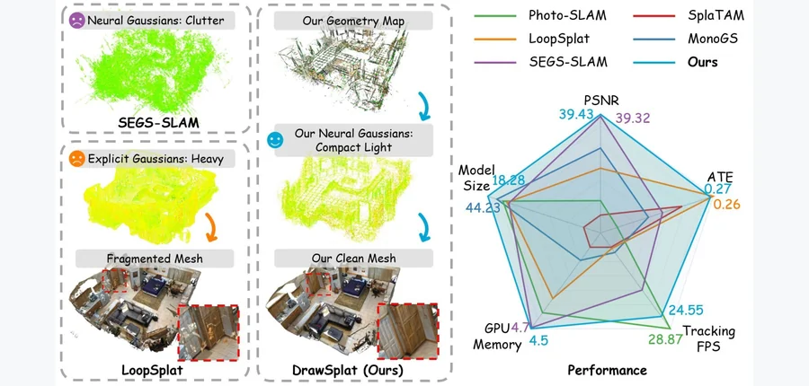 arXiv 2026-11-02 · cs.CV · #20 **[DrawSplat: Atlanta World-Guided Implicit Gaussian SLAM for Indoor Reconstruction](https://arxiv.org/abs/2610.41602)** [Fan Zhu, Zhisong Xu, Ziyu Chen, Zhenjun Zhao, Takayuki Okatani](https://arxiv.org/abs/2610.41602) 机构：Tohoku University / University of Tokyo / Chinese Academy of Sciences / University of Science and Technology of China（部分作者；其余 affiliation 未确认）（[PDF](https://arxiv.org/pdf/2610.41602)） [Paper](https://arxiv.org/abs/2610.41602) · [图源](https://arxiv.org/html/2610.41602v1/motivation.png) 

中文摘要
RGB-D SLAM 需要准确在线跟踪、高质量渲染和几何一致的重建。现有 Gaussian SLAM 主要以光度、深度或局部帧到模型约束优化 Gaussian 基元；在弱纹理、大面积平面、噪声深度和长轨迹的室内场景中，这些约束常不充分，导致位姿漂移、表面厚度伪影、法向噪声和结构边界模糊。我们提出 DrawSplat，一种由 Atlanta World 引导的室内重建隐式 Gaussian SLAM 框架。DrawSplat 遵循类似绘图的过程：先用显式点线几何勾画结构布局，再由隐式神经 Gaussian 填充高保真外观和连续几何细节。它通过点线联合跟踪估计相机位姿、稀疏几何和重力方向，利用 Atlanta World 先验中的共享重力分量，从跟踪线条推断结构平面，并将其转为对 Gaussian 中心与法向的可微正则项。为提高紧凑性与效率，DrawSplat 将基于锚点的隐式神经 Gaussian 表示与自适应结构采样结合，把 Gaussian 容量分配给结构信息丰富的区域。多个数据集实验表明，在维持质量、效率和模型大小的实用平衡时，DrawSplat 在 Gaussian SLAM 系统中实现稳健跟踪、高保真渲染和较强几何重建。 <a href="https://arxiv.org/abs/2610.41602">原摘要来源</a>
 | 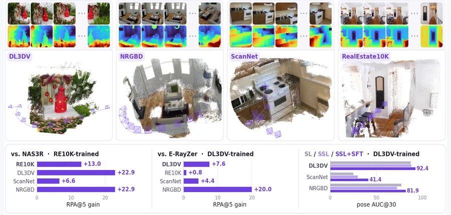 arXiv 2026-11-02 · cs.CV · #21 **[Rethinking Asymmetry in Self-Supervised 3D Geometry Learning](https://arxiv.org/abs/2610.42092)** [Gyeongjin Kang, Freeman Cheng, Botao Ye, Weijie Lyu, Ming-Hsuan Yang, Eunbyung Park](https://arxiv.org/abs/2610.42092) 机构：Yonsei University / University of California, Merced / ETH Zürich（[PDF](https://arxiv.org/pdf/2610.42092)） [Paper](https://arxiv.org/abs/2610.42092) · [Project](https://gynjn.github.io/rethinking-asymmetry/) · [图源](https://arxiv.org/html/2610.42092v1/figs/teaser_row_depth.png) 

中文摘要
自监督学习依赖模型所观察内容与必须解释内容之间的不对称。近期方法从未标定位姿的图像学习三维几何，先预测相机和场景结构，再渲染留出视角。为避免平凡解，它们在输入空间施加不对称，用分支分离或掩码注意力限制视角间交互。我们以几何精度而非渲染质量为主要目标，重新审视这一设计。当留出视角位于上下文视角之间时，上下文实际上已经约束了该视角所见的几何。因此，我们把不对称移到三维表示空间：仅在重建场景时排除留出视角，而共享骨干仍使用全部视角建立对应。这比输入空间设计改进深度和位姿估计。我们进一步利用视角密度：稀疏和稠密观测描绘同一场景，却提供不同数量的对应关系。将稀疏上下文特征与稠密上下文特征对齐，可在渲染之外提供几何训练信号，无需预训练几何教师。再与冻结的视觉基础模型特征对齐，还能进一步获益。这些信号均不需要几何标注，所得模型的几何估计优于先前自监督方法。受控实验分离了各组件贡献，自监督预训练也改善后续监督训练。 <a href="https://arxiv.org/abs/2610.42092">原摘要来源</a>
 |
| 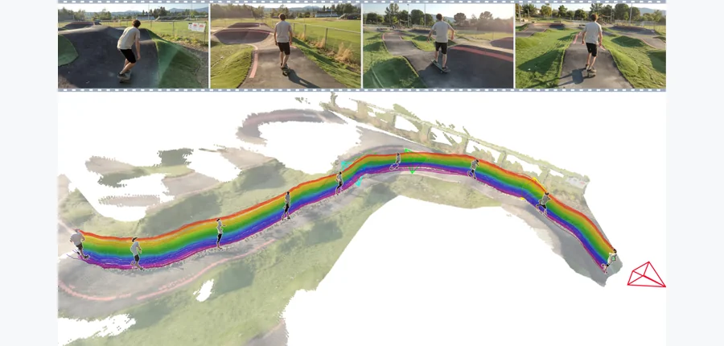 arXiv 2026-11-02 · cs.CV · #22 **[ReLift: Dense 3D Tracking as Lifted Trajectory Repair](https://arxiv.org/abs/2610.42136)** [Assaf Singer, Maroun Khriesh, Noam Rotstein, Yoni Kasten, Or Litany](https://arxiv.org/abs/2610.42136) 机构：Technion / NVIDIA（[PDF](https://arxiv.org/pdf/2610.42136)） [Paper](https://arxiv.org/abs/2610.42136) · [图源](https://arxiv.org/html/2610.42136v1/teaser_v8_strip.png) 

中文摘要
从单目视频进行稠密三维跟踪，需要跨时间建立点对应、估计深度，并推断遮挡期间的轨迹。现有方法通常联合学习这些任务，但四维监督稀缺使目标艰难。我们表明，强大的预训练二维跟踪器和三维几何模型可构成有效基础：仅把轨迹提升到三维并对遮挡段简单插值，在使用相同几何的条件下，已能接近专用三维跟踪器。然而提升后的轨迹继承对应和深度误差；发生遮挡时，深度来自遮挡物而非被跟踪点。我们提出 ReLift，将稠密三维跟踪重构为几何轨迹修复与补全的高效前馈框架。其核心轨迹校正器沿轨迹和跨轨迹交替施加注意力，以保留可靠观测、修复错误位置并补全缺失运动。只使用几何输入，使我们能够在模拟提升误差的三维轨迹上直接训练，将训练与图像及任何特定跟踪器或几何模型解耦。把四维监督集中用于轨迹细化，得到可复用模型；无需重训，它便能持续改善不同跟踪器和几何提供者的提升轨迹，并直接受益于两类组件未来的改进。在 WorldTrack 上，ReLift 获得最先进的平均精度，全点 APD 比最强基线提高 2.1，动态点提高 3.0；更快的配置仍可与领先三维跟踪器竞争，运行速度快于 4RC。更多示例和代码见论文补充页面。 <a href="https://arxiv.org/abs/2610.42136">原摘要来源</a>
 | 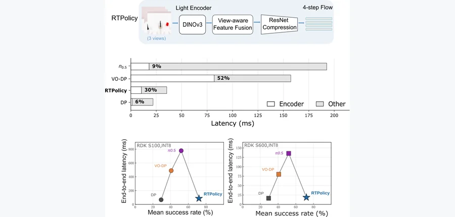 arXiv 2026-11-02 · cs.RO · #23 **[RTPolicy: Real-Time (32.9 Hz) Multi-View Visuomotor Policy for Robotic Manipulation on Edge Devices](https://arxiv.org/abs/2610.41625)** [Xianbao Hou, Zehao Ni, Yonghao He, Lingfeng Qian, Xin Shi, Hu Su, Wei Sui, Cong Yang](https://arxiv.org/abs/2610.41625) 机构：Soochow University / Tongji University / Chinese Academy of Sciences（[PDF](https://arxiv.org/pdf/2610.41625)） [Paper](https://arxiv.org/abs/2610.41625) · [Project](https://d-robotics-ai-lab.github.io/RTPolicy.project/) · [图源](https://arxiv.org/html/2610.41625v1/first.png) 

中文摘要
低推理延迟对闭环机器人操作至关重要；在异步推理中，必须及时更新动作块以修正累积偏差。然而现有视觉运动策略依赖计算昂贵的视觉骨干，导致高延迟和部署负担。我们提出 RTPolicy，一种兼顾操作准确率与推理效率的多视角视觉运动策略。其核心将视角感知特征融合与视觉压缩结合，把各相机视角的互补信息汇集为紧凑 token 表示。该表示结合机器人状态和流时间，作为流匹配动作生成器的条件，从而降低动作生成成本。大量实验表明，此设计在保留操作所需视觉信息的同时，降低视觉表示与动作生成的计算成本。在 RoboTwin 2.0 的 50 个单任务干净评价中，RTPolicy 平均成功率为 52.26%，高于排行榜中最强基线 π₀ 的 46.4%。在真实双臂平台上的异步流式推理评估中，RTPolicy 平均成功率为 72.0%；采用 INT16 时，在 RDK S600 上推理延迟 30.35 ms（32.9 Hz），在 RDK S100 上为 149.72 ms（6.7 Hz）。摘要提供项目页网址。 <a href="https://arxiv.org/abs/2610.41625">原摘要来源</a>
 | 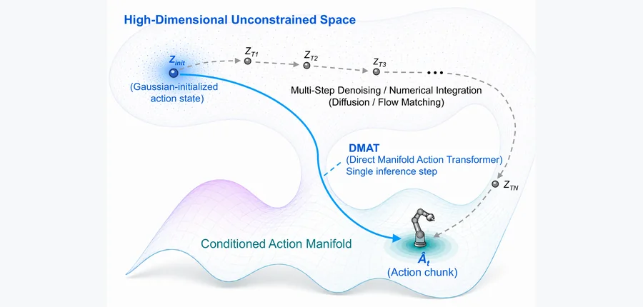 arXiv 2026-11-02 · cs.RO · #24 **[Direct Action-Manifold Modeling for Efficient and Robust Bimanual Manipulation](https://arxiv.org/abs/2610.41643)** [Hongren Wang, Mingyu You, Zihan Li, Zhipeng Wang, Shuo Jiang, Bin He](https://arxiv.org/abs/2610.41643) 机构：Tongji University（[PDF](https://arxiv.org/pdf/2610.41643)） [Paper](https://arxiv.org/abs/2610.41643) · [图源](https://arxiv.org/html/2610.41643v1/fig_introduction.png) 

中文摘要
扩散和流匹配视觉运动策略需要迭代去噪或数值积分来生成多模态动作，因而引入延迟和执行不匹配。我们考虑另一种表述：给定视觉和本体感知，演示中的双臂动作块集中在随观测变化的结构化关节动作空间区域，因此直接建模动作目标可能比建模生成过程更合适。基于此，我们提出 Direct Manifold Action Transformer（DMAT），将动作生成改写为从随机插值变量直接预测干净、以观测为条件的关节空间动作块，实现单步推理，无须迭代生成推理或额外的轨迹拉直流程。在 DMAT 中，局部三维几何将预测锚定到空间结构；状态一致的频谱时间细化（STR）则使预测块与本体感知一致，并抑制高频残差。每种方法在 567 次标准及分布外试验中，DMAT 的总体成功率超过 Improved 3D Diffusion Policy（IDP3）和 DiTFlow3D，相对提升分别为 129.1% 和 95.7%；生成动作块分别快 2.06 倍和 1.34 倍，且在重复 50 N 干预下保持稳健。这些结果为高效稳健双臂操作提供新的生成范式。 <a href="https://arxiv.org/abs/2610.41643">原摘要来源</a>
 |
| 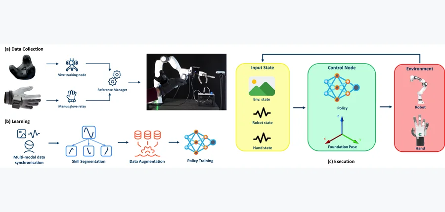 arXiv 2026-11-02 · cs.RO · #25 **[From Teleoperation to Long-Horizon Dexterity: Evaluating Visuomotor Skills and Offline Proxies for Dexterous Manipulation](https://arxiv.org/abs/2610.40828)** [Ammar N. Abbas, Aayush Jain, Prashanth Viswanath, Nivesh Gadipudi, Giulia Vilone, Jim Gibbons](https://arxiv.org/abs/2610… 机构：Analog Devices（[PDF](https://arxiv.org/pdf/2610.40828)） [Paper](https://arxiv.org/abs/2610.40828) · [图源](https://arxiv.org/html/2610.40828v1/fig_system.png) 

中文摘要
模仿学习策略旨在使机器人操作稳健应对物体姿态、外观和环境的变化，这些变化会挑战预编程动作。然而真实表现仍难预测，因为验证损失等常规优化信号与机器人成功率没有稳定关系。为了确定影响真实表现的设计选择，我们评估了七类策略家族中的 281 个模仿学习策略，在五指机器人手抓取和插入 RJ45 接头的约 1,700 次真实机器人试验中测试。受控消融表明，观测和动作表示的影响超过常规优化器及采样选择。对于点云策略，裁剪兴趣区域、采用机器人基座坐标系表示、在点编码器内归一化，分别使成功率提高 70–100 个百分点。对于视觉语言动作策略，预测绝对动作而非相对动作，使插入成功率最高提高 70 个百分点。技能分解、多视角感知和恢复演示与表现最强的系统相关，但其作用没有被独立分离。在评估的 67 项离线指标中，只有五项关于预测运动平滑度和直接性的指标与插入成功率可靠相关（r = −0.70 至 −0.80），而且只在同一策略家族内成立。结果指出，表示选择是决定真实模仿学习表现的关键，离线指标可辅助筛选策略，但不能取代真实机器人评价。 <a href="https://arxiv.org/abs/2610.40828">原摘要来源</a>
 | 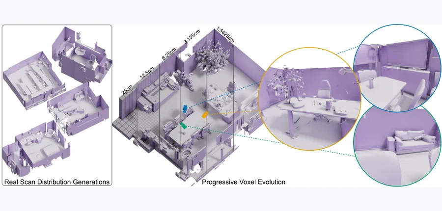 arXiv 2026-11-02 · cs.CV · #26 **[VoxLution: Evolving Voxels for High-Fidelity 3D Scene Generation](https://arxiv.org/abs/2610.41501)** [Daoyi Gao, Xinyi Zhang, Alexey Bokhovkin, Lei Li, Angela Dai](https://arxiv.org/abs/2610.41501) 机构：Technical University of Munich / University of Virginia（[PDF](https://arxiv.org/pdf/2610.41501)） [Paper](https://arxiv.org/abs/2610.41501) · [Project](https://daoyig.github.io/VoxLution/) · [图源](https://arxiv.org/html/2610.41501v1/teaser_v9o.png) 

中文摘要
高分辨率室内三维场景生成对虚拟现实、空间计算和机器人仿真很重要。我们提出 VoxLution，一种由粗到细的 Transformer 方法，生成细节丰富的高保真室内场景，克服现有生成模型几何过于平滑的问题。方法先生成低分辨率空间布局，再依据该结构按局部块逐步细化场景几何。核心是把三维超分辨率表述为多分辨率稀疏体素网格上的序列建模问题。为此，我们提出无需训练且与分辨率无关的 token 化方案，用一个十进制数紧凑编码八个八分体的几何信息。Transformer 序列同时包含多种分辨率，使粗布局指导局部精细细节的生成。为保持局部块间连贯性，方法将相邻块边界信息直接纳入 Transformer 序列。VoxLution 的场景体素分辨率高于现有基线，在标准基准上达到先进性能：3D-FRONT 的 FPD 和 FID 分别降低 59.6% 和 51.1%，Scannet++ 分别降低 70.5% 和 73.8%。 <a href="https://arxiv.org/abs/2610.41501">原摘要来源</a>
 | 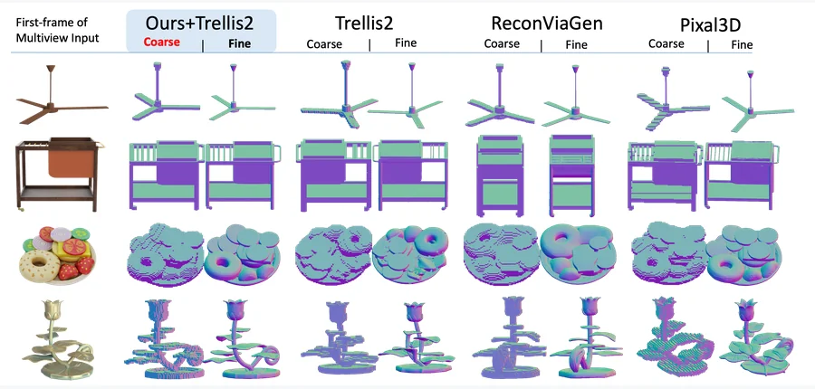 arXiv 2026-11-02 · cs.CV · #27 **[Coarse3D: Controllable and Faithful Sparse Structure Generation for Image-to-3D](https://arxiv.org/abs/2610.41231)** [Gaige Wang, Bowen Pan, Hao Ren, Jiangjing Lyu, Chengfei Lyu](https://arxiv.org/abs/2610.41231) 机构：Alibaba Group（[PDF](https://arxiv.org/pdf/2610.41231)） [Paper](https://arxiv.org/abs/2610.41231) · [图源](https://arxiv.org/html/2610.41231v1/images/teaser_v2.png) 

中文摘要
由粗到细的三维原生生成高度依赖第一阶段的稀疏结构，它决定后续细化的全局朝向和整体几何。然而现有粗生成器有两项主要限制：语义规范化含糊导致朝向难以控制，二维到三维的锚定不足使结构常与输入图像不一致。我们提出 Coarse3D，从任意未标定位姿图像生成朝向可控、结构忠实的稀疏体素几何。Coarse3D 有三项设计：以首帧为锚的规范空间，在保留物体中心归一化的同时使生成朝向与首个输入视角对齐；双塔 DiT，将生成与辅助前馈重建耦合，学习有空间依据的特征；以及空间先验引导注意力，利用像素到体素对应关系正则化交叉注意力。Coarse3D 可以直接替换现有流程中的粗生成阶段。实验表明，它显著提高稀疏结构质量，并持续改善最终三维生成，达到先进水平。 <a href="https://arxiv.org/abs/2610.41231">原摘要来源</a>
 |
| 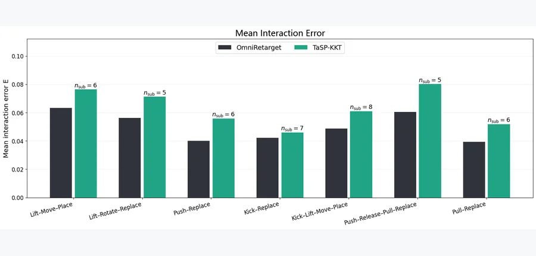 arXiv 2026-11-02 · cs.RO · #28 **[Geometry-Aware Humanoid Retargeting via Manifold ODEs](https://arxiv.org/abs/2610.41349)** [Pengyu Zhu, Heye Wang, Xi Wang, Xuyang Wu, He Kong, Guodong Shi](https://arxiv.org/abs/2610.41349) 机构：Southern University of Science and Technology / University of Sydney（[PDF](https://arxiv.org/pdf/2610.41349)） [Paper](https://arxiv.org/abs/2610.41349) · [图源](https://arxiv.org/html/2610.41349v1/figures/1.png) 

中文摘要
本文关注保留交互关系的运动重定向，即把人类演示迁移到人形机器人，同时维持与物体和地形的空间关系。OmniRetarget 等先前方法通过时间耦合的约束优化处理该任务，每帧需要反复进行序列二次规划（SQP）迭代。我们从常微分方程（ODE）视角研究该问题，将逐帧 Karush–Kuhn–Tucker（KKT）条件的连续时间极限建模为机器人配置流形上的 ODE。这一视角带来两点益处：第一，把 OmniRetarget 的 SQP 迭代联系到 ODE 的后向离散化，使我们能在适当正则条件下证明其局部收敛；第二，导出基于 KKT 流前向离散化的新重定向方法 TaSP-KKT（KKT 流的切空间参数化）。所提方法与对应后向格式一样，对 ODE 解达到一阶收敛；每步却只需一次加权切锥投影及闭式流形更新，避免反复的内部 SQP 迭代。数值实验表明，TaSP-KKT 的重定向质量与 OmniRetarget 相近但略低，运行速度约快两倍。 <a href="https://arxiv.org/abs/2610.41349">原摘要来源</a>
 | 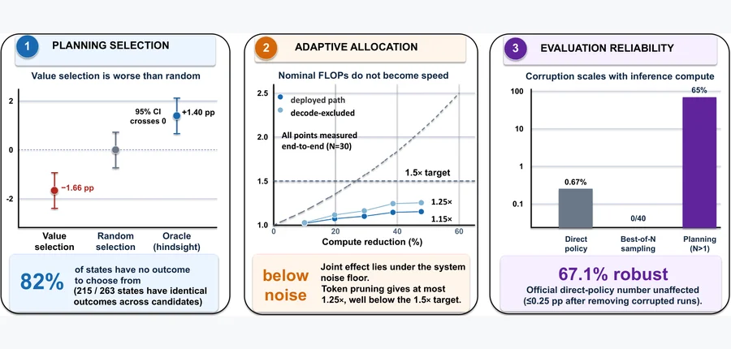 arXiv 2026-11-02 · cs.AI · #29 **[When Does Test-Time Search Help World Action Models? An Empirical Audit of Candidate Selection and Simulator Integrity](https://arxiv.org/abs/2610.41970)** [Jun Liu, Dajie Sun, Zhenglun Kong, Zhenjiang Fan, Peiyan Dong, Fan Yang, Wenbin Zhangg, Geng Yuan, Xue Lin, Yanzhi Wang… 机构：Carnegie Mellon University / UC Berkeley / Harvard University / Stanford University / MIT / Fujitsu / Florida International University / University of Georgia / Northeastern University / EmbodyX（[PDF](https://arxiv.org/pdf/2610.41970)） [Paper](https://arxiv.org/abs/2610.41970) · [图源](https://arxiv.org/html/2610.41970v1/fig_teaser.png) 

中文摘要
世界动作模型越来越多地采用测试时扩展，在候选选择和自适应算力分配上花费额外推理计算以改善控制。只有候选包含可利用信号、名义算力节省转化为真实加速、评价本身可靠时，这些收益才可信。我们在 Cosmos Policy 和 RoboCasa 上，以先检验前提、预注册的方法审计这三点。在干净数据上，学习的价值选择器比随机选择差 1.66 个百分点；事后先知选择器只提高 1.40 个百分点，回合级区间跨过零；82% 状态中的候选结果相同，选择余地很小。Token 剪枝使单次前向 FLOPs 最多减少 47%，但在部署路径上测得的端到端加速最多只有 1.15 倍（排除解码的路径为 1.25 倍），低于 1.5 倍目标；自适应分配实验在统计功效门槛下无法得出结论。我们还发现并修复静默渲染损坏：其发生率沿高算力规划路径急剧上升，但不影响官方直接策略结果；并发布检测器、修复和脚本。这些发现说明，测试时扩展应作为一系列前提（决策信号、实际效率、评价完整性）审计，不能只看成功率。结论仅适用于测试过的配置。 <a href="https://arxiv.org/abs/2610.41970">原摘要来源</a>
 | 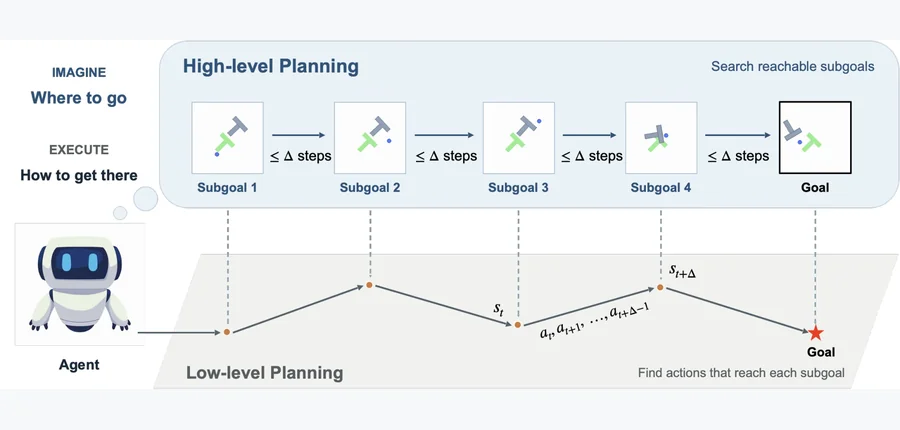 arXiv 2026-11-02 · cs.RO · #30 **[Hierarchical World Models with Implicit Dynamics](https://arxiv.org/abs/2610.42146)** [Gaoyue Zhou, Yvonne Wu, Zichen Jeff Cui, Nicolas Ballas, Mido Assran, Lerrel Pinto, Yann LeCun](https://arxiv.org/abs/261… 机构：New York University / Meta FAIR / AMI Labs（[PDF](https://arxiv.org/pdf/2610.42146)） [Paper](https://arxiv.org/abs/2610.42146) · [Project](https://id-wm.github.io/) · [图源](https://arxiv.org/html/2610.42146v1/idwm_teaser.png) 

中文摘要
世界模型规划支持具身智能体的测试时适应，相比直接策略学习具有更好的泛化能力，但长时任务仍受累积误差和搜索复杂度限制。现有分层方法常使用固定宏动作或潜在技能，导致表示脆弱且精细控制有限。我们提出 ID-WM（隐式动力学世界模型），一种将状态空间可达性与局部控制解耦的分层世界模型。框架用高层模型在状态流形上采样可行转移，以低层世界模型作为逆动力学求解器，把这些转移落实为精确动作。这使规划器能够识别可达子目标，而不被低层执行细节束缚。通过优先考虑局部物理可行性而非全局行为模式，ID-WM 可从短片段合成新的长时计划，超越训练中见过的特定行为模式。我们在三个导航和操作任务套件上展示其效果，相比先进的策略规划器和扩散式规划器提高 38.5%。分层结构还缓解累积误差，使其相比单层世界模型 MPC 提高 135%，尤其适用于复杂、未见配置下的长时任务。视频见摘要提供的网址。 <a href="https://arxiv.org/abs/2610.42146">原摘要来源</a>
 |
<!-- PAPER_CARDS_END -->

## 检索概况

- **检索窗口**：北京时间 2026-11-01 09:00 至 2026-11-02 09:00；官方最新批次为 **Monday, 2 November 2026**。
- **官方分类页总命中／入选**：New **650／30 篇**（650 个互异 ID）；Cross **365** 条，Replacement **567** 条。
- **筛选规则**：主榜只用官方 New，逐篇按标题和原摘要核实；先排三维物理与几何方法，再排有具体机器人任务和实验的具身研究。
- **证据边界**：标题、作者、分类、方法与结果来自官方 arXiv 列表及摘要；机构由 PDF 首页核实。相关性、机构强度、优先级和局限建议均为编辑推断。

| 官方分类页 | listing 日期 | New | Cross | Replacement |
|---|---|---:|---:|---:|
| [cond-mat](https://arxiv.org/list/cond-mat/new?show=2000) | 2026-11-02 | 81 | 27 | 56 |
| [cs.AI](https://arxiv.org/list/cs.AI/new?show=2000) | 2026-11-02 | 98 | 88 | 111 |
| [cs.CV](https://arxiv.org/list/cs.CV/new?show=2000) | 2026-11-02 | 76 | 26 | 63 |
| [cs.GR](https://arxiv.org/list/cs.GR/new?show=2000) | 2026-11-02 | 3 | 1 | 1 |
| [cs.LG](https://arxiv.org/list/cs.LG/new?show=2000) | 2026-11-02 | 111 | 87 | 139 |
| [cs.RO](https://arxiv.org/list/cs.RO/new?show=2000) | 2026-11-02 | 60 | 12 | 38 |
| [eess.IV](https://arxiv.org/list/eess.IV/new?show=2000) | 2026-11-02 | 18 | 2 | 2 |
| [eess.SP](https://arxiv.org/list/eess.SP/new?show=2000) | 2026-11-02 | 20 | 4 | 12 |
| [eess.SY](https://arxiv.org/list/eess.SY/new?show=2000) | 2026-11-02 | 28 | 23 | 10 |
| [math.DS](https://arxiv.org/list/math.DS/new?show=2000) | 2026-11-02 | 8 | 5 | 14 |
| [math.NA](https://arxiv.org/list/math.NA/new?show=2000) | 2026-11-02 | 15 | 12 | 14 |
| [math.OC](https://arxiv.org/list/math.OC/new?show=2000) | 2026-11-02 | 35 | 20 | 29 |
| [physics](https://arxiv.org/list/physics/new?show=2000) | 2026-11-02 | 85 | 40 | 61 |
| [stat.ML](https://arxiv.org/list/stat.ML/new?show=2000) | 2026-11-02 | 12 | 18 | 17 |

## Top papers

| # | 论文 | arXiv | 分类 | 作者 | 机构 | 相关性（推断） | 机构强度（推断） | 优先级（推断） |
|---:|---|---|---|---|---|---|---|---|
| 1 | [GeoFlip: Benchmarking Geometry-Sensitive Physics in Video Generation](https://arxiv.org/pdf/2610.42002) | [arXiv:2610.42002](https://arxiv.org/abs/2610.42002) | [cs.CV](https://arxiv.org/abs/2610.42002) | [Yuqi Li, Junming Liu, Bowen Hu, Ruize Niu, Huiran Duan, Yingli Tian, Hao Wu](https://arxiv.org/abs/2610.42002) | City University of New York / University of Melbourne / Sun Yat-sen University / Chinese University of Hong Kong / Carnegie Mellon University（[PDF](https://arxiv.org/pdf/2610.42002)） | 高：三维物理／接触机制 | 强（推断） | A |
| 2 | [$\nabla$Mimic: Ultra-Efficient Humanoid Control with Differentiable Simulation](https://arxiv.org/pdf/2610.41654) | [arXiv:2610.41654](https://arxiv.org/abs/2610.41654) | [cs.RO](https://arxiv.org/abs/2610.41654) | [Weyl Lu, Yubei Chen](https://arxiv.org/abs/2610.41654) | University of California, Davis（[PDF](https://arxiv.org/pdf/2610.41654)） | 高：三维物理／接触机制 | 中（推断） | A |
| 3 | [Contact Imitation Interface: Transferring Dexterous Skills by Showing How Contact Unfolds](https://arxiv.org/pdf/2610.41028) | [arXiv:2610.41028](https://arxiv.org/abs/2610.41028) | [cs.RO](https://arxiv.org/abs/2610.41028) | [Zhixuan Xu, Yichen Li, Bingchen Wu, Rui Wang, Yiwen Hou, Zixuan Liu, Tianyu Qiu, Lin Shao](https://arxiv.org/abs/2610.41028) | National University of Singapore / RoboScience / South China University of Technology（[PDF](https://arxiv.org/pdf/2610.41028)） | 高：三维物理／接触机制 | 中（推断） | A |
| 4 | [EgoHSI3R: Online 4D Hand-Scene Interaction Reconstruction from Egocentric Video](https://arxiv.org/pdf/2610.40832) | [arXiv:2610.40832](https://arxiv.org/abs/2610.40832) | [cs.CV](https://arxiv.org/abs/2610.40832) | [Mingzhi Pei, Zhangchen Ye, Ruoqu Chen, Liu Cao, Mengdi Xu](https://arxiv.org/abs/2610.40832) | Tsinghua University（[PDF](https://arxiv.org/pdf/2610.40832)） | 高：三维物理／接触机制 | 强（推断） | A |
| 5 | [Flexibility-Aware Robotic Manipulation: Deformation Estimation, Kinematics, and Control via Distributed Inertial Measurement](https://arxiv.org/pdf/2610.41702) | [arXiv:2610.41702](https://arxiv.org/abs/2610.41702) | [cs.RO](https://arxiv.org/abs/2610.41702) | [Amir Hossein Barjini, Sadeq Yaqubi, Pauli Mustalahti, Jouni Mattila](https://arxiv.org/abs/2610.41702) | Tampere University（[PDF](https://arxiv.org/pdf/2610.41702)） | 高：三维物理／接触机制 | 中（推断） | A |
| 6 | [UFMF: Radar-Guided Kinematic Priors for Real-Time 4D Occupancy Forecasting](https://arxiv.org/pdf/2610.40947) | [arXiv:2610.40947](https://arxiv.org/abs/2610.40947) | [cs.CV](https://arxiv.org/abs/2610.40947) | [Zeping Zhang, Zhuoya Zhao, Robert Laganière](https://arxiv.org/abs/2610.40947) | University of Ottawa（[PDF](https://arxiv.org/pdf/2610.40947)） | 高：三维物理／接触机制 | 中（推断） | A |
| 7 | [When the Simulator Fails, Not the Policy: Auditing Contact Artifacts in Simulated Robot Benchmarks](https://arxiv.org/pdf/2610.41857) | [arXiv:2610.41857](https://arxiv.org/abs/2610.41857) | [cs.RO](https://arxiv.org/abs/2610.41857) | [Alex Zhou, Junhao Wu, Xueyang Zhou, Yixiao Huo, Hongcheng Gao, Di Zhu, Zhenghao Zhang, Yongchao Chen](https://arxiv.org/abs/2610.41857) | Tsinghua University / University of Chinese Academy of Sciences（[PDF](https://arxiv.org/pdf/2610.41857)） | 高：三维物理／接触机制 | 强（推断） | A |
| 8 | [FlapSim: A Composable MuJoCo Simulation Platform and Reduced-Order Aerodynamic Model Hierarchy for Flapping-Wing Robotics](https://arxiv.org/pdf/2610.40902) | [arXiv:2610.40902](https://arxiv.org/abs/2610.40902) | [cs.RO](https://arxiv.org/abs/2610.40902) | [Mingshan He](https://arxiv.org/abs/2610.40902) | Institute of Science Tokyo（[PDF](https://arxiv.org/pdf/2610.40902)） | 高：三维物理／接触机制 | 中（推断） | A |
| 9 | [Cross-Embodiment Motion Planning by Coupling Body-Agnostic World Model with Differentiable Ego-Dynamics](https://arxiv.org/pdf/2610.41330) | [arXiv:2610.41330](https://arxiv.org/abs/2610.41330) | [cs.RO](https://arxiv.org/abs/2610.41330) | [Zhidong Wang, Zirui Li, Haoran Xu, Yujie Yan, Zitong Shan, Jingsong Liang, Han Yu, Chen Lv](https://arxiv.org/abs/2610.41330) | Nanyang Technological University（[PDF](https://arxiv.org/pdf/2610.41330)） | 高：三维物理／接触机制 | 中（推断） | A |
| 10 | [A variational phase-field theory of cohesive fracture at finite deformation](https://arxiv.org/pdf/2610.41662) | [arXiv:2610.41662](https://arxiv.org/abs/2610.41662) | [physics.comp-ph](https://arxiv.org/abs/2610.41662) | [Ye Feng](https://arxiv.org/abs/2610.41662) | Northwestern Polytechnical University（[PDF](https://arxiv.org/pdf/2610.41662)） | 高：三维物理／接触机制 | 中（推断） | A |
| 11 | [A Momentum-weighted Interface Stabilization Approach for Fluid-Structure Interaction with Strong Added-Mass Effects](https://arxiv.org/pdf/2610.42034) | [arXiv:2610.42034](https://arxiv.org/abs/2610.42034) | [physics.comp-ph](https://arxiv.org/abs/2610.42034) | [Nihar Bhardwaj Darbhamulla, Xiaoyu Mao, Aditya Narkhede, David Brown, Rajeev K. Jaiman](https://arxiv.org/abs/2610.42034) | University of British Columbia / Synopsys（[PDF](https://arxiv.org/pdf/2610.42034)） | 高：三维物理／接触机制 | 中（推断） | A |
| 12 | [CuPIQP: A Batched and Differentiable QP Solver on GPUs for Robot Learning and Control](https://arxiv.org/pdf/2610.41021) | [arXiv:2610.41021](https://arxiv.org/abs/2610.41021) | [math.OC](https://arxiv.org/abs/2610.41021) | [Fenglong Song, Roland Schwan, Yuwen Chen, Yuning Jiang, Colin N. Jones](https://arxiv.org/abs/2610.41021) | EPFL / Dartmouth College / ETH Zürich（[PDF](https://arxiv.org/pdf/2610.41021)） | 高：三维物理／接触机制 | 强（推断） | A |
| 13 | [FOCUS: First-Order Control Using Optimal Transport Supervision for Imitation from Observations](https://arxiv.org/pdf/2610.41540) | [arXiv:2610.41540](https://arxiv.org/abs/2610.41540) | [cs.LG](https://arxiv.org/abs/2610.41540) | [João A. Cândido Ramos, Lionel Blondé, Hugues Vinzant, Jacopo Castellini, Alexandros Kalousis](https://arxiv.org/abs/2610.41540) | University of Geneva / HES-SO（[PDF](https://arxiv.org/pdf/2610.41540)） | 高：三维物理／接触机制 | 中（推断） | A |
| 14 | [Frozen in Time: How a Physics Foundation Model Forgets Under Sim-to-Real Adaptation](https://arxiv.org/pdf/2610.40857) | [arXiv:2610.40857](https://arxiv.org/abs/2610.40857) | [cs.LG](https://arxiv.org/abs/2610.40857) | [Haaris Mian, Miles Cranmer, Alessandro Favero, Payel Mukhopadhyay](https://arxiv.org/abs/2610.40857) | University of Cambridge / Polymathic AI（[PDF](https://arxiv.org/pdf/2610.40857)） | 高：三维物理／接触机制 | 强（推断） | A |
| 15 | [DyCraft: An Agentic System for Long-Horizon 4D Scene Generation](https://arxiv.org/pdf/2610.40754) | [arXiv:2610.40754](https://arxiv.org/abs/2610.40754) | [cs.CV](https://arxiv.org/abs/2610.40754) | [Jeff Tan, Hang Dai, Zeqian Long, Yanzhe Lyu, R. Kenny Jones, Shangzhe Wu, Chen Geng, Jiajun Wu](https://arxiv.org/abs/2610.40754) | Stanford University / University of Cambridge（[PDF](https://arxiv.org/pdf/2610.40754)） | 高：三维物理／接触机制 | 强（推断） | A |
| 16 | [Let LiDAR Decide Where to Look: Geometry-Measured Token Selection for Efficient Sparse Latent World Models](https://arxiv.org/pdf/2610.40935) | [arXiv:2610.40935](https://arxiv.org/abs/2610.40935) | [cs.CV](https://arxiv.org/abs/2610.40935) | [Zeping Zhang, Zhuoya Zhao, Robert Laganière](https://arxiv.org/abs/2610.40935) | University of Ottawa（[PDF](https://arxiv.org/pdf/2610.40935)） | 高：三维物理／接触机制 | 中（推断） | A |
| 17 | [HandMimicX: Learning Human-Like Dexterous Manipulation via an Object-Centric Policy from Egocentric Videos](https://arxiv.org/pdf/2610.41336) | [arXiv:2610.41336](https://arxiv.org/abs/2610.41336) | [cs.RO](https://arxiv.org/abs/2610.41336) | [Zihan Gao, Yufei Liu, Yuhong Zhang, Zhen Yu, Xinhao Huang, Zhinan You, Kai W. Ho, Zipeng Ye, Peng Jiao, Haoqian Wang](https://arxiv.org/abs/2610.41336) | Tsinghua University / TsingTec / Meituan / Chinese University of Hong Kong, Shenzhen / NVIDIA（[PDF](https://arxiv.org/pdf/2610.41336)） | 高：三维物理／接触机制 | 强（推断） | A |
| 18 | [Suspended-Fabric Robotic Manipulation Surfaces: Modelling, Design Space, and Multimodular Extensio](https://arxiv.org/pdf/2610.41982) | [arXiv:2610.41982](https://arxiv.org/abs/2610.41982) | [cs.RO](https://arxiv.org/abs/2610.41982) | [Pratik Ingle, Jørn Lambertsen, Kasper Støy, Andres Faiña](https://arxiv.org/abs/2610.41982) | IT University of Copenhagen（[PDF](https://arxiv.org/pdf/2610.41982)） | 高：三维物理／接触机制 | 中（推断） | A |
| 19 | [From 1D Benchmarks to Complex 3D Geometries: Can Agents Reliably Specify Problems for Automated PDE Simulation?](https://arxiv.org/pdf/2610.41267) | [arXiv:2610.41267](https://arxiv.org/abs/2610.41267) | [cs.AI](https://arxiv.org/abs/2610.41267) | [Akshat Jani, Sakhinana Sagar Srinivas, Venkataramana Runkana](https://arxiv.org/abs/2610.41267) | Tata Research Development and Design Centre（[PDF](https://arxiv.org/pdf/2610.41267)） | 高：三维物理／仿真规格 | 中（推断） | B |
| 20 | [DrawSplat: Atlanta World-Guided Implicit Gaussian SLAM for Indoor Reconstruction](https://arxiv.org/pdf/2610.41602) | [arXiv:2610.41602](https://arxiv.org/abs/2610.41602) | [cs.CV](https://arxiv.org/abs/2610.41602) | [Fan Zhu, Zhisong Xu, Ziyu Chen, Zhenjun Zhao, Takayuki Okatani](https://arxiv.org/abs/2610.41602) | Tohoku University / University of Tokyo / Chinese Academy of Sciences / University of Science and Technology of China（部分作者；其余 affiliation 未确认）（[PDF](https://arxiv.org/pdf/2610.41602)） | 高：三维世界／几何 | 中（推断） | B |
| 21 | [Rethinking Asymmetry in Self-Supervised 3D Geometry Learning](https://arxiv.org/pdf/2610.42092) | [arXiv:2610.42092](https://arxiv.org/abs/2610.42092) | [cs.CV](https://arxiv.org/abs/2610.42092) | [Gyeongjin Kang, Freeman Cheng, Botao Ye, Weijie Lyu, Ming-Hsuan Yang, Eunbyung Park](https://arxiv.org/abs/2610.42092) | Yonsei University / University of California, Merced / ETH Zürich（[PDF](https://arxiv.org/pdf/2610.42092)） | 高：三维世界／几何 | 强（推断） | B |
| 22 | [ReLift: Dense 3D Tracking as Lifted Trajectory Repair](https://arxiv.org/pdf/2610.42136) | [arXiv:2610.42136](https://arxiv.org/abs/2610.42136) | [cs.CV](https://arxiv.org/abs/2610.42136) | [Assaf Singer, Maroun Khriesh, Noam Rotstein, Yoni Kasten, Or Litany](https://arxiv.org/abs/2610.42136) | Technion / NVIDIA（[PDF](https://arxiv.org/pdf/2610.42136)） | 高：三维世界／几何 | 强（推断） | B |
| 23 | [RTPolicy: Real-Time (32.9 Hz) Multi-View Visuomotor Policy for Robotic Manipulation on Edge Devices](https://arxiv.org/pdf/2610.41625) | [arXiv:2610.41625](https://arxiv.org/abs/2610.41625) | [cs.RO](https://arxiv.org/abs/2610.41625) | [Xianbao Hou, Zehao Ni, Yonghao He, Lingfeng Qian, Xin Shi, Hu Su, Wei Sui, Cong Yang](https://arxiv.org/abs/2610.41625) | Soochow University / Tongji University / Chinese Academy of Sciences（[PDF](https://arxiv.org/pdf/2610.41625)） | 相关：具身机器人任务 | 中（推断） | B |
| 24 | [Direct Action-Manifold Modeling for Efficient and Robust Bimanual Manipulation](https://arxiv.org/pdf/2610.41643) | [arXiv:2610.41643](https://arxiv.org/abs/2610.41643) | [cs.RO](https://arxiv.org/abs/2610.41643) | [Hongren Wang, Mingyu You, Zihan Li, Zhipeng Wang, Shuo Jiang, Bin He](https://arxiv.org/abs/2610.41643) | Tongji University（[PDF](https://arxiv.org/pdf/2610.41643)） | 相关：具身机器人任务 | 中（推断） | B |
| 25 | [From Teleoperation to Long-Horizon Dexterity: Evaluating Visuomotor Skills and Offline Proxies for Dexterous Manipulation](https://arxiv.org/pdf/2610.40828) | [arXiv:2610.40828](https://arxiv.org/abs/2610.40828) | [cs.RO](https://arxiv.org/abs/2610.40828) | [Ammar N. Abbas, Aayush Jain, Prashanth Viswanath, Nivesh Gadipudi, Giulia Vilone, Jim Gibbons](https://arxiv.org/abs/2610.40828) | Analog Devices（[PDF](https://arxiv.org/pdf/2610.40828)） | 相关：具身机器人任务 | 中（推断） | B |
| 26 | [VoxLution: Evolving Voxels for High-Fidelity 3D Scene Generation](https://arxiv.org/pdf/2610.41501) | [arXiv:2610.41501](https://arxiv.org/abs/2610.41501) | [cs.CV](https://arxiv.org/abs/2610.41501) | [Daoyi Gao, Xinyi Zhang, Alexey Bokhovkin, Lei Li, Angela Dai](https://arxiv.org/abs/2610.41501) | Technical University of Munich / University of Virginia（[PDF](https://arxiv.org/pdf/2610.41501)） | 高：三维世界／几何 | 中（推断） | B |
| 27 | [Coarse3D: Controllable and Faithful Sparse Structure Generation for Image-to-3D](https://arxiv.org/pdf/2610.41231) | [arXiv:2610.41231](https://arxiv.org/abs/2610.41231) | [cs.CV](https://arxiv.org/abs/2610.41231) | [Gaige Wang, Bowen Pan, Hao Ren, Jiangjing Lyu, Chengfei Lyu](https://arxiv.org/abs/2610.41231) | Alibaba Group（[PDF](https://arxiv.org/pdf/2610.41231)） | 高：三维世界／几何 | 中（推断） | B |
| 28 | [Geometry-Aware Humanoid Retargeting via Manifold ODEs](https://arxiv.org/pdf/2610.41349) | [arXiv:2610.41349](https://arxiv.org/abs/2610.41349) | [cs.RO](https://arxiv.org/abs/2610.41349) | [Pengyu Zhu, Heye Wang, Xi Wang, Xuyang Wu, He Kong, Guodong Shi](https://arxiv.org/abs/2610.41349) | Southern University of Science and Technology / University of Sydney（[PDF](https://arxiv.org/pdf/2610.41349)） | 相关：具身机器人任务 | 中（推断） | B |
| 29 | [When Does Test-Time Search Help World Action Models? An Empirical Audit of Candidate Selection and Simulator Integrity](https://arxiv.org/pdf/2610.41970) | [arXiv:2610.41970](https://arxiv.org/abs/2610.41970) | [cs.AI](https://arxiv.org/abs/2610.41970) | [Jun Liu, Dajie Sun, Zhenglun Kong, Zhenjiang Fan, Peiyan Dong, Fan Yang, Wenbin Zhangg, Geng Yuan, Xue Lin, Yanzhi Wang, Dong Huang](https://arxiv.org/abs/2610.41970) | Carnegie Mellon University / UC Berkeley / Harvard University / Stanford University / MIT / Fujitsu / Florida International University / University of Georgia / Northeastern University / EmbodyX（[PDF](https://arxiv.org/pdf/2610.41970)） | 相关：具身机器人任务 | 强（推断） | B |
| 30 | [Hierarchical World Models with Implicit Dynamics](https://arxiv.org/pdf/2610.42146) | [arXiv:2610.42146](https://arxiv.org/abs/2610.42146) | [cs.RO](https://arxiv.org/abs/2610.42146) | [Gaoyue Zhou, Yvonne Wu, Zichen Jeff Cui, Nicolas Ballas, Mido Assran, Lerrel Pinto, Yann LeCun](https://arxiv.org/abs/2610.42146) | New York University / Meta FAIR / AMI Labs（[PDF](https://arxiv.org/pdf/2610.42146)） | 相关：具身机器人任务 | 中（推断） | B |

## 逐篇要点

### 1. [GeoFlip: Benchmarking Geometry-Sensitive Physics in Video Generation](https://arxiv.org/abs/2610.42002)
- **方法事实**：用控制变量的几何干预构造物理结果相反的配对视频基准。（[原摘要](https://arxiv.org/abs/2610.42002)）
- **结果事实**：16 个模型在共同条件上的最高平均事件正确率仅 27.98%。（[原摘要](https://arxiv.org/abs/2610.42002)）
- **局限与改进（推断）**：可分开报告初始几何识别与动力学外推误差，避免把两类失败混在一起。

### 2. [$\nabla$Mimic: Ultra-Efficient Humanoid Control with Differentiable Simulation](https://arxiv.org/abs/2610.41654)
- **方法事实**：逐反向步裁剪异常接触梯度，并以多步回归复用仿真窗口。（[原摘要](https://arxiv.org/abs/2610.41654)）
- **结果事实**：单 GPU 上 20 分钟达到 0.82 跟踪分数，报告比先前方法更快。（[原摘要](https://arxiv.org/abs/2610.41654)）
- **局限与改进（推断）**：需在不同接触求解器和摩擦系数下验证梯度裁剪阈值的稳健性。

### 3. [Contact Imitation Interface: Transferring Dexterous Skills by Showing How Contact Unfolds](https://arxiv.org/abs/2610.41028)
- **方法事实**：以共享接触几何和接触表面轨迹连接人类演示与机器人手控制。（[原摘要](https://arxiv.org/abs/2610.41028)）
- **结果事实**：六组手与任务中，最终阶段平均成功率比基线至少高 50 个百分点。（[原摘要](https://arxiv.org/abs/2610.41028)）
- **局限与改进（推断）**：可测试视觉接触估计误差对跨手型迁移的影响。

### 4. [EgoHSI3R: Online 4D Hand-Scene Interaction Reconstruction from Egocentric Video](https://arxiv.org/abs/2610.40832)
- **方法事实**：循环场景表示联合恢复相机、稠密场景、世界坐标双手与逐顶点接触。（[原摘要](https://arxiv.org/abs/2610.40832)）
- **结果事实**：在 ARCTIC 上取得所比较方法中最低的世界坐标手关节误差。（[原摘要](https://arxiv.org/abs/2610.40832)）
- **局限与改进（推断）**：可用遮挡和快速相机运动分层评估接触预测是否稳定。

### 5. [Flexibility-Aware Robotic Manipulation: Deformation Estimation, Kinematics, and Control via Distributed Inertial Measurement](https://arxiv.org/abs/2610.41702)
- **方法事实**：由主导振动模态确定最小 IMU 配置，再重建连续连杆形变用于控制。（[原摘要](https://arxiv.org/abs/2610.41702)）
- **结果事实**：长臂双连杆平台的三项末端均方根误差为 0.0107 m、0.0194 m、0.0102 rad。（[原摘要](https://arxiv.org/abs/2610.41702)）
- **局限与改进（推断）**：模态随负载变化时可能失配；可测在线模态更新的传感和控制收益。

### 6. [UFMF: Radar-Guided Kinematic Priors for Real-Time 4D Occupancy Forecasting](https://arxiv.org/abs/2610.40947)
- **方法事实**：雷达速度先验与逐单元流场改进轻量 BEV 到三维占据预测。（[原摘要](https://arxiv.org/abs/2610.40947)）
- **结果事实**：单 RTX 4090 达到 122 FPS，nuScenes 快速位移 mIoU 为 0.45。（[原摘要](https://arxiv.org/abs/2610.40947)）
- **局限与改进（推断）**：可按雷达缺失率和远距离稀疏度分层测试先验的作用。

### 7. [When the Simulator Fails, Not the Policy: Auditing Contact Artifacts in Simulated Robot Benchmarks](https://arxiv.org/abs/2610.41857)
- **方法事实**：逐物理步记录接触异常，并通过逐位重放和单参数改动定位仿真伪影。（[原摘要](https://arxiv.org/abs/2610.41857)）
- **结果事实**：修正三角形面积阈值后，含伪影回合由 12/100 降至零。（[原摘要](https://arxiv.org/abs/2610.41857)）
- **局限与改进（推断）**：应在更多引擎版本与物体尺度上检验相同阈值失效机制。

### 8. [FlapSim: A Composable MuJoCo Simulation Platform and Reduced-Order Aerodynamic Model Hierarchy for Flapping-Wing Robotics](https://arxiv.org/abs/2610.40902)
- **方法事实**：在 MuJoCo 中组合降阶空气动力模型、时间同步、入流与锁相谐波。（[原摘要](https://arxiv.org/abs/2610.40902)）
- **结果事实**：四模块配置报告 0.9662 力矩保真度及 67.98 倍 CPU 加速。（[原摘要](https://arxiv.org/abs/2610.40902)）
- **局限与改进（推断）**：需用真实扑翼飞行数据测试降阶模型的跨风况误差。

### 9. [Cross-Embodiment Motion Planning by Coupling Body-Agnostic World Model with Differentiable Ego-Dynamics](https://arxiv.org/abs/2610.41330)
- **方法事实**：将身体无关世界模型与各机器人可微自身动力学在相机自身运动处耦合。（[原摘要](https://arxiv.org/abs/2610.41330)）
- **结果事实**：七个仿真机器人上比同世界模型基线高 3.8–10.6 个成功率百分点。（[原摘要](https://arxiv.org/abs/2610.41330)）
- **局限与改进（推断）**：平地假设限制复杂地形迁移；可加入俯仰和侧倾扰动实验。

### 10. [A variational phase-field theory of cohesive fracture at finite deformation](https://arxiv.org/abs/2610.41662)
- **方法事实**：独立柔度损伤场与秩一形变梯度分解构成有限形变黏聚断裂相场。（[原摘要](https://arxiv.org/abs/2610.41662)）
- **结果事实**：二维、三维例子覆盖大拉伸、有限旋转与复杂裂纹路径。（[原摘要](https://arxiv.org/abs/2610.41662)）
- **局限与改进（推断）**：可测裂尖网格细化下的能量与裂纹路径收敛。

### 11. [A Momentum-weighted Interface Stabilization Approach for Fluid-Structure Interaction with Strong Added-Mass Effects](https://arxiv.org/abs/2610.42034)
- **方法事实**：用流体与结构界面动量算子构造一致的压力块稳定化。（[原摘要](https://arxiv.org/abs/2610.42034)）
- **结果事实**：强附加质量工况中，数值基准比标准分区方案更稳健。（[原摘要](https://arxiv.org/abs/2610.42034)）
- **局限与改进（推断）**：可比较稀疏对角近似和完整界面算子的误差与通信成本。

### 12. [CuPIQP: A Batched and Differentiable QP Solver on GPUs for Robot Learning and Control](https://arxiv.org/abs/2610.41021)
- **方法事实**：近端内点 GPU 求解器批量处理稠密、稀疏和多阶段 QP，并支持求导。（[原摘要](https://arxiv.org/abs/2610.41021)）
- **结果事实**：最多 16,384 个 QP 的基准中，求解速度相对 Moreau 最多快 18.8 倍。（[原摘要](https://arxiv.org/abs/2610.41021)）
- **局限与改进（推断）**：需检验接近不可行和退化约束时的梯度质量。

### 13. [FOCUS: First-Order Control Using Optimal Transport Supervision for Imitation from Observations](https://arxiv.org/abs/2610.41540)
- **方法事实**：局部最优传输将 rollout 窗口软匹配多个专家片段，结合短时域可微 actor–critic。（[原摘要](https://arxiv.org/abs/2610.41540)）
- **结果事实**：在 DFlex 接触丰富任务中改善样本效率和训练稳定性。（[原摘要](https://arxiv.org/abs/2610.41540)）
- **局限与改进（推断）**：可测窗口长度与接触切换频率的交互，寻找失败边界。

### 14. [Frozen in Time: How a Physics Foundation Model Forgets Under Sim-to-Real Adaptation](https://arxiv.org/abs/2610.40857)
- **方法事实**：研究 Walrus-1.3B 在圆柱绕流仿真再到实验数据的两阶段适应。（[原摘要](https://arxiv.org/abs/2610.40857)）
- **结果事实**：20 个 epoch 后原数据单步误差最高增大 35 倍；回放 1% 仿真数据可恢复大部分性能。（[原摘要](https://arxiv.org/abs/2610.40857)）
- **局限与改进（推断）**：可比较按动力学状态选择回放与均匀回放的低成本收益。

### 15. [DyCraft: An Agentic System for Long-Horizon 4D Scene Generation](https://arxiv.org/abs/2610.40754)
- **方法事实**：以可单独调试的三维故事板拆解长时动画，再生成局部运动。（[原摘要](https://arxiv.org/abs/2610.40754)）
- **结果事实**：24 项任务中相对智能体基线减少物理违规并提高人评偏好。（[原摘要](https://arxiv.org/abs/2610.40754)）
- **局限与改进（推断）**：可引入可计算的支撑和穿透约束，测其与故事板分解的互补性。

### 16. [Let LiDAR Decide Where to Look: Geometry-Measured Token Selection for Efficient Sparse Latent World Models](https://arxiv.org/abs/2610.40935)
- **方法事实**：在视觉骨干前用 LiDAR／雷达三维投影选择关键图像 token。（[原摘要](https://arxiv.org/abs/2610.40935)）
- **结果事实**：25% token 预算在 nuScenes 和 NAVSIM 上优于稠密基线，总 FLOPs 少 6.6 倍。（[原摘要](https://arxiv.org/abs/2610.40935)）
- **局限与改进（推断）**：应评估测距失效时的安全退化和关键目标漏选。

### 17. [HandMimicX: Learning Human-Like Dexterous Manipulation via an Object-Centric Policy from Egocentric Videos](https://arxiv.org/abs/2610.41336)
- **方法事实**：以物体运动定义强化学习目标，并约束手物交互状态。（[原摘要](https://arxiv.org/abs/2610.41336)）
- **结果事实**：仿真与真实机器人实验报告从人类 RGB-D 视频学习及跨位置迁移。（[原摘要](https://arxiv.org/abs/2610.41336)）
- **局限与改进（推断）**：可分离物体中心奖励与手姿约束的独立贡献。

### 18. [Suspended-Fabric Robotic Manipulation Surfaces: Modelling, Design Space, and Multimodular Extensio](https://arxiv.org/abs/2610.41982)
- **方法事实**：可分离悬链线模型支持从执行器高度到织物形状及反向坡度求解。（[原摘要](https://arxiv.org/abs/2610.41982)）
- **结果事实**：2×2 原型用九个执行器在 1 m² 内定位厘米物体至 0.03 m。（[原摘要](https://arxiv.org/abs/2610.41982)）
- **局限与改进（推断）**：可测试不同摩擦与物体质量下模型误差是否累积。

### 19. [From 1D Benchmarks to Complex 3D Geometries: Can Agents Reliably Specify Problems for Automated PDE Simulation?](https://arxiv.org/abs/2610.41267)
- **方法事实**：用科学检查、澄清和局部修补约束三维几何与 PDE 仿真规格生成。（[原摘要](https://arxiv.org/abs/2610.41267)）
- **结果事实**：120 项模板相关请求首轮正确率 98.3%；12 项真实流程中 9 项全链成功。（[原摘要](https://arxiv.org/abs/2610.41267)）
- **局限与改进（推断）**：复杂几何测试样本有限；可加入反事实边界条件压力测试。

### 20. [DrawSplat: Atlanta World-Guided Implicit Gaussian SLAM for Indoor Reconstruction](https://arxiv.org/abs/2610.41602)
- **方法事实**：以点线跟踪和 Atlanta World 平面约束引导隐式神经 Gaussian SLAM。（[原摘要](https://arxiv.org/abs/2610.41602)）
- **结果事实**：多数据集实验报告跟踪、渲染和几何重建的综合改善。（[原摘要](https://arxiv.org/abs/2610.41602)）
- **局限与改进（推断）**：可按非曼哈顿室内场景比例测试结构先验何时失效。

### 21. [Rethinking Asymmetry in Self-Supervised 3D Geometry Learning](https://arxiv.org/abs/2610.42092)
- **方法事实**：将留出视角的不对称放在三维重建空间，同时共享骨干建立全部视角对应。（[原摘要](https://arxiv.org/abs/2610.42092)）
- **结果事实**：无需几何标注的特征对齐改善深度和位姿估计。（[原摘要](https://arxiv.org/abs/2610.42092)）
- **局限与改进（推断）**：可分视角密度测试稀疏到稠密对齐的收益上限。

### 22. [ReLift: Dense 3D Tracking as Lifted Trajectory Repair](https://arxiv.org/abs/2610.42136)
- **方法事实**：把单目稠密三维跟踪转成对提升轨迹的几何修复与补全。（[原摘要](https://arxiv.org/abs/2610.42136)）
- **结果事实**：WorldTrack 全点和动态点 APD 分别比最强基线提高 2.1 和 3.0。（[原摘要](https://arxiv.org/abs/2610.42136)）
- **局限与改进（推断）**：可用真实遮挡长度分层测试模拟提升误差的覆盖范围。

### 23. [RTPolicy: Real-Time (32.9 Hz) Multi-View Visuomotor Policy for Robotic Manipulation on Edge Devices](https://arxiv.org/abs/2610.41625)
- **方法事实**：用视角感知融合和视觉压缩条件化流匹配动作生成器。（[原摘要](https://arxiv.org/abs/2610.41625)）
- **结果事实**：RoboTwin 2.0 50 任务平均成功率 52.26%；RDK S600 达 32.9 Hz。（[原摘要](https://arxiv.org/abs/2610.41625)）
- **局限与改进（推断）**：可报告多相机失同步和压缩率变化下的闭环性能。

### 24. [Direct Action-Manifold Modeling for Efficient and Robust Bimanual Manipulation](https://arxiv.org/abs/2610.41643)
- **方法事实**：直接预测以观测为条件的双臂关节动作块，用局部三维几何和 STR 修正。（[原摘要](https://arxiv.org/abs/2610.41643)）
- **结果事实**：567 次标准与分布外试验中，成功率相对两基线提高 129.1% 和 95.7%。（[原摘要](https://arxiv.org/abs/2610.41643)）
- **局限与改进（推断）**：可区分单步生成与几何锚定在接触任务中的贡献。

### 25. [From Teleoperation to Long-Horizon Dexterity: Evaluating Visuomotor Skills and Offline Proxies for Dexterous Manipulation](https://arxiv.org/abs/2610.40828)
- **方法事实**：在 1,700 次真实机器人试验中消融观测、动作表示及离线指标。（[原摘要](https://arxiv.org/abs/2610.40828)）
- **结果事实**：点云表示选择带来 70–100 个成功率百分点增益；67 项离线指标仅五项可靠相关。（[原摘要](https://arxiv.org/abs/2610.40828)）
- **局限与改进（推断）**：跨策略家族有效的低成本离线代理仍需探索。

### 26. [VoxLution: Evolving Voxels for High-Fidelity 3D Scene Generation](https://arxiv.org/abs/2610.41501)
- **方法事实**：把稀疏体素三维超分辨率转成跨分辨率序列建模。（[原摘要](https://arxiv.org/abs/2610.41501)）
- **结果事实**：3D-FRONT 的 FPD/FID 分别降低 59.6%/51.1%。（[原摘要](https://arxiv.org/abs/2610.41501)）
- **局限与改进（推断）**：可测试块边界约束对下游机器人碰撞几何的影响。

### 27. [Coarse3D: Controllable and Faithful Sparse Structure Generation for Image-to-3D](https://arxiv.org/abs/2610.41231)
- **方法事实**：首帧锚定规范空间、双塔 DiT 和像素体素注意力改善粗三维结构。（[原摘要](https://arxiv.org/abs/2610.41231)）
- **结果事实**：替换既有流程粗阶段后，最终三维生成质量持续提高。（[原摘要](https://arxiv.org/abs/2610.41231)）
- **局限与改进（推断）**：可比较多视角冲突时首帧锚定与联合锚定的结构误差。

### 28. [Geometry-Aware Humanoid Retargeting via Manifold ODEs](https://arxiv.org/abs/2610.41349)
- **方法事实**：用机器人配置流形上的 KKT 流 ODE 导出单投影的重定向更新。（[原摘要](https://arxiv.org/abs/2610.41349)）
- **结果事实**：TaSP-KKT 质量略低于 OmniRetarget，但速度约快两倍。（[原摘要](https://arxiv.org/abs/2610.41349)）
- **局限与改进（推断）**：可在接触约束突变处评估一阶离散化误差。

### 29. [When Does Test-Time Search Help World Action Models? An Empirical Audit of Candidate Selection and Simulator Integrity](https://arxiv.org/abs/2610.41970)
- **方法事实**：审计世界动作模型的候选信号、真实加速和仿真评价完整性。（[原摘要](https://arxiv.org/abs/2610.41970)）
- **结果事实**：学习选择器比随机差 1.66 个百分点，token 剪枝端到端最多加速 1.15 倍。（[原摘要](https://arxiv.org/abs/2610.41970)）
- **局限与改进（推断）**：可把候选多样性作为启动测试时搜索的门控条件。

### 30. [Hierarchical World Models with Implicit Dynamics](https://arxiv.org/abs/2610.42146)
- **方法事实**：高层模型采样可达状态转移，低层逆动力学世界模型生成精确动作。（[原摘要](https://arxiv.org/abs/2610.42146)）
- **结果事实**：三个导航和操作套件中相对策略及扩散规划器提高 38.5%。（[原摘要](https://arxiv.org/abs/2610.42146)）
- **局限与改进（推断）**：可检验高层可达性误判是否随规划长度放大。

## 今日最值得细读的 5 篇

1. [GeoFlip](https://arxiv.org/abs/2610.42002)：配对几何干预把视频生成的物理结果检验变成可验证任务。
2. [∇Mimic](https://arxiv.org/abs/2610.41654)：精确接触梯度与计算开销的处理具有直接方法价值。
3. [Contact Imitation Interface](https://arxiv.org/abs/2610.41028)：把接触表面轨迹作为跨手型演示接口。
4. [EgoHSI3R](https://arxiv.org/abs/2610.40832)：联合四维手、场景和逐顶点接触重建。
5. [SimuGuard](https://arxiv.org/abs/2610.41857)：给具身基准提供可重放的接触伪影审计。

## 低算力可改进论文与方法级实验（推断）

以下实验均为编辑建议，不是原论文结论。

1. **GeoFlip**：在配对场景上训练一个仅用首帧几何差分与支撑图的小型物理事件判别器，再作为视频生成的重排序分数；用 482 对中的留出机制评估事件正确率。只训练轻量判别器；收益是分离几何识别与生成误差，风险是判别器只记住场景模板。
2. **∇Mimic**：把逐样本裁剪改成按接触事件类型自适应的分位数裁剪；在 Unitree G1 的少量 LAFAN1 片段上比较梯度异常率和 20 分钟跟踪分数。只改反向步统计；收益是保留有效大梯度，风险是稀有接触类型统计不足。
3. **CIMI**：在接触表面规划器中加入接触法向变化率约束；选两组 LEAP/Wuji 操作比较滑移与末阶段成功率。无需重训大视觉骨干；收益是改善接触切换，风险是抑制必要的快速翻转。
4. **EgoHSI3R**：利用预测的逐顶点接触对世界坐标手轨迹做局部时序投影；在 ARCTIC 按遮挡长度比较关节误差和接触一致性。只训练小型残差头；收益是减少接触漂移，风险是错误接触会牵引手部位置。
5. **SimuGuard**：把接触异常阈值从固定速度改为按物体尺度与质量归一化的能量残差；在 RoboTwin 容器任务回放中测误报、漏报和成功率区间。只处理已有状态日志；收益是跨物体尺度泛化，风险是质量参数不准。
6. **UFMF**：在雷达缺失时用短时视觉流估计替代速度先验并加置信门控；在 nuScenes 人工丢弃雷达帧，比较快速目标 mIoU。只训练轻量门控；收益是传感失效稳健性，风险是视觉流在夜间也会失效。
7. **FlapSim**：用频率变化率选择谐波阶数而非固定 1f–6f；在 48 个留出场景比较力矩保真度和 CPU 时间。只改降阶模型配置；收益是进一步降低计算，风险是频率突变时漏掉高阶项。
8. **Hourglass**：对可微自身动力学模板增加在线参数不确定度，并在想象规划中惩罚高不确定动作；用七机器人中的留出机器人比较碰撞与成功率。只拟合少量物理参数；收益是改进三分钟识别后的迁移，风险是保守规划降低速度。
9. **FOCUS**：按接触事件自适应缩短最优传输匹配窗口；在 DFlex 的足地接触切换任务比较样本效率。无需大规模数据；收益是降低不兼容片段匹配，风险是窗口过短丢掉动作意图。
10. **DrawSplat**：用平面先验置信度门控 Gaussian 法向正则，而非始终施加；在室内非曼哈顿子集测表面厚度和位姿误差。只改现有正则项；收益是降低错误结构先验的伤害，风险是低纹理区域约束不足。

## 重大 Replacement

本批次 567 条 Replacement 属于旧 arXiv ID，未计入主榜。本期未确认有需要单列的重大结果更新。

## 发布前核对

- 官方 New 互异 ID **650**；主榜 **30** 个互异 ID，Top papers **30** 行。
- 三列论文卡片 **30** 张，卡片内完整中文 Abstract **30** 篇；真实论文图 **30** 张，缺摘要 **0** 篇、缺图 **0** 篇。
- 30 篇英文摘要与官方 `/abs` 页面逐字一致；图片均有官方 arXiv HTML 或 PDF 图源，并已人工核对缩略图与论文对应。
