# 2026-11-04 arXiv 每日论文订阅摘要

<!-- PAPER_CARDS_START -->
## 论文卡片

按原日报排名展示；点击标题或 Paper 查看原文，详细中文分析见下方。

| 论文 | 论文 | 论文 |
|---|---|---|
| 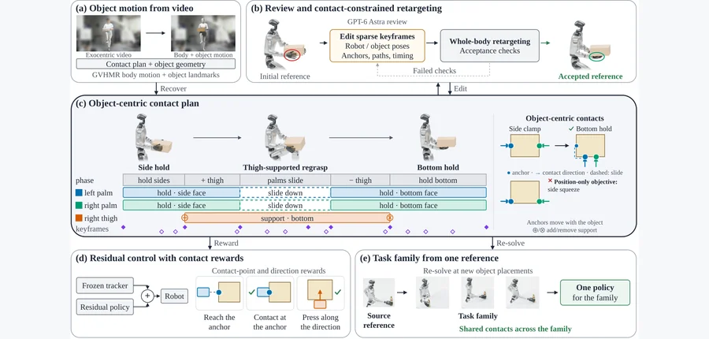 arXiv 2026-11-04 · cs.RO · #1 **[ReContact: Reconstruct and Retarget Human Contacts from Video for Contact-Rich Humanoid Manipulation](https://arxiv.org/abs/2611.02968)** [Zhongkai Gu , Yang Liu , Wei Zhu , Mitsuhiro Hayashibe](https://arxiv.org/abs/2611.02968) 机构：Tohoku University（[PDF](https://arxiv.org/pdf/2611.02968)） [Paper](https://arxiv.org/abs/2611.02968) · [Project](https://recontact-robot.github.io) · [图源](https://arxiv.org/html/2611.02968v1/framework_spine.png) 

中文摘要
接触转换使人形机器人能够在全身不同部位间重新分配物体支撑，从而完成超出仅靠手部抓握的操作。人类视频为机器人学习这类转换提供了可扩展的数据来源。然而，身体遮挡会干扰物体位姿跟踪，并破坏重定向后的动作。此外，准确复现物体轨迹并不保证机器人在预期接触处施加稳定力，后续阶段可能滑脱或掉落。为解决这些问题，我们提出 ReContact，通过以物体为中心的接触计划重建并重定向人—物交互。计划规定接触阶段、接触对、锚点、施压方向以及粘着或滑动模式。接触先验使遮挡期间的物体位姿重建更加稳定。在冻结的全身跟踪器上训练残差策略，奖励其在计划锚点处建立接触，并使作用力与指定方向一致。在仿真中的大腿支撑再抓握任务上，ReContact 在三个训练随机种子下的 83.5% ± 5.2% 回合中达到计划的双掌托底姿态，而最佳适配基线为 0.16%。在新摆放位置重新求解的 247 条参考轨迹上训练的单一策略，将工作空间内的管件转移成功率从仅使用源参考轨迹的 20.4% 提高到 97.8%。在真实 Unitree G1 上，策略完成了七项接触密集操作任务和两项移动操作任务。 <a href="https://arxiv.org/pdf/2611.02968">原摘要来源</a>
 | 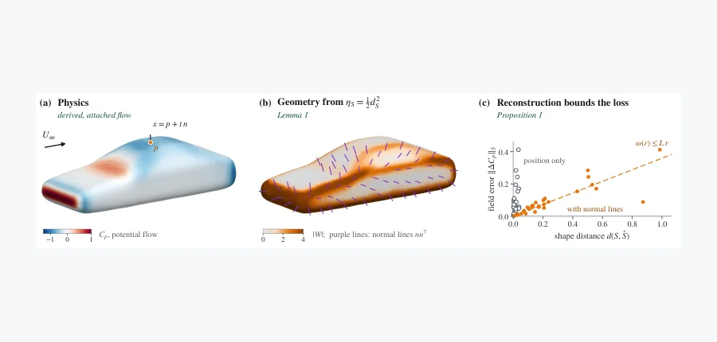 arXiv 2026-11-04 · cs.LG · #2 **[Large Geometry Models Are Priors For Fast Physics Pretraining](https://arxiv.org/abs/2611.02066)** [Maggie Chlon , Leon Chlon](https://arxiv.org/abs/2611.02066) 机构：Hassana Labs（[PDF](https://arxiv.org/pdf/2611.02066)） [Paper](https://arxiv.org/abs/2611.02066) · [图源](https://arxiv.org/html/2611.02066v1/areals_theory.png) 

中文摘要
语言和视觉模型通过在大量无标签数据上预训练而提高了数据效率；物理场模型也有这类数据，即超过一千万个三维形状，但现有几何预训练目标通常由人为设计，而不是从物理规律推导。欧拉—拉格朗日几何预训练从物理方程导出目标：对于附着流动，形状进入流动欧拉—拉格朗日方程的方式仅通过一些系数，而距离和无向法线可在一阶近似下确定这些系数。因此，它们的重建误差为表征所丢失的任意场信息提供上界；在昂贵仿真上的微调只需组装全局场。我们在 AREALS 中实现这一思路：这是一个掩码表面自编码器，其面积元 token 包含位置、法线和面积，并在 61,822 个原始网格上进行无监督、无符号预训练。由于运行条件仅通过远场进入，传感器可以提供这一条件：AREALS 无需条件标签即可一次前向传播补全隐藏场。在 DrivAerML 和 DrivAerNet++ 上，它使用约一半的仿真数据便达到相同架构从头训练的精度；在 WindsorML 上约需四分之一。在 DoubleDelta 机翼上，使用 20 个传感器时，其场误差和力误差分别比采用学习先验的贝叶斯反演方法 GABI 低 3.9 倍和 4.0 倍；在训练角度之外，预训练使误差减半。 <a href="https://arxiv.org/abs/2611.02066">原摘要来源</a>
 | 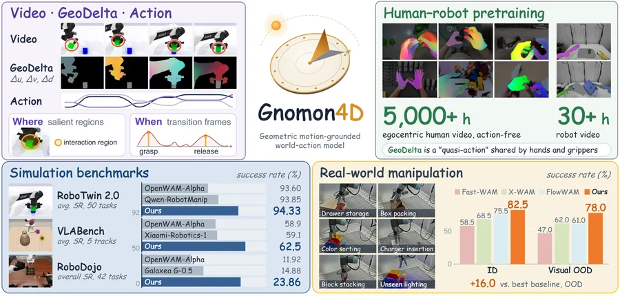 arXiv 2026-11-04 · cs.CV · #3 **[Gnomon4D: Learning Where and When to Focus for Geometric Motion-Grounded World-Action Modeling](https://arxiv.org/abs/2611.02474)** [Lingwei Dang , Yan Zhou , Juntong Li , Zhenhao Zhang , Yiteng Chen , Xiaoqiang Liu , Liang An , Hongwen Zhang , Wei Min… 机构：South China University of Technology / Tsinghua University / KlingAI Research / Nanjing University / Beijing Normal University / Shadow AI（[PDF](https://arxiv.org/pdf/2611.02474)） [Paper](https://arxiv.org/abs/2611.02474) · [Project](https://droliven.github.io/Gnomon4D/) · [图源](https://arxiv.org/html/2611.02474v1/ljt_teaser.png) 

中文摘要
世界—动作模型（WAM）利用视频生成先验，联合预测未来观测和机器人动作。然而，RGB 未来帧将物理状态变化与外观纠缠在一起，而逐帧深度图和点图缺乏时间对应关系。已有 4D 方法或将运动隐含在视觉特征中，或需通过独立接口将预测轨迹转换为动作。我们提出 Gnomon4D，一种联合生成未来视频、机器人动作和 GeoDelta 的 WAM；GeoDelta 是与视频对齐的 4D 几何运动场，编码机器人和物体点跨帧的图像平面位移与深度变化。将机器人运动和物体响应置于共享空间后，GeoDelta 在推理时向动作专家揭示两者的运动关系。交互显著性注意力（InSAttn）利用这些关系，使空间信息读取聚焦于任务相关交互区域；转换锚定聚合（TransAgg）则围绕抓取和释放等相对运动变化聚合证据。GeoDelta 不依赖具体机器人的控制指令来描述表面运动，因此可作为共享的人—机器人准动作表征：先在 EgoManip-5000H 上进行无动作预训练，再在 Robot-30H 上进行机器人中间训练。Gnomon4D 在 RoboTwin 2.0、VLABench 和 RoboDojo 上领先；在分布内和分布外设置下，分别比最强真实机器人基线高 7.0 和 16.0 个百分点。 <a href="https://arxiv.org/abs/2611.02474">原摘要来源</a>
 |
| 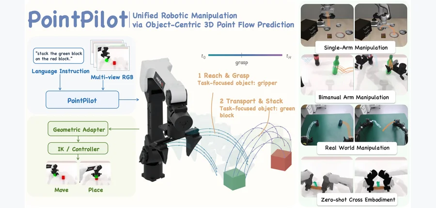 arXiv 2026-11-04 · cs.RO · #4 **[PointPilot: Unified Robotic Manipulation via Object-Centric 3D Point Flow Prediction](https://arxiv.org/abs/2611.02930)** [Yihan Fang , Yuxin Tian , Ruixiang Wang , Zhanqi Zhang , Xing Hu , Zhen Yang , Huayi Zhou , Yongyi Su , Wei Gao , Kui Jia… 机构：Chinese University of Hong Kong, Shenzhen / DexForce Technology / Shenzhen University / Foshan University（[PDF](https://arxiv.org/pdf/2611.02930)） [Paper](https://arxiv.org/abs/2611.02930) · [图源](https://arxiv.org/html/2611.02930v1/figure/overview.png) 

中文摘要
泛化仍是机器人领域的核心挑战；策略需要应对不同机器人形态、相机位姿和场景布局等多维域变化。为此，我们提出 PointPilot，一个以任务为中心、与三维空间对齐的操作框架，其核心是预测三维空间中的点流。PointPilot 不建模完整场景，而只表示任务相关物体（也将机器人夹爪视为物体），避免预测与操作无关的冗余场景部分。此外，PointPilot 将三维空间表征对齐到统一坐标系，无需另行训练动作专家，即可根据物体点流在不同操作模式下闭环、全自动执行动作；现有方法通常需要额外动作头，或只支持半自动及特定单臂模式。给定传感器观测和语言指令，模型端到端地联合学习子任务规划、相关物体定位和三维点流预测。通过在共享三维点流空间处理异构数据，PointPilot 可吸收不同机器人形态的演示。大量仿真和真实实验验证了该方法。尤其是，PointPilot 展现零样本形态泛化：单一训练策略无需额外微调，即可部署到此前未见过的机器人形态并完成操作任务。 <a href="https://arxiv.org/abs/2611.02930">原摘要来源</a>
 | 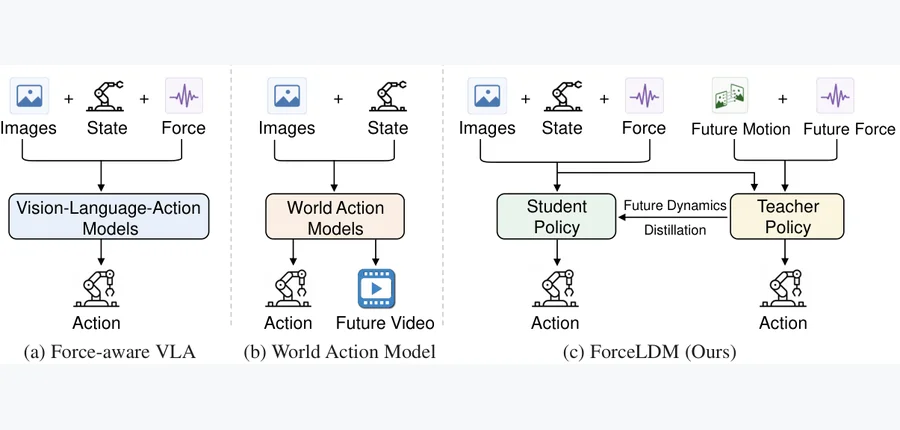 arXiv 2026-11-04 · cs.RO · #5 **[ForceLDM: A Force-aware Latent Dynamics Model for Contact-Rich Manipulation](https://arxiv.org/abs/2611.03294)** [Peiyuan Tang , Yao Li , Xiaodong Zhang , Wuyang Zhang , Qin Xia , Yanyong Zhang , Zijiang Yang](https://arxiv.org/abs/261… 机构：Xi’an Jiaotong University / University of Science and Technology of China / Suzhou Artificial Intelligence Laboratory / Synkrotron（[PDF](https://arxiv.org/pdf/2611.03294)） [Paper](https://arxiv.org/abs/2611.03294) · [Project](https://tpy001.github.io/ForceLDM/) · [图源](https://arxiv.org/html/2611.03294v1/figure1.png) 

中文摘要
接触密集操作需要精细控制并涉及复杂环境物理交互，给机器人策略学习带来挑战。纯视觉策略难以完成这类任务，因为仅凭视觉观测很难推断接触状态和交互力。现有方法加入力或触觉传感，但常将其仅作为辅助观测，未充分用于建模未来交互动力学。为此，我们提出 ForceLDM，一种力感知潜在动力学模型，通过学习未来接触和运动动力学来指导动作生成。ForceLDM 不直接预测容易混入无关感官细节的未来观测，而是通过知识蒸馏学习紧凑的未来动力学表征。具体而言，教师网络利用特权性的未来力／力矩与光流信号提取未来动力学特征，再将这些特征蒸馏到只使用当前观测训练的学生网络。由此，学生在部署时无需未来感官输入，仍可推理即将发生的接触和物理动力学。为提高稳健性与泛化性，方法还引入基于课程的渐进式噪声注入，缓解对未来特征的过度依赖。五项真实接触密集操作任务的实验表明，ForceLDM 优于先进基线，能够泛化到新物体，并对环境扰动保持稳健。项目页和代码已提供。 <a href="https://arxiv.org/abs/2611.03294">原摘要来源</a>
 | 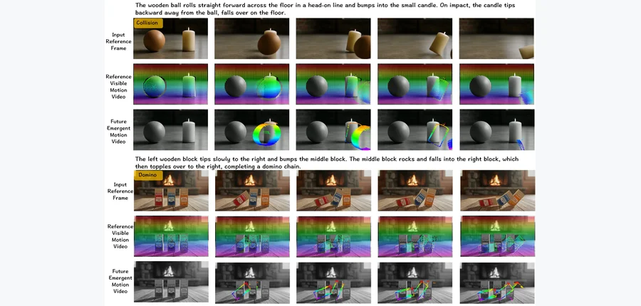 arXiv 2026-11-04 · cs.CV · #6 **[Seeing the Unseen: Unified Visible--Invisible Motion for Physically Consistent Video Generation](https://arxiv.org/abs/2611.00293)** [Mingyang Bao , Fangda Ye , Xihao Chen , Bobo Li , Jason Li , Shengqiong Wu](https://arxiv.org/abs/2611.00293) 机构：National University of Singapore / Nanyang Technological University / University of Oxford（[PDF](https://arxiv.org/pdf/2611.00293)） [Paper](https://arxiv.org/abs/2611.00293) · [Project](https://vid-gen.github.io/seeing_the_unseen/) · [图源](https://arxiv.org/html/2611.00293v1/intro-2.png) 

中文摘要
近期视频生成在视觉质量上取得显著进展，但由于缺少对底层物理过程的显式建模，生成的动力学常缺乏物理一致性。现有方法要么依赖假设较强的仿真器，要么使用粗粒度语义引导，而且难以有效地将物理先验注入生成模型。我们提出 Seeing the Unseen，一个物理约束的视频生成统一框架。方法分为学习物理动力学和将其注入视频合成两个阶段。首先，轻量级的基于粒子的图动力学仿真器（PGDS）从数据中学习可泛化的物理交互，预测合理的三维运动轨迹。其次，可见—不可见运动场（VIMF）同时捕捉输入帧中可观测的运动，以及随后由物体动力学产生的运动。相较常规物理信号，这一表征提供更完整、结构化的运动引导。将这些轨迹整合到基于扩散的视频生成器后，方法生成视觉连贯且物理一致的视频。大量实验表明，与强基线相比，运动精度、交互一致性提高，物理伪影减少。 <a href="https://arxiv.org/abs/2611.00293">原摘要来源</a>
 |
| 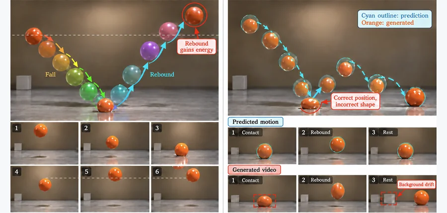 arXiv 2026-11-04 · cs.CV · #7 **[IMPACT: Image-Conditioned Motion with Physics-Aware Collision and Trajectory Guidance for Video Generation](https://arxiv.org/abs/2611.01372)** [Shiwei Yang , Yunlong Yu , Zhao Wang , Jungong Han](https://arxiv.org/abs/2611.01372) 机构：Zhejiang University / Tsinghua University（[PDF](https://arxiv.org/pdf/2611.01372)） [Paper](https://arxiv.org/abs/2611.01372) · [图源](https://arxiv.org/html/2611.01372v1/Figures/teaser.png) 

中文摘要
视觉上逼真的视频生成不能保证运动符合物理规律。生成物体可能出现不合理的碰撞响应或没有能量耗散的反弹；即使物理运动预测正确，合成阶段也未必忠实实现。我们提出 IMPACT，一个由物理状态驱动的图生视频框架，通过耦合显式动力学预测与互补的稀疏、稠密物理引导来解决这些问题。可学习校准的物理状态生成器把连续自由飞行动力学与离散碰撞响应统一起来，将碰撞时刻、碰后速度、反弹衰减和最终静止联系成一致的物理状态序列。为将这一演化转换成有效生成约束，IMPACT 从同一物理展开中导出稀疏轨迹与稠密区域运动先验。稀疏轨迹约束物体的全局位移，稠密先验引导扩散采样，促进物体区域运动连贯并抑制不必要的背景变化。二者共享的物理基础协调全局和局部运动引导，减小预测与生成之间的不匹配。在涵盖不同材料组合和视觉环境的 100 个受控球—平面碰撞场景上，实验表明该方法相比通用、物理约束和运动可控视频生成代表性基线具有更高的物理合理性。项目代码仓库已提供。 <a href="https://arxiv.org/abs/2611.01372">原摘要来源</a>
 | 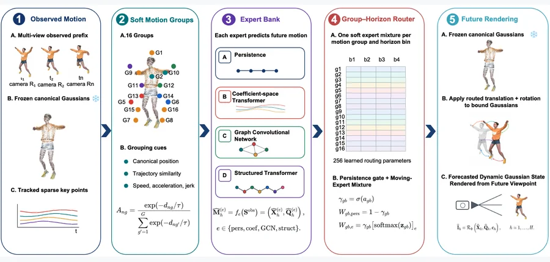 arXiv 2026-11-04 · cs.CV · #8 **[MoRE-GS: Motion-Regime Experts for Future Gaussian Splatting](https://arxiv.org/abs/2611.00375)** [Shima Salehi , Joshua Peeples](https://arxiv.org/abs/2611.00375) 机构：Texas A&amp;M University（[PDF](https://arxiv.org/pdf/2611.00375)） [Paper](https://arxiv.org/abs/2611.00375) · [Project](https://advanced-vision-and-learning-lab.github.io/MoRE-GS-website/) · [图源](https://arxiv.org/html/2611.00375v1/figures/method.png) 

中文摘要
未来动态新视角合成必须在同一场景中外推多种运动模式。单一动力学模型可能难以同时表示静止区域、协同运动、局部交互和关节轨迹。我们提出用于 Gaussian Splatting 的运动模式专家路由（MoRE-GS），一个因果、考虑渲染的动态三维 Gaussian 场景预测框架。MoRE-GS 冻结仅从已观测时间前缀重建的 Gaussian 表征，并通过四种互补专家预测其控制关键点的运动：持续性模型、系数空间 Transformer、图卷积网络，以及带刚性和非刚性运动约束的结构化 Transformer。紧凑路由表按软运动组和预测时域区间分配专家混合权重；持续性门控抑制不可靠的外推。在 D-NeRF 和 HyperNeRF 场景上，MoRE-GS 相比其他方法取得更好的表现；结果表明，经渲染器校准的互补运动预测器组合，有助于在异质运动模式下进行因果动态 Gaussian 预测。项目页已提供。 <a href="https://arxiv.org/abs/2611.00375">原摘要来源</a>
 | 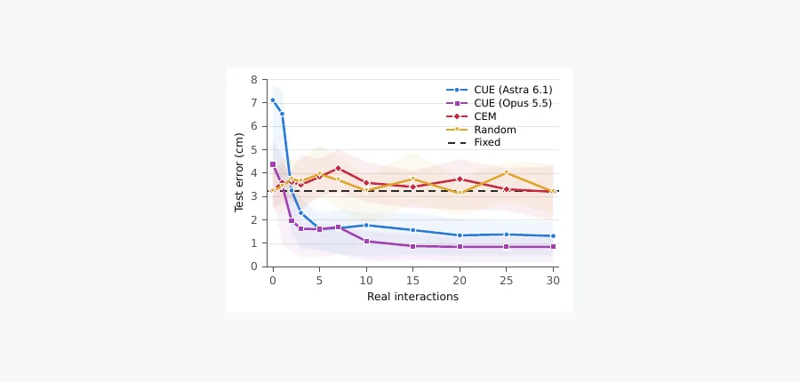 arXiv 2026-11-04 · cs.RO · #9 **[Closing the Dynamics Gap through Self-Directed Robotic Interaction](https://arxiv.org/abs/2611.02691)** [Xilun Zhang , Liam Achenbach , Luis Pabon , Matthew Foutter , Marco Pavone](https://arxiv.org/abs/2611.02691) 机构：Stanford University / ETH Zurich / NVIDIA Research / microagi（[PDF](https://arxiv.org/pdf/2611.02691)） [Paper](https://arxiv.org/abs/2611.02691) · [Project](https://cue-dynamics.github.io/) · [图源](https://arxiv.org/pdf/2611.02691) 

中文摘要
智能体式 Real2Sim2Real 系统可以根据相机观测在仿真中重建场景，但摩擦和恢复系数等接触密集动力学参数不能在没有交互的情况下被观测到。我们将其称为“动力学差距”，并提出 CUE：一个通过主动与环境交互来缩小差距的智能体系统。仅给定高层指令且不重置环境时，智能体自行建立感知、识别物理参数，并选择其仿真误差最大的交互。在台球任务中，针对仿真的 25 种隐藏物理条件，CUE 相比最强基线将留出测试中的球位置误差降低 72%；我们还将其部署在真实台球桌上。更多细节见项目网站。 <a href="https://arxiv.org/abs/2611.02691">原摘要来源</a>
 |
| 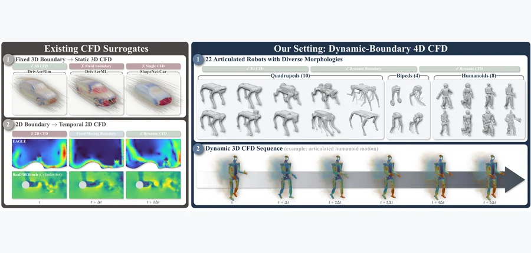 arXiv 2026-11-04 · cs.LG · #10 **[DynaSolver: A Neural Operator for Autoregressive 4D Flow Prediction with Dynamic Boundaries](https://arxiv.org/abs/2611.03595)** [Rui Qian , Shibo Dai , Mengjun Lin , Yuk-Kit Hou , Saining Zhang , Bohan Li , Junhao Chen , Hao Zhao , Chaojian Li](https… 机构：Tsinghua University / Peking University / Nanyang Technological University / Shanghai Jiao Tong University / Hong Kong University of Science and Technology（[PDF](https://arxiv.org/pdf/2611.03595)） [Paper](https://arxiv.org/abs/2611.03595) · [Project](https://made-gpt.github.io/DynaSolver-ProjectPage/) · [图源](https://arxiv.org/html/2611.03595v1/teaser.png) 

中文摘要
神经算子能为计算流体力学（CFD）提供高效替代模型，但多数针对静态几何设计，无法处理连续移动边界引起的非定常流动。我们研究关节式移动几何的动态边界 4D CFD 预测，并提出 RoboCFD-4D：一个覆盖不同形态和流动条件、具有时间分辨率的机器人 CFD 基准。为应对这一设置下的计算和自回归挑战，我们提出 DynaSolver，一个显式以边界演化和因果流动历史为条件的神经算子。DynaSolver 采用高效的物理 token 表达，在算子堆栈中复用点到 token 的投影，显著减少反复进行的点空间时空计算，同时保持准确的点级重建。我们还提出重放增强的并行训练，使模型接触自回归生成的历史，同时保留并行密集监督，从而缩小使用真实历史训练与自回归展开之间的差距。在 RoboCFD-4D 上的实验表明，DynaSolver 在广泛的学习型 CFD 替代模型中获得最佳完整展开精度，且随展开延长优势增大，表明自回归误差累积显著减少。项目页已提供。 <a href="https://arxiv.org/abs/2611.03595">原摘要来源</a>
 | 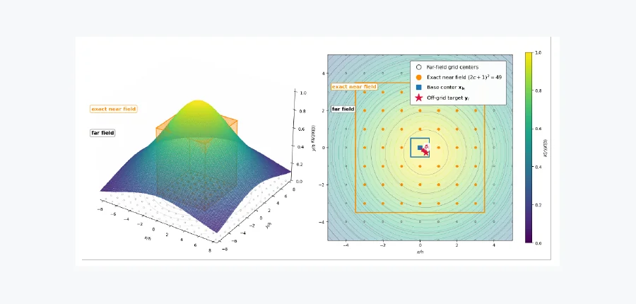 arXiv 2026-11-04 · math.NA · #11 **[Kernelized Stable Fluids for simulating physically accurate solutions](https://arxiv.org/abs/2611.03263)** [L. Scholz , A. Bacho , H. Owhadi](https://arxiv.org/abs/2611.03263) 机构：Leibniz University Hannover / California Institute of Technology（[PDF](https://arxiv.org/pdf/2611.03263)） [Paper](https://arxiv.org/abs/2611.03263) · [图源](https://arxiv.org/pdf/2611.03263) 

中文摘要
Stable Fluids 算法是一种求解不可压缩 Navier–Stokes（NS）方程的分步法，具有无条件稳定性。它最初用于视觉特效，因计算复杂度低而可进行实时仿真。该方法通过特征线法求解对流步骤，通常以线性插值实现；这会造成过度的涡量扩散，是其物理精度不足的主要原因之一。为解决这一缺点、使算法适用于工程和科学计算，我们提出采用稀疏 Cholesky 预条件的核化 Stable Fluids（KSF-Chol）。方法在对流步骤中以核插值替代线性插值。我们利用稀疏 Cholesky 预条件和近场／远场方法加速计算量较大的核插值，并针对均匀笛卡尔网格优化两者。KSF-Chol 每个时间步在空间和时间上达到近线性计算复杂度 O(N log^d(N/ε_chol))。我们在多个二维与三维基准上将 KSF-Chol 与参考求解器和数值参考数据比较，展示了显著降低的数值扩散，以及对相关流动量有竞争力的计算精度。 <a href="https://arxiv.org/abs/2611.03263">原摘要来源</a>
 | 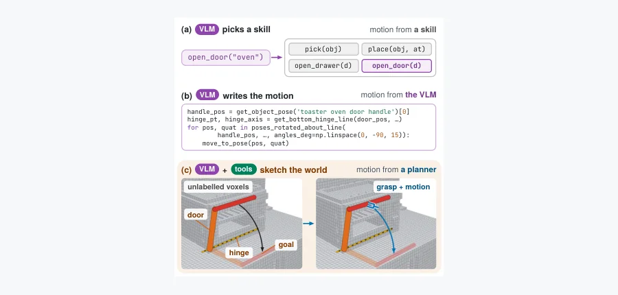 arXiv 2026-11-04 · cs.RO · #12 **[WorldSketch: Sketching World Models for Zero-Shot Mobile Manipulation](https://arxiv.org/abs/2611.00513)** [Jiaming Wang](https://arxiv.org/abs/2611.00513) 机构：affiliation 未确认 [Paper](https://arxiv.org/abs/2611.00513) · [图源](https://arxiv.org/html/2611.00513v1/teaser.png) 

中文摘要
大多数智能体式机器人系统使用视觉语言模型（VLM）来编排预定义技能，或直接生成动作、约束和控制程序。前者受技能库限制，后者要求 VLM 精确推理几何和接触。本文提出 WorldSketch：一种让 VLM 构建世界模型、而非生成机器人动作的智能体机器人范式。VLM 作为智能体主动查询感知工具，构建并通过视觉验证最小化的运动学世界模型，只捕捉任务相关物体、交互几何和可能的运动。随后，几何规划器在该模型上联合优化接触和全身运动。世界模型还能自我改进：执行反馈验证结果、更新不确定假设，并允许智能体在预测被推翻时修正模型。我们在 RoboCasa、LIBERO-PRO 和 R2R-CE 导航上展示该范式的通用性，零样本成功率分别为 91%、97% 和 76%。在 RoboCasa 上，WorldSketch 比次优零样本智能体基线高 58 个百分点，而 VLM 输入 token 减少 10 倍；在 LIBERO-PRO 上，比 CaP-X 高 82 个百分点。导航任务中，它以 6 倍更少的输入 token 达到逐步调用 VLM 智能体的成功率。 <a href="https://arxiv.org/abs/2611.00513">原摘要来源</a>
 |
| 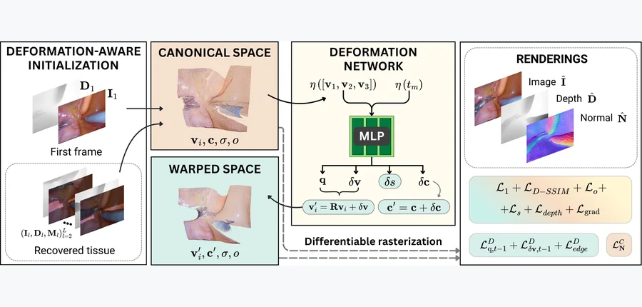 arXiv 2026-11-04 · cs.CV · #13 **[4D Triangle Splatting Reconstruction of Dynamic Endoscopic Scenes from Monocular Videos](https://arxiv.org/abs/2611.02034)** [Laura Salort-Benejam , Stamatia Giannarou , Antonio Agudo](https://arxiv.org/abs/2611.02034) 机构：Institut de Robòtica i Informàtica Industrial, CSIC-UPC / Imperial College London（[PDF](https://arxiv.org/pdf/2611.02034)） [Paper](https://arxiv.org/abs/2611.02034) · [图源](https://arxiv.org/html/2611.02034v1/figures/TRIANGLE_INITIALIZATION.png) 

中文摘要
从单目视频稳健地重建可形变内镜场景的 4D 表示仍有难度，原因包括非刚性组织形变、照明变化、遮挡和未知相机轨迹。可靠的动态内镜重建有望改善微创手术中的可视化、诊断准确性和术中引导。我们提出 SurgicalTS，一个从静态单目相机视频重建动态内镜场景的自监督三角形 splatting 框架。场景由一组规范空间中的三角形表示，并与形变网络联合优化。我们引入基于四元数的形变模型、改进的颜色参数化、时空先验，以及在遮挡条件下提高完整性的重新定义的初始化策略。在来自不同手术的具有挑战性的体内内镜视频上进行的大量评估表明，SurgicalTS 能成功建模软组织形变和器械—组织交互，并持续优于先进方法。该方法在保持有竞争力的几何和光度精度的同时缩短训练时间，表明基于四元数、具有物理一致性的形变建模有助于稳健高效的 4D 内镜场景重建。 <a href="https://arxiv.org/abs/2611.02034">原摘要来源</a>
 | 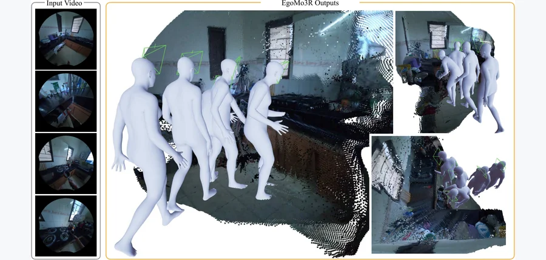 arXiv 2026-11-04 · cs.CV · #14 **[EgoMo3R: Joint Egocentric Motion and Scene Reconstruction](https://arxiv.org/abs/2611.01627)** [Chaitanya Patel , Yusuke Kato , Rin Takahira , Kazuki Kozuka , Juan Carlos Niebles , Ehsan Adeli](https://arxiv.org/abs/2… 机构：Stanford University / Panasonic R&amp;D Company of America / Panasonic Holdings（[PDF](https://arxiv.org/pdf/2611.01627)） [Paper](https://arxiv.org/abs/2611.01627) · [Project](https://chaitanya100100.github.io/EgoMo3R/) · [图源](https://arxiv.org/html/2611.01627v1/teaser-crop_lq.png) 

中文摘要
从第一人称视频理解整体三维人体运动及周围环境，是 AR／VR 和机器人应用的基础。尽管两项任务内在耦合，现有方法仍通常分别处理。特别是，第一人称运动重建方法通常假设可由专门惯性传感器获得米制、重力对齐的相机轨迹；但从单目第一人称视频中恢复这类轨迹仍面临快速头部运动和运动模糊等挑战。我们提出 EgoMo3R，一个联合优化框架，可从普通第一人称视频中同时重建三维人体运动和场景几何。它利用单目深度、光流和点轨迹等底层视觉几何基元的稳健性，并通过一阶优化将其与基于扩散的人体运动先验结合。我们提出交替优化方案，形成协同反馈：场景重建为运动先验提供物理依据和轨迹条件，运动先验则正则化相机轨迹，并将场景锚定在米制、重力对齐的世界坐标系中。我们在 EgoExo4D 和 Nymeria 的高度动态序列上评估 EgoMo3R，结果在三维场景重建和第一人称运动估计上均优于专门基线。 <a href="https://arxiv.org/abs/2611.01627">原摘要来源</a>
 | 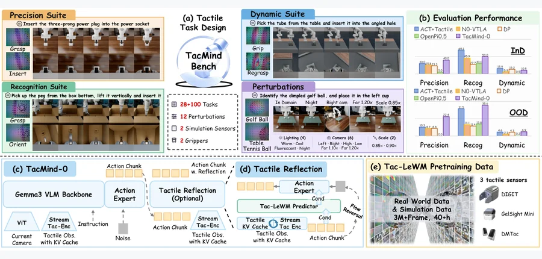 arXiv 2026-11-04 · cs.RO · #15 **[TacMind: Benchmarking and Modeling Tactile Interaction States for Robotic Manipulation](https://arxiv.org/abs/2611.00455)** [Jiaxin Shi , Zibin Wu , Yichi Zhang , Jianghua Duan , Siyu Zhu , Weihao Yuan](https://arxiv.org/abs/2611.00455) 机构：Shanghai Jiao Tong University / Hong Kong University of Science and Technology (Guangzhou) / Harbin Institute of Technology / Daimon Robotics / Fudan University / Nanjing University（[PDF](https://arxiv.org/pdf/2611.00455)） [Paper](https://arxiv.org/abs/2611.00455) · [Project](https://tacmind-bench.github.io/) · [图源](https://arxiv.org/html/2611.00455v1/teaser.png) 

中文摘要
触觉传感直接提供接触物理、局部几何和交互动力学的观测，是接触密集操作的重要反馈来源。然而，现有触觉操作研究通常在特定任务设置中开发和评估，因此难以系统比较不同交互条件下触觉信息的贡献。我们建立了一个仿真基准，包含按精细操作、识别和动态三种互补评测范式组织的 128 项任务。基准还包含受控的静态和动态任务变体，以及用于评估视觉和物理条件变化下稳健性的 12 种扰动设置。这些设置促使我们将触觉信息视为随时间演化的交互表征，而非仅是瞬时观测。因此，我们提出一个以动作为条件的潜在预测世界模型，它整合触觉历史，并通过预测未来触觉潜变量学习触觉状态。在此表征之上，我们设计了以所学触觉状态为条件生成动作的模型，并利用预测的未来触觉信息，通过预测性触觉反思来细化候选动作。在所提出基准上的实验表明，在各评测范式中加入触觉信息均带来持续收益。项目页已提供。 <a href="https://arxiv.org/abs/2611.00455">原摘要来源</a>
 |
| 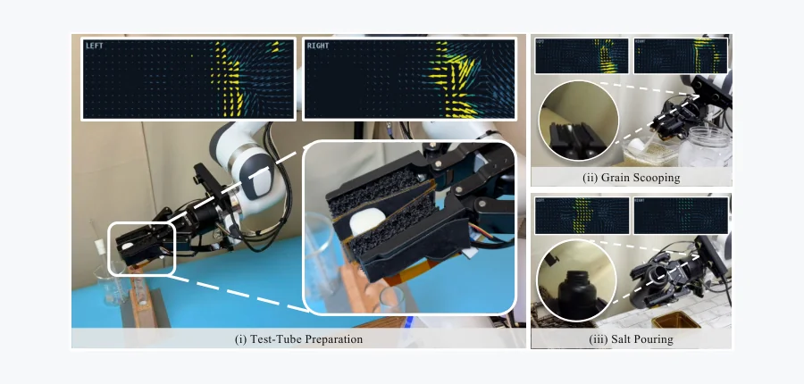 arXiv 2026-11-04 · cs.RO · #16 **[PanoTac: A Dense Three-Axis Tactile Sensor for Robust Touch-Centric Manipulation](https://arxiv.org/abs/2611.03520)** [Binglin (Andre) Wang , Xiaole (Alex) Jiang , Zicheng Teng , Xinqi Liu , Yunzhu Li , Lerrel Pinto , Zichen Jeff Cui , Bing… 机构：New York University / City University of New York / Columbia University（[PDF](https://arxiv.org/pdf/2611.03520)） [Paper](https://arxiv.org/abs/2611.03520) · [Project](https://panotac.github.io) · [图源](https://arxiv.org/html/2611.03520v1/teaser_v4.png) 

中文摘要
接触密集操作受益于同时反映细致接触几何与交互力的触觉反馈。例如舀取颗粒时，接触模式有助于判断勺子方向，而通过抓握传来的阻力可指导运动。为提供这两种互补感知能力，我们提出 PanoTac，一种低成本、柔顺的触觉指尖，用于稠密三轴触觉感知。每个指尖提供 12 × 32 × 3 的触觉表征，每个触觉单元有一个法向（z）和两个剪切方向（x、y）的响应分量。传感器以 60 Hz 运行，每个指尖成本低于 50 美元。传感器表征实验量化了响应的重复性，以及不同传感器实例和接触位置之间的一致性。我们将 PanoTac 集成到机器人视觉—触觉系统中。在试管准备、颗粒舀取和倒盐任务上，所得策略的表现平均比纯视觉基线高 46.7 个百分点。消融实验表明，移除空间接触信息或剪切力反馈都会降低任务组合的总体表现。项目页已提供。 <a href="https://arxiv.org/abs/2611.03520">原摘要来源</a>
 | 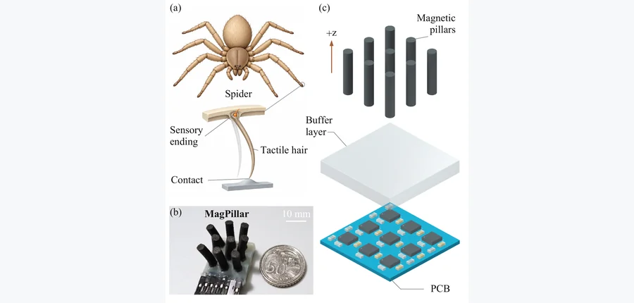 arXiv 2026-11-04 · cs.RO · #17 **[MagPillar: A Soft Magnetopillar Array Tactile Sensor for Robotic Surface Perception](https://arxiv.org/abs/2611.01609)** [Haotian Guo , Yu Feng , Hao Wu , Jiazhi Tang , Jianshu Zhou](https://arxiv.org/abs/2611.01609) 机构：National University of Singapore / Shanghai Jiao Tong University（[PDF](https://arxiv.org/pdf/2611.01609)） [Paper](https://arxiv.org/abs/2611.01609) · [图源](https://arxiv.org/html/2611.01609v1/figures/Fig01_bioinspired_design_and_sensor_structure.png) 

中文摘要
机器人表面探索需要既能顺应接触、又能捕捉表面特征变化的触觉接口。我们提出 MagPillar，一种受蜘蛛触觉毛启发的传感器，将磁性柱阵列与三轴霍尔感知结合。完整阵列的力学和磁场模型刻画柱体形变如何影响阵列测得的叠加磁场，为解释接触响应提供物理基础。柔顺柱体结构将表面纹理和几何特征的接触转换成不同的磁响应模式。在机器人表面感知实验中，光谱特征与逻辑回归在同一次实验内按时间分块交叉验证的条件下，以 99.34% 的离线准确率区分六种材料表面。对周期性凸起的连续扫描产生的振幅和峰间距变化与表面几何变化一致。这些发现将柔顺接触力学与分布式磁感知连接起来，为材料识别和定性表面轮廓感知提供了新路径。 <a href="https://arxiv.org/abs/2611.01609">原摘要来源</a>
 | 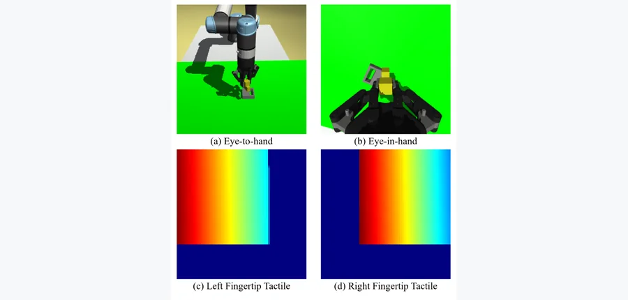 arXiv 2026-11-04 · cs.RO · #18 **[Visuo-tactile Diffusion Policy for Robotic Manipulation with Auxiliary Tactile Dynamics Prediction](https://arxiv.org/abs/2611.02677)** [Kaihong Ouyang , Zihao Su , Chengxuan Zheng , Weiyi Lai , Dong Zhou](https://arxiv.org/abs/2611.02677) 机构：Harbin Institute of Technology（[PDF](https://arxiv.org/pdf/2611.02677)） [Paper](https://arxiv.org/abs/2611.02677) · [图源](https://arxiv.org/pdf/2611.02677) 

中文摘要
长时程机器人装配需要在抓取、对齐和插入阶段可靠地感知与行动。视觉捕捉全局物体位姿和场景上下文，指尖触觉则提供局部接触线索，尤其有助于处理接触状态变化。我们提出一种视觉—触觉扩散策略，用两个相机视角和两幅指尖触觉图像各自的四步历史作为条件生成动作序列。循环时间表征融合两种模态的近期观测。为了促使其捕捉接触如何随动作演化，辅助目标根据时间表征和演示动作预测两步后的指尖图像变化。该目标仅在训练期间使用，不增加推理时计算。在 MuJoCo 装配实验的三个独立训练随机种子中，完整模型的平均成功率为 59.0% ± 2.6%，比纯视觉基线的 42.7% ± 1.5% 高 16.3 个百分点。 <a href="https://arxiv.org/abs/2611.02677">原摘要来源</a>
 |
| 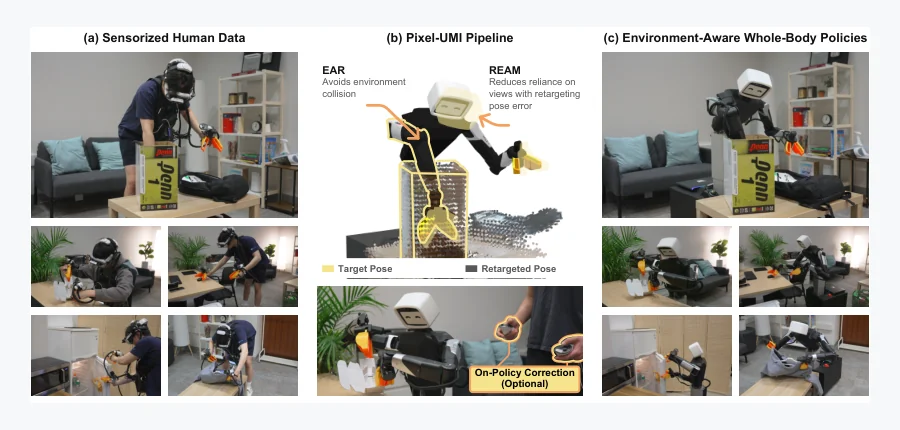 arXiv 2026-11-04 · cs.RO · #19 **[Pixel-UMI: Learning Environment-Aware Whole-Body Manipulation from Sensorized Human Demonstrations](https://arxiv.org/abs/2611.03647)** [Jason Jingzhou Liu , Tony Tao , Deepak Pathak , Ruslan Salakhutdinov](https://arxiv.org/abs/2611.03647) 机构：Carnegie Mellon University（[PDF](https://arxiv.org/pdf/2611.03647)） [Paper](https://arxiv.org/abs/2611.03647) · [Project](https://pixel-robot.com/pixel-umi/) · [图源](https://arxiv.org/html/2611.03647v1/pixel_umi_teaser.png) 

中文摘要
带传感器的人类演示为移动操作提供可扩展数据，但人和机器人的形态差异增加策略学习难度。我们提出 Pixel-UMI，一套从人类数据学习环境感知全身策略的流程。首先，环境感知重定向（EAR）将重建的场景几何与演示中的头部、夹爪轨迹结合，确定机器人姿态，并生成考虑碰撞的关节和底盘目标。经过延迟校准的动作分配把这些轨迹转换成动作。然而，运动学差异可能留下位姿误差，造成演示者与机器人的视角不匹配。因此，我们提出重定向误差感知遮蔽（REAM），在训练时利用这些误差，减轻部署时对不匹配视角的依赖。最后，由于估计动作无法完整反映接触密集交互，我们通过 DAgger 收集在线人类修正以提升表现。我们在五项具有挑战性的任务上评估 Pixel-UMI，涵盖关节物体操作、可形变物体处理、受限空间伸手、全身避碰和接触密集双手协调，平均任务进度达到 87.0%。视频结果已提供。 <a href="https://arxiv.org/abs/2611.03647">原摘要来源</a>
 | 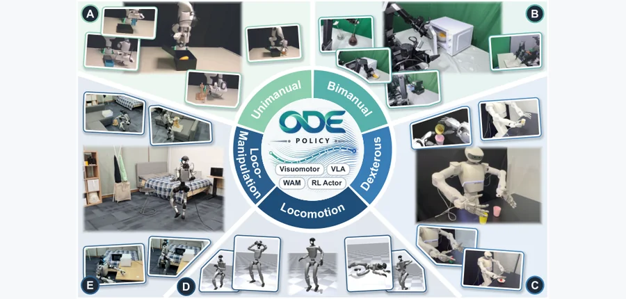 arXiv 2026-11-04 · cs.RO · #20 **[ODE Policy: Robot Learning via Action Dynamics, Not Actions](https://arxiv.org/abs/2611.01729)** [Jindou Jia , Jingliang Li , Kuangji Zuo , Tuo An , Yuxuan Hu , Mengfei Zhao , Bofan Lyu , Jiaqi Bai , Daoyuan Zhu , Hengy… 机构：Nanyang Technological University（[PDF](https://arxiv.org/pdf/2611.01729)） [Paper](https://arxiv.org/abs/2611.01729) · [Code](https://github.com/NTUMARS/ODE-POLICY) · [Project](https://ntumars.github.io/ODE/) · [图源](https://arxiv.org/html/2611.01729v1/teaser.png) 

中文摘要
多数机器人策略无论用模仿学习（IL）还是强化学习（RL）训练，都是在离散控制步将观测映射为动作值，把物理运动的连续性留给模型隐式学习。我们提出 ODE Policy：学习动作的动力学，而非动作本身。神经常微分方程（ODE）学习动作的向量场：在 IL 中使短动作片段的积分动作与目标匹配，在 RL 中匹配单个控制步。轻量级多样性头通过随机化向量场方向来表示多模态行为。部署时，每个动作从前一动作积分得到，因此执行轨迹在构造上连续。我们将其分别作为视觉运动策略、视觉语言动作模型（VLA）与世界—动作模型（WAM）的动作头，以及基于模型的 RL 的 actor，在单臂、双臂、灵巧操作、移动和移动操作任务上与 14 个基线比较。在 IL 中，相较流匹配，训练一个 epoch 后其成功率、泛化能力和模式均衡性分别达到 5.9 倍、5.4 倍和 3.9 倍，动作生成速度提高 10.8 倍；运动大多比人类演示更平滑。在单臂、双臂、灵巧手和人形机器人平台上的 14 项真实任务中，它获得最高成功率。在 RL 中，它还加速用于人形运动跟踪的 SuperMimic，并使其动作更平滑。ODE Policy 在学习、数据、参数和执行方面均具有效率，为扩展机器人学习提供了可能路径。 <a href="https://arxiv.org/abs/2611.01729">原摘要来源</a>
 |   |
<!-- PAPER_CARDS_END -->

## 检索概况

- **检索窗口**：北京时间 2026-11-03 09:30 至 2026-11-04 09:00；官方 listing 批次为 **Tuesday, 3 November 2026**，各分类页均已更新。
- **官方范围**：逐页检查 cs.CV、cs.GR、cs.RO、cs.AI、cs.LG、physics、cond-mat、math.OC、math.NA、math.DS、stat.ML、eess.IV、eess.SY、eess.SP 的 [New listing](https://arxiv.org/list/cs.CV/new?show=2000)；仅官方 New 进入主榜，同一 arXiv ID 去重。
- **检索量**：New 1680 条，去重后 1680 篇；Cross 987 条、Replacement 1322 条另行查看。本期按标题和摘要入选 **20 篇**。
- **证据边界**：标题、作者、分类、摘要和实验陈述来自各论文 arXiv 官方页面；机构由 PDF 首页核对，无法确定者明示。相关性、机构强度、局限与改进建议均为本日报推断。

## 官方分类页统计

| 官方 New 分类页 | 批次 | New | Cross | Replacement |
|---|---|---:|---:|---:|
| [cs.CV](https://arxiv.org/list/cs.CV/new?show=2000) | 2026-11-03 | 333 | 62 | 174 |
| [cs.GR](https://arxiv.org/list/cs.GR/new?show=2000) | 2026-11-03 | 3 | 16 | 4 |
| [cs.RO](https://arxiv.org/list/cs.RO/new?show=2000) | 2026-11-03 | 129 | 20 | 69 |
| [cs.AI](https://arxiv.org/list/cs.AI/new?show=2000) | 2026-11-03 | 222 | 299 | 295 |
| [cs.LG](https://arxiv.org/list/cs.LG/new?show=2000) | 2026-11-03 | 334 | 236 | 302 |
| [physics](https://arxiv.org/list/physics/new?show=2000) | 2026-11-03 | 180 | 70 | 123 |
| [cond-mat](https://arxiv.org/list/cond-mat/new?show=2000) | 2026-11-03 | 174 | 70 | 121 |
| [math.OC](https://arxiv.org/list/math.OC/new?show=2000) | 2026-11-03 | 79 | 44 | 46 |
| [math.NA](https://arxiv.org/list/math.NA/new?show=2000) | 2026-11-03 | 50 | 21 | 28 |
| [math.DS](https://arxiv.org/list/math.DS/new?show=2000) | 2026-11-03 | 31 | 26 | 33 |
| [stat.ML](https://arxiv.org/list/stat.ML/new?show=2000) | 2026-11-03 | 33 | 46 | 57 |
| [eess.IV](https://arxiv.org/list/eess.IV/new?show=2000) | 2026-11-03 | 26 | 7 | 11 |
| [eess.SY](https://arxiv.org/list/eess.SY/new?show=2000) | 2026-11-03 | 33 | 41 | 37 |
| [eess.SP](https://arxiv.org/list/eess.SP/new?show=2000) | 2026-11-03 | 53 | 29 | 22 |

## Top papers

| # | 论文 | arXiv | 分类 | 作者 | 机构 | 相关性（推断） | 机构强度（推断） | 优先级（推断） |
|---:|---|---|---|---|---|---|---|---|
| 1 | [ReContact: Reconstruct and Retarget Human Contacts from Video for Contact-Rich Humanoid Manipulation](https://arxiv.org/pdf/2611.02968) | [arXiv:2611.02968](https://arxiv.org/abs/2611.02968) | [cs.RO](https://arxiv.org/abs/2611.02968) | [Zhongkai Gu , Yang Liu , Wei Zhu , Mitsuhiro Hayashibe](https://arxiv.org/abs/2611.02968) | Tohoku University（[PDF](https://arxiv.org/pdf/2611.02968)） | 高：3D／物理交叉 | 中（推断） | A |
| 2 | [Large Geometry Models Are Priors For Fast Physics Pretraining](https://arxiv.org/pdf/2611.02066) | [arXiv:2611.02066](https://arxiv.org/abs/2611.02066) | [cs.LG](https://arxiv.org/abs/2611.02066) | [Maggie Chlon , Leon Chlon](https://arxiv.org/abs/2611.02066) | Hassana Labs（[PDF](https://arxiv.org/pdf/2611.02066)） | 高：3D／物理交叉 | 中（推断） | A |
| 3 | [Gnomon4D: Learning Where and When to Focus for Geometric Motion-Grounded World-Action Modeling](https://arxiv.org/pdf/2611.02474) | [arXiv:2611.02474](https://arxiv.org/abs/2611.02474) | [cs.CV](https://arxiv.org/abs/2611.02474) | [Lingwei Dang , Yan Zhou , Juntong Li , Zhenhao Zhang , Yiteng Chen , Xiaoqiang Liu , Liang An , Hongwen Zhang , Wei Min , Guoxin Zhang , Pengfei Wan , Yebin Liu , Qingyao Wu](https://arxiv.org/abs/2611.02474) | South China University of Technology / Tsinghua University / KlingAI Research / Nanjing University / Beijing Normal University / Shadow AI（[PDF](https://arxiv.org/pdf/2611.02474)） | 高：3D／物理交叉 | 强（推断） | A |
| 4 | [PointPilot: Unified Robotic Manipulation via Object-Centric 3D Point Flow Prediction](https://arxiv.org/pdf/2611.02930) | [arXiv:2611.02930](https://arxiv.org/abs/2611.02930) | [cs.RO](https://arxiv.org/abs/2611.02930) | [Yihan Fang , Yuxin Tian , Ruixiang Wang , Zhanqi Zhang , Xing Hu , Zhen Yang , Huayi Zhou , Yongyi Su , Wei Gao , Kui Jia](https://arxiv.org/abs/2611.02930) | Chinese University of Hong Kong, Shenzhen / DexForce Technology / Shenzhen University / Foshan University（[PDF](https://arxiv.org/pdf/2611.02930)） | 高：3D／物理交叉 | 中（推断） | A |
| 5 | [ForceLDM: A Force-aware Latent Dynamics Model for Contact-Rich Manipulation](https://arxiv.org/pdf/2611.03294) | [arXiv:2611.03294](https://arxiv.org/abs/2611.03294) | [cs.RO](https://arxiv.org/abs/2611.03294) | [Peiyuan Tang , Yao Li , Xiaodong Zhang , Wuyang Zhang , Qin Xia , Yanyong Zhang , Zijiang Yang](https://arxiv.org/abs/2611.03294) | Xi’an Jiaotong University / University of Science and Technology of China / Suzhou Artificial Intelligence Laboratory / Synkrotron（[PDF](https://arxiv.org/pdf/2611.03294)） | 高：3D／物理交叉 | 中（推断） | A |
| 6 | [Seeing the Unseen: Unified Visible--Invisible Motion for Physically Consistent Video Generation](https://arxiv.org/pdf/2611.00293) | [arXiv:2611.00293](https://arxiv.org/abs/2611.00293) | [cs.CV](https://arxiv.org/abs/2611.00293) | [Mingyang Bao , Fangda Ye , Xihao Chen , Bobo Li , Jason Li , Shengqiong Wu](https://arxiv.org/abs/2611.00293) | National University of Singapore / Nanyang Technological University / University of Oxford（[PDF](https://arxiv.org/pdf/2611.00293)） | 高：3D／物理交叉 | 强（推断） | A |
| 7 | [IMPACT: Image-Conditioned Motion with Physics-Aware Collision and Trajectory Guidance for Video Generation](https://arxiv.org/pdf/2611.01372) | [arXiv:2611.01372](https://arxiv.org/abs/2611.01372) | [cs.CV](https://arxiv.org/abs/2611.01372) | [Shiwei Yang , Yunlong Yu , Zhao Wang , Jungong Han](https://arxiv.org/abs/2611.01372) | Zhejiang University / Tsinghua University（[PDF](https://arxiv.org/pdf/2611.01372)） | 高：3D／物理交叉 | 强（推断） | A |
| 8 | [MoRE-GS: Motion-Regime Experts for Future Gaussian Splatting](https://arxiv.org/pdf/2611.00375) | [arXiv:2611.00375](https://arxiv.org/abs/2611.00375) | [cs.CV](https://arxiv.org/abs/2611.00375) | [Shima Salehi , Joshua Peeples](https://arxiv.org/abs/2611.00375) | Texas A&M University（[PDF](https://arxiv.org/pdf/2611.00375)） | 高：3D／物理交叉 | 中（推断） | A |
| 9 | [Closing the Dynamics Gap through Self-Directed Robotic Interaction](https://arxiv.org/pdf/2611.02691) | [arXiv:2611.02691](https://arxiv.org/abs/2611.02691) | [cs.RO](https://arxiv.org/abs/2611.02691) | [Xilun Zhang , Liam Achenbach , Luis Pabon , Matthew Foutter , Marco Pavone](https://arxiv.org/abs/2611.02691) | Stanford University / ETH Zurich / NVIDIA Research / microagi（[PDF](https://arxiv.org/pdf/2611.02691)） | 高：3D／物理交叉 | 强（推断） | A |
| 10 | [DynaSolver: A Neural Operator for Autoregressive 4D Flow Prediction with Dynamic Boundaries](https://arxiv.org/pdf/2611.03595) | [arXiv:2611.03595](https://arxiv.org/abs/2611.03595) | [cs.LG](https://arxiv.org/abs/2611.03595) | [Rui Qian , Shibo Dai , Mengjun Lin , Yuk-Kit Hou , Saining Zhang , Bohan Li , Junhao Chen , Hao Zhao , Chaojian Li](https://arxiv.org/abs/2611.03595) | Tsinghua University / Peking University / Nanyang Technological University / Shanghai Jiao Tong University / Hong Kong University of Science and Technology（[PDF](https://arxiv.org/pdf/2611.03595)） | 高：3D／物理交叉 | 强（推断） | A |
| 11 | [Kernelized Stable Fluids for simulating physically accurate solutions](https://arxiv.org/pdf/2611.03263) | [arXiv:2611.03263](https://arxiv.org/abs/2611.03263) | [math.NA](https://arxiv.org/abs/2611.03263) | [L. Scholz , A. Bacho , H. Owhadi](https://arxiv.org/abs/2611.03263) | Leibniz University Hannover / California Institute of Technology（[PDF](https://arxiv.org/pdf/2611.03263)） | 高：3D／物理交叉 | 强（推断） | B |
| 12 | [WorldSketch: Sketching World Models for Zero-Shot Mobile Manipulation](https://arxiv.org/pdf/2611.00513) | [arXiv:2611.00513](https://arxiv.org/abs/2611.00513) | [cs.RO](https://arxiv.org/abs/2611.00513) | [Jiaming Wang](https://arxiv.org/abs/2611.00513) | affiliation 未确认 | 高：3D／物理交叉 | 未评（机构未确认） | B |
| 13 | [4D Triangle Splatting Reconstruction of Dynamic Endoscopic Scenes from Monocular Videos](https://arxiv.org/pdf/2611.02034) | [arXiv:2611.02034](https://arxiv.org/abs/2611.02034) | [cs.CV](https://arxiv.org/abs/2611.02034) | [Laura Salort-Benejam , Stamatia Giannarou , Antonio Agudo](https://arxiv.org/abs/2611.02034) | Institut de Robòtica i Informàtica Industrial, CSIC-UPC / Imperial College London（[PDF](https://arxiv.org/pdf/2611.02034)） | 高：3D／物理交叉 | 中（推断） | B |
| 14 | [EgoMo3R: Joint Egocentric Motion and Scene Reconstruction](https://arxiv.org/pdf/2611.01627) | [arXiv:2611.01627](https://arxiv.org/abs/2611.01627) | [cs.CV](https://arxiv.org/abs/2611.01627) | [Chaitanya Patel , Yusuke Kato , Rin Takahira , Kazuki Kozuka , Juan Carlos Niebles , Ehsan Adeli](https://arxiv.org/abs/2611.01627) | Stanford University / Panasonic R&D Company of America / Panasonic Holdings（[PDF](https://arxiv.org/pdf/2611.01627)） | 高：3D／物理交叉 | 强（推断） | B |
| 15 | [TacMind: Benchmarking and Modeling Tactile Interaction States for Robotic Manipulation](https://arxiv.org/pdf/2611.00455) | [arXiv:2611.00455](https://arxiv.org/abs/2611.00455) | [cs.RO](https://arxiv.org/abs/2611.00455) | [Jiaxin Shi , Zibin Wu , Yichi Zhang , Jianghua Duan , Siyu Zhu , Weihao Yuan](https://arxiv.org/abs/2611.00455) | Shanghai Jiao Tong University / Hong Kong University of Science and Technology (Guangzhou) / Harbin Institute of Technology / Daimon Robotics / Fudan University / Nanjing University（[PDF](https://arxiv.org/pdf/2611.00455)） | 高：具身机器人／触觉 | 中（推断） | B |
| 16 | [PanoTac: A Dense Three-Axis Tactile Sensor for Robust Touch-Centric Manipulation](https://arxiv.org/pdf/2611.03520) | [arXiv:2611.03520](https://arxiv.org/abs/2611.03520) | [cs.RO](https://arxiv.org/abs/2611.03520) | [Binglin (Andre) Wang , Xiaole (Alex) Jiang , Zicheng Teng , Xinqi Liu , Yunzhu Li , Lerrel Pinto , Zichen Jeff Cui , Binghao Huang](https://arxiv.org/abs/2611.03520) | New York University / City University of New York / Columbia University（[PDF](https://arxiv.org/pdf/2611.03520)） | 高：具身机器人／触觉 | 中（推断） | B |
| 17 | [MagPillar: A Soft Magnetopillar Array Tactile Sensor for Robotic Surface Perception](https://arxiv.org/pdf/2611.01609) | [arXiv:2611.01609](https://arxiv.org/abs/2611.01609) | [cs.RO](https://arxiv.org/abs/2611.01609) | [Haotian Guo , Yu Feng , Hao Wu , Jiazhi Tang , Jianshu Zhou](https://arxiv.org/abs/2611.01609) | National University of Singapore / Shanghai Jiao Tong University（[PDF](https://arxiv.org/pdf/2611.01609)） | 高：具身机器人／触觉 | 中（推断） | B |
| 18 | [Visuo-tactile Diffusion Policy for Robotic Manipulation with Auxiliary Tactile Dynamics Prediction](https://arxiv.org/pdf/2611.02677) | [arXiv:2611.02677](https://arxiv.org/abs/2611.02677) | [cs.RO](https://arxiv.org/abs/2611.02677) | [Kaihong Ouyang , Zihao Su , Chengxuan Zheng , Weiyi Lai , Dong Zhou](https://arxiv.org/abs/2611.02677) | Harbin Institute of Technology（[PDF](https://arxiv.org/pdf/2611.02677)） | 高：具身机器人／触觉 | 中（推断） | B |
| 19 | [Pixel-UMI: Learning Environment-Aware Whole-Body Manipulation from Sensorized Human Demonstrations](https://arxiv.org/pdf/2611.03647) | [arXiv:2611.03647](https://arxiv.org/abs/2611.03647) | [cs.RO](https://arxiv.org/abs/2611.03647) | [Jason Jingzhou Liu , Tony Tao , Deepak Pathak , Ruslan Salakhutdinov](https://arxiv.org/abs/2611.03647) | Carnegie Mellon University（[PDF](https://arxiv.org/pdf/2611.03647)） | 高：具身机器人／触觉 | 强（推断） | B |
| 20 | [ODE Policy: Robot Learning via Action Dynamics, Not Actions](https://arxiv.org/pdf/2611.01729) | [arXiv:2611.01729](https://arxiv.org/abs/2611.01729) | [cs.RO](https://arxiv.org/abs/2611.01729) | [Jindou Jia , Jingliang Li , Kuangji Zuo , Tuo An , Yuxuan Hu , Mengfei Zhao , Bofan Lyu , Jiaqi Bai , Daoyuan Zhu , Hengyu Dai , Junpeng Zhang , Jianfei Yang](https://arxiv.org/abs/2611.01729) | Nanyang Technological University（[PDF](https://arxiv.org/pdf/2611.01729)） | 高：具身机器人／触觉 | 中（推断） | B |

## 逐篇中文要点

### 1. [ReContact: Reconstruct and Retarget Human Contacts from Video for Contact-Rich Humanoid Manipulation](https://arxiv.org/abs/2611.02968)

- **论文事实／方法**：以接触阶段、锚点和施压方向组成物体中心计划，约束视频重建和全身策略。（[摘要](https://arxiv.org/abs/2611.02968)）
- **论文事实／实验**：G1 完成七项接触操作与两项移动操作；仿真大腿支撑再抓握达 83.5% ± 5.2%。（[摘要](https://arxiv.org/abs/2611.02968)）
- **推断／局限**：对物体跟踪与接触计划质量的依赖仍需单独量化。

### 2. [Large Geometry Models Are Priors For Fast Physics Pretraining](https://arxiv.org/abs/2611.02066)

- **论文事实／方法**：从附着流动的欧拉—拉格朗日形式导出距离和无向法线预训练目标。（[摘要](https://arxiv.org/abs/2611.02066)）
- **论文事实／实验**：61,822 个网格预训练后，多项汽车流场任务以约半数或更少仿真达到从头训练精度。（[摘要](https://arxiv.org/abs/2611.02066)）
- **推断／局限**：边界层分离及拓扑变化是否仍受同一表征约束需要检验。

### 3. [Gnomon4D: Learning Where and When to Focus for Geometric Motion-Grounded World-Action Modeling](https://arxiv.org/abs/2611.02474)

- **论文事实／方法**：GeoDelta 显式编码跨帧二维位移和深度变化，并将交互关系交给动作专家。（[摘要](https://arxiv.org/abs/2611.02474)）
- **论文事实／实验**：在三个仿真基准上领先，真实机器人分布内／外分别提升 7.0／16.0 个百分点。（[摘要](https://arxiv.org/abs/2611.02474)）
- **推断／局限**：深度误差与遮挡可能削弱跨帧点对应及动作聚焦。

### 4. [PointPilot: Unified Robotic Manipulation via Object-Centric 3D Point Flow Prediction](https://arxiv.org/abs/2611.02930)

- **论文事实／方法**：只对任务相关物体及夹爪预测统一坐标系内三维点流，直接闭环执行。（[摘要](https://arxiv.org/abs/2611.02930)）
- **论文事实／实验**：论文报告仿真和真实操作实验，以及无微调的未见机器人形态部署。（[摘要](https://arxiv.org/abs/2611.02930)）
- **推断／局限**：点流到执行的稳定性在强遮挡与高速接触下仍需细分评估。

### 5. [ForceLDM: A Force-aware Latent Dynamics Model for Contact-Rich Manipulation](https://arxiv.org/abs/2611.03294)

- **论文事实／方法**：将未来力／力矩和光流的教师特征蒸馏给仅看当前观测的学生策略。（[摘要](https://arxiv.org/abs/2611.03294)）
- **论文事实／实验**：五项真实接触操作中优于对比方法，并测试新物体和环境扰动。（[摘要](https://arxiv.org/abs/2611.03294)）
- **推断／局限**：训练期特权未来信号与真实部署分布差距需明确消融。

### 6. [Seeing the Unseen: Unified Visible--Invisible Motion for Physically Consistent Video Generation](https://arxiv.org/abs/2611.00293)

- **论文事实／方法**：粒子图动力学预测三维轨迹，再用可见／不可见运动场引导扩散生成。（[摘要](https://arxiv.org/abs/2611.00293)）
- **论文事实／实验**：论文报告运动准确性、交互一致性和物理伪影较基线改善。（[摘要](https://arxiv.org/abs/2611.00293)）
- **推断／局限**：物理一致性还需由事件级守恒和接触测量验证。

### 7. [IMPACT: Image-Conditioned Motion with Physics-Aware Collision and Trajectory Guidance for Video Generation](https://arxiv.org/abs/2611.01372)

- **论文事实／方法**：统一自由飞行与离散碰撞状态，并从同一 rollout 导出稀疏轨迹和稠密区域引导。（[摘要](https://arxiv.org/abs/2611.01372)）
- **论文事实／实验**：在 100 个球—平面碰撞场景上提高物理合理性。（[摘要](https://arxiv.org/abs/2611.01372)）
- **推断／局限**：现有受控球碰撞范围尚不足证明复杂多物体接触泛化。

### 8. [MoRE-GS: Motion-Regime Experts for Future Gaussian Splatting](https://arxiv.org/abs/2611.00375)

- **论文事实／方法**：在已观测前缀重建的 Gaussian 上路由四种运动预测专家。（[摘要](https://arxiv.org/abs/2611.00375)）
- **论文事实／实验**：D-NeRF 与 HyperNeRF 上优于所比较的动态新视角预测方法。（[摘要](https://arxiv.org/abs/2611.00375)）
- **推断／局限**：路由表在新运动组合及长时外推中的可靠性需检查。

### 9. [Closing the Dynamics Gap through Self-Directed Robotic Interaction](https://arxiv.org/abs/2611.02691)

- **论文事实／方法**：CUE 自主选择仿真误差最大的交互，以辨识摩擦和恢复系数。（[摘要](https://arxiv.org/abs/2611.02691)）
- **论文事实／实验**：25 种隐藏物理条件下留出球位置误差降 72%，并部署真实台球桌。（[摘要](https://arxiv.org/abs/2611.02691)）
- **推断／局限**：台球之外的多接触与不可复位任务可进一步验证。

### 10. [DynaSolver: A Neural Operator for Autoregressive 4D Flow Prediction with Dynamic Boundaries](https://arxiv.org/abs/2611.03595)

- **论文事实／方法**：物理 token 复用点投影，并通过重放增强训练减轻自回归偏移。（[摘要](https://arxiv.org/abs/2611.03595)）
- **论文事实／实验**：RoboCFD-4D 上完整 rollout 精度领先，优势随预测时间延长。（[摘要](https://arxiv.org/abs/2611.03595)）
- **推断／局限**：动态边界外推到未见运动幅度时的误差增长需独立报告。

### 11. [Kernelized Stable Fluids for simulating physically accurate solutions](https://arxiv.org/abs/2611.03263)

- **论文事实／方法**：以核插值替代 Stable Fluids 的线性对流插值，并用稀疏 Cholesky 预条件加速。（[摘要](https://arxiv.org/abs/2611.03263)）
- **论文事实／实验**：二维与三维基准显示数值扩散明显降低，流动量精度有竞争力。（[摘要](https://arxiv.org/abs/2611.03263)）
- **推断／局限**：近线性复杂度的常数和边界条件敏感性需在小网格上实测。

### 12. [WorldSketch: Sketching World Models for Zero-Shot Mobile Manipulation](https://arxiv.org/abs/2611.00513)

- **论文事实／方法**：VLM 构造可验证的最小运动学世界模型，再由几何规划器联合优化接触和全身运动。（[摘要](https://arxiv.org/abs/2611.00513)）
- **论文事实／实验**：RoboCasa、LIBERO-PRO、R2R-CE 的零样本成功率分别为 91%、97%、76%。（[摘要](https://arxiv.org/abs/2611.00513)）
- **推断／局限**：世界模型错误的发现与修复仍可能受感知工具覆盖范围制约。

### 13. [4D Triangle Splatting Reconstruction of Dynamic Endoscopic Scenes from Monocular Videos](https://arxiv.org/abs/2611.02034)

- **论文事实／方法**：三角形 splatting 与形变网络联合建模内镜软组织，并加入四元数形变和时空先验。（[摘要](https://arxiv.org/abs/2611.02034)）
- **论文事实／实验**：体内内镜视频上优于比较方法，训练时间缩短。（[摘要](https://arxiv.org/abs/2611.02034)）
- **推断／局限**：相机运动和组织形变同时强烈变化时的可辨识性需检查。

### 14. [EgoMo3R: Joint Egocentric Motion and Scene Reconstruction](https://arxiv.org/abs/2611.01627)

- **论文事实／方法**：交替优化场景几何、相机和人体运动，将运动先验用于米制重力对齐。（[摘要](https://arxiv.org/abs/2611.01627)）
- **论文事实／实验**：EgoExo4D 与 Nymeria 动态序列上的场景和运动估计均优于专门基线。（[摘要](https://arxiv.org/abs/2611.01627)）
- **推断／局限**：快速头部运动与强运动模糊仍是可能的失败条件。

### 15. [TacMind: Benchmarking and Modeling Tactile Interaction States for Robotic Manipulation](https://arxiv.org/abs/2611.00455)

- **论文事实／方法**：建立 128 任务、三种范式和 12 类扰动的触觉基准，并预测未来触觉潜变量。（[摘要](https://arxiv.org/abs/2611.00455)）
- **论文事实／实验**：论文在各评测范式中报告触觉信息带来的持续收益。（[摘要](https://arxiv.org/abs/2611.00455)）
- **推断／局限**：仿真触觉状态是否能迁移到不同真实传感器仍待测量。

### 16. [PanoTac: A Dense Three-Axis Tactile Sensor for Robust Touch-Centric Manipulation](https://arxiv.org/abs/2611.03520)

- **论文事实／方法**：12×32×3、60 Hz 的低成本指尖同时测法向与双向剪切响应。（[摘要](https://arxiv.org/abs/2611.03520)）
- **论文事实／实验**：三项真实操作中策略平均比纯视觉基线高 46.7 个百分点。（[摘要](https://arxiv.org/abs/2611.03520)）
- **推断／局限**：不同物体材料与指尖磨损下的标定漂移需长期测试。

### 17. [MagPillar: A Soft Magnetopillar Array Tactile Sensor for Robotic Surface Perception](https://arxiv.org/abs/2611.01609)

- **论文事实／方法**：磁性柱阵列与三轴霍尔传感结合，并用力学—磁场模型解释接触响应。（[摘要](https://arxiv.org/abs/2611.01609)）
- **论文事实／实验**：六种材料在同会话时间分块验证中离线准确率 99.34%。（[摘要](https://arxiv.org/abs/2611.01609)）
- **推断／局限**：跨会话、跨传感器和未知表面的泛化尚未由该数字说明。

### 18. [Visuo-tactile Diffusion Policy for Robotic Manipulation with Auxiliary Tactile Dynamics Prediction](https://arxiv.org/abs/2611.02677)

- **论文事实／方法**：训练时用两步后的触觉图像变化监督视觉—触觉扩散策略，不增加推理开销。（[摘要](https://arxiv.org/abs/2611.02677)）
- **论文事实／实验**：MuJoCo 装配成功率为 59.0% ± 2.6%，纯视觉基线为 42.7% ± 1.5%。（[摘要](https://arxiv.org/abs/2611.02677)）
- **推断／局限**：结果限于仿真装配，真实触觉噪声下仍需验证。

### 19. [Pixel-UMI: Learning Environment-Aware Whole-Body Manipulation from Sensorized Human Demonstrations](https://arxiv.org/abs/2611.03647)

- **论文事实／方法**：利用场景几何做避碰重定向，再按位姿误差遮蔽视角并收集 DAgger 修正。（[摘要](https://arxiv.org/abs/2611.03647)）
- **论文事实／实验**：五类真实全身操作任务的平均任务进度为 87.0%。（[摘要](https://arxiv.org/abs/2611.03647)）
- **推断／局限**：重建误差和人机形态差异的贡献需要分解。

### 20. [ODE Policy: Robot Learning via Action Dynamics, Not Actions](https://arxiv.org/abs/2611.01729)

- **论文事实／方法**：神经 ODE 学习动作向量场，部署时从上一动作积分获得连续轨迹。（[摘要](https://arxiv.org/abs/2611.01729)）
- **论文事实／实验**：在 14 项真实机器人任务上报告最高成功率，并在 IL 中提升效率。（[摘要](https://arxiv.org/abs/2611.01729)）
- **推断／局限**：连续性并不直接保证接触力或安全约束，需专门评估。

## 今日最值得细读的 5 篇

1. [ReContact](https://arxiv.org/abs/2611.02968)：接触计划贯通视频重建、重定向与全身控制。
2. [Large Geometry Models Are Priors for Fast Physics Pretraining](https://arxiv.org/abs/2611.02066)：从物理方程导出几何预训练目标。
3. [Gnomon4D](https://arxiv.org/abs/2611.02474)：4D 几何运动场进入世界—动作模型。
4. [ForceLDM](https://arxiv.org/abs/2611.03294)：未来力与接触的蒸馏式动力学表征。
5. [DynaSolver](https://arxiv.org/abs/2611.03595)：移动边界条件下的 4D 流场预测。

## 低算力方法级改进建议

以下均为**本日报推断，尚未实施或验证**。
1. **[ReContact: Reconstruct and Retarget Human Contacts from Video for Contact-Rich Humanoid Manipulation](https://arxiv.org/abs/2611.02968)**：将锚点固定的接触计划改为可学习的接触置信区间；在一个双掌托底仿真任务中遮挡 10%—50% 目标帧，比较滑脱率和接触力方向误差。只需单场景短轨迹；预期提高遮挡稳健性，风险是区间过宽导致接触漂移。
2. **[Large Geometry Models Are Priors For Fast Physics Pretraining](https://arxiv.org/abs/2611.02066)**：在面积元 token 中加入局部曲率残差，而保持预训练骨干冻结；在 DrivAer 子集用 100／200 次 CFD 仿真比较力误差。小数据头部微调即可；预期改进分离区，风险是曲率估计受网格噪声影响。
3. **[Gnomon4D: Learning Where and When to Focus for Geometric Motion-Grounded World-Action Modeling](https://arxiv.org/abs/2611.02474)**：为 GeoDelta 增加接触事件边界的时序一致性损失；在 RoboTwin 两个抓放任务比较事件对齐和成功率。仅训练轻量运动头；预期减少释放时误动作，风险是伪接触标签误导。
4. **[ForceLDM: A Force-aware Latent Dynamics Model for Contact-Rich Manipulation](https://arxiv.org/abs/2611.03294)**：将未来力蒸馏改成接触前后分段的分位数目标；在一项插入任务比较峰值力和成功率。只调整学生头与小数据集；预期减少过力，风险是分位数目标过于保守。
5. **[IMPACT: Image-Conditioned Motion with Physics-Aware Collision and Trajectory Guidance for Video Generation](https://arxiv.org/abs/2611.01372)**：在碰撞状态生成器加入可微的能量耗散不等式，并仅训练碰后状态头；用 100 个球—平面场景比较反弹高度误差。训练参数少；预期抑制异常增能，风险是对主动碰撞不适用。
6. **[MoRE-GS: Motion-Regime Experts for Future Gaussian Splatting](https://arxiv.org/abs/2611.00375)**：用运动组不确定性控制专家路由的持续性门控；在 D-NeRF 两个场景做逐时域外推比较。仅学习小路由表；预期降低长时失真，风险是门控偏向静止。
7. **[Closing the Dynamics Gap through Self-Directed Robotic Interaction](https://arxiv.org/abs/2611.02691)**：用参数后验熵与任务收益共同选交互，而非仅选最大仿真误差；在二维台球中限制 5 次触球比较留出误差。低维仿真即可；预期提高探测效率，风险是后验模型失配。
8. **[DynaSolver: A Neural Operator for Autoregressive 4D Flow Prediction with Dynamic Boundaries](https://arxiv.org/abs/2611.03595)**：在重放训练中按边界速度自适应抽样历史长度；在 RoboCFD-4D 的一类关节运动上比较长时 rollout 误差。只微调训练调度；预期减小快速运动误差，风险是慢速场景性能下降。
9. **[Kernelized Stable Fluids for simulating physically accurate solutions](https://arxiv.org/abs/2611.03263)**：对核插值局部半径使用涡量感知自适应选择；在二维涡街与小型三维基准比较能谱和耗时。无需大模型；预期保留涡结构，风险是稀疏预条件结构频繁变化。
10. **[MagPillar: A Soft Magnetopillar Array Tactile Sensor for Robotic Surface Perception](https://arxiv.org/abs/2611.01609)**：把磁场前向模型用于合成受控柱体磨损，再训练轻量校准层；在六材质离线数据上按会话拆分测试。仅需小分类器；预期提升跨会话稳定性，风险是合成磨损与真实漂移不一致。

## Replacement 单列

本轮检查了官方 Replacement 列表；暂无经相邻版本摘要与正文逐项核实、足以单列的重大修订。

## 素材与摘要核查

本期卡片将逐篇附完整中文摘要和原摘要来源；缺原摘要 **0** 篇。已逐张核对 **20/20** 张配图与对应论文，18 张来自官方 arXiv HTML、2 张从官方 PDF 矢量图裁取；缺图 **0** 篇。
