# 2026-11-05 arXiv 每日论文订阅摘要

<!-- PAPER_CARDS_START -->
## 论文卡片

按原日报排名展示；点击标题或 Paper 查看原文，详细中文分析见下方。

| 论文 | 论文 | 论文 |
|---|---|---|
| 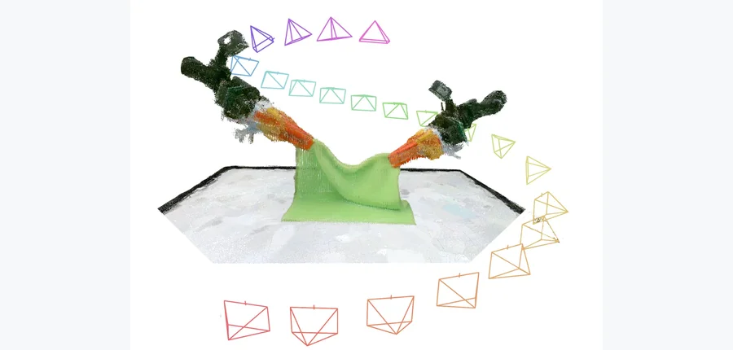 arXiv 2026-11-05 · cs.RO · #1 **[Hybrid Particle-Voxel Dynamics for Multimodal 3D World Simulation](https://arxiv.org/abs/2611.04492)** [Jimmy Wang , Yifan Chou , Kaifeng Zhang , Yixuan Wang , Binghao Huang , Tao Yu , Saleh Nabi , Yunzhu Li](https://arxiv.or… 机构：Columbia University / UC Berkeley / University of Michigan / NVIDIA / Analog Devices（[PDF](https://arxiv.org/pdf/2611.04492)） [Paper](https://arxiv.org/abs/2611.04492) · [Project](https://jwang771.github.io/3dworldsimulator/) · [图源](https://arxiv.org/pdf/2611.04492) 

中文摘要
预测世界如何响应机器人动作而演化，是策略学习、评估和规划的核心。然而，许多动作条件世界模型在二维图像或视频空间预测未来观测，没有显式建模底层三维场景，因此难以保持跨视角和长时交互的空间一致性。我们提出 3D World Simulator：一个动作条件多模态世界建模框架，以统一的三维表征联合预测外观、几何和触觉观测。方法结合混合粒子—体素自编码器与动作条件潜在动力学模型：前者把点云压缩为紧凑的三维体素潜变量，后者预测其演化。共享三维表征支持从任意视角进行几何一致的渲染，也便于整合空间对齐的触觉信号。实验展示了以 50 Hz 运行的交互式、长时、多模态预测。我们进一步展示该模型如何利用触觉和多视角视觉观测（包括腕部及新视角相机）为策略训练与评估可扩展地生成数据。方法还能扩展到包含多种物体的大型数据集，并在未见物体和机器人配置下进行基于模型的规划。这些结果表明，混合粒子—体素动力学有望成为多模态三维世界模拟的基础。 <a href="https://arxiv.org/abs/2611.04492">原摘要来源</a>
 | 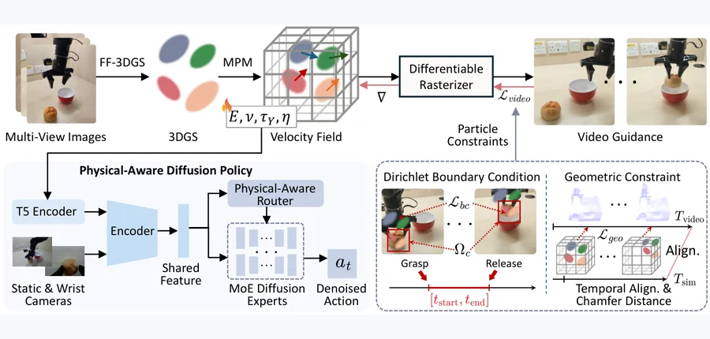 arXiv 2026-11-05 · cs.RO · #2 **[Physical Diffusion Policy via MPM-Guided 3D Gaussian Simulation](https://arxiv.org/abs/2611.04493)** [Can Wang , Qiyuan Qiao , Lei Liu , Ge Yuan , Xinhui Liu , Dong Xu](https://arxiv.org/abs/2611.04493) 机构：The University of Hong Kong（[PDF](https://arxiv.org/pdf/2611.04493)） [Paper](https://arxiv.org/abs/2611.04493) · [图源](https://arxiv.org/html/2611.04493v1/fig_framework.png) 

中文摘要
由于材料不同的日常物体具有不同的形变和接触动力学，为多样物体学习鲁棒操作策略仍然困难。扩散策略虽然能建模多模态操作行为，但通常缺乏显式物理推理，面对异质物体时可能产生平均化动作。我们提出一种物理感知扩散策略，以物体物理理解增强视觉模仿学习。框架将三维高斯泼溅与可微物质点法仿真结合，从视觉演示恢复材料属性；其中视频引导和粒子级约束支持准确估计物理参数。估计出的物理条件进一步融入材料感知的混合专家扩散策略，使其能在不同物理状态下自适应生成行为。为实际部署，我们引入物理记忆库，以高效检索物理信息，无需在线仿真优化。在广泛的仿真及真实物体上的实验表明，相比现有扩散方法，操作成功率和泛化能力有所提高。结果表明，融入物理知识对于多样环境中的可扩展机器人操作至关重要。 <a href="https://arxiv.org/abs/2611.04493">原摘要来源</a>
 | 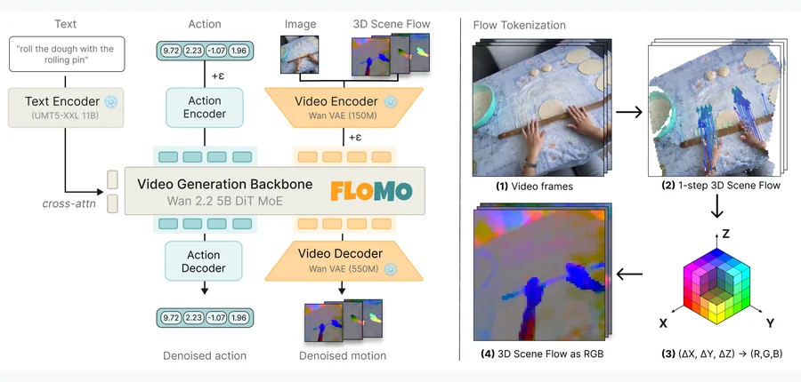 arXiv 2026-11-05 · cs.CV · #3 **[FloMo: 3D Scene Flow as a World Action Model Intermediate for Learning from Human Video](https://arxiv.org/abs/2611.05062)** [Jeremy Collins , Namra Patel , Ayush Agarwal , Shitij Govil , Animesh Garg](https://arxiv.org/abs/2611.05062) 机构：Georgia Institute of Technology（[PDF](https://arxiv.org/pdf/2611.05062)） [Paper](https://arxiv.org/abs/2611.05062) · [图源](https://arxiv.org/html/2611.05062v2/figures/figure_arch.png) 

中文摘要
预训练视频生成模型将互联网规模的运动先验融入机器人策略，但完整视频对于动作预测是冗余信号。我们认为，稠密三维运动是视频预训练向机器人动作迁移的关键媒介；预测运动比预测视频能提高动作预测的样本效率。FloMo 是一个经微调以预测三维场景流和动作 token 的 5B 视频生成模型。把场景流渲染为 RGB 并编码进与视频相同的潜在空间，使预训练视频生成骨干能够高效适配三维场景流预测。模型以无动作标注的人类视频和带动作标注的机器人遥操作数据联合训练，受益于人类视频预训练，并能泛化到未见物体、运动基元和任务。把运动预测替换为视频预测会降低分布外泛化；在运动预测之外加入视频预测目标也会降低而非提高策略成功率。当联合预测运动、视频和动作时，动作 token 对运动的关注远多于视频，说明视频预测会占用模型容量。总体结果表明，运动有效地介导了视频预训练向动作的迁移。更多信息见论文所附网址。 <a href="https://arxiv.org/abs/2611.05062">原摘要来源</a>
 |
| 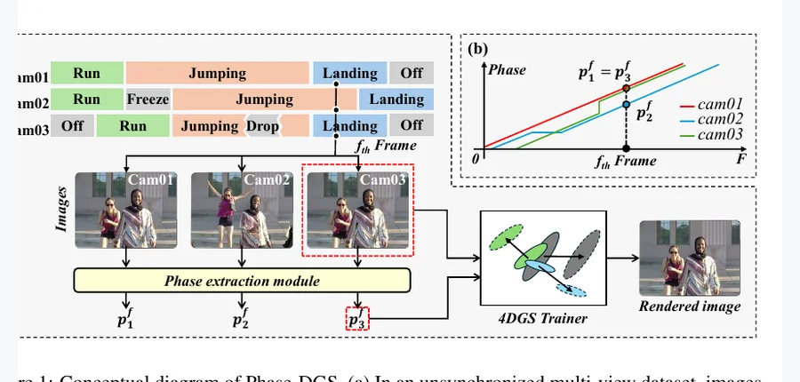 NeurIPS 2026 · #4 **[Phase-DGS: Phase-guided Dynamic Gaussian Splatting from Unsynchronized Multi-view Video](https://arxiv.org/abs/2611.04666)** [Hosung Jeon , Jun Young Jeong , Sangwoon Kwak , Joonsoo Kim , Sangmin Kim , Jaesik Park , Won-Sik Cheong , Hyon-Gon Choo]… 机构：Electronics and Telecommunications Research Institute (ETRI) / Seoul National University（[PDF](https://arxiv.org/pdf/2611.04666)） [Paper](https://arxiv.org/abs/2611.04666) · [Project](https://oc-dev74.github.io/Phase-DGS/) · [图源](https://arxiv.org/pdf/2611.04666) 

中文摘要
使用动态高斯泼溅（DGS）重建时空场景，根本上依赖所有相机完全同步，但实际中很难满足。工业级同步需要昂贵的专用硬件和复杂配置，而音频对齐、几何匹配及位姿跟踪等数据驱动替代方法又受环境或场景特定假设限制。为克服这一问题，我们提出 Phase-DGS，用表示每一帧在底层运动周期中固有状态的语义相位替代传统时间戳。无论由哪台相机在何时记录，捕捉到同一运动状态的帧都具有相同相位，从而自然建立非同步相机间的时空对应。在时间偏移、丢帧和相机冻结条件下验证显示，该方法相较基线最高提升 8.5 dB PSNR，并能无缝集成到 RealTime-4DGS 和 FreeTimeGS 等现有 DGS 骨干。 <a href="https://arxiv.org/abs/2611.04666">原摘要来源</a>
 | 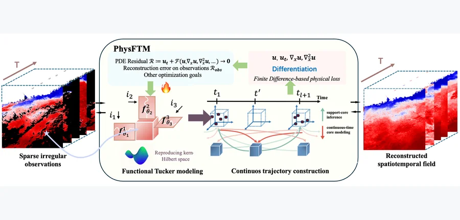 NeurIPS 2026 · #5 **[Physics-Informed Functional Tucker Method with RKHS Factors for Sparse Spatiotemporal Reconstruction](https://arxiv.org/abs/2611.03717)** [Zhengyang Liu , Jianguo Huang , Junxi Hu , Yucheng Mi , Haojie Cai , Wenxuan Shen , Zhikun Zhang , Renfeng Peng , Guangta… 机构：SandGold AI Research / Nanyang Technological University / Westlake University / Southern University of Science and Technology / Chinese Academy of Sciences（[PDF](https://arxiv.org/pdf/2611.03717)） [Paper](https://arxiv.org/abs/2611.03717) · [Code](https://github.com/liusirzzz/PhysFTM) · [图源](https://arxiv.org/html/2611.03717v1/figures/framework_GT.png) 

中文摘要
从固定稀疏传感器和缺失帧重建物理动力学，是科学研究中的基本难题。稀疏观测使大范围场区域缺少约束，导致逆问题不适定：模型可能拟合观测传感器，却在传感器之外产生不准确结构，或在支持帧之间作出不可靠预测。为此，我们提出 PhysFTM，一种物理信息功能 Tucker 模型：在再生核希尔伯特空间（RKHS）中参数化 Tucker 模态因子，并通过在传感器外配置点计算有限差分残差，加入偏微分方程（PDE）约束。这些残差为没有直接观测监督的区域提供额外物理信息。PhysFTM 首先通过交替最小化，分别优化 Tucker 核张量和基于 RKHS 的因子，在支持帧重建连续空间场。为重建缺失帧，它在 Tucker 核空间构建连续轨迹，再由学到的空间 RKHS-FTM 表征解码，恢复完整时空场。在 Allen–Cahn、Navier–Stokes、三维热方程以及三维网格化 Copernicus 海洋再分析数据上的实验，展示了两种缺失帧协议下准确的二维／三维重建。代码见论文所附链接。 <a href="https://arxiv.org/abs/2611.03717">原摘要来源</a>
 | 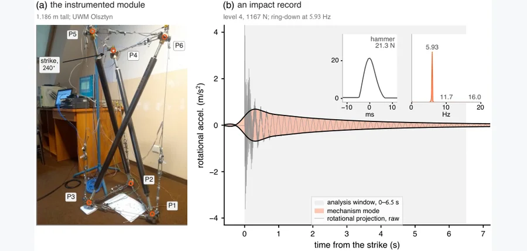 arXiv 2026-11-05 · cs.LG · #6 **[Physics-Informed Identification of Tensegrity Prestress across Taut-Slack Transitions](https://arxiv.org/abs/2611.04007)** [Sandesh Lamsal , Sumit Kumar , Rubi Bhandari , Subhamoy Sen , Andrzej Rutkiewicz , Leszek Małyszko , Landolf Rhode-Barba… 机构：University of Miami / Florida International University / Indian Institute of Technology Mandi / University of Warmia and Mazury / University of Applied Sciences in Elbląg（[PDF](https://arxiv.org/pdf/2611.04007)） [Paper](https://arxiv.org/abs/2611.04007) · [图源](https://arxiv.org/html/2611.04007v1/fig_olsztyn_exp.png) 

中文摘要
预应力决定张拉整体结构的稳定性、刚度和动态行为，但无法直接从稀疏结构测量中观察，服役期间还可能衰减。强激励下索可能松弛，动力学因而变得非光滑。现有辨识方法局限于索始终拉紧的状态，而针对张拉整体的物理信息网络也只解决从已知构件参数预测响应的正向问题。本研究建立逆问题：在约束笛卡尔坐标下，利用运动方程残差训练神经网络；此时质量矩阵为常数，力密度线性进入方程。力密度、阻尼和轴向刚度均为可训练参数，同时保留仅承拉的索定律。Fisher 信息分析在反演前判断一段记录能确定哪些构件参数。方法在最多五个模块的仿真平面张拉整体框架和一个三维棱柱，以及仿生腿和全尺寸张拉整体单纯形的实测记录上测试。在单模块框架上，使用半数自由坐标处的含噪加速度，无论记录是否包含拉紧—松弛转换，可辨识的力密度误差均在 1.5% 内；包含转换的记录还能确定仅拉紧记录无法确定的构件。在五模块、16 索、两跨桥框架上，力密度误差中位数适度升至 4.2%。在实测记录中，辨识弹簧刚度与独立测量值的平均偏差在 0.1% 内；13 个等级的单纯形预应力与索力传感器结果的均方根差为 2.9%。 <a href="https://arxiv.org/abs/2611.04007">原摘要来源</a>
 |
| 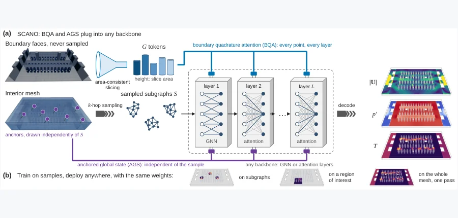 arXiv 2026-11-05 · cs.LG · #7 **[SCANO: Restoring Boundary-Condition Completeness in Sampled Meshes with a Sliced-Cross-Attention Neural Operator for 3D Thermal Fields](https://arxiv.org/abs/2611.04603)** [Tianyu Li , Zhiwei Cao , Qingang Zhang , Ruihang Wang , Binyang Song , Yonggang Wen](https://arxiv.org/abs/2611.04603) 机构：Nanyang Technological University / Fuzhou University / Yunnan University（[PDF](https://arxiv.org/pdf/2611.04603)） [Paper](https://arxiv.org/abs/2611.04603) · [图源](https://arxiv.org/html/2611.04603v1/fig_method.png) 

中文摘要
在百万单元网格上训练神经算子可能超出 GPU 内存，因此常在子采样网格上训练，再部署到全网格或选定区域。但子采样会扭曲边界信息并降低精度。我们考察采样条件下的边界条件何时能与全网格训练保持一致，以及如何聚合并注入边界数据。把解表示为边界数据相对于依类型而定的测度的积分后，我们指出子采样通过三种方式扭曲条件信息：边界覆盖不完整或全局状态依赖样本、按面数量而非面积加权，以及把边界输入压缩到低维向量。由此得到四个可在训练前检查的可测一致性条件。我们用两个不依赖骨干网络的模块满足这些条件：边界求积注意力（BQA）按类型和面积加权聚合所有边界面为切片 token，供每层的每个查询点读取；锚定全局状态（AGS）由独立于采样点的锚点估计全局状态。把两者加入可扩展的消息传递和切片注意力骨干，构成 SCANO。实验覆盖受控及公开基准和含百万单元网格的数据中心热仿真数据集（DCTS）。在两个基准上，BQA 改进所有骨干，最高将全网格误差降低 15 倍；在三个数据集上，AGS 使区域预测与全网格预测一致，在公开基准上使多数骨干的区域误差至少降低十倍。两模块合用，在两个基准上将原先最佳骨干的全网格误差近乎减半。SCANO 可在一秒内预测房间尺度场，比全房间锚点自注意力快逾 100 倍。 <a href="https://arxiv.org/abs/2611.04603">原摘要来源</a>
 | 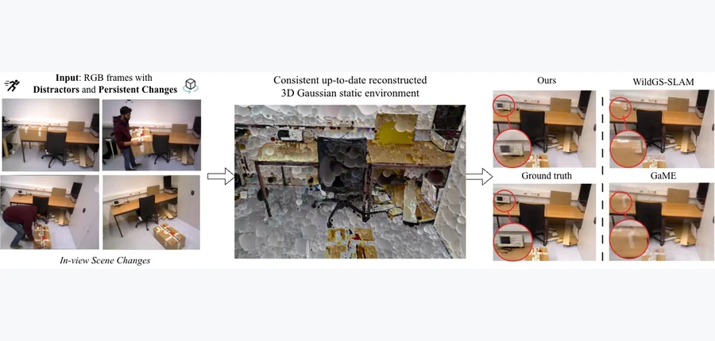 WACV 2027 · #8 **[SettleSplat: Monocular Gaussian Mapping under In-View Scene Changes](https://arxiv.org/abs/2611.04195)** [Anh Thuan Tran , Xiyun Song , Yubin Zhou , Heather Yu , Jana Kosecka , Liang Peng](https://arxiv.org/abs/2611.04195) 机构：George Mason University / Futurewei Technologies（[PDF](https://arxiv.org/pdf/2611.04195)） [Paper](https://arxiv.org/abs/2611.04195) · [图源](https://arxiv.org/html/2611.04195v1/images/livesplat-teaser.jpg) 

中文摘要
在线三维高斯建图能够快速、高保真地合成新视角，广泛用于增强现实、机器人和自主系统。然而，许多现有方法假设静态场景，或将动态内容作为离群值过滤。本文研究单次在线序列中物体在相机视野内被操作而引起的场景变化；这不同于以往只检测视野外变化或不同采集序列间变化的工作。在这种设置下，瞬时与持久动态交织：物体运动时可能是干扰物，停稳后则成为持久场景的一部分。近期研究虽开始通过移除干扰物获得干净静态背景，但视野内场景变化仍缺乏研究。为此，我们提出 SettleSplat：一种在此类变化下维护最新三维高斯地图的单目建图系统。具体而言，方法把粗略逐像素不确定性提升为高斯动态性场，并剪除瞬时高斯；对于持久变化，则利用由无参数渲染深度不确定性加权的几何矛盾，将真实变化与尚未充分优化的区域区分开来。在 Bonn 和 Co-Fusion 上，SettleSplat 取得一致的三维高斯地图，在完整图像和变化区域均优于当前基线，同时保持相近速度。 <a href="https://arxiv.org/abs/2611.04195">原摘要来源</a>
 | 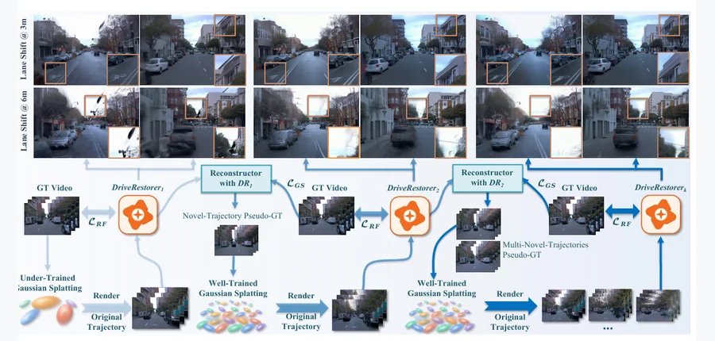 arXiv 2026-11-05 · cs.CV · #9 **[ReconDreamer#: Self-Evolving Closed-Loop Synergy of Reconstruction and Generation for Dynamic Driving Scenes](https://arxiv.org/abs/2611.04173)** [Songling Liu , Guosheng Zhao , Xiaofeng Wang , Chaojun Ni , Guan Huang , Jiwen Lu , Xingang Wang , Zheng Zhu](https://arx… 机构：Chinese Academy of Sciences / University of Chinese Academy of Sciences / Tsinghua University（[PDF](https://arxiv.org/pdf/2611.04173)） [Paper](https://arxiv.org/abs/2611.04173) · [图源](https://arxiv.org/pdf/2611.04173) 

中文摘要
近年来，借助生成先验，动态驾驶场景重建取得显著进展，尤其改善了新轨迹渲染质量。然而，生成数据与真实传感器观测之间仍有明显差距，严重限制重建保真度进一步提高。本文提出 ReconDreamer#，一个让重建与生成协同的自演化框架，缩小合成新轨迹数据与真实记录观测间的差距。在这一自演化闭环中，生成模型与重建模型通过迭代细化相互促进，最终显著增强重建模型的三维表征能力。我们还引入基于几何先验的自适应地面模型，进一步提高重建模型的渲染质量。方法在 Waymo、nuScenes、PandaSet 和 EUVS 基准上得到全面评估。具体地，在 Waymo 的 6 米横向偏移条件下，相比 ReconDreamer++，ReconDreamer# 的 NTA-IoU 和 NTL-IoU 分别提高 8.8% 和 3.0%，FID 降低 15.1%。 <a href="https://arxiv.org/abs/2611.04173">原摘要来源</a>
 |
| 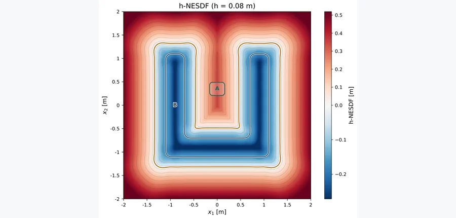 arXiv 2026-11-05 · cs.RO · #10 **[h-NESDF: An Infinitely Differentiable Signed Distance Between Two Sets with Robotic Applications](https://arxiv.org/abs/2611.03944)** [Vinicius Mariano Gonçalves , Pedro Antonio de Souza Campos Rodrigues](https://arxiv.org/abs/2611.03944) 机构：Federal University of Minas Gerais（[PDF](https://arxiv.org/pdf/2611.03944)） [Paper](https://arxiv.org/abs/2611.03944) · [图源](https://arxiv.org/html/2611.03944v1/field_2d.png) 

中文摘要
计算集合间距离对许多机器人应用（如运动规划和控制）十分重要，这些应用通常也需要距离的导数。但欧氏距离并非总是可微，会给需要导数的算法造成困难。本文提出两个一般集合（满足温和正则条件，但可为非凸）之间的法向欧氏有符号距离函数 NESDF。该度量本身仍不可微，但由此可以引入推广形式 h-NESDF：它带有平滑参数 h，对所有 h&gt;0 均无限可微，并在 h 趋于 0 时收敛到 NESDF。该度量适合 GPU 并行化，因此可高效计算。我们用大量仿真实验评估它在运动规划中的可行性。 <a href="https://arxiv.org/abs/2611.03944">原摘要来源</a>
 | 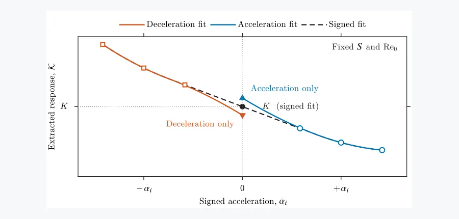 arXiv 2026-11-05 · physics.flu-dyn · #11 **[Fluid memory beyond creeping flow: a history kernel for a sphere at finite Reynolds numbers](https://arxiv.org/abs/2611.04606)** [M. D. Łasica , J. G. M. Kuerten , S. K. F. Stoter](https://arxiv.org/abs/2611.04606) 机构：Eindhoven University of Technology（[PDF](https://arxiv.org/pdf/2611.04606)） [Paper](https://arxiv.org/abs/2611.04606) · [图源](https://arxiv.org/html/2611.04606v1/signed_epsilon_Simple.png) 

中文摘要
预测超出蠕动流极限的球体历史力仍然困难。现有公式针对特定流动历史推导或校准，缺乏在更一般条件下的预测精度证据。我们提出系统方法：基于初始雷诺数 0.2 至 200、有限时长加减速斜坡的轴对称 Navier–Stokes 仿真，提取空间均匀非定常流中固定球体的历史核。得到的核曲面在短滞后和蠕动流极限恢复 Basset 极限，并通过远尾流渐近形式延拓到已解析滞后范围之外。在较高雷诺数下，中等滞后处的核出现非单调行为，与边界层和尾流的延迟调整有关。对于所测试情形，与所比较的文献公式相比，该核无需针对各情形单独调整，就能显著改善有限斜坡、振荡驱动和非周期复合速度历史下的历史力预测。结果表明，滞后时间和雷诺数捕捉了主导的记忆响应。 <a href="https://arxiv.org/abs/2611.04606">原摘要来源</a>
 | 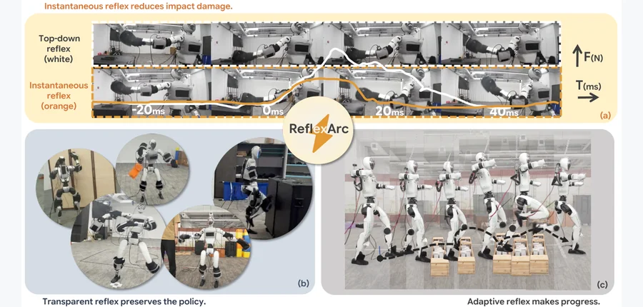 arXiv 2026-11-05 · cs.RO · #12 **[ReflexArc: Bottom-Up Integration of Instantaneous Tactile Reflexes into Whole-Body Humanoid Control](https://arxiv.org/abs/2611.04424)** [Mingyu Wang , Si Li , Ziqing Chen , He Wang , Li Yi](https://arxiv.org/abs/2611.04424) 机构：Tsinghua University / Peking University / Galbot（[PDF](https://arxiv.org/pdf/2611.04424)） [Paper](https://arxiv.org/abs/2611.04424) · [Project](https://minusmodulo.github.io/reflexarc-website/) · [图源](https://arxiv.org/html/2611.04424v1/teaser_v2.png) 

中文摘要
在杂乱环境中运行的人形机器人，必须在数十毫秒内到来的首次冲击峰值之前响应意外接触。以 50 Hz 运行的学习型全身策略会带来一个策略周期的延迟，还可能把保护性撤离误判为跟踪误差而压制。为此，我们提出 ARC（Ascending Reflex Control），一个将即时触觉反射自底向上整合进学习型全身控制的框架。ARC 包含即时反射通路和自底向上反射整合两部分。反射通路从全身触觉检测危险接触，求解全身撤离姿态，并在 10 ms 内直接送至电机。反射整合结合带反射的策略学习、反射透明的策略对齐及反射信息驱动的策略适配，以持续撤离、维持平衡并完成更长时程恢复。我们在 Unitree G1 上部署 ARC，评估三类危险接触。与其他条件相同但延迟 20 ms 的反射相比，ARC 将首次力峰值降低 34.1%，接触冲量由 0.2632 N·s 降至 0.1225 N·s（相差 2.15 倍）。我们还展示了受保护的运动跟踪、遥操作，以及脚部触觉引导的无视觉越障。项目页见论文所附链接。 <a href="https://arxiv.org/abs/2611.04424">原摘要来源</a>
 |
| 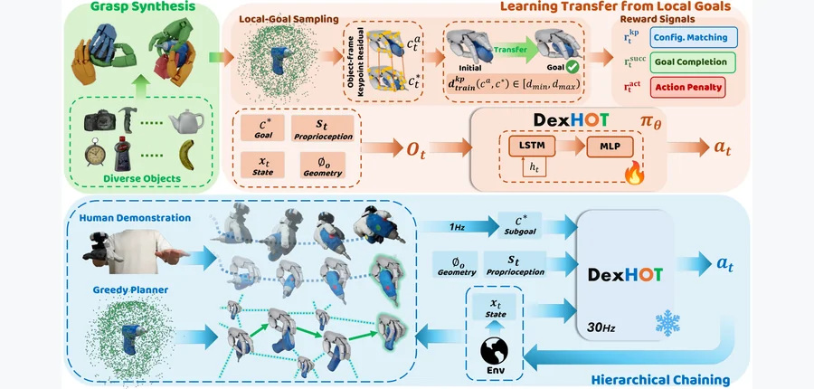 arXiv 2026-11-05 · cs.RO · #13 **[DexHOT: Learning Hand-Object Configuration Transfer for Dexterous Manipulation](https://arxiv.org/abs/2611.05119)** [Zhewei Gui , Anthony Bolton , Jiyao Zhang , Zeyuan Chen , Qiyang Yan , Tianyu Wang , Hao Dong](https://arxiv.org/abs/2611… 机构：Peking University / PrimeBot / BIGAI（[PDF](https://arxiv.org/pdf/2611.05119)） [Paper](https://arxiv.org/abs/2611.05119) · [Project](https://dex-hot.github.io/) · [图源](https://arxiv.org/html/2611.05119v1/DexHOT_pipeline.png) 

中文摘要
灵巧操作不仅要移动物体，还要安排手相对于物体的位置，以保持有用接触并支持后续动作。但许多学习系统主要以物体位姿或轨迹指定目标，让手—物配置隐式形成。我们提出 DexHOT，把灵巧操作表述为手—物配置迁移：在同时指定手部关节姿态与物体相对于手腕位姿的可行配置之间移动。DexHOT 从合成的可行配置对学习可复用、以关系为条件的迁移基元，无需人类参考运动；并通过闭环跟踪配置子目标组合成长时行为。在包含 120 个物体的 DexHOTBench 上，单一策略对已见和未见物体分别达到 80.5% 与 69.4% 的迁移成功率；在真实灵巧手上，200 次真实机器人迁移的成功率为 61.5%，六项演示引导任务的成功率为 90%。结果表明，显式手—物目标为灵巧操作提供了表达力强且可组合的接口。更多细节和视频见论文所附网址。 <a href="https://arxiv.org/abs/2611.05119">原摘要来源</a>
 | 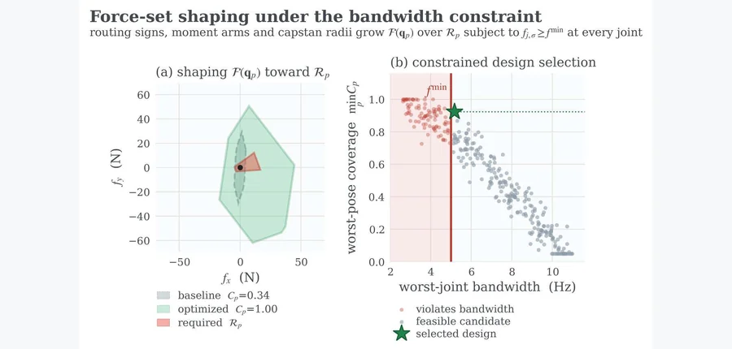 arXiv 2026-11-05 · cs.RO · #14 **[PACT: Pose-Robust Actuation Co-Design for Tendon-Driven Robotic Hands](https://arxiv.org/abs/2611.05302)** [Prashant Kumar , Rachael Granberry , Taylor Niehues , Andrew A. Stanley , Gabe Pirie](https://arxiv.org/abs/2611.05302) 机构：Meta Reality Labs Research（[PDF](https://arxiv.org/pdf/2611.05302)） [Paper](https://arxiv.org/abs/2611.05302) · [图源](https://arxiv.org/pdf/2611.05302) 

中文摘要
人形机器人手需要在人体尺度空间内提供足够的力、速度和反驱性。腱驱传动把执行器移到手掌和前臂，但走线、力臂和绞盘尺寸共同决定输出力与关节速度；顺次选择这些设计参数会顾此失彼。本文提出用于腱驱机器人手的姿态鲁棒执行器协同设计框架 PACT，在随姿态变化的力需求和驱动系统带宽约束下，联合优化腱绳走线、力臂及绞盘尺寸。可行力形式在所有关节施加执行器界限与平衡约束，最大最小目标则最大化最弱姿态处的任务力覆盖率。应用于四自由度手指时，该框架得到采用准直接驱动执行器的非对称 N+1 腱拓扑。在八个姿态上，设计实现 0.88–1.00 的任务力覆盖率，在第 70 百分位人体尺寸范围内，预测独立关节屈伸最小带宽为 5 Hz。样机测量与预测的偏差最高 24.5%，主要由未建模的传动损耗造成。结果表明，在不放宽带宽约束的条件下，将走线与驱动系统协同设计能够满足随姿态变化的力需求，为人体尺寸、人体水平性能的机器人手铺路。 <a href="https://arxiv.org/abs/2611.05302">原摘要来源</a>
 | 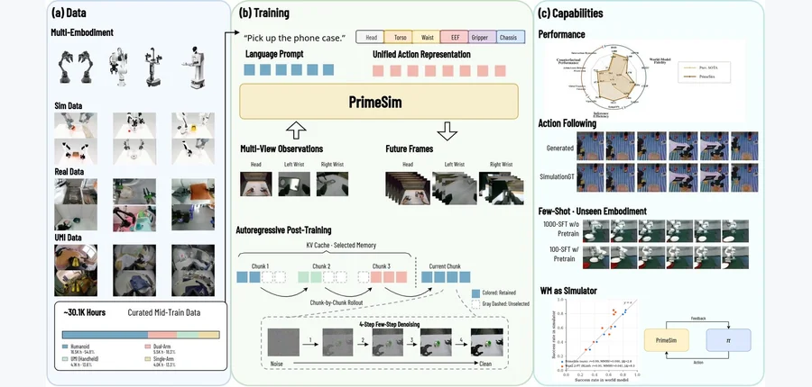 arXiv 2026-11-05 · cs.RO · #15 **[PrimeSim: A Generalist World Model Simulator from Large-Scale Cross-Embodiment Demonstrations](https://arxiv.org/abs/2611.04870)** [Travis Davies , Wentao Ma , Lihao Guo , Tengfei Ma , Xiaowen Chang , Jiafeng Xu , Shilong Wang , Yiqi Deng , Shaowen He… 机构：PrimeBot Research / Southeast University / Shanghai Jiao Tong University / Chinese University of Hong Kong / University of Chinese Academy of Sciences / Beihang University / Peking University / Shanghai Innovation Institute（[PDF](https://arxiv.org/pdf/2611.04870)） [Paper](https://arxiv.org/abs/2611.04870) · [图源](https://arxiv.org/html/2611.04870v1/images/primesim_teaser.png) 

中文摘要
用于模拟器的机器人世界模型不能只生成看似合理的视频，还必须忠实遵循指令动作、保持跨相机视角一致，并在长时推演中持续连贯。我们提出 PrimeSim：通过渐进式中期训练与后训练实现这些目标的动作条件多视角世界模型模拟器。以预训练视频生成器为起点，模型在跨 22 个平台的 30,110 小时机器人演示上中期训练。为改善动作遵循性，我们引入统一的跨形态动作表征和帧对齐双路径条件机制，加强动作与画面的对应。为保持多视角一致，我们开发带显式相机身份的视角感知交错注意力，允许跨视角信息交换，同时保留各视角特有表征。我们还提出快视频、慢记忆后训练框架，把双向视频生成器转为高效自回归模拟器。通过结合快速因果生成、自推演训练和分层时间记忆，PrimeSim 缓解自身生成历史造成的误差累积，并支持连贯长时模拟。PrimeSim 以 10.1 FPS 运行，在刚性和可形变操作任务的长时推演中保持稳定；对留出平台只需 100–200 个梯度步骤即可迁移，而预训练骨干不能做到这一点。与五个开源动作条件世界模型相比，它在五套 WorldSimProbe 测试中的四套领先，且 EWMBench 总体成绩最佳；但细粒度局部校准仍落后于其他方法。其推演足以支持基于 GRPO 的策略优化。论文发布模型权重、推理代码和训练代码。 <a href="https://arxiv.org/abs/2611.04870">原摘要来源</a>
 |
| 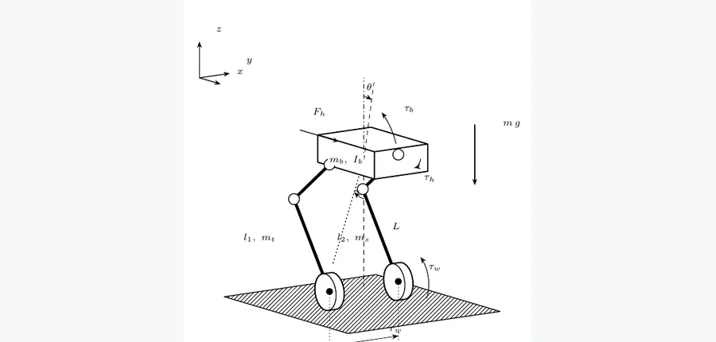 arXiv 2026-11-05 · eess.SY · #16 **[Moving Horizon Estimation and Constrained Model Predictive Control for Balancing a Wheel-Legged Robot Under Unknown Disturbances](https://arxiv.org/abs/2611.04357)** [Haitham El-Hussieny](https://arxiv.org/abs/2611.04357) 机构：Egypt-Japan University of Science and Technology（[PDF](https://arxiv.org/pdf/2611.04357)） [Paper](https://arxiv.org/abs/2611.04357) · [图源](https://arxiv.org/pdf/2611.04357) 

中文摘要
轮腿机器人以两轮保持平衡，同时通过关节腿改变高度、吸收冲击和跨越不平地形。在硬件上，平衡控制器依赖含噪惯性及编码器测量，还需在不超出电机扭矩限制的条件下抵御载荷、风等未知扰动。本文为一台 9.95 kg 轮腿机器人的矢状面平衡提出移动时域估计器（MHE）与无偏差约束模型预测控制器（MPC）的组合。估计器使用虚拟腿模型，加入水平髋部力、机身俯仰力矩和陀螺仪偏置；其加速度计模型扣除预测的髋部加速度，并在检测到冲击时增大过程噪声。方法在 MuJoCo 中以模拟传感器噪声、偏置、量化和延迟评估，并与分别使用真实状态、互补滤波器或同一 MHE 的 LQR 基线比较。在行驶、下蹲、倒车和俯身序列中，配合 MHE 的 MPC 将速度均方根误差降至 0.11 m/s，而使用真实状态的 LQR 为 0.24 m/s。在未知 2 kg 载荷和 10 N 逆风下，风中平均位置误差为 6 cm，而真实状态 LQR 为 81 cm。在 3×4 组载荷和逆风组合中，使用同一估计器的 LQR 在 12 组中的 3 组跌倒，MPC 则在 1 组跌倒。结果仅限平地仿真，硬件实验仍是未来工作。 <a href="https://arxiv.org/abs/2611.04357">原摘要来源</a>
 |   |   |
<!-- PAPER_CARDS_END -->

> 官方批次：2026-11-04（北京时间 2026-11-05 检索）；14 个分类页共 766 条 New、420 条 Cross、753 条 Replacement；New 按 arXiv ID 去重后 766 篇，本期入选 16 篇。主榜仅含 New。

## 检索概况

检索窗口：arXiv 官方 Wednesday, 4 November 2026 New submissions；北京时间 2026-11-05 09:00 起核对。优先三维物理交叉，再列有具体机器人方法或实验证据的具身工作。相关性、机构强度、局限和实验建议均为推断。

| 官方 New 分类页 | 批次 | New | Cross | Replacement |
|---|---|---:|---:|---:|
| [cs.CV](https://arxiv.org/list/cs.CV/new?show=2000) | 2026-11-04 | 141 | 19 | 100 |
| [cs.GR](https://arxiv.org/list/cs.GR/new?show=2000) | 2026-11-04 | 0 | 2 | 4 |
| [cs.RO](https://arxiv.org/list/cs.RO/new?show=2000) | 2026-11-04 | 56 | 16 | 53 |
| [cs.AI](https://arxiv.org/list/cs.AI/new?show=2000) | 2026-11-04 | 115 | 137 | 161 |
| [cs.LG](https://arxiv.org/list/cs.LG/new?show=2000) | 2026-11-04 | 148 | 104 | 193 |
| [physics](https://arxiv.org/list/physics/new?show=2000) | 2026-11-04 | 87 | 35 | 58 |
| [cond-mat](https://arxiv.org/list/cond-mat/new?show=2000) | 2026-11-04 | 100 | 28 | 69 |
| [math.OC](https://arxiv.org/list/math.OC/new?show=2000) | 2026-11-04 | 19 | 16 | 20 |
| [math.NA](https://arxiv.org/list/math.NA/new?show=2000) | 2026-11-04 | 21 | 3 | 17 |
| [math.DS](https://arxiv.org/list/math.DS/new?show=2000) | 2026-11-04 | 11 | 10 | 18 |
| [stat.ML](https://arxiv.org/list/stat.ML/new?show=2000) | 2026-11-04 | 9 | 24 | 27 |
| [eess.IV](https://arxiv.org/list/eess.IV/new?show=2000) | 2026-11-04 | 12 | 1 | 5 |
| [eess.SY](https://arxiv.org/list/eess.SY/new?show=2000) | 2026-11-04 | 31 | 14 | 16 |
| [eess.SP](https://arxiv.org/list/eess.SP/new?show=2000) | 2026-11-04 | 16 | 11 | 12 |

合计：766 条 New（766 个去重 ID）；本期入选 16 篇。以下标题、作者、分类与摘要来自对应官方 [New 分类页](https://arxiv.org/list/cs.RO/new?show=2000)；机构来自各篇 PDF 首页，未能可靠核实时标注。

## Top papers

| # | 论文 | arXiv | 分类 | 作者 | 机构 | 相关性（推断） | 机构强度（推断） | 优先级（推断） |
|---:|---|---|---|---|---|---|---|---|
| 1 | [Hybrid Particle-Voxel Dynamics for Multimodal 3D World Simulation](https://arxiv.org/pdf/2611.04492) | [arXiv:2611.04492](https://arxiv.org/abs/2611.04492) | [cs.RO) ](https://arxiv.org/abs/2611.04492) | [Jimmy Wang , Yifan Chou , Kaifeng Zhang , Yixuan Wang , Binghao Huang , Tao Yu , Saleh Nabi , Yunzhu Li](https://arxiv.org/abs/2611.04492) | Columbia University / UC Berkeley / University of Michigan / NVIDIA / Analog Devices（[PDF](https://arxiv.org/pdf/2611.04492)） | 极高：三维物理／机器人交互 | 中（推断） | A |
| 2 | [Physical Diffusion Policy via MPM-Guided 3D Gaussian Simulation](https://arxiv.org/pdf/2611.04493) | [arXiv:2611.04493](https://arxiv.org/abs/2611.04493) | [cs.RO](https://arxiv.org/abs/2611.04493) | [Can Wang , Qiyuan Qiao , Lei Liu , Ge Yuan , Xinhui Liu , Dong Xu](https://arxiv.org/abs/2611.04493) | The University of Hong Kong（[PDF](https://arxiv.org/pdf/2611.04493)） | 极高：三维物理／机器人交互 | 中（推断） | A |
| 3 | [FloMo: 3D Scene Flow as a World Action Model Intermediate for Learning from Human Video](https://arxiv.org/pdf/2611.05062) | [arXiv:2611.05062](https://arxiv.org/abs/2611.05062) | [cs.CV) ](https://arxiv.org/abs/2611.05062) | [Jeremy Collins , Namra Patel , Ayush Agarwal , Shitij Govil , Animesh Garg](https://arxiv.org/abs/2611.05062) | Georgia Institute of Technology（[PDF](https://arxiv.org/pdf/2611.05062)） | 极高：三维物理／机器人交互 | 中（推断） | A |
| 4 | [Phase-DGS: Phase-guided Dynamic Gaussian Splatting from Unsynchronized Multi-view Video](https://arxiv.org/pdf/2611.04666) | [arXiv:2611.04666](https://arxiv.org/abs/2611.04666) | [cs.CV) ](https://arxiv.org/abs/2611.04666) | [Hosung Jeon , Jun Young Jeong , Sangwoon Kwak , Joonsoo Kim , Sangmin Kim , Jaesik Park , Won-Sik Cheong , Hyon-Gon Choo](https://arxiv.org/abs/2611.04666) | Electronics and Telecommunications Research Institute (ETRI) / Seoul National University（[PDF](https://arxiv.org/pdf/2611.04666)） | 极高：三维物理／机器人交互 | 中（推断） | A |
| 5 | [Physics-Informed Functional Tucker Method with RKHS Factors for Sparse Spatiotemporal Reconstruction](https://arxiv.org/pdf/2611.03717) | [arXiv:2611.03717](https://arxiv.org/abs/2611.03717) | [cs.CV) ](https://arxiv.org/abs/2611.03717) | [Zhengyang Liu , Jianguo Huang , Junxi Hu , Yucheng Mi , Haojie Cai , Wenxuan Shen , Zhikun Zhang , Renfeng Peng , Guangtao Zhang , Zhiqiang Liu](https://arxiv.org/abs/2611.03717) | SandGold AI Research / Nanyang Technological University / Westlake University / Southern University of Science and Technology / Chinese Academy of Sciences（[PDF](https://arxiv.org/pdf/2611.03717)） | 极高：三维物理／机器人交互 | 中（推断） | A |
| 6 | [Physics-Informed Identification of Tensegrity Prestress across Taut-Slack Transitions](https://arxiv.org/pdf/2611.04007) | [arXiv:2611.04007](https://arxiv.org/abs/2611.04007) | [cs.LG) ](https://arxiv.org/abs/2611.04007) | [Sandesh Lamsal , Sumit Kumar , Rubi Bhandari , Subhamoy Sen , Andrzej Rutkiewicz , Leszek Małyszko , Landolf Rhode-Barbarigos](https://arxiv.org/abs/2611.04007) | University of Miami / Florida International University / Indian Institute of Technology Mandi / University of Warmia and Mazury / University of Applied Sciences in Elbląg（[PDF](https://arxiv.org/pdf/2611.04007)） | 极高：三维物理／机器人交互 | 中（推断） | A |
| 7 | [SCANO: Restoring Boundary-Condition Completeness in Sampled Meshes with a Sliced-Cross-Attention Neural Operator for 3D Thermal Fields](https://arxiv.org/pdf/2611.04603) | [arXiv:2611.04603](https://arxiv.org/abs/2611.04603) | [cs.LG) ](https://arxiv.org/abs/2611.04603) | [Tianyu Li , Zhiwei Cao , Qingang Zhang , Ruihang Wang , Binyang Song , Yonggang Wen](https://arxiv.org/abs/2611.04603) | Nanyang Technological University / Fuzhou University / Yunnan University（[PDF](https://arxiv.org/pdf/2611.04603)） | 极高：三维物理／机器人交互 | 中（推断） | A |
| 8 | [SettleSplat: Monocular Gaussian Mapping under In-View Scene Changes](https://arxiv.org/pdf/2611.04195) | [arXiv:2611.04195](https://arxiv.org/abs/2611.04195) | [cs.CV](https://arxiv.org/abs/2611.04195) | [Anh Thuan Tran , Xiyun Song , Yubin Zhou , Heather Yu , Jana Kosecka , Liang Peng](https://arxiv.org/abs/2611.04195) | George Mason University / Futurewei Technologies（[PDF](https://arxiv.org/pdf/2611.04195)） | 高：三维几何／动力学 | 中（推断） | A |
| 9 | [ReconDreamer#: Self-Evolving Closed-Loop Synergy of Reconstruction and Generation for Dynamic Driving Scenes](https://arxiv.org/pdf/2611.04173) | [arXiv:2611.04173](https://arxiv.org/abs/2611.04173) | [cs.CV](https://arxiv.org/abs/2611.04173) | [Songling Liu , Guosheng Zhao , Xiaofeng Wang , Chaojun Ni , Guan Huang , Jiwen Lu , Xingang Wang , Zheng Zhu](https://arxiv.org/abs/2611.04173) | Chinese Academy of Sciences / University of Chinese Academy of Sciences / Tsinghua University（[PDF](https://arxiv.org/pdf/2611.04173)） | 高：三维几何／动力学 | 中（推断） | A |
| 10 | [h-NESDF: An Infinitely Differentiable Signed Distance Between Two Sets with Robotic Applications](https://arxiv.org/pdf/2611.03944) | [arXiv:2611.03944](https://arxiv.org/abs/2611.03944) | [cs.RO](https://arxiv.org/abs/2611.03944) | [Vinicius Mariano Gonçalves , Pedro Antonio de Souza Campos Rodrigues](https://arxiv.org/abs/2611.03944) | Federal University of Minas Gerais（[PDF](https://arxiv.org/pdf/2611.03944)） | 高：三维几何／动力学 | 中（推断） | A |
| 11 | [Fluid memory beyond creeping flow: a history kernel for a sphere at finite Reynolds numbers](https://arxiv.org/pdf/2611.04606) | [arXiv:2611.04606](https://arxiv.org/abs/2611.04606) | [physics.flu-dyn](https://arxiv.org/abs/2611.04606) | [M. D. Łasica , J. G. M. Kuerten , S. K. F. Stoter](https://arxiv.org/abs/2611.04606) | Eindhoven University of Technology（[PDF](https://arxiv.org/pdf/2611.04606)） | 高：三维几何／动力学 | 中（推断） | B |
| 12 | [ReflexArc: Bottom-Up Integration of Instantaneous Tactile Reflexes into Whole-Body Humanoid Control](https://arxiv.org/pdf/2611.04424) | [arXiv:2611.04424](https://arxiv.org/abs/2611.04424) | [cs.RO](https://arxiv.org/abs/2611.04424) | [Mingyu Wang , Si Li , Ziqing Chen , He Wang , Li Yi](https://arxiv.org/abs/2611.04424) | Tsinghua University / Peking University / Galbot（[PDF](https://arxiv.org/pdf/2611.04424)） | 高：具身机器人／控制 | 中（推断） | B |
| 13 | [DexHOT: Learning Hand-Object Configuration Transfer for Dexterous Manipulation](https://arxiv.org/pdf/2611.05119) | [arXiv:2611.05119](https://arxiv.org/abs/2611.05119) | [cs.RO](https://arxiv.org/abs/2611.05119) | [Zhewei Gui , Anthony Bolton , Jiyao Zhang , Zeyuan Chen , Qiyang Yan , Tianyu Wang , Hao Dong](https://arxiv.org/abs/2611.05119) | Peking University / PrimeBot / BIGAI（[PDF](https://arxiv.org/pdf/2611.05119)） | 高：具身机器人／控制 | 中（推断） | B |
| 14 | [PACT: Pose-Robust Actuation Co-Design for Tendon-Driven Robotic Hands](https://arxiv.org/pdf/2611.05302) | [arXiv:2611.05302](https://arxiv.org/abs/2611.05302) | [cs.RO](https://arxiv.org/abs/2611.05302) | [Prashant Kumar , Rachael Granberry , Taylor Niehues , Andrew A. Stanley , Gabe Pirie](https://arxiv.org/abs/2611.05302) | Meta Reality Labs Research（[PDF](https://arxiv.org/pdf/2611.05302)） | 高：具身机器人／控制 | 中（推断） | B |
| 15 | [PrimeSim: A Generalist World Model Simulator from Large-Scale Cross-Embodiment Demonstrations](https://arxiv.org/pdf/2611.04870) | [arXiv:2611.04870](https://arxiv.org/abs/2611.04870) | [cs.RO](https://arxiv.org/abs/2611.04870) | [Travis Davies , Wentao Ma , Lihao Guo , Tengfei Ma , Xiaowen Chang , Jiafeng Xu , Shilong Wang , Yiqi Deng , Shaowen He , Xiaoqi Li , Qian Zhu , Ran Cheng , Hao Dong](https://arxiv.org/abs/2611.04870) | PrimeBot Research / Southeast University / Shanghai Jiao Tong University / Chinese University of Hong Kong / University of Chinese Academy of Sciences / Beihang University / Peking University / Shanghai Innovation Institute（[PDF](https://arxiv.org/pdf/2611.04870)） | 高：具身机器人／控制 | 中（推断） | B |
| 16 | [Moving Horizon Estimation and Constrained Model Predictive Control for Balancing a Wheel-Legged Robot Under Unknown Disturbances](https://arxiv.org/pdf/2611.04357) | [arXiv:2611.04357](https://arxiv.org/abs/2611.04357) | [eess.SY](https://arxiv.org/abs/2611.04357) | [Haitham El-Hussieny](https://arxiv.org/abs/2611.04357) | Egypt-Japan University of Science and Technology（[PDF](https://arxiv.org/pdf/2611.04357)） | 高：具身机器人／控制 | 中（推断） | B |

## 逐篇中文要点

### 1. [Hybrid Particle-Voxel Dynamics for Multimodal 3D World Simulation](https://arxiv.org/abs/2611.04492)

- **论文事实／方法**：混合粒子—体素编码器与动作条件动力学在统一三维潜变量中联合预测几何、外观和触觉。（[摘要](https://arxiv.org/abs/2611.04492)）
- **论文事实／实验**：报告 50 Hz 长时多模态预测，并展示未见物体和机器人配置下的规划。（[摘要](https://arxiv.org/abs/2611.04492)）
- **推断／局限**：触觉与几何的长期误差是否同时累积，需要逐模态闭环量化。

### 2. [Physical Diffusion Policy via MPM-Guided 3D Gaussian Simulation](https://arxiv.org/abs/2611.04493)

- **论文事实／方法**：结合 3DGS 与可微 MPM 估计材料参数，再以材料感知混合专家扩散策略生成动作。（[摘要](https://arxiv.org/abs/2611.04493)）
- **论文事实／实验**：报告在多种仿真和真实物体上的操作成功率及泛化提升。（[摘要](https://arxiv.org/abs/2611.04493)）
- **推断／局限**：材料参数可辨识性及仿真与真实接触失配值得单独消融。

### 3. [FloMo: 3D Scene Flow as a World Action Model Intermediate for Learning from Human Video](https://arxiv.org/abs/2611.05062)

- **论文事实／方法**：把场景流编码进视频模型潜空间，以三维运动作为人类视频向机器人动作迁移的中介。（[摘要](https://arxiv.org/abs/2611.05062)）
- **论文事实／实验**：以 5B 模型训练；运动目标优于替换或叠加的视频预测目标。（[摘要](https://arxiv.org/abs/2611.05062)）
- **推断／局限**：5B 模型的计算成本较高；小模型是否保有相同迁移优势仍待检验。

### 4. [Phase-DGS: Phase-guided Dynamic Gaussian Splatting from Unsynchronized Multi-view Video](https://arxiv.org/abs/2611.04666)

- **论文事实／方法**：用动作周期的语义相位替代多相机时间戳，为非同步视频建立跨视角对应。（[摘要](https://arxiv.org/abs/2611.04666)）
- **论文事实／实验**：在时间偏移、丢帧及相机冻结条件下，PSNR 相较基线最高提高 8.5 dB。（[摘要](https://arxiv.org/abs/2611.04666)）
- **推断／局限**：非周期或相似动作状态的相位歧义可能导致错误跨视角匹配。

### 5. [Physics-Informed Functional Tucker Method with RKHS Factors for Sparse Spatiotemporal Reconstruction](https://arxiv.org/abs/2611.03717)

- **论文事实／方法**：以 RKHS Tucker 因子表示连续场，在无传感器的配置点加入 PDE 残差。（[摘要](https://arxiv.org/abs/2611.03717)）
- **论文事实／实验**：在 Allen–Cahn、Navier–Stokes、三维热方程及海洋数据上验证缺帧重建。（[摘要](https://arxiv.org/abs/2611.03717)）
- **推断／局限**：PDE 不准确时，配置点残差可能把模型拉向错误物理。

### 6. [Physics-Informed Identification of Tensegrity Prestress across Taut-Slack Transitions](https://arxiv.org/abs/2611.04007)

- **论文事实／方法**：在约束笛卡尔坐标中以运动方程残差反演张拉整体的力密度、阻尼和刚度。（[摘要](https://arxiv.org/abs/2611.04007)）
- **论文事实／实验**：实测弹簧刚度平均偏差低于 0.1%；13 级预应力与力传感器的 RMS 差为 2.9%。（[摘要](https://arxiv.org/abs/2611.04007)）
- **推断／局限**：真实索摩擦、滞回及未建模连接点误差可能影响辨识。

### 7. [SCANO: Restoring Boundary-Condition Completeness in Sampled Meshes with a Sliced-Cross-Attention Neural Operator for 3D Thermal Fields](https://arxiv.org/abs/2611.04603)

- **论文事实／方法**：让全部边界面按类型与面积进入注意力，并用独立锚点估计全局状态。（[摘要](https://arxiv.org/abs/2611.04603)）
- **论文事实／实验**：百万单元网格实验中，边界模块使全网格误差最高降低 15 倍。（[摘要](https://arxiv.org/abs/2611.04603)）
- **推断／局限**：边界面类型或面积错误会直接污染求积注意力。

### 8. [SettleSplat: Monocular Gaussian Mapping under In-View Scene Changes](https://arxiv.org/abs/2611.04195)

- **论文事实／方法**：区分移动中的瞬时物体与停稳后的持久变化，持续维护单目 3DGS 地图。（[摘要](https://arxiv.org/abs/2611.04195)）
- **论文事实／实验**：Bonn 和 Co-Fusion 上，完整图像与变化区域均优于现有基线且速度相近。（[摘要](https://arxiv.org/abs/2611.04195)）
- **推断／局限**：持续遮挡下，持久变化与优化不足可能更难区分。

### 9. [ReconDreamer#: Self-Evolving Closed-Loop Synergy of Reconstruction and Generation for Dynamic Driving Scenes](https://arxiv.org/abs/2611.04173)

- **论文事实／方法**：生成与重建闭环迭代，并引入几何先验自适应地面模型改善动态驾驶场景渲染。（[摘要](https://arxiv.org/abs/2611.04173)）
- **论文事实／实验**：Waymo 6 米横移下，NTA-IoU／NTL-IoU 提高 8.8%／3.0%，FID 降低 15.1%。（[摘要](https://arxiv.org/abs/2611.04173)）
- **推断／局限**：迭代自生成数据可能积累系统性几何误差。

### 10. [h-NESDF: An Infinitely Differentiable Signed Distance Between Two Sets with Robotic Applications](https://arxiv.org/abs/2611.03944)

- **论文事实／方法**：构造可处理非凸集合、对 h>0 无限可微的有符号距离，供运动规划求导。（[摘要](https://arxiv.org/abs/2611.03944)）
- **论文事实／实验**：以仿真运动规划评估距离函数的可行性。（[摘要](https://arxiv.org/abs/2611.03944)）
- **推断／局限**：平滑参数 h 在接触精度与梯度稳定性间的权衡仍需报告。

### 11. [Fluid memory beyond creeping flow: a history kernel for a sphere at finite Reynolds numbers](https://arxiv.org/abs/2611.04606)

- **论文事实／方法**：由轴对称 Navier–Stokes 仿真提取有限雷诺数下球体历史力核。（[摘要](https://arxiv.org/abs/2611.04606)）
- **论文事实／实验**：覆盖初始雷诺数 0.2–200，并测试斜坡、振荡和非周期复合流动历史。（[摘要](https://arxiv.org/abs/2611.04606)）
- **推断／局限**：核来自固定球及空间均匀流，直接外推到自由运动或复杂障碍仍需验证。

### 12. [ReflexArc: Bottom-Up Integration of Instantaneous Tactile Reflexes into Whole-Body Humanoid Control](https://arxiv.org/abs/2611.04424)

- **论文事实／方法**：让全身触觉危险接触在 10 ms 内直接触发电机撤离，再与学习策略整合。（[摘要](https://arxiv.org/abs/2611.04424)）
- **论文事实／实验**：G1 上相较延迟 20 ms 的反射，力峰降低 34.1%，接触冲量由 0.2632 降到 0.1225 N·s。（[摘要](https://arxiv.org/abs/2611.04424)）
- **推断／局限**：触觉误报与撤离动作对原任务成功率的影响值得量化。

### 13. [DexHOT: Learning Hand-Object Configuration Transfer for Dexterous Manipulation](https://arxiv.org/abs/2611.05119)

- **论文事实／方法**：把手关节姿态和物体相对手腕位姿组成配置目标，学习可组合迁移基元。（[摘要](https://arxiv.org/abs/2611.05119)）
- **论文事实／实验**：120 物体基准已见／未见迁移成功率为 80.5%／69.4%；真实迁移 61.5%。（[摘要](https://arxiv.org/abs/2611.05119)）
- **推断／局限**：合成可行配置与真实接触摩擦失配可能限制跨物体迁移。

### 14. [PACT: Pose-Robust Actuation Co-Design for Tendon-Driven Robotic Hands](https://arxiv.org/abs/2611.05302)

- **论文事实／方法**：联合优化腱绳走线、力臂和绞盘尺寸，约束随姿态变化的力与带宽。（[摘要](https://arxiv.org/abs/2611.05302)）
- **论文事实／实验**：八姿态任务力覆盖率 0.88–1.00；样机与预测最高偏差 24.5%。（[摘要](https://arxiv.org/abs/2611.05302)）
- **推断／局限**：样机最高 24.5% 偏差表明传动损耗模型尚可改进。

### 15. [PrimeSim: A Generalist World Model Simulator from Large-Scale Cross-Embodiment Demonstrations](https://arxiv.org/abs/2611.04870)

- **论文事实／方法**：跨形态动作条件、多视角交错注意力及快视频慢记忆支持长时模拟。（[摘要](https://arxiv.org/abs/2611.04870)）
- **论文事实／实验**：30,110 小时、22 平台训练；10.1 FPS，留出平台用 100–200 梯度步迁移。（[摘要](https://arxiv.org/abs/2611.04870)）
- **推断／局限**：论文承认细粒度局部校准仍落后；长时物理接触误差应单测。

### 16. [Moving Horizon Estimation and Constrained Model Predictive Control for Balancing a Wheel-Legged Robot Under Unknown Disturbances](https://arxiv.org/abs/2611.04357)

- **论文事实／方法**：以移动时域估计配合约束 MPC，抵御轮腿机器人未知载荷和逆风。（[摘要](https://arxiv.org/abs/2611.04357)）
- **论文事实／实验**：仿真中速度 RMS 误差 0.11 m/s；在 2 kg 载荷及 10 N 逆风下平均位置误差 6 cm。（[摘要](https://arxiv.org/abs/2611.04357)）
- **推断／局限**：论文实验仅限平地仿真，真实硬件和复杂地形仍未验证。

## 今日最值得细读的 5 篇

1. **[Hybrid Particle-Voxel Dynamics for Multimodal 3D World Simulation](https://arxiv.org/abs/2611.04492)**：混合粒子—体素编码器与动作条件动力学在统一三维潜变量中联合预测几何、外观和触觉。
2. **[Physical Diffusion Policy via MPM-Guided 3D Gaussian Simulation](https://arxiv.org/abs/2611.04493)**：结合 3DGS 与可微 MPM 估计材料参数，再以材料感知混合专家扩散策略生成动作。
3. **[FloMo: 3D Scene Flow as a World Action Model Intermediate for Learning from Human Video](https://arxiv.org/abs/2611.05062)**：把场景流编码进视频模型潜空间，以三维运动作为人类视频向机器人动作迁移的中介。
4. **[Phase-DGS: Phase-guided Dynamic Gaussian Splatting from Unsynchronized Multi-view Video](https://arxiv.org/abs/2611.04666)**：用动作周期的语义相位替代多相机时间戳，为非同步视频建立跨视角对应。
5. **[Physics-Informed Functional Tucker Method with RKHS Factors for Sparse Spatiotemporal Reconstruction](https://arxiv.org/abs/2611.03717)**：以 RKHS Tucker 因子表示连续场，在无传感器的配置点加入 PDE 残差。

## 低算力可改进论文与具体实验（推断）

1. **[h-NESDF: An Infinitely Differentiable Signed Distance Between Two Sets with Robotic Applications](https://arxiv.org/abs/2611.03944)**：把平滑尺度 h 设为局部曲率与接近速度的函数；在二维非凸抓取路径上比较固定 h 的最小间隙和梯度抖动。只需几何查询和小规模规划；预期减少接触附近数值不稳，风险是过度平滑。
2. **[Physics-Informed Functional Tucker Method with RKHS Factors for Sparse Spatiotemporal Reconstruction](https://arxiv.org/abs/2611.03717)**：按 PDE 残差与传感器覆盖度自适应放置配置点；在三维热方程小网格的遮挡区域比较均匀采样。仅需小网格和低秩模型；预期降低无观测区误差，风险是残差偏向错误边界。
3. **[SCANO: Restoring Boundary-Condition Completeness in Sampled Meshes with a Sliced-Cross-Attention Neural Operator for 3D Thermal Fields](https://arxiv.org/abs/2611.04603)**：为 BQA 增加边界面积守恒的分层采样；在公开热场网格逐步降采样边界面比较误差。只需冻结骨干和轻量模块；预期降低内存且保留边界完整性，风险是细小热点丢失。
4. **[SettleSplat: Monocular Gaussian Mapping under In-View Scene Changes](https://arxiv.org/abs/2611.04195)**：给持久变化判据加入时间滞后置信区间；在 Bonn 的移动后停稳片段比较误剪和鬼影。只调地图更新模块；预期稳定变化识别，风险是响应变慢。
5. **[Physics-Informed Identification of Tensegrity Prestress across Taut-Slack Transitions](https://arxiv.org/abs/2611.04007)**：将拉紧—松弛切换处的 Fisher 信息用于主动激励选择；在单模块仿真以同样采样数比较参数置信区间。小动力系统即可运行；预期改善不可辨识索参数，风险是激励超出安全范围。
6. **[Phase-DGS: Phase-guided Dynamic Gaussian Splatting from Unsynchronized Multi-view Video](https://arxiv.org/abs/2611.04666)**：用循环一致性筛除相位别名；在两相机周期运动的丢帧子集比较匹配错误率。只训练轻量相位头；预期减少跨视角错配，风险是非周期运动受限。
7. **[Fluid memory beyond creeping flow: a history kernel for a sphere at finite Reynolds numbers](https://arxiv.org/abs/2611.04606)**：用少量核基函数拟合雷诺数连续插值并施加 Basset 短时约束；在留出雷诺数的斜坡历史上测力误差。核回归成本低；预期提高插值鲁棒性，风险是高雷诺数非单调峰被抹平。
8. **[PACT: Pose-Robust Actuation Co-Design for Tendon-Driven Robotic Hands](https://arxiv.org/abs/2611.05302)**：在 PACT 优化中加入实测摩擦损失区间的鲁棒约束；用四自由度手指少量台架点比较最弱姿态力覆盖。只优化低维设计参数；预期缩小预测—样机差距，风险是设计过于保守。
9. **[DexHOT: Learning Hand-Object Configuration Transfer for Dexterous Manipulation](https://arxiv.org/abs/2611.05119)**：将手—物配置目标增加接触裕度而非仅可行性标签；在 DexHOTBench 轻量模拟子集比较未见物体迁移。只修改子目标筛选；预期减少滑移，风险是可达配置变少。
10. **[Moving Horizon Estimation and Constrained Model Predictive Control for Balancing a Wheel-Legged Robot Under Unknown Disturbances](https://arxiv.org/abs/2611.04357)**：令 MHE 的冲击过程噪声由残差幅度连续调节；在 MuJoCo 3×4 载荷风场上比较跌倒数与估计延迟。仅用现有控制仿真；预期兼顾扰动响应和稳态精度，风险是冲击误检。

## Replacement 观察

本次 753 条 Replacement 属于单独列表，未混入主榜。筛查相关标题后，已收录的 MagPillar 与 PRIME W0 最新摘要均与先前保存版本一致；其他更新未确认达到重大变化，因此本期不单列。

## 完整性

入选 16 篇；原摘要缺失 0 篇；配图缺失 0 篇。
