# 2026-11-06 arXiv 每日论文订阅摘要

<!-- PAPER_CARDS_START -->
## 论文卡片

按原日报排名展示；点击标题或 Paper 查看原文，详细中文分析见下方。

| 论文 | 论文 | 论文 |
|---|---|---|
| 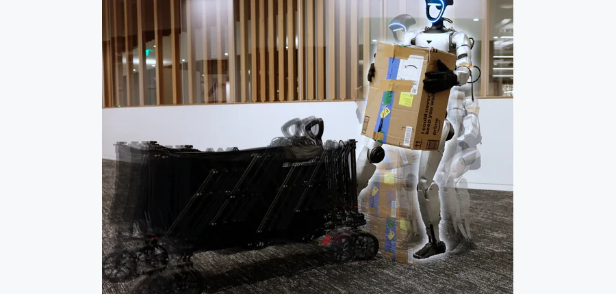 arXiv 2026-11-06 · cs.RO · #1 **[Ctrl-F: Force as an Interface for Humanoid Loco-Manipulation](https://arxiv.org/abs/2611.05507)** [Mengjie Zhao , Yuxin Chen , Yiyang Shao , Chuye Hong , Jiakang Chen , Koushil Sreenath , Masayoshi Tomizuka](https://arxi… 机构：University of California, Berkeley（[PDF](https://arxiv.org/pdf/2611.05507)） [Paper](https://arxiv.org/abs/2611.05507) · [Project](https://forcectrl.github.io/) · [图源](https://arxiv.org/html/2611.05507v1/teaser.png) 

中文摘要
人形机器人动作跟踪已扩展为能复现多样人体动作的通用策略，但由此得到的行为发生在自由空间：跟踪器知道身体应到达哪里，却不知道如何与环境交互。其他工作虽将物体纳入目标，但把交互简化为接触或几何，因而较少探索要求更高的情形。我们认为，力是连接动作模仿与物体交互的自然指令通道，它不仅指定接触位置，也指定施力大小。我们提出 Ctrl-F：一种分层的动作—力框架，在动作跟踪中加入显式力指令，即为手或脚等指定接触部位分别给出三维力。该框架包括：（1）统一的动作—力控制器，在跟踪参考动作的同时向外界施加指令力；（2）高级力规划器，依据物体状态和本体感觉在线给出力指令。在仿真和实体硬件上，Ctrl-F 完成了需要大而持续交互力的移动操作，并随负载变化在线调整指令，这些任务超出不感知力的跟踪器能力。硬件实验展示了用手拖、推、举以及用脚踢；在推踢任务中成功操作重达 20 kg 的箱子，而不感知力的基线失败，并能在线适应任务中途增加的负载。 <a href="https://arxiv.org/abs/2611.05507">原摘要来源</a>
 | 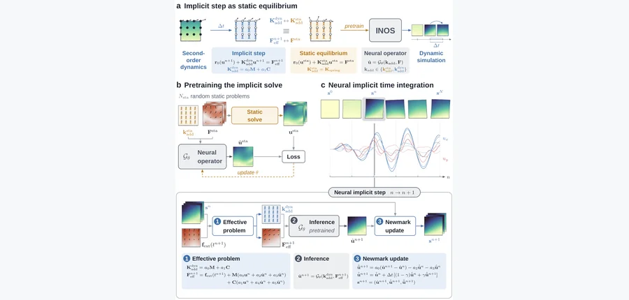 arXiv 2026-11-06 · cs.LG · #2 **[Learning Implicit Solves for Dynamic Simulations](https://arxiv.org/abs/2611.05439)** [Chawit Kaewnuratchadasorn , Jiaji Wang , Xin Nie](https://arxiv.org/abs/2611.05439) 机构：The University of Hong Kong / Tsinghua University（[PDF](https://arxiv.org/pdf/2611.05439)） [Paper](https://arxiv.org/abs/2611.05439) · [图源](https://arxiv.org/html/2611.05439v1/figure1.png) 

中文摘要
动力系统的高保真仿真是科学发现和工程设计的核心，但计算开销仍然很高。本文提出隐式神经算子求解器（INOS），学习隐式求解过程并将其嵌入时间积分器。INOS 先用静态平衡解预训练神经算子，再将其用于 Newmark-β 积分。每个时间增量中，积分器构造等效平衡问题，预训练算子推断下一步的解场，Newmark 关系据此推进动态状态。在线性和非线性弹性动力学数值案例中，方法无需动态轨迹监督便能准确预测完整场。比较结果显示，以零样本方式评估的 INOS 比用动态仿真训练的神经求解器基线预测更准确。此外，在非线性仿真中，相比顺序执行的经典有限元求解器，INOS 实现超过 4,600 倍加速。INOS 原生支持动态条件变化，并允许跨空间和时间离散复用预训练算子；进一步评估展示了稳定的百万步滚动预测。这些发现支持将 INOS 用作准确、高效、稳健的动态建模可复用神经隐式求解器。 <a href="https://arxiv.org/abs/2611.05439">原摘要来源</a>
 | 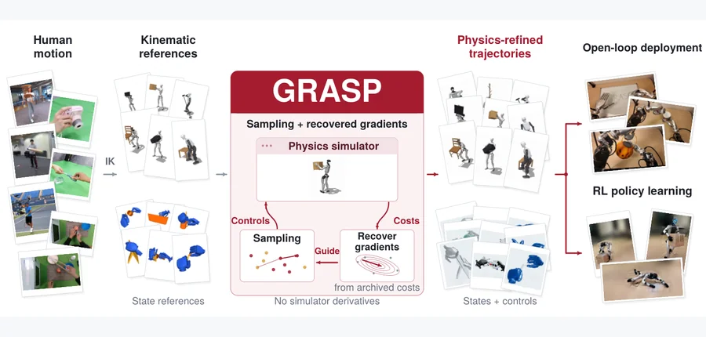 arXiv 2026-11-06 · cs.RO · #3 **[GRASP: Gradient-Guided Sampling for Contact-Rich Physics-Based Motion Retargeting](https://arxiv.org/abs/2611.05754)** [Yang Liu , Tong Wang , Yiming Bao , Heng Yang](https://arxiv.org/abs/2611.05754) 机构：Harvard University（[PDF](https://arxiv.org/pdf/2611.05754)） [Paper](https://arxiv.org/abs/2611.05754) · [Project](https://computationalrobotics.seas.harvard.edu/GRASP/) · [图源](https://arxiv.org/html/2611.05754v1/grasp_teaser.png) 

中文摘要
我们研究面向机器人学习的人类演示物理重定向：在接触动力学约束下寻找复现参考动作的机器人控制。提出 GRASP（从归档样本恢复梯度以生成提议），无需可微仿真器即可结合采样探索与梯度引导细化。GRASP-TO 扩展温度化顺序蒙特卡洛：在归档滚动轨迹上拟合局部二次代价模型，用其梯度引导马尔可夫链蒙特卡洛的样本更新。Metropolis–Hastings 校正对每个固定提议核保持目标分布；群体分析将恢复的梯度与高斯平滑联系起来。GRASP-MPC 通过热启动滚动时域规划，将优化器扩展到长时间演示。灵巧手和人形机器人的实验显示，在共用跟踪目标且无需任务专用接触奖励的条件下可准确重定向，其中 1,352 段双手 OakInk2 演示的成功率为 92.8%。细化后的参考动作改善了转笔和人形机器人—物体交互中的 PPO 跟踪。论文还在真实硬件上展示了灵巧操作与全身人形动作。 <a href="https://arxiv.org/abs/2611.05754">原摘要来源</a>
 |
| 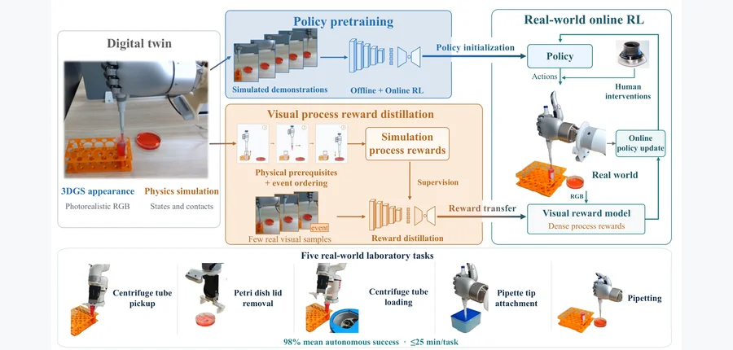 arXiv 2026-11-06 · cs.RO · #4 **[TwinBridge: Digital Twin-Driven Policy and Reward Transfer for Real-World Reinforcement Learning in Laboratory Robotics](https://arxiv.org/abs/2611.06442)** [Shu'ang Sun , Yibo Qiu , Haoliang Ye , Zan Huang , Ao Tian , Kan Ding , Ronald Xu , Mingzhai Sun](https://arxiv.org/abs/2… 机构：University of Science and Technology of China（[PDF](https://arxiv.org/pdf/2611.06442)） [Paper](https://arxiv.org/abs/2611.06442) · [图源](https://arxiv.org/html/2611.06442v1/01_motivation_image.png) 

中文摘要
在线强化学习有助于精确的实验室操作，但昂贵的真实世界演示及稠密过程奖励难以获取，限制了实际应用。本文提出 TwinBridge：由数字孪生驱动的框架，为真实世界在线学习提供策略初始化和稠密视觉奖励。方法结合三维高斯泼溅与物理仿真构建数字孪生。仿真器状态在物理前提和顺序约束下提供任务事件及几何进度，用来为仿真演示和强化学习的策略预训练生成奖励。随后将这种监督蒸馏到视觉奖励模型。真实交互时，模型预测与执行历史结合，计算用于人在环中策略细化的稠密奖励。在五项真实实验室任务中，每项真实交互不超过 25 分钟，TwinBridge 最终平均自主成功率达到 98%。实验表明，稠密奖励相比稀疏奖励提高了交互效率，而基于仿真的策略初始化进一步加快学习。 <a href="https://arxiv.org/abs/2611.06442">原摘要来源</a>
 | 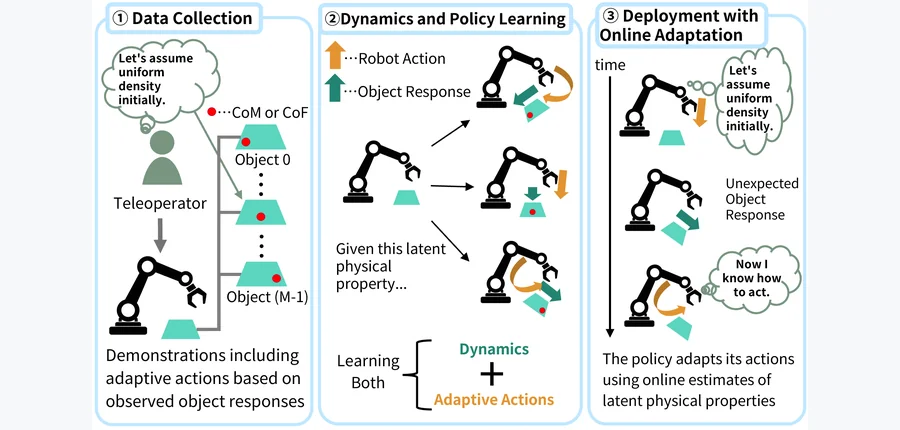 arXiv 2026-11-06 · cs.RO · #5 **[Online Adaptation to Latent Physical Properties for Learning from Demonstration](https://arxiv.org/abs/2611.06118)** [Kotaro Kajitsuka , Masaki Murooka , Fumio Kanehiro](https://arxiv.org/abs/2611.06118) 机构：University of Tsukuba / AIST (CNRS-AIST JRL)（[PDF](https://arxiv.org/pdf/2611.06118)） [Paper](https://arxiv.org/abs/2611.06118) · [图源](https://arxiv.org/html/2611.06118v1/figures/ConceptNew.png) 

中文摘要
操作外观相同但物理属性不同的物体，需要根据交互中获取的信息调整动作。本文研究如何从演示学习依据交互所得物理属性信息调整操作，例如重新抓取或改变接触位置。为此，方法学习预测物体响应所需物理属性的潜在表征，并用这些表征的在线估计来条件化策略。动力学模型与物体专属潜在表征从包含适应物理属性行为的演示中联合学习；学习到的表征再用于条件化模仿策略。执行期间，动力学模型和策略权重保持固定，而潜在表征根据预测观测与实际观测的差异更新，使与物体的交互能影响动作生成。对质心不同的物体开展的真实和仿真实验表明，通过物理属性潜在表征进行在线适应可能提高任务成功率。不过，在仿真中，对于演示未覆盖的质心位置，成功率仍约为 30%，显示对未见物理属性的适应有限。项目页见原文链接。 <a href="https://arxiv.org/abs/2611.06118">原摘要来源</a>
 | 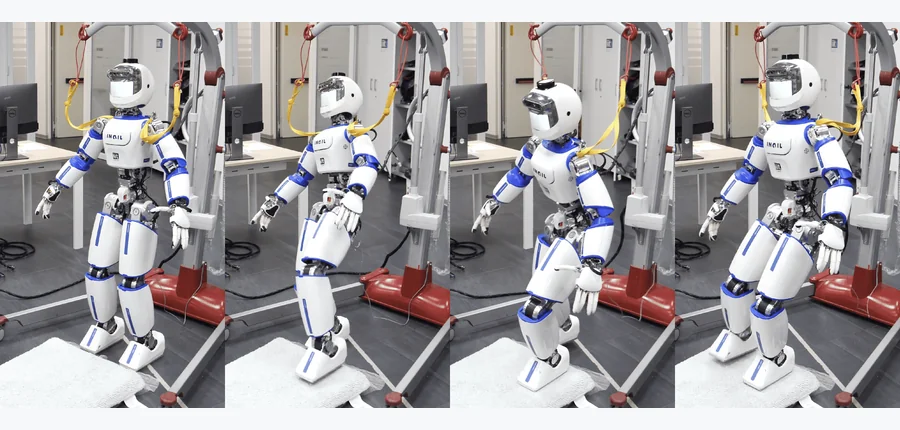 IEEE Robotics and Automation Letters (2025) · #6 **[Contact-Implicit Whole-Body Trajectory Optimization for Dynamic Humanoid Locomotion on Parameterizable Uneven Terrain](https://arxiv.org/abs/2611.05585)** [Roberto Mauceri , Stefano Dafarra , Giulio Romualdi , Marco Gabiccini , Daniele Pucci](https://arxiv.org/abs/2611.05585) 机构：Istituto Italiano di Tecnologia / University of Manchester / University of Pisa（[PDF](https://arxiv.org/pdf/2611.05585)） [Paper](https://arxiv.org/abs/2611.05585) · [图源](https://arxiv.org/pdf/2611.05585) 

中文摘要
本文提出一种轨迹规划器，利用接触隐式全身优化框架，使人形机器人在复杂且可参数化的地形上完成动态动作。规划器考虑机器人的完整动力学和运动学，无需预先定义接触序列便能生成可行运动。为规划在台阶、斜坡及其他地形上的双足行走，我们提出以平滑曲面近似地面几何的数学模型。机器人与地面的刚性相互作用通过新的接触约束建模，将适用范围从平坦水平表面扩展到任意平滑表面。论文利用非线性规划在多种地形拓扑上规划动作，验证其有效性；还通过将高层要求写入代价函数和初始猜测，探索动态轨迹生成。在非共面地形上开展了初步可行性测试，包括仿真及实体 ErgoCub 机器人。 <a href="https://arxiv.org/abs/2611.05585">原摘要来源</a>
 |
| 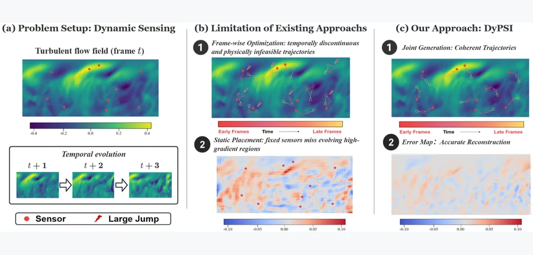 arXiv 2026-11-06 · cs.AI · #7 **[DyPSI: Dynamic Physics Sensing via Joint Field and Sensor-Trajectory Generation](https://arxiv.org/abs/2611.06280)** [Yizhou Zhang , Panqi Chen , Lei Cheng , Ting Zhang , Jianlong Li , Jianfeng Shi , Shikai Fang](https://arxiv.org/abs/2611… 机构：Zhejiang University / Ocean University of China（[PDF](https://arxiv.org/pdf/2611.06280)） [Paper](https://arxiv.org/abs/2611.06280) · [图源](https://arxiv.org/html/2611.06280v1/picture/intro.png) 

中文摘要
在持续演化的环境中进行物理场感知，需要从稀疏观测重建稠密时空场，并随之调整未来采样位置。现有重建和传感器布置方法虽取得进展，通常仍假设静态感知：要么对所有帧使用同一布局，要么逐帧独立优化位置，因此难以生成时间连贯的感知轨迹。我们提出 DyPSI，将问题表述为在历史观测条件下联合生成未来场与传感器轨迹。DyPSI 将离散传感器坐标提升为连续的传感器位置场，以共享的功能 Tucker 表征编码物理场和感知配置，并训练联合扩散模型，在所得潜空间同时生成未来场与传感器轨迹。高斯过程时间核关联扩散训练中注入的扰动，使去噪器偏向时间平滑的恢复；论文还分析了 EDM 训练目标与序列聚合 A 最优性准则以及核诱导的离散轨迹变化界之间的联系。在湍流、GLORYS12 海表温度和三维汽车空气动力学上的实验显示，DyPSI 持续优于静态及逐帧布置策略，在传感器预算紧张时显著降低误差。代码见原文链接。 <a href="https://arxiv.org/abs/2611.06280">原摘要来源</a>
 | 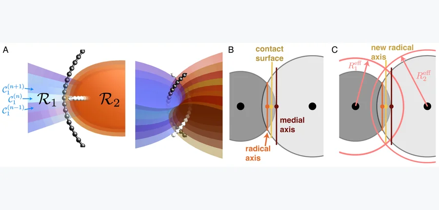 arXiv 2026-11-06 · cond-mat.soft · #8 **[Medial Model of Elastic Curve Contacts, from Clasps to Knits](https://arxiv.org/abs/2611.05688)** [Kathryn Chain , Haoye Sun , Michael S. Dimitriyev](https://arxiv.org/abs/2611.05688) 机构：Texas A&amp;M University（[PDF](https://arxiv.org/pdf/2611.05688)） [Paper](https://arxiv.org/abs/2611.05688) · [图源](https://arxiv.org/html/2611.05688v1/figures/fig2.png) 

中文摘要
由相互扣合、缠绕纤维构成的材料难以建模和理解，部分原因是纤维形状与接触力学之间存在复杂耦合。我们对接触力学的许多直觉来自针对凸体交互的赫兹模型；然而，纤维常形成具有鞍形接触面的扣结，两物体沿鞍面贴合的可能性使许多现有模型难以适用。基于纤维间接触面近似极小或常平均曲率曲面的观察，本文检验这一假设，并尝试与几何建模方法直接建立联系。为此采用中轴变换，将 Voronoi 剖分推广至生成曲线和曲面。正交扣结和简单针织结构的计算研究表明，中轴变换可以合理建模相同曲线之间的接触面。论文还表明，基于根式 Voronoi 剖分的中轴变换推广可较好近似非相同曲线之间的接触面；将这种“根式轴变换”用于不同半径的曲线，展示出曲面形成有限平均曲率的趋势。结果或可引导更复杂的缠绕结构几何建模方法。 <a href="https://arxiv.org/abs/2611.05688">原摘要来源</a>
 | 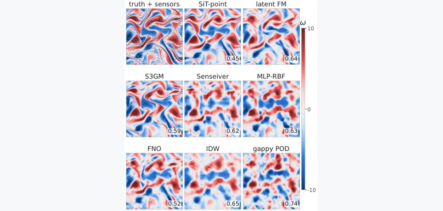 arXiv 2026-11-06 · physics.flu-dyn · #9 **[FlowReconBench: Accuracy, calibration and cost of learned and classical flow reconstruction from sparse sensors](https://arxiv.org/abs/2611.06912)** [Nicolas Tricard , Linzheng Wang , Jason Chen , Sili Deng](https://arxiv.org/abs/2611.06912) 机构：Massachusetts Institute of Technology（[PDF](https://arxiv.org/pdf/2611.06912)） [Paper](https://arxiv.org/abs/2611.06912) · [图源](https://arxiv.org/html/2611.06912v1/gallery_kolmogorov_allbaselines_compact.png) 

中文摘要
从稀疏传感器重建完整流场，需要对未测区域和物理变量作先验假设，但学习方法何时优于经典估计器、预测哪些方面可信仍不清楚。FlowReconBench 在三种工况评估十种学习方法和五种经典方法：跨雷诺数的层流圆柱尾流、二维 Kolmogorov 湍流和大规模三维各向同性湍流。方法共用控制数据泄漏的划分与传感器采样，并按各通道误差、集合离散度、校准性、频谱和成本评分。领先方法随工况而变。经典方法在低阶和稠密感知工况表现强劲；圆柱尾流中，线性随机估计和缺失数据本征正交分解居前，包括对未观测压力的估计。三维情况下，在观测通道上反距离加权与最佳学习方法相当。传感器密度降低或可观测性较差时，数据驱动方法占优。对于 Kolmogorov 流，连续秩概率得分与误差给出不同排名：生成模型给出更广但离散度不足的集合，确定性模型更重视逐点误差。生成模型可通过采样预算平衡这一取舍；预算增加可改善集合质量，但计算成本更高。三维扩展测试显示，可查询方法的内存占用基本不随网格增长，而需构建完整网格的方法会耗尽内存。只观测四个场中的两个时，问题在运动学上约束不足，但潜变量模型仍可重现与真值结构相似的结果。 <a href="https://arxiv.org/abs/2611.06912">原摘要来源</a>
 |
| 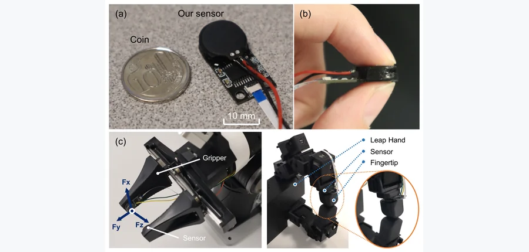 arXiv 2026-11-06 · cs.RO · #10 **[LumiTac: Compact, High-Rate Six-Axis Optical Tactile Sensing for Human-Robot Interaction](https://arxiv.org/abs/2611.05936)** [Hao Wu , Haotian Guo , Yu Feng , Yutong Wang , Jianshu Zhou](https://arxiv.org/abs/2611.05936) 机构：National University of Singapore（[PDF](https://arxiv.org/pdf/2611.05936)） [Paper](https://arxiv.org/abs/2611.05936) · [图源](https://arxiv.org/html/2611.05936v1/assets/Prototype.png) 

中文摘要
将六轴触觉反馈集成到机器人界面，需要紧凑、载荷测量准确且能快速在线重建的传感器。本文提出 LumiTac：一款无需相机的薄型光电触觉传感器，结合空间分布式照明与光谱编码。五个发光器和五个 RGBW 接收器装在由半透明硅胶连接的相对电路板上。压缩、剪切、弯曲和扭转引起的层间运动会调制内部光场。传感头直径 12 mm、厚 4.75 mm、质量低于 2 g，元件成本约 7 美元。一个紧凑的多层感知机从 20 个光学通道重建三个力分量和三个力矩分量。独立测试的决定系数 R² 为 0.9657–0.9941；力的平均绝对误差为 0.054–0.190 N，力矩为 0.304–1.419 mN·m。在线预测平均更新率达到 303.57 Hz，软件处理中位延迟为 0.722 ms。组合载荷、轻质物体和快速敲击实验分别评估了载荷跟踪、小力敏感度和瞬态响应。机器人演示进一步验证了其在触觉引导操作与物理人机交互中的适用性。这项研究为紧凑、高频光学触觉感知提供了一条路径。 <a href="https://arxiv.org/abs/2611.05936">原摘要来源</a>
 | 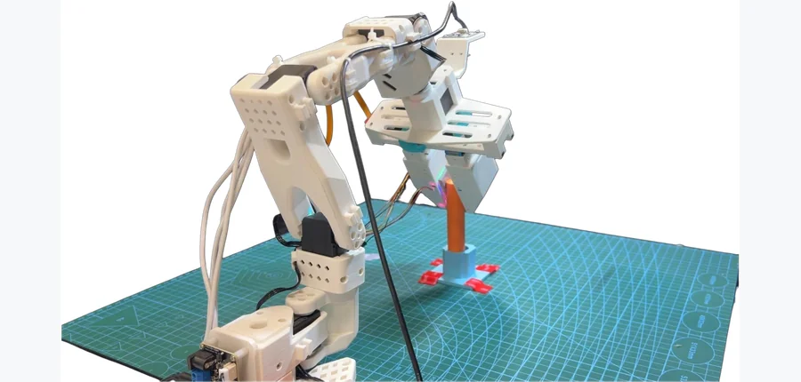 arXiv 2026-11-06 · cs.RO · #11 **[Which Physical Tactile Cues Matter for Contact-Rich Imitation Learning? A Controlled Real-Robot Study](https://arxiv.org/abs/2611.06673)** [Xuhao Qin , Xiyan Huang , Haoyu Dong , Xi Zhang , Chenxi Xiao](https://arxiv.org/abs/2611.06673) 机构：ShanghaiTech University（[PDF](https://arxiv.org/pdf/2611.06673)） [Paper](https://arxiv.org/abs/2611.06673) · [Project](https://xuhaoqin02.github.io/lerobot-tactile/) · [图源](https://arxiv.org/pdf/2611.06673) 

中文摘要
基于视觉的触觉传感器在单一图像流中记录接触外观、几何、压入深度和切向形变等多种物理交互信息。然而，现有视觉—触觉策略常将触觉观测直接当图像处理，难以判断哪些物理线索有助于策略学习。本文基于 LeRobot 平台及所开发的视觉—触觉感知系统，开展一项受控真实机器人研究，比较具有物理可解释性的触觉信号。从同一触觉流提取触觉 RGB 图像、法线／深度图和标记点流场，分别表示接触外观、几何与切向形变。在相同任务演示和相同策略骨干下，评估各线索及其组合的贡献，并比较触觉编码器和视觉—触觉融合策略。720 次真实机器人试验得出四项主要结果：（1）触觉感知使总体成功率从 57.8% 提高到 78.9%，但不同任务阶段的贡献不同；（2）标记点流场是最有效的单一线索，成功率达到 74.4%，对调节已建立的接触尤其重要；（3）按线索分解的编码持续改善性能，说明不同物理线索需要针对性处理；（4）触觉融合效果依任务而变，但交叉注意力作为轻量方案，其性能可与预训练触觉编码器相当。 <a href="https://arxiv.org/abs/2611.06673">原摘要来源</a>
 | 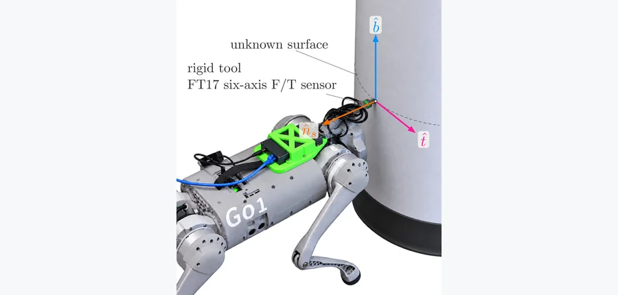 arXiv 2026-11-06 · cs.RO · #12 **[SCRUB: Contact-Based Surface-Frame Estimation for Force-Motion Control with an Armless Quadruped](https://arxiv.org/abs/2611.06649)** [Sourav Selvaraj , Juan Pablo Espinosa Chessal , Mahdi Agheli](https://arxiv.org/abs/2611.06649) 机构：Worcester Polytechnic Institute（[PDF](https://arxiv.org/pdf/2611.06649)） [Paper](https://arxiv.org/abs/2611.06649) · [图源](https://arxiv.org/html/2611.06649v1/assets/go1_axis_annotated_compressed.jpg) 

中文摘要
擦拭、打磨和检查机器人需要让滑动工具以受控力压在表面上。控制该力需要表面法线，而真实未建图表面的法线未知。已有法线估计器要么依赖摩擦模型，要么假设瞬时工具速度沿着表面；行走会破坏后一个假设。我们提出基于接触的表面坐标系估计器 SCRUB，使无臂四足机器人能在不知道法线、法线不与坐标轴对齐且没有视觉法线预测的情况下，沿近乎竖直的表面滑动机身工具。SCRUB 的预测控制器依靠卡尔曼滤波估计的法线压紧并滑动工具，估计结合两个线索：（1）力线索测量估计法线相对于运动方向的倾斜。如果摩擦力正好反向于运动，则无论摩擦系数为何，只有倾斜为零时该线索才为零；但若估计的滑动方向错误，摩擦会表现为虚假倾斜。（2）速度线索测量沿运动方向的倾斜。行走与压紧会使工具进出表面，因此 SCRUB 从工具速度中减去指令压紧速率，对每个步态周期的结果取平均，并把该均值视为沿表面运动。在 Unitree Go1 硬件上，以标称速度和载荷运行时，SCRUB 完成了每次墙面横越和柱体环绕。去掉任一线索、取消步态平均或使用固定法线时，柱体环绕均未完成。 <a href="https://arxiv.org/abs/2611.06649">原摘要来源</a>
 |
| 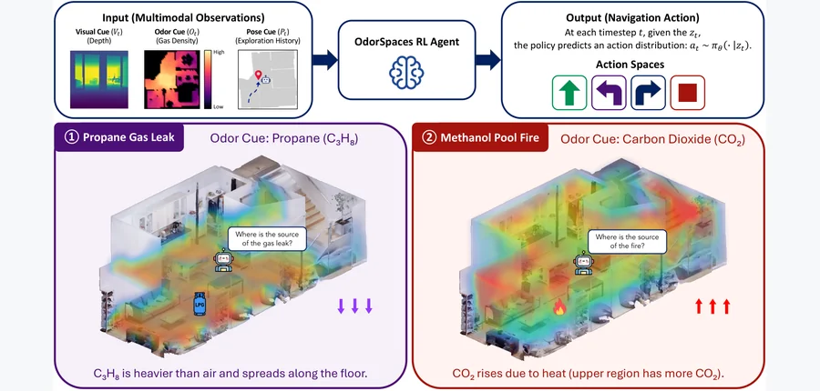 arXiv 2026-11-06 · cs.RO · #13 **[OdorSpaces: Visual-Olfactory Embodied Navigation in 3D Environments](https://arxiv.org/abs/2611.05738)** [Changyeon Lee , Kelin Yu , Zheng Wei , Shuna Ni , Ruohan Gao](https://arxiv.org/abs/2611.05738) 机构：University of Maryland, College Park（[PDF](https://arxiv.org/pdf/2611.05738)） [Paper](https://arxiv.org/abs/2611.05738) · [Project](https://odorspaces.github.io/) · [图源](https://arxiv.org/html/2611.05738v1/main_figure.png) 

中文摘要
嗅觉为感知空气中化学信号提供重要信息，但在具身智能中仍少有探索；此前有限的机器嗅觉工作主要关注语义气味感知。我们提出 OdorSpaces：用于视觉—嗅觉具身导航的物理仿真平台和基准。OdorSpaces 为 Habitat-Sim 加入由 Fire Dynamics Simulator（FDS）模拟的三维气味输运与扩散，使智能体能够结合视觉和嗅觉观测，在逼真的室内环境中导航。基准包含两种有代表性的寻源场景：定位不可见气体泄漏和定位早期火源。我们开发了初始的多模态强化学习策略，随时间融合视觉观测和嗅觉测量。实验显示该策略优于多种基线，为未来视觉—嗅觉具身导航研究提供了参考。 <a href="https://arxiv.org/abs/2611.05738">原摘要来源</a>
 | 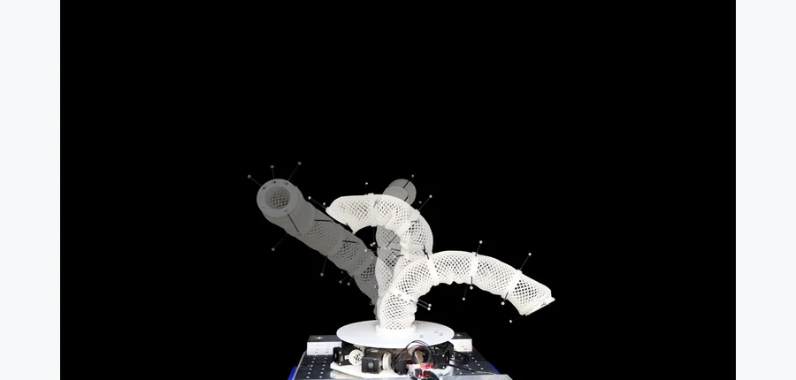 arXiv 2026-11-06 · cs.RO · #14 **[Dynamic Shape Control of Soft Trunk Robots](https://arxiv.org/abs/2611.06625)** [Hehui Zheng , Marc Stampanoni , Roshan S. Kaundinya , Ronan Hinchet , George Haller , Robert K. Katzschmann](https://arxi… 机构：ETH Zurich（[PDF](https://arxiv.org/pdf/2611.06625)） [Paper](https://arxiv.org/abs/2611.06625) · [图源](https://arxiv.org/pdf/2611.06625) 

中文摘要
控制软体象鼻机器人的形状轮廓可扩大其在复杂工作空间中的可达范围，并增强实际应用能力。近期软体机器人设计进展使其更能贴合复杂形状；特别是几何设计为螺旋面的象鼻机器人展现出很强的变形能力。但顺应性使系统高度非线性，形状控制因而困难。在相似的腱驱象鼻机器人上，基于绝热谱子流形（aSSM）理论的模型控制器已实现高精度闭环末端跟踪。本文将这一方法扩展至从数据学习经修剪螺旋面软体象鼻机器人全身的 aSSM 模型，并用于模型预测控制（MPC），在硬件上展示多种形状控制任务。在闭环动态形状调节中，方法比可用线性基线高出 10 倍。在人在环中交互演示中，方法完成逐段塑形，并让网球保持平衡超过 25 秒，线性基线未能完成。一个在硬件上训练 12 小时的无模型强化学习策略也未完成同一平衡任务。结果支持 aSSM-MPC 作为真实软体硬件全身形状控制的实用途径。 <a href="https://arxiv.org/abs/2611.06625">原摘要来源</a>
 | 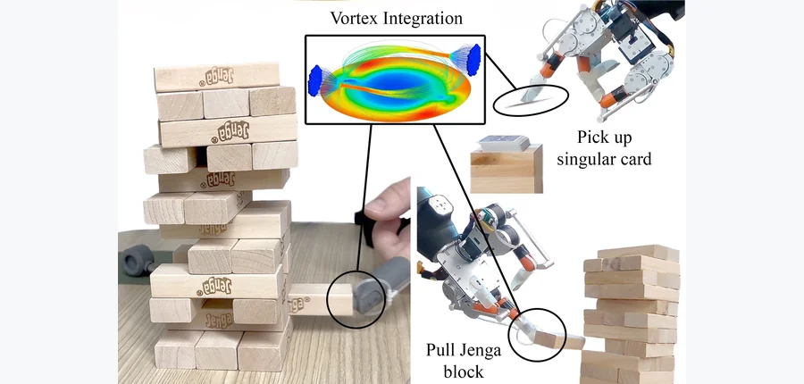 arXiv 2026-11-06 · cs.RO · #15 **[Vortex-Induced Torque in Grasping Soft Objects: Influence of Geometry and Pneumatic Parameters](https://arxiv.org/abs/2611.06359)** [Roman Mykhailyshyn , Tomohiro Motoda , Ivan Virgala , Ann Majewicz Fey , Yukiyasu Domae](https://arxiv.org/abs/2611.06359) 机构：AIST / Technical University of Košice / The University of Texas at Austin（[PDF](https://arxiv.org/pdf/2611.06359)） [Paper](https://arxiv.org/abs/2611.06359) · [图源](https://arxiv.org/pdf/2611.06359) 

中文摘要
涡流抓手常用于包装、分拣和装配等自动化系统，以处理几何复杂的物体；但它与顺应物体的相互作用仍难预测，尤其是抓取过程中传递的涡流诱导扭矩。本研究考察抓取顺应物体时的涡流诱导扭矩，并量化供气压力、切向喷嘴直径、表面几何和曲率的耦合影响。结果显示，增大切向喷嘴直径主要提高生成扭矩对供气压力的敏感性，并非在所有条件下产生更大扭矩。表面几何也强烈影响旋转相互作用：圆顶凹面通常比对应的圆顶凸面产生大得多的扭矩，而圆柱凹凸面差异相对较小。几何匹配良好的圆顶凹面表现出最强且最可重复的响应。在评估的机器学习回归方法中，高斯过程回归在重复交叉验证下总体预测性能最佳，说明可结合气动与几何参数估计涡流诱导扭矩。这些发现为在软物体灵巧操作中预测和利用涡流诱导扭矩提供了基础。 <a href="https://arxiv.org/abs/2611.06359">原摘要来源</a>
 |
| 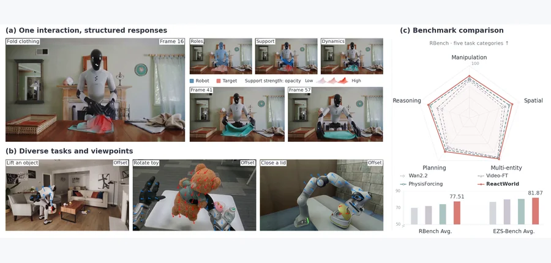 arXiv 2026-11-06 · cs.CV · #16 **[ReactWorld: Structuring Interaction Responses for Embodied Video Generation](https://arxiv.org/abs/2611.06120)** [Hanwei Liu , Huijia Zhang , Hanzhang Wang , Guangyu Liu , Hanbei Zhan , Linjie Hu , Bin Xiao , Xuan Zhou , Dong Zhang](ht… 机构：Huawei Technologies / Tongji University / Zhejiang University（[PDF](https://arxiv.org/pdf/2611.06120)） [Paper](https://arxiv.org/abs/2611.06120) · [Project](https://metaengine-world.github.io/ReactWorld/) · [图源](https://arxiv.org/html/2611.06120v1/figures/fig1_teaser.png) 

中文摘要
具身视频世界模型预测机器人动作引起的场景变化，但生成的物体响应可能与任务意图和接触动力学不一致。具身场景中的关键响应常集中在局部区域及特定时间段。受思维链推理启发，我们提出由结构化交互预期引导的具身视频生成模型 ReactWorld。在生成骨干的特征空间中，交互响应场预测器预期交互如何展开，显式描述参与者角色、未来运动响应强度及局部运动变化。响应反馈适配器根据物体分支在有预测局部动力学输入与该输入置零时的输出差异，生成物体特征增量；同时将预测位移转换为时间注意力的位置偏置。这两个机制分别引导跨帧的物体特征更新和信息检索。通过交互预期及生成反馈，ReactWorld 在 RBench 获得平均 77.51 分，比 PhysisForcing 高 3.29 分，并在九个类别均有改善；在 EZS-Bench 获得 86.98 的 Domain 分数和 81.87 的平均分。 <a href="https://arxiv.org/abs/2611.06120">原摘要来源</a>
 | 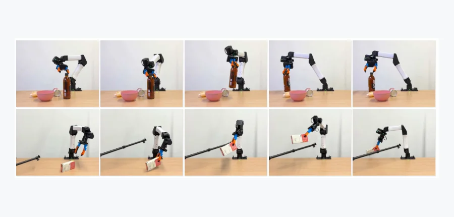 arXiv 2026-11-06 · cs.RO · #17 **[cuRoboV2-Fast: Fast Torque-Limited Collision-Free Motion Planning](https://arxiv.org/abs/2611.06913)** [Balakumar Sundaralingam , Adithyavairavan Murali , Stan Birchfield](https://arxiv.org/abs/2611.06913) 机构：affiliation 未确认 [Paper](https://arxiv.org/abs/2611.06913) · [Project](https://research.nvidia.com/labs/lpr/curobov2-fast/) · [图源](https://arxiv.org/html/2611.06913v1/bspline_hero_combined.png) 

中文摘要
我们提出 GPU 加速规划器 cuRoboV2-Fast，降低无碰撞、考虑载荷和扭矩限制的动作的规划延迟及执行时间。B 样条轨迹优化减少所需迭代次数，而加速的机器人计算与可微逆动力学降低细化成本并支持变化的载荷。TimeOpt 在固定路径上，针对采样的速度、加速度、加加速度和扭矩约束优化通过速度；它利用局部样条支撑，在 GPU 上高效求解带状牛顿系统。载荷为 3 kg 时，cuRoboV2-Fast 在 RTX 5090 上平均规划时间为 4.4 ms，比 cuRoboV2 快 14.7 倍。方法在 Jetson AGX Orin 上的规划速度快于运行于 RTX 5090 的 cuRoboV1 加 TOPPRA。基于双目相机部署在 YAM 上后，完成拾取并放下循环的平均时间为 5.93 s，比 cuRoboV2 缩短 34.6%。Apache 2.0 许可代码和项目页见原文链接。 <a href="https://arxiv.org/abs/2611.06913">原摘要来源</a>
 | 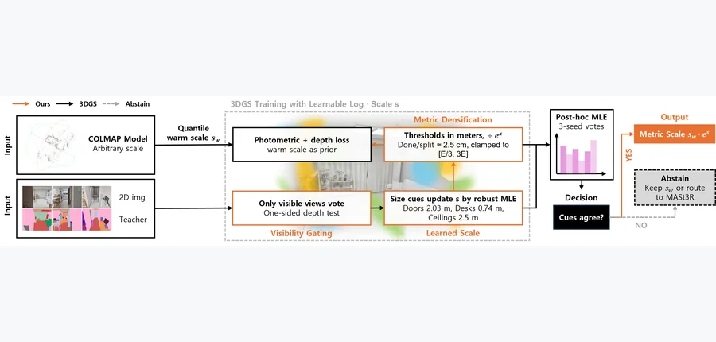 arXiv 2026-11-06 · cs.CV · #18 **[METRIC-GS: Selective Metric-Scale Estimation for 3D Gaussian Splatting](https://arxiv.org/abs/2611.06020)** [Sooyeun Yang , Jongseong Brad Choi](https://arxiv.org/abs/2611.06020) 机构：SUNY Korea / Stony Brook University（[PDF](https://arxiv.org/pdf/2611.06020)） [Paper](https://arxiv.org/abs/2611.06020) · [图源](https://arxiv.org/html/2611.06020v1/WACV_overview.png) 

中文摘要
三维高斯泼溅（3DGS）重建继承了运动恢复结构的任意单位，因此在有人提供尺度前无法测量，也无法用于放置增强现实内容。两种标准办法在真实采集中都不稳健：对五个天花板高度经卷尺测量的室内场景，楼地面至天花板的分位数启发式误差为 27%，三个网络的公制深度对齐误差为 35–71%。我们提出用于真实室内照片的选择性尺度估计器 METRIC-GS：从重建自身的语义内容读出尺度，且证据不足时拒绝估计。冻结的二维教师通过可见性感知投票为高斯基元赋标签；门、桌子及层高等建筑和家具类别的实例尺寸先验，通过稳健最大似然步骤融合；内点质量测试将证据薄弱的情形转为显式拒绝，并路由到较重的公制模型。在具有激光真值的 47 个 ScanNet++ 场景上，使用公开评估前固定的配置，估计器将启发式的平均误差从 21.1% 降至 16.6%（在它实际处理的 28 个场景上为 9.3%），每场景约需 11 s。MASt3R 作为独立估计器仍更准确（9.9%），但只将被拒绝的场景送给它，能在调用次数减少 60% 的情况下匹配全部调用的结果；作者推荐这种选择性混合配置。可见性感知投票在已部署精度不变的条件下，将可处理场景数从 16 提高到 28。方法不经改变地用于作者自采的 13 个手机和无人机样本；MASt3R 在其中 12 个未通过自身配准门槛，而系统改善了它实际处理的全部五个样本，且未使任何一个变差。论文还报告，一个当前的前馈公制模型在训练混合数据内的基准上误差为 2.3%，在从未见过的采集上则为 28–35%：公开的尺度估计数字可能是最佳情况，而非部署估计。 <a href="https://arxiv.org/abs/2611.06020">原摘要来源</a>
 |
| 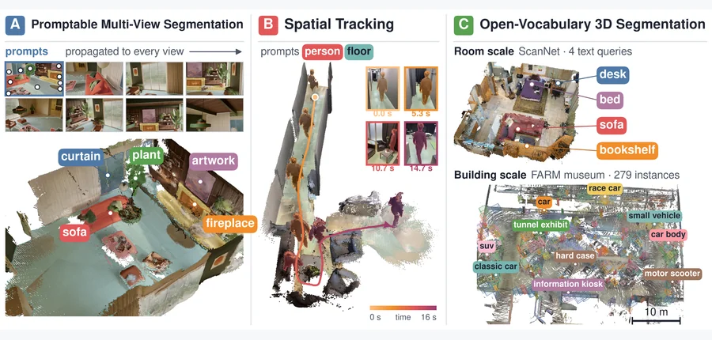 arXiv 2026-11-06 · cs.CV · #19 **[Feature Puzzles: Single-Image Supervision for Multi-View 3D-Aware Segmentation](https://arxiv.org/abs/2611.05874)** [Jiahao Ma , Qiang Zhang , Miaomiao Liu , David Ahmedt-Aristizabal , Chuong Nguyen](https://arxiv.org/abs/2611.05874) 机构：Australian National University / University of Science and Technology of China / CSIRO（[PDF](https://arxiv.org/pdf/2611.05874)） [Paper](https://arxiv.org/abs/2611.05874) · [Project](https://featurepuzzles.github.io/) · [图源](https://arxiv.org/html/2611.05874v1/figures/cover/cover.jpeg) 

中文摘要
人类能轻易识别三维场景中跨视角出现的同一物体；训练模型获得这种多视角一致的感知通常需要视频或经标定的多视角采集，其成本高于规模大、来源多样的单目数据。本文提出 Feature Puzzles：只用单幅图像语义分割监督学习多视角一致分割的框架。具体而言，该流程通过图像裁剪和几何变换构造多视角一致的分割伪标签；另引入轻量即插即用网络，利用现有预训练三维基础模型学到的多视角一致图像特征及所生成伪标签，执行多视角一致分割。框架可接收单视角或多视角提供的多类提示，并可扩展至开放词汇三维分割。仅用单图监督时，前馈模型在 NVOS 上取得最高 mIoU；与使用逐场景优化或域内多视角训练的基线相比，在 SPIn-NeRF 与 ScanNet++ 上仍有竞争力，并展示了向开放词汇三维分割的零样本迁移。视觉比较见原文项目页。 <a href="https://arxiv.org/abs/2611.05874">原摘要来源</a>
 | 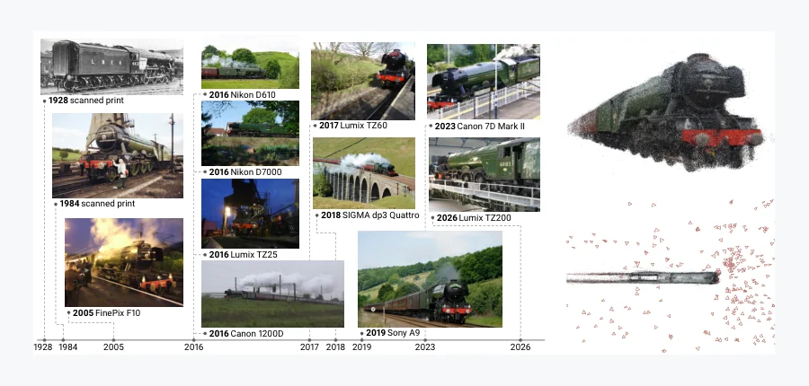 arXiv 2026-11-06 · cs.CV · #20 **[Trainspotting: Learning Object-Centric 3D Reconstruction from Found Photos](https://arxiv.org/abs/2611.06849)** [Hanyu Chen , Noah Snavely](https://arxiv.org/abs/2611.06849) 机构：Cornell University（[PDF](https://arxiv.org/pdf/2611.06849)） [Paper](https://arxiv.org/abs/2611.06849) · [图源](https://arxiv.org/html/2611.06849v1/timeline_white_aligned.png) 

中文摘要
当前最先进的前馈重建模型在野外采集的以物体为中心的照片集合上表现较差。它们主要使用单次拍摄的物体数据训练：图像视角变化，但物体及环境几乎固定。公开照片档案提供了另一种多视角数据：同一物体或设计的既有照片，由许多人在不同年份、环境、相机条件下拍摄，有时甚至来自不同实物。本文提出 Trainspotting 数据集，包含来自 Wikimedia Commons 的 12,068 个物体和 311,886 张照片。作者重建每个物体，恢复相机位姿、多视角立体深度和物体掩码；并将物体分为三种情形：固定于一处的物体、在不同地点移动的物体，以及多个实体共享的设计。近期前馈重建模型在该数据集上的评估显示，后两种情形下失败最严重。在 Trainspotting 上微调 VGGT-Ω，显著改善了留出物体上的相机位姿、深度和三维几何。在独立的 NAVI 野外基准上也观察到类似改进，该基准中同一物体的照片来自不同环境。传统基准上的性能基本不变。 <a href="https://arxiv.org/abs/2611.06849">原摘要来源</a>
 | 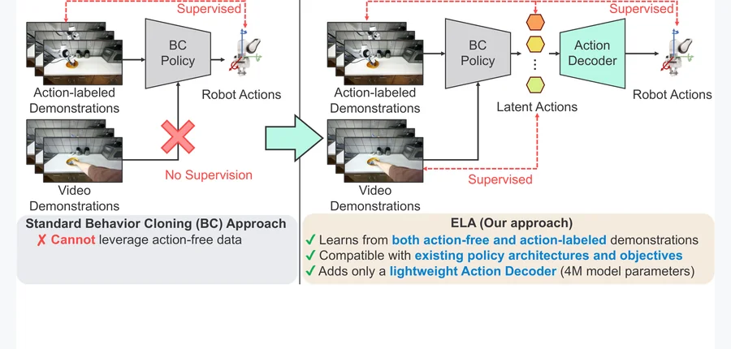 CoRL 2026 · #21 **[ELA: End-to-End Latent Action Policy Learning from Video Demonstrations](https://arxiv.org/abs/2611.05571)** [Cheng-Chun Hsu , Peter Stone](https://arxiv.org/abs/2611.05571) 机构：The University of Texas at Austin（[PDF](https://arxiv.org/pdf/2611.05571)） [Paper](https://arxiv.org/abs/2611.05571) · [Project](https://end2end-latent-action.github.io/) · [图源](https://arxiv.org/html/2611.05571v1/teaser.png) 

中文摘要
机器人模仿学习受限于带动作标注数据稀缺，而视频等无动作标注演示更丰富。近期潜在动作方法从观测变化学习与动作相关的表征，却未针对下游控制优化潜在动作，导致策略难以建模这些表征，也难以把它们准确解码为连续机器人动作。本文提出 ELA：通过联合优化潜在动作与策略学习和动作解码，从视频演示学习的端到端框架。ELA 联合训练潜在动作模型、潜在动作策略与动作解码器，使策略能利用大量视频数据，同时只需少量带动作标注的机器人演示。仿真及真实操作任务实验显示，ELA 持续优于先前潜在动作基线。此外，它借助轻量的 400 万参数动作解码器即可与现有模仿学习方法结合，无需修改策略架构或训练目标。更多材料见原文链接。 <a href="https://arxiv.org/abs/2611.05571">原摘要来源</a>
 |
| 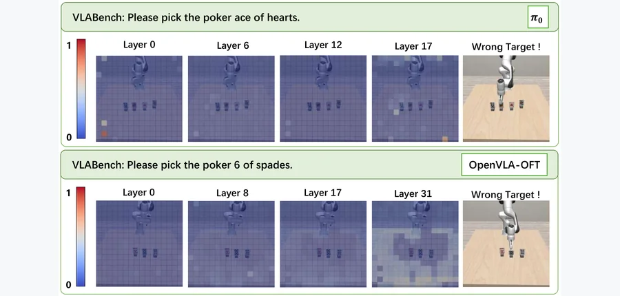 arXiv 2026-11-06 · cs.RO · #22 **[$A^3$-VLA: Automatic Perception-Guided Attention Alignment for Robot Manipulation](https://arxiv.org/abs/2611.06447)** [Shengzhe Zhang , Qi Zhang , Dazhong Shen , Chao Wang , Shaopeng Zhai , Hui Xiong](https://arxiv.org/abs/2611.06447) 机构：University of Science and Technology of China / Shanghai AI Laboratory / Nanjing University of Aeronautics and Astronautics / HKUST（[PDF](https://arxiv.org/pdf/2611.06447)） [Paper](https://arxiv.org/abs/2611.06447) · [图源](https://arxiv.org/html/2611.06447v1/intro.png) 

中文摘要
视觉—语言—动作模型（VLA）利用视觉—语言模型（VLM）处理视觉观测和语言指令，使机器人能完成操作任务。但动作预测目标本身缺乏细粒度、任务专用的感知监督，容易依赖与任务无关的视觉捷径，使注意力偏离目标物体和关键交互区域，从而限制操作性能与泛化。为解决这一问题，我们提出面向机器人操作的自动感知引导注意力对齐框架 A³-VLA，从操作过程本身提取任务专用的视觉引导。具体而言，A³-VLA 先依据交互引发的视觉变化，为目标物体和机器人生成启发式候选区域，再离线利用视觉分割模型细化。这些区域通过两个互补目标提供显式感知引导：注意力分配损失鼓励语言或机器人状态 token 查询视觉输入时充分关注任务关键区域；对比学习损失使候选目标区域的表征与语言指令对齐，并与无关区域区分。大量仿真和真实操作实验显示，A³-VLA 稳定改善多个 VLA 骨干，在各基准上的平均成功率增益为 6.5%–25.2%。 <a href="https://arxiv.org/abs/2611.06447">原摘要来源</a>
 | 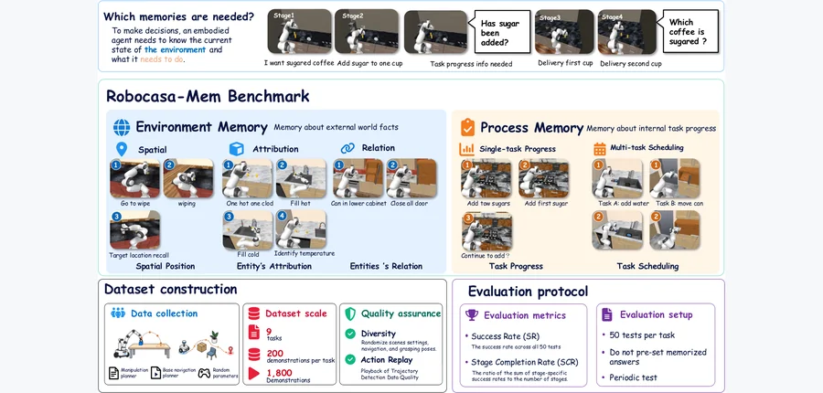 arXiv 2026-11-06 · cs.RO · #23 **[Robocasa-Mem: Benchmarking Environment and Process Memory in Long-Horizon Mobile Manipulation](https://arxiv.org/abs/2611.06475)** [Sihang Chen , Chen Ye , Wei Chen , Xiaohan Lei , Zhipeng Tang , Sha Zhang , Yuan Zhang , Zixuan Chen , Jiajun Deng , Houq… 机构：University of Science and Technology of China / Tongji University / Chinese University of Hong Kong / Anhui University / Nanjing University（[PDF](https://arxiv.org/pdf/2611.06475)） [Paper](https://arxiv.org/abs/2611.06475) · [Project](https://sihhangchen.github.io/RoboCasa-Mem/) · [Data](https://modelscope.cn/datasets/ouhebai/RoboCasa-Mem/tree/master/data) · [图源](https://arxiv.org/html/2611.06475v1/benchmark-overview.png) 

中文摘要
真实环境中的移动操作机器人必须完成复杂物体交互和多步决策，常需依赖当前已不可见的任务相关信息。但现有基准对这类依赖记忆的移动操作决策评测有限。为此我们提出 RoboCasa-Mem：一个包含九项移动操作任务的新基准，要求智能体在关键决策点利用交互历史。任务分为两类记忆：环境记忆，记录空间位置、物体属性及物体关系；过程记忆，记录单任务进度和多任务调度。特别地，我们提出行为条件评测。对于有多条有效执行路径的任务，评估器不固定单一目标或轨迹，而根据机器人先前动作推导后续任务约束。这样既能评估后续行为是否与机器人自己的交互历史一致，也能减少固定目标分配带来的捷径。基准提供 1,800 段成功演示供策略训练。我们还构建了分层记忆增强策略（HMAP）基线：高级规划器利用结构化实体与过程记忆生成子任务；低级 VLA 控制器通过以子目标为条件的查询，将 VGGT-Omega 几何纳入动作生成。RoboCasa-Mem 与 HMAP 基线共同支持系统评估依赖记忆的行为，并促进具有记忆能力的移动操作策略开发。 <a href="https://arxiv.org/abs/2611.06475">原摘要来源</a>
 | 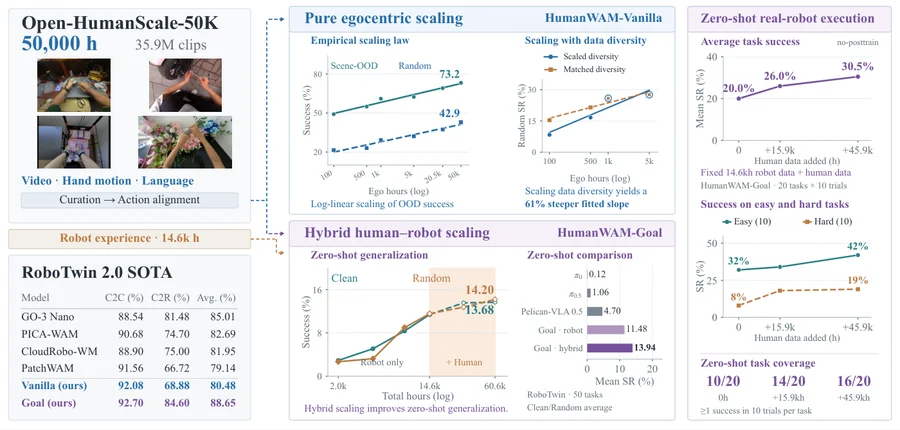 arXiv 2026-11-06 · cs.CV · #24 **[Open-HumanScale: An Open Recipe for Scaling Human and Robot Experience for Embodied Foundation Models](https://arxiv.org/abs/2611.06817)** [Juncheng Ma , Jiaxin Li , Jiankai Tu , Bo Liang , Guodong Lv , Yufan Deng , Junzhe Tang , Liangzhu Yang , Chen Bian , Zic… 机构：Peking University / National University of Singapore / MIT / UC Santa Barbara / NVIDIA（[PDF](https://arxiv.org/pdf/2611.06817)） [Paper](https://arxiv.org/abs/2611.06817) · [Project](https://dagroup-pku.github.io/open-humanscale/) · [图源](https://arxiv.org/html/2611.06817v1/teaser.png) 

中文摘要
第一视角人类视频是可规模化的机器人操作先验来源，但要把原始数据规模转化为可泛化的机器人策略，仍需严格的数据整理与训练方案。我们提出 Open-HumanScale：首个将第一视角预训练扩展到 50,000 小时的完全开放方案，以 Open-HumanScale-50K 为核心；这是一个密集标注手部运动和自然语言的第一视角视频语料。利用该语料，作者通过闭环仿真评估系统研究纯人类视频预训练，发现预训练时长与下游机器人成功率之间的经验对数线性缩放规律。基于这些发现，作者开发了 HumanWAM-Vanilla，一个仅在 5 万小时第一视角人类视频上预训练的世界—动作模型。经过机器人后训练后，它在 RoboTwin 2.0 Clean2Clean 上成功率为 92.08%，Clean2Random 为 68.88%；在 RoboDojo 上的平均成功率为 14.17%，平均进度分数为 19.00。为进一步提高能力，作者探索人类—机器人联合预训练，得到视觉目标条件化世界—动作模型 HumanWAM-Goal。混合数据扩展带来跨仿真和实体基准的广泛零样本泛化，并使后训练的 RoboTwin 2.0 表现达到新的最佳水平：Clean2Clean 为 92.70%，Clean2Random 达 84.60%。在实体机器人上，HumanWAM-Goal 还表现出涌现的具身上下文学习能力，无需参数更新即可动态调整操作行为以适应未见视觉目标。为支持可复现的具身智能扩展研究，作者开源 Open-HumanScale-50K 语料、数据整理和预训练流程、预训练与后训练的 HumanWAM 检查点、推理代码和仿真评估套件。 <a href="https://arxiv.org/abs/2611.06817">原摘要来源</a>
 |
<!-- PAPER_CARDS_END -->

## 检索概况

- **官方批次**：2026-11-05（Thursday, 5 November 2026）；北京时间 2026-11-06 09:31–10:02 核验。
- **来源**：arXiv 官方各分类 `New submissions`；只将 New 放入主榜，按 arXiv ID 去重。
- **分类范围**：cs.CV、cs.GR、cs.RO、cs.AI、cs.LG；补查 physics、cond-mat、math.OC/NA/DS、stat.ML、eess.IV/SY/SP。
- **总命中**：14 页 New 648 条（去重 648 个 ID）；Cross 386 条；Replacement 723 条。主榜入选 **24** 篇。
- **筛选说明**：按标题和摘要检查三维几何、物理机制及具体机器人任务和实验；相关性、机构强度、局限及改进均为编辑推断。
- **配图／摘要**：24/24 篇有经核对的论文图，24/24 篇有完整原摘要与中文译文；缺图 0，缺原摘要 0。

| 官方 New 分类页 | 批次 | New | Cross | Replacement |
|---|---|---:|---:|---:|
| [cond-mat](https://arxiv.org/list/cond-mat/new?show=2000) | 2026-11-05 | 62 | 26 | 77 |
| [cs.AI](https://arxiv.org/list/cs.AI/new?show=2000) | 2026-11-05 | 93 | 124 | 142 |
| [cs.CV](https://arxiv.org/list/cs.CV/new?show=2000) | 2026-11-05 | 130 | 18 | 93 |
| [cs.GR](https://arxiv.org/list/cs.GR/new?show=2000) | 2026-11-05 | 1 | 6 | 4 |
| [cs.LG](https://arxiv.org/list/cs.LG/new?show=2000) | 2026-11-05 | 110 | 104 | 188 |
| [cs.RO](https://arxiv.org/list/cs.RO/new?show=2000) | 2026-11-05 | 53 | 9 | 40 |
| [eess.IV](https://arxiv.org/list/eess.IV/new?show=2000) | 2026-11-05 | 5 | 3 | 5 |
| [eess.SP](https://arxiv.org/list/eess.SP/new?show=2000) | 2026-11-05 | 28 | 8 | 16 |
| [eess.SY](https://arxiv.org/list/eess.SY/new?show=2000) | 2026-11-05 | 20 | 19 | 16 |
| [math.DS](https://arxiv.org/list/math.DS/new?show=2000) | 2026-11-05 | 13 | 7 | 10 |
| [math.NA](https://arxiv.org/list/math.NA/new?show=2000) | 2026-11-05 | 18 | 2 | 12 |
| [math.OC](https://arxiv.org/list/math.OC/new?show=2000) | 2026-11-05 | 20 | 17 | 29 |
| [physics](https://arxiv.org/list/physics/new?show=2000) | 2026-11-05 | 88 | 23 | 62 |
| [stat.ML](https://arxiv.org/list/stat.ML/new?show=2000) | 2026-11-05 | 7 | 20 | 29 |

## Top papers

| # | 论文 | arXiv | 分类 | 作者 | 机构 | 相关性（推断） | 机构强度（推断） | 优先级（推断） |
|---:|---|---|---|---|---|---|---|---|
| 1 | [Ctrl-F: Force as an Interface for Humanoid Loco-Manipulation](https://arxiv.org/pdf/2611.05507) | [arXiv:2611.05507](https://arxiv.org/abs/2611.05507) | [cs.RO](https://arxiv.org/abs/2611.05507) | [Mengjie Zhao , Yuxin Chen , Yiyang Shao , Chuye Hong , Jiakang Chen , Koushil Sreenath , Masayoshi Tomizuka](https://arxiv.org/abs/2611.05507) | University of California, Berkeley（[PDF](https://arxiv.org/pdf/2611.05507)） | 极高：三维物理／接触 | 高（推断） | A |
| 2 | [Learning Implicit Solves for Dynamic Simulations](https://arxiv.org/pdf/2611.05439) | [arXiv:2611.05439](https://arxiv.org/abs/2611.05439) | [cs.LG](https://arxiv.org/abs/2611.05439) | [Chawit Kaewnuratchadasorn , Jiaji Wang , Xin Nie](https://arxiv.org/abs/2611.05439) | The University of Hong Kong / Tsinghua University（[PDF](https://arxiv.org/pdf/2611.05439)） | 极高：三维物理／接触 | 高（推断） | A |
| 3 | [GRASP: Gradient-Guided Sampling for Contact-Rich Physics-Based Motion Retargeting](https://arxiv.org/pdf/2611.05754) | [arXiv:2611.05754](https://arxiv.org/abs/2611.05754) | [cs.RO](https://arxiv.org/abs/2611.05754) | [Yang Liu , Tong Wang , Yiming Bao , Heng Yang](https://arxiv.org/abs/2611.05754) | Harvard University（[PDF](https://arxiv.org/pdf/2611.05754)） | 极高：三维物理／接触 | 高（推断） | A |
| 4 | [TwinBridge: Digital Twin-Driven Policy and Reward Transfer for Real-World Reinforcement Learning in Laboratory Robotics](https://arxiv.org/pdf/2611.06442) | [arXiv:2611.06442](https://arxiv.org/abs/2611.06442) | [cs.RO](https://arxiv.org/abs/2611.06442) | [Shu'ang Sun , Yibo Qiu , Haoliang Ye , Zan Huang , Ao Tian , Kan Ding , Ronald Xu , Mingzhai Sun](https://arxiv.org/abs/2611.06442) | University of Science and Technology of China（[PDF](https://arxiv.org/pdf/2611.06442)） | 极高：三维物理／接触 | 高（推断） | A |
| 5 | [Online Adaptation to Latent Physical Properties for Learning from Demonstration](https://arxiv.org/pdf/2611.06118) | [arXiv:2611.06118](https://arxiv.org/abs/2611.06118) | [cs.RO](https://arxiv.org/abs/2611.06118) | [Kotaro Kajitsuka , Masaki Murooka , Fumio Kanehiro](https://arxiv.org/abs/2611.06118) | University of Tsukuba / AIST (CNRS-AIST JRL)（[PDF](https://arxiv.org/pdf/2611.06118)） | 极高：三维物理／接触 | 中（推断） | A |
| 6 | [Contact-Implicit Whole-Body Trajectory Optimization for Dynamic Humanoid Locomotion on Parameterizable Uneven Terrain](https://arxiv.org/pdf/2611.05585) | [arXiv:2611.05585](https://arxiv.org/abs/2611.05585) | [cs.RO](https://arxiv.org/abs/2611.05585) | [Roberto Mauceri , Stefano Dafarra , Giulio Romualdi , Marco Gabiccini , Daniele Pucci](https://arxiv.org/abs/2611.05585) | Istituto Italiano di Tecnologia / University of Manchester / University of Pisa（[PDF](https://arxiv.org/pdf/2611.05585)） | 极高：三维物理／接触 | 高（推断） | A |
| 7 | [DyPSI: Dynamic Physics Sensing via Joint Field and Sensor-Trajectory Generation](https://arxiv.org/pdf/2611.06280) | [arXiv:2611.06280](https://arxiv.org/abs/2611.06280) | [cs.AI](https://arxiv.org/abs/2611.06280) | [Yizhou Zhang , Panqi Chen , Lei Cheng , Ting Zhang , Jianlong Li , Jianfeng Shi , Shikai Fang](https://arxiv.org/abs/2611.06280) | Zhejiang University / Ocean University of China（[PDF](https://arxiv.org/pdf/2611.06280)） | 极高：三维物理／接触 | 高（推断） | A |
| 8 | [Medial Model of Elastic Curve Contacts, from Clasps to Knits](https://arxiv.org/pdf/2611.05688) | [arXiv:2611.05688](https://arxiv.org/abs/2611.05688) | [cond-mat.soft](https://arxiv.org/abs/2611.05688) | [Kathryn Chain , Haoye Sun , Michael S. Dimitriyev](https://arxiv.org/abs/2611.05688) | Texas A&M University（[PDF](https://arxiv.org/pdf/2611.05688)） | 极高：三维物理／接触 | 高（推断） | A |
| 9 | [FlowReconBench: Accuracy, calibration and cost of learned and classical flow reconstruction from sparse sensors](https://arxiv.org/pdf/2611.06912) | [arXiv:2611.06912](https://arxiv.org/abs/2611.06912) | [physics.flu-dyn](https://arxiv.org/abs/2611.06912) | [Nicolas Tricard , Linzheng Wang , Jason Chen , Sili Deng](https://arxiv.org/abs/2611.06912) | Massachusetts Institute of Technology（[PDF](https://arxiv.org/pdf/2611.06912)） | 极高：三维物理／接触 | 高（推断） | A |
| 10 | [LumiTac: Compact, High-Rate Six-Axis Optical Tactile Sensing for Human-Robot Interaction](https://arxiv.org/pdf/2611.05936) | [arXiv:2611.05936](https://arxiv.org/abs/2611.05936) | [cs.RO](https://arxiv.org/abs/2611.05936) | [Hao Wu , Haotian Guo , Yu Feng , Yutong Wang , Jianshu Zhou](https://arxiv.org/abs/2611.05936) | National University of Singapore（[PDF](https://arxiv.org/pdf/2611.05936)） | 极高：三维物理／接触 | 高（推断） | A |
| 11 | [Which Physical Tactile Cues Matter for Contact-Rich Imitation Learning? A Controlled Real-Robot Study](https://arxiv.org/pdf/2611.06673) | [arXiv:2611.06673](https://arxiv.org/abs/2611.06673) | [cs.RO](https://arxiv.org/abs/2611.06673) | [Xuhao Qin , Xiyan Huang , Haoyu Dong , Xi Zhang , Chenxi Xiao](https://arxiv.org/abs/2611.06673) | ShanghaiTech University（[PDF](https://arxiv.org/pdf/2611.06673)） | 极高：三维物理／接触 | 高（推断） | B |
| 12 | [SCRUB: Contact-Based Surface-Frame Estimation for Force-Motion Control with an Armless Quadruped](https://arxiv.org/pdf/2611.06649) | [arXiv:2611.06649](https://arxiv.org/abs/2611.06649) | [cs.RO](https://arxiv.org/abs/2611.06649) | [Sourav Selvaraj , Juan Pablo Espinosa Chessal , Mahdi Agheli](https://arxiv.org/abs/2611.06649) | Worcester Polytechnic Institute（[PDF](https://arxiv.org/pdf/2611.06649)） | 极高：三维物理／接触 | 中（推断） | B |
| 13 | [OdorSpaces: Visual-Olfactory Embodied Navigation in 3D Environments](https://arxiv.org/pdf/2611.05738) | [arXiv:2611.05738](https://arxiv.org/abs/2611.05738) | [cs.RO](https://arxiv.org/abs/2611.05738) | [Changyeon Lee , Kelin Yu , Zheng Wei , Shuna Ni , Ruohan Gao](https://arxiv.org/abs/2611.05738) | University of Maryland, College Park（[PDF](https://arxiv.org/pdf/2611.05738)） | 极高：三维物理／接触 | 高（推断） | B |
| 14 | [Dynamic Shape Control of Soft Trunk Robots](https://arxiv.org/pdf/2611.06625) | [arXiv:2611.06625](https://arxiv.org/abs/2611.06625) | [cs.RO](https://arxiv.org/abs/2611.06625) | [Hehui Zheng , Marc Stampanoni , Roshan S. Kaundinya , Ronan Hinchet , George Haller , Robert K. Katzschmann](https://arxiv.org/abs/2611.06625) | ETH Zurich（[PDF](https://arxiv.org/pdf/2611.06625)） | 极高：三维物理／接触 | 高（推断） | B |
| 15 | [Vortex-Induced Torque in Grasping Soft Objects: Influence of Geometry and Pneumatic Parameters](https://arxiv.org/pdf/2611.06359) | [arXiv:2611.06359](https://arxiv.org/abs/2611.06359) | [cs.RO](https://arxiv.org/abs/2611.06359) | [Roman Mykhailyshyn , Tomohiro Motoda , Ivan Virgala , Ann Majewicz Fey , Yukiyasu Domae](https://arxiv.org/abs/2611.06359) | AIST / Technical University of Košice / The University of Texas at Austin（[PDF](https://arxiv.org/pdf/2611.06359)） | 极高：三维物理／接触 | 高（推断） | B |
| 16 | [ReactWorld: Structuring Interaction Responses for Embodied Video Generation](https://arxiv.org/pdf/2611.06120) | [arXiv:2611.06120](https://arxiv.org/abs/2611.06120) | [cs.CV](https://arxiv.org/abs/2611.06120) | [Hanwei Liu , Huijia Zhang , Hanzhang Wang , Guangyu Liu , Hanbei Zhan , Linjie Hu , Bin Xiao , Xuan Zhou , Dong Zhang](https://arxiv.org/abs/2611.06120) | Huawei Technologies / Tongji University / Zhejiang University（[PDF](https://arxiv.org/pdf/2611.06120)） | 极高：三维物理／接触 | 高（推断） | B |
| 17 | [cuRoboV2-Fast: Fast Torque-Limited Collision-Free Motion Planning](https://arxiv.org/pdf/2611.06913) | [arXiv:2611.06913](https://arxiv.org/abs/2611.06913) | [cs.RO](https://arxiv.org/abs/2611.06913) | [Balakumar Sundaralingam , Adithyavairavan Murali , Stan Birchfield](https://arxiv.org/abs/2611.06913) | affiliation 未确认 | 高：机器人运动规划 | 未评估（推断） | B |
| 18 | [METRIC-GS: Selective Metric-Scale Estimation for 3D Gaussian Splatting](https://arxiv.org/pdf/2611.06020) | [arXiv:2611.06020](https://arxiv.org/abs/2611.06020) | [cs.CV](https://arxiv.org/abs/2611.06020) | [Sooyeun Yang , Jongseong Brad Choi](https://arxiv.org/abs/2611.06020) | SUNY Korea / Stony Brook University（[PDF](https://arxiv.org/pdf/2611.06020)） | 高：基础三维视觉 | 高（推断） | B |
| 19 | [Feature Puzzles: Single-Image Supervision for Multi-View 3D-Aware Segmentation](https://arxiv.org/pdf/2611.05874) | [arXiv:2611.05874](https://arxiv.org/abs/2611.05874) | [cs.CV](https://arxiv.org/abs/2611.05874) | [Jiahao Ma , Qiang Zhang , Miaomiao Liu , David Ahmedt-Aristizabal , Chuong Nguyen](https://arxiv.org/abs/2611.05874) | Australian National University / University of Science and Technology of China / CSIRO（[PDF](https://arxiv.org/pdf/2611.05874)） | 高：基础三维视觉 | 高（推断） | B |
| 20 | [Trainspotting: Learning Object-Centric 3D Reconstruction from Found Photos](https://arxiv.org/pdf/2611.06849) | [arXiv:2611.06849](https://arxiv.org/abs/2611.06849) | [cs.CV](https://arxiv.org/abs/2611.06849) | [Hanyu Chen , Noah Snavely](https://arxiv.org/abs/2611.06849) | Cornell University（[PDF](https://arxiv.org/pdf/2611.06849)） | 高：基础三维视觉 | 高（推断） | B |

| 21 | [ELA: End-to-End Latent Action Policy Learning from Video Demonstrations](https://arxiv.org/pdf/2611.05571) | [arXiv:2611.05571](https://arxiv.org/abs/2611.05571) | [cs.RO](https://arxiv.org/abs/2611.05571) | [Cheng-Chun Hsu , Peter Stone](https://arxiv.org/abs/2611.05571) | The University of Texas at Austin（[PDF](https://arxiv.org/pdf/2611.05571)） | 高：具身策略／评测 | 高（推断） | B |
| 22 | [$A^3$-VLA: Automatic Perception-Guided Attention Alignment for Robot Manipulation](https://arxiv.org/pdf/2611.06447) | [arXiv:2611.06447](https://arxiv.org/abs/2611.06447) | [cs.RO](https://arxiv.org/abs/2611.06447) | [Shengzhe Zhang , Qi Zhang , Dazhong Shen , Chao Wang , Shaopeng Zhai , Hui Xiong](https://arxiv.org/abs/2611.06447) | University of Science and Technology of China / Shanghai AI Laboratory / Nanjing University of Aeronautics and Astronautics / HKUST（[PDF](https://arxiv.org/pdf/2611.06447)） | 高：具身策略／评测 | 高（推断） | B |
| 23 | [Robocasa-Mem: Benchmarking Environment and Process Memory in Long-Horizon Mobile Manipulation](https://arxiv.org/pdf/2611.06475) | [arXiv:2611.06475](https://arxiv.org/abs/2611.06475) | [cs.RO](https://arxiv.org/abs/2611.06475) | [Sihang Chen , Chen Ye , Wei Chen , Xiaohan Lei , Zhipeng Tang , Sha Zhang , Yuan Zhang , Zixuan Chen , Jiajun Deng , Houqiang Li , Yanyong Zhang](https://arxiv.org/abs/2611.06475) | University of Science and Technology of China / Tongji University / Chinese University of Hong Kong / Anhui University / Nanjing University（[PDF](https://arxiv.org/pdf/2611.06475)） | 高：具身策略／评测 | 高（推断） | B |
| 24 | [Open-HumanScale: An Open Recipe for Scaling Human and Robot Experience for Embodied Foundation Models](https://arxiv.org/pdf/2611.06817) | [arXiv:2611.06817](https://arxiv.org/abs/2611.06817) | [cs.CV](https://arxiv.org/abs/2611.06817) | [Juncheng Ma , Jiaxin Li , Jiankai Tu , Bo Liang , Guodong Lv , Yufan Deng , Junzhe Tang , Liangzhu Yang , Chen Bian , Zicong Cao , Baohao Zhu , Jianxin Bi , Tengfei Yan , Yinyuan Zhang , Kewei Zhang , Xinglong Chen , Kaiqi Chen , Duomin Wang , Xiaotian Tang , Liang Tan , Li Li , Yuan Xu , Haosen Yang , Yuqi Wang , Jingfei Xia , Songyan Huang , Zhiyang Dou , Zhen Dong , Enze Xie , Tat-Seng Chua , Daquan Zhou](https://arxiv.org/abs/2611.06817) | Peking University / National University of Singapore / MIT / UC Santa Barbara / NVIDIA（[PDF](https://arxiv.org/pdf/2611.06817)） | 高：具身策略／评测 | 高（推断） | B |

## 逐篇中文要点

### 1. [Ctrl-F: Force as an Interface for Humanoid Loco-Manipulation](https://arxiv.org/abs/2611.05507)

- **论文事实／方法**：以每个指定接触部位的三维力作为指令，分层协调动作跟踪和在线力规划。（[原摘要](https://arxiv.org/abs/2611.05507)）
- **论文事实／实验**：仿真与硬件实现手部拖、推、举及脚踢；推踢重达 20 kg 的箱子并适应中途加重。（[原摘要](https://arxiv.org/abs/2611.05507)）
- **推断／局限**：力命令的稳定性与安全边界在多接触切换和未知摩擦下仍需逐项验证。

### 2. [Learning Implicit Solves for Dynamic Simulations](https://arxiv.org/abs/2611.05439)

- **论文事实／方法**：用静态平衡解预训练神经算子，再嵌入 Newmark-β 积分求解弹性动力学。（[原摘要](https://arxiv.org/abs/2611.05439)）
- **论文事实／实验**：线性／非线性案例无需动态轨迹监督；报告非线性仿真较顺序有限元求解器加速逾 4,600 倍及百万步滚动。（[原摘要](https://arxiv.org/abs/2611.05439)）
- **推断／局限**：极长滚动的误差是否守恒、速度与硬件及精度预算是否公平，需要独立检查。

### 3. [GRASP: Gradient-Guided Sampling for Contact-Rich Physics-Based Motion Retargeting](https://arxiv.org/abs/2611.05754)

- **论文事实／方法**：在历史轨迹上拟合局部二次代价，以恢复的梯度引导顺序蒙特卡洛重定向，无需可微仿真器。（[原摘要](https://arxiv.org/abs/2611.05754)）
- **论文事实／实验**：在 1,352 段双手 OakInk2 演示中成功率为 92.8%，并展示实体灵巧手和人形动作。（[原摘要](https://arxiv.org/abs/2611.05754)）
- **推断／局限**：局部二次模型在碰撞不连续处可能失真；应比较接触事件附近的样本效率。

### 4. [TwinBridge: Digital Twin-Driven Policy and Reward Transfer for Real-World Reinforcement Learning in Laboratory Robotics](https://arxiv.org/abs/2611.06442)

- **论文事实／方法**：将 3DGS 与物理仿真结合成数字孪生，蒸馏仿真事件和几何进度为真实操作的视觉奖励。（[原摘要](https://arxiv.org/abs/2611.06442)）
- **论文事实／实验**：五项真实实验室任务中，单项交互不超过 25 分钟，最终平均自主成功率为 98%。（[原摘要](https://arxiv.org/abs/2611.06442)）
- **推断／局限**：数字孪生的几何和接触误差可能污染奖励，需量化真实域外动作的误判。

### 5. [Online Adaptation to Latent Physical Properties for Learning from Demonstration](https://arxiv.org/abs/2611.06118)

- **论文事实／方法**：联合学习物体潜在物性与动力学，执行时固定网络权重并按预测误差在线更新潜变量。（[原摘要](https://arxiv.org/abs/2611.06118)）
- **论文事实／实验**：真实及仿真质心变化实验提示成功率提升，但未见质心位置的仿真成功率约 30%。（[原摘要](https://arxiv.org/abs/2611.06118)）
- **推断／局限**：潜变量外推能力有限；需区分物性识别失败和策略对新物性的控制失败。

### 6. [Contact-Implicit Whole-Body Trajectory Optimization for Dynamic Humanoid Locomotion on Parameterizable Uneven Terrain](https://arxiv.org/abs/2611.05585)

- **论文事实／方法**：以平滑曲面近似复杂地形，在全身动力学优化中引入不预设接触序列的接触约束。（[原摘要](https://arxiv.org/abs/2611.05585)）
- **论文事实／实验**：在台阶、斜坡等地形进行非线性规划，报告仿真与 ErgoCub 实机的初步非共面测试。（[原摘要](https://arxiv.org/abs/2611.05585)）
- **推断／局限**：地形近似误差及求解时间可能限制在线部署，应按坡度和曲率分层评测。

### 7. [DyPSI: Dynamic Physics Sensing via Joint Field and Sensor-Trajectory Generation](https://arxiv.org/abs/2611.06280)

- **论文事实／方法**：以连续传感器位置场、功能 Tucker 表征和联合扩散，同时生成未来物理场与传感器轨迹。（[原摘要](https://arxiv.org/abs/2611.06280)）
- **论文事实／实验**：在湍流、GLORYS12 海温及三维汽车空气动力学中，紧传感器预算下优于静态和逐帧布点。（[原摘要](https://arxiv.org/abs/2611.06280)）
- **推断／局限**：扩散采样成本与传感器运动约束的相容性仍需具体部署评估。

### 8. [Medial Model of Elastic Curve Contacts, from Clasps to Knits](https://arxiv.org/abs/2611.05688)

- **论文事实／方法**：以中轴变换及根式 Voronoi 推广描述相同和不同半径纤维的鞍形接触面。（[原摘要](https://arxiv.org/abs/2611.05688)）
- **论文事实／实验**：正交扣结及简单针织结构的计算案例支持其接触面近似，并观察到有限平均曲率趋势。（[原摘要](https://arxiv.org/abs/2611.05688)）
- **推断／局限**：目前为几何近似，尚需与载荷、摩擦及实测接触应力耦合。

### 9. [FlowReconBench: Accuracy, calibration and cost of learned and classical flow reconstruction from sparse sensors](https://arxiv.org/abs/2611.06912)

- **论文事实／方法**：统一比较稀疏传感器流场重建的十种学习法与五种经典法，覆盖校准、频谱和成本。（[原摘要](https://arxiv.org/abs/2611.06912)）
- **论文事实／实验**：三种工况含大规模三维湍流；不同工况最优方法不同，三维观测通道上反距离加权可匹配最佳学习法。（[原摘要](https://arxiv.org/abs/2611.06912)）
- **推断／局限**：不同传感器布局与未观测变量可能翻转排名；应报告跨布局置信区间。

### 10. [LumiTac: Compact, High-Rate Six-Axis Optical Tactile Sensing for Human-Robot Interaction](https://arxiv.org/abs/2611.05936)

- **论文事实／方法**：用五组发光／RGBW 接收单元与硅胶层形成小型光学触觉头，MLP 从 20 通道恢复六轴力／力矩。（[原摘要](https://arxiv.org/abs/2611.05936)）
- **论文事实／实验**：传感头直径 12 mm、成本约 7 美元；报告平均 303.57 Hz 更新率及机器人操作演示。（[原摘要](https://arxiv.org/abs/2611.05936)）
- **推断／局限**：长期温漂、硅胶老化和接触位置变化对六轴校准的影响尚需测试。

### 11. [Which Physical Tactile Cues Matter for Contact-Rich Imitation Learning? A Controlled Real-Robot Study](https://arxiv.org/abs/2611.06673)

- **论文事实／方法**：同一触觉流分解 RGB、法线／深度及标记点流，并在固定演示与策略骨干下比较线索。（[原摘要](https://arxiv.org/abs/2611.06673)）
- **论文事实／实验**：720 次真实机器人试验中总体成功率由 57.8% 升至 78.9%；标记点流单独达到 74.4%。（[原摘要](https://arxiv.org/abs/2611.06673)）
- **推断／局限**：不同任务阶段的线索价值不同；应测试传感器磨损与接触材料变化。

### 12. [SCRUB: Contact-Based Surface-Frame Estimation for Force-Motion Control with an Armless Quadruped](https://arxiv.org/abs/2611.06649)

- **论文事实／方法**：用力和步态平均速度双线索经卡尔曼滤波估计表面法线，为四足机器人滑动工具控制提供坐标系。（[原摘要](https://arxiv.org/abs/2611.06649)）
- **论文事实／实验**：Unitree Go1 完成全部墙面横越与柱面环绕；移除任一线索、步态平均或改用固定法线时环绕失败。（[原摘要](https://arxiv.org/abs/2611.06649)）
- **推断／局限**：力线索假设摩擦反向于运动；黏滑与各向异性摩擦可能造成系统偏差。

### 13. [OdorSpaces: Visual-Olfactory Embodied Navigation in 3D Environments](https://arxiv.org/abs/2611.05738)

- **论文事实／方法**：在 Habitat-Sim 中加入 FDS 三维气味输运／扩散，建立视觉—嗅觉室内寻源基准。（[原摘要](https://arxiv.org/abs/2611.05738)）
- **论文事实／实验**：任务包括不可见气体泄漏和早期火源定位；初始多模态强化学习策略优于多种基线。（[原摘要](https://arxiv.org/abs/2611.05738)）
- **推断／局限**：仿真气流与真实建筑通风的差距可能影响策略迁移。

### 14. [Dynamic Shape Control of Soft Trunk Robots](https://arxiv.org/abs/2611.06625)

- **论文事实／方法**：从数据学习软体象鼻机器人全身绝热谱子流形模型，以 MPC 调节形状。（[原摘要](https://arxiv.org/abs/2611.06625)）
- **论文事实／实验**：硬件形状调节相对线性基线改善 10 倍，网球平衡超过 25 秒；硬件训练 12 小时的无模型 RL 未完成同任务。（[原摘要](https://arxiv.org/abs/2611.06625)）
- **推断／局限**：模型在新负载与形变范围外的稳定性需要验证。

### 15. [Vortex-Induced Torque in Grasping Soft Objects: Influence of Geometry and Pneumatic Parameters](https://arxiv.org/abs/2611.06359)

- **论文事实／方法**：量化供气压力、喷嘴直径、表面几何与曲率对软物体涡流抓取扭矩的耦合影响。（[原摘要](https://arxiv.org/abs/2611.06359)）
- **论文事实／实验**：圆顶凹面扭矩通常高于对应凸面；重复交叉验证中高斯过程回归预测最佳。（[原摘要](https://arxiv.org/abs/2611.06359)）
- **推断／局限**：几何匹配与材料顺应性共同变化时，回归模型的因果解释仍不充分。

### 16. [ReactWorld: Structuring Interaction Responses for Embodied Video Generation](https://arxiv.org/abs/2611.06120)

- **论文事实／方法**：预测交互参与者、响应强度与局部运动，再用反馈适配器调节生成特征和时间注意力。（[原摘要](https://arxiv.org/abs/2611.06120)）
- **论文事实／实验**：RBench 平均 77.51 分，较 PhysisForcing 高 3.29 分；EZS-Bench 平均 81.87 分。（[原摘要](https://arxiv.org/abs/2611.06120)）
- **推断／局限**：视频指标不能直接保证接触力和物体守恒，需物理可测量验证。

### 17. [cuRoboV2-Fast: Fast Torque-Limited Collision-Free Motion Planning](https://arxiv.org/abs/2611.06913)

- **论文事实／方法**：用 B 样条轨迹优化、可微逆动力学与 GPU 带状牛顿求解，规划载荷／扭矩约束运动。（[原摘要](https://arxiv.org/abs/2611.06913)）
- **论文事实／实验**：3 kg 载荷下 RTX 5090 平均规划 4.4 ms；YAM 拾取放置循环平均 5.93 s。（[原摘要](https://arxiv.org/abs/2611.06913)）
- **推断／局限**：端到端时延对碰撞模型更新和传感器延迟的敏感性仍需报告。

### 18. [METRIC-GS: Selective Metric-Scale Estimation for 3D Gaussian Splatting](https://arxiv.org/abs/2611.06020)

- **论文事实／方法**：从 3DGS 语义内容、建筑家具尺寸先验及可见性投票估计公制尺度，证据薄弱时拒绝并路由。（[原摘要](https://arxiv.org/abs/2611.06020)）
- **论文事实／实验**：47 个 ScanNet++ 场景平均误差由 21.1% 降至 16.6%；只对拒绝样本调用 MASt3R 节省 60% 调用。（[原摘要](https://arxiv.org/abs/2611.06020)）
- **推断／局限**：室内尺寸先验在异形建筑和跨地区设计中可能偏移。

### 19. [Feature Puzzles: Single-Image Supervision for Multi-View 3D-Aware Segmentation](https://arxiv.org/abs/2611.05874)

- **论文事实／方法**：用单图裁剪与几何变换产生多视角一致伪标签，结合三维基础模型特征学习分割。（[原摘要](https://arxiv.org/abs/2611.05874)）
- **论文事实／实验**：单图监督下在 NVOS 达到最高 mIoU，并在 SPIn-NeRF、ScanNet++ 保持竞争力。（[原摘要](https://arxiv.org/abs/2611.05874)）
- **推断／局限**：伪标签的跨视角对应在遮挡和非刚体场景可能失效。

### 20. [Trainspotting: Learning Object-Centric 3D Reconstruction from Found Photos](https://arxiv.org/abs/2611.06849)

- **论文事实／方法**：收集跨年份和环境的物体照片，重建位姿、深度和掩码，再微调前馈三维重建模型。（[原摘要](https://arxiv.org/abs/2611.06849)）
- **论文事实／实验**：Trainspotting 含 12,068 个物体和 311,886 张照片；VGGT-Ω 在留出物体和 NAVI 野外基准改善。（[原摘要](https://arxiv.org/abs/2611.06849)）
- **推断／局限**：同设计多实体可能带来几何不一致，应分开报告此类物体的重建误差。

### 21. [ELA: End-to-End Latent Action Policy Learning from Video Demonstrations](https://arxiv.org/abs/2611.05571)

- **论文事实／方法**：联合训练潜在动作模型、策略和解码器，让无动作标注视频服务连续机器人动作学习。（[原摘要](https://arxiv.org/abs/2611.05571)）
- **论文事实／实验**：仿真及真实操作任务优于先前潜在动作基线；动作解码器约 400 万参数。（[原摘要](https://arxiv.org/abs/2611.05571)）
- **推断／局限**：少量带动作标注演示的任务覆盖和视频域差异可能左右迁移效果。

### 22. [$A^3$-VLA: Automatic Perception-Guided Attention Alignment for Robot Manipulation](https://arxiv.org/abs/2611.06447)

- **论文事实／方法**：依据交互引发的视觉变化提取目标／机器人区域，以注意力分配和对比损失约束 VLA 感知。（[原摘要](https://arxiv.org/abs/2611.06447)）
- **论文事实／实验**：多种 VLA 骨干的仿真与真实操作任务平均成功率提升 6.5%–25.2%。（[原摘要](https://arxiv.org/abs/2611.06447)）
- **推断／局限**：离线伪区域若漏掉关键接触或遮挡，可能将注意力对齐到错误目标。

### 23. [Robocasa-Mem: Benchmarking Environment and Process Memory in Long-Horizon Mobile Manipulation](https://arxiv.org/abs/2611.06475)

- **论文事实／方法**：构建环境／过程记忆任务，并让评测器依机器人先前选择推导后续约束以减少固定目标捷径。（[原摘要](https://arxiv.org/abs/2611.06475)）
- **论文事实／实验**：九项移动操作任务、1,800 段成功演示；提供结合结构化记忆与 VGGT-Omega 几何的 HMAP 基线。（[原摘要](https://arxiv.org/abs/2611.06475)）
- **推断／局限**：行为条件评测仍可能对记忆表示方式和视觉几何误差敏感。

### 24. [Open-HumanScale: An Open Recipe for Scaling Human and Robot Experience for Embodied Foundation Models](https://arxiv.org/abs/2611.06817)

- **论文事实／方法**：整理 5 万小时带手部运动和语言标注的第一视角视频，比较纯人类与人机混合预训练的世界—动作模型。（[原摘要](https://arxiv.org/abs/2611.06817)）
- **论文事实／实验**：HumanWAM-Goal 后训练在 RoboTwin 2.0 Clean2Random 达 84.60%，并报告实体机器人未见目标适应。（[原摘要](https://arxiv.org/abs/2611.06817)）
- **推断／局限**：数据和训练规模高；应区分视频规模、标注质量与混合数据比例各自贡献。

## 今日最值得细读的 5 篇

1. [Ctrl-F](https://arxiv.org/abs/2611.05507)：显式三维力指令贯通动作跟踪与真实大载荷交互，可细读控制层级和接触切换。
2. [Learning Implicit Solves](https://arxiv.org/abs/2611.05439)：静态平衡算子直接服务动态隐式积分，值得核查长时稳定性与加速基准。
3. [GRASP](https://arxiv.org/abs/2611.05754)：不依赖可微仿真器恢复接触重定向的梯度，含大规模双手演示和硬件验证。
4. [TwinBridge](https://arxiv.org/abs/2611.06442)：3DGS／物理数字孪生蒸馏稠密奖励，真实交互预算很小，需细看奖励偏差。
5. [FlowReconBench](https://arxiv.org/abs/2611.06912)：三维流场在内的统一比较揭示经典方法与学习方法的适用边界。

## 低算力可改进论文与具体实验

以下均为**推断性研究建议**；先在小规模公开／自建模拟环境验证，不将原论文效果当成改法结果。

| 论文 | 方法级改法与小实验 | 低算力原因 | 预期收益与风险（推断） |
|---|---|---|---|
| [INOS](https://arxiv.org/abs/2611.05439) | 在隐式算子输出后加入一轮廉价物理残差校正；在二维弹性梁上比较 1k／10k 步能量漂移和误差。 | 固定小网格与冻结预训练算子，只训练校正头。 | 或减轻长时漂移；风险是残差校正破坏速度优势。 |
| [GRASP](https://arxiv.org/abs/2611.05754) | 对接触事件附近的局部二次拟合加入接触模式分簇；在两指物体翻转中比较每次成功所需 rollout。 | 小物体、少自由度、共享仿真缓存。 | 或减少跨模式梯度误导；风险是样本被分簇后过稀。 |
| [TwinBridge](https://arxiv.org/abs/2611.06442) | 对视觉奖励加入接触前后的一致性置信门；在单项桌面倾倒任务中人为扰动孪生几何，测奖励排序和真实成功率。 | 冻结策略与奖励骨干，只训练小门控层。 | 或减少错误奖励；风险是门控拒绝有效探索。 |
| [Online Adaptation](https://arxiv.org/abs/2611.06118) | 用双假设质心粒子替代单点潜变量更新；在四种未见质心配置的抓取中比较识别误差与成功率。 | 小粒子数、冻结动力学与策略。 | 或改善物性多解性；风险是粒子退化和额外观测需求。 |
| [DyPSI](https://arxiv.org/abs/2611.06280) | 把传感器最大速度和转弯半径投影到扩散采样每一步；在二维涡流场用两只移动传感器比较误差与轨迹可行率。 | 低分辨率二维场、短时间窗。 | 或提高可部署性；风险是投影损伤生成分布。 |
| [LumiTac](https://arxiv.org/abs/2611.05936) | 为六轴标定增加温度／时间低秩漂移状态；在不同温度和长时间加载下测力矩误差。 | 只训练线性或小 MLP 校正层。 | 或增强长期稳定性；风险是漂移状态与真实载荷混淆。 |
| [SCRUB](https://arxiv.org/abs/2611.06649) | 用力—速度残差在线识别各向异性摩擦，动态调节法线滤波器权重；在三种表面材质上比较轨迹和法线误差。 | 小状态卡尔曼滤波，无大模型训练。 | 或减少黏滑偏差；风险是短轨迹不可辨识。 |
| [FlowReconBench](https://arxiv.org/abs/2611.06912) | 以经典插值残差触发局部学习式修正；在低分辨率三维湍流上扫描传感器密度与未观测通道。 | 冻结经典基线，只训练局部小网络。 | 或保留低成本并改善稀疏区；风险是边界处误差集中。 |
| [METRIC-GS](https://arxiv.org/abs/2611.06020) | 把尺寸先验改成可校准的层级先验并显式估计场景异常度；在 ScanNet++ 的异形房间子集测试误差／拒绝率。 | 只优化少量分布参数，复用现有 3DGS。 | 或提升域外拒绝可靠性；风险是异常度过保守。 |
| [OdorSpaces](https://arxiv.org/abs/2611.05738) | 对气味观测加入风向条件的粒子信念更新，再由小策略读取信念；在两种通风设置下测寻源距离和成功率。 | 少量粒子与冻结视觉编码器。 | 或提高跨风场适应；风险是风向测量误差累积。 |

## 重大 Replacement

- [Gnomon4D: Learning Where and When to Focus for Geometric Motion-Grounded World-Action Modeling](https://arxiv.org/abs/2611.02474)（[官方 cs.CV Replacement 列表](https://arxiv.org/list/cs.CV/new?show=2000)，v2）：本次摘要从通用几何运动表述改为突出机器人动作注意力对交互的低权重诊断，进一步强调抓取／释放时的空间与时间读出，并将效果描述改为多个基准领先及视觉偏移下更强。旧摘要中的 7.0/16.0 个百分点结果未在新版摘要保留。以上是**摘要版本对照**，不是对完整论文改动的推断；该 ID 不计入 New 主榜。
