# 2026-11-07 arXiv 每日论文订阅摘要

<!-- PAPER_CARDS_START -->
## 论文卡片

按原日报排名展示；点击标题或 Paper 查看原文，详细中文分析见下方。

| 论文 | 论文 | 论文 |
|---|---|---|
| 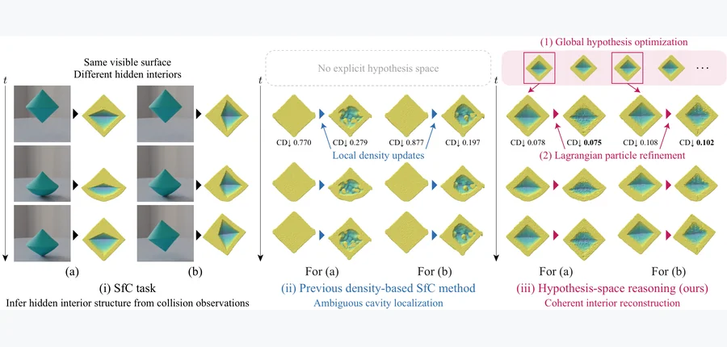 WACV 2027 · #1 **[Structure from Collision via Hypothesis-Space Reasoning](https://arxiv.org/abs/2611.07900)** [Takuhiro Kaneko](https://arxiv.org/abs/2611.07900) 机构：NTT, Inc.（[PDF](https://arxiv.org/pdf/2611.07900)） [Paper](https://arxiv.org/abs/2611.07900) · [Project](https://www.kecl.ntt.co.jp/people/kaneko.takuhiro/projects/sfc-hypothesis/) · [图源](https://arxiv.org/html/2611.07900v1/teaser.png) 

中文摘要
了解物体隐藏的内部结构，包括空腔是否存在及其位置，对于预测仿真、机器人操作和无损检测至关重要。然而，空腔不会在静态可见表面留下直接痕迹，碰撞引发的形变因而成为推断它们的少数线索之一。碰撞恢复结构（SfC）从碰撞事件的多视角观测中恢复物体隐藏的内部结构。这项任务有两项难点：隐藏空腔只能通过表面运动间接观察，而空腔意味着材料缺失，难以用标准密度表征直接优化。基于密度的 SfC 基线同时受到这两项难点影响：表面匹配梯度不能直接指出空腔位置，空腔内部或附近的密度梯度也可能微弱或缺乏信息。因此，我们把 SfC 重新表述为假设空间推理，将隐藏空腔表示为显式结构假设，其变量编码可用的结构先验，而不依赖隐式密度更新。全局阶段使用仅前向的物质点法（MPM）仿真，在假设空间中进行无梯度优化；局部阶段再以拉格朗日粒子系统表示选定假设，并使用可微 MPM 仿真进行基于梯度的细化。在 SfC 基准上，本方法的隐藏结构重建和未来预测优于基于密度的 SfC 基线。内部拓扑压力测试和稳健性分析刻画了其适用范围与局限。项目页见原文链接。 <a href="https://arxiv.org/abs/2611.07900">原摘要来源</a>
 | 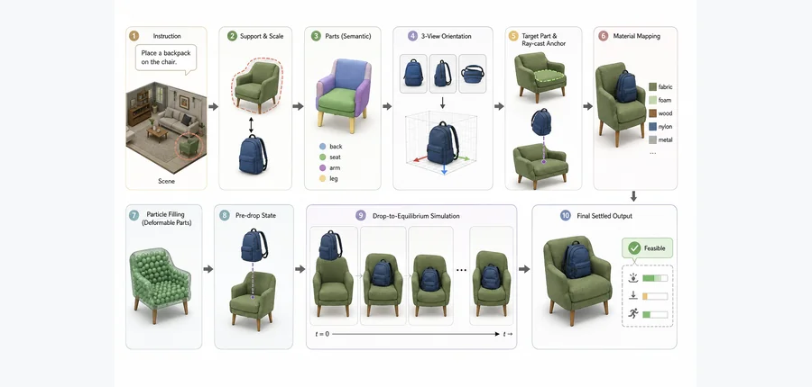 arXiv 2026-11-07 · cs.CV · #2 **[Deformable Contact-Aware 3D Object Placement](https://arxiv.org/abs/2611.08005)** [Songhe Wang , David Miller , Charles A. Kamhoua](https://arxiv.org/abs/2611.08005) 机构：affiliation 未确认 [Paper](https://arxiv.org/abs/2611.08005) · [图源](https://arxiv.org/html/2611.08005v1/pipeline_1.png) 

中文摘要
现有语言引导的三维物体放置通常预测刚体六自由度位姿，忽略室内放置实际上由接触决定。因此，预测位姿常会悬浮、穿透支撑物，或无法使柔软表面发生形变。我们提出形变接触感知放置（DCAP），将放置重新表述为下落至平衡的过程。DCAP 不预测静态位姿，而是构造指定下落位置、物体尺度和可形变部件的语义释放状态，再由刚体与形变体耦合仿真器在重力和摩擦作用下使物体稳定。这明确分开了语义意图与物理实现。在包含 2,063 个提示词—资产—场景组合的基准上，DCAP 显著优于静态基线。在标准放置任务中，相比最强的原始刚体基线，它将 VLM 物理性与自然性评分提高 21.2 分、人的偏好评分提高 26.5 分，并将平均穿透深度降低 72.3%。相比仿真滚动基线，DCAP 将残余速度降低 72.1%。最终，结果证明，物理准确的三维放置需要把语义意图和物理实现建模为严格分开的过程。 <a href="https://arxiv.org/abs/2611.08005">原摘要来源</a>
 | 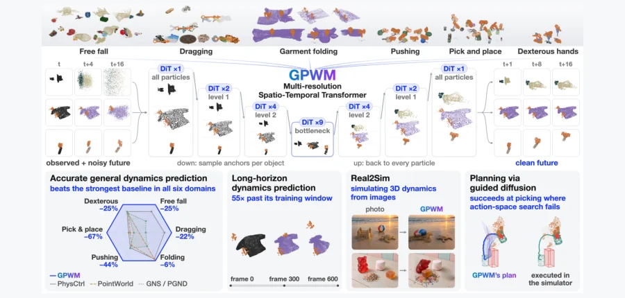 arXiv 2026-11-07 · cs.RO · #3 **[GPWM: Modeling the World as 3D Particle Motion](https://arxiv.org/abs/2611.08338)** [Robert Ren , Matthew Bronars , He Zhu , Yikai Tang , Jianing Zhang , Sergey Zakharov , Pavel Tokmakov , Katerina Fragkiad… 机构：Carnegie Mellon University / Toyota Research Institute（[PDF](https://arxiv.org/pdf/2611.08338)） [Paper](https://arxiv.org/abs/2611.08338) · [Project](https://robertren1122.github.io/gpwm/) · [图源](https://arxiv.org/html/2611.08338v1/GPWM_teaser_v25.png) 

中文摘要
我们提出生成式粒子世界模型 GPWM，通过生成粒子和刚体随时间的运动来预测三维场景演化。与生成场景外观的视频世界模型不同，GPWM 直接在三维物理空间中工作。单一表征和架构同时覆盖被动物理过程与机器人交互中的刚体、形变体、布料和颗粒材料。GPWM 是面向物体的多分辨率 Transformer，结合流匹配与 diffusion forcing，生成远超训练时长的连贯物理轨迹。我们在 ParticleWorlds 上训练和评估 GPWM；该语料包含 2,550 万帧，覆盖多种几何、材料、交互和机器人形态。GPWM 在六个物理领域中均优于此前最好的学习式动力学基线，平均预测误差降低 31%。区别于此前按领域建模的方法，单个 Unified GPWM 以同一组权重覆盖这些异质状态，明显优于逐领域基线，且在两个领域超过我们自己的专用模型。GPWM 还可泛化到未见过的几何、物理属性、物体数量和滚动时长。除了预测，GPWM 还通过学习执行器与物体联合运动的生成先验来支持富接触规划：规划不在无约束动作中搜索，而在模型潜在噪声中搜索可达成物体空间目标的交互。使用同一世界模型，噪声空间规划在推和拾取任务中显著优于动作空间搜索；这些任务中的复杂接触序列很难被搜索发现。所得计划在仿真中开环执行，无需参考动作轨迹或目标专用策略即可完成目标导向操作。 <a href="https://arxiv.org/abs/2611.08338">原摘要来源</a>
 |
| 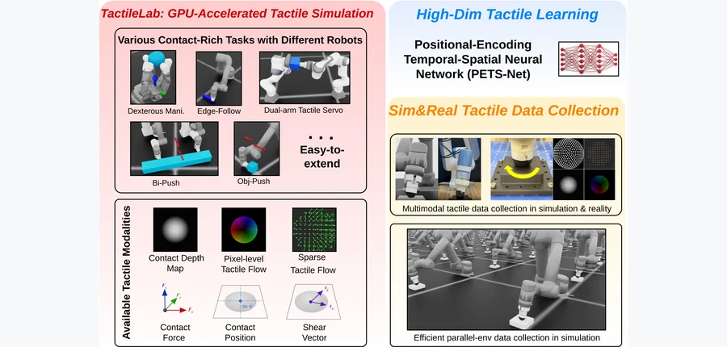 arXiv 2026-11-07 · cs.RO · #4 **[TactileLab: Sim-to-Real Dexterous Robot Manipulation with Efficient Shear-Sensitive Tactile Simulation](https://arxiv.org/abs/2611.07881)** [Yijiong Lin , Wenhao He , Toby Jack , Max Yang , Haoran Li , Nathan F. Lepora](https://arxiv.org/abs/2611.07881) 机构：Beijing Institute of Technology / University of Bristol / Xi’an Jiaotong-Liverpool University（[PDF](https://arxiv.org/pdf/2611.07881)） [Paper](https://arxiv.org/abs/2611.07881) · [Project](https://yijionglin.github.io/tactilelab/) · [图源](https://arxiv.org/html/2611.07881v1/pic/cover_figure/cover_figure_0_01.jpg) 

中文摘要
能够表示触觉感知中剪切效应的机器人仿真器对富接触操作愈发重要。然而，用高保真形变体或软体仿真模拟接触剪切的计算开销很大，限制了大规模强化学习。我们提出基于 IsaacLab 的可扩展多模态触觉仿真框架 TactileLab，重点引入一种基于光流的新触觉表征，称为模拟触觉流。TactileLab 不依赖软体物理来模拟剪切形变，而利用刚体仿真高效估计接触界面的稠密切向运动，产生编码与剪切相关接触动力学的触觉流场。该流场与接触深度场提供的几何特征互补。我们还提出联合处理长时本体感觉信号和丰富触觉观测的新策略架构。在多个富接触任务中，使用模拟触觉流训练的策略能够大规模高效学习，并表现出涌现的接触感知行为。为将策略从仿真部署到真实环境，我们提出真实到仿真的触觉转换方法，将真实触觉图像流映射为模拟触觉流和深度场，同时提出新的触觉数据采集方法，并在多种触觉传感器设计上验证。借助该流程，我们在双臂和灵巧手内操作等任务中展示了真实部署。总体上，TactileLab 为可扩展触觉策略学习提供端到端的仿真到现实框架，使异质触觉机器人系统能够完成多种对剪切敏感的操作。 <a href="https://arxiv.org/abs/2611.07881">原摘要来源</a>
 | 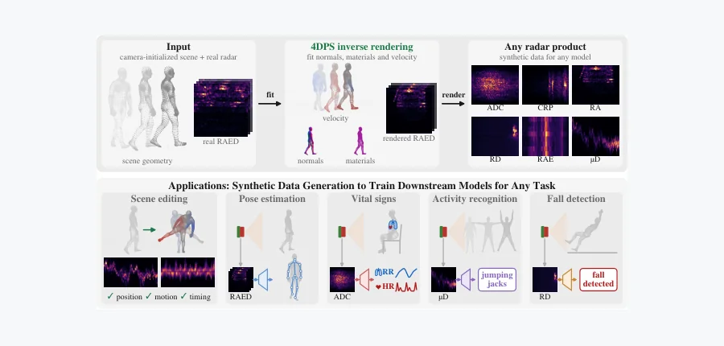 arXiv 2026-11-07 · cs.CV · #5 **[4D Point Splatting for mmWave Radar Micro-Doppler Differentiable Rendering](https://arxiv.org/abs/2611.08342)** [Adnan Armouti , Guanyue Qian , Rajalakshmi Nandakumar](https://arxiv.org/abs/2611.08342) 机构：Cornell Tech / New York University（[PDF](https://arxiv.org/pdf/2611.08342)） [Paper](https://arxiv.org/abs/2611.08342) · [图源](https://arxiv.org/html/2611.08342v1/fig_teaser.png) 

中文摘要
毫米波雷达可将运动人体的微米级位移分辨为微多普勒信号，从而支持步态、手势、活动、姿态和生命体征感知。这些任务各自依赖真实数据训练的下游模型，但雷达数据集规模比视觉和语言数据集小几个数量级。蛮力采集无法弥合差距；现有合成方法——仅前向仿真器、学习式生成器和静态场景逆渲染器——也无法拟合运动人体的真实采集，因而留下仿真到现实差距。我们提出四维点泼溅（4DPS），一种基于物理的可微渲染器，可将显式运动场景拟合到真实采集。借助同步相机初始化房间和人体，我们用带有材料、法向和速度的定向点表示场景，并把各点泼溅到距离和多普勒单元。输出是实际雷达记录的原始复数回波，因此可对渲染数据执行相同的信号处理，得到训练任意先进下游模型所需的表征。我们在使用不同雷达的 HuPR 和 RT-Pose 数据集上分别拟合 235 和 100 个序列。重建取得最佳结果：距离—方位角的中位相关系数分别为 0.940 和 0.830，距离—多普勒为 0.829 和 0.695，微多普勒为 0.988 和 0.966。渲染结果在下游仿真到现实差距上也取得最佳结果。在 RT-Pose 上，用它们训练的姿态模型在真实数据上达到 21.9 cm MPJPE，而真实数据训练为 16.7 cm，RF-Genesis 基线为 127.6 cm；渲染数据与真实数据训练的模型学到的特征几乎相同。自定义 CUDA 核在一张 H100 上拟合 HuPR 和 RT-Pose 的单个序列分别需要 5.7 和 12.9 分钟，使毫米波雷达的数据集级逆渲染首次成为可能。本工作可支持面向任何以人为中心的下游任务和模型的合成数据生成，以及用于数据增强的场景编辑。 <a href="https://arxiv.org/abs/2611.08342">原摘要来源</a>
 | 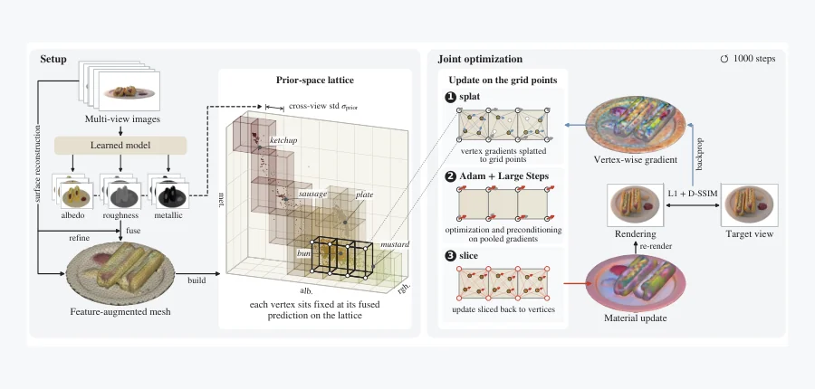 arXiv 2026-11-07 · cs.CV · #6 **[Integrating Learned Priors through Prior-Space Reparameterization for Physically Based Inverse Rendering](https://arxiv.org/abs/2611.07573)** [Hun Hwangbo , Minjun Park , Yongsung Kim , Wooseok Song , Jungmin Ko , Junghyun Hwang , Sungroh Yoon](https://arxiv.org/a… 机构：Seoul National University（[PDF](https://arxiv.org/pdf/2611.07573)） [Paper](https://arxiv.org/abs/2611.07573) · [图源](https://arxiv.org/html/2611.07573v1/schematic_lattice.png) 

中文摘要
基于物理的逆渲染把外观分解为材料和照明；这一问题具有歧义，学习得到的材料预测可提供有用先验。多数现有方法通过辅助正则损失引入这些线索，这会改变优化目标，并需要平衡先验与光度拟合的影响。我们提出先验引导的材料重参数化，用预测特征之间的关系约束优化空间，同时保持目标函数不变。我们将多视角材料预测融合到网格上，在所得先验特征空间中构建 permutohedral lattice。预测相似的表面点共享材料变量，并与几何、照明一同在纯光度目标下优化。使用两种学习式预测器，在三个合成基准和 Stanford-ORB 上的实验表明，材料分解和重光照得到改善。在 Synthetic4Relight 和 TensoIR-Synthetic 上，相比所评估的最强网格基线，重光照 PSNR 提高 1.5–2.5 dB；在受控比较中，也优于使用相同先验的正则损失。我们进一步发现，重参数化汇聚了有噪声的光度梯度，使不同采样视角下的更新更加一致。这种一致性允许缩短联合优化日程：在 TensoIR-Synthetic 上，耗时不足一分钟，同时重光照质量仍超过所有评估基线。 <a href="https://arxiv.org/abs/2611.07573">原摘要来源</a>
 |
| 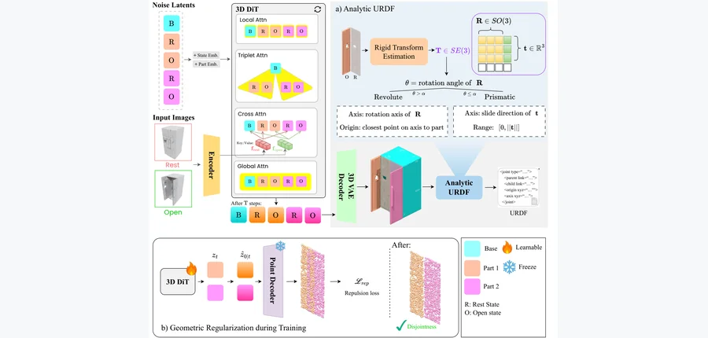 arXiv 2026-11-07 · cs.CV · #7 **[ArtCrafter: Feed-Forward Generation of Articulated 3D Object with Analytic Joint Derivation](https://arxiv.org/abs/2611.07658)** [Minh Canh Tu , Quang-Binh Nguyen , Khoi Nguyen](https://arxiv.org/abs/2611.07658) 机构：Qualcomm AI Research（[PDF](https://arxiv.org/pdf/2611.07658)） [Paper](https://arxiv.org/abs/2611.07658) · [图源](https://arxiv.org/html/2611.07658v1/4_overview_pipeline.png) 

中文摘要
可关节运动的三维资产对于机器人仿真和训练至关重要，但从日常图像生成此类资产面临关键难题：恢复相互一致的部件几何与运动学。我们提出 ArtCrafter，一种前馈生成模型，利用物体静止和打开状态的两张图像，可控生成可关节运动的三维物体。核心是基于 DiT 的生成模型，在一次前向传播中联合生成两个关节状态下的部件级网格。受 Slot Attention 启发，其去噪过程采用 $1+2N$ 个槽：一个共享基座槽，以及 $N$ 对静止／打开槽，促使每一对绑定到同一个运动学部件。为保证生成的部件在几何上一致且互不重叠，我们引入 Triplet Attention，通过共享基座槽约束每对静止／打开槽的跨状态几何一致性；同时在解码的部件点云上施加排斥损失 $\mathcal{L}_{\mathrm{rep}}$，防止去噪期间部件相互穿透。得到成对网格后，根据每对静止／打开网格之间的刚体变换，解析推导 URDF 关节的类型、轴、原点和范围，提供可解释的替代方案，而无需学习式关节参数回归。在分布内和分布外数据集上的大量实验表明，相同双状态输入设置下，ArtCrafter 的几何质量和关节精度优于现有方法；与采用其他输入设置和范式的方法相比也有竞争力。 <a href="https://arxiv.org/abs/2611.07658">原摘要来源</a>
 | 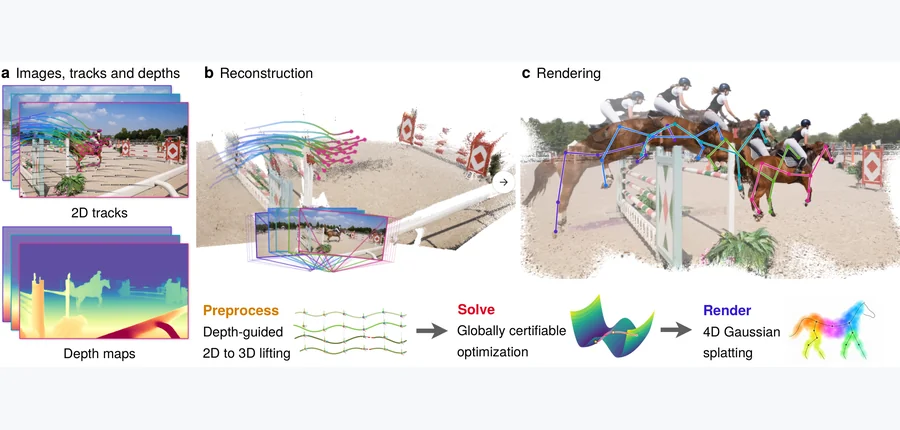 arXiv 2026-11-07 · cs.CV · #8 **[XM4D: 4D Reconstruction through Certifiable Geometric Optimization](https://arxiv.org/abs/2611.07902)** [Haoyu Han , Jack Benarroch Jedlicki , Jiahui Lei , Heng Yang](https://arxiv.org/abs/2611.07902) 机构：Harvard University / University of California, Berkeley（[PDF](https://arxiv.org/pdf/2611.07902)） [Paper](https://arxiv.org/abs/2611.07902) · [图源](https://arxiv.org/html/2611.07902v1/teaser.png) 

中文摘要
准确的四维重建仍具挑战：联合估计相机运动、场景几何和非刚性形变涉及高度非凸优化，难以保证全局最优。我们提出 XM4D，一种基于可认证全局最优几何优化的准确、高效四维重建框架。通过分开估计相机运动和非刚性形变，我们将两个阶段都表述为结构化二次约束二次规划（QCQP），可进行半定规划（SDP）松弛，并得到可验证的全局最优证书。在相机运动估计中，利用基础深度预测模型将静态点轨迹提升到三维，构造同时估计相机位姿、深度尺度和静态路标点的尺度化束调整问题。通过解析消去平移和路标点，将问题化简为仅关于尺度化旋转的 QCQP。对非刚性重建，我们用嵌入式形变图（EDG）表示动态运动，并证明其跟踪、刚性和时间正则目标同样可化简为仅关于旋转的 QCQP。两个问题均可作 SDP 松弛，并用基于黎曼优化的 GPU 加速 Burer–Monteiro 求解器高效求解。恢复的几何还用于初始化动态高斯泼溅，以作光度细化。七个基准上的大量实验表明，该方法在静态和动态场景中准确估计相机运动，可高效扩展至数千帧，并达到最佳的新视角渲染质量。 <a href="https://arxiv.org/abs/2611.07902">原摘要来源</a>
 | 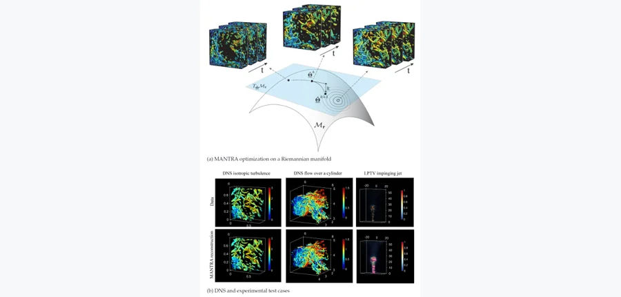 arXiv 2026-11-07 · physics.flu-dyn · #9 **[Low-Rank Tensor Manifolds for Turbulent Field Reconstruction from Sparse Data](https://arxiv.org/abs/2611.08411)** [Nazmus Sakib , Alexander G. Mychkovsky , Hessam Babaee](https://arxiv.org/abs/2611.08411) 机构：University of Pittsburgh / Naval Nuclear Laboratory（[PDF](https://arxiv.org/pdf/2611.08411)） [Paper](https://arxiv.org/abs/2611.08411) · [图源](https://arxiv.org/html/2611.08411v1/figure_1.png) 

中文摘要
从稀疏且不规则的测量重建湍流场仍很困难，因为底层逆问题严重欠定。我们提出 MANTRA，一种基于流形的张量框架：在连续张量积空间中表示各速度分量，同时将其系数张量限制在低秩 Tucker 流形上。这种结构无需网格化观测或控制方程，就能提供紧凑、适应数据的表征。黎曼优化以及秩和基函数复杂度的自适应选择，使模型利用各坐标方向的时空相关性。在强迫各向同性湍流和绕圆柱流的仿真中，即使采样密度比底层网格低数个数量级，MANTRA 仍能恢复多尺度结构；在高斯噪声达到峰值速度 20% 时也保持准确。它还能从稀疏观测恢复主要的坐标方向相关结构。用于振荡冲击射流的实验粒子追踪测速数据时，MANTRA 揭示了单看散乱测量难以发现的随时间演化结构。 <a href="https://arxiv.org/abs/2611.08411">原摘要来源</a>
 |
| 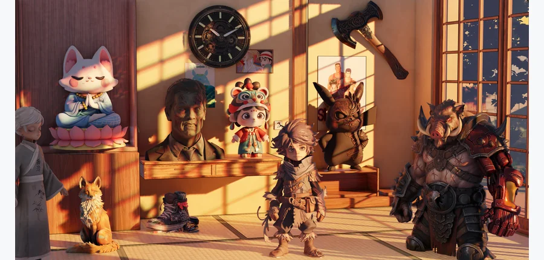 SIGGRAPH Asia 2026 (TOG) · #10 **[MIKU: Material Invariance and Knowledge Unification for PBR Generation](https://arxiv.org/abs/2611.07354)** [Yajie Bao , Jiaye Fu , Youtian Lin , Shuang Wu , Jiachen Qian , Feihu Zhang , Xun Cao , Yao Yao](https://arxiv.org/abs/26… 机构：Nanjing University / Peking University / The University of Hong Kong / DreamTech（[PDF](https://arxiv.org/pdf/2611.07354)） [Paper](https://arxiv.org/abs/2611.07354) · [图源](https://arxiv.org/html/2611.07354v1/figs_new/teaser.jpg) 

中文摘要
高质量的基于物理渲染（PBR）材料生成仍具挑战，因为数据集和合成流程缺乏标准化表征。材料定义、渲染约定和参数化方式不同，会导致结果不稳定且物理上不合理。我们提出 MIKU，一个面向不同三维内容领域的统一框架，用于标准化 PBR 资产表征和物理一致的材料生成。核心是统一处理流程，从数据预处理到最终纹理合成保持一致的几何与纹理表征。归一化方案把异质材料参数统一到共同表征空间，从而支持稳健的跨数据集训练和推理。在此基础上，我们在两阶段多视角合成框架中训练一种具有物理感知能力的 PBR 纹理扩散模型。首先，几何感知的反照率生成在显式几何引导下合成多视角反照率图，以保证跨视角外观一致。其次，金属度—粗糙度生成根据生成的反照率和统一表征，使用扩散模型预测物理上合理的粗糙度与金属度图。模型在标准化数据上端到端训练，学习生成遵循类别级材料先验和语义部件边界的材料。通过把表征标准化与外观合成分开，MIKU 显著改善材料生成的稳定性和物理一致性。大量实验显示其纹理质量及跨物体部件的语义一致性达到最佳，推动三维内容创建的自动化材料生成。 <a href="https://arxiv.org/abs/2611.07354">原摘要来源</a>
 | 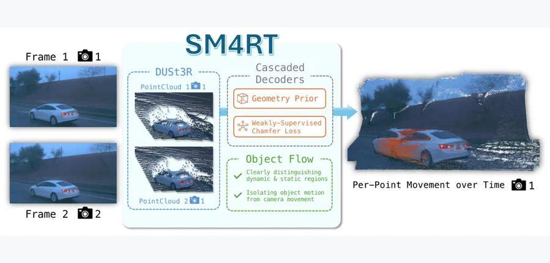 arXiv 2026-11-07 · cs.CV · #11 **[SM4RT: Cascaded Feed-forward Model for 4D Reconstruction](https://arxiv.org/abs/2611.08436)** [Pang-Chi Lo , Jhao-Syun Lai , Tsung-Wei Ke](https://arxiv.org/abs/2611.08436) 机构：Carnegie Mellon University / National Taiwan University（[PDF](https://arxiv.org/pdf/2611.08436)） [Paper](https://arxiv.org/abs/2611.08436) · [Project](https://sm4rt-eailab.github.io/) · [图源](https://arxiv.org/html/2611.08436v1/teaser_new.png) 

中文摘要
我们提出 SM4RT，一种从 RGB 视频重建动态场景的多任务级联前馈模型。现有前馈方法通常分别处理几何重建和运动估计，而且常在同一坐标系中预测运动，必须同时考虑相机移动；SM4RT 先重建三维几何，再以预测结构为基础估计运动，按顺序解决这两个任务。通过在各像素对应的相机坐标系中表示其三维运动，SM4RT 减少了相机运动带来的歧义。为解决真实场景运动标签稀疏的问题，SM4RT 还引入弱监督损失，利用另一时间步的已标注点位置约束未标注点运动。我们在 Kubric、Waymo 和 Point Odyssey 三个动态场景数据集上评估运动估计，SM4RT 在多数指标上优于先前基线；另在五个动态场景数据集上评估几何重建，结果与最佳方法相当。总体上，这一统一框架表明，将几何重建与运动估计级联既可避免性能权衡，又可借助更好的几何推理改善运动估计。 <a href="https://arxiv.org/abs/2611.08436">原摘要来源</a>
 | 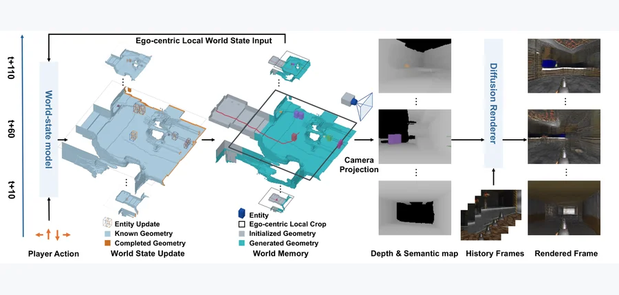 arXiv 2026-11-07 · cs.CV · #12 **[PlayGen2: Learning Real-Time Playable Worlds with Explicit 3D State](https://arxiv.org/abs/2611.07867)** [Jihai Zhang , Yuhan Zhou , Junyou Li , Deheng Ye , Qi Dou , Yu Cheng](https://arxiv.org/abs/2611.07867) 机构：The Chinese University of Hong Kong / Wellington College / Tencent / Nanyang Technological University（[PDF](https://arxiv.org/pdf/2611.07867)） [Paper](https://arxiv.org/abs/2611.07867) · [图源](https://arxiv.org/html/2611.07867v1/teaser.png) 

中文摘要
构建可玩的世界不只需要生成可信视频，还需要响应式控制、持久的空间结构，以及与动态实体的一致交互。如果仅用生成帧作为循环世界表征，这些要求就会依附于视角相关的外观合成，难以维持长期时空一致性。我们提出 PlayGen2，一种将学习式三维状态演化与神经渲染分开的实时交互世界模型。PlayGen2 维护持久世界记忆：静态几何由体素占据网格表示，玩家及其他实体则有按身份索引的三维状态。在固定大小的局部区域中，世界状态模型联合学习动作条件下的实体动力学、几何补全和实体发现，并将更新写入持久世界记忆。单独的神经渲染器从世界状态的深度和语义投影合成第一人称观测，生成图像不反馈给状态预测。以 Doom 为测试平台，我们展示模型能学习世界动力学，包括几何感知的玩家运动和玩家与非玩家角色的交互。框架具有计算效率：在搭载 M4 Pro 芯片的 MacBook Pro 上，完整仿真和渲染流程的后端延迟约为 160 ms。除了单人交互，我们还展示在未见过的 Doom 地图上的零样本部署、通过组合单人模型实现多人交互，以及通过基于规则的状态干预实现可编程玩法。这些能力展示了所学习游戏世界模型的可迁移性和可扩展性。代码与预训练权重已公开。 <a href="https://arxiv.org/abs/2611.07867">原摘要来源</a>
 |
| 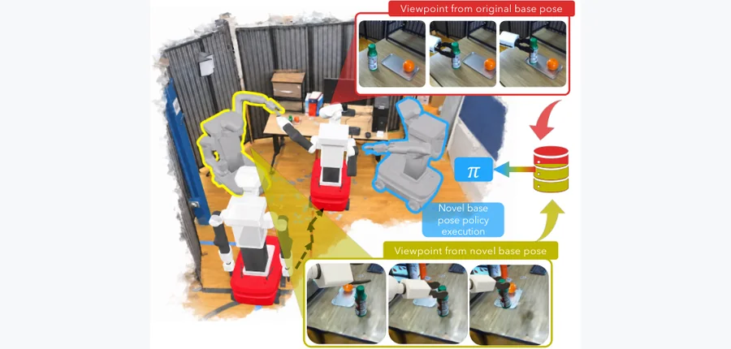 arXiv 2026-11-07 · cs.RO · #13 **[MOMASPLAT: Dynamic Novel-View Demonstration Augmentation for Mobile Manipulation](https://arxiv.org/abs/2611.08372)** [Sateesh Kumar , Arnav Balaji , Arpit Bahety , Skand Peri , Georgios Pavlakos , Roberto Martín-Martín](https://arxiv.org… 机构：The University of Texas at Austin（[PDF](https://arxiv.org/pdf/2611.08372)） [Paper](https://arxiv.org/abs/2611.08372) · [Project](https://robin-lab.cs.utexas.edu/momasplat/) · [图源](https://arxiv.org/html/2611.08372v1/teaser.png) 

中文摘要
通过模仿学习训练的视觉运动策略对相机视角变化高度敏感。这对移动操作（MoMa）尤其成问题：受导航不确定性、定位漂移和环境约束影响，机器人很少恰好从采集演示时相同的底座位姿执行操作。近期方法利用新视角合成（NVS）为未见视角扩增演示，但假设场景静态，因而无法在接触后的交互阶段重新渲染被操作物体，最关键的演示片段仍未得到扩增。我们提出 MOMASPLAT，一种面向移动操作的新视角演示扩增框架，可从未见的机器人底座位姿合成包含动态物体交互的完整操作轨迹。关键观察是，常规 MoMa 数据采集天然提供重建静态场景与被操作物体三维形态所需的多视角观测。MOMASPLAT 结合三维高斯泼溅、前馈三维基础模型和基于运动学的动作重定向，分别重建场景和被操作物体，从新视角渲染，并生成与变换后动作配对、几何一致的合成演示。我们在三个场景中涉及刚体和关节物体的五项真实移动操作任务上评估 MOMASPLAT，并在仿真中以真值验证合成演示的保真度。MOMASPLAT 显著提高对未见底座位姿的稳健性：平均成功率超过最强基线的两倍，在所有基线失败的大幅底座位移条件下仍保持非零成功率，同时减少大规模真实数据采集需求。 <a href="https://arxiv.org/abs/2611.08372">原摘要来源</a>
 | 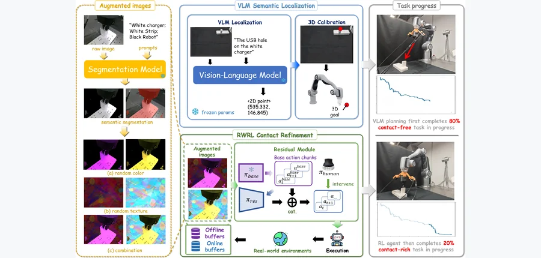 NeurIPS 2026 · #14 **[Semantics-to-Contact: A Stagewise Framework for Robust Contact-Rich Manipulation](https://arxiv.org/abs/2611.07532)** [Guanren Qiao , Ruixiang Ouyang , Sheng Xu , Yueci Deng , Yunxin Tai , Kui Jia , Guiliang Liu](https://arxiv.org/abs/2611.… 机构：The Chinese University of Hong Kong, Shenzhen / DexForce / Shenzhen Loop Area Institute（[PDF](https://arxiv.org/pdf/2611.07532)） [Paper](https://arxiv.org/abs/2611.07532) · [Project](https://edem-ai.github.io/S2C/) · [图源](https://arxiv.org/html/2611.07532v1/pipeline.png) 

中文摘要
富接触操作需要在复杂接触动力学下精确控制，同时对多样视觉条件保持稳健；但真实世界强化学习常过拟合训练场景的外观。我们提出 Semantics-to-Contact（S2C），一种视觉稳健的富接触操作分阶段框架。核心是将问题分为语义聚焦和接触细化两阶段。第一阶段中，视觉语言模型在外观多变的场景中定位与任务有关的区域，提供粗略空间引导并减轻探索负担。第二阶段中，真实世界的人在环残差强化学习策略利用力反馈，在定位区域内学习精细接触行为。为进一步提升视觉稳健性，我们引入以物体为中心的视觉增强：保留机器人和任务相关物体，同时随机化背景外观。在六项真实富接触操作任务上的实验显示，S2C 相比强基线持续提高成功率，并在显著视觉和位置变化下保持可靠性能。这些结果说明，分阶段语义聚焦与接触细化为视觉稳健的真实富接触操作提供了实用途径。演示见原文链接。 <a href="https://arxiv.org/abs/2611.07532">原摘要来源</a>
 | 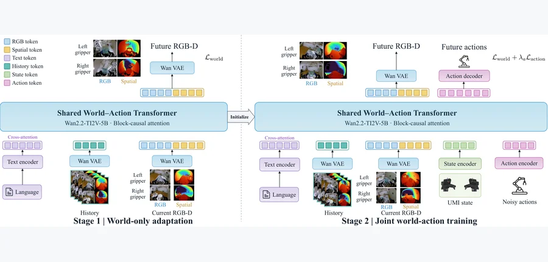 arXiv 2026-11-07 · cs.RO · #15 **[Spatial-UMI-Dream: Scaling World Action Models with Metric Geometry for UMI Manipulation](https://arxiv.org/abs/2611.07229)** [Weiduo Yuan , Ze Yuan , Sihan Liu , Jionghao Wang , Liang Heng , Zhenyu Zhao , Yue Wang](https://arxiv.org/abs/2611.07229) 机构：University of Southern California / Carnegie Mellon University / Texas A&amp;M University（[PDF](https://arxiv.org/pdf/2611.07229)） [Paper](https://arxiv.org/abs/2611.07229) · [图源](https://arxiv.org/html/2611.07229v1/fig2_method.png) 

中文摘要
通用操作接口（UMI）使演示采集可脱离特定机器人进行扩展。然而，其移动且近距离的夹爪相机在缺少稳定外部视角时将相机运动与物体运动耦合，使精确操作所需的度量几何隐含在 RGB 中。我们提出 Spatial-UMI-Dream，一个 5B 参数的空间世界动作模型（WAM），通过两阶段训练——先仅适应世界建模，再联合学习世界和动作——在 605 小时 RGB-D UMI 数据上预训练，联合预测未来 RGB、与鱼眼对齐的度量深度和动作。由双目得到的深度使场景尺度与空间关系在统一的双夹爪 RGB-D 表征中显式化。评估 UMI 策略还需检验：UMI 与机器人无关的演示采集能否带来跨机器人形态的策略泛化，以及对环境变化的稳健性。我们提出基于 RoboTwin、包含二十项任务的仿真基准 RoboTwin-UMI，配备 UMI 腕部鱼眼观测，可分别或联合在环境与形态变化下对 UMI 策略进行可控、可重复且无需额外微调的评估。在 RoboTwin-UMI 上，Spatial-UMI-Dream 在域内达到 79.10% 成功率，在形态与环境同时变化时达到 72.15%，分别比各设置下所评估的最强基线高 4.65 和 10.30 个百分点。在所评估策略中，其形态迁移的成功率降幅也最小。在匹配的预训练消融中，相比 RGB-D 预训练，仅 RGB 预训练使域内成功率降低 5.75 个百分点。在六项真实任务中，Spatial-UMI-Dream 的平均成功率为 85.0%，比最强基线高 24.2 个百分点。项目页见原文链接。 <a href="https://arxiv.org/abs/2611.07229">原摘要来源</a>
 |
| 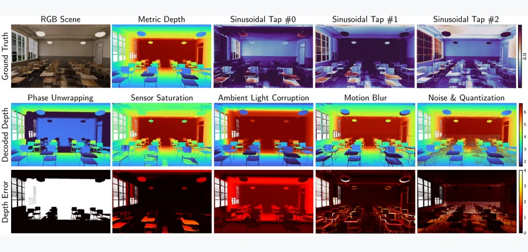 arXiv 2026-11-07 · cs.RO · #16 **[VisionSIM: Beyond Idealized Sensors - A Multi-Modal Simulator for Robot Perception](https://arxiv.org/abs/2611.08368)** [Sacha Jungerman , Kaustubh Sadekar , Avery Gump , Sriram Narayanan , Shantanu Gupta , Bhuyashi Deka , Srinivasa Narasimha… 机构：University of Wisconsin–Madison / Portland State University / Carnegie Mellon University（[PDF](https://arxiv.org/pdf/2611.08368)） [Paper](https://arxiv.org/abs/2611.08368) · [图源](https://arxiv.org/html/2611.08368v1/itof.png) 

中文摘要
机器人感知越来越依赖将相机与事件相机、SPAD、iToF/dToF 和热成像等新模态组合的异质传感器套件。但现有仿真器把这些传感器理想化，掩盖了限制真实部署的模态特有失效模式。我们提出 VisionSIM，一个统一且基于物理的仿真平台，通过建模多种传统及新兴模态的原始物理测量过程，将传感器真实性置于核心。平台可细粒度控制物理传感器参数，重现通用仿真器忽略的失效模式：LiDAR 的回波堆积与眩光；iToF 的相位缠绕、饱和和运动伪影；事件相机的不应期丢失；热相机依赖历史的辐射。这使在相同场景和轨迹上原则性地比较不同模态成为可能。我们发布该平台，以及一个包含同步原始测量和丰富真值标注的大型室内数据集。 <a href="https://arxiv.org/abs/2611.08368">原摘要来源</a>
 | 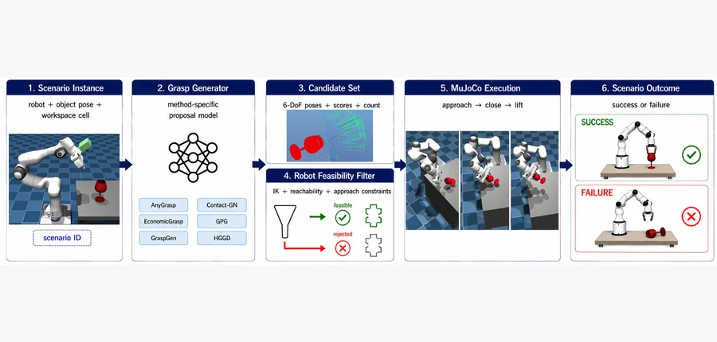 ICARCV 2026 · #17 **[GraspBench: Execution-Aware Cross-Robot Evaluation of 6-DoF Grasp Generation in MuJoCo](https://arxiv.org/abs/2611.07651)** [Abdul Basit , Bibek Poudel , Muhammad Shafique](https://arxiv.org/abs/2611.07651) 机构：New York University Abu Dhabi（[PDF](https://arxiv.org/pdf/2611.07651)） [Paper](https://arxiv.org/abs/2611.07651) · [图源](https://arxiv.org/html/2611.07651v1/figures/methodology_graspBench_paper.jpg) 

中文摘要
现代六自由度抓取生成器常以抓取评分、数据集级指标或单机器人演示评估，但候选抓取的质量并不单独决定特定机器人能否执行。我们提出 GraspBench，一套受控的 MuJoCo 协议，用机器人专属逆运动学筛选、运动规划及固定的接近—闭合—抬升执行过程，评估完整的抓取生成流水线。GraspBench 在四种机器人形态、五个诊断物体和结构化桌面位姿网格上评估六套配置好的流水线，每种方法得到 540 个场景，共 3,240 次方法—场景评估。未返回结果保守计为失败；成功依据各方法执行程序给出的二值抬升判据。GraspGen 总成功率最高（73.1%），其次是 EconomicGrasp（63.5%）；按机器人和物体分析时，不同形态及几何之间存在明显差异。GPG 产生最多的原生候选，但成功率为 44.3%，说明候选数量本身不能保证机器人可执行抓取。考虑聚类的配对区间支持主要方法差异，但没有估计重复执行的不确定性。结果刻画的是固定场景中配置完整的流水线，而非模型内在质量或随机重复性，表明抓取表现共同取决于生成器、机器人形态、场景和执行协议。 <a href="https://arxiv.org/abs/2611.07651">原摘要来源</a>
 | 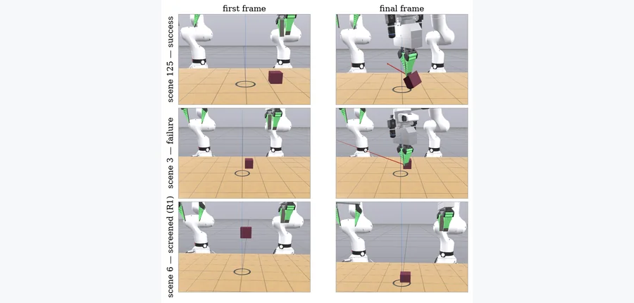 IROS 2026 Scale-Infra Workshop · #18 **[Closed-Loop Physics-Based Manipulation Evaluation at a Commodity Price: What 4.4 L4 GPU hours at $3.50 Buys You](https://arxiv.org/abs/2611.07441)** [Rohun Kshirsagar , Diana Rypkema](https://arxiv.org/abs/2611.07441) 机构：affiliation 未确认 [Paper](https://arxiv.org/abs/2611.07441) · [图源](https://arxiv.org/html/2611.07441v1/fig3_rollouts.png) 

中文摘要
以足够统计规模评估富接触机器人操作，过去主要只有资源充足的实验室能够完成，因此需要更便宜高效的方案。我们提出可复现的评估封装，基于此前在无服务器商用 GPU 上以 200 次滚动为规模的研究；每次重复约花费 3.50 美元、耗时 38 分钟，使用八个并行分片共 4.4 个 L4 GPU 小时。借助该封装，我们报告稀疏数据下动作分块的一个部分受控负结果：三个独立训练的分块检查点在 780 次滚动中没有真正成功，而三个单步检查点的成功率为 2.6%–11.8%。逐步重规划对照在一定程度上将失败机制定位于分块预测而非开环执行，即问题出在训练形式和多步预测。本工作通过可复用评估封装，进一步降低了基于物理的策略开发与评估门槛。 <a href="https://arxiv.org/abs/2611.07441">原摘要来源</a>
 |
| 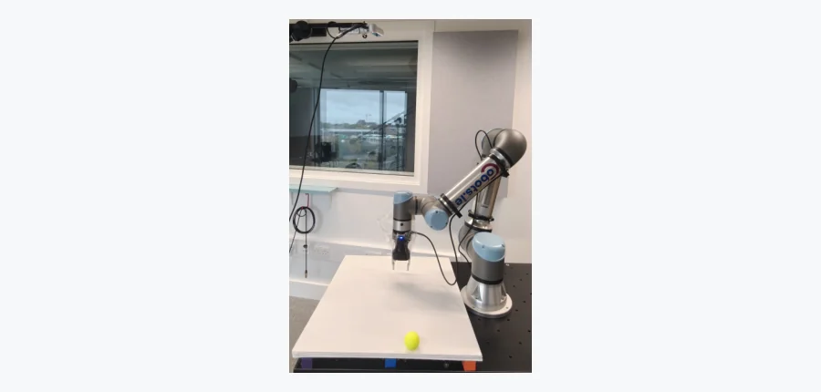 arXiv 2026-11-07 · cs.RO · #19 **[Time-Indexed Skill Success Models for Latency-Aware Skill Selection and Timing in Dynamic Manipulation](https://arxiv.org/abs/2611.07964)** [Mohsen Omidi , Maria Chiara Leva , Brian Vaughan](https://arxiv.org/abs/2611.07964) 机构：Technological University Dublin（[PDF](https://arxiv.org/pdf/2611.07964)） [Paper](https://arxiv.org/abs/2611.07964) · [图源](https://arxiv.org/html/2611.07964v1/hw_setup.png) 

中文摘要
机器人操作运动物体时，选定技能开始执行时观测已经过时，而最佳技能可能在数百毫秒内改变。然而，技能能力模型预测的是观测时刻启动技能的成功率。我们提出时间索引技能成功模型，预测在给定延迟后启动技能时整个任务的成功率。模型在一组启动延迟上分支得到的滚动轨迹上训练，使滚动时域规划器在固定或随机延迟下同时选择技能及启动时刻。在 MuJoCo 中使用 UR5e 和三种技能捕获滑动冰球的研究中，延迟为 100–300 ms 时，该规划器比静态能力模型高 2.8–6.2 个百分点，即便静态模型使用启动状态的点预测或采样预测也是如此。五次完整运行（三个训练种子、两种分布偏移）中，相对四种基线的全部 80 个配对 95% 区间都未包含零。延迟启动时，时间索引模型校准较好（预期校准误差 0.009，对比 0.239）；在延迟期间暂停世界会使成功率被高估最多 23 个百分点。真实 UR5e 在注入 0.2 s 延迟后捕获滚动球的实验中，一个在匹配硬件的仿真器中训练的静态模型，对预先指定且被其评为至少 0.8 成功概率的 35 次延迟启动子集预测成功率为 99%；实际其中 63% 成功（95% 区间 46%–77%），时间索引模型预测为 56%。在这种单技能、可预测的情形中，匹配的物理预测同样校准良好。 <a href="https://arxiv.org/abs/2611.07964">原摘要来源</a>
 | 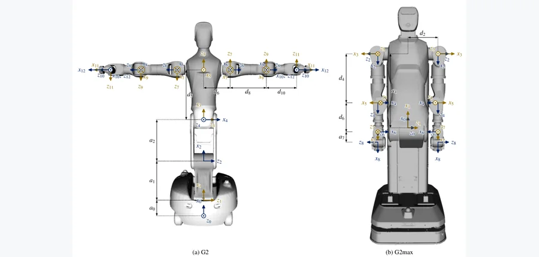 arXiv 2026-11-07 · cs.RO · #20 **[Whole-Body Elasto-Geometrical Calibration of Wheeled Humanoid Robots Using a Shared-Waist Dual-Chain Model](https://arxiv.org/abs/2611.07560)** [Pengxin Zha , Yi Lu , Haojun Ma , Jun Zhu , Minghao Qiu , Xiaoyan Wang , Wei Shan , Maoqing Yao](https://arxiv.org/abs/26… 机构：affiliation 未确认 [Paper](https://arxiv.org/abs/2611.07560) · [图源](https://arxiv.org/html/2611.07560v1/fig1_frames.png) 

中文摘要
轮式人形机器人的双臂装在同一个可驱动腰部上，通常没有力矩传感器，因此两个末端执行器的精度都依赖同一腰部模型。先估计追踪器和目标的外参，再根据光学追踪器测得的双臂法兰目标位置，在同一问题中辨识腰部和双臂。运动学模型完整包含腰部基座、平行轴及分支参数；手臂柔顺性由测得的力矩驱动，腰部柔顺性由机器人质量模型的重力力矩驱动；具有证据最大化尺度的高斯先验用于稳定估计。独立及顺序单链标定都是该问题的受限形式，其腰部信息是单链 Schur 补之和。在两个腰部不同的机器人上，分别在无负载与带负载条件下，标定将留出位姿的平均误差从 11.3–31.1 mm 降至 0.50–1.11 mm。从 20 个位姿到全部训练集的每一种规模，该方法的平均误差比两种已发表全身标定方法的改编版本低 17%–63%，主要收益来自腰部柔顺性。独立标定会产生两个腰部模型；任选其一供双臂共用，另一只手臂的误差最高会升至 3.21 mm。 <a href="https://arxiv.org/abs/2611.07560">原摘要来源</a>
 |   |
<!-- PAPER_CARDS_END -->

## 检索概况

- **官方批次／检索窗口**：2026-11-06（Friday, 6 November 2026）；北京时间 2026-11-07 09:05–09:21 核验。
- **来源**：arXiv 官方各分类 `New submissions`；只将 New 放入主榜，按 arXiv ID 去重。
- **分类范围**：cs.CV、cs.GR、cs.RO、cs.AI、cs.LG；补查 physics、cond-mat、math.OC/NA/DS、stat.ML、eess.IV/SY/SP。
- **总命中**：14 页 New 680 条（去重 680 个 ID）；Cross 398 条；Replacement 778 条。主榜入选 **20** 篇。
- **筛选说明**：按标题和摘要检查三维几何、物理机制及具体机器人任务和实验；相关性、机构强度、局限及改进均为编辑推断。
- **配图／摘要**：20/20 篇有经核对的官方论文图，20/20 篇有完整原摘要与中文译文；缺图 0，缺原摘要 0。

| 官方 New 分类页 | 批次 | New | Cross | Replacement |
|---|---|---:|---:|---:|
| [cond-mat](https://arxiv.org/list/cond-mat/new?show=2000) | 2026-11-06 | 82 | 39 | 80 |
| [cs.AI](https://arxiv.org/list/cs.AI/new?show=2000) | 2026-11-06 | 75 | 123 | 163 |
| [cs.CV](https://arxiv.org/list/cs.CV/new?show=2000) | 2026-11-06 | 107 | 31 | 120 |
| [cs.GR](https://arxiv.org/list/cs.GR/new?show=2000) | 2026-11-06 | 7 | 4 | 5 |
| [cs.LG](https://arxiv.org/list/cs.LG/new?show=2000) | 2026-11-06 | 145 | 79 | 193 |
| [cs.RO](https://arxiv.org/list/cs.RO/new?show=2000) | 2026-11-06 | 68 | 13 | 34 |
| [eess.IV](https://arxiv.org/list/eess.IV/new?show=2000) | 2026-11-06 | 2 | 4 | 5 |
| [eess.SP](https://arxiv.org/list/eess.SP/new?show=2000) | 2026-11-06 | 24 | 6 | 8 |
| [eess.SY](https://arxiv.org/list/eess.SY/new?show=2000) | 2026-11-06 | 26 | 23 | 16 |
| [math.DS](https://arxiv.org/list/math.DS/new?show=2000) | 2026-11-06 | 12 | 4 | 22 |
| [math.NA](https://arxiv.org/list/math.NA/new?show=2000) | 2026-11-06 | 15 | 7 | 17 |
| [math.OC](https://arxiv.org/list/math.OC/new?show=2000) | 2026-11-06 | 29 | 14 | 25 |
| [physics](https://arxiv.org/list/physics/new?show=2000) | 2026-11-06 | 78 | 40 | 58 |
| [stat.ML](https://arxiv.org/list/stat.ML/new?show=2000) | 2026-11-06 | 10 | 11 | 32 |

## Top papers

| # | 论文 | arXiv | 分类 | 作者 | 机构 | 相关性（推断） | 机构强度（推断） | 阅读优先级 |
|---:|---|---|---|---|---|---|---|---|
| 1 | [Structure from Collision via Hypothesis-Space Reasoning](https://arxiv.org/pdf/2611.07900) | [arXiv:2611.07900](https://arxiv.org/abs/2611.07900) | [cs.CV](https://arxiv.org/abs/2611.07900) | [Takuhiro Kaneko](https://arxiv.org/abs/2611.07900) | NTT, Inc.（[PDF](https://arxiv.org/pdf/2611.07900)） | 极高：三维几何／物理 | 高（推断） | A |
| 2 | [Deformable Contact-Aware 3D Object Placement](https://arxiv.org/pdf/2611.08005) | [arXiv:2611.08005](https://arxiv.org/abs/2611.08005) | [cs.CV](https://arxiv.org/abs/2611.08005) | [Songhe Wang , David Miller , Charles A. Kamhoua](https://arxiv.org/abs/2611.08005) | affiliation 未确认 | 极高：三维几何／物理 | 未评估（推断） | A |
| 3 | [GPWM: Modeling the World as 3D Particle Motion](https://arxiv.org/pdf/2611.08338) | [arXiv:2611.08338](https://arxiv.org/abs/2611.08338) | [cs.RO](https://arxiv.org/abs/2611.08338) | [Robert Ren , Matthew Bronars , He Zhu , Yikai Tang , Jianing Zhang , Sergey Zakharov , Pavel Tokmakov , Katerina Fragkiadaki](https://arxiv.org/abs/2611.08338) | Carnegie Mellon University / Toyota Research Institute（[PDF](https://arxiv.org/pdf/2611.08338)） | 极高：三维几何／物理 | 高（推断） | A |
| 4 | [TactileLab: Sim-to-Real Dexterous Robot Manipulation with Efficient Shear-Sensitive Tactile Simulation](https://arxiv.org/pdf/2611.07881) | [arXiv:2611.07881](https://arxiv.org/abs/2611.07881) | [cs.RO](https://arxiv.org/abs/2611.07881) | [Yijiong Lin , Wenhao He , Toby Jack , Max Yang , Haoran Li , Nathan F. Lepora](https://arxiv.org/abs/2611.07881) | Beijing Institute of Technology / University of Bristol / Xi’an Jiaotong-Liverpool University（[PDF](https://arxiv.org/pdf/2611.07881)） | 极高：三维几何／物理 | 高（推断） | A |
| 5 | [4D Point Splatting for mmWave Radar Micro-Doppler Differentiable Rendering](https://arxiv.org/pdf/2611.08342) | [arXiv:2611.08342](https://arxiv.org/abs/2611.08342) | [cs.CV](https://arxiv.org/abs/2611.08342) | [Adnan Armouti , Guanyue Qian , Rajalakshmi Nandakumar](https://arxiv.org/abs/2611.08342) | Cornell Tech / New York University（[PDF](https://arxiv.org/pdf/2611.08342)） | 极高：三维几何／物理 | 高（推断） | A |
| 6 | [Integrating Learned Priors through Prior-Space Reparameterization for Physically Based Inverse Rendering](https://arxiv.org/pdf/2611.07573) | [arXiv:2611.07573](https://arxiv.org/abs/2611.07573) | [cs.CV](https://arxiv.org/abs/2611.07573) | [Hun Hwangbo , Minjun Park , Yongsung Kim , Wooseok Song , Jungmin Ko , Junghyun Hwang , Sungroh Yoon](https://arxiv.org/abs/2611.07573) | Seoul National University（[PDF](https://arxiv.org/pdf/2611.07573)） | 极高：三维几何／物理 | 高（推断） | A |
| 7 | [ArtCrafter: Feed-Forward Generation of Articulated 3D Object with Analytic Joint Derivation](https://arxiv.org/pdf/2611.07658) | [arXiv:2611.07658](https://arxiv.org/abs/2611.07658) | [cs.CV](https://arxiv.org/abs/2611.07658) | [Minh Canh Tu , Quang-Binh Nguyen , Khoi Nguyen](https://arxiv.org/abs/2611.07658) | Qualcomm AI Research（[PDF](https://arxiv.org/pdf/2611.07658)） | 极高：三维几何／物理 | 高（推断） | A |
| 8 | [XM4D: 4D Reconstruction through Certifiable Geometric Optimization](https://arxiv.org/pdf/2611.07902) | [arXiv:2611.07902](https://arxiv.org/abs/2611.07902) | [cs.CV](https://arxiv.org/abs/2611.07902) | [Haoyu Han , Jack Benarroch Jedlicki , Jiahui Lei , Heng Yang](https://arxiv.org/abs/2611.07902) | Harvard University / University of California, Berkeley（[PDF](https://arxiv.org/pdf/2611.07902)） | 极高：三维几何／物理 | 高（推断） | A |
| 9 | [Low-Rank Tensor Manifolds for Turbulent Field Reconstruction from Sparse Data](https://arxiv.org/pdf/2611.08411) | [arXiv:2611.08411](https://arxiv.org/abs/2611.08411) | [physics.flu-dyn](https://arxiv.org/abs/2611.08411) | [Nazmus Sakib , Alexander G. Mychkovsky , Hessam Babaee](https://arxiv.org/abs/2611.08411) | University of Pittsburgh / Naval Nuclear Laboratory（[PDF](https://arxiv.org/pdf/2611.08411)） | 极高：三维几何／物理 | 高（推断） | A |
| 10 | [MIKU: Material Invariance and Knowledge Unification for PBR Generation](https://arxiv.org/pdf/2611.07354) | [arXiv:2611.07354](https://arxiv.org/abs/2611.07354) | [cs.CV](https://arxiv.org/abs/2611.07354) | [Yajie Bao , Jiaye Fu , Youtian Lin , Shuang Wu , Jiachen Qian , Feihu Zhang , Xun Cao , Yao Yao](https://arxiv.org/abs/2611.07354) | Nanjing University / Peking University / The University of Hong Kong / DreamTech（[PDF](https://arxiv.org/pdf/2611.07354)） | 极高：三维几何／物理 | 高（推断） | A |
| 11 | [SM4RT: Cascaded Feed-forward Model for 4D Reconstruction](https://arxiv.org/pdf/2611.08436) | [arXiv:2611.08436](https://arxiv.org/abs/2611.08436) | [cs.CV](https://arxiv.org/abs/2611.08436) | [Pang-Chi Lo , Jhao-Syun Lai , Tsung-Wei Ke](https://arxiv.org/abs/2611.08436) | Carnegie Mellon University / National Taiwan University（[PDF](https://arxiv.org/pdf/2611.08436)） | 高：动态三维／交互 | 高（推断） | B |
| 12 | [PlayGen2: Learning Real-Time Playable Worlds with Explicit 3D State](https://arxiv.org/pdf/2611.07867) | [arXiv:2611.07867](https://arxiv.org/abs/2611.07867) | [cs.CV](https://arxiv.org/abs/2611.07867) | [Jihai Zhang , Yuhan Zhou , Junyou Li , Deheng Ye , Qi Dou , Yu Cheng](https://arxiv.org/abs/2611.07867) | The Chinese University of Hong Kong / Wellington College / Tencent / Nanyang Technological University（[PDF](https://arxiv.org/pdf/2611.07867)） | 高：动态三维／交互 | 高（推断） | B |
| 13 | [MOMASPLAT: Dynamic Novel-View Demonstration Augmentation for Mobile Manipulation](https://arxiv.org/pdf/2611.08372) | [arXiv:2611.08372](https://arxiv.org/abs/2611.08372) | [cs.RO](https://arxiv.org/abs/2611.08372) | [Sateesh Kumar , Arnav Balaji , Arpit Bahety , Skand Peri , Georgios Pavlakos , Roberto Martín-Martín](https://arxiv.org/abs/2611.08372) | The University of Texas at Austin（[PDF](https://arxiv.org/pdf/2611.08372)） | 高：动态三维／交互 | 高（推断） | B |
| 14 | [Semantics-to-Contact: A Stagewise Framework for Robust Contact-Rich Manipulation](https://arxiv.org/pdf/2611.07532) | [arXiv:2611.07532](https://arxiv.org/abs/2611.07532) | [cs.RO](https://arxiv.org/abs/2611.07532) | [Guanren Qiao , Ruixiang Ouyang , Sheng Xu , Yueci Deng , Yunxin Tai , Kui Jia , Guiliang Liu](https://arxiv.org/abs/2611.07532) | The Chinese University of Hong Kong, Shenzhen / DexForce / Shenzhen Loop Area Institute（[PDF](https://arxiv.org/pdf/2611.07532)） | 高：机器人接触／物理感知 | 高（推断） | B |
| 15 | [Spatial-UMI-Dream: Scaling World Action Models with Metric Geometry for UMI Manipulation](https://arxiv.org/pdf/2611.07229) | [arXiv:2611.07229](https://arxiv.org/abs/2611.07229) | [cs.RO](https://arxiv.org/abs/2611.07229) | [Weiduo Yuan , Ze Yuan , Sihan Liu , Jionghao Wang , Liang Heng , Zhenyu Zhao , Yue Wang](https://arxiv.org/abs/2611.07229) | University of Southern California / Carnegie Mellon University / Texas A&M University（[PDF](https://arxiv.org/pdf/2611.07229)） | 高：机器人接触／物理感知 | 高（推断） | B |
| 16 | [VisionSIM: Beyond Idealized Sensors - A Multi-Modal Simulator for Robot Perception](https://arxiv.org/pdf/2611.08368) | [arXiv:2611.08368](https://arxiv.org/abs/2611.08368) | [cs.RO](https://arxiv.org/abs/2611.08368) | [Sacha Jungerman , Kaustubh Sadekar , Avery Gump , Sriram Narayanan , Shantanu Gupta , Bhuyashi Deka , Srinivasa Narasimhan , Atul Ingle , Mohit Gupta](https://arxiv.org/abs/2611.08368) | University of Wisconsin–Madison / Portland State University / Carnegie Mellon University（[PDF](https://arxiv.org/pdf/2611.08368)） | 高：机器人接触／物理感知 | 高（推断） | B |
| 17 | [GraspBench: Execution-Aware Cross-Robot Evaluation of 6-DoF Grasp Generation in MuJoCo](https://arxiv.org/pdf/2611.07651) | [arXiv:2611.07651](https://arxiv.org/abs/2611.07651) | [cs.RO](https://arxiv.org/abs/2611.07651) | [Abdul Basit , Bibek Poudel , Muhammad Shafique](https://arxiv.org/abs/2611.07651) | New York University Abu Dhabi（[PDF](https://arxiv.org/pdf/2611.07651)） | 高：机器人任务／评测 | 高（推断） | B |
| 18 | [Closed-Loop Physics-Based Manipulation Evaluation at a Commodity Price: What 4.4 L4 GPU hours at $3.50 Buys You](https://arxiv.org/pdf/2611.07441) | [arXiv:2611.07441](https://arxiv.org/abs/2611.07441) | [cs.RO](https://arxiv.org/abs/2611.07441) | [Rohun Kshirsagar , Diana Rypkema](https://arxiv.org/abs/2611.07441) | affiliation 未确认 | 高：机器人任务／评测 | 未评估（推断） | B |
| 19 | [Time-Indexed Skill Success Models for Latency-Aware Skill Selection and Timing in Dynamic Manipulation](https://arxiv.org/pdf/2611.07964) | [arXiv:2611.07964](https://arxiv.org/abs/2611.07964) | [cs.RO](https://arxiv.org/abs/2611.07964) | [Mohsen Omidi , Maria Chiara Leva , Brian Vaughan](https://arxiv.org/abs/2611.07964) | Technological University Dublin（[PDF](https://arxiv.org/pdf/2611.07964)） | 高：机器人任务／评测 | 高（推断） | B |
| 20 | [Whole-Body Elasto-Geometrical Calibration of Wheeled Humanoid Robots Using a Shared-Waist Dual-Chain Model](https://arxiv.org/pdf/2611.07560) | [arXiv:2611.07560](https://arxiv.org/abs/2611.07560) | [cs.RO](https://arxiv.org/abs/2611.07560) | [Pengxin Zha , Yi Lu , Haojun Ma , Jun Zhu , Minghao Qiu , Xiaoyan Wang , Wei Shan , Maoqing Yao](https://arxiv.org/abs/2611.07560) | affiliation 未确认 | 高：机器人任务／评测 | 未评估（推断） | B |

## 逐篇中文要点

### 1. [Structure from Collision via Hypothesis-Space Reasoning](https://arxiv.org/abs/2611.07900)

- **论文事实／方法**：将空腔表示为显式结构假设，先用前向 MPM 做全局无梯度搜索，再用可微 MPM 细化粒子结构。（[原摘要](https://arxiv.org/abs/2611.07900)）
- **论文事实／实验**：SfC 基准上的内部结构重建与未来预测优于密度式基线。（[原摘要](https://arxiv.org/abs/2611.07900)）
- **推断／局限**：假设族可能限定可恢复拓扑；应测试多空腔和形状先验失配。

### 2. [Deformable Contact-Aware 3D Object Placement](https://arxiv.org/abs/2611.08005)

- **论文事实／方法**：把语言放置指令转成释放状态，再由刚体—形变体仿真在重力和摩擦下求平衡。（[原摘要](https://arxiv.org/abs/2611.08005)）
- **论文事实／实验**：2,063 组场景中，标准放置的平均穿透深度较最强原始刚体基线下降 72.3%。（[原摘要](https://arxiv.org/abs/2611.08005)）
- **推断／局限**：接触和材料参数误差可能影响真实放置，需与实体软支撑面比较。

### 3. [GPWM: Modeling the World as 3D Particle Motion](https://arxiv.org/abs/2611.08338)

- **论文事实／方法**：在三维粒子与刚体状态上，以流匹配和 diffusion forcing 统一预测多材料动力学。（[原摘要](https://arxiv.org/abs/2611.08338)）
- **论文事实／实验**：六个物理领域平均预测误差下降 31%；噪声空间规划在仿真推抓任务中优于动作搜索。（[原摘要](https://arxiv.org/abs/2611.08338)）
- **推断／局限**：开环仿真成功尚未证明真实接触稳定性；可测试分布外摩擦和闭环修正。

### 4. [TactileLab: Sim-to-Real Dexterous Robot Manipulation with Efficient Shear-Sensitive Tactile Simulation](https://arxiv.org/abs/2611.07881)

- **论文事实／方法**：用刚体接触界面切向运动近似触觉剪切流，并把真实触觉图像转到模拟流与深度场。（[原摘要](https://arxiv.org/abs/2611.07881)）
- **论文事实／实验**：论文报告跨多种触觉传感器验证，并在真实双臂和手内操作中部署。（[原摘要](https://arxiv.org/abs/2611.07881)）
- **推断／局限**：刚体近似可能遗漏软材料内部应变；应按剪切载荷分层评估。

### 5. [4D Point Splatting for mmWave Radar Micro-Doppler Differentiable Rendering](https://arxiv.org/abs/2611.08342)

- **论文事实／方法**：以含材料、法向和速度的运动点表示场景，可微泼溅成毫米波雷达原始复数回波。（[原摘要](https://arxiv.org/abs/2611.08342)）
- **论文事实／实验**：在 HuPR 与 RT-Pose 拟合 235/100 个序列；RT-Pose 合成训练姿态模型的真实数据 MPJPE 为 21.9 cm。（[原摘要](https://arxiv.org/abs/2611.08342)）
- **推断／局限**：相机初始化依赖与单 H100 拟合成本限制部署；可研究稀疏点自适应。

### 6. [Integrating Learned Priors through Prior-Space Reparameterization for Physically Based Inverse Rendering](https://arxiv.org/abs/2611.07573)

- **论文事实／方法**：在先验特征空间用 permutohedral lattice 共享材料变量，保持纯光度逆渲染目标。（[原摘要](https://arxiv.org/abs/2611.07573)）
- **论文事实／实验**：合成基准上重光照 PSNR 较最强网格基线提高 1.5–2.5 dB。（[原摘要](https://arxiv.org/abs/2611.07573)）
- **推断／局限**：先验预测错配可能将不同材料绑在一起；应分析边界与高光区域。

### 7. [ArtCrafter: Feed-Forward Generation of Articulated 3D Object with Analytic Joint Derivation](https://arxiv.org/abs/2611.07658)

- **论文事实／方法**：由静止和打开两帧联合生成部件网格，解析推导 URDF 关节，并用排斥损失抑制穿透。（[原摘要](https://arxiv.org/abs/2611.07658)）
- **论文事实／实验**：相同双状态输入设置下，论文报告几何质量和关节精度优于现有方法。（[原摘要](https://arxiv.org/abs/2611.07658)）
- **推断／局限**：仅两帧可能无法辨识隐藏铰链和非刚性运动；可测试多解不确定性。

### 8. [XM4D: 4D Reconstruction through Certifiable Geometric Optimization](https://arxiv.org/abs/2611.07902)

- **论文事实／方法**：把相机估计和形变重建分别化成旋转 QCQP，以 SDP 松弛给出全局最优证书。（[原摘要](https://arxiv.org/abs/2611.07902)）
- **论文事实／实验**：七个基准上报告千帧级优化和领先的新视角渲染质量。（[原摘要](https://arxiv.org/abs/2611.07902)）
- **推断／局限**：证书依赖模型假设及松弛紧性；应报告失效视频中的证书覆盖率。

### 9. [Low-Rank Tensor Manifolds for Turbulent Field Reconstruction from Sparse Data](https://arxiv.org/abs/2611.08411)

- **论文事实／方法**：用连续张量积与低秩 Tucker 流形表示稀疏观测下的速度场。（[原摘要](https://arxiv.org/abs/2611.08411)）
- **论文事实／实验**：圆柱绕流和湍流实验在低采样密度、最高 20% 峰值速度高斯噪声下仍可恢复结构。（[原摘要](https://arxiv.org/abs/2611.08411)）
- **推断／局限**：无需方程的拟合未必满足守恒；可加投影约束并测涡量误差。

### 10. [MIKU: Material Invariance and Knowledge Unification for PBR Generation](https://arxiv.org/abs/2611.07354)

- **论文事实／方法**：标准化异质 PBR 参数，再用多视角反照率及金属度—粗糙度扩散模型生成材料。（[原摘要](https://arxiv.org/abs/2611.07354)）
- **论文事实／实验**：论文报告纹理质量和部件语义一致性达到最佳。（[原摘要](https://arxiv.org/abs/2611.07354)）
- **推断／局限**：外观指标不能单独证明物理参数正确；应加入跨照明材质反演。

### 11. [SM4RT: Cascaded Feed-forward Model for 4D Reconstruction](https://arxiv.org/abs/2611.08436)

- **论文事实／方法**：先重建三维点图，再在相机坐标系估计逐像素三维运动，并用弱监督约束未标注点。（[原摘要](https://arxiv.org/abs/2611.08436)）
- **论文事实／实验**：三个运动数据集多数指标领先；五个几何数据集与最佳方法相当。（[原摘要](https://arxiv.org/abs/2611.08436)）
- **推断／局限**：运动标签稀疏时跨相机运动误差可能积累；可检查长序列闭环。

### 12. [PlayGen2: Learning Real-Time Playable Worlds with Explicit 3D State](https://arxiv.org/abs/2611.07867)

- **论文事实／方法**：以持久占据网格和实体三维状态驱动动作条件世界演化，单独用神经渲染生成视图。（[原摘要](https://arxiv.org/abs/2611.07867)）
- **论文事实／实验**：Doom 测试报告约 160 ms 的 M4 Pro 后端延迟，并展示未见地图与多人交互。（[原摘要](https://arxiv.org/abs/2611.07867)）
- **推断／局限**：游戏规则和接触相对简单；不宜直接外推为真实物理世界模型。

### 13. [MOMASPLAT: Dynamic Novel-View Demonstration Augmentation for Mobile Manipulation](https://arxiv.org/abs/2611.08372)

- **论文事实／方法**：分开重建静态场景与运动物体，再以 3DGS 和运动学重定向合成移动操作演示。（[原摘要](https://arxiv.org/abs/2611.08372)）
- **论文事实／实验**：五项真实任务中，未见底座位姿的平均成功率超过最强基线两倍。（[原摘要](https://arxiv.org/abs/2611.08372)）
- **推断／局限**：物体遮挡与重定向误差可能影响接触阶段；可按底座位移量报告。

### 14. [Semantics-to-Contact: A Stagewise Framework for Robust Contact-Rich Manipulation](https://arxiv.org/abs/2611.07532)

- **论文事实／方法**：视觉语言模型先定位任务区域，再由真实世界残差 RL 利用力反馈细化接触行为。（[原摘要](https://arxiv.org/abs/2611.07532)）
- **论文事实／实验**：六项真实富接触任务中，论文报告相对强基线持续提高成功率。（[原摘要](https://arxiv.org/abs/2611.07532)）
- **推断／局限**：语义定位错误可能把接触控制引向错误区域；应测试置信度门控。

### 15. [Spatial-UMI-Dream: Scaling World Action Models with Metric Geometry for UMI Manipulation](https://arxiv.org/abs/2611.07229)

- **论文事实／方法**：在 605 小时 RGB-D UMI 数据上训练 5B 世界动作模型，联合预测未来 RGB、度量深度与动作。（[原摘要](https://arxiv.org/abs/2611.07229)）
- **论文事实／实验**：RoboTwin-UMI 组合偏移成功率 72.15%；六项真实任务平均成功率 85.0%。（[原摘要](https://arxiv.org/abs/2611.07229)）
- **推断／局限**：5B 训练门槛高；可独立验证度量深度对小模型的收益。

### 16. [VisionSIM: Beyond Idealized Sensors - A Multi-Modal Simulator for Robot Perception](https://arxiv.org/abs/2611.08368)

- **论文事实／方法**：建模 LiDAR、iToF、事件及热传感器的原始物理测量和模态特有失效。（[原摘要](https://arxiv.org/abs/2611.08368)）
- **论文事实／实验**：平台和带同步原始测量、真值标注的大型室内数据集已在论文中报告发布。（[原摘要](https://arxiv.org/abs/2611.08368)）
- **推断／局限**：传感器物理参数的真实标定仍是关键；应做跨设备误差审计。

### 17. [GraspBench: Execution-Aware Cross-Robot Evaluation of 6-DoF Grasp Generation in MuJoCo](https://arxiv.org/abs/2611.07651)

- **论文事实／方法**：统一机器人逆运动学、规划与接近—闭合—抬升执行，评估抓取生成完整流水线。（[原摘要](https://arxiv.org/abs/2611.07651)）
- **论文事实／实验**：六种流水线、四种机器人共 3,240 次评估；GraspGen 总成功率 73.1%。（[原摘要](https://arxiv.org/abs/2611.07651)）
- **推断／局限**：固定场景与二值抬升不能衡量抗扰动性能；可加入重复扰动试验。

### 18. [Closed-Loop Physics-Based Manipulation Evaluation at a Commodity Price: What 4.4 L4 GPU hours at $3.50 Buys You](https://arxiv.org/abs/2611.07441)

- **论文事实／方法**：在无服务器 L4 GPU 上分片运行可复现的闭环物理操作评估。（[原摘要](https://arxiv.org/abs/2611.07441)）
- **论文事实／实验**：每次约 3.50 美元、38 分钟；三个分块策略在 780 次滚动中零真正成功。（[原摘要](https://arxiv.org/abs/2611.07441)）
- **推断／局限**：部分受控负结果不能推广到全部动作分块策略；需匹配容量和训练预算。

### 19. [Time-Indexed Skill Success Models for Latency-Aware Skill Selection and Timing in Dynamic Manipulation](https://arxiv.org/abs/2611.07964)

- **论文事实／方法**：用延迟索引的技能成功概率同时选择技能和启动时间。（[原摘要](https://arxiv.org/abs/2611.07964)）
- **论文事实／实验**：100–300 ms 延迟下仿真提高 2.8–6.2 个百分点；真实 UR5e 的 35 次预定延迟启动子集成功 63%。（[原摘要](https://arxiv.org/abs/2611.07964)）
- **推断／局限**：单技能可预测场景中物理预测也校准良好；需测试多技能随机接触。

### 20. [Whole-Body Elasto-Geometrical Calibration of Wheeled Humanoid Robots Using a Shared-Waist Dual-Chain Model](https://arxiv.org/abs/2611.07560)

- **论文事实／方法**：联合辨识共享腰部与双臂几何、柔顺性，利用双链信息稳定标定。（[原摘要](https://arxiv.org/abs/2611.07560)）
- **论文事实／实验**：两台机器人留出位姿误差从 11.3–31.1 mm 降至 0.50–1.11 mm。（[原摘要](https://arxiv.org/abs/2611.07560)）
- **推断／局限**：光学追踪器和重力模型依赖可能影响现场复用；可测低成本传感器替代。

## 今日最值得细读的 5 篇

1. [Structure from Collision](https://arxiv.org/abs/2611.07900)：显式内部拓扑假设与可微 MPM 串联，直接对应隐藏几何和碰撞形变反演。
2. [GPWM](https://arxiv.org/abs/2611.08338)：统一粒子动力学涵盖多材料并用于接触规划，值得核查跨领域泛化边界。
3. [Deformable Contact-Aware 3D Object Placement](https://arxiv.org/abs/2611.08005)：把语言放置转成刚柔接触平衡，提供清晰的穿透和残余速度指标。
4. [TactileLab](https://arxiv.org/abs/2611.07881)：用刚体接触运动近似剪切触觉，直接连接仿真速度和实体灵巧操作。
5. [4D Point Splatting for mmWave Radar](https://arxiv.org/abs/2611.08342)：将运动点的材料与速度映射到可微雷达回波，物理表征与跨模态生成结合紧密。

## 低算力可改进论文（推断）

以下是方法级研究建议，不是论文已经完成的结果。各项先在小场景或少量轨迹验证，再决定是否扩大规模。

1. **[Structure from Collision via Hypothesis-Space Reasoning](https://arxiv.org/abs/2611.07900)**：方法改法：把空腔候选改成可增删的拓扑树，局部使用碰撞事件的表面位移残差选择分裂节点。 小实验：在双空腔合成物体上比较固定候选、拓扑树与密度基线的空腔 IoU 和未来形变误差。 低算力原因：少量 MPM 轨迹加低维拓扑搜索即可。 预期收益／风险：可减少先验拓扑错配；风险是搜索分支增长。
2. **[Deformable Contact-Aware 3D Object Placement](https://arxiv.org/abs/2611.08005)**：方法改法：在释放状态优化中加入材料参数后验，把摩擦和软支撑刚度的不确定性传播到落点分布。 小实验：对两种软垫和三档摩擦做 6 自由度放置小基准，测穿透、稳定时间与置信区间覆盖。 低算力原因：只需少量刚柔仿真与小规模参数搜索。 预期收益／风险：可提高对未知材料的鲁棒性；风险是仿真参数不可辨识。
3. **[TactileLab: Sim-to-Real Dexterous Robot Manipulation with Efficient Shear-Sensitive Tactile Simulation](https://arxiv.org/abs/2611.07881)**：方法改法：在刚体触觉流上增加小型学习式剪切残差，只用少量真实传感器轨迹校正。 小实验：在滑移和旋转接触两种任务上比较深度、刚体流及残差流的滑移预测和操作成功率。 低算力原因：冻结仿真策略，仅训练小残差网络。 预期收益／风险：可补偿刚体近似；风险是跨传感器迁移差。
4. **[Integrating Learned Priors through Prior-Space Reparameterization for Physically Based Inverse Rendering](https://arxiv.org/abs/2611.07573)**：方法改法：将材料共享格点改成边界感知的自适应细分，避免不同材质共享变量。 小实验：在双材质网格和 Stanford-ORB 子集上测边界 PSNR、重光照误差与优化耗时。 低算力原因：只改材质参数化，无需重训先验模型。 预期收益／风险：可改善薄材质边界；风险是变量数上升。
5. **[Low-Rank Tensor Manifolds for Turbulent Field Reconstruction from Sparse Data](https://arxiv.org/abs/2611.08411)**：方法改法：在低秩 Tucker 速度场更新后做无散度投影，形成轻量守恒约束。 小实验：用二维圆柱绕流稀疏传感器试验比较速度误差、散度和涡量谱。 低算力原因：低秩系数与小网格投影可在 CPU 上试验。 预期收益／风险：可改善物理一致性；风险是边界条件处理失真。
6. **[MOMASPLAT: Dynamic Novel-View Demonstration Augmentation for Mobile Manipulation](https://arxiv.org/abs/2611.08372)**：方法改法：为动态物体新视角演示加入可见性置信图，用它加权模仿损失。 小实验：用两项已有移动操作任务的小演示集按底座位移和遮挡量分桶测成功率。 低算力原因：冻结 3DGS 重建，仅改数据权重。 预期收益／风险：可压低错渲染监督；风险是置信估计过于保守。
7. **[GraspBench: Execution-Aware Cross-Robot Evaluation of 6-DoF Grasp Generation in MuJoCo](https://arxiv.org/abs/2611.07651)**：方法改法：把单次二值抬升扩展为接触稳定裕量，并在同一候选上施加小摩擦与位姿扰动。 小实验：取五个诊断物体各 20 个姿态，比较裕量排序与扰动后抬升成功率。 低算力原因：复用现有 MuJoCo 任务，不训练大型模型。 预期收益／风险：可识别脆弱抓取；风险是接触求解器偏差。
8. **[Time-Indexed Skill Success Models for Latency-Aware Skill Selection and Timing in Dynamic Manipulation](https://arxiv.org/abs/2611.07964)**：方法改法：把时间索引成功模型拆为技能本身与延迟后物体状态的不确定性两项。 小实验：在滑动冰球任务加入随机摩擦与 50–300 ms 延迟，比较校准误差和拦截成功。 低算力原因：只需小型技能分类器和 MuJoCo 分支滚动。 预期收益／风险：可提升随机延迟适应；风险是两项误差叠加。
9. **[Whole-Body Elasto-Geometrical Calibration of Wheeled Humanoid Robots Using a Shared-Waist Dual-Chain Model](https://arxiv.org/abs/2611.07560)**：方法改法：在共享腰部模型加入位姿主动选择，以 Schur 补信息增益选少量标定动作。 小实验：在两臂仿真标定数据上用 20/40 个位姿比较随机、单链和双链主动选择的留出误差。 低算力原因：只优化低维参数和采样位姿。 预期收益／风险：可减少标定采集；风险是选择姿态受安全范围限制。
10. **[Closed-Loop Physics-Based Manipulation Evaluation at a Commodity Price: What 4.4 L4 GPU hours at $3.50 Buys You](https://arxiv.org/abs/2611.07441)**：方法改法：用逐步重规划对照分解动作分块的预测误差与开环执行误差。 小实验：复用 200 次滚动评估，以相同训练预算比较不同块长和每步重新查询。 低算力原因：单次重复约 4.4 L4 GPU 小时，可先跑小样本。 预期收益／风险：可定位失败机制；风险是小样本成功率方差大。

## Replacement 观察

本期 Replacement 与 New 分列，以下 ID 不计入主榜。

- [PhysTrace: Interpretable Temporal Evaluation of Physical Consistency in Video Generative Models](https://arxiv.org/abs/2610.31429v2)（[官方 cs.AI Replacement 列表](https://arxiv.org/list/cs.AI/new?show=2000)，v2）：核对[旧版摘要](https://arxiv.org/abs/2610.31429v1)与[新版摘要](https://arxiv.org/abs/2610.31429v2)，新版增加了参考引导的掩码去噪，用于从混合可能／不可能视频潜变量作受控重建；同时补充人类评估，并将 IntPhys2-Timing 的最高 Hit Rate 从旧摘要的 70.7% 更新为 77.4%，另报告 IntPhys2 判别准确率 67.2%。这是**摘要版本差异**，不推断完整论文其他部分的变化。
