# 2026-11-10 arXiv 每日论文订阅摘要

<!-- PAPER_CARDS_START -->
## 论文卡片

按原日报排名展示；点击标题或 Paper 查看原文，详细中文分析见下方。

| 论文 | 论文 | 论文 |
|---|---|---|
| 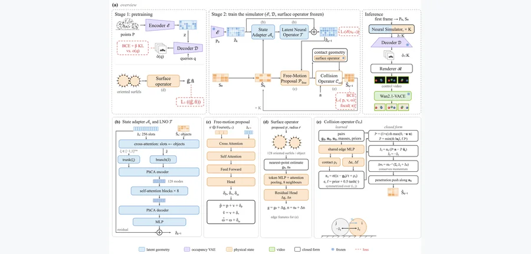 arXiv 2026-11-10 · [arXiv:2611.08904](https · #1 **[MotionCore: A Latent Neural Simulator for Video Generation with Rigid-Body Dynamics](https://arxiv.org/abs/2611.08904)** [cs.CV](https://arxiv.org/abs/2611.08904) 机构：[Zheng Wang , Zhengwei Gong , Yuanzhi Liang , Chi Zhang](https://arxiv.org/abs/2611.08904) [Paper](https://arxiv.org/abs/2611.08904) · [图源](https://arxiv.org/html/2611.08904v1/figs/Method.png) 

中文摘要
视频生成模型虽能生成高度逼真的视频，物体运动却可能不符合物理规律；这表明仅建模视觉外观可能不足以获得可迁移的物理动力学表征。我们提出 MotionCore，利用可学习的偏微分方程求解器学习物理动力学，重点处理刚体运动。其潜在神经仿真器从观测到的运动预测物体级物理状态的演化，再将预测转为在空间上对齐的潜在控制信号，供可控视频扩散模型使用。生成器负责外观和场景细节，学习得到的动力学模型则规定物理轨迹。为使轨迹在这一视觉接口中得到保留，MotionCore 结合扩散匹配目标，以及对物体身份和位置施加的低容量可解码约束。我们在公开物理一致性基准及具有已知轨迹的成对数据上评估。结果表明，在所评估的刚体场景中，该方法提升了物理一致性和轨迹遵循程度，同时保持相当的视觉质量。受控消融实验比较了学习式动力学与解析先验，并研究潜在演化处理器的选择。 <a href="https://arxiv.org/abs/2611.08904">原摘要来源</a>
 | 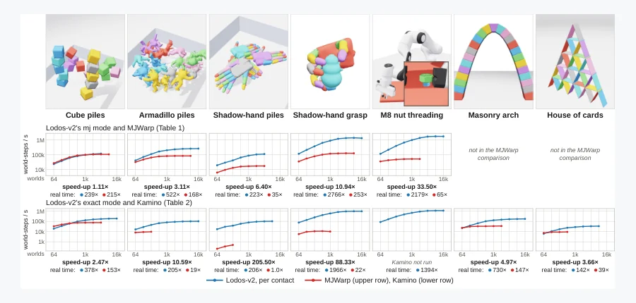 arXiv 2026-11-10 · [arXiv:2611.08868](https · #2 **[Lodos-v2: An Efficient Primal Formulation of the Exact Frictional Contact Problem](https://arxiv.org/abs/2611.08868)** [cs.RO](https://arxiv.org/abs/2611.08868) 机构：[Onur Beker , Andreas René Geist , Georg Martius](https://arxiv.org/abs/2611.08868) [Paper](https://arxiv.org/abs/2611.08868) · [图源](https://arxiv.org/html/2611.08868v1/teaser.png) 

中文摘要
Lodos-v2 是一个基于 GPU、面向大规模并行刚体接触动力学的仿真框架，专门追求大量精细网格发生碰撞时的高吞吐量。前代 Lodos-v1 有两项主要限制。其一，它求解基于锥互补的接触动力学的标准凸松弛，因此继承了法向离地和人为柔顺性、切向蠕动等已知物理伪影。其二，它按每对碰撞体用单一系数缩放弹簧阻尼力的接触组重参数化方案，无法与关节限位、焊接等完整仿真器所需的其他约束集成。Lodos-v2 通过两项贡献解决这些问题：首先，在外层近端最小化循环中，依次求解一系列原始形式的凸松弛，从而高效求解精确摩擦接触问题；其次，将 Lodos-v1 的接触组重参数化扩展到基于锥互补接触动力学的原始形式，使其能够与其他约束集成。实验表明，这些贡献相较成熟的刚体仿真框架提高了吞吐量。源代码见论文所给链接。 <a href="https://arxiv.org/abs/2611.08868">原摘要来源</a>
 | 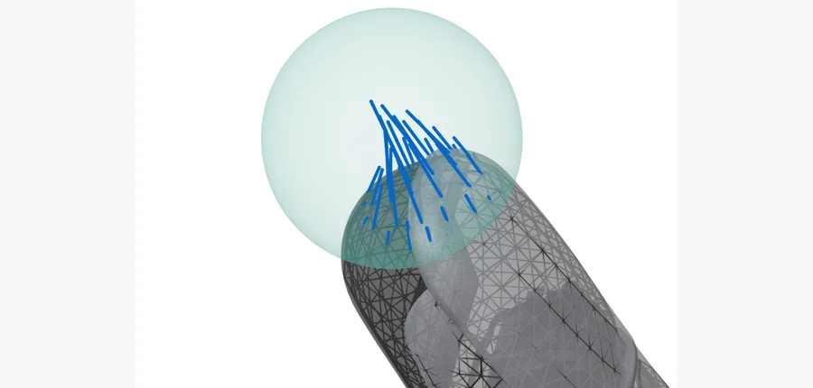 arXiv 2026-11-10 · [arXiv:2611.08872](https · #3 **[Lodos: A Lightweight Simulator Designed for Contact-Rich Interactions with Detailed Meshes](https://arxiv.org/abs/2611.08872)** [cs.RO](https://arxiv.org/abs/2611.08872) 机构：[Onur Beker , Andreas René Geist , Georg Martius](https://arxiv.org/abs/2611.08872) [Paper](https://arxiv.org/abs/2611.08872) · [图源](https://arxiv.org/html/2611.08872v1/figs/fig_finger.png) 

中文摘要
近年来，大规模并行刚体仿真在机器人研究中发挥核心作用，推动了强化学习、随机最优控制及基于随机平滑的轨迹优化等方向。在富接触场景中，此类仿真的扩展能力很大程度上依赖经过优化的碰撞几何表示，通常需把底层表面粗略近似为球、胶囊、圆柱或盒等基元。当表面复杂度或应用精度要求使这些近似不再足够时，就需要网格间碰撞，而这会显著降低吞吐量。本文从零设计一个仿真框架来解决这一瓶颈，提出新的宽相和窄相碰撞检测流程，以及后续接触动力学计算方法。实验验证表明，该框架在物理忠实度上与现有成熟仿真器相当，而在其专门针对的精细网格间碰撞场景下，吞吐量可提高约一个数量级。源代码见论文所给链接。 <a href="https://arxiv.org/abs/2611.08872">原摘要来源</a>
 |
| 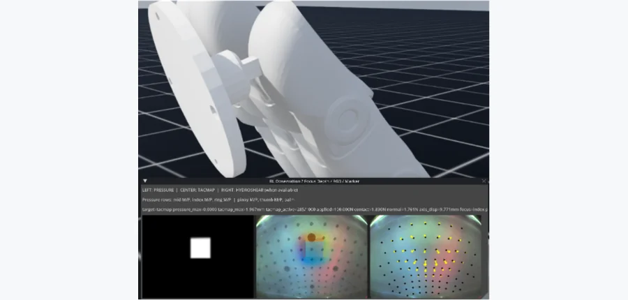 arXiv 2026-11-10 · [arXiv:2611.08939](https · #4 **[RevoSim: Scalable Multimodal Tactile Simulation for Dexterous Manipulation](https://arxiv.org/abs/2611.08939)** [cs.RO](https://arxiv.org/abs/2611.08939) 机构：[Ke Zhang , Lixin Xu , Ziyi Wang , Xiyue Dong , Jie Tan , Lianghu Shao , Xianpeng Wang , Chuanyu Li , Renjing Xu](https://arxiv.org/abs/2611.08939) [Paper](https://arxiv.org/abs/2611.08939) · [图源](https://arxiv.org/html/2611.08939v1/a.png) 

中文摘要
我们提出 RevoSim：用于 BrainCo Revo3 灵巧手的可扩展、高保真多模态触觉仿真器，同时建模 285 个压阻式触觉单元和五个视觉触觉指尖。RevoSim 可高效生成同步的压力、深度、RGB 和标记点位移观测；在单张 RTX 5090 上，其深度条件化标记点位移配置最多支持 4,096 个并行环境。我们完全在仿真中训练手内操作和抓取策略，为今后的仿真到现实迁移奠定基础。项目页见论文所给链接。 <a href="https://arxiv.org/abs/2611.08939">原摘要来源</a>
 | 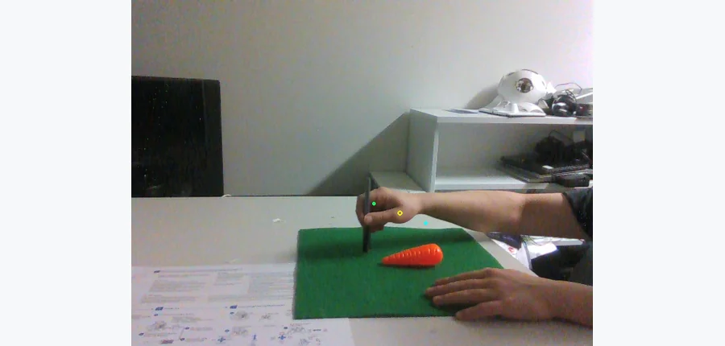 ACRA 2026 · #5 **[HOC2R: Hand-Object Contact Trajectories for Human-to-Robot Motion Transfer](https://arxiv.org/abs/2611.08920)** [cs.RO](https://arxiv.org/abs/2611.08920) 机构：[Hongkun Yu , Francisco M. López , Francisco Cruz](https://arxiv.org/abs/2611.08920) [Paper](https://arxiv.org/abs/2611.08920) · [图源](https://arxiv.org/pdf/2611.08920) 

中文摘要
人类视频包含大量物体操作示范，却不直接提供机器人可遵循的运动线索。我们提出 HOC2R，一种面向机器人运动的手—物接触轨迹提取器，结合冻结的 DINOv3 和 SAM 2.1 特征，以及学习式手物关联与接触定位模块。HOC2R 支持两种模式：在未剪辑视频中检测、计数并定位可见接触的计数感知自动模式，以及在已知接触帧时针对双指夹爪的固定双接触定位模式。在含 30 项任务的点标注基准上，相比改造的 VRB2 基线，自动模式把接触次数准确率从 58.1% 提高到 71.4%，平均定位距离从 19.81 像素降至 10.46 像素。在七次未见过的 RGB-D 执行中，五任务固定双接触检查点把平均定位距离从 67.67 像素降至 27.02 像素。在六段机器人评估序列中，30 任务固定双接触检查点得到四条可行轨迹并在三项任务上成功；各改造基线分别只有两条可行轨迹和一项成功任务。HOC2R 在所评估的单手场景中具有竞争力，对手部颜色变化稳健，并在所评估的多手场景中表现最强。这些结果支持将 HOC2R 用作从人类示范提取机器人可用接触轨迹的实用伪标注方法。 <a href="https://arxiv.org/abs/2611.08920">原摘要来源</a>
 | 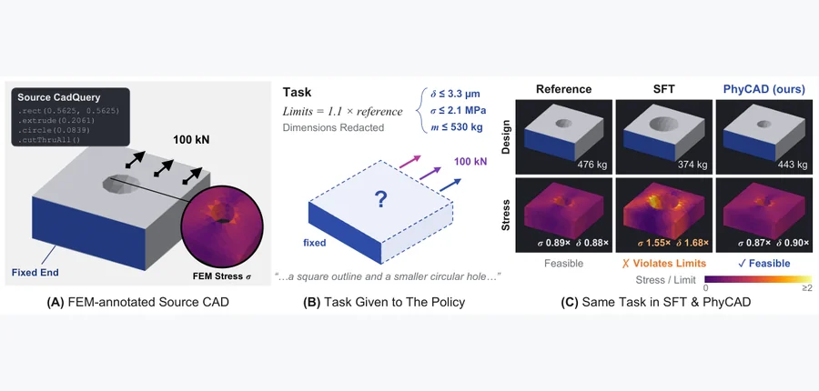 arXiv 2026-11-10 · [arXiv:2611.09401](https · #6 **[PhyCAD: Physics-Aware Text-to-CAD Generation via Hierarchical Reinforcement Learning](https://arxiv.org/abs/2611.09401)** [cs.AI](https://arxiv.org/abs/2611.09401) 机构：[Yuxin Cui , Weijie Zheng , Zhengyang Li , Han Wang , Wenjie Feng , Qiyu Kang](https://arxiv.org/abs/2611.09401) [Paper](https://arxiv.org/abs/2611.09401) · [图源](https://arxiv.org/html/2611.09401v1/teaser_cad.png) 

中文摘要
语言驱动的计算机辅助设计（CAD）能从文本创建可编辑的参数模型，但几何正确并不能保证物理可行。我们提出 PhyCAD，使语言模型在几何和物理约束下生成可执行 CadQuery 程序的物理感知 Text-to-CAD 框架。为此，我们构建了将参数化 CAD 模型与几何规格、载荷条件和物理约束关联的数据集，并开发自动化 CAD—CAE 验证器，结合程序执行、几何检查和有限元分析为训练提供反馈。关键学习难点是在保留部分进展信息的同时优先满足几何与物理约束；简单汇总异质奖励可能掩盖这一优先级，让单项指标的改善抵消尚未满足的设计要求。因此，我们提出用于 Group Relative Policy Optimization 的分层平衡优势：按验证状态把候选设计分层，结合层间进展和层内逐目标的同伴排序。这样既在训练信号中保持跨层优先级，又提供满足约束和改进可行设计的细粒度反馈。多种语言模型上的实验表明，PhyCAD 持续提高几何和物理约束的联合满足程度；结果说明，可验证的工程反馈有助于语言驱动 CAD 从几何重建走向物理感知设计。 <a href="https://arxiv.org/abs/2611.09401">原摘要来源</a>
 |
| 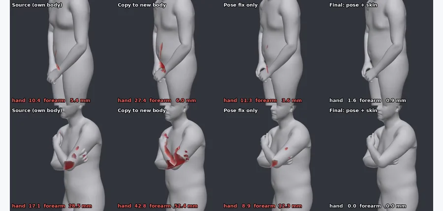 arXiv 2026-11-10 · [arXiv:2611.09693](https · #7 **[Real-Time Self-Penetration Repair for Skinned Characters with Soft Contact Budgets](https://arxiv.org/abs/2611.09693)** [cs.GR](https://arxiv.org/abs/2611.09693) 机构：[Yifei Zhu](https://arxiv.org/abs/2611.09693) [Paper](https://arxiv.org/abs/2611.09693) · [图源](https://arxiv.org/html/2611.09693v1/figures/cases.png) 

中文摘要
一种体型上合理的动作转移到另一种体型后可能发生穿透，动作模型也可能在其原生角色上产生自穿透。我们提出无需训练的后处理模块，先校正姿态，再进行有界的皮肤压缩，以减少这类伪影。只要原生角色和输出角色具有兼容的角色包，该模块即可接入任意动作模型，而无须访问其内部结构。每个角色包由骨架和皮肤离线构建，无须训练。顶点级姿态层在单个 CPU 核上以纯 C 求解局部二次规划，无状态接触形变器则作用于宿主最终蒙皮网格。依赖身体部位的软组织预算通过静态约定在姿态和皮肤之间分配校正量；源动作已有的穿透不获得额外容许量，可选的衣物厚度和柔顺性会修改姿态层的碰撞面。系统可因果运行或使用短缓冲前瞻，并在零状态的干净非活动帧上精确逐帧直通原生接口。在 320 段未见片段和三种体型上，手—躯干穿透深度超过 20 mm 的帧占比从直接复制动作的 15.53% 降至 0.00%；所有帧最终最大深度为 9.3 mm。姿态和皮肤处理平均耗时分别为 1.11 和 1.18 ms，总计 2.29 ms，低于单帧时间。相对直接复制的目标动作，关节速度高频比的中位数为 1.008。 <a href="https://arxiv.org/abs/2611.09693">原摘要来源</a>
 | 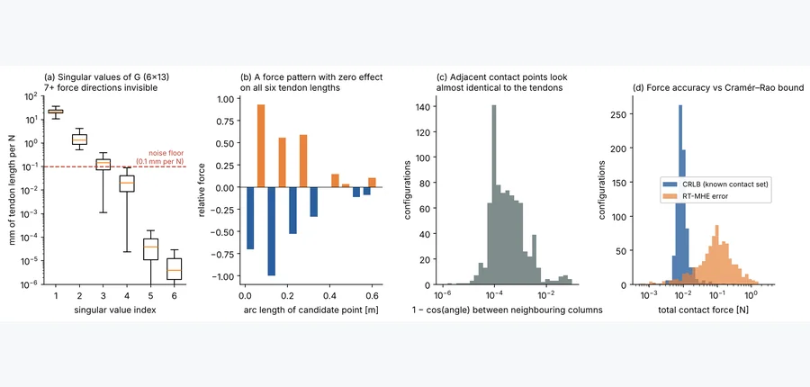 arXiv 2026-11-10 · [arXiv:2611.09877](https · #8 **[Locating Contact on Tendon-Driven Continuum Robots From Tendon Measurements Alone via Constrained Moving Horizon Estimation](https://arxiv.org/abs/2611.09877)** [cs.RO](https://arxiv.org/abs/2611.09877) 机构：[Haitham El-Hussieny](https://arxiv.org/abs/2611.09877) [Paper](https://arxiv.org/abs/2611.09877) · [图源](https://arxiv.org/html/2611.09877v1/figs/identifiability.png) 

中文摘要
腱驱动连续体机器人可以进入受限空间，但其身体上的接触无法由电机端传感器直接观测。我们证明这是一项结构性限制，而非调参问题：从接触力到腱测量的映射具有至少七维零空间，因此任何不固定接触支撑位置的估计器都无法定位接触。然而，当障碍物几何已知时，非穿透和互补条件使接触力局部可辨识；我们还证明，具有未知接触输入的相应系统具有局部指数强可检测性。我们提出编码这些条件的约束移动窗估计器（MHE），每个采样时刻求解一个二次规划即可实时运行，并给出局部、分模式的稳健稳定性结果。在双节机器人沿墙面按压和滑动的有限元基准中，它把接触定位到 0.9 mm、接触力估计误差降至 0.22 N；采用状态投影、经过调优的扩展卡尔曼滤波器（EKF）分别为 65 mm 和 0.72 N。它能容忍毫米级障碍位置误差和未建模的墙面摩擦，而投影 EKF 在这些条件下失败。在包含未建模腱摩擦的 40 次随机模型失配试验中，力和位置估计每次都优于对照。没有接触时，MHE 相对 EKF 无优势，验证其收益来自接触约束。本报告扩展了一篇提交至 IEEE Control Systems Letters 的短文，补充了完整证明和实验。 <a href="https://arxiv.org/abs/2611.09877">原摘要来源</a>
 | 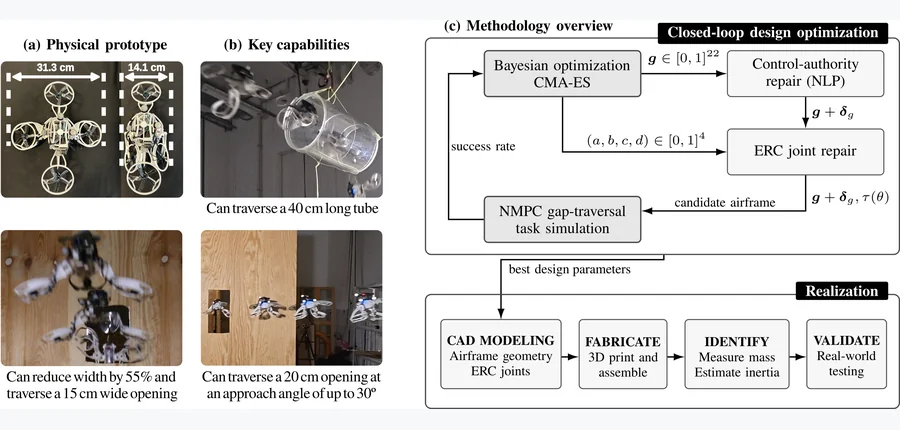 arXiv 2026-11-10 · [arXiv:2611.09272](https · #9 **[Task-Driven Closed-Loop Design Optimization of Passively Morphing Quadrotors for Contact-Mediated Narrow Gap Traversal](https://arxiv.org/abs/2611.09272)** [cs.RO](https://arxiv.org/abs/2611.09272) 机构：[Etor Arza , Luca Girardi , Gabriel Maquignaz , Javier Paez , Stefan Leutenegger , Stefano Mintchev , Kostas Alexis](https://arxiv.org/abs/2611.09272) [Paper](https://arxiv.org/abs/2611.09272) · [图源](https://arxiv.org/html/2611.09272v1/figures/overview.jpg) 

中文摘要
在杂乱环境中飞行的机器人可能遇到比其标称宽度更窄的开口。现有被动变形无人机通过穿越时折叠来缩窄机身，但通常采用人工设计，难以兼顾折叠比、飞行效率和控制跟踪性能。我们提出闭环设计方法，以接触式窄缝穿越在仿真中的成功率为依据，联合优化四旋翼几何以及两个被动折叠机臂的扭矩—挠曲响应。优化算法采样候选设计，在穿越任务的接触仿真中评估，以任务成功率为反馈逐步改进采样。所得原型机将宽度从 31.3 cm 被动缩至 14.1 cm，并以 2 m/s 参考速度穿过 15 cm 宽开口；它还能容忍最多 30 度的接近角误差，穿过 40 cm 长的狭窄通道。相比刚性对照，柔性配置在无接触飞行时的位置 RMSE 只增加 2 mm，电功率增加不足 1%。这些结果表明，任务驱动的闭环设计优化能生成接触时紧凑、容忍接近角误差且正常飞行时近似刚性的被动变形机体。 <a href="https://arxiv.org/abs/2611.09272">原摘要来源</a>
 |
| 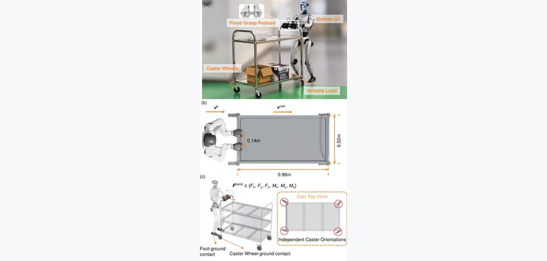 arXiv 2026-11-10 · [arXiv:2611.08664](https · #10 **[ForPC: Force-Aware Whole-Body Control for Precise Humanoid Cart Pushing](https://arxiv.org/abs/2611.08664)** [cs.RO](https://arxiv.org/abs/2611.08664) 机构：[ZhenYu Zou , Xing Liu , ShiChuang Wang , YunLong Dong , LiNan Deng , Feng Hua , Jun Wan , Cheng Cheng](https://arxiv.org/abs/2611.08664) [Paper](https://arxiv.org/abs/2611.08664) · [图源](https://arxiv.org/html/2611.08664v1/fig02_problem_setup.png) 

中文摘要
人形机器人有望承担制造、物流和医疗等领域繁重的物料搬运工作，操作现有轮式推车可避免改造场所。然而，双手抓握形成力耦合闭环：推动推车的接触力矩也会扰乱机器人平衡，载荷变化又会改变耦合动力学，使推车任务困难。我们提出 ForPC，一个通过两阶段强化学习调节推车速度的力感知全身控制框架。第一阶段在不同手部载荷和上半身姿态下训练行走先验，以维持平衡；第二阶段仅从机载观测估计力潜变量与状态潜变量，无需外部力传感器，并将其输入残差策略，协调有界的手臂、腰部和腿部调整及底座速度指令。多目标奖励惩罚双手内部对抗力、抓握滑移和执行器饱和，促使策略按需施加接触力，而无需人类示范。仿真间迁移实验中，相对仅行走基线，ForPC 的推车速度 RMSE 最多降低 68.2%，多弯路线横向误差 RMSE 最多降低 74.2%。仅在仿真中训练的策略也无需真实训练或微调，即可迁移到实体 Unitree G1；不针对载荷调整时，能以 0.5 m/s 推动载重最多 30 kg 的推车。这些结果提示人形机器人未来有望替代人类完成高效日常物料搬运。 <a href="https://arxiv.org/abs/2611.08664">原摘要来源</a>
 | 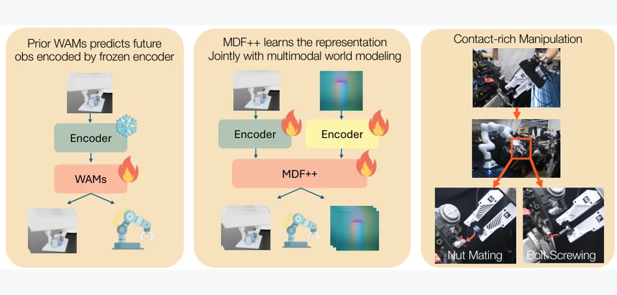 arXiv 2026-11-10 · [arXiv:2611.09293](https · #11 **[MDF++: Visuo-Tactile World Action Model with End-to-end Representation Learning](https://arxiv.org/abs/2611.09293)** [cs.RO](https://arxiv.org/abs/2611.09293) 机构：[Zixuan Huang , Jinhao Yu , Zachary Charlick , Dmitry Berenson](https://arxiv.org/abs/2611.09293) [Paper](https://arxiv.org/abs/2611.09293) · [图源](https://arxiv.org/html/2611.09293v1/pull_fig.png) 

中文摘要
世界动作模型（WAM）近来成为机器人操作的重要框架：它同时建模动作生成和未来观测预测，因此既能行动也能预判动作结果。但现有 WAM 通常依赖基于重建训练且冻结的预训练编码器，其表征未必适合机器人控制。本文研究为 WAM 学习扎根物理、与控制相关的表征。我们提出 MDF++，一个视觉—触觉世界动作模型，以扩散主干端到端学习多感官观测的潜在表征。朴素联合训练可能导致特征坍塌；MDF++ 采用利用跨模态相关性的多任务学习策略，获得任务相关表征。我们在一系列富接触操作任务上评估，包括真实的螺栓旋紧和螺母配合；相比使用冻结预训练表征的 WAM，性能最多提高 50%。更多视频见论文所给网站。 <a href="https://arxiv.org/abs/2611.09293">原摘要来源</a>
 | 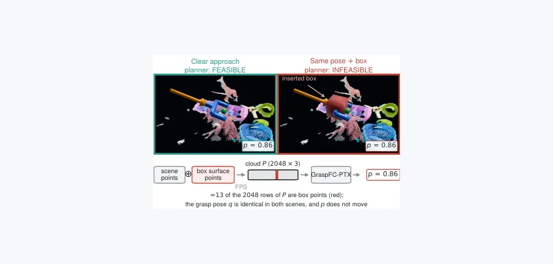 arXiv 2026-11-10 · [arXiv:2611.09130](https · #12 **[Auditing Grasp Feasibility Predictors with Planner-Verified Counterfactuals](https://arxiv.org/abs/2611.09130)** [cs.RO](https://arxiv.org/abs/2611.09130) 机构：[Sajid Ansari , Antony Thomas , Girish Varma](https://arxiv.org/abs/2611.09130) [Paper](https://arxiv.org/abs/2611.09130) · [图源](https://arxiv.org/html/2611.09130v1/fig_teaser.png) 

中文摘要
抓取可行性预测器在任务与运动规划基准上报告接近完美的准确率，但这并不能证明它们使用了运动规划器实际检查的碰撞几何。我们提出经规划器验证的反事实（CF）测试：固定抓取姿态，在接近通道中插入实体障碍、把障碍点加入模型输入，再由规划器重新计算标签，使其从可行翻转为不可行。八个涵盖点云、体素、深度和物体 token 的预测器，其自然分布 AUROC 虽有 0.920–0.996，CF 成对 AUROC 却降至近乎随机的 0.470–0.504；这种标签翻转在四种规划器、两种机械臂以及真实物体障碍下均成立。预测器在不同尺度上失效，从包围盒到 12.5 cm 体素均有。对所剖析的点云模型，障碍要么使表征朝与阻挡抓取无关的方向移动，要么根本没有被登记。一个感知接近通道间隙、只用原基准而未用反事实场景训练的点云读取模块达到 0.983 的 CF 成对 AUROC，但它仍受训练时障碍放置位置束缚；位置不变的间隙表征仍是开放问题。我们公开反事实标签、指标、数据说明和重标注流程，链接见原文。 <a href="https://arxiv.org/abs/2611.09130">原摘要来源</a>
 |
| 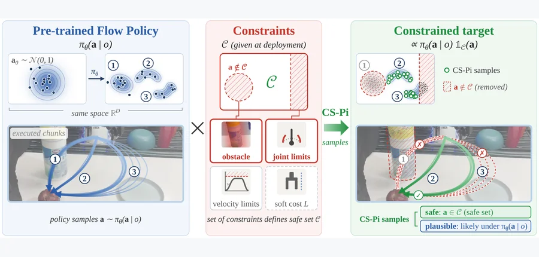 arXiv 2026-11-10 · [arXiv:2611.08654](https · #13 **[CS-Pi: Constraint-Satisfying Flow Policy Sampling](https://arxiv.org/abs/2611.08654)** [cs.RO](https://arxiv.org/abs/2611.08654) 机构：[Soumojit Bhattacharya , Oliver Kroemer , Shubham Tulsiani](https://arxiv.org/abs/2611.08654) [Paper](https://arxiv.org/abs/2611.08654) · [图源](https://arxiv.org/html/2611.08654v1/figures/problem.png) 

中文摘要
部署在真实环境中的流匹配策略常需满足示范中未出现的约束，例如避开从未见过的障碍。为每项新约束重训并不现实，因此必须在推理时实施约束，同时保留策略学到的内容：策略几乎不会采样的动作虽可能避障，却可能无法完成任务。我们希望动作既安全、满足约束，也合理、在策略下保持高概率。常见的梯度引导作用于带噪状态，必须根据策略正在估计的干净动作计算代价；当策略在绕障左侧还是右侧之间犹豫时，这种估计会取平均，可能直接穿过障碍。我们转而结合拒绝采样和投影。拒绝法反复抽样直到动作安全，输出都合理，但安全动作罕见时等待成本难以承受；投影法把动作移到最近的安全动作，效率高却未必合理。关键洞见是流匹配采样可兼得投影效率与拒绝法的合理性。CS-Pi 的“抽样—投影—重新加噪”采样器将每次抽样投影至最近的安全动作，按投影位移大小重新加噪，再运行未修改的策略，直到抽到安全动作。只替换投影步骤即可扩展到连续代价。二维诊断、七自由度货架拾取放置、方向偏好和零样本 Franka 部署中，CS-Pi 在货架与硬件上分别达到 81% 和 55% 的安全成功率，投影法分别为 55% 和 40%，同时保持动作合理性。 <a href="https://arxiv.org/abs/2611.08654">原摘要来源</a>
 | 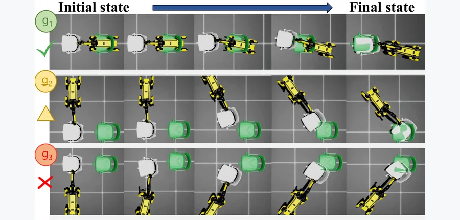 arXiv 2026-11-10 · [arXiv:2611.09864](https · #14 **[Grasp-TAGS: Task-Aware Grasp Selection via Critic Distillation for Prehensile Loco-Manipulation](https://arxiv.org/abs/2611.09864)** [cs.RO](https://arxiv.org/abs/2611.09864) 机构：[Xun Tu , Minghao Zou , Karthik Desingh](https://arxiv.org/abs/2611.09864) [Paper](https://arxiv.org/abs/2611.09864) · [图源](https://arxiv.org/html/2611.09864v1/qualitative.png) 

中文摘要
移动操作要求移动机械臂在长时程内协调运动与操作，是服务机器人和仓储等场景中重排大物体的关键能力。尽管已有进展，任务仍受复杂的机器人—物体及物体—环境交互动力学影响。现有基于模型的方法通常要求准确动力学模型；学习式方法降低了这一要求，但往往假定初始抓握固定或预先给定。然而，几何上同样稳定的不同抓握可能导致很不同的后续操作性能。因此，我们提出 Grasp-TAGS，一个面向目标条件大物体重排的任务感知抓握选择框架。我们在多种初始抓握配置上训练统一的 PPO 强化学习策略，再把学到的评论器蒸馏为轻量抓握效用网络，仅凭候选抓握配置和目标信息为抓握排序。推理时，在接触物体前选出预测后续效用最高的抓握，供后续策略完成任务。实验表明，Grasp-TAGS 相比固定单抓握策略和随机抓握选择提高了重排成功率：平均为 89.84%，最佳单抓握策略为 79.87%，提升 9.97 个百分点；它还在所有评估物体上降低了最终朝向误差。更多定性结果见论文所给补充网页。 <a href="https://arxiv.org/abs/2611.09864">原摘要来源</a>
 | 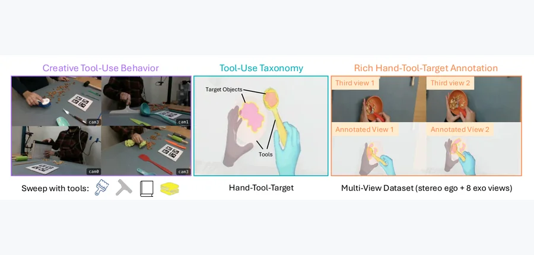 arXiv 2026-11-10 · [arXiv:2611.09036](https · #15 **[ToolDex: An Ego-Exo Human Demonstration Dataset for Creative Physical Tool Use](https://arxiv.org/abs/2611.09036)** [cs.RO](https://arxiv.org/abs/2611.09036) 机构：[Mohamed Elmoghany , Kehan Li , Ruoqu Chen , Tarun Chiruvolu , Shutong Zhang , Ryan Wang , Stephen Tian , Yaru Niu , Michelle Guo , Ding Zhao , Weiyu Liu , Mengdi Xu , Li Fei-Fei , Jiajun Wu](https://arxiv.org/abs/2611.09036) [Paper](https://arxiv.org/abs/2611.09036) · [图源](https://arxiv.org/html/2611.09036v1/tooldex_teaser.png) 

中文摘要
创造性使用工具是人类的基本能力，也是迈向通用具身智能的重要一步；当标准工具不可用时，这要求智能体推理物体可供性、物理约束和操作策略。然而，该领域缺少兼具规模、保真度和多样性的真实人类工具使用数据，现有基准多基于仿真、聚焦简化交互或缺乏细致观测与标注。我们提出 ToolDex，一个用于创造性物理工具使用的大规模第一人称—第三人称（ego-exo）人类示范数据集，记录人们选择、改造并重新利用现有物体作为工具的场景。数据集通过同步的第一人称相机和八台第三人称相机提供高保真多视角观测，并对手、工具、目标物及其可形变交互提供丰富标注。除数据收集外，我们建立评测套件，刻画物理工具使用推理、稀疏视角 3D／4D 重建和机器人策略学习三项核心能力。ToolDex 为研究人类工具使用行为以及开发能在复杂真实环境中自适应使用工具的具身智能体提供基础。数据集可视化和基准结果见论文所给链接。 <a href="https://arxiv.org/abs/2611.09036">原摘要来源</a>
 |
| 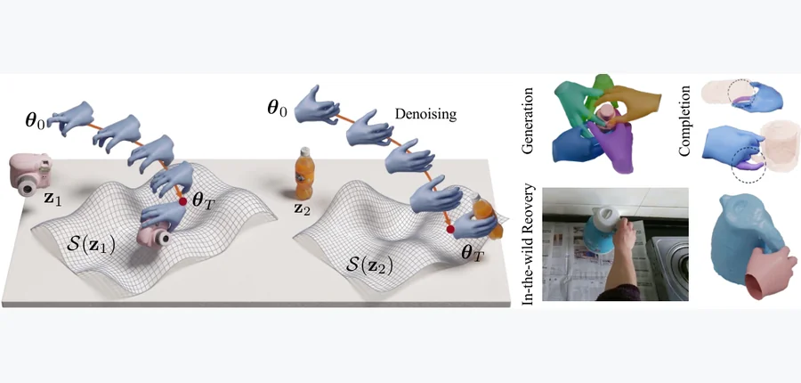 arXiv 2026-11-10 · [arXiv:2611.08578](https · #16 **[HaNDF: Object-Conditioned Geometric Neural Hand Distance Fields](https://arxiv.org/abs/2611.08578)** [cs.CV](https://arxiv.org/abs/2611.08578) 机构：[Zuhao Liu , Melih Darcan , Zhengdi Yu , Riza Alp Guler , Tolga Birdal](https://arxiv.org/abs/2611.08578) [Paper](https://arxiv.org/abs/2611.08578) · [图源](https://arxiv.org/html/2611.08578v1/HaNDF_Teaser.png) 

中文摘要
我们提出 HaNDF：在手部关节姿态的乘积流形上，以物体条件化的神经距离场作为数据驱动先验，建模合理的手—物配置。近来的无条件生成先验在人体姿态建模上取得成功，但手是经常与其他物体交互的多关节结构，因此需要能根据交互物体建模合理手部姿态的条件生成先验。HaNDF 构建几何感知、物体条件化的神经距离场，以条件场的零水平集表示合理的关节姿态。我们借助黎曼几何工具：（i）在物体诱导的神经场零水平集上表示合理手势；（ii）将给定姿态投影到该场。利用 HaNDF 还可以反过来优化合理的条件，即确定交互中的物体。广泛评估表明，HaNDF 是灵活而有效的手物交互先验，适用于姿态细化、遮挡下重建及物理上合理的操作合成。 <a href="https://arxiv.org/abs/2611.08578">原摘要来源</a>
 | 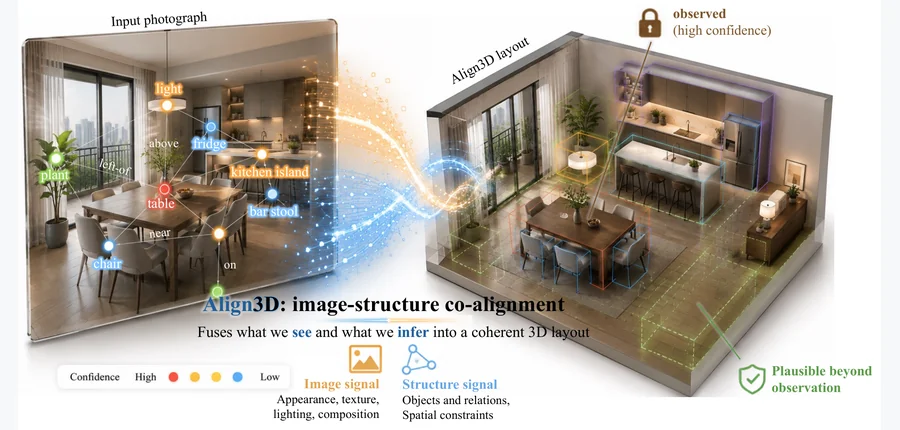 arXiv 2026-11-10 · [arXiv:2611.08861](https · #17 **[Align3D: Image-Structure Co-Aligned 3D Scene Generation with Observability-Aware Fidelity-Preserving Guidance](https://arxiv.org/abs/2611.08861)** [cs.CV](https://arxiv.org/abs/2611.08861) 机构：[Chenliang Zhou , Yifan Wang , Andrzej Banburski-Fahey](https://arxiv.org/abs/2611.08861) [Paper](https://arxiv.org/abs/2611.08861) · [图源](https://arxiv.org/html/2611.08861v1/teaser.png) 

中文摘要
我们提出 Align3D，一种图像条件扩散模型：它生成既忠实于单张输入照片、又在未观察视角下保持物理合理的三维室内布局。方法从照片推断经过置信度校准的场景图，训练带图像—结构协同对齐的集合扩散布局去噪器；其中，置信度加权的模态融合利用预测置信度平衡图像与场景图对齐。同时，可观测性感知的保真引导投影相互冲突的场景质量梯度，并用物体级置信度掩码重新加权，使观测不足的自由度吸收物理先验，而不破坏图像—场景图匹配。在 3D-FRONT 上，Align3D 相比近期基线改善了图像对齐和场景质量指标；训练完成后，可对未见过的照片单次前向生成布局。 <a href="https://arxiv.org/abs/2611.08861">原摘要来源</a>
 | 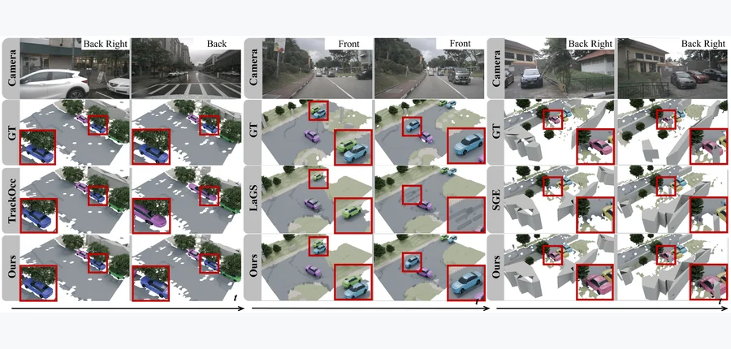 arXiv 2026-11-10 · [arXiv:2611.09661](https · #18 **[Video2Asset: Online Construction of Persistent 3D Street-Scene Assets](https://arxiv.org/abs/2611.09661)** [cs.CV](https://arxiv.org/abs/2611.09661) 机构：[Zihan Zheng , Chunlei Cai , Zhenlong Wu , Linjun Li , Yichen Gong , Xiaoyun Zhang , Qiang Hu](https://arxiv.org/abs/2611.09661) [Paper](https://arxiv.org/abs/2611.09661) · [图源](https://arxiv.org/html/2611.09661v1/fig/comparison.png) 

中文摘要
从多视角视频在线构建三维街景资产，旨在把视频持续更新为由独立可编辑物体组成的场景。核心难点是在运动和遮挡下累计局部、间歇的观测，同时避免身份碎片化或跨物体混合证据。为此，我们提出 Video2Asset，一种从多视角视频在线构建持久三维资产的框架。它以占据表示为中间层，通过历史载体引导进行实例解码，并用融合实例对齐三维特征与多视角外观的身份编码器构建带身份信息的观测。累积证据关联将当前观测与资产记录中积累的身份、几何及外观证据比较，决定身份继承并更新世界坐标系下的状态。框架根据这些状态从资产库实例化网格，并与占据推导的静态背景结合，支持场景可视化、网格替换、物体删除和轨迹编辑。在多个数据集上的实验显示，它在多种占据模型下改进时间身份一致性和资产质量；在采用 SGE 的 nuScenes 上，资产碎片化减少 15.4%。 <a href="https://arxiv.org/abs/2611.09661">原摘要来源</a>
 |
| 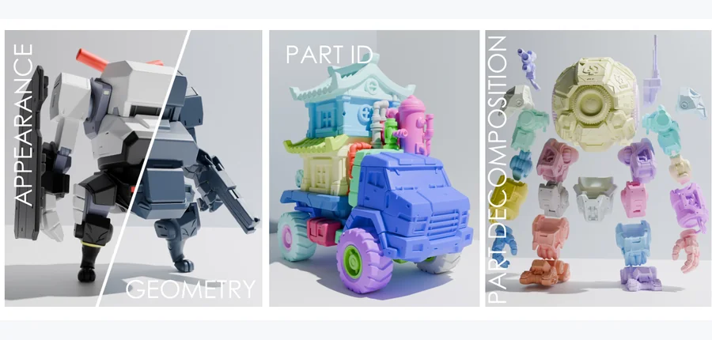 arXiv 2026-11-10 · [arXiv:2611.09055](https · #19 **[OmniLatent: Unified Latent for 3D Part Modeling](https://arxiv.org/abs/2611.09055)** [cs.CV](https://arxiv.org/abs/2611.09055) 机构：[Yunhan Yang , Yunfei Zhao , Zeqiang Lai , Jiachen Xu , Minxiu Wang , Xintong Han , Xiangyu Yue , Xihui Liu , Chunchao Guo](https://arxiv.org/abs/2611.09055) [Paper](https://arxiv.org/abs/2611.09055) · [图源](https://arxiv.org/html/2611.09055v1/teaser.png) 

中文摘要
三维部件分解是创建可编辑资产的核心能力，但现有流程通常先生成完整网格、再进行分割，因此容易受到几何伪影、纹理歧义和部件级标注不足影响。我们提出 OmniLatent，一个用于三维部件分解的统一潜在建模框架。它不孤立预测部件标签，而是在共享潜在空间中联合编码几何、形变、外观和二值部件 ID，使数据充足的几何与视觉先验支持数据稀缺的部件学习。给定单张输入图像，基础模型一次生成几何、形变、纹理和表面部件 ID，无需独立分割阶段即可得到部件感知的三维资产。我们进一步微调预训练模型以支持两种扩展：点提示适配器将带二值部件 ID 的任意三维点提示映射为潜在 token，进行完整分割、细化和部件细分；非模态部件补全模型通过动态分配每部件 token、与给定几何潜变量交叉注意，以及部件局部和全局注意交替，将部分表面掩码补全为连贯的完整物体分解。大量实验显示，OmniLatent 生成语义明确、边界精确的部件分割，支持交互式部件编辑，并在保持整体物体一致性的同时补全局部观测。 <a href="https://arxiv.org/abs/2611.09055">原摘要来源</a>
 | 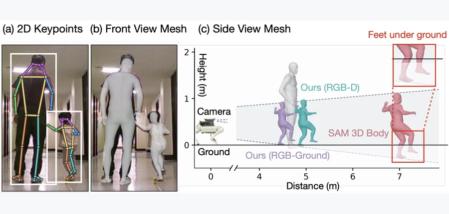 arXiv 2026-11-10 · [arXiv:2611.08954](https · #20 **[MetricPose: Flexible 3D Human Pose Estimation with Depth and Geometric Cues](https://arxiv.org/abs/2611.08954)** [cs.CV](https://arxiv.org/abs/2611.08954) 机构：[Shifan Zhu , Sabad Modi , Hang Yang , Arushi Agrawal , Steven Gao , Meghan Huber , Nathan Wycoff , Donghyun Kim](https://arxiv.org/abs/2611.08954) [Paper](https://arxiv.org/abs/2611.08954) · [图源](https://arxiv.org/html/2611.08954v1/abs.png) 

中文摘要
本文提出一种三维人体姿态估计器，预测相机坐标系中具有准确尺度的人体关节位置。任务要求恢复身体关节配置、尺度以及相对于相机的米制位置。单目图像中，人体尺寸和相机距离通过透视投影相互耦合，因此仅凭图像无法唯一确定；结合学习到的 RGB 先验、直接深度测量，以及环境中的几何约束（例如地面接触）可减轻这种歧义。我们在预训练全身姿态估计器上加入可选的米制深度及几何处理模块，改善相机距离估计和深度引导的身体细化，同时保留仅用 RGB 的运行方式。所得统一模型共享学习参数，支持 RGB、RGB-Ground 和 RGB-D 三种输入。不同于仅计算骨盆相对误差，相机局部误差还能衡量人体相对相机的放置位置。相比现有基础模型 SAM 3D Body，三种模式下的相机局部关节位置误差分别降低 12.16%、31.00% 和 54.61%。 <a href="https://arxiv.org/abs/2611.08954">原摘要来源</a>
 | 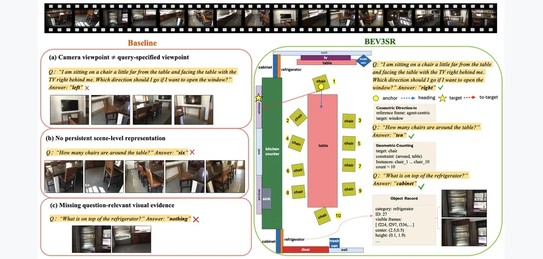 arXiv 2026-11-10 · [arXiv:2611.09816](https · #21 **[BEV3SR: Evidence-Aware 3D Spatial Reasoning from Video](https://arxiv.org/abs/2611.09816)** [cs.CV](https://arxiv.org/abs/2611.09816) 机构：[Fan Zhu , Rui Yu](https://arxiv.org/abs/2611.09816) [Paper](https://arxiv.org/abs/2611.09816) · [图源](https://arxiv.org/html/2611.09816v1/fig1.png) 

中文摘要
视频三维空间推理对视觉语言模型仍然困难，因为视频提供的是连续、局部视角观测，而非持久的米制场景记录。许多问题需要在查询指定的视角而非观测相机视角下回答，固定数量的 RGB 帧提示也可能遗漏稀疏或被遮挡的线索。我们提出 BEV3SR，一个适用于带相机参数的 RGB-D 视频、无须训练且与主干模型无关的框架。BEV3SR 将视频观测转为可查询的米制鸟瞰图（BEV）场景记忆，并把每个查询形式化为证据感知的空间任务。空间任务形式化器指定参考坐标系、空间约束、目标和证据需求；证据需求决定推理路径。需要几何证据的查询由几何推理器利用查询坐标系下的米制 BEV 记录确定性计算答案；需要视觉证据的查询交由视觉证据对齐器，通过 BEV 索引的物体记录及其支持视角检索物体一致、带场景上下文的 RGB 帧，以供视觉语言模型定位。保持标准的 16 帧预算时，BEV3SR 在多个三维场景问答基准上持续改善不同 VLM 主干，在空间密集问题上提升很大，在开放式场景问答上也显著改善。这表明 BEV3SR 为视频显式三维空间推理提供有效、高效且可解释的框架。 <a href="https://arxiv.org/abs/2611.09816">原摘要来源</a>
 |
| 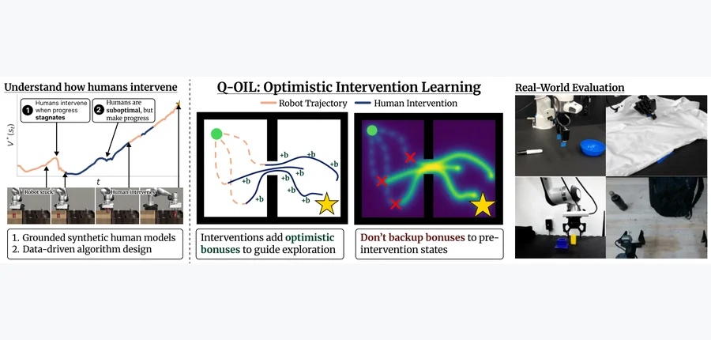 arXiv 2026-11-10 · [arXiv:2611.08576](https · #22 **[Q-OIL: Optimistic Exploration in Learning from Human Interventions](https://arxiv.org/abs/2611.08576)** [cs.RO](https://arxiv.org/abs/2611.08576) 机构：[Pranav Teegavarapu , Sriyash Poddar , Rico Qi , Cleah Winston , Krisha Khandelwal , Aykut Onyol , Natasha Jaques , Abhishek Gupta](https://arxiv.org/abs/2611.08576) [Paper](https://arxiv.org/abs/2611.08576) · [图源](https://arxiv.org/html/2611.08576v1/teaser_overview.png) 

中文摘要
机器人在真实环境部署时难免犯错；人类干预能为改进行为提供反馈，使其在线适应新场景。但人参与的机器人学习难以研究：真实实验慢且昂贵，算法开发大多依赖模拟的人类模型。我们发现，常用的人类建模假设与真实人的干预方式不符。分析参与者的干预数据后，我们发现人往往在智能体进展停滞时介入，而纠正动作经常并非最优。基于此，我们提出以进展为依据的人类干预模型，其与真实用户对算法的排名具有更高的秩相关，可支持更贴近实际的仿真基准和算法开发。进一步，我们提出 Q-OIL：在强化学习中的干预转移上加入乐观奖励，并温和地引导探索靠近人类纠正。解耦的评论器对稳定性至关重要，因为它防止乐观奖励反向传播到干预前状态。结果，Q-OIL 比有竞争力的基线学得更高效，在仿真和真实机器人上成功率高出 10%–50%，并在两项双臂操作任务上改善预训练 VLA。将评估和算法都建立在更真实的人类行为之上，为可扩展的干预学习提供了实用途径。 <a href="https://arxiv.org/abs/2611.08576">原摘要来源</a>
 | 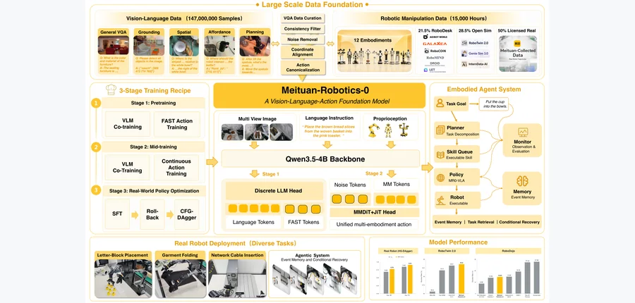 arXiv 2026-11-10 · [arXiv:2611.08577](https · #23 **[Meituan-Robotics-0: A Vision-Language-Action Foundation Model for Desktop Manipulation](https://arxiv.org/abs/2611.08577)** [cs.RO](https://arxiv.org/abs/2611.08577) 机构：[Meituan Robotics Team : Caicheng Wang , Chen Zhao , Chengpeng Jin , Duo Xu , Fengjiao Chen , Guanglu Wan , Heqing Yang , Jia Wang , Jiacong Zhou , Jie Hu , Jiyuan Ru , Lingfeng Zhang , Linjiang Huang , Manyuan Zhang , Ningchu Liu , Shijie Zhou , Si Liu , Shuo Li , Tianyi Zhang , Xi Zhang , Xin Chen , Xuezhi Cao , Xunliang Cai , Yanbin Zeng , Yang Yang , Yang Yi , Yanli Tan , Yifu Xu , Yimeng Jia , Yuchen Tang , Yuchen Xie , Yuxiang Zheng , Zerwei Chng , Zilong Huang , Zipeng Ye , Ziyuan Qin , Ziqin Wang](https://arxiv.org/abs/2611.08577) [Paper](https://arxiv.org/abs/2611.08577) · [图源](https://arxiv.org/html/2611.08577v1/main_m42_clean_v2.png) 

中文摘要
我们提出 Meituan-Robotics-0（MR0），一个面向固定底座桌面操作的视觉—语言—动作基础模型与具身智能体系统。MR0 结合 1.47 亿条视觉语言样本，以及覆盖 12 种机器人形态、经过整理的 15,060 小时机器人轨迹。三阶段训练流程通过离散动作 token 预训练对齐多模态表征与机器人行为，在中期用流匹配把先验迁移到连续跨形态控制，并在真实环境后训练中适配策略。我们提出 Rollback，把被替换的策略片段与人类纠正配对，在无需价值学习或优势标注的情况下为 CFG-DAgger 提供正负监督。统一末端执行器接口支持异构形态，异步动作块合并则在推理延迟变化时维持平滑执行。事件驱动智能体持久保存任务事件，在进展或可行性变化时重新评估计划，使跨任务检索和有条件恢复任务成为可能。MR0 在 RoboTwin 2.0 上取得 93.6% 成功率，并在 RoboDojo VLA 赛道排名第五。在匹配的 HG-DAgger 后训练条件下，它在三项真实机器人任务上的平均成功率与进展评分高于 $\pi_{0.5}$。在以太网接口插入任务中，用 Rollback 数据训练的 CFG-DAgger 达到 70% 成功率和 0.90 进展评分。定性智能体部署展示了跨任务事件检索和从暂时不满足的任务条件中恢复。 <a href="https://arxiv.org/abs/2611.08577">原摘要来源</a>
 | 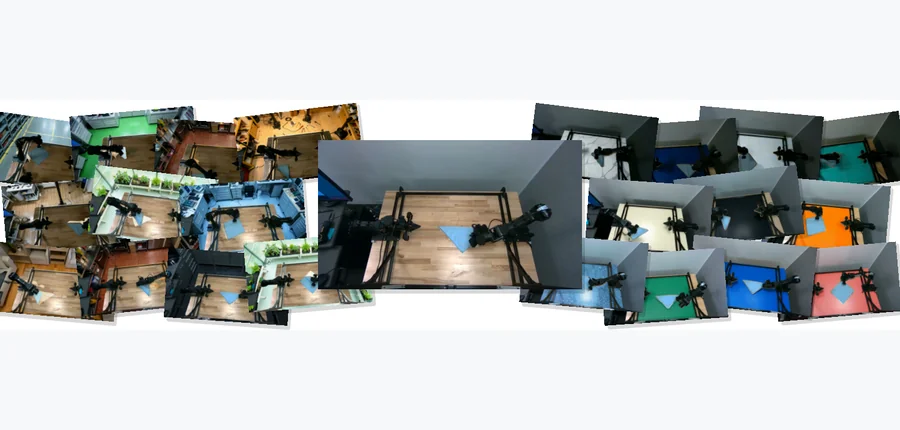 arXiv 2026-11-10 · [arXiv:2611.09145](https · #24 **[Augmentron: Scalable Multi-View Visual Augmentation for Robot Learning](https://arxiv.org/abs/2611.09145)** [cs.LG](https://arxiv.org/abs/2611.09145) 机构：[Tanay Tandon , Aseem Doriwala , Jade Choghari , Catherine Weaver , Pragna Mannam](https://arxiv.org/abs/2611.09145) [Paper](https://arxiv.org/abs/2611.09145) · [图源](https://arxiv.org/html/2611.09145v1/figure1_augmentation_collage_borderless_notext.png) 

中文摘要
由视觉变化范围狭窄的示范训练的机器人策略，可能对与任务无关的环境特征过于敏感。生成式增强虽可增加视觉多样性，但逐帧、逐视角独立处理成本高，也可能造成相机之间或时间上的观测不一致。我们提出 Augmentron，一个感知几何的流程：生成可复用场景表示，并通过录制的相机姿态进行渲染，在保留机器人、任务物体、动作和标注的同时，生成时间和多视角一致的环境及工作空间变化。在三项实体操作任务中，以 Augmentron 数据替换一半真实训练数据，在分布外干扰物和分布外工作空间变化评估中改善了三项任务上模型的成功率。在另一项与其他增强技术的比较中，Augmentron 在全部三种条件下取得最高的汇总成功率。结果表明，在训练流程中加入增强数据可帮助策略泛化到动态真实场景。 <a href="https://arxiv.org/abs/2611.09145">原摘要来源</a>
 |
| 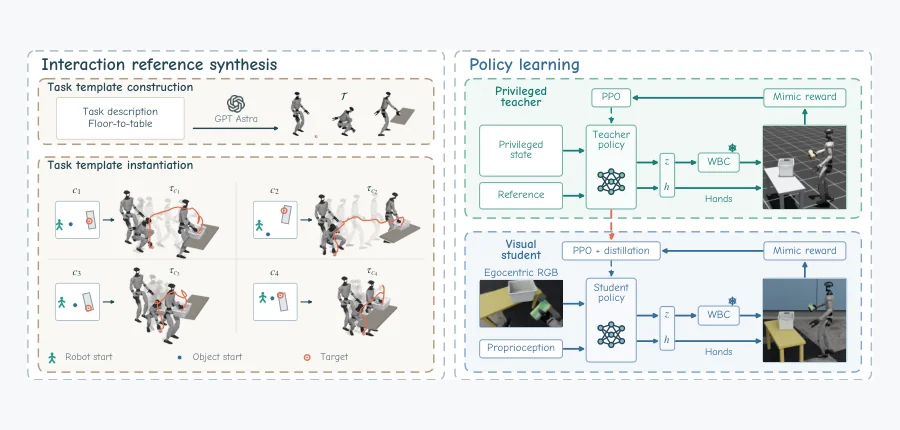 arXiv 2026-11-10 · [arXiv:2611.09266](https · #25 **[SUGARv2: Learning Diverse Visual Humanoid Loco-Manipulation Skills from Synthesized Interaction References](https://arxiv.org/abs/2611.09266)** [cs.RO](https://arxiv.org/abs/2611.09266) 机构：[Tianshu Wu , Tianxiang Gui , Yue Chen , Tingxu Liu , Ziye Peng , Guangjie Yang , Xiangqi Kong , Ye Shi , Jingya Wang , Hao Dong](https://arxiv.org/abs/2611.09266) [Paper](https://arxiv.org/abs/2611.09266) · [图源](https://arxiv.org/html/2611.09266v1/sugarv2_overview_five_tasks.png) 

中文摘要
随着任务及空间配置扩展，扩大视觉人形机器人移动操作技能的规模，需要降低示范收集和任务专用训练设计的人力投入。我们提出 SUGARv2：通过交互参考合成与共享训练流程学习多样视觉移动操作技能的统一框架。为低成本获取多样参考，我们将可复用任务模板适配到不同空间配置，合成协调的机器人与物体运动；为减少专用奖励设计和训练工作，我们跨任务采用基于参考的模仿目标。首先训练可获取特权信息的教师执行这些参考，再用教师蒸馏和强化学习训练视觉策略，并沿用相同的参考模仿奖励；同时使用多样物体实例和视觉域随机化，以支持视觉泛化与仿真到现实迁移。在五项人形机器人移动操作任务中，SUGARv2 的仿真平均成功率为 91.0%；实体人形机器人部署进一步展示了全身操作的仿真到现实迁移。这些结果显示了该框架学习多样视觉移动操作技能的潜力。 <a href="https://arxiv.org/abs/2611.09266">原摘要来源</a>
 |   |   |
<!-- PAPER_CARDS_END -->

## 检索概况

- **检索窗口**：北京时间 2026-11-09 09:15 至 2026-11-10 09:06；本轮抓取 arXiv 官方 14 个分类的 `new?show=2000` 页面。
- **官方最新批次**：全部目标页显示 **Monday, 9 November 2026**；只从各页 `New submissions` 区段进入主榜。
- **总命中／去重／入选**：631 条分类页 New 记录／631 个不同 arXiv ID／25 篇。逐篇按标题和原摘要筛选，3D 与物理交叉优先，具身工作随后。
- **事实与判断**：标题、作者、分类、摘要、实验数字来自[官方 New listing](https://arxiv.org/list/cs.RO/new?show=2000)及逐篇 arXiv 页面；机构仅据 PDF 首页确认，未确认者如实标注。相关性、机构强度、局限和实验建议均为**推断**。
- **卡片完整性**：本期 25 篇均已取得官方原摘要并完整翻译；25 张卡片均有对应论文真实配图，缺摘要 0 篇、缺图 0 篇。

## 官方 New listing 状态

| 分类页 | 官方日期 | New 条目 |
|---|---|---:|
| [cs.CV](https://arxiv.org/list/cs.CV/new?show=2000) | 2026-11-09 | 93 |
| [cs.GR](https://arxiv.org/list/cs.GR/new?show=2000) | 2026-11-09 | 5 |
| [cs.RO](https://arxiv.org/list/cs.RO/new?show=2000) | 2026-11-09 | 54 |
| [cs.AI](https://arxiv.org/list/cs.AI/new?show=2000) | 2026-11-09 | 94 |
| [cs.LG](https://arxiv.org/list/cs.LG/new?show=2000) | 2026-11-09 | 121 |
| [physics](https://arxiv.org/list/physics/new?show=2000) | 2026-11-09 | 74 |
| [cond-mat](https://arxiv.org/list/cond-mat/new?show=2000) | 2026-11-09 | 66 |
| [math.OC](https://arxiv.org/list/math.OC/new?show=2000) | 2026-11-09 | 21 |
| [math.NA](https://arxiv.org/list/math.NA/new?show=2000) | 2026-11-09 | 26 |
| [math.DS](https://arxiv.org/list/math.DS/new?show=2000) | 2026-11-09 | 14 |
| [stat.ML](https://arxiv.org/list/stat.ML/new?show=2000) | 2026-11-09 | 9 |
| [eess.IV](https://arxiv.org/list/eess.IV/new?show=2000) | 2026-11-09 | 14 |
| [eess.SY](https://arxiv.org/list/eess.SY/new?show=2000) | 2026-11-09 | 19 |
| [eess.SP](https://arxiv.org/list/eess.SP/new?show=2000) | 2026-11-09 | 21 |
| **合计** | — | **631** |

## Top papers

| # | 论文 | arXiv | 分类 | 作者 | 机构 | 相关性（推断） | 机构强度（推断） | 阅读优先级（推断） |
|---:|---|---|---|---|---|---|---|---|
| 1 | [MotionCore: A Latent Neural Simulator for Video Generation with Rigid-Body Dynamics](https://arxiv.org/abs/2611.08904) | [arXiv:2611.08904](https://arxiv.org/abs/2611.08904) | [cs.CV](https://arxiv.org/abs/2611.08904) | [Zheng Wang , Zhengwei Gong , Yuanzhi Liang , Chi Zhang](https://arxiv.org/abs/2611.08904) | China Telecom Institute of Artificial Intelligence (TeleAI) / The University of Tokyo / Shanghai Jiao Tong University（[PDF](https://arxiv.org/pdf/2611.08904)） | 极高：三维物理／接触 | 较强 | A |
| 2 | [Lodos-v2: An Efficient Primal Formulation of the Exact Frictional Contact Problem](https://arxiv.org/abs/2611.08868) | [arXiv:2611.08868](https://arxiv.org/abs/2611.08868) | [cs.RO](https://arxiv.org/abs/2611.08868) | [Onur Beker , Andreas René Geist , Georg Martius](https://arxiv.org/abs/2611.08868) | University of Tübingen（[PDF](https://arxiv.org/pdf/2611.08868)） | 极高：三维物理／接触 | 较强 | A |
| 3 | [Lodos: A Lightweight Simulator Designed for Contact-Rich Interactions with Detailed Meshes](https://arxiv.org/abs/2611.08872) | [arXiv:2611.08872](https://arxiv.org/abs/2611.08872) | [cs.RO](https://arxiv.org/abs/2611.08872) | [Onur Beker , Andreas René Geist , Georg Martius](https://arxiv.org/abs/2611.08872) | University of Tübingen / Max Planck Institute for Intelligent Systems（[PDF](https://arxiv.org/pdf/2611.08872)） | 极高：三维物理／接触 | 较强 | A |
| 4 | [RevoSim: Scalable Multimodal Tactile Simulation for Dexterous Manipulation](https://arxiv.org/abs/2611.08939) | [arXiv:2611.08939](https://arxiv.org/abs/2611.08939) | [cs.RO](https://arxiv.org/abs/2611.08939) | [Ke Zhang , Lixin Xu , Ziyi Wang , Xiyue Dong , Jie Tan , Lianghu Shao , Xianpeng Wang , Chuanyu Li , Renjing Xu](https://arxiv.org/abs/2611.08939) | HKUST (Guangzhou) / BrainCo / Georgia Institute of Technology（[PDF](https://arxiv.org/pdf/2611.08939)） | 极高：三维物理／接触 | 较强 | A |
| 5 | [HOC2R: Hand-Object Contact Trajectories for Human-to-Robot Motion Transfer](https://arxiv.org/abs/2611.08920) | [arXiv:2611.08920](https://arxiv.org/abs/2611.08920) | [cs.RO](https://arxiv.org/abs/2611.08920) | [Hongkun Yu , Francisco M. López , Francisco Cruz](https://arxiv.org/abs/2611.08920) | UNSW Sydney / Universidad Central de Chile（[PDF](https://arxiv.org/pdf/2611.08920)） | 极高：三维物理／接触 | 较强 | A |
| 6 | [PhyCAD: Physics-Aware Text-to-CAD Generation via Hierarchical Reinforcement Learning](https://arxiv.org/abs/2611.09401) | [arXiv:2611.09401](https://arxiv.org/abs/2611.09401) | [cs.AI](https://arxiv.org/abs/2611.09401) | [Yuxin Cui , Weijie Zheng , Zhengyang Li , Han Wang , Wenjie Feng , Qiyu Kang](https://arxiv.org/abs/2611.09401) | University of Science and Technology of China（[PDF](https://arxiv.org/pdf/2611.09401)） | 极高：三维物理／接触 | 较强 | A |
| 7 | [Real-Time Self-Penetration Repair for Skinned Characters with Soft Contact Budgets](https://arxiv.org/abs/2611.09693) | [arXiv:2611.09693](https://arxiv.org/abs/2611.09693) | [cs.GR](https://arxiv.org/abs/2611.09693) | [Yifei Zhu](https://arxiv.org/abs/2611.09693) | affiliation 未确认 | 极高：三维物理／接触 | 未评估 | A |
| 8 | [Locating Contact on Tendon-Driven Continuum Robots From Tendon Measurements Alone via Constrained Moving Horizon Estimation](https://arxiv.org/abs/2611.09877) | [arXiv:2611.09877](https://arxiv.org/abs/2611.09877) | [cs.RO](https://arxiv.org/abs/2611.09877) | [Haitham El-Hussieny](https://arxiv.org/abs/2611.09877) | Egypt-Japan University of Science and Technology（[PDF](https://arxiv.org/pdf/2611.09877)） | 极高：三维物理／接触 | 较强 | A |
| 9 | [Task-Driven Closed-Loop Design Optimization of Passively Morphing Quadrotors for Contact-Mediated Narrow Gap Traversal](https://arxiv.org/abs/2611.09272) | [arXiv:2611.09272](https://arxiv.org/abs/2611.09272) | [cs.RO](https://arxiv.org/abs/2611.09272) | [Etor Arza , Luca Girardi , Gabriel Maquignaz , Javier Paez , Stefan Leutenegger , Stefano Mintchev , Kostas Alexis](https://arxiv.org/abs/2611.09272) | Norwegian University of Science and Technology / ETH Zurich / University of Bonn（[PDF](https://arxiv.org/pdf/2611.09272)） | 极高：三维物理／接触 | 较强 | A |
| 10 | [ForPC: Force-Aware Whole-Body Control for Precise Humanoid Cart Pushing](https://arxiv.org/abs/2611.08664) | [arXiv:2611.08664](https://arxiv.org/abs/2611.08664) | [cs.RO](https://arxiv.org/abs/2611.08664) | [ZhenYu Zou , Xing Liu , ShiChuang Wang , YunLong Dong , LiNan Deng , Feng Hua , Jun Wan , Cheng Cheng](https://arxiv.org/abs/2611.08664) | affiliation 未确认 | 极高：三维物理／接触 | 未评估 | A |
| 11 | [MDF++: Visuo-Tactile World Action Model with End-to-end Representation Learning](https://arxiv.org/abs/2611.09293) | [arXiv:2611.09293](https://arxiv.org/abs/2611.09293) | [cs.RO](https://arxiv.org/abs/2611.09293) | [Zixuan Huang , Jinhao Yu , Zachary Charlick , Dmitry Berenson](https://arxiv.org/abs/2611.09293) | University of Michigan（[PDF](https://arxiv.org/pdf/2611.09293)） | 极高：三维物理／接触 | 较强 | A |
| 12 | [Auditing Grasp Feasibility Predictors with Planner-Verified Counterfactuals](https://arxiv.org/abs/2611.09130) | [arXiv:2611.09130](https://arxiv.org/abs/2611.09130) | [cs.RO](https://arxiv.org/abs/2611.09130) | [Sajid Ansari , Antony Thomas , Girish Varma](https://arxiv.org/abs/2611.09130) | IIIT Hyderabad（[PDF](https://arxiv.org/pdf/2611.09130)） | 极高：三维物理／接触 | 较强 | A |
| 13 | [CS-Pi: Constraint-Satisfying Flow Policy Sampling](https://arxiv.org/abs/2611.08654) | [arXiv:2611.08654](https://arxiv.org/abs/2611.08654) | [cs.RO](https://arxiv.org/abs/2611.08654) | [Soumojit Bhattacharya , Oliver Kroemer , Shubham Tulsiani](https://arxiv.org/abs/2611.08654) | Carnegie Mellon University（[PDF](https://arxiv.org/pdf/2611.08654)） | 极高：三维物理／接触 | 较强 | A |
| 14 | [Grasp-TAGS: Task-Aware Grasp Selection via Critic Distillation for Prehensile Loco-Manipulation](https://arxiv.org/abs/2611.09864) | [arXiv:2611.09864](https://arxiv.org/abs/2611.09864) | [cs.RO](https://arxiv.org/abs/2611.09864) | [Xun Tu , Minghao Zou , Karthik Desingh](https://arxiv.org/abs/2611.09864) | University of Minnesota, Twin Cities（[PDF](https://arxiv.org/pdf/2611.09864)） | 极高：三维物理／接触 | 较强 | A |
| 15 | [ToolDex: An Ego-Exo Human Demonstration Dataset for Creative Physical Tool Use](https://arxiv.org/abs/2611.09036) | [arXiv:2611.09036](https://arxiv.org/abs/2611.09036) | [cs.RO](https://arxiv.org/abs/2611.09036) | [Mohamed Elmoghany , Kehan Li , Ruoqu Chen , Tarun Chiruvolu , Shutong Zhang , Ryan Wang , Stephen Tian , Yaru Niu , Michelle Guo , Ding Zhao , Weiyu Liu , Mengdi Xu , Li Fei-Fei , Jiajun Wu](https://arxiv.org/abs/2611.09036) | Stanford University / Carnegie Mellon University（[PDF](https://arxiv.org/pdf/2611.09036)） | 极高：三维物理／接触 | 较强 | A |
| 16 | [HaNDF: Object-Conditioned Geometric Neural Hand Distance Fields](https://arxiv.org/abs/2611.08578) | [arXiv:2611.08578](https://arxiv.org/abs/2611.08578) | [cs.CV](https://arxiv.org/abs/2611.08578) | [Zuhao Liu , Melih Darcan , Zhengdi Yu , Riza Alp Guler , Tolga Birdal](https://arxiv.org/abs/2611.08578) | Imperial College London（[PDF](https://arxiv.org/pdf/2611.08578)） | 极高：三维物理／接触 | 较强 | A |
| 17 | [Align3D: Image-Structure Co-Aligned 3D Scene Generation with Observability-Aware Fidelity-Preserving Guidance](https://arxiv.org/abs/2611.08861) | [arXiv:2611.08861](https://arxiv.org/abs/2611.08861) | [cs.CV](https://arxiv.org/abs/2611.08861) | [Chenliang Zhou , Yifan Wang , Andrzej Banburski-Fahey](https://arxiv.org/abs/2611.08861) | affiliation 未确认 | 高：三维几何／空间 | 未评估 | B |
| 18 | [Video2Asset: Online Construction of Persistent 3D Street-Scene Assets](https://arxiv.org/abs/2611.09661) | [arXiv:2611.09661](https://arxiv.org/abs/2611.09661) | [cs.CV](https://arxiv.org/abs/2611.09661) | [Zihan Zheng , Chunlei Cai , Zhenlong Wu , Linjun Li , Yichen Gong , Xiaoyun Zhang , Qiang Hu](https://arxiv.org/abs/2611.09661) | Shanghai Jiao Tong University / Acrab AI（[PDF](https://arxiv.org/pdf/2611.09661)） | 高：三维几何／空间 | 较强 | B |
| 19 | [OmniLatent: Unified Latent for 3D Part Modeling](https://arxiv.org/abs/2611.09055) | [arXiv:2611.09055](https://arxiv.org/abs/2611.09055) | [cs.CV](https://arxiv.org/abs/2611.09055) | [Yunhan Yang , Yunfei Zhao , Zeqiang Lai , Jiachen Xu , Minxiu Wang , Xintong Han , Xiangyu Yue , Xihui Liu , Chunchao Guo](https://arxiv.org/abs/2611.09055) | The University of Hong Kong / Tencent / The Chinese University of Hong Kong / Nanjing University（[PDF](https://arxiv.org/pdf/2611.09055)） | 高：三维几何／空间 | 较强 | B |
| 20 | [MetricPose: Flexible 3D Human Pose Estimation with Depth and Geometric Cues](https://arxiv.org/abs/2611.08954) | [arXiv:2611.08954](https://arxiv.org/abs/2611.08954) | [cs.CV](https://arxiv.org/abs/2611.08954) | [Shifan Zhu , Sabad Modi , Hang Yang , Arushi Agrawal , Steven Gao , Meghan Huber , Nathan Wycoff , Donghyun Kim](https://arxiv.org/abs/2611.08954) | University of Massachusetts Amherst（[PDF](https://arxiv.org/pdf/2611.08954)） | 高：三维几何／空间 | 较强 | B |
| 21 | [BEV3SR: Evidence-Aware 3D Spatial Reasoning from Video](https://arxiv.org/abs/2611.09816) | [arXiv:2611.09816](https://arxiv.org/abs/2611.09816) | [cs.CV](https://arxiv.org/abs/2611.09816) | [Fan Zhu , Rui Yu](https://arxiv.org/abs/2611.09816) | University of Louisville（[PDF](https://arxiv.org/pdf/2611.09816)） | 高：三维几何／空间 | 较强 | B |
| 22 | [Q-OIL: Optimistic Exploration in Learning from Human Interventions](https://arxiv.org/abs/2611.08576) | [arXiv:2611.08576](https://arxiv.org/abs/2611.08576) | [cs.RO](https://arxiv.org/abs/2611.08576) | [Pranav Teegavarapu , Sriyash Poddar , Rico Qi , Cleah Winston , Krisha Khandelwal , Aykut Onyol , Natasha Jaques , Abhishek Gupta](https://arxiv.org/abs/2611.08576) | University of Washington / Toyota Research Institute（[PDF](https://arxiv.org/pdf/2611.08576)） | 高：具身机器人任务 | 较强 | B |
| 23 | [Meituan-Robotics-0: A Vision-Language-Action Foundation Model for Desktop Manipulation](https://arxiv.org/abs/2611.08577) | [arXiv:2611.08577](https://arxiv.org/abs/2611.08577) | [cs.RO](https://arxiv.org/abs/2611.08577) | [Meituan Robotics Team : Caicheng Wang , Chen Zhao , Chengpeng Jin , Duo Xu , Fengjiao Chen , Guanglu Wan , Heqing Yang , Jia Wang , Jiacong Zhou , Jie Hu , Jiyuan Ru , Lingfeng Zhang , Linjiang Huang , Manyuan Zhang , Ningchu Liu , Shijie Zhou , Si Liu , Shuo Li , Tianyi Zhang , Xi Zhang , Xin Chen , Xuezhi Cao , Xunliang Cai , Yanbin Zeng , Yang Yang , Yang Yi , Yanli Tan , Yifu Xu , Yimeng Jia , Yuchen Tang , Yuchen Xie , Yuxiang Zheng , Zerwei Chng , Zilong Huang , Zipeng Ye , Ziyuan Qin , Ziqin Wang](https://arxiv.org/abs/2611.08577) | Meituan Robotics Team（[PDF](https://arxiv.org/pdf/2611.08577)） | 高：具身机器人任务 | 较强 | B |
| 24 | [Augmentron: Scalable Multi-View Visual Augmentation for Robot Learning](https://arxiv.org/abs/2611.09145) | [arXiv:2611.09145](https://arxiv.org/abs/2611.09145) | [cs.LG](https://arxiv.org/abs/2611.09145) | [Tanay Tandon , Aseem Doriwala , Jade Choghari , Catherine Weaver , Pragna Mannam](https://arxiv.org/abs/2611.09145) | University of Pennsylvania / Scale AI / University of California, Berkeley（[PDF](https://arxiv.org/pdf/2611.09145)） | 高：具身机器人任务 | 较强 | B |
| 25 | [SUGARv2: Learning Diverse Visual Humanoid Loco-Manipulation Skills from Synthesized Interaction References](https://arxiv.org/abs/2611.09266) | [arXiv:2611.09266](https://arxiv.org/abs/2611.09266) | [cs.RO](https://arxiv.org/abs/2611.09266) | [Tianshu Wu , Tianxiang Gui , Yue Chen , Tingxu Liu , Ziye Peng , Guangjie Yang , Xiangqi Kong , Ye Shi , Jingya Wang , Hao Dong](https://arxiv.org/abs/2611.09266) | Peking University / ShanghaiTech University / Beihang University（[PDF](https://arxiv.org/pdf/2611.09266)） | 高：具身机器人任务 | 较强 | B |

## 逐篇中文要点

### 1. [MotionCore: A Latent Neural Simulator for Video Generation with Rigid-Body Dynamics](https://arxiv.org/abs/2611.08904)

- **论文事实／方法**：用潜在神经仿真器预测物体级刚体状态，再以空间对齐的潜在控制驱动视频扩散生成。（[原摘要](https://arxiv.org/abs/2611.08904)）
- **论文事实／实验**：公开物理一致性基准和已知轨迹成对数据上，物理一致性及轨迹遵循改善，视觉质量相当。（[原摘要](https://arxiv.org/abs/2611.08904)）
- **推断／局限**：推断：需检验多体碰撞、复杂接触及更长时间滚动时的误差累积。

### 2. [Lodos-v2: An Efficient Primal Formulation of the Exact Frictional Contact Problem](https://arxiv.org/abs/2611.08868)

- **论文事实／方法**：以原始形式凸松弛级联和外层近端优化求解精确摩擦接触，并扩展接触组重参数化。（[原摘要](https://arxiv.org/abs/2611.08868)）
- **论文事实／实验**：摘要报告相较现有刚体仿真框架的吞吐量提升，目标是减少法向与切向伪影。（[原摘要](https://arxiv.org/abs/2611.08868)）
- **推断／局限**：推断：宜在相同碰撞几何、误差阈值与接触场景下比较速度和物理精度。

### 3. [Lodos: A Lightweight Simulator Designed for Contact-Rich Interactions with Detailed Meshes](https://arxiv.org/abs/2611.08872)

- **论文事实／方法**：针对精细网格碰撞重新设计宽相、窄相检测与接触动力学计算。（[原摘要](https://arxiv.org/abs/2611.08872)）
- **论文事实／实验**：实验称物理忠实度与成熟仿真器相当，精细网格碰撞吞吐量提高约一个数量级。（[原摘要](https://arxiv.org/abs/2611.08872)）
- **推断／局限**：推断：应测试极端薄壁和持续摩擦接触以界定准确率与速度边界。

### 4. [RevoSim: Scalable Multimodal Tactile Simulation for Dexterous Manipulation](https://arxiv.org/abs/2611.08939)

- **论文事实／方法**：同时仿真 Revo3 灵巧手的 285 个压阻单元与五个视觉触觉指尖。（[原摘要](https://arxiv.org/abs/2611.08939)）
- **论文事实／实验**：单张 RTX 5090 的指定配置支持最多 4,096 个并行环境，并在仿真中训练抓取与手内操作。（[原摘要](https://arxiv.org/abs/2611.08939)）
- **推断／局限**：推断：摘要未报告真实部署，需量化触觉校准误差与 sim-to-real 成功率。

### 5. [HOC2R: Hand-Object Contact Trajectories for Human-to-Robot Motion Transfer](https://arxiv.org/abs/2611.08920)

- **论文事实／方法**：从人类视频提取手物关联、接触位置及机器人可用的接触轨迹。（[原摘要](https://arxiv.org/abs/2611.08920)）
- **论文事实／实验**：30 任务点标注基准上，接触计数准确率由 58.1% 提至 71.4%；六段机器人序列成功三项。（[原摘要](https://arxiv.org/abs/2611.08920)）
- **推断／局限**：推断：多遮挡、非可见接触与跨手形态迁移仍需检验。

### 6. [PhyCAD: Physics-Aware Text-to-CAD Generation via Hierarchical Reinforcement Learning](https://arxiv.org/abs/2611.09401)

- **论文事实／方法**：以 CAD 程序执行、几何检查和有限元分析反馈，分层优化文本生成的参数化模型。（[原摘要](https://arxiv.org/abs/2611.09401)）
- **论文事实／实验**：多种语言模型实验报告几何与物理约束的联合满足率持续改善。（[原摘要](https://arxiv.org/abs/2611.09401)）
- **推断／局限**：推断：CAE 代理的边界条件和材料设定会影响真实制造可行性。

### 7. [Real-Time Self-Penetration Repair for Skinned Characters with Soft Contact Budgets](https://arxiv.org/abs/2611.09693)

- **论文事实／方法**：用姿态二次规划与有界皮肤压缩修复蒙皮角色自穿透，无需训练。（[原摘要](https://arxiv.org/abs/2611.09693)）
- **论文事实／实验**：320 段未见片段中，手—躯干深度大于 20 mm 的帧从 15.53% 降到 0，平均处理共 2.29 ms。（[原摘要](https://arxiv.org/abs/2611.09693)）
- **推断／局限**：推断：应评估不同骨架兼容性及接触压缩对视觉自然度的影响。

### 8. [Locating Contact on Tendon-Driven Continuum Robots From Tendon Measurements Alone via Constrained Moving Horizon Estimation](https://arxiv.org/abs/2611.09877)

- **论文事实／方法**：用已知障碍几何、非穿透与互补约束构建实时移动窗接触估计器。（[原摘要](https://arxiv.org/abs/2611.09877)）
- **论文事实／实验**：有限元基准定位误差 0.9 mm、力误差 0.22 N，优于投影 EKF 的 65 mm 与 0.72 N。（[原摘要](https://arxiv.org/abs/2611.09877)）
- **推断／局限**：推断：在未知障碍形状或多接触点时可辨识性可能改变。

### 9. [Task-Driven Closed-Loop Design Optimization of Passively Morphing Quadrotors for Contact-Mediated Narrow Gap Traversal](https://arxiv.org/abs/2611.09272)

- **论文事实／方法**：以接触式窄缝穿越成功率反馈，联合优化折叠四旋翼几何及机臂扭矩—挠曲响应。（[原摘要](https://arxiv.org/abs/2611.09272)）
- **论文事实／实验**：原型机从 31.3 cm 缩至 14.1 cm，以 2 m/s 参考速度穿过 15 cm 开口。（[原摘要](https://arxiv.org/abs/2611.09272)）
- **推断／局限**：推断：应测试多次碰撞后的材料疲劳与控制稳定性。

### 10. [ForPC: Force-Aware Whole-Body Control for Precise Humanoid Cart Pushing](https://arxiv.org/abs/2611.08664)

- **论文事实／方法**：用力和状态潜变量驱动残差全身控制，协调人形机器人双手推车与平衡。（[原摘要](https://arxiv.org/abs/2611.08664)）
- **论文事实／实验**：仿真训练的策略在实体 Unitree G1 上可推动最多 30 kg 推车，速度 0.5 m/s。（[原摘要](https://arxiv.org/abs/2611.08664)）
- **推断／局限**：推断：载荷突变、地面摩擦变化和人机共处安全需要额外验证。

### 11. [MDF++: Visuo-Tactile World Action Model with End-to-end Representation Learning](https://arxiv.org/abs/2611.09293)

- **论文事实／方法**：以跨模态多任务训练防止表征坍塌，端到端学习视觉—触觉世界动作模型。（[原摘要](https://arxiv.org/abs/2611.09293)）
- **论文事实／实验**：在含真实螺栓旋紧、螺母配合的富接触任务中，相比冻结表征 WAM 最多提升 50%。（[原摘要](https://arxiv.org/abs/2611.09293)）
- **推断／局限**：推断：触觉传感器差异与训练数据规模应做受控消融。

### 12. [Auditing Grasp Feasibility Predictors with Planner-Verified Counterfactuals](https://arxiv.org/abs/2611.09130)

- **论文事实／方法**：固定抓取姿态、在接近通道插障，由规划器重标以反事实审计可行性预测器。（[原摘要](https://arxiv.org/abs/2611.09130)）
- **论文事实／实验**：八种预测器的自然 AUROC 为 0.920–0.996，反事实成对 AUROC 降至 0.470–0.504。（[原摘要](https://arxiv.org/abs/2611.09130)）
- **推断／局限**：推断：需测试对障碍位置不变、可跨机械臂迁移的间隙表示。

### 13. [CS-Pi: Constraint-Satisfying Flow Policy Sampling](https://arxiv.org/abs/2611.08654)

- **论文事实／方法**：通过抽样—投影—重新加噪，在不改动流匹配策略参数下满足新障碍约束。（[原摘要](https://arxiv.org/abs/2611.08654)）
- **论文事实／实验**：七自由度货架任务安全成功率 81%，实体 Franka 55%，分别高于投影法的 55% 与 40%。（[原摘要](https://arxiv.org/abs/2611.08654)）
- **推断／局限**：推断：稀有安全动作下的重采样耗时和可达性仍应量化。

### 14. [Grasp-TAGS: Task-Aware Grasp Selection via Critic Distillation for Prehensile Loco-Manipulation](https://arxiv.org/abs/2611.09864)

- **论文事实／方法**：把多初始抓握策略的评论器蒸馏为轻量效用网络，在接触前选择最有利于后续重排的抓握。（[原摘要](https://arxiv.org/abs/2611.09864)）
- **论文事实／实验**：平均重排成功率 89.84%，最佳单抓握策略 79.87%，提升 9.97 个百分点。（[原摘要](https://arxiv.org/abs/2611.09864)）
- **推断／局限**：推断：抓握几何稳定性与后续任务效用的分布外关系值得测试。

### 15. [ToolDex: An Ego-Exo Human Demonstration Dataset for Creative Physical Tool Use](https://arxiv.org/abs/2611.09036)

- **论文事实／方法**：采集同步第一人称与八路第三人称工具使用示范，并设物理推理、3D／4D 重建和策略学习基准。（[原摘要](https://arxiv.org/abs/2611.09036)）
- **论文事实／实验**：摘要说明包含手、工具、目标物及形变交互的多视角标注。（[原摘要](https://arxiv.org/abs/2611.09036)）
- **推断／局限**：推断：需区分人类工具技巧可观察性与机器人执行可迁移性。

### 16. [HaNDF: Object-Conditioned Geometric Neural Hand Distance Fields](https://arxiv.org/abs/2611.08578)

- **论文事实／方法**：以物体条件神经距离场的零水平集表达合理手姿，并通过黎曼几何投影姿态。（[原摘要](https://arxiv.org/abs/2611.08578)）
- **论文事实／实验**：摘要报告其用于姿态细化、遮挡重建及物理合理操作合成。（[原摘要](https://arxiv.org/abs/2611.08578)）
- **推断／局限**：推断：几何合理性仍需与实际接触力及稳定抓握验证。

### 17. [Align3D: Image-Structure Co-Aligned 3D Scene Generation with Observability-Aware Fidelity-Preserving Guidance](https://arxiv.org/abs/2611.08861)

- **论文事实／方法**：融合照片和置信度校准场景图，并在观测不足自由度上引入物理先验。（[原摘要](https://arxiv.org/abs/2611.08861)）
- **论文事实／实验**：3D-FRONT 上的图像对齐与场景质量指标优于近期基线。（[原摘要](https://arxiv.org/abs/2611.08861)）
- **推断／局限**：推断：单图不可见区域的真实性需独立于布局先验评估。

### 18. [Video2Asset: Online Construction of Persistent 3D Street-Scene Assets](https://arxiv.org/abs/2611.09661)

- **论文事实／方法**：用身份感知占据观测和累积证据关联，在线构建可编辑的持久三维街景资产。（[原摘要](https://arxiv.org/abs/2611.09661)）
- **论文事实／实验**：在采用 SGE 的 nuScenes 上，资产碎片化减少 15.4%。（[原摘要](https://arxiv.org/abs/2611.09661)）
- **推断／局限**：推断：动态物体长期遮挡与身份交换仍是关键压力测试。

### 19. [OmniLatent: Unified Latent for 3D Part Modeling](https://arxiv.org/abs/2611.09055)

- **论文事实／方法**：在统一潜在空间联合生成几何、形变、外观和部件 ID，并支持点提示与非模态补全。（[原摘要](https://arxiv.org/abs/2611.09055)）
- **论文事实／实验**：摘要报告部件分割、交互编辑及局部观测补全的实验收益。（[原摘要](https://arxiv.org/abs/2611.09055)）
- **推断／局限**：推断：部件可动性和装配物理约束尚需单独评估。

### 20. [MetricPose: Flexible 3D Human Pose Estimation with Depth and Geometric Cues](https://arxiv.org/abs/2611.08954)

- **论文事实／方法**：结合 RGB 先验、深度与地面等几何约束估计相机坐标中的米制人体关节。（[原摘要](https://arxiv.org/abs/2611.08954)）
- **论文事实／实验**：相比 SAM 3D Body，RGB、RGB-Ground、RGB-D 模式相机局部误差分别下降 12.16%、31.00%、54.61%。（[原摘要](https://arxiv.org/abs/2611.08954)）
- **推断／局限**：推断：地面估计错误或深度噪声可能抵消几何模块收益。

### 21. [BEV3SR: Evidence-Aware 3D Spatial Reasoning from Video](https://arxiv.org/abs/2611.09816)

- **论文事实／方法**：把 RGB-D 视频变成可查询米制 BEV 记忆，按证据需求路由几何计算或视觉检索。（[原摘要](https://arxiv.org/abs/2611.09816)）
- **论文事实／实验**：在 16 帧预算下，多个三维场景问答基准和不同 VLM 主干均有提升。（[原摘要](https://arxiv.org/abs/2611.09816)）
- **推断／局限**：推断：相机位姿误差和 BEV 占据遗漏会影响确定性答案。

### 22. [Q-OIL: Optimistic Exploration in Learning from Human Interventions](https://arxiv.org/abs/2611.08576)

- **论文事实／方法**：根据真实人的进展停滞干预构造模型，再给干预转移施加乐观奖励并解耦评论器。（[原摘要](https://arxiv.org/abs/2611.08576)）
- **论文事实／实验**：仿真与实体机器人成功率比竞争基线高 10%–50%，两项双臂任务中的预训练 VLA 也获改善。（[原摘要](https://arxiv.org/abs/2611.08576)）
- **推断／局限**：推断：不同操作者的干预偏好和成本可能影响模型泛化。

### 23. [Meituan-Robotics-0: A Vision-Language-Action Foundation Model for Desktop Manipulation](https://arxiv.org/abs/2611.08577)

- **论文事实／方法**：以三阶段 VLA 训练、Rollback 人类纠正配对和事件驱动代理处理桌面操作。（[原摘要](https://arxiv.org/abs/2611.08577)）
- **论文事实／实验**：RoboTwin 2.0 成功率 93.6%；以太网接口插入任务中 Rollback 后训练达到 70%。（[原摘要](https://arxiv.org/abs/2611.08577)）
- **推断／局限**：推断：大规模数据和系统组件较多，需要区分各模块贡献与训练成本。

### 24. [Augmentron: Scalable Multi-View Visual Augmentation for Robot Learning](https://arxiv.org/abs/2611.09145)

- **论文事实／方法**：以可复用三维场景表示和记录相机姿态生成时空一致的多视角视觉增强。（[原摘要](https://arxiv.org/abs/2611.09145)）
- **论文事实／实验**：在三项实体操作任务中，以增强数据替换一半真实训练数据改善分布外成功率。（[原摘要](https://arxiv.org/abs/2611.09145)）
- **推断／局限**：推断：需测量场景渲染偏差对接触相关视觉线索的影响。

### 25. [SUGARv2: Learning Diverse Visual Humanoid Loco-Manipulation Skills from Synthesized Interaction References](https://arxiv.org/abs/2611.09266)

- **论文事实／方法**：用任务模板合成交互参考，再用模仿、蒸馏和强化学习训练跨任务人形机器人视觉策略。（[原摘要](https://arxiv.org/abs/2611.09266)）
- **论文事实／实验**：五项仿真移动操作任务平均成功率 91.0%，并展示实体全身操作迁移。（[原摘要](https://arxiv.org/abs/2611.09266)）
- **推断／局限**：推断：模板外任务和接触几何变化下的稳健性仍待检验。

## 今日最值得细读的 5 篇

1. [Lodos-v2](https://arxiv.org/abs/2611.08868)：精确摩擦接触与 GPU 吞吐的直接交叉。
2. [MotionCore](https://arxiv.org/abs/2611.08904)：可学习刚体动力学与视频生成解耦。
3. [RevoSim](https://arxiv.org/abs/2611.08939)：多模态触觉仿真的规模与物理保真。
4. [Locating Contact on Tendon-Driven Continuum Robots](https://arxiv.org/abs/2611.09877)：接触几何约束带来的可辨识性。
5. [PhyCAD](https://arxiv.org/abs/2611.09401)：有限元反馈如何约束可编辑三维设计。

## 低算力方法改进机会（推断）

| 论文 | 具体方法改法 | 小规模实验 | 低算力原因 | 预期收益与风险 |
|---|---|---|---|---|
| [Lodos-v2](https://arxiv.org/abs/2611.08868) | 给近端外循环加入接触模式变化触发的自适应停止准则，并保留精确互补残差检查。 | 在 3 类网格堆叠和螺纹接触上比较迭代数、滑移误差与穿透。 | 只改求解器准则，用小规模仿真。 | 可能减时；过早停止会破坏物理精度。 |
| [MotionCore](https://arxiv.org/abs/2611.08904) | 在物体级潜变量中加入显式动量守恒投影，保留原扩散控制接口。 | 两球碰撞与斜面滑动小数据，比较长时轨迹误差及视频一致性。 | 只训练小动力学模块，冻结生成器。 | 可能降低漂移；投影可能压制真实非保守力。 |
| [HOC2R](https://arxiv.org/abs/2611.08920) | 用手—物接触时间连续性约束和几何重投影一致性过滤伪标签。 | 在七段 RGB-D 序列上做遮挡分层定位误差和机器人轨迹可行率。 | 冻结视觉主干，只改轻量后处理。 | 可能减少跳变；真实接触突变可能被平滑。 |
| [PhyCAD](https://arxiv.org/abs/2611.09401) | 将有限元安全裕度的可微局部代理加入候选排序，并用真实 CAE 复核边界候选。 | 选 20 个含载荷条件的参数化零件，比较验证调用数和约束通过率。 | 小 CAD 子集与低维代理即可。 | 可能减少昂贵求解；代理误差会误排临界设计。 |
| [接触定位 MHE](https://arxiv.org/abs/2611.09877) | 在互补约束中加入障碍位姿不确定集，而非使用单一固定几何。 | 二节连续体有限元场景中扫 1–5 mm 障碍偏差，比较位置与力 RMSE。 | 只需小型 QP 和现有仿真。 | 可能提高失配稳健性；不确定集过大会弱化可辨识性。 |
| [抓握反事实审计](https://arxiv.org/abs/2611.09130) | 用局部接近通道的距离场积分代替绝对障碍位置特征。 | 跨障碍放置位置训练／测试，比较 CF-pair AUROC 与自然 AUROC。 | 冻结抓握候选，训练小读出头。 | 可能改善位置泛化；细薄障碍可能被栅格平滑。 |
| [CS-Pi](https://arxiv.org/abs/2611.08654) | 以可达安全体积估计自适应设定重新加噪尺度和最大重采样轮数。 | 七自由度货架场景按障碍密度分层测成功率与延迟。 | 无需重训策略，只改推理采样。 | 可能降低尾部延迟；尺度过小会陷入局部解。 |
| [MDF++](https://arxiv.org/abs/2611.09293) | 在视觉—触觉潜变量加入接触事件一致性辅助目标，仅在接触帧启用。 | 小型螺母配合数据集做接触帧定位和策略成功率消融。 | 冻结扩散主干，仅训小投影头。 | 可能提升接触表征；伪接触标签会带来偏差。 |

## Replacement 单列

本轮官方分类页另有 545 个去重 Replacement ID。未发现经过版本差异与内容核实后足以单列的重大修订；不混入 New 主榜。

## 发布前检查

- 已核对 Top papers 25 行、卡片 25 张、可展开中文摘要 25 个、逐篇分析 25 节；原文摘要与本期 enrichment 的 25 条英文摘要逐字一致。
- 配图仅采用对应 arXiv HTML 或 PDF 中的真实论文图；无可用图时使用仓库明确标注的占位图。
