# 2026-11-11 arXiv 每日论文订阅摘要

<!-- PAPER_CARDS_START -->
## 论文卡片

按原日报排名展示；点击标题或 Paper 查看原文，详细中文分析见下方。

| 论文 | 论文 | 论文 |
|---|---|---|
| 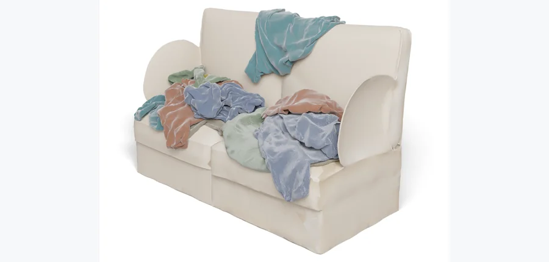 arXiv 2026-11-11 · cs.CV · #1 **[SoftPAT3D: Physics-Augmented Text-to-3D Scene Generation with Deformables](https://arxiv.org/abs/2611.11087)** [Lei Shu , Alberta Longhini , Leonidas Guibas , Gordon Wetzstein , Jeannette Bohg](https://arxiv.org/abs/2611.11087) 机构：Stanford University（[PDF](https://arxiv.org/pdf/2611.11087)） [Paper](https://arxiv.org/abs/2611.11087) · [图源](https://arxiv.org/html/2611.11087v1/figs/v2/teaser_hero_ours.png) 

中文摘要
我们提出 SoftPAT3D，一种物理增强的文生三维场景生成框架。在该框架中，布料、毛绒玩具和绳索等可形变物体被生成为物理有效、可直接仿真的物体，并与承托它们的家具、彼此以及自身形成无相交的接触。现有物理增强流程只仿真刚体，无法容纳生成的可形变物体：文生三维方法返回的网格在几何上可能无效甚至自相交，也没有静止形状、材料模型或容许的初始状态，而这些正是形变仿真的必需输入。我们利用流程中已有的信息构造这些输入。静止形状依据物体的制造方式而非生成的、不符合物理规律的形变构型确定；材料库为每个物体赋予可进一步优化的初始弹性参数。系统重新生成被遮挡的支撑物并将其转换为水密碰撞网格，从提示指定的支撑部位上方以可优化的位置释放各物体，再用统一的接触模型驱动完整场景达到静力平衡，并通过几何检查和视觉语言模型核实完成情况。场景不符合提示时，对位置进行网格搜索；对搜索未能达到的目标，则利用同一接触能量的可微仿真伴随梯度，同时放置多个物体并恢复和优化材料参数。多物体场景在单次仿真中达到平衡，该流程也可仅从文本提示运行。在全部 65 条提示上，SoftPAT3D 没有产生任何非预期穿透，而所有其他系统均出现穿透；生成场景可直接用于场景编辑和机器人操作。 <a href="https://arxiv.org/abs/2611.11087">原摘要来源</a>
 | 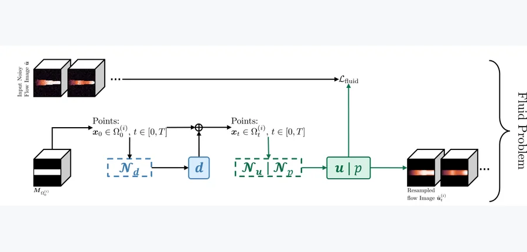 arXiv 2026-11-11 · physics.flu-dyn · #2 **[Reconstructing Interacting Blood Flow and Wall Interface Deformation from Noisy Flow Data Using PirateNets](https://arxiv.org/abs/2611.10505)** [Han Zhang , Xue-Cheng Tai , Alessandro Veneziani , Raymond H. Chan](https://arxiv.org/abs/2611.10505) 机构：Brown University / NORCE / Emory University（原单位）/ Lingnan University（[PDF](https://arxiv.org/pdf/2611.10505)） [Paper](https://arxiv.org/abs/2611.10505) · [图源](https://arxiv.org/html/2611.10505v1/im/pipeline_fluid.png) 

中文摘要
血流与弹性血管壁的运动相互耦合：流体应力驱动血管壁形变，运动中的血管壁又改变血液流动的区域。给定有噪声的流动图像，我们研究重建这种耦合的、非定常三维运动的逆问题。我们通过类似 Gauss–Seidel 的流体与几何交替更新完成重建。在流体部分，使用物理信息网络拟合观测并在由任意拉格朗日–欧拉（ALE）映射描述的运动区域上满足不可压 Navier–Stokes 方程，以恢复速度和压力。在几何部分，参考域修正和序列配准恢复血管形状与壁面位移。界面牵引力连续性和弹性动量方程对配准进行正则化，使恢复的位移也受到物理约束。网络在采样的时空点上评估场及物理残差，无需对运动区域重新划分网格。在收缩通道和类似患者主动脉的场景中，实验展示了从噪声数据重建流动和壁面运动。消融与参数敏感性研究考察结构正则化及物理系数不准确的影响。进一步的三元件 Windkessel 出口边界条件实验展示了框架适配更符合生理情形的边界设置的方式。 <a href="https://arxiv.org/abs/2611.10505">原摘要来源</a>
 | 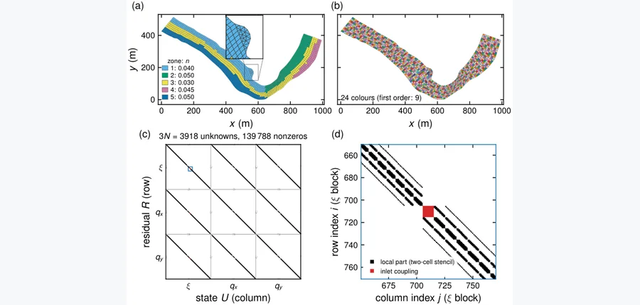 arXiv 2026-11-11 · physics.flu-dyn · #3 **[Hydrograd v2.0: a differentiable two-dimensional shallow-water model on unstructured meshes with steady and unsteady adjoints for calibration and closure learning](https://arxiv.org/abs/2611.11540)** [Xiaofeng Liu](https://arxiv.org/abs/2611.11540) 机构：The Pennsylvania State University（[PDF](https://arxiv.org/pdf/2611.11540)） [Paper](https://arxiv.org/abs/2611.11540) · [图源](https://arxiv.org/html/2611.11540v1/fig02_mesh_jacobian.png) 

中文摘要
我们提出 Hydrograd v2.0，这是一个用 Python 和 JAX 编写、经过显著改进的可微二维浅水模型。它在 SRH-2D 和 HEC-RAS 2D 等生产级模型的非结构网格上，以保持平衡和正性的有限体积格式求解浅水方程，并处理淹没与退水。梯度计算针对问题类型设计：稳态由牛顿法及通过图着色获得的精确稀疏雅可比矩阵求解，依据隐函数定理仅需一次线性求解即可得到梯度；非稳态流动通过带检查点的反向模式求导，或使用梯度计算成本约为两次前向运行的隐式时间积分器。所有梯度与有限差分一致，稳态流动的误差约为 $10^{-8}$。在 Savannah River 案例中，稳态水面与 SRH-2D 的均方根差异为 4.7 毫米。稳态闭合关系学习比对时间推进直接求导快 96 倍，且达到更低损失。从水位记录反演入流流量过程线时，峰值误差为 2%。在非稳态糙率标定中，敏感度矩阵的奇异值分解表明，测站水位对河段总阻力的敏感度比对各糙率分区之间阻力分配高 70 至 160 倍；这解释了为什么只有每个分区均设测站的布局才能恢复全部五个糙率值。在单张 GPU 上，含 512,000 个单元的网格一次前向运行用时 7.6 秒，计算一次梯度用时 51 秒。 <a href="https://arxiv.org/abs/2611.11540">原摘要来源</a>
 |
| 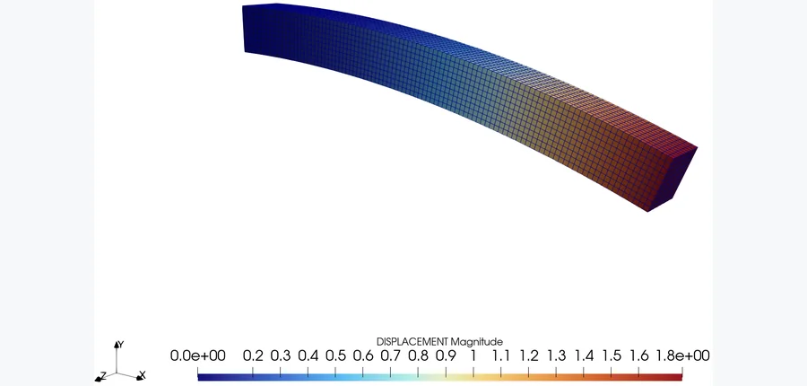 arXiv 2026-11-11 · physics.comp-ph · #4 **[Consistent Mapping for Fluid Structure Interaction with Geometrically Nonlinear Isogeometric Beams](https://arxiv.org/abs/2611.12599)** [Juan Ignacio Camarotti , Ricky Aristio , Roland Wüchner](https://arxiv.org/abs/2611.12599) 机构：Technical University of Munich（[PDF](https://arxiv.org/pdf/2611.12599)） [Paper](https://arxiv.org/abs/2611.12599) · [图源](https://arxiv.org/html/2611.12599v1/bending_bernoulli_20_deg.png) 

中文摘要
等几何梁公式用较少结构自由度为细长结构提供高效的降维表示，同时保留准确几何和高阶连续性。将其用于流固耦合（FSI）时，需要在一维梁中心线与周围流体界面之间传递运动和载荷。传统有限元梁已有相应映射策略，但几何非线性的等几何公式需要与样条运动学及不同截面转动描述一致的算子。本文为分区式 FSI 中几何非线性的等几何 Bernoulli 梁和 Timoshenko 梁建立一致的梁到表面映射。流体界面点在参考构型中附着于梁，并通过各公式的非线性运动学重建。一致线性化得到依赖构型的映射算子，其转置保证功共轭的载荷传递。我们通过解析形变测试、收敛研究和虚功检查验证公式，并在基于梁改造的 Mok、Turek–Hron 基准及 Goland 机翼颤振基准中评估。结果证实在大形变下能准确重建界面并实现功共轭载荷传递，同时展示两种梁公式适用于耦合 FSI 问题。 <a href="https://arxiv.org/abs/2611.12599">原摘要来源</a>
 | 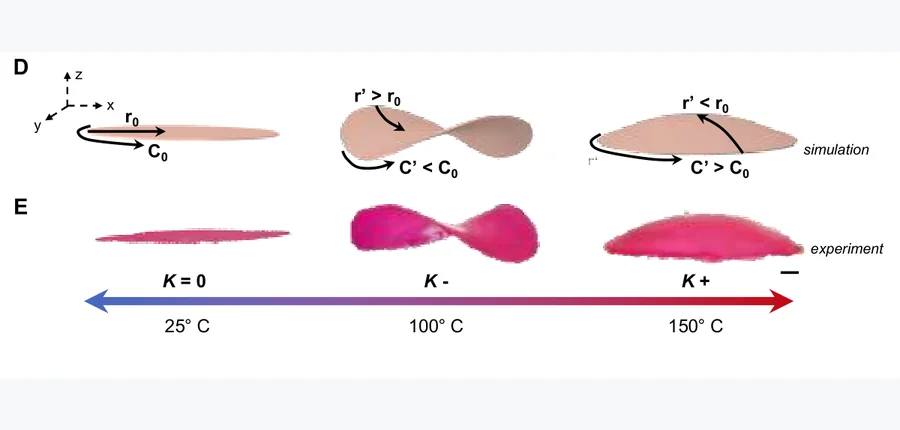 arXiv 2026-11-11 · cond-mat.soft · #5 **[Hierarchical Design of Ambidirectional LCE Sheets for Three-State Gaussian Shape Morphs](https://arxiv.org/abs/2611.09952)** [Atalaya Milan Wilborn , Gurminder K. Paink , Raphael Kay , Patryk Wasik , Friedrich Stricker , Jacopo Movilli , Shucong L… 机构：Harvard University / ETH Zürich / Brookhaven National Laboratory / Georgia Institute of Technology（[PDF](https://arxiv.org/pdf/2611.09952)） [Paper](https://arxiv.org/abs/2611.09952) · [图源](https://arxiv.org/pdf/2611.09952) 

中文摘要
调控表面曲率是自然和人工系统实现适应性的常用策略，其结构决定功能。不可伸展表面的高斯曲率是固定的，而可伸展材料表面能在应变作用下改变高斯曲率，从而实现运动、动态变色和可调刚度等能力。这一特征常用于开发具有复杂功能的软执行器；但过去若不采用多材料结构或空间变化的刺激场，很难跨越完整的高斯曲率范围。我们提出利用多相液晶弹性体（LCE）作为可双向形变的构件，产生多样的动态高斯形状变化。借助材料在相变过程中依次收缩和伸长的特性，我们设计并研究径向排列的平面 LCE 薄片的形变响应：随着温度单调升高，它们依次变化为负曲率和正曲率的表面。随后我们研究中尺度非对称性及宏观几何对曲率大小和弯曲对称性的影响，表明单一形态可以被编程为丰富的形变行为。最后，受头足类动物将机械形变能力与动态光学性质耦合的启发，我们制备了具有结构色的 LCE 薄片，将动态高斯曲率与动态变色响应耦合。该方法为软体机器人、可展开系统和响应性表面所需的多状态形状重构自适应结构提供了途径。 <a href="https://arxiv.org/abs/2611.09952">原摘要来源</a>
 | 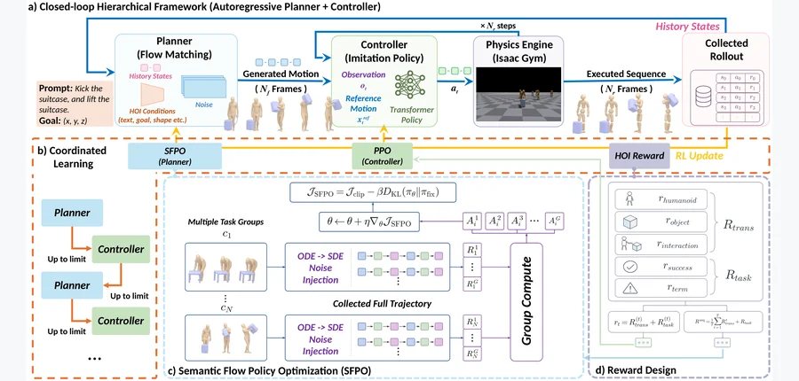 arXiv 2026-11-11 · cs.CV · #6 **[InfCoiL: Coordinated Planner-Controller Learning for Closed-Loop Physics-Based Human-Object Interaction](https://arxiv.org/abs/2611.11517)** [Yude Zou , Yifei Yao , Yiwei Hao , Hanqing Wang , Xing Gao](https://arxiv.org/abs/2611.11517) 机构：Shanghai Jiao Tong University / Shanghai Artificial Intelligence Laboratory（[PDF](https://arxiv.org/pdf/2611.11517)） [Paper](https://arxiv.org/abs/2611.11517) · [Project](https://infcoil.github.io/) · [图源](https://arxiv.org/html/2611.11517v1/md4_cropped.png) 

中文摘要
文本和目标条件化的人—物交互（HOI）为物理角色动画中的高层意图提供了直观接口。将这类意图转化为物理合理、富接触的行为，自然需要生成式规划器和基于物理的控制器；但现有规划器—控制器系统要么开环执行计划，要么虽闭环却固定规划器，因此执行反馈不能改变规划内容。我们提出 InfCoiL，通过协同学习规划器与控制器，实现基于物理的 HOI 闭环框架。它借助共享的形态接口，在自回归的规划—执行循环中耦合形态感知的流匹配规划器与统一的多形态控制器，并使用相同物理 rollout 的强化学习交替微调两者。为在线优化流匹配规划器，我们提出语义流策略优化（SFPO）：以异质 HOI 特征上的逐通道语义协方差，将选定去噪转移随机化，并根据完整闭环执行分配组相对的序列级奖励。在留出的 OMOMO 序列上，InfCoiL 在目标到达任务成功率及物理跟踪精度上优于开环分层基线。项目页面见论文所给 HTTPS 链接。 <a href="https://arxiv.org/abs/2611.11517">原摘要来源</a>
 |
| 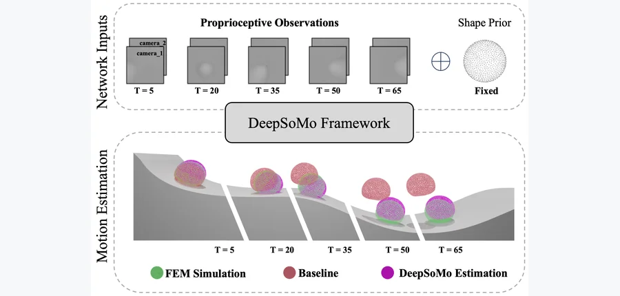 arXiv 2026-11-11 · cs.RO · #7 **[DeepSoMo: Deformable Object Motion Estimation under Proprioceptive Partial Observability via Predictive Latent Dynamics](https://arxiv.org/abs/2611.11242)** [Hanwen Zhao , Weicheng Dai , Luoyao Chen , Chen Feng](https://arxiv.org/abs/2611.11242) 机构：New York University（[PDF](https://arxiv.org/pdf/2611.11242)） [Paper](https://arxiv.org/abs/2611.11242) · [Project](https://ai4ce.github.io/DeepSoMo) · [图源](https://arxiv.org/html/2611.11242v1/figures/1_teaser.png) 

中文摘要
在软体机器人中，仅凭本体感觉估计可形变物体的运动具有挑战性，因为内部观测只能间接反映全局运动、接触和形状变化，造成部分可观测性。此时，瞬时观测并不足够；准确估计需要时间上连贯的潜在表示。本文从潜在动力学角度研究本体感觉部分可观测条件下的形变运动估计。我们认为，长时段估计的关键要求是潜在时间一致性，即潜在状态仍能预测未来观测。为此，提出 DeepSoMo，通过自监督的潜在预测约束在潜在动力学中施加预测结构。我们在典型的形变动力学场景中评估该方法，以高保真有限元仿真作为受控的真值来源。与架构匹配的循环网络基线相比，该方法在轨迹估计、方向恢复、形状重建和接触推断上均取得稳定改善。 <a href="https://arxiv.org/abs/2611.11242">原摘要来源</a>
 | 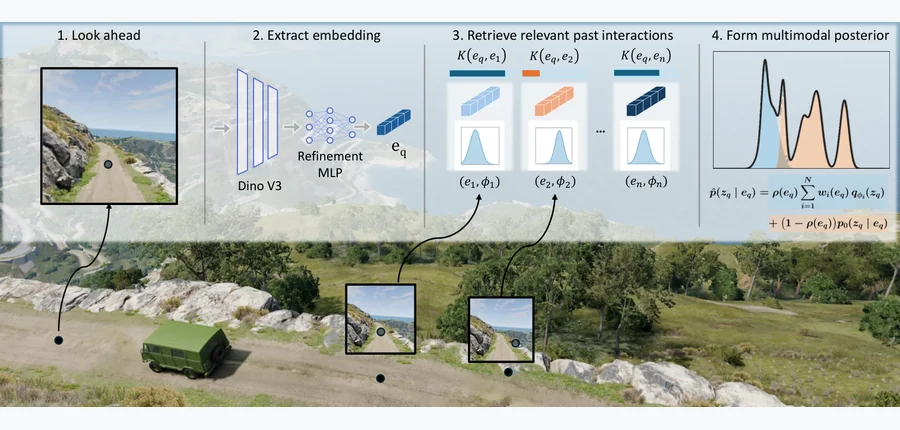 arXiv 2026-11-11 · cs.RO · #8 **[Beyond Semantic Classes: Online Physical Parameter Estimation via Embedding-Conditioned Gaussian Mixtures](https://arxiv.org/abs/2611.10107)** [Alexander Borca-Tasciuc , Prayag Sharma , Franck Djeumou](https://arxiv.org/abs/2611.10107) 机构：Rensselaer Polytechnic Institute（[PDF](https://arxiv.org/pdf/2611.10107)） [Paper](https://arxiv.org/abs/2611.10107) · [图源](https://arxiv.org/html/2611.10107v1/graphic_abstract_v3.png) 

中文摘要
如果机器人能在接触前从视觉推断与交互相关的物理属性，将有助于在非结构化环境中规划和控制。视觉提供有用的接触前信息，但外观本身常有歧义：看似相似的区域在接触时可能呈现不同的摩擦、刚度或下陷响应。现有方法常将这种歧义压缩为点估计，或通过固定语义类别汇总经验，难以保留不同物理状态。我们提出实时估计器，以直接由连续视觉嵌入条件化的潜在物理参数高斯混合后验，取代按语义类别索引。方法将通常由逆向建模得到的、基于交互的高斯参数估计保留为混合分量，并通过嵌入相似度检索和加权每个新查询区域的相关历史交互。交互记录稀少时，支持度感知的融合机制纳入条件生成先验模型；学习式嵌入细化则在不离散化表示的情况下提高检索相关性。实验表明，估计器可恢复多峰物理信念、排除无关交互历史、避免空间地图离散化，并以控制器频率运行。在未知低摩擦和高摩擦区域的高保真自动驾驶竞速仿真中，随着交互证据在多圈行驶中积累，该后验使控制器持续适应，在保持摩擦感知行为的同时提升表现。 <a href="https://arxiv.org/abs/2611.10107">原摘要来源</a>
 | 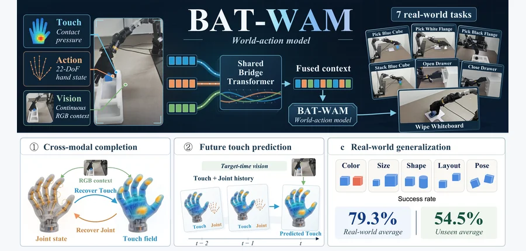 arXiv 2026-11-11 · cs.RO · #9 **[BAT-WAM: Bridging Action and Touch in World-Action Models for Dexterous Hands](https://arxiv.org/abs/2611.10967)** [Dong Fang , Feixuan Huang , Yuanxin Zhong , Yuxiang Gao , Qi Song , Yunlong Wang , Xiaosong Jia , Yu-Gang Jiang](https://… 机构：Fudan University / Rimbot / Southeast University / Tsinghua University（[PDF](https://arxiv.org/pdf/2611.10967)） [Paper](https://arxiv.org/abs/2611.10967) · [图源](https://arxiv.org/html/2611.10967v1/figures/overview.png) 

中文摘要
使用世界动作模型（WAM）进行灵巧操作依赖手部构型和接触信息，但关节状态与全手触觉观测可能部分甚至全部缺失。RGB 图像提供场景上下文及手物几何，却不足以可靠恢复这些缺失模态。我们还观察到手部状态与触觉信息之间的相关性。基于此，提出 BAT-WAM，在 WAM 中桥接视觉、关节状态与触觉表示。BAT-WAM 为触觉流和动作流分别学习码本及解码器，用以 RGB 为条件的连续潜在桥连接两流进行双向学习，同时将视觉信息用作连续上下文。按照 HTBench 评估协议，相对于以图像为条件的 HandTouch 检查点，BAT-WAM 在完全遮蔽和部分遮蔽条件下分别将触觉重建的均方根误差（RMSE）降低 34.73% 和 38.84%。在目标时刻 RGB 和历史动作条件下预测未来触觉时，相对于结合 HandTouch 的 OpenWAM，平均 RMSE 降低 85.56%。真实机器人实验进一步表明，BAT-WAM 在灵巧操作上持续优于相关 WAM 基线；未见过的物体和场景上的泛化实验也显示相对基线的显著改善。这些发现支持将视觉上下文、手部状态和触觉联合建模，作为多模态 WAM 的一种表示方法。 <a href="https://arxiv.org/abs/2611.10967">原摘要来源</a>
 |
| 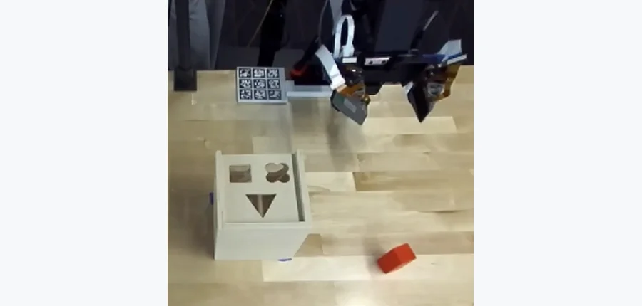 CoRL 2026 Dexterous Manipulation Workshop · #10 **[Tactile Sensors Are an Effective Substitute for Wrist Cameras in Contact-Rich or Occluded Manipulation](https://arxiv.org/abs/2611.10490)** [Aijia Yang , Arsh Tangri , Sergey Zakharov , Krishna Murthy Jatavallabhula](https://arxiv.org/abs/2611.10490) 机构：Toyota Research Institute（[PDF](https://arxiv.org/pdf/2611.10490)） [Paper](https://arxiv.org/abs/2611.10490) · [Project](https://annieyaj.github.io/tactile-vs-vision/) · [图源](https://arxiv.org/html/2611.10490v1/t1.png) 

中文摘要
学习式操作策略通常依赖腕部相机提供近距离视觉反馈，以补充工作空间的外部视角。然而，富接触操作需要建立和保持接触，而接触部位即使对腕部相机也可能不可见。安装在手指上的触觉传感器无需视觉可达即可直接、可靠地测量接触。本文表明，将场景视觉、自身视角视觉与触觉结合，可使策略重新获得腕部相机带来的性能优势。我们将两个低成本触觉阵列加入视觉触觉 ACT 策略，在训练和部署中均不使用腕部图像。评估覆盖放置、插入、遮挡下取物及持续接触工具使用等六类真实任务。在三个富接触任务中，我们固定演示数据、策略架构和优化设置，分别改变腕部相机及触觉的可用性。相对于不含腕部图像的视觉输入，加入腕部相机使成功率提高 18.3–28.3 个百分点；改用触觉使成功率提高 31.7–60.0 个百分点。在全部三个任务中，其观察到的成功率均高于使用腕部相机的纯视觉策略，其中两项在 Holm 校正的检验下有显著优势。这些结果支持在所评估的富接触场景中，以指尖触觉作为腕部相机的有效替代。 <a href="https://arxiv.org/abs/2611.10490">原摘要来源</a>
 | 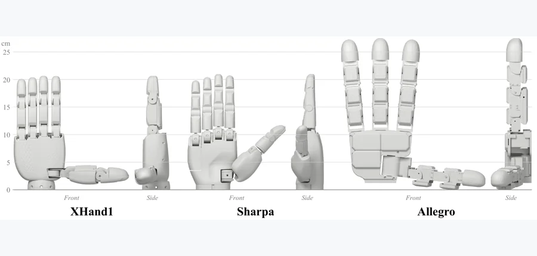 CoRL 2026 Everything Beneath the Policy Workshop · #11 **[Which Taxels, Not How Many: Tactile Sensor Placement for Dexterous Policies](https://arxiv.org/abs/2611.10647)** [Taeyun Kim , Jinsoo Shin , Taehwa Kim , Taeyoon Kim , Jinyoung Choi](https://arxiv.org/abs/2611.10647) 机构：NAVER LABS（[PDF](https://arxiv.org/pdf/2611.10647)） [Paper](https://arxiv.org/abs/2611.10647) · [图源](https://arxiv.org/html/2611.10647v1/Hand_presentation_v2.png) 

中文摘要
灵巧操作策略依赖训练前确定的设计选择：哪些传感器进入观测、传感器放在哪里，以及如何为编码器排列读数。这些选择很少被检验。对于触觉，仿真研究通常将触觉单元均匀铺设在手部，这一配置未经测试便成为默认方案。我们在单一受控协议下检验该默认方案。协议固定教师模型、训练过程和候选触觉单元，只改变传感器配置及表示，并在三种机器人手的掌内旋转和抓取任务上评估。依据接触统计选择的少量触觉单元可达到远多于它的均匀布设单元的表现；位于很少发生接触位置的单元与没有触觉输入等效。使用全部候选单元时，即使采用卷积编码器，它们在输入张量中的排列也不影响性能。因此，均匀铺设高估了任务所需的触觉单元数量。我们将结果总结为触觉策略设计的经验，以及触觉策略研究应报告的最少设计选择。 <a href="https://arxiv.org/abs/2611.10647">原摘要来源</a>
 | 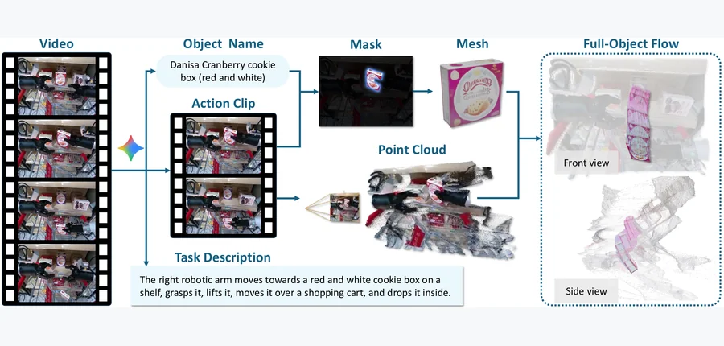 arXiv 2026-11-11 · cs.RO · #12 **[ObjectWorld: Scaling Object-Centric World Models with A Large-Scale 3D Full-Object Flow Dataset](https://arxiv.org/abs/2611.11085)** [Haonan Chen , Sicheng Isabella Lu , Haitian Li , Jiajin Wu , Hexiang Wei , Jiawei Zhang , Xin Fei , Yiwen Hou , Chenrui T… 机构：National University of Singapore / RoboScience / NUS Guangzhou Research Translation and Innovation Institute（[PDF](https://arxiv.org/pdf/2611.11085)） [Paper](https://arxiv.org/abs/2611.11085) · [Project](https://nus-lins-lab.github.io/ObjectWorld/) · [图源](https://arxiv.org/html/2611.11085v1/Data_Pipeline.png) 

中文摘要
从大规模视觉数据生成世界模型，为可扩展的机器人操作提供了有前景的路径；这需要一种既能接受大规模监督，又能用于下游控制的中间表示。我们提出三维完整物体流，这是一种以物体为中心的运动表示，为目标物体完整表面（包括被遮挡区域）上的点分配密集三维轨迹。相对于仅覆盖可见表面的物体流，这一表示将完整物体运动显式化，并统一适用于刚体和可形变物体。为大规模应用这一表示，我们构建了 1,210 小时的完整物体流数据集，以缓解完整三维物体运动监督不足的问题。数据集结合多样化真实视频和物理仿真，使用可扩展的标注流程从真实观测恢复完整物体运动，并通过质量指标系统评估标注。随后训练的世界模型以图像和任务描述为输入，在重建的物体几何上预测密集完整物体流。实验表明，该标注具有可靠质量，流预测随数据规模改善，并能在新场景和新机器人形态下有效支持下游操作。包含额外结果和视频的项目网站见论文所给 HTTPS 链接。 <a href="https://arxiv.org/abs/2611.11085">原摘要来源</a>
 |
| 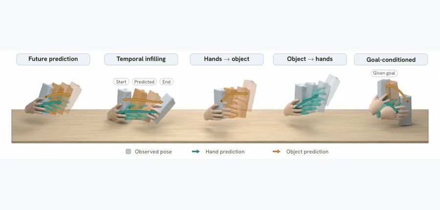 arXiv 2026-11-11 · cs.CV · #13 **[Grasping the Future: Joint 3D Hand-Object Forecasting From Internet Videos](https://arxiv.org/abs/2611.12879)** [Rustin Soraki , Matthew Wallingford , Ryan Aby , Brandon Chee , Jason Ren , Ali Farhadi , Homanga Bharadhwaj , Roozbeh Mo… 机构：University of Washington / University of North Carolina at Chapel Hill / Johns Hopkins University / Skild AI（[PDF](https://arxiv.org/pdf/2611.12879)） [Paper](https://arxiv.org/abs/2611.12879) · [Project](https://grasping-the-future.github.io/) · [图源](https://arxiv.org/html/2611.12879v1/teaser_tasks.png) 

中文摘要
与物体交互时，我们需要预判它会怎样运动，以及双手应如何随之运动。人类视频记录了日常活动中的这类关系，为预测未来交互提供了自然的数据来源；从中学习需要恢复已完成交互的运动，并据此预判随后可能发生的事情。我们提出 Grasping-the-Future，一个联合建模三维手物运动的统一生成模型，涵盖腕部运动、手指关节运动以及物体位置和朝向。通过掩码时空补全和流匹配，我们训练单个模型完成多种预测任务：预测未来交互、由物体运动预测手部运动或反向预测、生成朝向期望最终物体姿态的两条轨迹，以及补全部分观测的交互。我们显式建模手物关系并加入接触约束，以帮助在运动中维持抓握关系。为从互联网视频获得三维监督，我们开发了将预训练感知模型与联合几何优化结合的可扩展流程，以重建已完成的交互，并将恢复的轨迹与带标注交互数据集结合，用作所有任务的训练数据。在具有三维标注的数据集上，模型在所有任务中表现强劲，优于已发布的预测模型。此外，我们将预测轨迹重定向到机器人形态，展示其几何和物理合理性。视频见论文所给 HTTPS 链接。 <a href="https://arxiv.org/abs/2611.12879">原摘要来源</a>
 | 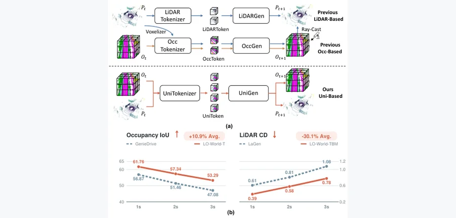 arXiv 2026-11-11 · cs.CV · #14 **[LO-World: Unified BEV Latent Modeling for Joint 4D Occupancy and LiDAR Forecasting](https://arxiv.org/abs/2611.11912)** [Zhimin Liao , Ping Wei , Kai Mao , Shuaijia Chen](https://arxiv.org/abs/2611.11912) 机构：Xi’an Jiaotong University（[PDF](https://arxiv.org/pdf/2611.11912)） [Paper](https://arxiv.org/abs/2611.11912) · [图源](https://arxiv.org/html/2611.11912v1/introduction_figure.png) 

中文摘要
LiDAR 点云和三维语义占据分别表示精细的度量几何与稠密体素语义，两种模态天然具有互补潜力。然而，现有世界模型通常独立预测两者，或用启发式级联，未能利用跨模态的双向约束。为此，我们提出 LO-World，一个在共享鸟瞰图（BEV）潜在空间中同时预测两种模态的统一四维世界模型。单流形式使稠密语义和度量几何相互增强，同时减少多流程冗余。具体而言，LO-World 将高效的混合距离图—体素自编码器与缓存历史上下文的流匹配生成器结合，以降低迭代采样延迟。大量实验表明，相比此前最先进的基线，LO-World 将占据预测交并比（IoU）提高 10.9%，将 LiDAR Chamfer 距离降低 30.1%；同时在单张 RTX 4090 上保持超过 25 FPS 的实时吞吐量。代码见论文所给 HTTPS 链接。 <a href="https://arxiv.org/abs/2611.11912">原摘要来源</a>
 | 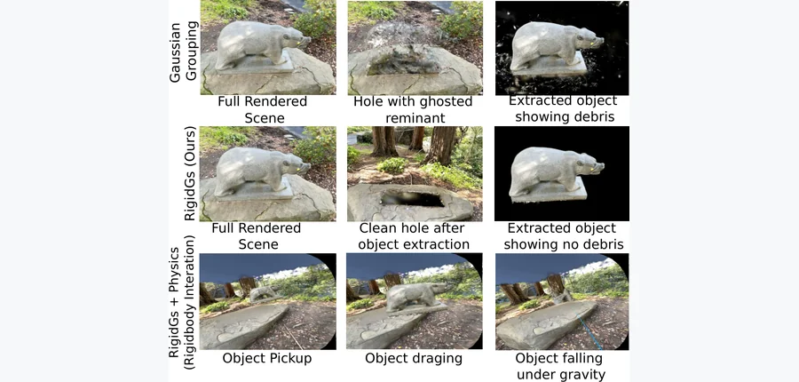 WACV 2027 (Applications Track) · #15 **[RigidGS: Geometry-Aware Object Decoupling for Rigid-Body Interaction in 3D Gaussian Splatting](https://arxiv.org/abs/2611.10199)** [Paul Sansah Gyreyiri , Diksha Shukla](https://arxiv.org/abs/2611.10199) 机构：University of Wyoming（[PDF](https://arxiv.org/pdf/2611.10199)） [Paper](https://arxiv.org/abs/2611.10199) · [Project](https://gyreyirisansah.github.io/rigidgs/) · [图源](https://arxiv.org/html/2611.10199v1/rigidgs_hero_image_small.png) 

中文摘要
交互式 VR/MR 应用需要既支持实时渲染又支持物体级操作的照片级三维表示。三维 Gaussian Splatting（3DGS）虽然渲染质量高，却以非结构化、整体式基元表示场景。现有物体感知 3DGS 方法联合优化几何和语义状态，面临两类失效：复杂几何上的基础模型掩码噪声，以及标签与几何耦合，即联合优化的身份梯度会错误标注边界高斯。我们提出 RigidGS，一条将几何学习与物体身份分离的端到端流程。我们设计深度和时间感知的掩码细化模块，分别处理 SAM2 对细结构过度包含、对多深度物体包含不足的问题。随后完全通过上游的 COLMAP 投影投票确定物体身份，并在训练中冻结身份，使掩码监督仅用于几何优化。仅细化掩码便能显著改进竞争方法，但标签与几何耦合仍有残余差距；固定身份设计消除了这一差距。在 LLFF/NVOS、Mip-NeRF 360 和 iNeRF360 上，RigidGS 优于此前物体感知 3DGS 方法；其中在 LLFF/NVOS 上，分割和边界 IoU 分别提高 7.7 和 14.5 个百分点。最后，RigidGS 无需提取网格即可在 Meta Quest 2 上实现实时刚体操作。代码和项目页见论文所给 HTTPS 链接。 <a href="https://arxiv.org/abs/2611.10199">原摘要来源</a>
 |
| 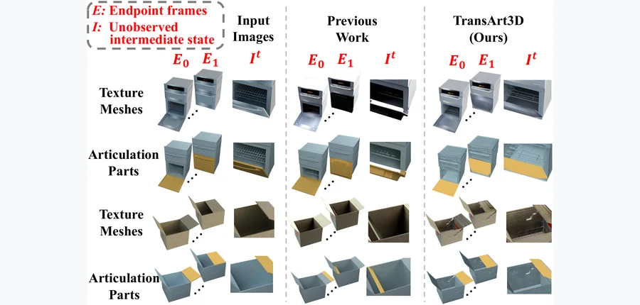 arXiv 2026-11-11 · cs.CV · #16 **[TransArt3D: From Two States to Articulated 3D Reconstruction with Video Transition Priors](https://arxiv.org/abs/2611.11304)** [Chenhao Guan , Liying Yang , Xinxing Yu , Hao Mo , Tianshun Han , Renjun Gao , Yanyan Liang](https://arxiv.org/abs/2611.1… 机构：Macau University of Science and Technology（[PDF](https://arxiv.org/pdf/2611.11304)） [Paper](https://arxiv.org/abs/2611.11304) · [图源](https://arxiv.org/html/2611.11304v1/comparison.png) 

中文摘要
从少量图像重建可交互的关节物体，对机器人与仿真很重要，却是高度欠约束的问题。现有优化方法用分别评价每个状态的静态三维先验拟合关节物体，因此单个状态的重建误差会作为虚假的运动渗入活动部件及关节估计。视频扩散模型捕捉状态间的运动，但只在二维中隐式表示。为此，我们提出 TransArt3D，通过将视频转变先验转换为显式的部件结构和关节运动学，仅用两个端点图像重建关节三维物体。首先，通过跨转变的三维共识，将静态三维先验联合施加到端点间生成的视频帧上，以稳定不变区域并初始化部件和关节。随后，整流流运动学细化让视频先验监督整个转变过程中的三维运动场，同时用部件归属和共享关节约束优化，避免单状态误差污染关节结构。最后，运动感知的规范外观融合利用恢复的关节运动，将两张端点图像映射到同一规范表面，为只在某一状态可见的区域赋予纹理。在 PartNet-Mobility 上，TransArt3D 在同样只给定两个端点的方法中取得更好的几何和关节精度；在关节状态几何、关节定位及外观方面，也超越了给定六个观测状态的方法。 <a href="https://arxiv.org/abs/2611.11304">原摘要来源</a>
 | 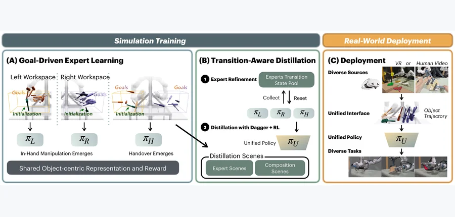 arXiv 2026-11-11 · cs.RO · #17 **[SimDuoReal: Object-Centric Bimanual Policy for Emergent Dexterity](https://arxiv.org/abs/2611.10410)** [Qiyang Yan , Yulin Liu , Akash Sharma , Haozhi Qi , Guanya Shi , C. Karen Liu](https://arxiv.org/abs/2611.10410) 机构：Amazon FAR / UC San Diego / University of Chicago / Carnegie Mellon University / Stanford University（[PDF](https://arxiv.org/pdf/2611.10410)） [Paper](https://arxiv.org/abs/2611.10410) · [Project](https://simduoreal.github.io/) · [图源](https://arxiv.org/html/2611.10410v1/system_overview_1.png) 

中文摘要
双臂灵巧操作需要手臂与手部协调控制，但手工指定这种协调既困难又常依赖具体任务。本文探究复杂的双臂灵巧性是否能从简单的物体中心学习目标中涌现。我们在共享的物体中心奖励下训练强化学习策略，通过改变训练环境而非为每种行为单独调节奖励。策略在没有手工设计运动序列的情况下，自行发现抓取前操作、抓取与再抓取、手内调整及交接，以达到目标物体姿态。随后，我们在状态转移附近细化专家策略，并结合 DAgger 和强化学习，将它们蒸馏为能在多种双臂任务中组合这些行为的单一策略。在真实硬件上，同一策略对未见过的物体执行四项任务，80 次试验成功 61 次（76.3%），无需针对任务微调。在仿真条码扫描中，策略成功率为 85.0%，而两个不进行交接的单臂策略为 60.4%。结果表明，该目标可能为学习通用双臂灵巧性提供简单、可扩展的接口，将设计机器人协调动作的负担转移到指定物体应达到的状态上。 <a href="https://arxiv.org/abs/2611.10410">原摘要来源</a>
 | 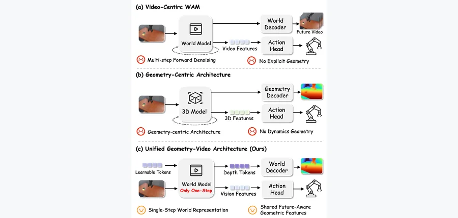 arXiv 2026-11-11 · cs.CV · #18 **[ForeAct: Geometry-Guided Action Learning from World Representations](https://arxiv.org/abs/2611.11500)** [Wei Lu , Jiaxi Zhang , Yunheng Wang , Taowen Wang , Yuetong Fang , Zhenhui Zhang , Shuning Zhang , Zizhao Yuan , Yixiao F… 机构：Hong Kong University of Science and Technology (Guangzhou) / JD Explore Academy（[PDF](https://arxiv.org/pdf/2611.11500)） [Paper](https://arxiv.org/abs/2611.11500) · [图源](https://arxiv.org/html/2611.11500v1/figures/intro3.png) 

中文摘要
机器人操作需要同时捕捉场景几何及交互中几何如何演化的表示，但现有方法大多分别处理两者。世界动作模型通过耦合动作预测和未来视频生成来捕捉动力学，不过迭代扩散或整流流推理的计算成本较高，表示也缺少显式空间结构。显式建模场景几何通常需要增加参数和计算量的辅助模块；而几何中心策略主要恢复已观察到的空间结构，常缺乏交互中未来几何变化的显式监督。为解决这些限制，我们提出 ForeAct，将预训练视频世界模型改作低延迟控制的单次前向表示主干。ForeAct 对当前观测的干净潜变量直接进行一次前向处理，省去未来帧合成和迭代去噪，同时保留主干已学习的时空先验。它不引入单独的几何主干，而使用受下一帧相对深度监督的可学习 token，通过双向自注意力塑造共享视频表示。这一紧凑接口把主干已有的空间知识转为面向动作生成、具有未来感知能力的表示，额外参数很少。轻量几何读出仅用于训练，部署时移除，因此无需深度输入或外部几何主干，也能实现低延迟的几何感知控制。在没有额外大规模预训练的条件下，ForeAct 在 LIBERO 上平均成功率为 96.6%，在 SimplerEnv-Bridge 上为 63.5%，并在 90 次真实世界 rollout 中取得 74.4% 的成功率。 <a href="https://arxiv.org/abs/2611.11500">原摘要来源</a>
 |
| 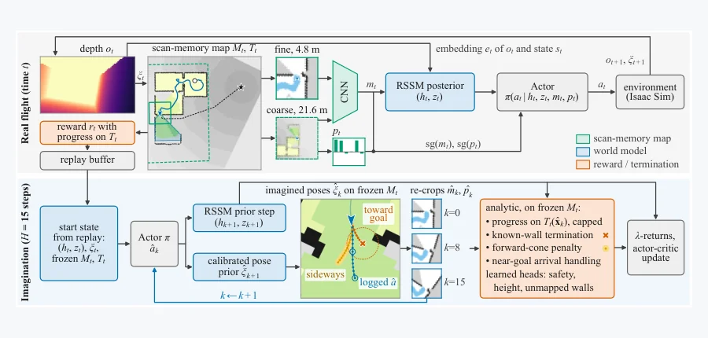 arXiv 2026-11-11 · cs.RO · #19 **[ScanDreamer: A Map-Grounded World Model for Quadrotor Navigation](https://arxiv.org/abs/2611.11605)** [Yunyi Gao , Yixing Shi , Yize Liu , Hai-Duong Tran , Nhat-Hoang P. Nguyen , Shuai Wang , Yi Deng , Shengming Liu , Sim Ku… 机构：Xiamen University Malaysia / VinUniversity / Nanyang Technological University（[PDF](https://arxiv.org/pdf/2611.11605)） [Paper](https://arxiv.org/abs/2611.11605) · [图源](https://arxiv.org/html/2611.11605v1/fig_overview.png) 

中文摘要
检查建筑物和隧道的四旋翼飞行器需在未知拥挤环境中导航，但前向深度相机视野有限，限制了场景理解和避碰。近期世界模型智能体通过想象经验学习导航，例如 AirDreamer，但数据需求较高，且往往缺少显式几何记忆及对相机可观测范围的意识。我们提出 ScanDreamer，一种基于地图的世界模型，由深度图像和机体位姿构建在线二维扫描记忆地图。世界模型、actor 和 critic 均以该地图为条件，地图还用于定义测地进度奖励。此外，前向视锥惩罚抑制相机视线之外的水平运动。在想象过程中，ScanDreamer 在冻结地图上推进四旋翼位姿，并从地图几何中推导前进度与触壁信号。我们以 80 万个环境步（单张 GPU 训练 5.5 小时）训练，并在 NVIDIA Isaac Sim 中跨未见过的布局和参数范围评估 1,560 个 episode。三个随机种子的均值±标准差结果为：ScanDreamer 成功率 96.3±0.3%，碰撞率 3.6±0.3%；同样在线交互预算下，AirDreamer 分别为 59.6±3.0% 和 28.8±2.8%。去掉前向视锥惩罚后，碰撞率升至 9.9±3.1%。结果表明，显式地图记忆、地图约束的想象和感知感知的运动相结合，可显著改进导航表现及数据效率。源代码见论文所给 HTTPS 链接。 <a href="https://arxiv.org/abs/2611.11605">原摘要来源</a>
 | 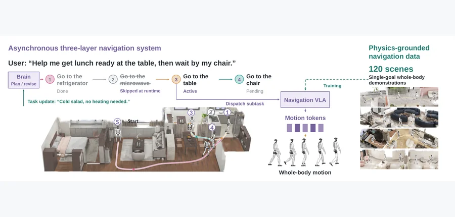 arXiv 2026-11-11 · cs.RO · #20 **[LHNav: Long-Horizon Humanoid Navigation via Multirate Coordination and Physics-Grounded Action Data](https://arxiv.org/abs/2611.12136)** [Xueyang Wang , Zehong Shen , Dingkun Wei , Huaijin Pi , Changpeng Wang , Xing Zhu , Hujun Bao , Yujun Shen , Xiaowei Zhou… 机构：Zhejiang University / Robbyant / The University of Hong Kong（[PDF](https://arxiv.org/pdf/2611.12136)） [Paper](https://arxiv.org/abs/2611.12136) · [图源](https://arxiv.org/html/2611.12136v1/nhnav_teaser_layout_v12.png) 

中文摘要
我们研究依据长时段语言指令、跨越多个目的地的人形机器人导航。这项任务要求机器人在连续目标之间保持进展，同时在狭窄空间持续产生自然、稳定的全身运动。现有方法仅分解任务并不能保证执行全程不断推进，基于路标点的导航也不能保证全身运动自然且忠实于路线。我们的核心想法是让三个角色在不同时间尺度上协作：负责任务推理的 Brain、负责局部运动生成的 Cerebellum，以及负责全身执行的 Brainstem。我们在 LHNav 中实现这一异步系统，利用进度与到达反馈，协调导航目标、VLA 运动 token 预测和全身控制。为训练 Cerebellum 生成自然且忠实于路线的运动，我们设计物理约束数据引擎，改进沿避碰路线的运动参考的物理跟踪，并将所得示范与渲染的视觉观测配对。这些设计使任务规划能与持续运动同时进行，并把单目标导航扩展到连续目的地，同时保持自然、忠实于路线的全身运动。仿真中，导航 VLA 在单目标成功率和运动平滑度上优于 OmniNav 和 DualVLN，碰撞与跌倒也更少。使用仅在单目标示范上训练的 VLA，LHNav 在长时段导航任务中达到 75.56% 成功率。在 Unitree G1 上部署还展示了真实环境中的单目标导航，以及包含重新摆放物体的布局中的零样本长时段任务执行。项目网站见论文所给 HTTPS 链接。 <a href="https://arxiv.org/abs/2611.12136">原摘要来源</a>
 |   |
<!-- PAPER_CARDS_END -->

## 检索概况

- **检索窗口**：北京时间 2026-11-10 09:00 至 2026-11-11 09:00；本轮抓取 14 个 [arXiv 官方 New 分类页](https://arxiv.org/list/cs.RO/new?show=2000)。
- **官方最新批次**：全部分类页显示 **Tuesday, 10 November 2026**；主榜仅收各页 `New submissions`。
- **总命中／去重／入选**：1411 条 New 记录／1411 个不同 arXiv ID／20 篇。按标题和摘要人工核对后择取高相关论文。
- **事实与推断**：标题、作者、分类及摘要来自官方列表；机构以论文 PDF 首页核实。相关性、机构强度、局限和改进建议属于**推断**。
- **卡片完整性**：20 篇原摘要均已取得并逐篇翻译；20 张卡片均有官方论文真实配图，缺摘要 0 篇、缺图 0 篇。

## 官方 New listing 状态

| 分类页 | 官方日期 | New 条目 |
|---|---|---:|
| [cond-mat](https://arxiv.org/list/cond-mat/new?show=2000) | 2026-11-10 | 156 |
| [cs.AI](https://arxiv.org/list/cs.AI/new?show=2000) | 2026-11-10 | 166 |
| [cs.CV](https://arxiv.org/list/cs.CV/new?show=2000) | 2026-11-10 | 250 |
| [cs.GR](https://arxiv.org/list/cs.GR/new?show=2000) | 2026-11-10 | 4 |
| [cs.LG](https://arxiv.org/list/cs.LG/new?show=2000) | 2026-11-10 | 295 |
| [cs.RO](https://arxiv.org/list/cs.RO/new?show=2000) | 2026-11-10 | 128 |
| [eess.IV](https://arxiv.org/list/eess.IV/new?show=2000) | 2026-11-10 | 11 |
| [eess.SP](https://arxiv.org/list/eess.SP/new?show=2000) | 2026-11-10 | 36 |
| [eess.SY](https://arxiv.org/list/eess.SY/new?show=2000) | 2026-11-10 | 52 |
| [math.DS](https://arxiv.org/list/math.DS/new?show=2000) | 2026-11-10 | 27 |
| [math.NA](https://arxiv.org/list/math.NA/new?show=2000) | 2026-11-10 | 35 |
| [math.OC](https://arxiv.org/list/math.OC/new?show=2000) | 2026-11-10 | 65 |
| [physics](https://arxiv.org/list/physics/new?show=2000) | 2026-11-10 | 164 |
| [stat.ML](https://arxiv.org/list/stat.ML/new?show=2000) | 2026-11-10 | 22 |
| **合计** | — | **1411** |

## Top papers

| # | 论文 | 分类 | 作者 | 机构 | 相关性（推断） | 机构强度（推断） | 优先级 |
|---:|---|---|---|---|---|---|:---:|
| 1 | [SoftPAT3D: Physics-Augmented Text-to-3D Scene Generation with Deformables](https://arxiv.org/abs/2611.11087) | [cs.CV](https://arxiv.org/abs/2611.11087) | [Lei Shu , Alberta Longhini , Leonidas Guibas , Gordon Wetzstein , Jeannette Bohg](https://arxiv.org/abs/2611.11087) | Stanford University（[PDF](https://arxiv.org/pdf/2611.11087)） | 极高：三维物理／接触 | 待独立评估 | A |
| 2 | [Reconstructing Interacting Blood Flow and Wall Interface Deformation from Noisy Flow Data Using PirateNets](https://arxiv.org/abs/2611.10505) | [physics.flu-dyn](https://arxiv.org/abs/2611.10505) | [Han Zhang , Xue-Cheng Tai , Alessandro Veneziani , Raymond H. Chan](https://arxiv.org/abs/2611.10505) | Brown University / NORCE / Emory University（原单位）/ Lingnan University（[PDF](https://arxiv.org/pdf/2611.10505)） | 极高：三维物理／接触 | 待独立评估 | A |
| 3 | [Hydrograd v2.0: a differentiable two-dimensional shallow-water model on unstructured meshes with steady and unsteady adjoints for calibration and closure learning](https://arxiv.org/abs/2611.11540) | [physics.flu-dyn](https://arxiv.org/abs/2611.11540) | [Xiaofeng Liu](https://arxiv.org/abs/2611.11540) | The Pennsylvania State University（[PDF](https://arxiv.org/pdf/2611.11540)） | 极高：三维物理／接触 | 待独立评估 | A |
| 4 | [Consistent Mapping for Fluid Structure Interaction with Geometrically Nonlinear Isogeometric Beams](https://arxiv.org/abs/2611.12599) | [physics.comp-ph](https://arxiv.org/abs/2611.12599) | [Juan Ignacio Camarotti , Ricky Aristio , Roland Wüchner](https://arxiv.org/abs/2611.12599) | Technical University of Munich（[PDF](https://arxiv.org/pdf/2611.12599)） | 极高：三维物理／接触 | 待独立评估 | A |
| 5 | [Hierarchical Design of Ambidirectional LCE Sheets for Three-State Gaussian Shape Morphs](https://arxiv.org/abs/2611.09952) | [cond-mat.soft](https://arxiv.org/abs/2611.09952) | [Atalaya Milan Wilborn , Gurminder K. Paink , Raphael Kay , Patryk Wasik , Friedrich Stricker , Jacopo Movilli , Shucong Li , Joanna Aizenberg](https://arxiv.org/abs/2611.09952) | Harvard University / ETH Zürich / Brookhaven National Laboratory / Georgia Institute of Technology（[PDF](https://arxiv.org/pdf/2611.09952)） | 极高：三维物理／接触 | 待独立评估 | A |
| 6 | [InfCoiL: Coordinated Planner-Controller Learning for Closed-Loop Physics-Based Human-Object Interaction](https://arxiv.org/abs/2611.11517) | [cs.CV](https://arxiv.org/abs/2611.11517) | [Yude Zou , Yifei Yao , Yiwei Hao , Hanqing Wang , Xing Gao](https://arxiv.org/abs/2611.11517) | Shanghai Jiao Tong University / Shanghai Artificial Intelligence Laboratory（[PDF](https://arxiv.org/pdf/2611.11517)） | 极高：三维物理／接触 | 待独立评估 | A |
| 7 | [DeepSoMo: Deformable Object Motion Estimation under Proprioceptive Partial Observability via Predictive Latent Dynamics](https://arxiv.org/abs/2611.11242) | [cs.RO](https://arxiv.org/abs/2611.11242) | [Hanwen Zhao , Weicheng Dai , Luoyao Chen , Chen Feng](https://arxiv.org/abs/2611.11242) | New York University（[PDF](https://arxiv.org/pdf/2611.11242)） | 极高：三维物理／接触 | 待独立评估 | A |
| 8 | [Beyond Semantic Classes: Online Physical Parameter Estimation via Embedding-Conditioned Gaussian Mixtures](https://arxiv.org/abs/2611.10107) | [cs.RO](https://arxiv.org/abs/2611.10107) | [Alexander Borca-Tasciuc , Prayag Sharma , Franck Djeumou](https://arxiv.org/abs/2611.10107) | Rensselaer Polytechnic Institute（[PDF](https://arxiv.org/pdf/2611.10107)） | 极高：三维物理／接触 | 待独立评估 | A |
| 9 | [BAT-WAM: Bridging Action and Touch in World-Action Models for Dexterous Hands](https://arxiv.org/abs/2611.10967) | [cs.RO](https://arxiv.org/abs/2611.10967) | [Dong Fang , Feixuan Huang , Yuanxin Zhong , Yuxiang Gao , Qi Song , Yunlong Wang , Xiaosong Jia , Yu-Gang Jiang](https://arxiv.org/abs/2611.10967) | Fudan University / Rimbot / Southeast University / Tsinghua University（[PDF](https://arxiv.org/pdf/2611.10967)） | 极高：三维物理／接触 | 待独立评估 | A |
| 10 | [Tactile Sensors Are an Effective Substitute for Wrist Cameras in Contact-Rich or Occluded Manipulation](https://arxiv.org/abs/2611.10490) | [cs.RO](https://arxiv.org/abs/2611.10490) | [Aijia Yang , Arsh Tangri , Sergey Zakharov , Krishna Murthy Jatavallabhula](https://arxiv.org/abs/2611.10490) | Toyota Research Institute（[PDF](https://arxiv.org/pdf/2611.10490)） | 极高：三维物理／接触 | 待独立评估 | A |
| 11 | [Which Taxels, Not How Many: Tactile Sensor Placement for Dexterous Policies](https://arxiv.org/abs/2611.10647) | [cs.RO](https://arxiv.org/abs/2611.10647) | [Taeyun Kim , Jinsoo Shin , Taehwa Kim , Taeyoon Kim , Jinyoung Choi](https://arxiv.org/abs/2611.10647) | NAVER LABS（[PDF](https://arxiv.org/pdf/2611.10647)） | 极高：三维物理／接触 | 待独立评估 | A |
| 12 | [ObjectWorld: Scaling Object-Centric World Models with A Large-Scale 3D Full-Object Flow Dataset](https://arxiv.org/abs/2611.11085) | [cs.RO](https://arxiv.org/abs/2611.11085) | [Haonan Chen , Sicheng Isabella Lu , Haitian Li , Jiajin Wu , Hexiang Wei , Jiawei Zhang , Xin Fei , Yiwen Hou , Chenrui Tie , Chongkai Gao , Sheng Wang , Lin Shao](https://arxiv.org/abs/2611.11085) | National University of Singapore / RoboScience / NUS Guangzhou Research Translation and Innovation Institute（[PDF](https://arxiv.org/pdf/2611.11085)） | 极高：三维物理／接触 | 待独立评估 | A |
| 13 | [Grasping the Future: Joint 3D Hand-Object Forecasting From Internet Videos](https://arxiv.org/abs/2611.12879) | [cs.CV](https://arxiv.org/abs/2611.12879) | [Rustin Soraki , Matthew Wallingford , Ryan Aby , Brandon Chee , Jason Ren , Ali Farhadi , Homanga Bharadhwaj , Roozbeh Mottaghi](https://arxiv.org/abs/2611.12879) | University of Washington / University of North Carolina at Chapel Hill / Johns Hopkins University / Skild AI（[PDF](https://arxiv.org/pdf/2611.12879)） | 极高：三维物理／接触 | 待独立评估 | A |
| 14 | [LO-World: Unified BEV Latent Modeling for Joint 4D Occupancy and LiDAR Forecasting](https://arxiv.org/abs/2611.11912) | [cs.CV](https://arxiv.org/abs/2611.11912) | [Zhimin Liao , Ping Wei , Kai Mao , Shuaijia Chen](https://arxiv.org/abs/2611.11912) | Xi’an Jiaotong University（[PDF](https://arxiv.org/pdf/2611.11912)） | 高：动态三维场景 | 待独立评估 | A |
| 15 | [RigidGS: Geometry-Aware Object Decoupling for Rigid-Body Interaction in 3D Gaussian Splatting](https://arxiv.org/abs/2611.10199) | [cs.CV](https://arxiv.org/abs/2611.10199) | [Paul Sansah Gyreyiri , Diksha Shukla](https://arxiv.org/abs/2611.10199) | University of Wyoming（[PDF](https://arxiv.org/pdf/2611.10199)） | 高：三维几何／空间 | 待独立评估 | B |
| 16 | [TransArt3D: From Two States to Articulated 3D Reconstruction with Video Transition Priors](https://arxiv.org/abs/2611.11304) | [cs.CV](https://arxiv.org/abs/2611.11304) | [Chenhao Guan , Liying Yang , Xinxing Yu , Hao Mo , Tianshun Han , Renjun Gao , Yanyan Liang](https://arxiv.org/abs/2611.11304) | Macau University of Science and Technology（[PDF](https://arxiv.org/pdf/2611.11304)） | 高：三维几何／空间 | 待独立评估 | B |
| 17 | [SimDuoReal: Object-Centric Bimanual Policy for Emergent Dexterity](https://arxiv.org/abs/2611.10410) | [cs.RO](https://arxiv.org/abs/2611.10410) | [Qiyang Yan , Yulin Liu , Akash Sharma , Haozhi Qi , Guanya Shi , C. Karen Liu](https://arxiv.org/abs/2611.10410) | Amazon FAR / UC San Diego / University of Chicago / Carnegie Mellon University / Stanford University（[PDF](https://arxiv.org/pdf/2611.10410)） | 高：具身机器人任务 | 待独立评估 | B |
| 18 | [ForeAct: Geometry-Guided Action Learning from World Representations](https://arxiv.org/abs/2611.11500) | [cs.CV](https://arxiv.org/abs/2611.11500) | [Wei Lu , Jiaxi Zhang , Yunheng Wang , Taowen Wang , Yuetong Fang , Zhenhui Zhang , Shuning Zhang , Zizhao Yuan , Yixiao Feng , Zecui Zeng , Renjing Xu](https://arxiv.org/abs/2611.11500) | Hong Kong University of Science and Technology (Guangzhou) / JD Explore Academy（[PDF](https://arxiv.org/pdf/2611.11500)） | 高：具身机器人任务 | 待独立评估 | B |
| 19 | [ScanDreamer: A Map-Grounded World Model for Quadrotor Navigation](https://arxiv.org/abs/2611.11605) | [cs.RO](https://arxiv.org/abs/2611.11605) | [Yunyi Gao , Yixing Shi , Yize Liu , Hai-Duong Tran , Nhat-Hoang P. Nguyen , Shuai Wang , Yi Deng , Shengming Liu , Sim Kuan Goh , Duc-Thinh Pham , Sameer Alam](https://arxiv.org/abs/2611.11605) | Xiamen University Malaysia / VinUniversity / Nanyang Technological University（[PDF](https://arxiv.org/pdf/2611.11605)） | 高：具身机器人任务 | 待独立评估 | B |
| 20 | [LHNav: Long-Horizon Humanoid Navigation via Multirate Coordination and Physics-Grounded Action Data](https://arxiv.org/abs/2611.12136) | [cs.RO](https://arxiv.org/abs/2611.12136) | [Xueyang Wang , Zehong Shen , Dingkun Wei , Huaijin Pi , Changpeng Wang , Xing Zhu , Hujun Bao , Yujun Shen , Xiaowei Zhou](https://arxiv.org/abs/2611.12136) | Zhejiang University / Robbyant / The University of Hong Kong（[PDF](https://arxiv.org/pdf/2611.12136)） | 高：具身机器人任务 | 待独立评估 | B |

## 逐篇中文要点

### 1. [SoftPAT3D: Physics-Augmented Text-to-3D Scene Generation with Deformables](https://arxiv.org/abs/2611.11087)

- **论文事实／方法**：从文本生成可形变物体静止形状、材料和无穿透初态，再用统一接触模型求静力平衡。（[原摘要](https://arxiv.org/abs/2611.11087)）
- **论文事实／实验**：65 条提示中，摘要称无非预期穿透；结果可直接用于场景编辑和机器人操作。（[原摘要](https://arxiv.org/abs/2611.11087)）
- **推断／局限**：可用未见过的材料与多物体堆叠测试静力平衡的鲁棒性。

### 2. [Reconstructing Interacting Blood Flow and Wall Interface Deformation from Noisy Flow Data Using PirateNets](https://arxiv.org/abs/2611.10505)

- **论文事实／方法**：交替更新流场和血管几何，以 Navier–Stokes、界面牵引连续及弹性动量约束三维重建。（[原摘要](https://arxiv.org/abs/2611.10505)）
- **论文事实／实验**：在收缩通道和类主动脉场景展示从噪声数据恢复流场及壁面运动。（[原摘要](https://arxiv.org/abs/2611.10505)）
- **推断／局限**：需用真实 4D-flow MRI 与独立壁面测量评估参数失配下的可辨识性。

### 3. [Hydrograd v2.0: a differentiable two-dimensional shallow-water model on unstructured meshes with steady and unsteady adjoints for calibration and closure learning](https://arxiv.org/abs/2611.11540)

- **论文事实／方法**：非结构网格浅水模型结合稳态隐式梯度及非稳态伴随求导，支持标定和闭合学习。（[原摘要](https://arxiv.org/abs/2611.11540)）
- **论文事实／实验**：稳态闭合学习快 96 倍；单 GPU 的 512,000 单元网格前向 7.6 秒、梯度 51 秒。（[原摘要](https://arxiv.org/abs/2611.11540)）
- **推断／局限**：可检查强干湿边界和稀疏测站下梯度与参数可辨识性的变化。

### 4. [Consistent Mapping for Fluid Structure Interaction with Geometrically Nonlinear Isogeometric Beams](https://arxiv.org/abs/2611.12599)

- **论文事实／方法**：建立几何非线性等几何梁到流体界面的功共轭运动及载荷映射。（[原摘要](https://arxiv.org/abs/2611.12599)）
- **论文事实／实验**：通过解析形变、收敛、虚功以及多个流固耦合基准验证。（[原摘要](https://arxiv.org/abs/2611.12599)）
- **推断／局限**：可在接触、屈曲和更大截面转动条件下测量能量守恒误差。

### 5. [Hierarchical Design of Ambidirectional LCE Sheets for Three-State Gaussian Shape Morphs](https://arxiv.org/abs/2611.09952)

- **论文事实／方法**：利用多相液晶弹性体的顺序收缩与伸长，编程单片薄膜的正负高斯曲率变化。（[原摘要](https://arxiv.org/abs/2611.09952)）
- **论文事实／实验**：实验考察中尺度非对称和宏观几何，并展示曲率与结构色联动。（[原摘要](https://arxiv.org/abs/2611.09952)）
- **推断／局限**：软机器人应用需进一步检验循环寿命、负载和响应速度。

### 6. [InfCoiL: Coordinated Planner-Controller Learning for Closed-Loop Physics-Based Human-Object Interaction](https://arxiv.org/abs/2611.11517)

- **论文事实／方法**：在物理 HOI 中交替强化学习形态感知流规划器和多形态控制器，让执行反馈改变计划。（[原摘要](https://arxiv.org/abs/2611.11517)）
- **论文事实／实验**：留出的 OMOMO 序列上，目标到达与物理跟踪优于开环分层基线。（[原摘要](https://arxiv.org/abs/2611.11517)）
- **推断／局限**：需要检验未见物体接触拓扑和长时段失败后的恢复。

### 7. [DeepSoMo: Deformable Object Motion Estimation under Proprioceptive Partial Observability via Predictive Latent Dynamics](https://arxiv.org/abs/2611.11242)

- **论文事实／方法**：用自监督潜在预测约束，使本体感觉下的形变状态保持时间一致性。（[原摘要](https://arxiv.org/abs/2611.11242)）
- **论文事实／实验**：高保真有限元受控实验中，轨迹、方向、形状及接触估计优于匹配架构的循环基线。（[原摘要](https://arxiv.org/abs/2611.11242)）
- **推断／局限**：需从有限元真值扩展到真实软体传感器漂移与未知材料。

### 8. [Beyond Semantic Classes: Online Physical Parameter Estimation via Embedding-Conditioned Gaussian Mixtures](https://arxiv.org/abs/2611.10107)

- **论文事实／方法**：以视觉嵌入检索交互历史，构建摩擦等潜在参数的多峰高斯混合后验。（[原摘要](https://arxiv.org/abs/2611.10107)）
- **论文事实／实验**：高保真竞速仿真显示随着多圈交互证据积累，控制器能适应未知摩擦区域。（[原摘要](https://arxiv.org/abs/2611.10107)）
- **推断／局限**：可测试视觉相似但材料不同、且接触样本极少时的后验校准。

### 9. [BAT-WAM: Bridging Action and Touch in World-Action Models for Dexterous Hands](https://arxiv.org/abs/2611.10967)

- **论文事实／方法**：通过 RGB 条件的潜在桥联合动作与触觉码本，补全缺失手部状态或触觉。（[原摘要](https://arxiv.org/abs/2611.10967)）
- **论文事实／实验**：HTBench 的触觉重建 RMSE 降低 34.73%/38.84%，并报告真实灵巧手优势。（[原摘要](https://arxiv.org/abs/2611.10967)）
- **推断／局限**：宜评估传感器漂移、触觉延迟和跨硬件标定误差。

### 10. [Tactile Sensors Are an Effective Substitute for Wrist Cameras in Contact-Rich or Occluded Manipulation](https://arxiv.org/abs/2611.10490)

- **论文事实／方法**：把两个低成本指尖触觉阵列加入 ACT，训练部署均不使用腕部图像。（[原摘要](https://arxiv.org/abs/2611.10490)）
- **论文事实／实验**：三类接触任务中触觉使成功率提高 31.7–60.0 个百分点；六类真实任务被评估。（[原摘要](https://arxiv.org/abs/2611.10490)）
- **推断／局限**：需区分触觉的接触定位收益与额外传感器带来的预算收益。

### 11. [Which Taxels, Not How Many: Tactile Sensor Placement for Dexterous Policies](https://arxiv.org/abs/2611.10647)

- **论文事实／方法**：固定教师、训练和候选触觉单元，仅改变布局及表示，比较三种机器人手。（[原摘要](https://arxiv.org/abs/2611.10647)）
- **论文事实／实验**：接触统计选出的少量单元可匹配大量均匀单元；罕见接触位置贡献很小。（[原摘要](https://arxiv.org/abs/2611.10647)）
- **推断／局限**：可在任务迁移和接触分布变化时检验所选布局的稳健性。

### 12. [ObjectWorld: Scaling Object-Centric World Models with A Large-Scale 3D Full-Object Flow Dataset](https://arxiv.org/abs/2611.11085)

- **论文事实／方法**：用完整物体表面点的密集三维轨迹表示刚体及形变物体运动。（[原摘要](https://arxiv.org/abs/2611.11085)）
- **论文事实／实验**：构建 1,210 小时数据集，并报告新场景与不同机器人形态的下游操作效果。（[原摘要](https://arxiv.org/abs/2611.11085)）
- **推断／局限**：遮挡区域的伪标注质量需用独立几何真值分层评估。

### 13. [Grasping the Future: Joint 3D Hand-Object Forecasting From Internet Videos](https://arxiv.org/abs/2611.12879)

- **论文事实／方法**：从互联网视频恢复三维手物轨迹，使用接触约束的流匹配模型联合预测手和物体运动。（[原摘要](https://arxiv.org/abs/2611.12879)）
- **论文事实／实验**：在三维标注数据集上超过已发布预测模型，并将轨迹重定向到机器人形态。（[原摘要](https://arxiv.org/abs/2611.12879)）
- **推断／局限**：机器人上的物理可执行成功率仍需作为独立指标检验。

### 14. [LO-World: Unified BEV Latent Modeling for Joint 4D Occupancy and LiDAR Forecasting](https://arxiv.org/abs/2611.11912)

- **论文事实／方法**：在共享 BEV 潜变量中联合预测 LiDAR 点云与三维语义占据。（[原摘要](https://arxiv.org/abs/2611.11912)）
- **论文事实／实验**：摘要报告占据 IoU 提升 10.9%、Chamfer 距离下降 30.1%，单 RTX 4090 超过 25 FPS。（[原摘要](https://arxiv.org/abs/2611.11912)）
- **推断／局限**：可评估长时段滚动预测中几何误差与语义漂移。

### 15. [RigidGS: Geometry-Aware Object Decoupling for Rigid-Body Interaction in 3D Gaussian Splatting](https://arxiv.org/abs/2611.10199)

- **论文事实／方法**：冻结上游投票确定的物体身份，把掩码监督集中用于三维高斯几何优化。（[原摘要](https://arxiv.org/abs/2611.10199)）
- **论文事实／实验**：LLFF/NVOS 的分割和边界 IoU 分别提高 7.7、14.5 个百分点；Meta Quest 2 支持实时刚体操作。（[原摘要](https://arxiv.org/abs/2611.10199)）
- **推断／局限**：应测试严重遮挡和柔性物体时固定身份是否仍可靠。

### 16. [TransArt3D: From Two States to Articulated 3D Reconstruction with Video Transition Priors](https://arxiv.org/abs/2611.11304)

- **论文事实／方法**：用视频转变先验和共享关节约束，从两个端点图像重建可交互的关节三维物体。（[原摘要](https://arxiv.org/abs/2611.11304)）
- **论文事实／实验**：PartNet-Mobility 上优于同输入方法，并在部分指标超过使用六状态的方法。（[原摘要](https://arxiv.org/abs/2611.11304)）
- **推断／局限**：需要真实接触和关节力学实验验证其仿真可用性。

### 17. [SimDuoReal: Object-Centric Bimanual Policy for Emergent Dexterity](https://arxiv.org/abs/2611.10410)

- **论文事实／方法**：用共享物体中心奖励学习抓取前操作、再抓取、手内调整和双臂交接。（[原摘要](https://arxiv.org/abs/2611.10410)）
- **论文事实／实验**：真实四任务 80 次试验成功 61 次；仿真条码扫描成功率 85.0%。（[原摘要](https://arxiv.org/abs/2611.10410)）
- **推断／局限**：可检验未知质量、摩擦和非刚性物体下的零样本迁移。

### 18. [ForeAct: Geometry-Guided Action Learning from World Representations](https://arxiv.org/abs/2611.11500)

- **论文事实／方法**：将视频世界模型用作单次前向控制主干，并以未来相对深度监督共享表示。（[原摘要](https://arxiv.org/abs/2611.11500)）
- **论文事实／实验**：LIBERO 平均 96.6%、SimplerEnv-Bridge 63.5%，真实 90 次 rollout 成功率 74.4%。（[原摘要](https://arxiv.org/abs/2611.11500)）
- **推断／局限**：可对照相同算力的显式几何主干并测量遮挡物体场景的失败模式。

### 19. [ScanDreamer: A Map-Grounded World Model for Quadrotor Navigation](https://arxiv.org/abs/2611.11605)

- **论文事实／方法**：用在线二维扫描记忆地图约束四旋翼世界模型的想象和感知方向。（[原摘要](https://arxiv.org/abs/2611.11605)）
- **论文事实／实验**：单 GPU 5.5 小时训练后，在 1,560 个仿真 episode 中达到 96.3±0.3% 成功率。（[原摘要](https://arxiv.org/abs/2611.11605)）
- **推断／局限**：真实深度噪声与动态障碍可能影响冻结地图上的想象质量。

### 20. [LHNav: Long-Horizon Humanoid Navigation via Multirate Coordination and Physics-Grounded Action Data](https://arxiv.org/abs/2611.12136)

- **论文事实／方法**：异步协调任务推理、VLA 运动 token 和全身控制，并用物理约束数据训练导航。（[原摘要](https://arxiv.org/abs/2611.12136)）
- **论文事实／实验**：仿真长时段任务成功率 75.56%，Unitree G1 展示真实场景执行。（[原摘要](https://arxiv.org/abs/2611.12136)）
- **推断／局限**：应测量跨目标错误累积以及动态障碍时的跌倒和恢复。

## 今日最值得细读的 5 篇

1. [SoftPAT3D: Physics-Augmented Text-to-3D Scene Generation with Deformables](https://arxiv.org/abs/2611.11087)：从文本生成可形变物体静止形状、材料和无穿透初态，再用统一接触模型求静力平衡。
2. [Reconstructing Interacting Blood Flow and Wall Interface Deformation from Noisy Flow Data Using PirateNets](https://arxiv.org/abs/2611.10505)：交替更新流场和血管几何，以 Navier–Stokes、界面牵引连续及弹性动量约束三维重建。
3. [Hydrograd v2.0: a differentiable two-dimensional shallow-water model on unstructured meshes with steady and unsteady adjoints for calibration and closure learning](https://arxiv.org/abs/2611.11540)：非结构网格浅水模型结合稳态隐式梯度及非稳态伴随求导，支持标定和闭合学习。
4. [InfCoiL: Coordinated Planner-Controller Learning for Closed-Loop Physics-Based Human-Object Interaction](https://arxiv.org/abs/2611.11517)：在物理 HOI 中交替强化学习形态感知流规划器和多形态控制器，让执行反馈改变计划。
5. [ObjectWorld: Scaling Object-Centric World Models with A Large-Scale 3D Full-Object Flow Dataset](https://arxiv.org/abs/2611.11085)：用完整物体表面点的密集三维轨迹表示刚体及形变物体运动。

## 低算力可改进方向（方法级推断）

以下建议是基于摘要的研究设想，尚非论文已验证的结论；先在小规模基准中验证。

| 论文 | 方法改法与小实验 | 低算力原因 | 预期收益与风险（推断） |
|---|---|---|---|
| [SoftPAT3D](https://arxiv.org/abs/2611.11087) | 给可形变物体的静止形状加入接触可行性先验；在 10 个布料堆叠提示上比较穿透深度和求解迭代数。 | 固定生成网格，仅优化少量初态参数。 | 或减少接触求解成本；风险是先验偏向某类材料。 |
| [Hydrograd v2.0](https://arxiv.org/abs/2611.11540) | 对糙率反演加入按测站敏感度选择的分区正则；在小河道网格比较参数误差。 | 只优化分区标量。 | 或改善稀疏测站可辨识性；风险是抹平真实局部变化。 |
| [DeepSoMo](https://arxiv.org/abs/2611.11242) | 在潜在预测约束加入接触事件边界损失；用少量有限元轨迹比较接触 F1 与长时段误差。 | 冻结编码器，仅训练小型预测头。 | 或减少接触切换漂移；风险是事件伪标签噪声。 |
| [物理参数估计](https://arxiv.org/abs/2611.10107) | 用不确定度驱动的交互检索替换纯嵌入相似度；在两种外观相近摩擦面测试后验校准。 | 仅更改混合分量权重。 | 或更好区分物理状态；风险是探索样本不足。 |
| [Taxel 布局](https://arxiv.org/abs/2611.10647) | 用接触覆盖和任务迁移约束联合选点；在两只不同手上比较固定预算成功率。 | 优化少量传感器位置，不需大模型。 | 或提升跨任务稳健性；风险是仿真接触偏差。 |
| [ObjectWorld](https://arxiv.org/abs/2611.11085) | 对遮挡表面流加入刚体/形变分支一致性损失；在小规模合成序列比较隐藏面轨迹误差。 | 固定主干，仅训练轻量约束头。 | 或减少遮挡伪标注误差；风险是错误刚体假设。 |
| [ScanDreamer](https://arxiv.org/abs/2611.11605) | 将冻结地图改为带置信度的局部更新；在深度噪声和移动障碍小场景比较碰撞率。 | 二维地图与小规模仿真。 | 或改善动态环境适应；风险是地图更新不稳定。 |

本期仅列出以上 7 项具有明确方法改动和可执行小实验的方向。

## Replacement 观察

各官方页的 Replacement 与 New 分区分开检查；本轮未逐篇确认足以单列的重大修订，因此不把 Replacement 混入主榜。
