# 2026-11-12 arXiv 每日论文订阅摘要

<!-- PAPER_CARDS_START -->
## 论文卡片

按原日报排名展示；点击标题或 Paper 查看原文，详细中文分析见下方。

| 论文 | 论文 | 论文 |
|---|---|---|
| 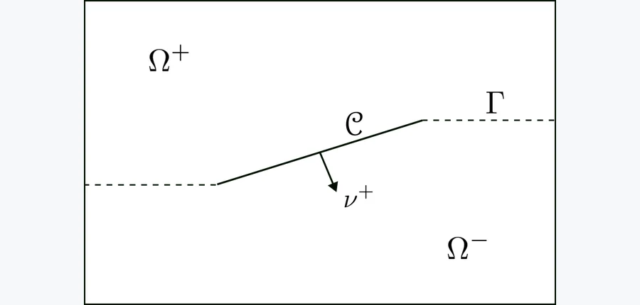 arXiv 2026-11-12 · math.NA · #1 **[Numerical analysis of coupled flow, deformation and frictional contact mechanics in a fractured porous medium](https://arxiv.org/abs/2611.14341)** [Marius Nevland , Kundan Kumar , Inga Berre , Jakub Wiktor Both , Eirik Keilegavlen](https://arxiv.org/abs/2611.14341) 机构：University of Bergen（[PDF](https://arxiv.org/pdf/2611.14341)） [Paper](https://arxiv.org/abs/2611.14341) · [图源](https://arxiv.org/html/2611.14341v1/domain.png) 

中文摘要
本文研究含裂隙接触力学的裂隙多孔介质中，耦合流动与黏弹性形变数学模型的数值近似。我们采用混合维度模型，将裂隙表示为多孔介质中的余维一对象。模型耦合基质和裂隙中的 Darcy 流、基质的线性黏弹性，以及裂隙表面的摩擦接触力学；接触条件包括法向柔顺性与 Coulomb 摩擦定律。我们提出并分析一种全离散数值格式，空间采用协调有限元，时间采用隐式 Euler 方法。论文证明离散解的存在性和唯一性，并推导稳定性与先验误差估计。最后通过数值实验计算误差估计，并与理论结果比较。 <a href="https://arxiv.org/abs/2611.14341">原摘要来源</a>
 | 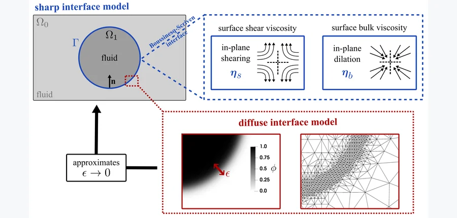 arXiv 2026-11-12 · cond-mat.soft · #2 **[A phase-field model of viscous surfaces in fluids](https://arxiv.org/abs/2611.13902)** [Maximilian Kloppe , Sebastian Aland](https://arxiv.org/abs/2611.13902) 机构：TU Bergakademie Freiberg / HTW Dresden / Center for Systems Biology Dresden（[PDF](https://arxiv.org/pdf/2611.13902)） [Paper](https://arxiv.org/abs/2611.13902) · [图源](https://arxiv.org/html/2611.13902v1/general_setup3.png) 

中文摘要
黏性表面在生物与工业多相流中发挥重要作用，但复杂流变性质与拓扑变化使其仿真颇具挑战。我们提出不可压 Navier–Stokes 流体中黏性表面的热力学一致相场模型，通过 Boussinesq–Scriven 本构律纳入表面剪切黏度与膨胀黏度。扩散界面公式从尖锐界面模型推导而来，并通过匹配渐近分析严格验证，确认可恢复正确的尖锐界面极限。我们开发无条件能量耗散的时间离散方法，以保证数值稳定性。模型通过与刚性球面表面流动解析解的定量基准比较得到验证；囊泡融合仿真还表明，拓扑变化期间能量耗散性质得到保持。这些结果表明，该框架无需显式追踪表面，即可稳健且符合物理规律地仿真包括大形变和拓扑变化在内的复杂表面动力学。 <a href="https://arxiv.org/abs/2611.13902">原摘要来源</a>
 | 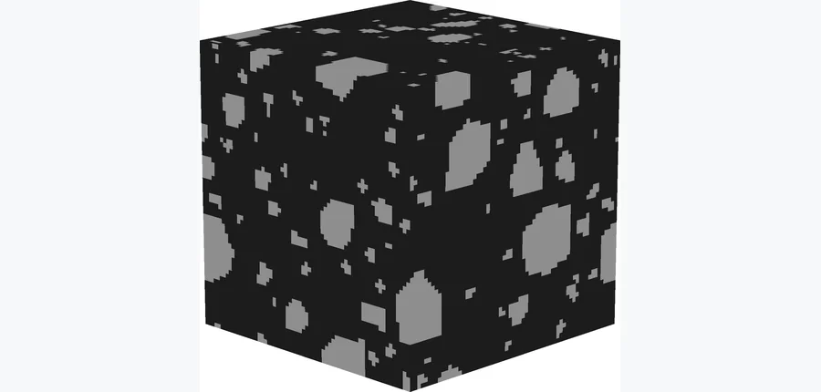 arXiv 2026-11-12 · physics.comp-ph · #3 **[Neural network scaling and generalization for 3D strain fields in heterogeneous materials](https://arxiv.org/abs/2611.14158)** [Lucas Fourel , Paul Devianne , Marine Debouvry , Tristan Destruhaut , Russell Gunn , Ashwini Gupta , Lori Graham-Brady… 机构：EPFL / Swiss Federal Office of Energy / Johns Hopkins University（[PDF](https://arxiv.org/pdf/2611.14158)） [Paper](https://arxiv.org/abs/2611.14158) · [图源](https://arxiv.org/html/2611.14158v1/figures/resolutions/bulk-r64.png) 

中文摘要
异质材料的计算均匀化与耦合多尺度仿真需要反复求解代表性体积单元中的力学场；对于高分辨率三维微结构，这一过程会变得极其昂贵。机器学习代理模型可以加速计算，但现有方法大多针对固定宏观载荷预测场，也很少说明网络架构应如何随高分辨率三维张量场预测任务扩展。本文提出一个 U-Net 代理模型，用于预测体素化混凝土细观结构中完整的 36 分量应变局域化张量场，分辨率最高达 $256^3$。训练张量由基于 FFT 的线弹性求解器生成；研究通过广泛的超参数优化推导扩展规律，并分析精度与速度的权衡。结果显示，只有网络宽度和深度需要随问题复杂度扩展；下采样后将通道数翻倍等常规 U-Net 设计对该问题并非最优。最终网络在验证集和留出测试集上均达到 1.118% 的平均绝对误差，在 Nvidia H100 GPU 上的推理速度约为 FFT 求解器的 8.7 倍。泛化实验显示模型可跨骨料体积分数迁移，并凸显多样化形貌训练的重要性。为提高可靠性，论文提出基于内部特征图计算的最大均值差异指标，以在不进行昂贵参考计算的条件下识别分布外微结构。 <a href="https://arxiv.org/abs/2611.14158">原摘要来源</a>
 |
| 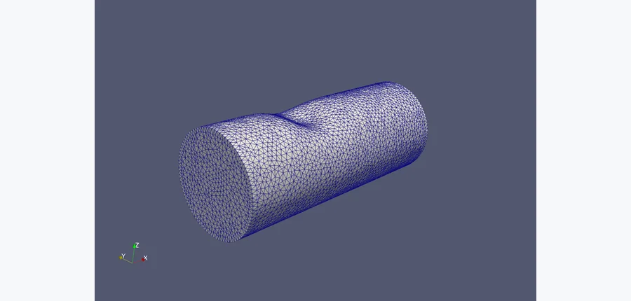 arXiv 2026-11-12 · physics.flu-dyn · #4 **[Neural Networks with Local Converging Inputs for Solving the 3D Stokes Equations on Unstructured Meshes: Novel Techniques and Advances](https://arxiv.org/abs/2611.12963)** [Farjana Siddiqua , Haoxiang Huang , Weiming Ding , Haotian Sun , Vigor Yang , Yingjie Liu](https://arxiv.org/abs/2611.12963) 机构：Georgia Institute of Technology（[PDF](https://arxiv.org/pdf/2611.12963)） [Paper](https://arxiv.org/abs/2611.12963) · [图源](https://arxiv.org/html/2611.12963v1/onebump.png) 

中文摘要
流体流动偏微分方程的神经网络代理通常在全局学习解，因此需要大型网络和大量高保真训练仿真。局部收敛输入神经网络（NNLCI）则在局部工作：它从目标点附近采样的两个收敛粗网格解预测该点的高保真解，因此网络较小、所需训练数据较少，并能跨几何形状泛化。本文中，两个低保真网格 LF1 和 LF2 平均分别约含 300 和 730 个四面体，而高保真网格 HF 约含 155,000 个。我们针对非结构化四面体网格上的三维 Stokes 方程开发 NNLCI 框架，并提出两项构建复杂曲边界附近局部输入的技术。第一，输入邻域可以越过边界，边界外数值由局部最小二乘拟合得到，使包括壁面邻近点在内的每个高保真点都能被预测。第二，依据相邻单元形心估计局部网格间距，从而在非结构化网格上一致地确定模板大小。对于含一至三个凸起、包括沿周向旋转凸起的管流，在全部高保真点上评估时，NNLCI 将较细低保真解的相对 $L^2$ 误差降低 90% 至 94%。这两项技术也适用于点云离散上具有光滑解的其他 NNLCI 问题。 <a href="https://arxiv.org/abs/2611.12963">原摘要来源</a>
 | 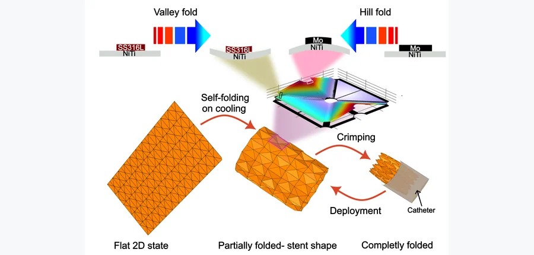 arXiv 2026-11-12 · cond-mat.mtrl-sci · #5 **[Design of Self-Folding Origami Architectures for Biomedical Implants: A Finite Element Simulation Framework](https://arxiv.org/abs/2611.13964)** [Suhas Chandrashekar , Thomas Stieglitz , Prasanth Velvaluri](https://arxiv.org/abs/2611.13964) 机构：University of Freiburg（[PDF](https://arxiv.org/pdf/2611.13964)） [Paper](https://arxiv.org/abs/2611.13964) · [图源](https://arxiv.org/pdf/2611.13964) 

中文摘要
微创脑植入物需要紧凑的输送构型和受控的形状变换，以穿过狭窄血管。折纸结构可从紧凑状态大幅变形为定制的展开形态，但在微尺度实施仍有困难：传统设计依赖预定义的山折与谷折，随着单元尺寸缩小以满足临床要求，制造和组装愈加困难。为此，我们提出基于薄膜双金属复合材料热致应力的自折叠方法。将形状记忆合金镍钛（NiTi）与钼或不锈钢（SS316L）配对，利用不同的热膨胀系数产生局部铰链弯曲，使结构能确定性、自主地折叠成预设的山折与谷折构型。通过有限元仿真，我们系统优化铰链长度、层厚、宽度与形状，找到一种铰链几何，相对于此前报道的设计将单元尺寸缩小约 50%。将该结构集成到完整的水弹折纸单元后，结果确认条带级折叠机制可扩展为整个镶嵌结构协调的自折叠形变。这些结果表明，基于临床已使用生物材料、由应力诱导的自折叠薄膜折纸结构具有可行性，并为集成传感和监测功能的新一代主动神经血管植入物提供可扩展的设计框架。 <a href="https://arxiv.org/abs/2611.13964">原摘要来源</a>
 | 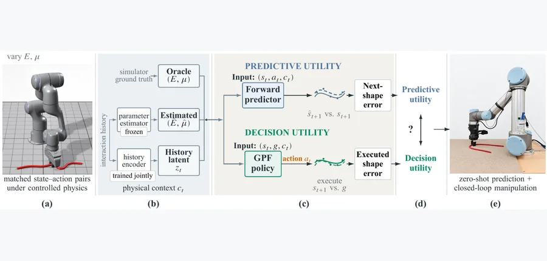 arXiv 2026-11-12 · cs.RO · #6 **[From Prediction to Action: Learning Physical Context for Deformable Linear Object Manipulation](https://arxiv.org/abs/2611.14274)** [Chengxiao Dong , Alessio Caporali , Hongyu Lan , Gianluca Palli](https://arxiv.org/abs/2611.14274) 机构：University of Bologna（[PDF](https://arxiv.org/pdf/2611.14274)） [Paper](https://arxiv.org/abs/2611.14274) · [图源](https://arxiv.org/html/2611.14274v1/fig1_physical_context_overview.png) 

中文摘要
能准确预测可形变物体响应的表示，未必最有利于选择操作动作。我们在可形变线状物体（DLO）的平面单抓取形状控制中，研究预测效用与决策效用之间的差别。作为共同决策骨干，我们提出几何指针流（Geometry-Pointer-Flow，GPF），一种将抓取位置选择与抓取条件化运动生成分开的几何驱动策略。其仅用几何信息的版本相对于 DLO 专用扩散策略，将单步执行后的形状误差降低 32.8%，参数量减少 18.7 倍，推理速度约快 193 倍。在这一骨干上，我们比较以真实物理参数、估计参数和学习得到的交互历史表示物理上下文时的前向预测与实际控制表现。在预测中，真实物理参数相对仅用几何信息使下一状态形状误差降低 15.8%，估计参数的预测能力略强于交互历史。但这一排序不适用于控制：估计参数未带来可检测的单步控制增益；在 470 次配对仿真试验中，历史条件化 GPF 相对于仅用几何信息的 GPF 将执行误差降低 9.9%。闭环控制中，交互历史提高了仿真中的严格阈值达成率，并在硬件上取得最强的零样本表现。所有策略仅在仿真中训练，未经过现实世界训练或微调即迁移到真实机器人。结果表明，应根据物理上下文支持的决策而非单纯预测精度评价它。代码将在论文被接收后发布。 <a href="https://arxiv.org/abs/2611.14274">原摘要来源</a>
 |
| 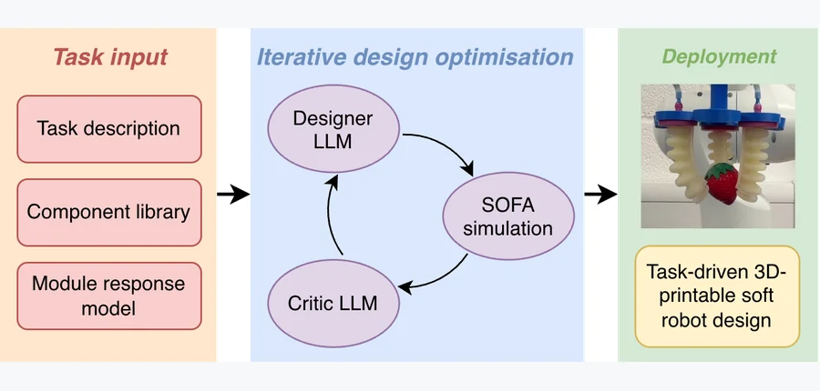 arXiv 2026-11-12 · cs.RO · #7 **[PneuGen: Task-Driven Agentic Co-Design of Soft Pneumatic Robots](https://arxiv.org/abs/2611.13344)** [Shaohong Zhong , Marco Pontin , Perla Maiolino](https://arxiv.org/abs/2611.13344) 机构：University of Oxford（[PDF](https://arxiv.org/pdf/2611.13344)） [Paper](https://arxiv.org/abs/2611.13344) · [图源](https://arxiv.org/html/2611.13344v1/figures/overview.png) 

中文摘要
面向任务的软体机器人设计需要同时考虑几何、形态、材料属性和驱动方式，形成难以探索的大型复杂设计空间。计算优化方法利用仿真信号迭代改进设计以达成任务目标，但优化与仿真通常都需要较高算力。我们提出 PneuGen，一种使用大语言模型（LLM）代理高效搜索软体机器人设计空间的代理式协同设计框架。设计代理从参数化部件库提出设计程序，独立的评审代理分析仿真诊断信息并建议有针对性的修改。拟合的模块响应模型提供可复用的物理先验，关联几何、压力与形变。设计程序经自动验证后转换为有限元仿真，支持迭代评估。在针对基础形状和具有挑战性物体的抓取任务，以及需要多方向平面与三维形变的形状匹配任务上，该框架显著优于此前的计算优化基线。消融实验还显示，评审代理与模块响应模型有助于提高设计效率。论文另外在现实世界的形状匹配和抓取任务中展示了代理生成的软体机器人设计。 <a href="https://arxiv.org/abs/2611.13344">原摘要来源</a>
 | 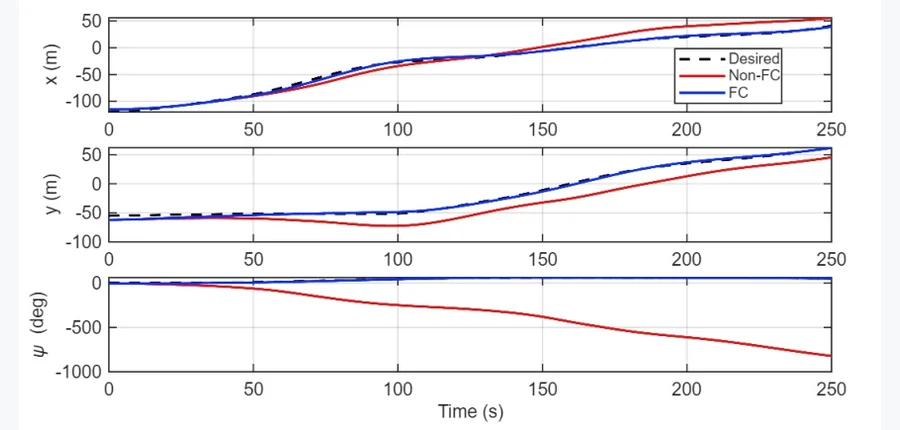 CAOS 2026 · #8 **[Force-Closure Condition for Cooperative Multi-robot Pushing of Rectangular Objects](https://arxiv.org/abs/2611.13268)** [Duy Anh Nguyen , Trung Dung Ngo](https://arxiv.org/abs/2611.13268) 机构：University of Prince Edward Island（[PDF](https://arxiv.org/pdf/2611.13268)） [Paper](https://arxiv.org/abs/2611.13268) · [图源](https://arxiv.org/html/2611.13268v1/fig_pose_tracking.png) 

中文摘要
在协作物体操作中，推挤接触的位置决定能否实现力封闭，以及机器人能否相应地向物体施加任意力和力矩。本文针对日常环境中常见的矩形物体，在四个无摩擦推挤接触下推导平面力封闭的充要闭式条件。若矩形长为 $b$、宽为 $a$，且四个边缘接触位置为 $l_1,l_2,l_3,l_4$，则当且仅当 $(l_1+l_3-b)(l_2+l_4-a)&lt;0$ 时存在力封闭。该条件与物体质心无关，可在接触力分配之前检验接触构型。不满足条件时，两个因子的符号指出应调整哪一对相对接触。论文将该条件和调整规则作为几何可行性层，集成到完整位姿轨迹跟踪框架中，以展示其控制用途。静态力旋量可行性测试验证了该条件；狭窄通道内的浮体仿真显示，维持力封闭构型将 $x$、$y$ 和展开后的偏航角均方根跟踪误差分别从 12.05 米、18.11 米、535.96 度降至 2.24 米、2.66 米、2.69 度。 <a href="https://arxiv.org/abs/2611.13268">原摘要来源</a>
 | 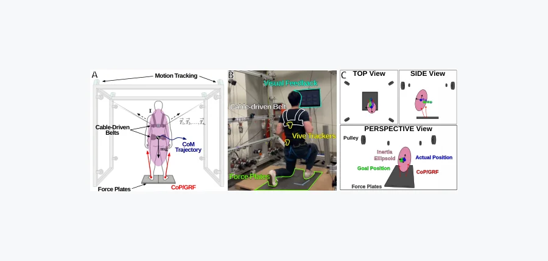 IEEE Robotics and Automation Letters · #9 **[Ground Reaction Force-Aware Model Predictive Control for Underactuated Upright Physical Assistance](https://arxiv.org/abs/2611.13204)** [Darren Biskup , Jeonghan Yu , Zibo Yu , Sunil K. Agrawal](https://arxiv.org/abs/2611.13204) 机构：Columbia University / SUNY Korea（[PDF](https://arxiv.org/pdf/2611.13204)） [Paper](https://arxiv.org/abs/2611.13204) · [图源](https://arxiv.org/html/2611.13204v1/fig1_v2.png) 

中文摘要
许多康复机器人使用反应式跟踪控制器执行预设动作，却未显式纳入使用者即时的人体—地面相互作用。本文提出用于直立身体辅助的地面反作用力感知模型预测控制（GRF-MPC）。方法将实时地面反作用力（GRF）和压力中心（CoP）测量直接纳入人体质心动力学模型，构建实时二次规划（QP），在滚动时域上优化辅助力与力矩。我们将 GRF-MPC 部署于欠驱动四缆配置的 Robotic Upright Stand Trainer（RobUST），并在六名健康参与者的近 300 次试验中，与全驱动八缆笛卡尔阻抗控制基线比较。任务包括脉冲扰动、弓步轨迹和自主稳定极限；在扰动期间，GRF-MPC 将峰值平面质心（CoM）误差降低 19.6%，轨迹跟踪误差降低 24.1%，净机械功减少 28.7%，同时允许归一化自主活动面积提高 45.9%。底层 QP 的求解时间不到 1 毫秒，可支持 100 Hz 重规划；结果表明，将实时人体—地面相互作用纳入预测控制，可以在执行器数量减半的条件下提供更强、更透明的身体辅助。 <a href="https://arxiv.org/abs/2611.13204">原摘要来源</a>
 |
| 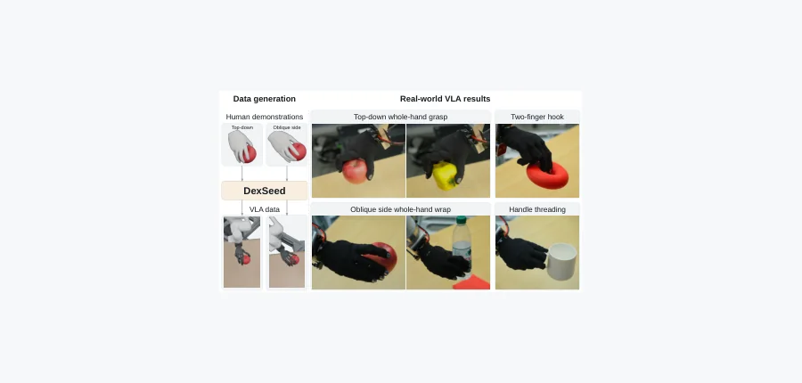 arXiv 2026-11-12 · cs.RO · #10 **[DexSeed: Expanding Human Hand-Object Interactions into Robot Demonstrations for Dexterous Policy Learning](https://arxiv.org/abs/2611.14092)** [Huaijin Pi , Zehong Shen , Yong Wang , Kechun Xu , Changpeng Wang , Dingkun Wei , Xueyang Wang , Wenjia Wang , Xing Zhu… 机构：The University of Hong Kong / Robbyant / Zhejiang University（[PDF](https://arxiv.org/pdf/2611.14092)） [Paper](https://arxiv.org/abs/2611.14092) · [图源](https://arxiv.org/html/2611.14092v1/teaser.png) 

中文摘要
我们研究如何为灵巧视觉—语言—动作（VLA）学习生成多样且物理上可执行的机器人示范。现有示范生成方法通常依赖昂贵的遥操作样本。人手—物体数据集虽然提供可复用来源，但现有迁移方法主要复现已有交互；将其转换为 VLA 训练数据，还需要覆盖不同物体与操作位置，并提供可执行的手臂和手指动作以及视觉观测。为此，我们提出 DexSeed，一种从人手—物体交互低成本生成灵巧机器人数据的框架。核心思想是在保留抓取的同时扩展人类动作序列，并在物理仿真中遵循手臂跟踪动力学实现所得运动。具体而言，方法按抓取模式组织原始序列并共享语言描述；基于 InteractionMesh 的重定向和手臂轨迹增强使序列适应机器人手、不同物体几何和拾取放置位置，同时保持局部手物关系。强化学习手指控制策略生成可执行的 rollout，手臂则跟踪预计算轨迹。成功 rollout 的渲染观测与记录动作配合抓取描述，用于微调 VLA。实验表明，该方法在重定向中改善接触保真度，并较所评估基线实现更可靠的整臂执行。仿真评估和现实部署还表明，仅以生成示范微调的 VLA 能执行语言指定的抓取。论文提供了项目页面的 HTTPS 链接。 <a href="https://arxiv.org/abs/2611.14092">原摘要来源</a>
 | 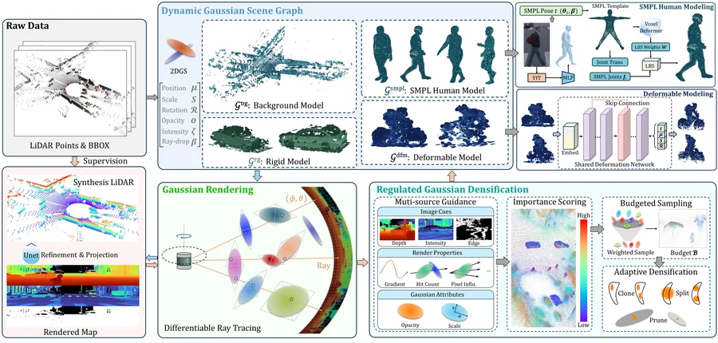 arXiv 2026-11-12 · cs.CV · #11 **[URL-Sim: Unified and Regulated LiDAR Simulation for High-Fidelity Reconstruction of Dynamic Driving Scenes](https://arxiv.org/abs/2611.12932)** [Kefei Qian , Xipeng Feng , Jie Li , Long Cao , Yuhan Chen , Xiangfei Huang , Guofa Li](https://arxiv.org/abs/2611.12932) 机构：Chongqing University（[PDF](https://arxiv.org/pdf/2611.12932)） [Paper](https://arxiv.org/abs/2611.12932) · [图源](https://arxiv.org/html/2611.12932v1/overview.jpg) 

中文摘要
从真实驾驶日志重建高保真 LiDAR 仿真场景，对自动驾驶系统的低成本安全验证至关重要。基于神经辐射场（NeRF）的模拟器可以实现逼真场景重建，但渲染速度较慢，限制了大规模采用。近期三维高斯泼溅（3DGS）方法通过显式图元表示与可微光栅化改善渲染效率，但现有 3DGS 方法大多局限于刚性车辆，且无约束增密会产生冗余图元。为此，我们提出 URL-Sim，一种统一且受约束的动态 LiDAR 仿真框架。它构建动态高斯场景图，将车辆、行人和骑行者等交通参与者的建模解耦，从而在同一框架下准确重建异质动态物体。它还引入受约束的高斯增密策略，按多维重要性评分对图元排序，将高斯分配给最关键区域，同时限制图元总量。Waymo 和 KITTI-360 数据集上的实验表明，在相近图元预算下，URL-Sim 比现有基线获得更高的定量精度与视觉质量，并能准确恢复多类动态交通参与者的几何与位姿。 <a href="https://arxiv.org/abs/2611.12932">原摘要来源</a>
 | 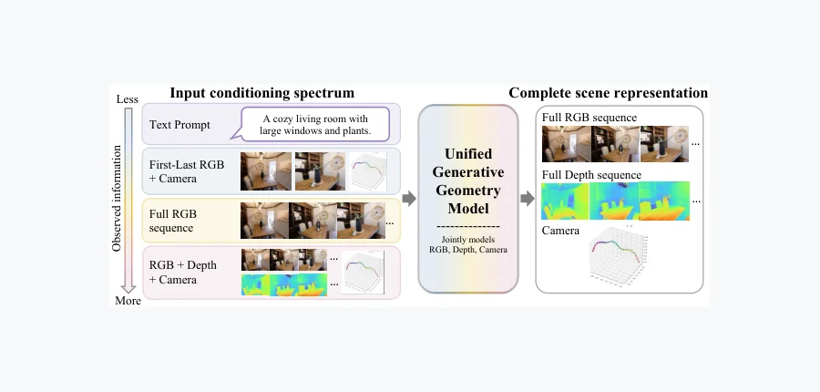 NeurIPS 2026 · #12 **[UGG: Unified Generative Geometry Model](https://arxiv.org/abs/2611.14440)** [Amani Kiruga , Zhiyi Li , Ruojin Cai , Hansen Lillemark , Xiaoshan Wu , Ayush Tewari , Yilun Du](https://arxiv.org/abs/26… 机构：Harvard University / MIT / UC San Diego / University of Cambridge（[PDF](https://arxiv.org/pdf/2611.14440)） [Paper](https://arxiv.org/abs/2611.14440) · [图源](https://arxiv.org/html/2611.14440v1/teaser_cr.png) 

中文摘要
理解四维场景是视觉智能的核心挑战，需要模型从部分观测中联合捕捉场景几何、外观和动力学。然而，现有方法分为直接几何预测的前馈模型，以及视觉合成的生成模型。我们提出 UGG，一种联合建模 RGB 视频和深度、相机位姿等几何表示的统一四维场景理解框架。通过在模态和时间维度赋予不同噪声水平，UGG 将视觉生成与几何预测统一表述为同一生成模型内的条件补全。这种灵活表述使模型能够利用几何和视觉标注子集各不相同的异质数据集训练。此外，生成式表述允许在推理时搜索多个可能的场景假设，利用从观测 RGB 帧提取的几何证据，在没有真实几何标注的情况下改进几何预测。我们在相机可控视频生成、深度估计和相机位姿预测任务中，包括稀疏观测的困难情形，展示 UGG 相对于非统一基线的有效性。代码和可视化资料可从论文所给 HTTPS 链接获取。 <a href="https://arxiv.org/abs/2611.14440">原摘要来源</a>
 |
| 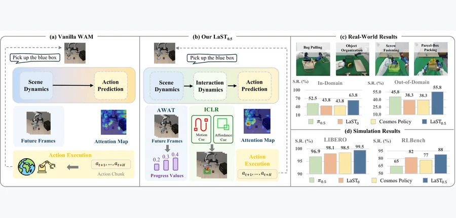 arXiv 2026-11-12 · cs.RO · #13 **[LaST0.5: A Generalist World Action Model with Interaction-Centric Latent Reasoning](https://arxiv.org/abs/2611.14048)** [Xuheng Zhang , Yiming Zhang , Jialin Gao , Hao Chen , Jiaming Liu , Ji Li , Runzhong Huang , Yinxi Wang , Chenyang Gu , Z… 机构：Peking University / The Chinese University of Hong Kong / Simplexity Robotics（[PDF](https://arxiv.org/pdf/2611.14048)） [Paper](https://arxiv.org/abs/2611.14048) · [图源](https://arxiv.org/html/2611.14048v1/teaser.png) 

中文摘要
世界动作模型（WAM）近来成为机器人操作的一个有前景范式，使策略具备建模时间和物理动力学的强大能力。现有 WAM 包括先视频后动作预测和视频—动作联合建模两类，均将世界模型的全局物理表示直接迁移到动作生成。然而，全局场景表示可能弱化局部机器人—物体交互，造成用于世界演化的表示与操作所需表示之间不匹配。为此，我们提出 LaST0.5，在世界建模与动作生成之间引入以交互为中心的物理表示。具体地，LaST0.5 在机器人与环境视觉交互线索的监督下学习紧凑的交互潜在空间；该推理空间被实现为混合 Transformer 架构中的潜在专家，连接世界专家与动作专家。此外，LaST0.5 通过联合预测未来表示和进度值，自适应地将世界信息迁移到动作中，并利用进度一致性调整动作执行、触发未来状态重采样。最后，我们在超过 1.4 万小时的大规模机器人数据上预训练 LaST0.5，以建立交互中心物理推理作为可扩展且有效的范式。LaST0.5 在 LIBERO 上达到 99.5%，在所评估的十项 RLBench 任务上超过此前最优方法，并在现实实验中表现出稳健的长时程执行与精准灵巧操作。 <a href="https://arxiv.org/abs/2611.14048">原摘要来源</a>
 | 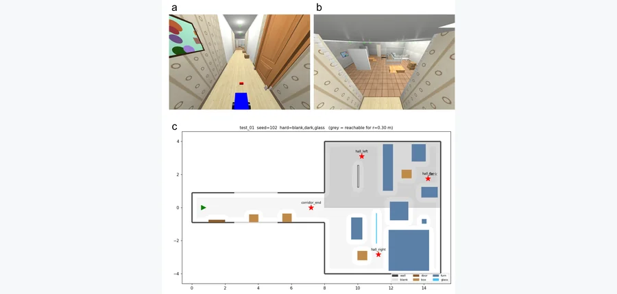 arXiv 2026-11-12 · cs.RO · #14 **[From Depth to Safe Depth: Uncertainty-Aware Monocular Perception for Mobile Robot Navigation](https://arxiv.org/abs/2611.13769)** [Saeid Firouzi Daghigh , Saeed Ayat](https://arxiv.org/abs/2611.13769) 机构：Payame Noor University（[PDF](https://arxiv.org/pdf/2611.13769)） [Paper](https://arxiv.org/abs/2611.13769) · [图源](https://arxiv.org/pdf/2611.13769) 

中文摘要
单目深度基础模型使人们倾向于用单个 RGB 相机替代移动机器人的深度传感器。我们发现，直接使用现成模型并不安全：在仿真室内导航基准中，由 Depth Anything V2（公制度量版）驱动的标准 Nav2 系统在 120 个 episode 中有 63% 发生碰撞，因为模型系统性高估附近障碍物距离。我们提出一个轻量插件，将预测深度转为“安全深度”。在冻结的深度模型上加入一个含 58 万参数的预测头，逐像素预测对数深度修正 $\mu$ 和不确定度 $\sigma$，并用带 $eta$ 权重的高斯负对数似然训练。导航系统使用单侧界 $\hat d_{	ext{safe}}=d e^{\mu-k\sigma}$；其中 $k$ 由留出场景上的保形校准设定，不确定度还决定哪些像素可以视为地面。该修正使深度误差减半（AbsRel 从 0.262 降至 0.134），近距离高估比例从 59.8% 降至 12.0%。在导航任务中，安全深度使成功率从 37% 升至 70%，碰撞率从 63% 降至 3%，接近真实深度的 2%。在相同像素覆盖率下校准的固定安全裕量只达到 30% 成功率，因为它使机器人停滞；在 56 个结果不一致的配对 episode 中，不确定度感知安全方法赢得 52 个。在玻璃、无纹理墙面和暗区，收益仍然成立。 <a href="https://arxiv.org/abs/2611.13769">原摘要来源</a>
 | 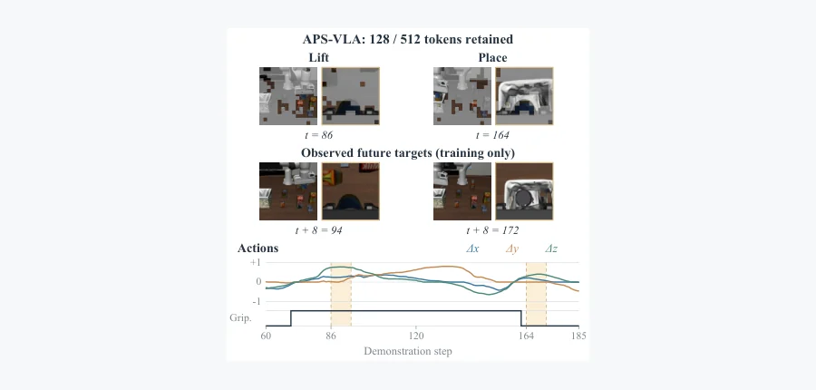 arXiv 2026-11-12 · cs.AI · #15 **[APS-VLA: Action-Guided and Future-Aware Token Pruning for Efficient Vision-Language-Action Models](https://arxiv.org/abs/2611.13030)** [Xiaoyang Xing , Chun-Mei Feng , Anthony Cohn , Xiaoliang Gong , Asoke Nandi](https://arxiv.org/abs/2611.13030) 机构：Tongji University / University of Leeds / Brunel University of London / A*STAR（[PDF](https://arxiv.org/pdf/2611.13030)） [Paper](https://arxiv.org/abs/2611.13030) · [图源](https://arxiv.org/html/2611.13030v1/fig1_aps_compact.png) 

中文摘要
视觉—语言—动作（VLA）策略在机器人操作中展现出较强泛化能力，但处理密集视觉 token 往往导致较高推理延迟。视觉 token 剪枝可以降低成本，但要选出仍能保证可靠动作生成的紧凑 token 集合并不容易；现有方法大多依赖静态或即时启发式线索估计重要性。我们提出 APS-VLA，一种从机器人示范学习视觉 token 选择、同时冻结预训练 VLA 骨干的框架。轻量的决策影响估计器结合当前视觉观测、语言指令与机器人本体感觉对 token 评分。训练结合两种互补信号：动作监督同时匹配完整输入策略的预测和示范动作；辅助视觉转移目标利用示范动作，从选中表示预测后续视觉特征。部署时，估计器在策略原生动作生成过程前执行一次硬选择与打包；辅助预测器被移除。使用 OpenVLA-OFT 在 LIBERO 上，以及使用 $\pi_{0.5}$ 和 XR-1 在 RoboCasa365 上的实验，显示推理加速且任务成功率变化较小。跨两个双臂平台的五项现实任务中，APS-VLA 将平均策略推理延迟从 137.25 毫秒降至 93.25 毫秒，加速 1.47 倍，平均成功率为 61%，未剪枝基线为 60%。这些结果支持 APS-VLA 作为跨 VLA 架构的模块化插件，在保持原策略参数和原生动作生成流程的条件下实现高效机器人控制。 <a href="https://arxiv.org/abs/2611.13030">原摘要来源</a>
 |
| 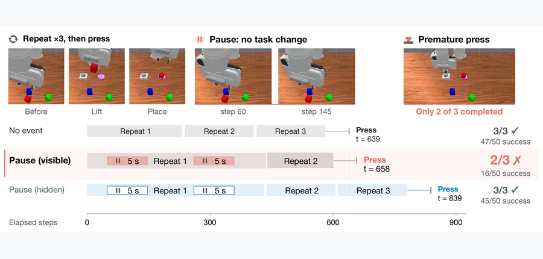 arXiv 2026-11-12 · cs.RO · #16 **[Is Your Robot's Memory Just a Clock? Temporal Shortcuts in Memory-Augmented VLA Policies](https://arxiv.org/abs/2611.14488)** [Chubin Zhang , Bo An](https://arxiv.org/abs/2611.14488) 机构：Nanyang Technological University（[PDF](https://arxiv.org/pdf/2611.14488)） [Paper](https://arxiv.org/abs/2611.14488) · [图源](https://arxiv.org/html/2611.14488v1/fig1_teaser.png) 

中文摘要
具备记忆的视觉—语言—动作（VLA）策略本应记住发生过什么。然而，许多方法按时间填充记忆：在整个 episode 中均匀抽取帧，并为每帧标记时间步。即使什么都没有发生，时间也在流逝；这种记忆可能无法区分等待与工作。我们发现它确实无法区分。在 RoboMME 的计数任务中，我们让机器人短暂停顿或轻微晃动手腕。这类空事件不改变任务相关状态，但一个已发布的记忆 VLA 会把这段时间计作已完成工作，从而过早停止。我们称之为“虚假进度”：一项任务的成功次数由 50 次中的 47 次降至 16 次，另一项由 44 次降至 10 次。如果将相同帧排除在记忆之外，成功率便会恢复，说明问题出在记忆，而非中断本身。我们将失败追溯到时间捷径：由于示范以稳定节奏推进，经过的时间能预测任务进度。事实上，仅缩放时间戳，就会使策略在时钟变快时提前停止、变慢时重复执行。令人意外的是，删除时间编码也无法消除失败，因为空事件帧仍占据按时间采样的记忆槽位。在 RoboMME 已发布设计中，易受攻击程度随记忆索引方式而变化。在诊断启发的修复方法中，训练时插入停顿并未消除失败，反而损害计数；按事件索引记忆则无需再训练，即可恢复至少一半的性能损失。旨在记住发生过什么的记忆，应计数事件而非时钟滴答。 <a href="https://arxiv.org/abs/2611.14488">原摘要来源</a>
 | 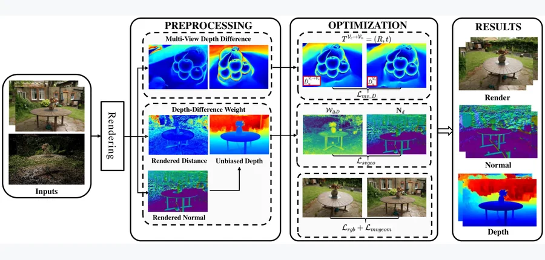 IEEE TPAMI（待刊） · #17 **[DepthGS: Depth-Guided Gaussian Splatting with Adaptive Regularization for High-Quality Surface Reconstruction](https://arxiv.org/abs/2611.13628)** [Xiao Ren , Yu Liu , Ning An , Jian Cheng , Xin Qiao , You-Fu Li , He Kong](https://arxiv.org/abs/2611.13628) 机构：Southern University of Science and Technology / China Coal Research Institute / Xi’an Jiaotong University / City University of Hong Kong（[PDF](https://arxiv.org/pdf/2611.13628)） [Paper](https://arxiv.org/abs/2611.13628) · [图源](https://arxiv.org/html/2611.13628v1/4_1_framework.png) 

中文摘要
近期三维高斯泼溅（3DGS）作为新视角合成的高效表示，兼具快速可微渲染与较高视觉保真度，也越来越多地用于表面重建。然而，深度信息与重建误差的关系仍缺乏充分研究，限制了几何优化策略的原则性设计。为此，我们提出 DepthGS，一个深度引导的高斯泼溅框架。我们推导单视角和多视角设置下深度偏差与重建误差的理论关系，并严格建立相应的重建误差上界。上述分析指导单视角和多视角优化中的自适应正则策略。具体而言，对单视角优化，我们提出由深度差异引导的自适应法向正则策略，用局部深度差异计算几何可靠性权重，调节法向约束强度。对多视角优化，我们引入跨视角深度一致性正则，使相邻视角的深度图与将当前视角预测深度变换到这些相邻视角后得到的对应预测保持一致。DTU、Mip-NeRF360 和 Tanks and Temples 上的大量实验表明，DepthGS 在表面重建与新视角合成上取得有竞争力的表现。 <a href="https://arxiv.org/abs/2611.13628">原摘要来源</a>
 | 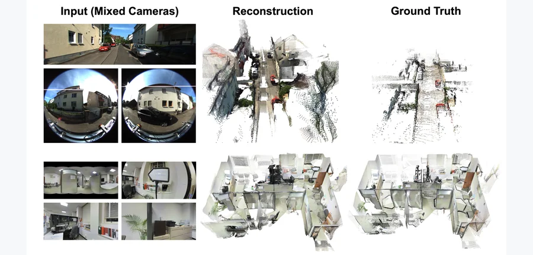 NeurIPS 2026 · #18 **[Camera3R: Feed-Forward 3D Reconstruction from Heterogeneous Camera Models](https://arxiv.org/abs/2611.13453)** [Ruxiao Duan , Yunwen Zhou , Erin Hong , Dongxu Zhao , Eric Turner , Federico Tombari , Alex Wong](https://arxiv.org/abs/2… 机构：Yale University / Google（[PDF](https://arxiv.org/pdf/2611.13453)） [Paper](https://arxiv.org/abs/2611.13453) · [图源](https://arxiv.org/html/2611.13453v1/fig/teaser.jpg) 

中文摘要
从无约束多视角图像进行前馈三维重建（3R）已成为三维计算机视觉的重要方向。研究者提出了架构与重建范式各异的基础重建模型。尽管这些模型在大规模透视图像数据上投入大量算力训练，但通常难以泛化到非透视图像，妨碍其用于任意、未知甚至混合相机模型的场景。为以最少再训练利用现有重建模型的能力，我们提出 Camera3R，一种低秩适配框架，将预先在透视图像上训练的 3R 网络高效扩展到其他相机模型。大量实验表明，仅增加 0.5% 的参数、训练不足一天，Camera3R 即可使基础三维重建模型适配非透视相机，同时完全保留其在透视输入上的原有性能。代码可从论文所给 HTTPS 链接获取。 <a href="https://arxiv.org/abs/2611.13453">原摘要来源</a>
 |
<!-- PAPER_CARDS_END -->

## 检索概况

- **检索窗口**：北京时间 2026-11-11 09:00 至 2026-11-12 09:00；本轮抓取 14 个 [arXiv 官方 New 分类页](https://arxiv.org/list/cs.RO/new?show=2000)。
- **官方最新批次**：全部分类页显示 **Wednesday, 11 November 2026**；主榜仅收各页 `New submissions`。
- **总命中／去重／入选**：726 条 New 记录／726 个不同 arXiv ID／18 篇。按标题和摘要核对研究对象；相关性排序是编辑判断。
- **事实与推断**：标题、作者、分类、摘要取自官方列表；机构据论文 PDF 首页核实。相关性、机构强度、局限和改进建议均为**推断**。
- **配图与摘要缺口**：18 张图均取自对应论文的官方 arXiv HTML 或 PDF，已逐张核对；缺图 0 篇，缺原摘要 0 篇。

## 官方 New listing 状态

| 分类页 | 官方日期 | New 条目 |
|---|---|---:|
| [cond-mat](https://arxiv.org/list/cond-mat/new?show=2000) | 2026-11-11 | 73 |
| [cs.AI](https://arxiv.org/list/cs.AI/new?show=2000) | 2026-11-11 | 105 |
| [cs.CV](https://arxiv.org/list/cs.CV/new?show=2000) | 2026-11-11 | 117 |
| [cs.GR](https://arxiv.org/list/cs.GR/new?show=2000) | 2026-11-11 | 3 |
| [cs.LG](https://arxiv.org/list/cs.LG/new?show=2000) | 2026-11-11 | 134 |
| [cs.RO](https://arxiv.org/list/cs.RO/new?show=2000) | 2026-11-11 | 57 |
| [eess.IV](https://arxiv.org/list/eess.IV/new?show=2000) | 2026-11-11 | 8 |
| [eess.SP](https://arxiv.org/list/eess.SP/new?show=2000) | 2026-11-11 | 14 |
| [eess.SY](https://arxiv.org/list/eess.SY/new?show=2000) | 2026-11-11 | 35 |
| [math.DS](https://arxiv.org/list/math.DS/new?show=2000) | 2026-11-11 | 15 |
| [math.NA](https://arxiv.org/list/math.NA/new?show=2000) | 2026-11-11 | 19 |
| [math.OC](https://arxiv.org/list/math.OC/new?show=2000) | 2026-11-11 | 37 |
| [physics](https://arxiv.org/list/physics/new?show=2000) | 2026-11-11 | 98 |
| [stat.ML](https://arxiv.org/list/stat.ML/new?show=2000) | 2026-11-11 | 11 |
| **合计** | — | **726** |

## Top papers

| # | 论文 | 分类 | 作者 | 机构 | 相关性（推断） | 机构强度（推断） | 优先级 |
|---:|---|---|---|---|---|---|---|
| 1 | [Numerical analysis of coupled flow, deformation and frictional contact mechanics in a fractured porous medium](https://arxiv.org/abs/2611.14341) | [math.NA](https://arxiv.org/abs/2611.14341) | [Marius Nevland , Kundan Kumar , Inga Berre , Jakub Wiktor Both , Eirik Keilegavlen](https://arxiv.org/abs/2611.14341) | University of Bergen（[PDF](https://arxiv.org/pdf/2611.14341)） | 极高：三维物理／接触 | 待独立评估 | A |
| 2 | [A phase-field model of viscous surfaces in fluids](https://arxiv.org/abs/2611.13902) | [cond-mat.soft](https://arxiv.org/abs/2611.13902) | [Maximilian Kloppe , Sebastian Aland](https://arxiv.org/abs/2611.13902) | TU Bergakademie Freiberg / HTW Dresden / Center for Systems Biology Dresden（[PDF](https://arxiv.org/pdf/2611.13902)） | 极高：三维物理／接触 | 待独立评估 | A |
| 3 | [Neural network scaling and generalization for 3D strain fields in heterogeneous materials](https://arxiv.org/abs/2611.14158) | [physics.comp-ph](https://arxiv.org/abs/2611.14158) | [Lucas Fourel , Paul Devianne , Marine Debouvry , Tristan Destruhaut , Russell Gunn , Ashwini Gupta , Lori Graham-Brady , Jean-François Molinari](https://arxiv.org/abs/2611.14158) | EPFL / Swiss Federal Office of Energy / Johns Hopkins University（[PDF](https://arxiv.org/pdf/2611.14158)） | 极高：三维物理／接触 | 待独立评估 | A |
| 4 | [Neural Networks with Local Converging Inputs for Solving the 3D Stokes Equations on Unstructured Meshes: Novel Techniques and Advances](https://arxiv.org/abs/2611.12963) | [physics.flu-dyn](https://arxiv.org/abs/2611.12963) | [Farjana Siddiqua , Haoxiang Huang , Weiming Ding , Haotian Sun , Vigor Yang , Yingjie Liu](https://arxiv.org/abs/2611.12963) | Georgia Institute of Technology（[PDF](https://arxiv.org/pdf/2611.12963)） | 极高：三维物理／接触 | 待独立评估 | A |
| 5 | [Design of Self-Folding Origami Architectures for Biomedical Implants: A Finite Element Simulation Framework](https://arxiv.org/abs/2611.13964) | [cond-mat.mtrl-sci](https://arxiv.org/abs/2611.13964) | [Suhas Chandrashekar , Thomas Stieglitz , Prasanth Velvaluri](https://arxiv.org/abs/2611.13964) | University of Freiburg（[PDF](https://arxiv.org/pdf/2611.13964)） | 极高：三维物理／接触 | 待独立评估 | A |
| 6 | [From Prediction to Action: Learning Physical Context for Deformable Linear Object Manipulation](https://arxiv.org/abs/2611.14274) | [cs.RO](https://arxiv.org/abs/2611.14274) | [Chengxiao Dong , Alessio Caporali , Hongyu Lan , Gianluca Palli](https://arxiv.org/abs/2611.14274) | University of Bologna（[PDF](https://arxiv.org/pdf/2611.14274)） | 极高：三维物理／接触 | 待独立评估 | A |
| 7 | [PneuGen: Task-Driven Agentic Co-Design of Soft Pneumatic Robots](https://arxiv.org/abs/2611.13344) | [cs.RO](https://arxiv.org/abs/2611.13344) | [Shaohong Zhong , Marco Pontin , Perla Maiolino](https://arxiv.org/abs/2611.13344) | University of Oxford（[PDF](https://arxiv.org/pdf/2611.13344)） | 极高：三维物理／接触 | 待独立评估 | A |
| 8 | [Force-Closure Condition for Cooperative Multi-robot Pushing of Rectangular Objects](https://arxiv.org/abs/2611.13268) | [cs.RO](https://arxiv.org/abs/2611.13268) | [Duy Anh Nguyen , Trung Dung Ngo](https://arxiv.org/abs/2611.13268) | University of Prince Edward Island（[PDF](https://arxiv.org/pdf/2611.13268)） | 极高：三维物理／接触 | 待独立评估 | A |
| 9 | [Ground Reaction Force-Aware Model Predictive Control for Underactuated Upright Physical Assistance](https://arxiv.org/abs/2611.13204) | [cs.RO](https://arxiv.org/abs/2611.13204) | [Darren Biskup , Jeonghan Yu , Zibo Yu , Sunil K. Agrawal](https://arxiv.org/abs/2611.13204) | Columbia University / SUNY Korea（[PDF](https://arxiv.org/pdf/2611.13204)） | 极高：三维物理／接触 | 待独立评估 | A |
| 10 | [DexSeed: Expanding Human Hand-Object Interactions into Robot Demonstrations for Dexterous Policy Learning](https://arxiv.org/abs/2611.14092) | [cs.RO](https://arxiv.org/abs/2611.14092) | [Huaijin Pi , Zehong Shen , Yong Wang , Kechun Xu , Changpeng Wang , Dingkun Wei , Xueyang Wang , Wenjia Wang , Xing Zhu , Yujun Shen , Taku Komura](https://arxiv.org/abs/2611.14092) | The University of Hong Kong / Robbyant / Zhejiang University（[PDF](https://arxiv.org/pdf/2611.14092)） | 极高：三维物理／接触 | 待独立评估 | A |
| 11 | [URL-Sim: Unified and Regulated LiDAR Simulation for High-Fidelity Reconstruction of Dynamic Driving Scenes](https://arxiv.org/abs/2611.12932) | [cs.CV](https://arxiv.org/abs/2611.12932) | [Kefei Qian , Xipeng Feng , Jie Li , Long Cao , Yuhan Chen , Xiangfei Huang , Guofa Li](https://arxiv.org/abs/2611.12932) | Chongqing University（[PDF](https://arxiv.org/pdf/2611.12932)） | 高：动态三维场景 | 待独立评估 | A |
| 12 | [UGG: Unified Generative Geometry Model](https://arxiv.org/abs/2611.14440) | [cs.CV](https://arxiv.org/abs/2611.14440) | [Amani Kiruga , Zhiyi Li , Ruojin Cai , Hansen Lillemark , Xiaoshan Wu , Ayush Tewari , Yilun Du](https://arxiv.org/abs/2611.14440) | Harvard University / MIT / UC San Diego / University of Cambridge（[PDF](https://arxiv.org/pdf/2611.14440)） | 高：动态三维场景 | 待独立评估 | A |
| 13 | [LaST0.5: A Generalist World Action Model with Interaction-Centric Latent Reasoning](https://arxiv.org/abs/2611.14048) | [cs.RO](https://arxiv.org/abs/2611.14048) | [Xuheng Zhang , Yiming Zhang , Jialin Gao , Hao Chen , Jiaming Liu , Ji Li , Runzhong Huang , Yinxi Wang , Chenyang Gu , Zihan Yang , Yaowei Liu , Zhonghao Yan , Ziyu Guo , Renrui Zhang , Peng Jia , Pheng-Ann Heng , Shanghang Zhang](https://arxiv.org/abs/2611.14048) | Peking University / The Chinese University of Hong Kong / Simplexity Robotics（[PDF](https://arxiv.org/pdf/2611.14048)） | 高：具身机器人任务 | 待独立评估 | B |
| 14 | [From Depth to Safe Depth: Uncertainty-Aware Monocular Perception for Mobile Robot Navigation](https://arxiv.org/abs/2611.13769) | [cs.RO](https://arxiv.org/abs/2611.13769) | [Saeid Firouzi Daghigh , Saeed Ayat](https://arxiv.org/abs/2611.13769) | Payame Noor University（[PDF](https://arxiv.org/pdf/2611.13769)） | 高：具身机器人任务 | 待独立评估 | B |
| 15 | [APS-VLA: Action-Guided and Future-Aware Token Pruning for Efficient Vision-Language-Action Models](https://arxiv.org/abs/2611.13030) | [cs.AI](https://arxiv.org/abs/2611.13030) | [Xiaoyang Xing , Chun-Mei Feng , Anthony Cohn , Xiaoliang Gong , Asoke Nandi](https://arxiv.org/abs/2611.13030) | Tongji University / University of Leeds / Brunel University of London / A*STAR（[PDF](https://arxiv.org/pdf/2611.13030)） | 高：具身机器人任务 | 待独立评估 | B |
| 16 | [Is Your Robot's Memory Just a Clock? Temporal Shortcuts in Memory-Augmented VLA Policies](https://arxiv.org/abs/2611.14488) | [cs.RO](https://arxiv.org/abs/2611.14488) | [Chubin Zhang , Bo An](https://arxiv.org/abs/2611.14488) | Nanyang Technological University（[PDF](https://arxiv.org/pdf/2611.14488)） | 高：具身机器人任务 | 待独立评估 | B |
| 17 | [DepthGS: Depth-Guided Gaussian Splatting with Adaptive Regularization for High-Quality Surface Reconstruction](https://arxiv.org/abs/2611.13628) | [cs.CV](https://arxiv.org/abs/2611.13628) | [Xiao Ren , Yu Liu , Ning An , Jian Cheng , Xin Qiao , You-Fu Li , He Kong](https://arxiv.org/abs/2611.13628) | Southern University of Science and Technology / China Coal Research Institute / Xi’an Jiaotong University / City University of Hong Kong（[PDF](https://arxiv.org/pdf/2611.13628)） | 高：三维几何／空间 | 待独立评估 | B |
| 18 | [Camera3R: Feed-Forward 3D Reconstruction from Heterogeneous Camera Models](https://arxiv.org/abs/2611.13453) | [cs.CV](https://arxiv.org/abs/2611.13453) | [Ruxiao Duan , Yunwen Zhou , Erin Hong , Dongxu Zhao , Eric Turner , Federico Tombari , Alex Wong](https://arxiv.org/abs/2611.13453) | Yale University / Google（[PDF](https://arxiv.org/pdf/2611.13453)） | 高：三维几何／空间 | 待独立评估 | B |

## 逐篇中文要点

### 1. [Numerical analysis of coupled flow, deformation and frictional contact mechanics in a fractured porous medium](https://arxiv.org/abs/2611.14341)

- **论文事实／方法**：混合维度模型耦合基质/裂隙 Darcy 流、黏弹性与 Coulomb 摩擦接触。（[原摘要](https://arxiv.org/abs/2611.14341)）
- **论文事实／实验**：证明全离散格式的解存在唯一性、稳定性及先验误差界，并做数值误差比较。（[原摘要](https://arxiv.org/abs/2611.14341)）
- **推断／局限**：可用复杂裂隙网络与强滑移状态检验误差界是否仍具有实际紧致性。

### 2. [A phase-field model of viscous surfaces in fluids](https://arxiv.org/abs/2611.13902)

- **论文事实／方法**：以 Boussinesq–Scriven 本构建立黏性界面的热力学一致相场模型。（[原摘要](https://arxiv.org/abs/2611.13902)）
- **论文事实／实验**：匹配渐近分析验证尖锐界面极限，时间离散无条件能量耗散；囊泡融合仿真跨拓扑变化保持耗散。（[原摘要](https://arxiv.org/abs/2611.13902)）
- **推断／局限**：可进一步在实验测得的表面黏度与融合形态上验证参数可辨识性。

### 3. [Neural network scaling and generalization for 3D strain fields in heterogeneous materials](https://arxiv.org/abs/2611.14158)

- **论文事实／方法**：U-Net 预测最高 $256^3$ 混凝土微结构的 36 分量应变局域化张量。（[原摘要](https://arxiv.org/abs/2611.14158)）
- **论文事实／实验**：留出测试集 MAE 为 1.118%，H100 上相对 FFT 求解器约快 8.7 倍。（[原摘要](https://arxiv.org/abs/2611.14158)）
- **推断／局限**：可测试裂纹、非线性本构和未见骨料形貌下的失效检测。

### 4. [Neural Networks with Local Converging Inputs for Solving the 3D Stokes Equations on Unstructured Meshes: Novel Techniques and Advances](https://arxiv.org/abs/2611.12963)

- **论文事实／方法**：以两个粗网格解作为局部输入预测三维 Stokes 高保真解，处理曲边界和非结构网格。（[原摘要](https://arxiv.org/abs/2611.12963)）
- **论文事实／实验**：在含一至三个凸起的管流中，较细低保真解的相对 $L^2$ 误差降低 90%–94%。（[原摘要](https://arxiv.org/abs/2611.12963)）
- **推断／局限**：可测试尖角或分离流等非光滑情形；现有结论针对光滑 Stokes 解。

### 5. [Design of Self-Folding Origami Architectures for Biomedical Implants: A Finite Element Simulation Framework](https://arxiv.org/abs/2611.13964)

- **论文事实／方法**：借 NiTi 与钼/不锈钢热膨胀差驱动薄膜铰链自折叠，用有限元优化折纸单元。（[原摘要](https://arxiv.org/abs/2611.13964)）
- **论文事实／实验**：优化几何将单元尺寸较既有设计缩小约 50%，并在水弹折纸单元中展示协调形变。（[原摘要](https://arxiv.org/abs/2611.13964)）
- **推断／局限**：需用实物验证微尺度制造公差、循环寿命与血管环境中的展开可靠性。

### 6. [From Prediction to Action: Learning Physical Context for Deformable Linear Object Manipulation](https://arxiv.org/abs/2611.14274)

- **论文事实／方法**：将抓取点选择与条件化运动生成分开，比较真实/估计物理参数与交互历史的决策效用。（[原摘要](https://arxiv.org/abs/2611.14274)）
- **论文事实／实验**：仅几何策略已将单步误差降低 32.8%；历史条件化策略在 470 次配对仿真中再降低 9.9%。（[原摘要](https://arxiv.org/abs/2611.14274)）
- **推断／局限**：可在材料/摩擦突变后测试历史编码何时优于显式参数估计。

### 7. [PneuGen: Task-Driven Agentic Co-Design of Soft Pneumatic Robots](https://arxiv.org/abs/2611.13344)

- **论文事实／方法**：LLM 设计代理、评审代理与模块物理响应模型共同搜索软气动机器人结构。（[原摘要](https://arxiv.org/abs/2611.13344)）
- **论文事实／实验**：有限元评估和现实形状匹配/抓取实验展示优于计算优化基线的任务表现。（[原摘要](https://arxiv.org/abs/2611.13344)）
- **推断／局限**：可隔离响应模型误差与代理建议质量，测量每次有效设计所需仿真预算。

### 8. [Force-Closure Condition for Cooperative Multi-robot Pushing of Rectangular Objects](https://arxiv.org/abs/2611.13268)

- **论文事实／方法**：推导矩形四个无摩擦推挤接触实现平面力封闭的充要条件，并用作控制可行性层。（[原摘要](https://arxiv.org/abs/2611.13268)）
- **论文事实／实验**：狭窄通道仿真中，保持力封闭大幅降低位置与偏航跟踪误差。（[原摘要](https://arxiv.org/abs/2611.13268)）
- **推断／局限**：可拓展到有限摩擦、接触位置不确定及三维推挤。

### 9. [Ground Reaction Force-Aware Model Predictive Control for Underactuated Upright Physical Assistance](https://arxiv.org/abs/2611.13204)

- **论文事实／方法**：将实时地面反作用力和压力中心纳入人体质心动力学，进行 100 Hz 滚动优化。（[原摘要](https://arxiv.org/abs/2611.13204)）
- **论文事实／实验**：六名健康参与者、近 300 次试验中，四缆控制较八缆基线降低峰值质心误差 19.6%。（[原摘要](https://arxiv.org/abs/2611.13204)）
- **推断／局限**：康复效果仍需在目标患者群体与更长期干预中独立验证。

### 10. [DexSeed: Expanding Human Hand-Object Interactions into Robot Demonstrations for Dexterous Policy Learning](https://arxiv.org/abs/2611.14092)

- **论文事实／方法**：从人手物交互扩展抓取与轨迹，在物理仿真中用手指 RL 控制生成可执行示范。（[原摘要](https://arxiv.org/abs/2611.14092)）
- **论文事实／实验**：生成数据微调的 VLA 在仿真和现实中执行语言指定抓取。（[原摘要](https://arxiv.org/abs/2611.14092)）
- **推断／局限**：可量化真实物体接触模型偏差对零样本灵巧操作的影响。

### 11. [URL-Sim: Unified and Regulated LiDAR Simulation for High-Fidelity Reconstruction of Dynamic Driving Scenes](https://arxiv.org/abs/2611.12932)

- **论文事实／方法**：用动态高斯场景图分别重建车辆、行人与骑行者，并限制增密图元总量。（[原摘要](https://arxiv.org/abs/2611.12932)）
- **论文事实／实验**：Waymo 和 KITTI-360 上，同等图元预算下较基线改善 LiDAR 重建精度与视觉质量。（[原摘要](https://arxiv.org/abs/2611.12932)）
- **推断／局限**：可检查非刚体行人运动与稀疏扫描条件下的几何稳定性。

### 12. [UGG: Unified Generative Geometry Model](https://arxiv.org/abs/2611.14440)

- **论文事实／方法**：把 RGB 视频、深度和相机位姿置于同一条件生成模型，支持异质标注与多假设搜索。（[原摘要](https://arxiv.org/abs/2611.14440)）
- **论文事实／实验**：在相机可控视频生成、深度和位姿预测中，含稀疏观测情形，优于非统一基线。（[原摘要](https://arxiv.org/abs/2611.14440)）
- **推断／局限**：可用接触与动力学一致性指标检验“4D 理解”中的物理可用性。

### 13. [LaST0.5: A Generalist World Action Model with Interaction-Centric Latent Reasoning](https://arxiv.org/abs/2611.14048)

- **论文事实／方法**：在世界专家与动作专家之间加入交互中心潜在专家，并用进度一致性调整动作执行。（[原摘要](https://arxiv.org/abs/2611.14048)）
- **论文事实／实验**：超过 1.4 万小时数据预训练；摘要报告 LIBERO 99.5% 及现实长时程灵巧操作。（[原摘要](https://arxiv.org/abs/2611.14048)）
- **推断／局限**：可将进度反馈与局部接触表示分别消融，检验优势来源和数据成本。

### 14. [From Depth to Safe Depth: Uncertainty-Aware Monocular Perception for Mobile Robot Navigation](https://arxiv.org/abs/2611.13769)

- **论文事实／方法**：以冻结深度骨干上的 0.58M 参数头估计深度修正与不确定度，保形校准安全界。（[原摘要](https://arxiv.org/abs/2611.13769)）
- **论文事实／实验**：120 次仿真导航中，碰撞率从 63% 降至 3%，成功率从 37% 升至 70%。（[原摘要](https://arxiv.org/abs/2611.13769)）
- **推断／局限**：需在真实移动机器人与动态障碍条件下检验校准覆盖率。

### 15. [APS-VLA: Action-Guided and Future-Aware Token Pruning for Efficient Vision-Language-Action Models](https://arxiv.org/abs/2611.13030)

- **论文事实／方法**：冻结 VLA 主干，以动作监督和视觉转移目标训练轻量 token 选择器。（[原摘要](https://arxiv.org/abs/2611.13030)）
- **论文事实／实验**：五项现实双臂任务中平均延迟从 137.25 降至 93.25 毫秒，成功率 61% 对 60%。（[原摘要](https://arxiv.org/abs/2611.13030)）
- **推断／局限**：可检验接触瞬间的稀有视觉 token 是否被剪掉并导致尾部失败。

### 16. [Is Your Robot's Memory Just a Clock? Temporal Shortcuts in Memory-Augmented VLA Policies](https://arxiv.org/abs/2611.14488)

- **论文事实／方法**：在 RoboMME 计数任务中注入停顿/空动作，识别时间采样记忆导致的“虚假进度”。（[原摘要](https://arxiv.org/abs/2611.14488)）
- **论文事实／实验**：一项任务成功次数由 47/50 降至 16/50；事件索引无需再训练可恢复至少半数损失。（[原摘要](https://arxiv.org/abs/2611.14488)）
- **推断／局限**：可在多步骤真实操作中测试事件检测误差与记忆容量之间的权衡。

### 17. [DepthGS: Depth-Guided Gaussian Splatting with Adaptive Regularization for High-Quality Surface Reconstruction](https://arxiv.org/abs/2611.13628)

- **论文事实／方法**：推导深度差异和重建误差上界，并设计单视角法向与多视角深度一致性正则。（[原摘要](https://arxiv.org/abs/2611.13628)）
- **论文事实／实验**：DTU、Mip-NeRF360 和 Tanks and Temples 实验显示表面重建与新视角合成的竞争力。（[原摘要](https://arxiv.org/abs/2611.13628)）
- **推断／局限**：可在透明、反射与深度严重缺失场景中检验上界假设。

### 18. [Camera3R: Feed-Forward 3D Reconstruction from Heterogeneous Camera Models](https://arxiv.org/abs/2611.13453)

- **论文事实／方法**：用低秩适配将透视预训练三维重建网络扩展到非透视/混合相机。（[原摘要](https://arxiv.org/abs/2611.13453)）
- **论文事实／实验**：仅增加 0.5% 参数、训练少于一天，同时保留透视输入性能。（[原摘要](https://arxiv.org/abs/2611.13453)）
- **推断／局限**：可检查极端鱼眼与跨设备标定误差下的重建稳定性。

## 今日最值得细读的 5 篇

1. [流动—形变—摩擦接触耦合数值分析](https://arxiv.org/abs/2611.14341)：混合维度接触模型与误差分析。
2. [黏性流体表面的相场模型](https://arxiv.org/abs/2611.13902)：能量耗散与拓扑变化。
3. [三维异质材料应变场代理](https://arxiv.org/abs/2611.14158)：36 分量场、扩展规律和分布外检测。
4. [可形变线状物体的物理上下文](https://arxiv.org/abs/2611.14274)：预测效用与决策效用分离。
5. [软气动机器人协同设计](https://arxiv.org/abs/2611.13344)：几何—材料—驱动的仿真搜索。

## 低算力可改进论文（推断；5 篇）

| 论文 | 具体方法改法与小实验 | 低算力原因 | 预期收益与风险 |
|---|---|---|---|
| [摩擦接触数值方法](https://arxiv.org/abs/2611.14341) | 将法向柔顺参数改为局部误差指示器控制的自适应值；在单裂隙剪切基准上测滑移边界和误差。 | 单裂隙有限元网格即可。 | 或减少参数敏感性；风险是破坏已有稳定性界。 |
| [三维 Stokes 局部代理](https://arxiv.org/abs/2611.12963) | 为边界外推加入残差置信度门控；在两种未见管壁凸起上分层测壁面误差。 | 仅需粗网格解和小型局部网络。 | 或改善壁面泛化；风险是门控过保守。 |
| [可形变线状物体控制](https://arxiv.org/abs/2611.14274) | 用接触事件而非固定长度历史编码物理上下文；在摩擦突变的平面绳索任务比较 470 次规模配对试验。 | 只训练小型历史编码器。 | 或提升非平稳控制；风险是事件检测噪声。 |
| [软气动机器人设计](https://arxiv.org/abs/2611.13344) | 给模块响应模型加入误差界，以主动选择下一次有限元仿真；在三种抓取物体上比较每单位仿真预算的成功设计数。 | 可复用已有模块和少量仿真。 | 或节省搜索成本；风险是代理误差界失准。 |
| [安全单目导航](https://arxiv.org/abs/2611.13769) | 将全局保形阈值改为按障碍距离分层的校准；在小型室内仿真中分别测近距离碰撞和停滞。 | 冻结深度骨干，只训练 0.58M 参数头。 | 或减少保守停滞；风险是各层样本量不足。 |

## Replacement 观察

各官方页的 Replacement 与 New 分区分开检查；本轮未逐篇确认足以单列的重大修订，因此未将 Replacement 混入主榜。
