# 2026-11-14 arXiv 每日论文订阅摘要

<!-- PAPER_CARDS_START -->
## 论文卡片

按原日报排名展示；点击标题或 Paper 查看原文，详细中文分析见下方。

| 论文 | 论文 | 论文 |
|---|---|---|
|  arXiv 2026-11-14 · cs.RO · #1 **[Alloy: A Multi-Material Physics Engine for Robot Learning](https://arxiv.org/abs/2611.16312)** [Pranay Gupta , Deepanshu Rohilla](https://arxiv.org/abs/2611.16312) 机构：Argon Robotics（[PDF](https://arxiv.org/pdf/2611.16312)） [Paper](https://arxiv.org/abs/2611.16312) · [图源](https://arxiv.org/html/2611.16312v1/figs/liquid_pour.jpg) 

中文摘要
机器人处理的远不止刚体，还有毛巾、线缆、水和沙。用于大规模训练机器人的模拟器通常最擅长刚体；每增加一种材料，往往就要引入另一套引擎，并手工编写两者之间的连接。我们提出开源机器人学习物理引擎 Alloy，使刚体机器人、布料、线缆、液体、颗粒材料和软体共处一个场景。每个物体只需描述一次；Alloy 为其分配适合材料的求解器，在每个控制步内耦合这些求解器，并在一块 GPU 或 CPU 上运行许多并行世界。每个世界都有健康等级，帮助区分物理模拟失败与策略失败。Alloy 基于 Newton、MuJoCo Warp 和 Warp 构建，并面向编程智能体使用：文档随软件包提供，每条错误信息指出修复方式，引擎还通过 Model Context Protocol 暴露为工具。在一次冷启动测试中，从未见过 Alloy 的智能体从软件包索引安装预发布版本，并在单块 GPU 上训练了行走、线缆处理和倾倒任务的策略。我们还报告了吞吐量随世界数量的增长、深度相机吞吐量、与闭式参考解的一致性，以及一千个世界上的可靠性测试。 <a href="https://arxiv.org/abs/2611.16312">原摘要来源</a>
 | 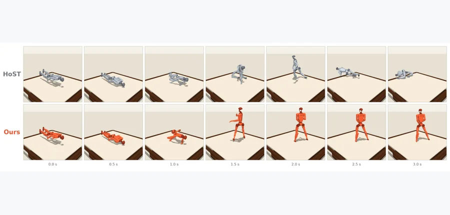 arXiv 2026-11-14 · cs.RO · #2 **[Elastra: A Simulation Framework for Elastic Bodies](https://arxiv.org/abs/2611.15112)** [Youran Sun , Chugang Yi , Xingyu Ren , Haizhao Yang](https://arxiv.org/abs/2611.15112) 机构：University of Maryland, College Park / The Chinese University of Hong Kong（[PDF](https://arxiv.org/pdf/2611.15112)） [Paper](https://arxiv.org/abs/2611.15112) · [Code](https://github.com/yichg/elastra) · [图源](https://arxiv.org/html/2611.15112v1/fig_teaser.png) 

中文摘要
机器人接触床垫、蹦床等弹性表面时，载荷变化会使表面形变并回弹，进而改变后续接触位置和力。我们提出 Elastra 仿真框架，用于建模这种交互，并支持机器人控制策略的训练与评估。Elastra 将每个表面表示为仅沿竖直方向运动的单元，用弹性连接和阻尼模拟形变与恢复。接触力驱动表面运动，更新后的表面几何用于计算后续接触力。我们以独立实现和真实床垫载荷曲线系统验证仿真。随后使用 Elastra 训练 Unitree G1 人形机器人在床垫和蹦床上起身。以预训练 HoST 策略和 ProtoMotions 动作跟踪器为原控制器，我们通过强化学习训练残差策略，修正其关节目标。加入残差策略后，HoST 的成功率从 44.1% 提高到 72.5%，在蹦床上从 55% 提高到 89%；对于训练期间未见过的初始姿态，ProtoMotions 的成功率从 19.0% 提高到 45.0%。代码和视频可通过论文所列链接获取。 <a href="https://arxiv.org/abs/2611.15112">原摘要来源</a>
 | 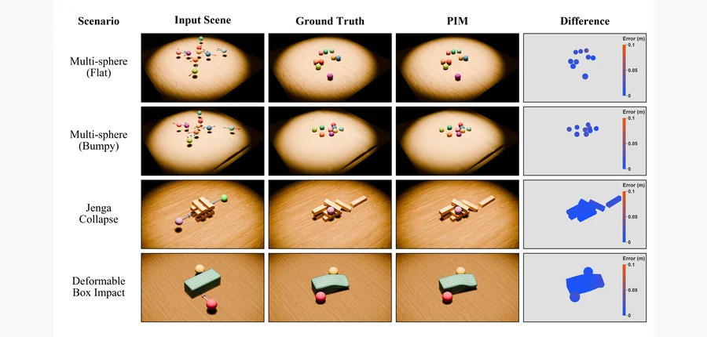 arXiv 2026-11-14 · cs.GR · #3 **[PIM: A Physical Intuition Model for Low-Latency Prediction of Object Interaction Outcomes](https://arxiv.org/abs/2611.16673)** [Tangwen Luo , Chuankun Zheng , Yuchi Huo](https://arxiv.org/abs/2611.16673) 机构：Zhejiang University（[PDF](https://arxiv.org/pdf/2611.16673)） [Paper](https://arxiv.org/abs/2611.16673) · [图源](https://arxiv.org/html/2611.16673v1/figure/result.png) 

中文摘要
由初始条件预测物体交互结果，是数据驱动物理推理的核心问题。既有方法通常采用刚体级状态，或通过自回归展开预测演化；粗粒度表示无法描述局部形变，而长时展开可能累积误差。我们提出物理直觉模型 PIM，直接由初始网格几何、运动学和物理属性预测物理系统的平衡状态。PIM 以局部 k 近邻（KNN）注意力编码物体内部几何，以基于锚点的跨物体注意力建模交互，并用双分支解码器预测物体级平移和逐顶点残差位移。在涵盖刚体与可形变交互的 MuJoCo 场景中，PIM 的顶点及质心误差低于所评估的基线。通过一次前向传播预测完整平衡态，在所评估协议下，PIM 相比自回归学习模型和 MuJoCo 展开显著降低延迟，适用于只需最终结果的低延迟推理。 <a href="https://arxiv.org/abs/2611.16673">原摘要来源</a>
 |
| 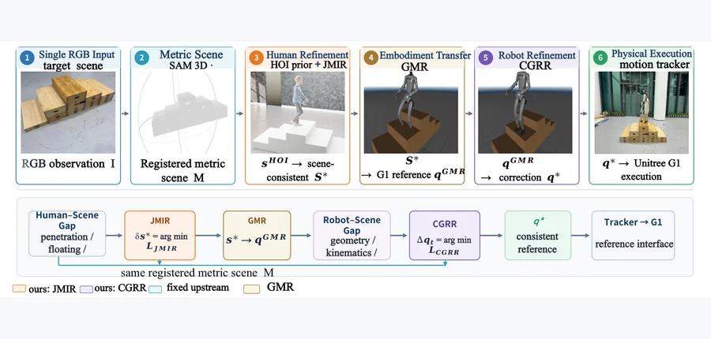 arXiv 2026-11-14 · cs.RO · #4 **[From a Single RGB Image to Robot Execution: Metric Scene Alignment and Contact-Guided Retargeting](https://arxiv.org/abs/2611.14981)** [Zhenxuan Ding , Yu Huang , Xinmiao Wang , Chenghao Sun , Ziyang Dong , Wenhao Cui](https://arxiv.org/abs/2611.14981) 机构：Beijing University of Chemical Technology / National University of Defense Technology / Noetix Robotics（[PDF](https://arxiv.org/pdf/2611.14981)） [Paper](https://arxiv.org/abs/2611.14981) · [图源](https://arxiv.org/html/2611.14981v1/Fig1_pipeline.png) 

中文摘要
将人形机器人交互生成推广到新环境，仍受制于预先构建 3D 场景资产的需求。直接从单张 RGB 图像重建场景可缓解这一限制，但在运动生成与迁移全程保持几何一致性仍是关键挑战：视觉上合理的人类运动可能与重建场景错位，而人机形体差异又会在重定向中引入支撑误差。我们提出将单张 RGB 图像转换为人形机器人运动参考的统一流程：从输入图像重建场景几何，生成以该场景为条件的人类交互，再把运动重定向到人形机器人。为维持全程几何一致性，我们在形体迁移前后设置两个互补的精修阶段。迁移前，联合度量交互精修（JMIR）在保留生成交互结构的同时，改善人类运动与已配准度量场景的对齐；迁移后，接触引导残差重定向（CGRR）校正机器人特有的支撑误差，以恢复预期支撑关系。所得运动参考与重建场景一致，可由多个预训练人形跟踪器执行，无需针对场景微调策略。相对 GRAIL，精修时间从 480 秒降至 87 秒，加速 5.5 倍。完整流程在仿真中成功率为 89%，在 Unitree G1 的 50 次实体试验中成功率为 70%，表明其可从单张 RGB 图像生成可执行的人形机器人运动参考。 <a href="https://arxiv.org/abs/2611.14981">原摘要来源</a>
 | 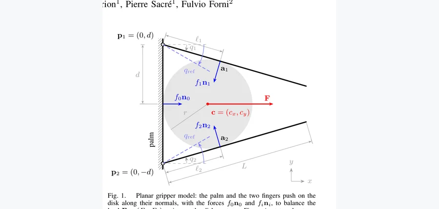 arXiv 2026-11-14 · cs.RO · #5 **[Input-output characterization of robotic grasping: Connecting design parameters to grasp behavior through the admittance](https://arxiv.org/abs/2611.16507)** [Julien Vanderheyden , Guillaume Drion , Pierre Sacré , Fulvio Forni](https://arxiv.org/abs/2611.16507) 机构：University of Liège / University of Cambridge（[PDF](https://arxiv.org/pdf/2611.16507)） [Paper](https://arxiv.org/abs/2611.16507) · [图源](https://arxiv.org/pdf/2611.16507) 

中文摘要
低阻抗夹爪使抓取动力学变得重要，但现有抓取指标是静态的：它们描述被抓物体如何抵抗恒定载荷，而非如何响应随时间变化的载荷。为此，我们用小信号分析，以导纳表征抓取，即平衡点附近载荷扰动与物体位移之间的传递矩阵。该矩阵在零频率下恢复抓取刚度与稳定性，并捕捉时变载荷下的固有频率和峰值增益。我们将这一表征应用于比例微分控制的平面双指夹爪。结果表明，对同一物体、在相同位置且接触力相同的两个抓取，其刚度可相差两个数量级；同样刚度的两个抓取也可能具有迥异的共振。非线性仿真证实，小信号分析能有效刻画抓取的动态行为。 <a href="https://arxiv.org/abs/2611.16507">原摘要来源</a>
 | 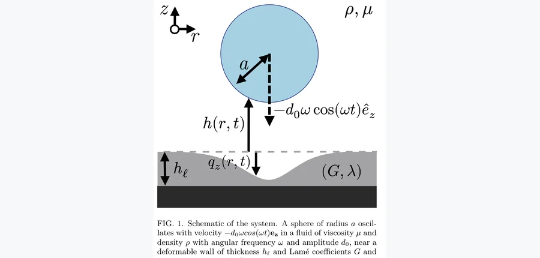 arXiv 2026-11-14 · cond-mat.soft · #6 **[Elasto-inertial force exerted on a sphere oscillating in a fluid near a soft interface](https://arxiv.org/abs/2611.16575)** [Axel Batalha (LOMA, L2C), Harshit Joshi (LOMA), Yacine Amarouchene (LOMA), Thomas Salez (LOMA, X-DEP-MECA)](https://arxiv… 机构：University of Bordeaux / CNRS / University of Montpellier / École Polytechnique（[PDF](https://arxiv.org/pdf/2611.16575)） [Paper](https://arxiv.org/abs/2611.16575) · [图源](https://arxiv.org/pdf/2611.16575) 

中文摘要
在受限流动中，即使对流惯性可忽略且雷诺数较低，流体惯性仍可能重要；但它与界面可形变性的耦合尚是开放问题。我们从理论上研究润滑区间内浸没球体在弹性壁附近的高频振荡。首先，通过一致匹配内部润滑流与外部流，调和此前对刚性壁附近附加质量的不同预测。以刚性壁问题为基准，我们再对壁面形变进行摄动分析，推导流体动力中首项弹性惯性修正。结果显示，界面柔软性与流体惯性的耦合在高频极限下产生主导的非耗散力贡献，其大小随频率的四次方变化，因而对应球体位置的四阶时间导数。该发现可能与生物和软物质环境中可形变界面附近胶体颗粒的短时动力学有关。 <a href="https://arxiv.org/abs/2611.16575">原摘要来源</a>
 |
| 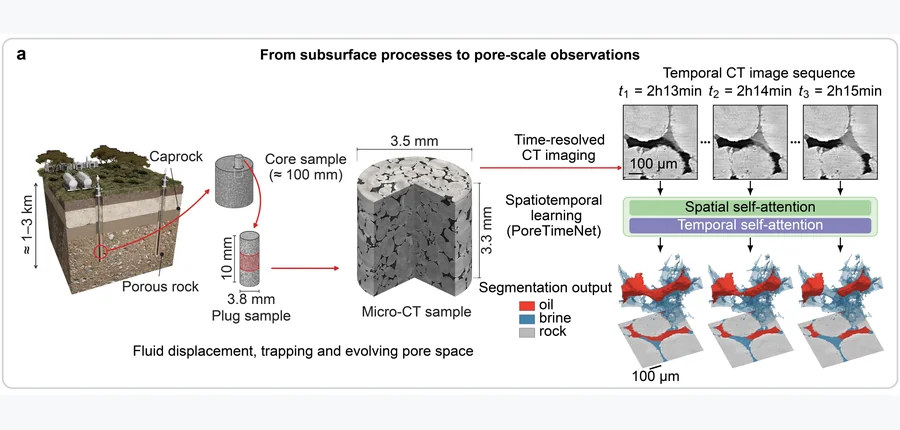 arXiv 2026-11-14 · physics.flu-dyn · #7 **[Spatiotemporal learning improves quantification of pore-space evolution and fluid displacement](https://arxiv.org/abs/2611.17111)** [Zhuangzhuang Ma , Rukuan Chai , Qianqian Ma , Yanghua Wang , Branko Bijeljic , Martin J. Blunt](https://arxiv.org/abs/261… 机构：Imperial College London（[PDF](https://arxiv.org/pdf/2611.17111)） [Paper](https://arxiv.org/abs/2611.17111) · [图源](https://arxiv.org/html/2611.17111v1/figures/main_figure_cee_8pt.png) 

中文摘要
孔隙空间演化与流体驱替影响岩石传输、储存流体的方式，关系到地质碳封存、地下储氢及地下水污染物迁移。一次时间分辨微 CT 实验可能产生数十至数百张三维图像；必须分割这些图像，才能量化物理属性并进行图像驱动仿真。阈值等传统方法在噪声大、对比度低的图像上表现欠佳，且需逐帧手工调整；三维深度学习网络则独立分割每帧，忽略时间信息，帧间误差可能被误判为物理变化。我们提出结合空间与时间信息、基于 Transformer 的 4D 分割框架，利用序列图像消解模糊的相位归属，并区分真实物理变化和分割误差。在矿物溶解图像上，相比忽略时间信息的同类 3D 模型，该方法更准确地测量孔体积增长和岩石边界，也捕捉到由参考分割和流动仿真验证的渗透率上升。该优势无需重新训练即可迁移至另一溶解样本。在另两组流体驱替数据上，它减少了预测岩石和孔隙度波动中的伪变化，并准确识别填充事件。时空分割使数百张三维图像序列成为更可靠的孔隙演化与流体驱替定量测量，无需逐图调参，从而支持时间分辨 CT 分析。 <a href="https://arxiv.org/abs/2611.17111">原摘要来源</a>
 | 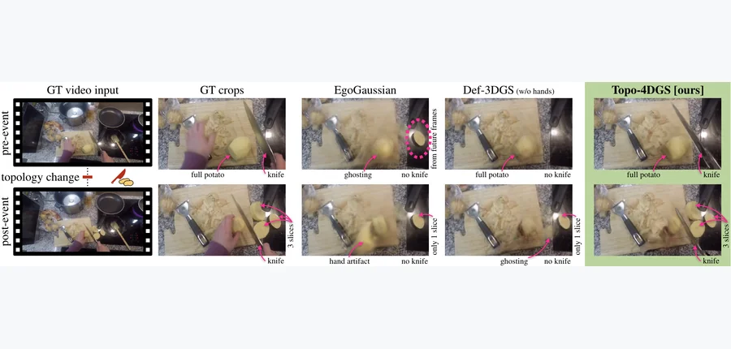 arXiv 2026-11-14 · cs.CV · #8 **[Topology-Aware 4D Gaussian Splatting for Egocentric Videos](https://arxiv.org/abs/2611.16012)** [Leonardo Vanni , Stefano Gasperini , Federico Tombari , Chiara Plizzari](https://arxiv.org/abs/2611.16012) 机构：Bocconi University / Technical University of Munich / Google（[PDF](https://arxiv.org/pdf/2611.16012)） [Paper](https://arxiv.org/abs/2611.16012) · [图源](https://arxiv.org/html/2611.16012v1/teaser.png) 

中文摘要
从单目第一视角视频重建动态场景与物体对具身 AI 很重要，但现有 4D Gaussian Splatting（4DGS）方法难以处理切割、组装、打开或关闭等日常交互中的拓扑变化。4DGS 依赖固定表示的形变，表面分离、合并或显露时会产生明显视觉伪影。为此，我们提出首个面向第一视角视频拓扑变化的基准 TopoEgo，覆盖裂分、融合、打开和关闭，并提出拓扑感知重建方法 Topo-4DGS。Topo-4DGS 为交互部件分配独立刚体变换，并在表面出现、消失或分离时动态启用或停用 Gaussian，从而联合建模部件级运动与随时间变化的表面支持。大量实验表明，Topo-4DGS 在拓扑变化场景中显著优于当前 4DGS 方法，尤其是在事件发生后的帧。代码和数据将公开。 <a href="https://arxiv.org/abs/2611.16012">原摘要来源</a>
 | 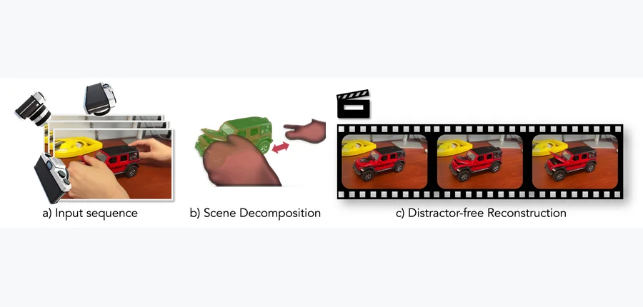 arXiv 2026-11-14 · cs.CV · #9 **[Reconstruct What You Can: Distractor-free 4D Gaussian Splatting](https://arxiv.org/abs/2611.16259)** [Joel Julin , Liuyue Xie , Ananya Bal , Mose Sakashita , Koichiro Niinuma , Laszlo A. Jeni](https://arxiv.org/abs/2611.16259) 机构：Carnegie Mellon University / Fujitsu Research of America（[PDF](https://arxiv.org/pdf/2611.16259)） [Paper](https://arxiv.org/abs/2611.16259) · [图源](https://arxiv.org/html/2611.16259v1/imgs/teaser.png) 

中文摘要
随意拍摄的视频动态重建需要保留有效的主体运动，同时抑制短暂遮挡物、阴影和体积效应。既有方法或因静态场景假设抑制真实运动，或联合建模全部观测，造成重影和几何不稳定。我们提出 ReCan-GS，一种将连贯场景内容与不一致观测分开的 4D Gaussian Splatting 框架。它由学习到的形变场推导基于 Jacobian 的形变敏感度分数，将其作为重建歧义的经验代理。该分数指导把表示分为动态 Core Gaussians 和逐视角 Distractor Gaussians，或在事后剪除敏感的 Core Gaussians。相同准则无需掩膜、预训练分割器或针对介质的监督，就能去除空间遮挡、光度伪影及演化中的烟或雾。合成与真实动态场景及合成烟雾场景实验表明，该方法适用于所评估的不同干扰情形。 <a href="https://arxiv.org/abs/2611.16259">原摘要来源</a>
 |
| 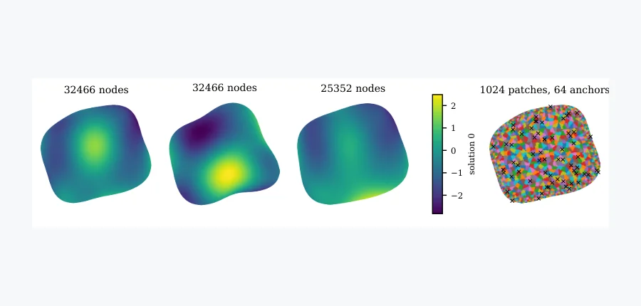 arXiv 2026-11-14 · cs.LG · #10 **[PhysICL: In-Context Learning of Physical Fields on Unstructured Meshes from Procedural Priors](https://arxiv.org/abs/2611.15965)** [Fabien Casenave](https://arxiv.org/abs/2611.15965) 机构：Safran Tech（[PDF](https://arxiv.org/pdf/2611.15965)） [Paper](https://arxiv.org/abs/2611.15965) · [图源](https://arxiv.org/html/2611.15965v1/prior_current.png) 

中文摘要
工程设计研究通常只有某一问题的数十至数百次仿真，且每次仿真使用自己的网格；其代理模型往往要为每项研究重新训练。表格基础模型则在合成任务上预训练，再凭示例于一次前向传播中推断新任务。我们展示在非结构网格上对物理场进行上下文学习的可行性。单个 PhysICL 模型仅在程序生成任务上预训练，便可从带标签仿真直接预测查询网格上的物理场及分位数，而无需更新权重。同一个检查点可接受不同数量的上下文示例、标量输入和输入场，以及任意数量的输出场；任务内网格大小与连通性也可变化。其程序先验在形变的2D 和 3D 模板网格上采样通用定律及边界元物理模型，且仅在模型采样的点上计算，足够快，CPU 工作进程在线生成的任务可以持续供给 GPU 预训练。在五个预训练未见的 PLAID 数据集上，场误差随上下文增加而降低；从 K=32 起，所有数据集和上下文采样的误差都低于最近的上下文仿真。该方法在其中两个数据集上接近逐数据集训练的降阶模型，但在低秩场中落后。对节点数中位数为 1.1 million（110 万）、达到最大预训练网格 20 倍的 AhmedML 表面，固定空间预算使 K=64 时峰值 GPU 显存为 4.27 GiB；6,000 节点的 2D_MSHE 网格则为 4.07 GiB。最后，对偏离程序先验的 2D_MSHE，仅用复现其几何与载荷、而不使用其输出的程序任务，以预训练成本十分之一微调，就将应力误差降低到原来的 1/2.7。 <a href="https://arxiv.org/abs/2611.15965">原摘要来源</a>
 | 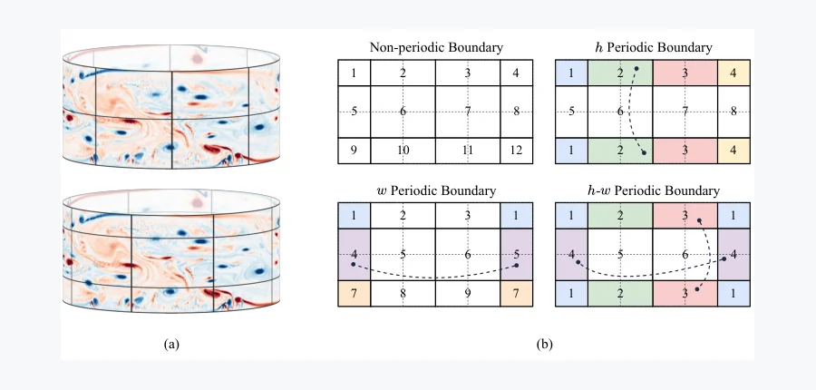 arXiv 2026-11-14 · physics.flu-dyn · #11 **[SUMNO: Spatially Unrolled Multigrid Neural Operator for Fluid Flow Surrogates](https://arxiv.org/abs/2611.16341)** [Yingqi Hu , Nan Deng , Changxiao Shao , Xiaozhou He](https://arxiv.org/abs/2611.16341) 机构：Harbin Institute of Technology（[PDF](https://arxiv.org/pdf/2611.16341)） [Paper](https://arxiv.org/abs/2611.16341) · [图源](https://arxiv.org/html/2611.16341v1/1.png) 

中文摘要
数据驱动代理可加速计算流体力学，类似经典几何多重网格（GMG）结构的分层 U 形网络已成为常见设计。现代代理以远低于数值求解器的成本取得有竞争力的精度，但复杂流动预测仍具挑战，也没有一种架构在各类流动中全面领先。这类网络与多重网格的相似性主要在多分辨率拓扑，其部件仍常沿用视觉网络设计。为此，我们提出用于规则网格流场的多重网格神经算子 SUMNO，把 V-cycle 空间展开为前馈 U 形网络。无参数下采样和上采样分别充当限制与延拓，加性跳连充当粗网格校正；传递和跳连路径不做归一化。宏观架构内，细尺度和中尺度使用卷积，最粗尺度使用移窗注意力，并推广窗口划分，使各坐标轴的周期性可独立处理。在四个稳态和非稳态流动基准的未见测试配置上，与五个代表性基线比较，SUMNO 在7 种设置中的 5 种排名第一，其余两种排名第二。相对最强基线，10 步展开均方误差约降低 30%；使用 9.4 million（940 万）参数还优于三个参数量超过 130 million（1.3 亿）的基线。 <a href="https://arxiv.org/abs/2611.16341">原摘要来源</a>
 | 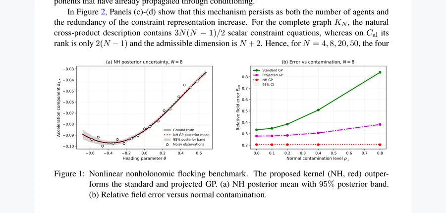 arXiv 2026-11-14 · eess.SY · #12 **[Structure-Preserving Learning for Nonlinear Nonholonomic Dynamics](https://arxiv.org/abs/2611.16796)** [Thomas Beckers , Anthony Bloch , Leonardo Colombo](https://arxiv.org/abs/2611.16796) 机构：Ulm University / University of Michigan / Spanish National Research Council（[PDF](https://arxiv.org/pdf/2611.16796)） [Paper](https://arxiv.org/abs/2611.16796) · [图源](https://arxiv.org/pdf/2611.16796) 

中文摘要
学习受非线性非完整约束的机械系统动力学具有挑战，因为数据驱动模型可能违反物理约束并给出不一致预测。我们基于 Lagrange–d’Alembert–Chetaev 方程及约束子流形的切向条件，建立约束保持学习框架；两者共同定义可容许加速度的仿射空间。利用动能度量与 Moore–Penrose 伪逆，我们构造度量投影及相应的 Chetaev 修正。将这一几何结构直接嵌入高斯过程先验，确保先验与后验动力学都严格满足加速度约束。我们刻画所得再生核 Hilbert 空间（RKHS），推导适配坐标表示，并证明非扩张性与一致性传递。最多 N=50 个智能体的三维方向群集系统数值实验表明，该方法能精确保持约束，并对违反约束的观测保持鲁棒。 <a href="https://arxiv.org/abs/2611.16796">原摘要来源</a>
 |
| 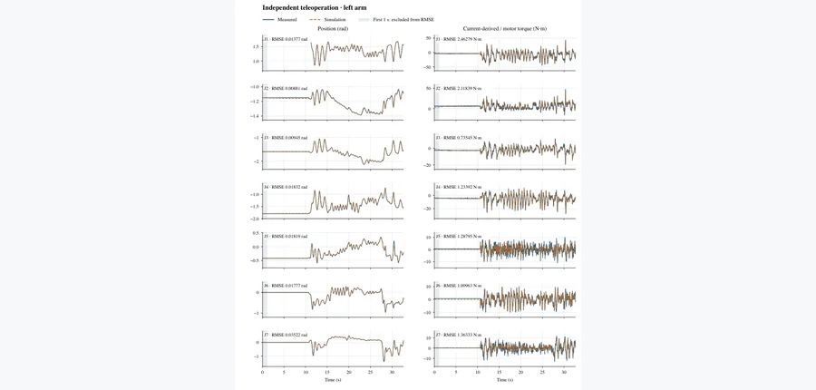 arXiv 2026-11-14 · cs.RO · #13 **[Genie Sim Benchmark: Real-to-Sim Fidelity and Evaluation](https://arxiv.org/abs/2611.15020)** [Di Yang , Da Huang , Yang Lv , Fan Yang , Yi Lu , Zheyuan Xing , Linting Guo , Jiaen Shen , Wenjun Sun , Maoqing Yao , Qi… 机构：affiliation 未确认 [Paper](https://arxiv.org/abs/2611.15020) · [图源](https://arxiv.org/html/2611.15020v1/left-position-torque.png) 

中文摘要
我们通过配对真实与仿真任务及补充的系统辨识研究评估 Genie Sim Benchmark。在涵盖 16 个任务名称的 22 个机器人任务配对中，基于真实机器人数据微调的任务专属 π0.5 策略，其描述性 Score 相关系数为 0.9686，MAE 为 0.0405，RMSE 为 0.0520；仿真与真实差值在 -0.110 到 +0.080 之间。G2 crsB 实验评估长时程闭环位置与关节侧力矩的一致性，另以5 个代表性物体案例考察系统辨识和跨引擎接触迁移。一段独立的 32.6503 秒遥操作轨迹未用于机械辨识和伺服增益搜索，用来通过仿真运动控制器的指令整形和校准的位置伺服，评估外部位置目标。双臂各关节的位置 RMSE 为 0.00614–0.03522 rad，由电流推得的力矩 RMSE 为 0.73545–4.00099 N·m。原生 PhysX 适配恢复了三个已记录的交互任务，各案例对齐增益不同。这些结果支持结合任务结果与物理响应一致性，对特定任务的仿真进行评估。 <a href="https://arxiv.org/abs/2611.15020">原摘要来源</a>
 | 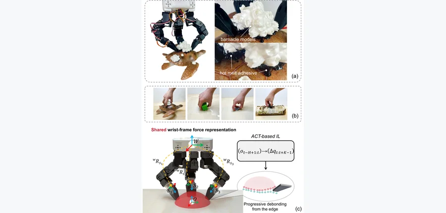 IEEE Transactions on Robotics (accepted) · #14 **[DexRemo: A Force-Sensing Hand Platform and Task Suite for Contact-Rich Removal Manipulation](https://arxiv.org/abs/2611.15981)** [Liman Wang , Hanyang Zhong , Sun Zhaole , Wenting Cao , Babar Jamil , Andy Tyrrell , Shan Luo , Jihong Zhu](https://arxiv… 机构：University of York / University of Edinburgh / Friedrich Schiller University Jena / King’s College London（[PDF](https://arxiv.org/pdf/2611.15981)） [Paper](https://arxiv.org/abs/2611.15981) · [Project](https://dexremo.github.io/) · [图源](https://arxiv.org/html/2611.15981v1/fig1.png) 

中文摘要
许多操作任务需要分离黏附、嵌入、污染或机械约束的目标。我们将这类任务研究为移除操作，其进展取决于不断变化的接触状态，而这些状态仅能由视觉和运动学部分观察。我们提出 DexRemo：一种具有高力驱动、模块化指尖及三轴指尖力传感的三指机器人手，并提供覆盖黏附剥离、表面清洁与自清洁以及遮挡取回的九场景真实机器人任务套件。为便于融合多指力观测，我们将指尖力表示在共享的腕中心坐标系中，使不同手指、不同时刻的力分量具有一致的几何意义。基于 Action Chunking Transformer，策略融合多视角视觉、本体感觉、指尖位姿和力观测，从示范中预测闭环动作片段。评估包含用于受控指尖输入及力坐标系消融的六个核心基准任务，以及提供额外留出覆盖的三个扩展场景。学习策略在这些评估中取得一致的移除操作表现；消融显示，相比局部坐标力输入及无力基线，腕坐标系力信息，尤其与指尖位姿结合时，能改善稳定性与泛化。 <a href="https://arxiv.org/abs/2611.15981">原摘要来源</a>
 | 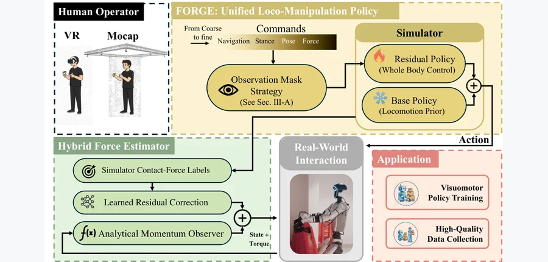 arXiv 2026-11-14 · cs.RO · #15 **[FORGE: Force-Aware Multi-Granularity Control for Efficient Humanoid Loco-Manipulation](https://arxiv.org/abs/2611.17142)** [Liangjun Xing , Ke Fan , Kailin Li , Bin Wang , Xiaojie Niu , Qingwei Ben , Jiafei Cao , Wei Yao , Yebin Liu , Jingbo Wan… 机构：Shanghai AI Laboratory / Tsinghua University / Zhejiang University / Shanghai Jiao Tong University / The Chinese University of Hong Kong（[PDF](https://arxiv.org/pdf/2611.17142)） [Paper](https://arxiv.org/abs/2611.17142) · [Code](https://github.com/bb0928/FORGE) · [Project](https://bb0928.github.io/forge/) · [图源](https://arxiv.org/html/2611.17142v1/Forge_Pipeline132_terms.png) 

中文摘要
人形机器人移动操作需要在频繁接触下协调行走、平衡调节与操作，使遥操作示范难以收集：实用控制器必须同时具备精确性、稳定性与接触感知。我们提出 FORGE，一套力感知多粒度控制系统，其由粗到细的指令空间覆盖速度导航、平面落脚、腕位姿跟踪及可选的力条件输入。策略训练不需要全身人体运动轨迹或关节角参考；部署时仅使用相对骨盆的稀疏双腕位姿、粗运动指令及可选的目标腕部负载输入。对持续接触，FORGE 将动量观测器与使用仿真接触力监督训练的学习修正结合。部署时，它由本体感觉及重建的低层手臂 PD 力矩估计低频、腕部等效交互力，无需腕部力/力矩传感器。准静态虚拟目标环根据该估计及可选的目标施加力调整腕部目标。冻结的行走先验及非对称残差动作稳定操作引起的全身修正。实验评估统一控制稳定性、任务空间跟踪、准静态腕部等效力估计、对刚性箱子的持续挤压力，以及跨负载条件的下蹲举升任务中下游扩散策略的执行。 <a href="https://arxiv.org/abs/2611.17142">原摘要来源</a>
 |
| 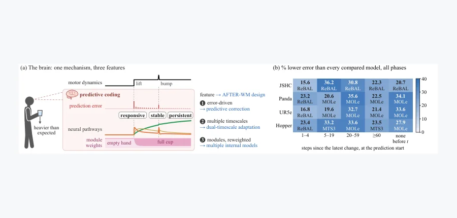 arXiv 2026-11-14 · cs.AI · #16 **[AFTER: A World Model with Adaptive Fast--Slow Timescales for Error-Driven Retention](https://arxiv.org/abs/2611.15215)** [Haoyi Zhang , Qi Zhang , Yunfan Ren , Yi Bin , Lei Zhu , Heng Tao Shen](https://arxiv.org/abs/2611.15215) 机构：Tongji University（[PDF](https://arxiv.org/pdf/2611.15215)） [Paper](https://arxiv.org/abs/2611.15215) · [图源](https://arxiv.org/html/2611.15215v1/fig1_teaser.png) 

中文摘要
在机器人与具身 AI 中，世界模型的一项核心挑战是适应交互期间突然、持久、最初未知的机器人动力学变化。例如，机器人手臂抓取未知载荷后，动力学会突然变化；若世界模型无法适应，预测误差会在开环展开中累积，最终误导动作。既有模型难以同时满足动力学适应的三项要求：响应性，即及时应对突变以抑制误差积累；稳定性，即区分持久变化和瞬时扰动，避免错误更新；持续性，即无新观测时保留已适应的动力学，防止后续预测回到旧模型。受人脑多时间尺度预测编码启发，我们提出 AFTER-WM：由预测误差驱动会衰减的快速修正和持续的慢速修正，同时动态调整预训练专家的组合权重而不改变专家，以协调响应性、稳定性与持续性。在五个仿真机器人数据集和真实无人机数据上，AFTER-WM 的多步平均误差低于十个对比模型，并在联合故障控制任务中取得最高平均回报。在仿真中，其多步平均误差较最强对比模型低 16%–34%；变化后 1–4 步、只有瞬时扰动以及第 40 步的误差也均最低，分别体现响应性、稳定性与持续性。所有代码（方法、基线和实验）及数据集将在线发布。 <a href="https://arxiv.org/abs/2611.15215">原摘要来源</a>
 | 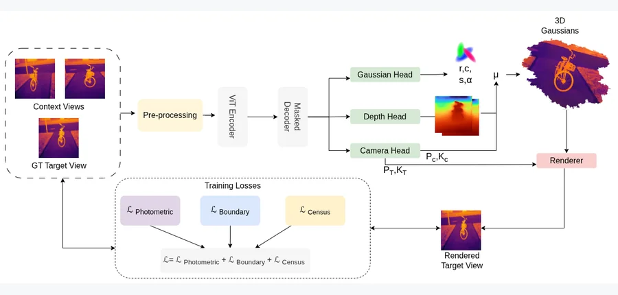 arXiv 2026-11-14 · cs.CV · #17 **[ThermalSplat: Generalizable Pose-Free Gaussian Splatting for Sparse-View Thermal 3D Reconstruction](https://arxiv.org/abs/2611.15435)** [Prasanna S , Gopi Raju Matta , Divya Madhuri Vemunuri , Kaushik Mitra](https://arxiv.org/abs/2611.15435) 机构：Indian Institute of Technology Madras（[PDF](https://arxiv.org/pdf/2611.15435)） [Paper](https://arxiv.org/abs/2611.15435) · [图源](https://arxiv.org/html/2611.15435v1/figures/ThermalSplat.drawio.png) 

中文摘要
热红外成像对搜救和自主导航很重要，但将其转换成三维场景表示仍是关键瓶颈。热图像纹理稀少、发射率随视角变化，使标准位姿估计器在稀疏视角下严重失效，标准 3D Gaussian Splatting 流程也随之崩溃。现有热重建方法还依赖密集采集和昂贵的逐场景优化；许多方法需要对齐的 RGB 与热图像数据集，以获取可靠相机位姿和初始点云，因而无法用于纯热成像、未知位姿环境。我们提出 ThermalSplat，据论文所述，这是首个可泛化的前馈 Gaussian splatting 框架，能直接从稀疏热图像重建三维场景，无需已知相机位姿、RGB 引导或逐场景训练。针对热成像挑战，我们采用对亮度变化不敏感的软 census 损失进行结构匹配，并以边界结构损失显式监督温度不连续处。模型在聚合的多源数据集上训练，单次前馈即可生成未见场景的清晰重建。大量实验表明，在稀疏视角条件下，ThermalSplat 相对逐场景热 splatting 方法具有明确优势；即使与在理想密集采集设置下运行的这些基线相比，也取得更好的感知保真度。由于无需昂贵的逐场景优化，该方法提供高效、可泛化的热成像三维重建途径。 <a href="https://arxiv.org/abs/2611.15435">原摘要来源</a>
 | 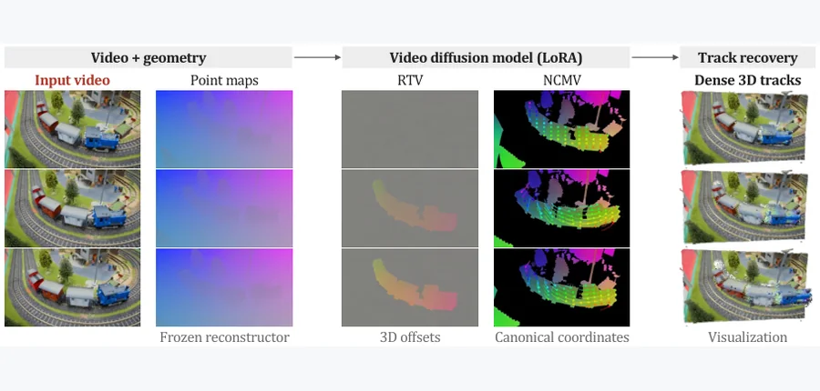 arXiv 2026-11-14 · cs.CV · #18 **[Track4D: Representing Dense 3D Tracking for Video Diffusion Models](https://arxiv.org/abs/2611.15287)** [Yushi Lan , Zeren Jiang , Kelvin Li , Xingang Pan , Chuanxia Zheng , Andrea Vedaldi](https://arxiv.org/abs/2611.15287) 机构：University of Oxford / Nanyang Technological University（[PDF](https://arxiv.org/pdf/2611.15287)） [Paper](https://arxiv.org/abs/2611.15287) · [Code](https://github.com/NIRVANALAN/Track4D) · [Project](https://nirvanalan.github.io/projects/track4d/) · [图源](https://arxiv.org/html/2611.15287v1/teaser-track4d.png) 

中文摘要
我们研究如何将已在数百万段视频上预训练的视频扩散模型（VDM）用于训练数据稀缺的稠密 3D 点跟踪。这并不简单，因为需要把三维轨迹表示为类似视频的信号，而这类信号可能超出 VDM 预训练时的自然视频分布。因此，我们系统比较两种视频表示。第一种残差三维跟踪视频（RTV）编码相对查询帧的逐像素三维偏移，可直接由生成视频恢复三维轨迹。第二种归一化坐标图视频（NCMV）为每个像素标注随时间不变的规范坐标；它更接近自然视频，也更容易被 VDM 学习，但需要额外使用现成2D 跟踪器后处理，才能恢复三维轨迹。RTV 跟踪更准确，而 NCMV 表明 VDM 能以视频形式生成稠密对应。我们以冻结 Wan 骨干的 LoRA 适配实现两种表示，并以现成三维重建器生成的点图作为几何支架。在单个动态三维跟踪数据集上训练后，Track4D 在四个真实和合成基准上取得有竞争力的零样本跟踪表现。绕过视频 VAE 并使用额外训练数据的回归读出进一步提升效果，显示该方向在稠密三维跟踪上的潜力。我们希望这些分析启发利用 VDM 先验开展稠密三维跟踪与 4D 重建的后续研究。 <a href="https://arxiv.org/abs/2611.15287">原摘要来源</a>
 |
| 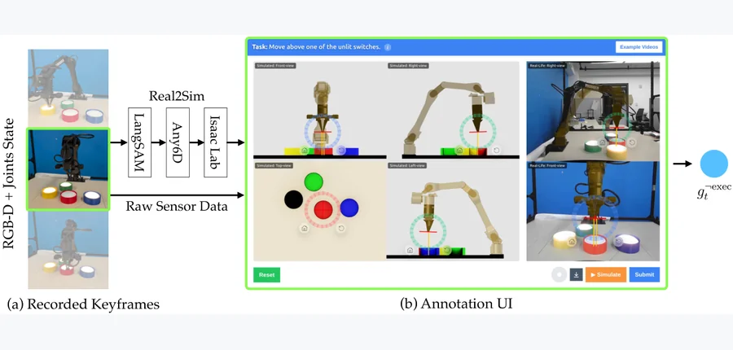 arXiv 2026-11-14 · cs.RO · #19 **[CrowdMAPS: Crowdsourcing Multiple Actions per State for Real-World Imitation Learning](https://arxiv.org/abs/2611.15078)** [Yilong Song , Harshvardhan Chandirasekar , Karthik Desingh , Chen Zhu-Tian](https://arxiv.org/abs/2611.15078) 机构：University of Minnesota, Twin Cities（[PDF](https://arxiv.org/pdf/2611.15078)） [Paper](https://arxiv.org/abs/2611.15078) · [图源](https://arxiv.org/html/2611.15078v1/system_figure_new_hq.png) 

中文摘要
真实机器人模仿学习常受实体演示采集成本限制，通常每个到访状态仅有一个动作标签。我们提出 CrowdMAPS，一种基于网页的众包范式，以每状态多动作（MAPS）扩充真实机器人数据集。在标准机器人数据采集期间或之后，CrowdMAPS 通过网页 3D 界面把已到访状态分发给远程标注员；他们无需接触实体机器人，即可指定其他有效动作。这沿着互补的“宽度”维度扩充数据，即增加每个已到访状态的动作数量，而非只收集更多轨迹。我们以非专家标注员提供的关键帧目标位姿标注评估 CrowdMAPS，并用所得 MAPS 数据训练模仿策略。在五项真实操作任务中，每状态动作数从一个增加到十个，提高了样本效率，并使关键姿态策略和轨迹策略的平均成功率分别提高 35.6 和 33.0 个百分点。结果表明，软件媒介的人类标注能够扩充实体机器人数据，提供更密集的监督，使 CrowdMAPS 成为可扩展的真实机器人数据采集数字层。 <a href="https://arxiv.org/abs/2611.15078">原摘要来源</a>
 | 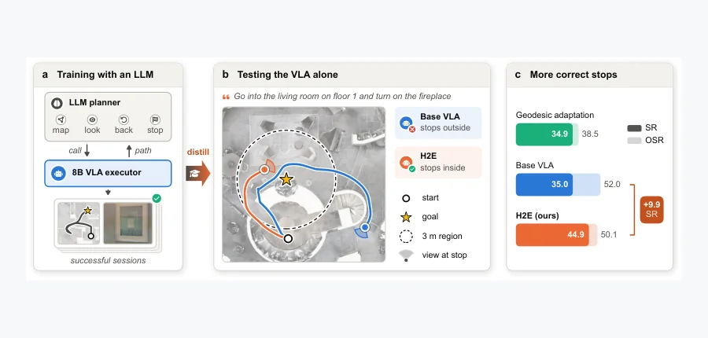 arXiv 2026-11-14 · cs.RO · #20 **[What Can a VLA Learn from the Agent That Calls It? Task-Level Experience Distillation for Embodied Navigation](https://arxiv.org/abs/2611.16246)** [Jinze Tao , Yuxiao Han , Kangkang Dong , Yancong Wei , Xiaojun Zhu , Bokui Chen , Houde Liu](https://arxiv.org/abs/2611.1… 机构：Tsinghua University（[PDF](https://arxiv.org/pdf/2611.16246)） [Paper](https://arxiv.org/abs/2611.16246) · [图源](https://arxiv.org/html/2611.16246v1/fig_teaser.png) 

中文摘要
导航智能体使用大型语言模型（LLM）规划器调用视觉语言动作（VLA）模型，每个 episode 都需要 LLM，增加成本和延迟。我们把成功的智能体经验蒸馏进 VLA，而非蒸馏规划器，使 VLA 在测试时独立导航。智能体会话并非 VLA 示范：其中包含由规划工具和子指令驱动的运动，以及绕行。我们提出 H2E，一种将这些会话转换为 VLA 训练数据的任务级经验蒸馏方法。每段运动都在原始任务指令下成为 VLA 动作，所到达位姿作为目标；H2E 屏蔽远离目标步骤的损失，并将距离目标 1 米内到访的每个状态标注为停止。随后我们用低秩适配更新 VLA。VLA 因此学会在目标处停止，并找到基础模型到不了的目标。在全部 3,189 个 REVERIE-CE val-unseen episode 上，H2E 将 8B VLA 的成功率从 35.0% 提高至 44.9%。 <a href="https://arxiv.org/abs/2611.16246">原摘要来源</a>
 |   |
<!-- PAPER_CARDS_END -->

## 检索概况

- **检索窗口**：北京时间 2026-11-13 09:00 至 2026-11-14 09:07；检索 14 个 arXiv 官方 New 分类页。
- **官方批次**：全部分类页显示 [Friday, 13 November 2026](https://arxiv.org/list/cs.CV/new?show=2000)。主榜仅收该批次 New，同一 arXiv ID 去重。
- **范围**：cs.CV、cs.GR、cs.RO、cs.AI、cs.LG，以及高度相关的 physics、cond-mat、eess、math、stat.ML；按标题与摘要核实，三维物理和接触优先。
- **总命中／去重／入选**：1,140 条 New／1,140 个不同 ID／20 篇。
- **来源与判断**：标题、作者、分类、摘要均来自所列官方 New 页面及各论文 arXiv 页面；机构优先核对 PDF 首页。相关性、机构强度、局限与改进建议均为推断。
- **完整性**：中文摘要与入选卡片逐篇对应；缺摘要 0 篇。真实论文配图 20/20，缺图 0 篇。

## 官方 New listing 状态

| 分类页 | 官方日期 | New 条目 |
|---|---|---:|
| [cond-mat](https://arxiv.org/list/cond-mat/new?show=2000) | 2026-11-13 | 169 |
| [cs.AI](https://arxiv.org/list/cs.AI/new?show=2000) | 2026-11-13 | 113 |
| [cs.CV](https://arxiv.org/list/cs.CV/new?show=2000) | 2026-11-13 | 170 |
| [cs.GR](https://arxiv.org/list/cs.GR/new?show=2000) | 2026-11-13 | 3 |
| [cs.LG](https://arxiv.org/list/cs.LG/new?show=2000) | 2026-11-13 | 186 |
| [cs.RO](https://arxiv.org/list/cs.RO/new?show=2000) | 2026-11-13 | 91 |
| [eess.IV](https://arxiv.org/list/eess.IV/new?show=2000) | 2026-11-13 | 12 |
| [eess.SP](https://arxiv.org/list/eess.SP/new?show=2000) | 2026-11-13 | 38 |
| [eess.SY](https://arxiv.org/list/eess.SY/new?show=2000) | 2026-11-13 | 63 |
| [math.DS](https://arxiv.org/list/math.DS/new?show=2000) | 2026-11-13 | 29 |
| [math.NA](https://arxiv.org/list/math.NA/new?show=2000) | 2026-11-13 | 44 |
| [math.OC](https://arxiv.org/list/math.OC/new?show=2000) | 2026-11-13 | 49 |
| [physics](https://arxiv.org/list/physics/new?show=2000) | 2026-11-13 | 157 |
| [stat.ML](https://arxiv.org/list/stat.ML/new?show=2000) | 2026-11-13 | 16 |
| **合计** | — | **1,140** |

## Top papers

| # | 论文 | 分类 | 作者 | 机构 | 相关性（推断） | 机构强度（推断） | 优先级 |
|---:|---|---|---|---|---|---|---|
| 1 | [Alloy: A Multi-Material Physics Engine for Robot Learning](https://arxiv.org/abs/2611.16312) | [cs.RO](https://arxiv.org/abs/2611.16312) | [Pranay Gupta , Deepanshu Rohilla](https://arxiv.org/abs/2611.16312) | Argon Robotics（[PDF](https://arxiv.org/pdf/2611.16312)） | 极高：三维物理／接触 | 待独立评估 | A |
| 2 | [Elastra: A Simulation Framework for Elastic Bodies](https://arxiv.org/abs/2611.15112) | [cs.RO](https://arxiv.org/abs/2611.15112) | [Youran Sun , Chugang Yi , Xingyu Ren , Haizhao Yang](https://arxiv.org/abs/2611.15112) | University of Maryland, College Park / The Chinese University of Hong Kong（[PDF](https://arxiv.org/pdf/2611.15112)） | 极高：三维物理／接触 | 待独立评估 | A |
| 3 | [PIM: A Physical Intuition Model for Low-Latency Prediction of Object Interaction Outcomes](https://arxiv.org/abs/2611.16673) | [cs.GR](https://arxiv.org/abs/2611.16673) | [Tangwen Luo , Chuankun Zheng , Yuchi Huo](https://arxiv.org/abs/2611.16673) | Zhejiang University（[PDF](https://arxiv.org/pdf/2611.16673)） | 极高：三维物理／接触 | 待独立评估 | A |
| 4 | [From a Single RGB Image to Robot Execution: Metric Scene Alignment and Contact-Guided Retargeting](https://arxiv.org/abs/2611.14981) | [cs.RO](https://arxiv.org/abs/2611.14981) | [Zhenxuan Ding , Yu Huang , Xinmiao Wang , Chenghao Sun , Ziyang Dong , Wenhao Cui](https://arxiv.org/abs/2611.14981) | Beijing University of Chemical Technology / National University of Defense Technology / Noetix Robotics（[PDF](https://arxiv.org/pdf/2611.14981)） | 极高：三维物理／接触 | 待独立评估 | A |
| 5 | [Input-output characterization of robotic grasping: Connecting design parameters to grasp behavior through the admittance](https://arxiv.org/abs/2611.16507) | [cs.RO](https://arxiv.org/abs/2611.16507) | [Julien Vanderheyden , Guillaume Drion , Pierre Sacré , Fulvio Forni](https://arxiv.org/abs/2611.16507) | University of Liège / University of Cambridge（[PDF](https://arxiv.org/pdf/2611.16507)） | 极高：三维物理／接触 | 待独立评估 | A |
| 6 | [Elasto-inertial force exerted on a sphere oscillating in a fluid near a soft interface](https://arxiv.org/abs/2611.16575) | [cond-mat.soft](https://arxiv.org/abs/2611.16575) | [Axel Batalha (LOMA, L2C), Harshit Joshi (LOMA), Yacine Amarouchene (LOMA), Thomas Salez (LOMA, X-DEP-MECA)](https://arxiv.org/abs/2611.16575) | University of Bordeaux / CNRS / University of Montpellier / École Polytechnique（[PDF](https://arxiv.org/pdf/2611.16575)） | 极高：三维物理／接触 | 待独立评估 | A |
| 7 | [Spatiotemporal learning improves quantification of pore-space evolution and fluid displacement](https://arxiv.org/abs/2611.17111) | [physics.flu-dyn](https://arxiv.org/abs/2611.17111) | [Zhuangzhuang Ma , Rukuan Chai , Qianqian Ma , Yanghua Wang , Branko Bijeljic , Martin J. Blunt](https://arxiv.org/abs/2611.17111) | Imperial College London（[PDF](https://arxiv.org/pdf/2611.17111)） | 极高：三维物理／接触 | 待独立评估 | A |
| 8 | [Topology-Aware 4D Gaussian Splatting for Egocentric Videos](https://arxiv.org/abs/2611.16012) | [cs.CV](https://arxiv.org/abs/2611.16012) | [Leonardo Vanni , Stefano Gasperini , Federico Tombari , Chiara Plizzari](https://arxiv.org/abs/2611.16012) | Bocconi University / Technical University of Munich / Google（[PDF](https://arxiv.org/pdf/2611.16012)） | 高：动态三维／物理场 | 待独立评估 | A |
| 9 | [Reconstruct What You Can: Distractor-free 4D Gaussian Splatting](https://arxiv.org/abs/2611.16259) | [cs.CV](https://arxiv.org/abs/2611.16259) | [Joel Julin , Liuyue Xie , Ananya Bal , Mose Sakashita , Koichiro Niinuma , Laszlo A. Jeni](https://arxiv.org/abs/2611.16259) | Carnegie Mellon University / Fujitsu Research of America（[PDF](https://arxiv.org/pdf/2611.16259)） | 高：动态三维／物理场 | 待独立评估 | A |
| 10 | [PhysICL: In-Context Learning of Physical Fields on Unstructured Meshes from Procedural Priors](https://arxiv.org/abs/2611.15965) | [cs.LG](https://arxiv.org/abs/2611.15965) | [Fabien Casenave](https://arxiv.org/abs/2611.15965) | Safran Tech（[PDF](https://arxiv.org/pdf/2611.15965)） | 高：动态三维／物理场 | 待独立评估 | A |
| 11 | [SUMNO: Spatially Unrolled Multigrid Neural Operator for Fluid Flow Surrogates](https://arxiv.org/abs/2611.16341) | [physics.flu-dyn](https://arxiv.org/abs/2611.16341) | [Yingqi Hu , Nan Deng , Changxiao Shao , Xiaozhou He](https://arxiv.org/abs/2611.16341) | Harbin Institute of Technology（[PDF](https://arxiv.org/pdf/2611.16341)） | 高：动态三维／物理场 | 待独立评估 | A |
| 12 | [Structure-Preserving Learning for Nonlinear Nonholonomic Dynamics](https://arxiv.org/abs/2611.16796) | [eess.SY](https://arxiv.org/abs/2611.16796) | [Thomas Beckers , Anthony Bloch , Leonardo Colombo](https://arxiv.org/abs/2611.16796) | Ulm University / University of Michigan / Spanish National Research Council（[PDF](https://arxiv.org/pdf/2611.16796)） | 高：动态三维／物理场 | 待独立评估 | A |
| 13 | [Genie Sim Benchmark: Real-to-Sim Fidelity and Evaluation](https://arxiv.org/abs/2611.15020) | [cs.RO](https://arxiv.org/abs/2611.15020) | [Di Yang , Da Huang , Yang Lv , Fan Yang , Yi Lu , Zheyuan Xing , Linting Guo , Jiaen Shen , Wenjun Sun , Maoqing Yao , Qian Wang](https://arxiv.org/abs/2611.15020) | affiliation 未确认 | 高：动态三维／物理场 | 待独立评估 | A |
| 14 | [DexRemo: A Force-Sensing Hand Platform and Task Suite for Contact-Rich Removal Manipulation](https://arxiv.org/abs/2611.15981) | [cs.RO](https://arxiv.org/abs/2611.15981) | [Liman Wang , Hanyang Zhong , Sun Zhaole , Wenting Cao , Babar Jamil , Andy Tyrrell , Shan Luo , Jihong Zhu](https://arxiv.org/abs/2611.15981) | University of York / University of Edinburgh / Friedrich Schiller University Jena / King’s College London（[PDF](https://arxiv.org/pdf/2611.15981)） | 高：具身机器人或基础三维 | 待独立评估 | B |
| 15 | [FORGE: Force-Aware Multi-Granularity Control for Efficient Humanoid Loco-Manipulation](https://arxiv.org/abs/2611.17142) | [cs.RO](https://arxiv.org/abs/2611.17142) | [Liangjun Xing , Ke Fan , Kailin Li , Bin Wang , Xiaojie Niu , Qingwei Ben , Jiafei Cao , Wei Yao , Yebin Liu , Jingbo Wang , Weinan Zhang](https://arxiv.org/abs/2611.17142) | Shanghai AI Laboratory / Tsinghua University / Zhejiang University / Shanghai Jiao Tong University / The Chinese University of Hong Kong（[PDF](https://arxiv.org/pdf/2611.17142)） | 高：具身机器人或基础三维 | 待独立评估 | B |
| 16 | [AFTER: A World Model with Adaptive Fast--Slow Timescales for Error-Driven Retention](https://arxiv.org/abs/2611.15215) | [cs.AI](https://arxiv.org/abs/2611.15215) | [Haoyi Zhang , Qi Zhang , Yunfan Ren , Yi Bin , Lei Zhu , Heng Tao Shen](https://arxiv.org/abs/2611.15215) | Tongji University（[PDF](https://arxiv.org/pdf/2611.15215)） | 高：具身机器人或基础三维 | 待独立评估 | B |
| 17 | [ThermalSplat: Generalizable Pose-Free Gaussian Splatting for Sparse-View Thermal 3D Reconstruction](https://arxiv.org/abs/2611.15435) | [cs.CV](https://arxiv.org/abs/2611.15435) | [Prasanna S , Gopi Raju Matta , Divya Madhuri Vemunuri , Kaushik Mitra](https://arxiv.org/abs/2611.15435) | Indian Institute of Technology Madras（[PDF](https://arxiv.org/pdf/2611.15435)） | 高：具身机器人或基础三维 | 待独立评估 | B |
| 18 | [Track4D: Representing Dense 3D Tracking for Video Diffusion Models](https://arxiv.org/abs/2611.15287) | [cs.CV](https://arxiv.org/abs/2611.15287) | [Yushi Lan , Zeren Jiang , Kelvin Li , Xingang Pan , Chuanxia Zheng , Andrea Vedaldi](https://arxiv.org/abs/2611.15287) | University of Oxford / Nanyang Technological University（[PDF](https://arxiv.org/pdf/2611.15287)） | 高：具身机器人或基础三维 | 待独立评估 | B |
| 19 | [CrowdMAPS: Crowdsourcing Multiple Actions per State for Real-World Imitation Learning](https://arxiv.org/abs/2611.15078) | [cs.RO](https://arxiv.org/abs/2611.15078) | [Yilong Song , Harshvardhan Chandirasekar , Karthik Desingh , Chen Zhu-Tian](https://arxiv.org/abs/2611.15078) | University of Minnesota, Twin Cities（[PDF](https://arxiv.org/pdf/2611.15078)） | 高：具身机器人或基础三维 | 待独立评估 | B |
| 20 | [What Can a VLA Learn from the Agent That Calls It? Task-Level Experience Distillation for Embodied Navigation](https://arxiv.org/abs/2611.16246) | [cs.RO](https://arxiv.org/abs/2611.16246) | [Jinze Tao , Yuxiao Han , Kangkang Dong , Yancong Wei , Xiaojun Zhu , Bokui Chen , Houde Liu](https://arxiv.org/abs/2611.16246) | Tsinghua University（[PDF](https://arxiv.org/pdf/2611.16246)） | 高：具身机器人或基础三维 | 待独立评估 | B |

## 逐篇中文要点

### 1. [Alloy: A Multi-Material Physics Engine for Robot Learning](https://arxiv.org/abs/2611.16312)

- **论文事实／方法**：多材料物理引擎把刚体、布料、绳索、液体、颗粒和软体置于同一机器人学习场景，逐控制步耦合求解。（[原摘要](https://arxiv.org/abs/2611.16312)）
- **论文事实／结果**：论文报告单 GPU 多并行世界及 CPU 运行、解析参考一致性和千世界可靠性测试。（[原摘要](https://arxiv.org/abs/2611.16312)）
- **推断／局限**：可在材料交界处增加守恒残差与接触冲量审计，检验跨求解器耦合误差。

### 2. [Elastra: A Simulation Framework for Elastic Bodies](https://arxiv.org/abs/2611.15112)

- **论文事实／方法**：以仅沿竖直方向运动的弹性连接单元模拟床垫和蹦床，并把更新后的表面反馈给接触力计算。（[原摘要](https://arxiv.org/abs/2611.15112)）
- **论文事实／结果**：Unitree G1 起身实验中，残差策略将 HoST 床垫成功率从 44.1% 提升到 72.5%，蹦床从 55% 提升到 89%。（[原摘要](https://arxiv.org/abs/2611.15112)）
- **推断／局限**：可检验横向剪切和局部折皱对接触位置的影响。

### 3. [PIM: A Physical Intuition Model for Low-Latency Prediction of Object Interaction Outcomes](https://arxiv.org/abs/2611.16673)

- **论文事实／方法**：从初始 mesh、运动学和物理属性单次预测系统平衡态，兼顾物体位移与逐顶点形变。（[原摘要](https://arxiv.org/abs/2611.16673)）
- **论文事实／结果**：MuJoCo 刚体和可形变交互实验中，顶点及质心误差低于所比较基线，最终状态推理延迟更低。（[原摘要](https://arxiv.org/abs/2611.16673)）
- **推断／局限**：可加入碰撞不可穿透和接触互补约束，测试未见材料下的平衡预测。

### 4. [From a Single RGB Image to Robot Execution: Metric Scene Alignment and Contact-Guided Retargeting](https://arxiv.org/abs/2611.14981)

- **论文事实／方法**：从单张 RGB 图重建度量场景、生成交互，再用 JMIR 与 CGRR 分别校正迁移前对齐和机器人支撑误差。（[原摘要](https://arxiv.org/abs/2611.14981)）
- **论文事实／结果**：相对 GRAIL，精修耗时从 480 秒降至 87 秒；仿真成功率 89%，Unitree G1 的 50 次实测成功率 70%。（[原摘要](https://arxiv.org/abs/2611.14981)）
- **推断／局限**：可测试单图尺度错误与遮挡对支撑接触和真实成功率的共同影响。

### 5. [Input-output characterization of robotic grasping: Connecting design parameters to grasp behavior through the admittance](https://arxiv.org/abs/2611.16507)

- **论文事实／方法**：以平衡点附近载荷扰动到物体位移的导纳传递矩阵描述低阻抗抓取的动态行为。（[原摘要](https://arxiv.org/abs/2611.16507)）
- **论文事实／结果**：同物体、同位置、同接触力的两个抓取，刚度可相差两个数量级；同刚度也可能有不同共振。（[原摘要](https://arxiv.org/abs/2611.16507)）
- **推断／局限**：可把平面无摩擦双指分析扩展到三维摩擦接触和时变负载。

### 6. [Elasto-inertial force exerted on a sphere oscillating in a fluid near a soft interface](https://arxiv.org/abs/2611.16575)

- **论文事实／方法**：在润滑近似中推导软界面附近高频振荡球体的流体惯性与界面形变耦合力。（[原摘要](https://arxiv.org/abs/2611.16575)）
- **论文事实／结果**：高频极限下，主导非耗散修正力随频率四次方变化，对应球体位置四阶时间导数。（[原摘要](https://arxiv.org/abs/2611.16575)）
- **推断／局限**：可用三维数值流固耦合验证薄隙近似失效边界。

### 7. [Spatiotemporal learning improves quantification of pore-space evolution and fluid displacement](https://arxiv.org/abs/2611.17111)

- **论文事实／方法**：将连续微 CT 的空间与时间信息结合为 4D 分割，区分孔隙真实变化和逐帧分割误差。（[原摘要](https://arxiv.org/abs/2611.17111)）
- **论文事实／结果**：在矿物溶解和两组流体驱替数据上，更准确测量孔体积、渗透率增长和填充事件。（[原摘要](https://arxiv.org/abs/2611.17111)）
- **推断／局限**：可加入流量守恒约束检验分割改善能否稳定转化为下游物理量。

### 8. [Topology-Aware 4D Gaussian Splatting for Egocentric Videos](https://arxiv.org/abs/2611.16012)

- **论文事实／方法**：为切割、组装、开闭等拓扑变化建立 TopoEgo 基准，使用部件刚体变换与 Gaussian 动态启停重建。（[原摘要](https://arxiv.org/abs/2611.16012)）
- **论文事实／结果**：论文报告拓扑事件后帧的重建表现优于既有 4DGS 方法。（[原摘要](https://arxiv.org/abs/2611.16012)）
- **推断／局限**：可用接触和质量守恒指标评估拆分/合并的几何可用性。

### 9. [Reconstruct What You Can: Distractor-free 4D Gaussian Splatting](https://arxiv.org/abs/2611.16259)

- **论文事实／方法**：以形变场 Jacobian 敏感度分离可重建的动态 Core Gaussian 与逐视角干扰 Gaussian。（[原摘要](https://arxiv.org/abs/2611.16259)）
- **论文事实／结果**：在合成/真实动态场景及合成烟雾场景中，无需掩膜或分割器即可抑制遮挡、阴影与体积效应。（[原摘要](https://arxiv.org/abs/2611.16259)）
- **推断／局限**：可检验快速真实运动是否被敏感度准则误删。

### 10. [PhysICL: In-Context Learning of Physical Fields on Unstructured Meshes from Procedural Priors](https://arxiv.org/abs/2611.15965)

- **论文事实／方法**：以程序生成物理先验预训练网格场的上下文学习模型，查询新网格时无需更新权重。（[原摘要](https://arxiv.org/abs/2611.15965)）
- **论文事实／结果**：K=32 后五个未见 PLAID 数据集的误差均低于最近上下文仿真；百万节点 AhmedML 表面 K=64 峰值显存 4.27 GiB。（[原摘要](https://arxiv.org/abs/2611.15965)）
- **推断／局限**：可检验程序先验与真实边界条件差异时的不确定度校准。

### 11. [SUMNO: Spatially Unrolled Multigrid Neural Operator for Fluid Flow Surrogates](https://arxiv.org/abs/2611.16341)

- **论文事实／方法**：把几何多重网格 V-cycle 展开为 U 形流体代理，并设计周期轴独立处理的移窗注意力。（[原摘要](https://arxiv.org/abs/2611.16341)）
- **论文事实／结果**：四个稳态/非稳态流动基准的七种设置中五次第一、两次第二，10 步展开 MSE 比最强基线低约 30%。（[原摘要](https://arxiv.org/abs/2611.16341)）
- **推断／局限**：可比较粗网格校正与守恒残差监督在边界层流动中的作用。

### 12. [Structure-Preserving Learning for Nonlinear Nonholonomic Dynamics](https://arxiv.org/abs/2611.16796)

- **论文事实／方法**：把 Lagrange–d’Alembert–Chetaev 约束和动能度量投影嵌入 GP 先验，使后验加速度严格满足非完整约束。（[原摘要](https://arxiv.org/abs/2611.16796)）
- **论文事实／结果**：最多 50 智能体的三维方向群集数值实验展示精确约束保持及对不兼容观测的鲁棒性。（[原摘要](https://arxiv.org/abs/2611.16796)）
- **推断／局限**：可在非理想轮地接触的移动机器人中测试约束软化时的模型偏差。

### 13. [Genie Sim Benchmark: Real-to-Sim Fidelity and Evaluation](https://arxiv.org/abs/2611.15020)

- **论文事实／方法**：以真实/仿真配对任务、系统辨识、关节位置/力矩回放及物体接触迁移评估 Genie Sim。（[原摘要](https://arxiv.org/abs/2611.15020)）
- **论文事实／结果**：22 个机器人任务配对的 Score 相关系数 0.9686；关节位置 RMSE 0.00614–0.03522 rad。（[原摘要](https://arxiv.org/abs/2611.15020)）
- **推断／局限**：相关性是描述性结果，可在未参与校准的物体与策略上检验预测能力。

### 14. [DexRemo: A Force-Sensing Hand Platform and Task Suite for Contact-Rich Removal Manipulation](https://arxiv.org/abs/2611.15981)

- **论文事实／方法**：三指手的三轴指尖力统一变换到腕坐标系，并与多视角图像、位姿共同训练 ACT 操作策略。（[原摘要](https://arxiv.org/abs/2611.15981)）
- **论文事实／结果**：九场景实机任务覆盖黏附剥离、清洁和遮挡取回；消融显示腕坐标系力信息改善稳定性与泛化。（[原摘要](https://arxiv.org/abs/2611.15981)）
- **推断／局限**：可针对接触突变建立力事件触发的动作分段，评估少样本剥离任务。

### 15. [FORGE: Force-Aware Multi-Granularity Control for Efficient Humanoid Loco-Manipulation](https://arxiv.org/abs/2611.17142)

- **论文事实／方法**：人形全身控制结合速度、脚步、腕位姿和可选目标负载，以动量观测器及仿真监督校正接触力估计。（[原摘要](https://arxiv.org/abs/2611.17142)）
- **论文事实／结果**：评估覆盖持续挤压、力估计和不同负载的下蹲举升任务；部署无需腕部力/力矩传感器。（[原摘要](https://arxiv.org/abs/2611.17142)）
- **推断／局限**：可比较估计腕力与实测力在快速冲击接触时的偏差。

### 16. [AFTER: A World Model with Adaptive Fast--Slow Timescales for Error-Driven Retention](https://arxiv.org/abs/2611.15215)

- **论文事实／方法**：以预测误差驱动快速衰减修正和持久慢修正，动态重配预训练专家以适应未知负载等动力学突变。（[原摘要](https://arxiv.org/abs/2611.15215)）
- **论文事实／结果**：五个仿真机器人数据集及真实 UAV 数据上多步误差优于十个对比模型；仿真中低 16%–34%。（[原摘要](https://arxiv.org/abs/2611.15215)）
- **推断／局限**：可检验突变检测误报时慢记忆污染及接触模式频繁切换下的适应速度。

### 17. [ThermalSplat: Generalizable Pose-Free Gaussian Splatting for Sparse-View Thermal 3D Reconstruction](https://arxiv.org/abs/2611.15435)

- **论文事实／方法**：无已知相机位姿、RGB 引导或逐场景训练，从稀疏热图像前馈重建 3D Gaussian。（[原摘要](https://arxiv.org/abs/2611.15435)）
- **论文事实／结果**：软 census 与温度边界损失提升无纹理热图的结构匹配，论文报告稀疏视角优于逐场景方法。（[原摘要](https://arxiv.org/abs/2611.15435)）
- **推断／局限**：可测试发射率随视角变化导致的度量几何与温度误差。

### 18. [Track4D: Representing Dense 3D Tracking for Video Diffusion Models](https://arxiv.org/abs/2611.15287)

- **论文事实／方法**：把逐像素 3D 偏移或规范坐标编码为视频，使用 LoRA 视频扩散模型生成稠密三维轨迹。（[原摘要](https://arxiv.org/abs/2611.15287)）
- **论文事实／结果**：单个动态 3D 数据集训练后，在四个真实及合成基准上展示有竞争力的零样本跟踪。（[原摘要](https://arxiv.org/abs/2611.15287)）
- **推断／局限**：可在遮挡后的轨迹重连和物理速度连续性上加入轻量约束。

### 19. [CrowdMAPS: Crowdsourcing Multiple Actions per State for Real-World Imitation Learning](https://arxiv.org/abs/2611.15078)

- **论文事实／方法**：网页三维界面让远程标注员为真实机器人已访问状态补充多个有效动作，而非增加实体演示轨迹。（[原摘要](https://arxiv.org/abs/2611.15078)）
- **论文事实／结果**：五项真实操作任务中每状态动作从 1 增至 10 后，关键姿态和轨迹策略平均成功率分别提高 35.6 与 33.0 个百分点。（[原摘要](https://arxiv.org/abs/2611.15078)）
- **推断／局限**：可对多动作标签加入接触可行性判别，减少未经实体执行的无效动作。

### 20. [What Can a VLA Learn from the Agent That Calls It? Task-Level Experience Distillation for Embodied Navigation](https://arxiv.org/abs/2611.16246)

- **论文事实／方法**：把成功导航 Agent 会话转成原始任务指令下的 VLA 监督，并屏蔽远离目标的动作。（[原摘要](https://arxiv.org/abs/2611.16246)）
- **论文事实／结果**：REVERIE-CE 的 3,189 个未见验证 episode 上，8B VLA 成功率从 35.0% 升至 44.9%。（[原摘要](https://arxiv.org/abs/2611.16246)）
- **推断／局限**：可检测遮挡或路径绕行时屏蔽策略是否误删必要的远离目标动作。

## 今日最值得细读的 5 篇

1. [Alloy: A Multi-Material Physics Engine for Robot Learning](https://arxiv.org/abs/2611.16312)：多材料物理引擎把刚体、布料、绳索、液体、颗粒和软体置于同一机器人学习场景，逐控制步耦合求解。
2. [Elastra: A Simulation Framework for Elastic Bodies](https://arxiv.org/abs/2611.15112)：以仅沿竖直方向运动的弹性连接单元模拟床垫和蹦床，并把更新后的表面反馈给接触力计算。
3. [PIM: A Physical Intuition Model for Low-Latency Prediction of Object Interaction Outcomes](https://arxiv.org/abs/2611.16673)：从初始 mesh、运动学和物理属性单次预测系统平衡态，兼顾物体位移与逐顶点形变。
4. [From a Single RGB Image to Robot Execution: Metric Scene Alignment and Contact-Guided Retargeting](https://arxiv.org/abs/2611.14981)：从单张 RGB 图重建度量场景、生成交互，再用 JMIR 与 CGRR 分别校正迁移前对齐和机器人支撑误差。
5. [Input-output characterization of robotic grasping: Connecting design parameters to grasp behavior through the admittance](https://arxiv.org/abs/2611.16507)：以平衡点附近载荷扰动到物体位移的导纳传递矩阵描述低阻抗抓取的动态行为。

## 低算力可改进论文（推断）

以下建议均为方法级探索，需与原论文基线在相同小规模设置下比较；预计收益和风险尚未经验证。

### [Alloy: A Multi-Material Physics Engine for Robot Learning](https://arxiv.org/abs/2611.16312)

- **方法改法**：给跨材料耦合添加逐步动量残差门控，残差过大时局部缩小时间步。
- **小实验**：在单 GPU 上用刚体-布料、刚体-液体各 20 个小场景比较穿透量和吞吐量。
- **低算力原因**：仅需小场景与现有求解器。
- **预期收益（推断）**：减少不稳定耦合造成的假失败。
- **风险（推断）**：门控可能过度降速。

### [Elastra: A Simulation Framework for Elastic Bodies](https://arxiv.org/abs/2611.15112)

- **方法改法**：为竖直弹性单元加局部横向剪切耦合，只在接触区域启用。
- **小实验**：用单脚落点移动和床垫载荷曲线比较接触力滞后。
- **低算力原因**：二维网格可在 CPU 测试。
- **预期收益（推断）**：改善斜向支撑和接触迁移。
- **风险（推断）**：新增自由度可能破坏稳定性。

### [PIM: A Physical Intuition Model for Low-Latency Prediction of Object Interaction Outcomes](https://arxiv.org/abs/2611.16673)

- **方法改法**：在逐顶点解码后投影到接触非穿透约束，同时保留原位移预测。
- **小实验**：小型刚柔碰撞集上比较最终误差、穿透深度和延迟。
- **低算力原因**：只需冻结模型上的轻量投影。
- **预期收益（推断）**：提高平衡态物理可行性。
- **风险（推断）**：投影可能牺牲数据拟合精度。

### [From a Single RGB Image to Robot Execution: Metric Scene Alignment and Contact-Guided Retargeting](https://arxiv.org/abs/2611.14981)

- **方法改法**：把单图重建尺度不确定度传播到支撑接触精修权重。
- **小实验**：在已知尺度的 10 个场景人为扰动深度，比较足底滑移和成功率。
- **低算力原因**：可先在预生成场景与离线轨迹上评估。
- **预期收益（推断）**：降低错误尺度诱发的支撑失败。
- **风险（推断）**：不确定度可能校准不足。

### [Input-output characterization of robotic grasping: Connecting design parameters to grasp behavior through the admittance](https://arxiv.org/abs/2611.16507)

- **方法改法**：以导纳频响峰值约束抓取候选排序，而非仅用静态刚度。
- **小实验**：在平面双指模型上扫描 3 种 PD 增益和周期负载，比较物体位移峰值。
- **低算力原因**：解析小信号模型和低维仿真即可。
- **预期收益（推断）**：避开共振敏感抓取。
- **风险（推断）**：线性化可能漏掉滑移。

### [Topology-Aware 4D Gaussian Splatting for Egocentric Videos](https://arxiv.org/abs/2611.16012)

- **方法改法**：在 Gaussian 启停时加入局部表面积变化预算和部件接触约束。
- **小实验**：用 TopoEgo 中小规模切割片段比较事件后几何一致性。
- **低算力原因**：只优化短视频与稀疏部件。
- **预期收益（推断）**：减少拓扑事件后伪表面。
- **风险（推断）**：表面积先验不适合材料丢失。

### [PhysICL: In-Context Learning of Physical Fields on Unstructured Meshes from Procedural Priors](https://arxiv.org/abs/2611.15965)

- **方法改法**：按边界条件相似度检索上下文网格，而非均匀抽取 K 个示例。
- **小实验**：固定 K=8/16，在小 PLAID 子集比较场误差和校准。
- **低算力原因**：冻结模型，仅改变检索。
- **预期收益（推断）**：提高少上下文效率。
- **风险（推断）**：相似度可能忽略局部载荷差异。

### [Structure-Preserving Learning for Nonlinear Nonholonomic Dynamics](https://arxiv.org/abs/2611.16796)

- **方法改法**：将硬非完整约束投影扩展为置信度控制的软约束投影。
- **小实验**：在简化轮式运动中注入可控侧滑，比较预测误差和约束残差。
- **低算力原因**：低维 GP 与合成轨迹足够。
- **预期收益（推断）**：适应真实接触滑移。
- **风险（推断）**：软化过度会失去几何保障。

### [AFTER: A World Model with Adaptive Fast--Slow Timescales for Error-Driven Retention](https://arxiv.org/abs/2611.15215)

- **方法改法**：用变化点检验决定慢分支写入时机，避免瞬时冲击污染持久记忆。
- **小实验**：在小型负载突变序列中分别加入单帧冲击和永久载荷，比较第 1–40 步误差。
- **低算力原因**：冻结专家，仅调轻量门控。
- **预期收益（推断）**：提高快慢适应的可辨性。
- **风险（推断）**：变化点延迟会降低突变响应。

## Replacement 单列

本轮仅凭 New 分类页核实主榜；没有逐版核实到值得单列的重大 Replacement，因此不列出未经确认的修订。
