# 2026-11-17 arXiv 每日论文订阅摘要

<!-- PAPER_CARDS_START -->
## 论文卡片

按原日报排名展示；点击标题或 Paper 查看原文，详细中文分析见下方。

| 论文 | 论文 | 论文 |
|---|---|---|
| 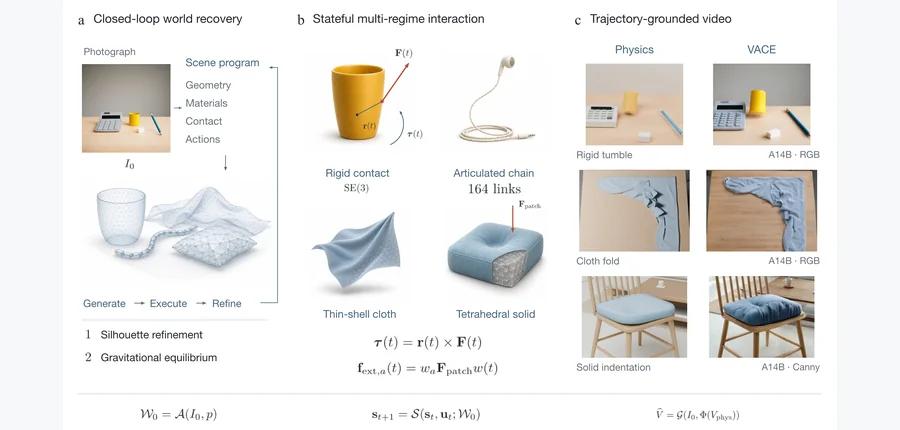 arXiv 2026-11-17 · cs.CV · #1 **[TelePhysica: Agentic Reconstruction of Physically Interactive Scenes](https://arxiv.org/abs/2611.18078)** [Ruiqi Shu , Xufeng Zhan , Yuanzhi Liang , Haibin Huang , Chi Zhang , Xuelong Li](https://arxiv.org/abs/2611.18078) 机构：China Telecom, Institute of Artificial Intelligence (TeleAI)（[PDF](https://arxiv.org/pdf/2611.18078)） [Paper](https://arxiv.org/abs/2611.18078) · [图源](https://arxiv.org/html/2611.18078v1/figures/fig1_teaser.png) 

中文摘要
直接的图像到视频扩散模型把像素合成与隐式潜在运动纠缠在一起，因而无法维持持久的三维力学平衡、在模拟过程中干预，或按反事实施力控制运动。另一方面，从未标定照片一次性编程重建三维场景时，单目深度和支撑间隙约束不足，重建场景可能互相穿透或在重力下坍塌。我们提出 TelePhysica：一个从单张照片闭环重建可执行、多种物理机制世界的框架，用于有状态的三维交互和以轨迹为依据的视频合成。视觉语言编程智能体在两阶段验证循环中生成可分离的视觉网格和声明式物理模型，分别通过像素对齐的轮廓检查和零外力重力平衡预检。验证后的世界被编译进统一求解器，耦合刚体、关节链、共维布料壳和三维四面体弹性动力学；仿真轨迹再经像素对齐结构流作为预训练视频扩散模型的条件。在包含 100 个场景的单图基准上，闭环执行把通过平衡验证的世界恢复率从单次合成的 0% 提高到 81%。受控本构消融表明，有限元布料相较匹配的刚性板代理，局部角点位移和面外褶皱大一个数量级以上。以仿真轨迹为视频扩散模型提供条件，使动态运动掩膜重合度提高 2–5 倍；在反事实施力方向反转时，仍能保持运动方向，而直接图像到视频模型未能做到。 <a href="https://arxiv.org/abs/2611.18078">原摘要来源</a>
 | 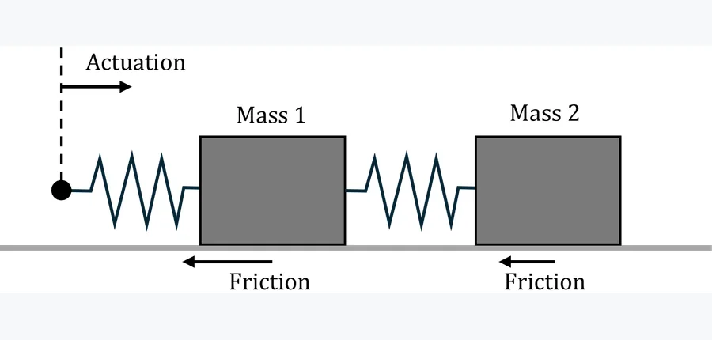 arXiv 2026-11-17 · cs.RO · #2 **[Modeling the Frictional Contact of Continuum Robots with Environments through Linear Complementarity Problem](https://arxiv.org/abs/2611.18546)** [Jia Shen , Junhyoung Ha , Yue Chen](https://arxiv.org/abs/2611.18546) 机构：Georgia Institute of Technology / Emory University / Ulsan National Institute of Science and Technology（[PDF](https://arxiv.org/pdf/2611.18546)） [Paper](https://arxiv.org/abs/2611.18546) · [图源](https://arxiv.org/html/2611.18546v1/images/fig_massSpring2.png) 

中文摘要
精确模拟连续体机器人与环境的摩擦，对运动控制和路径规划至关重要。然而，现有方法只预测机构内部摩擦，并将其限制在库仑摩擦锥边界力内，无法刻画静摩擦和运动滞后。本文在库仑摩擦假设下，提出基于互补约束的新摩擦模型。模型预测环境交互引起的静摩擦、滑动摩擦和滞后等效应，以及由这些交互造成的机器人形变；这些效应对连续体机器人的实际运动规划和控制很重要。该模型也可实时实现，以满足机器人应用的计算效率要求。实验表明，在一台长度为 287.9 mm 的腱驱动连续体机器人上，相比无摩擦模型，加入摩擦后模型的最大末端位置误差从 45.4 mm 降至 5.85 mm。 <a href="https://arxiv.org/abs/2611.18546">原摘要来源</a>
 | 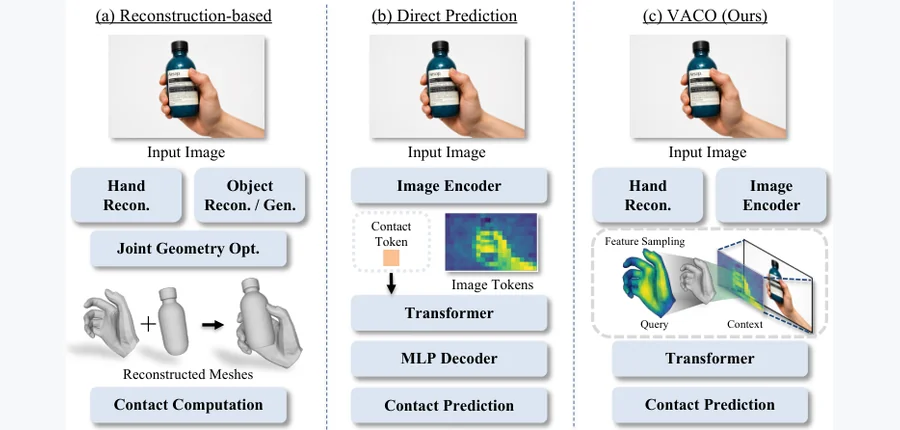 arXiv 2026-11-17 · cs.CV · #3 **[VACO: Vertex-Aligned Decoding for Dense Hand Contact Estimation from a Single Image](https://arxiv.org/abs/2611.17755)** [Binhong Ye , Jin-Chuan Shi , Tao Liu , Xin Wang , Hao Chen , Chunhua Shen](https://arxiv.org/abs/2611.17755) 机构：Zhejiang University / Zhejiang University of Technology（[PDF](https://arxiv.org/pdf/2611.17755)） [Paper](https://arxiv.org/abs/2611.17755) · [图源](https://arxiv.org/html/2611.17755v1/teaser.png) 

中文摘要
从单张 RGB 图像估计稠密手部接触，是灵巧操作和三维交互分析的基础能力。直接预测方法通常用一个共享查询解码整张逐顶点接触图，导致各顶点未在图像中单独定位，并把接触错误地扩散到相邻但未触碰的表面。我们提出 VACO 顶点对齐解码器，让每个 MANO 顶点在其投影位置采样局部图像特征。与接触任务联合训练的手部重建主干在推理时预测这些位置，无需辅助重建器。训练中使用加噪的真值投影和端到端特征适配，以提高鲁棒性及接触敏感特征的质量。单个 VACO 检查点在涵盖手物、手人、手场景和双手交互的五个基准上取得新的最佳结果。在 Hi4D 上，它比此前最强的直接预测器提高 20.7 个百分点 F1；对训练时未见的 HOT3D 和 HOCap 也能泛化，分别提高 5.5 和 2.7 个百分点。得到的接触预测还改善了下游 HOI 重建。 <a href="https://arxiv.org/abs/2611.17755">原摘要来源</a>
 |
| 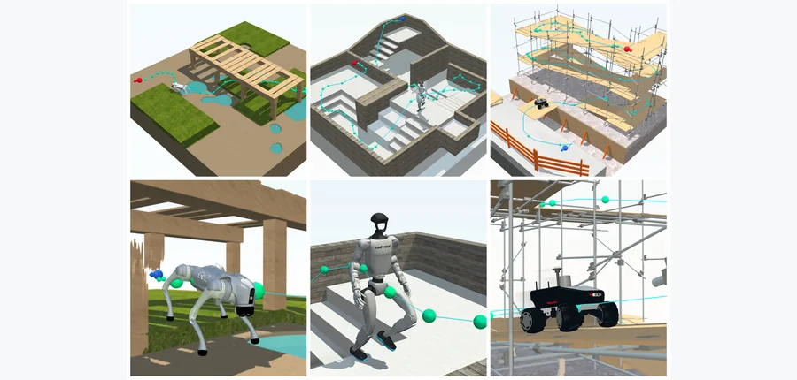 arXiv 2026-11-17 · cs.RO · #4 **[PoliMop: Policy-in-the-Loop Motion Planning in 3D Spaces for Mobile Robots](https://arxiv.org/abs/2611.18110)** [Yael Fassbind , Valentin N. Hartmann , Huang Su , Yijiang Huang , Stelian Coros](https://arxiv.org/abs/2611.18110) 机构：ETH Zurich（[PDF](https://arxiv.org/pdf/2611.18110)） [Paper](https://arxiv.org/abs/2611.18110) · [Project](https://ariael21.github.io/polimop.html) · [图源](https://arxiv.org/html/2611.18110v1/figure/optimized/teaser-12.jpg) 

中文摘要
机器人在复杂环境中到达目标状态，往往必须越过复杂地形和障碍。可通行路线取决于机器人的物理设计、所用控制策略，以及机器人如何改变周围环境。我们提出一种运动动力学约束的快速探索随机树（RRT）规划器：它利用物理仿真发挥控制策略中已有的技能，从而依据机器人自身能力寻找场景路径。规划器在场景周围的降维三维状态空间中采样，并通过策略滚动执行把 RRT 向采样点扩展。我们用简化质点模型预先规划的路径引导采样，使搜索集中到通往目标的有希望区域，规划时间最多降低 63%。四足、人形和轮式机器人的仿真实验表明，该方法可直接接入不同机器人及控制策略，在不改动底层规划算法的条件下利用它们的物理和策略能力。预先定义的环境改造，例如把木板架在沟壑上形成桥梁，也会随着机器人可达空间扩展而自动进入规划器的考虑范围。 <a href="https://arxiv.org/abs/2611.18110">原摘要来源</a>
 | 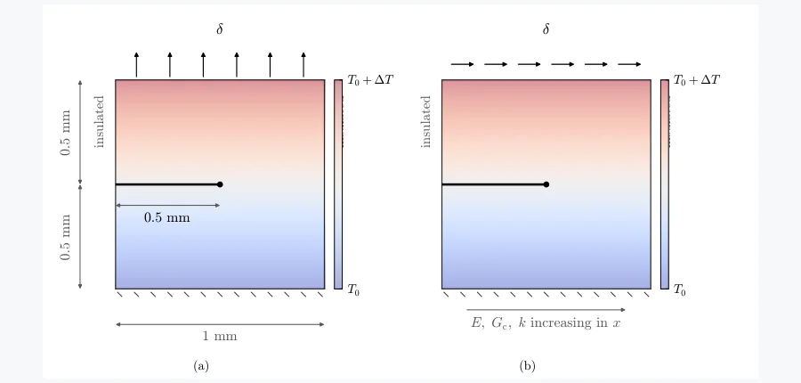 arXiv 2026-11-17 · cs.LG · #5 **[A mesh-free deep energy method for phase-field modeling of thermally driven brittle fracture](https://arxiv.org/abs/2611.17630)** [Han Zhang , Mehrisadat Makki Alamdari , Babak Shahbodagh , Mohammad Vahab , Cosmin Anitescu , Timon Rabczuk , Elena Atros… 机构：University of New South Wales / Central Queensland University / Bauhaus-Universität Weimar（[PDF](https://arxiv.org/pdf/2611.17630)） [Paper](https://arxiv.org/abs/2611.17630) · [图源](https://arxiv.org/html/2611.17630v1/geom_plates.png) 

中文摘要
热驱动断裂的相场仿真需要解析路径事先未知的局部裂纹带，以及厚度随瞬态过程变化的热边界层。此前基于神经能量的热断裂计算都从预先设置的缺陷出发。本文提出基于多分辨率神经表示的无网格深度能量法，在瞬态热载荷下预测自发裂纹萌生、裂纹间距，以及裂纹的选择性扩展和停止。两个具有各自多分辨率编码的网络分别表示位移与相场，以及瞬态温度；机械能和后向欧拉热方程的增量泛函在每次迭代重新抽取的积分点上估计。把不可逆性限制在裂纹集合、跨载荷步保留优化器状态并在每一步内衰减学习率，有助于避免虚假的损伤累积。在两个带缺口板上，起裂峰值载荷与独立有限元参考结果接近。在采用解析温度场淬冷的玻璃条上，裂纹路径从直线变为振荡再变为分叉，振荡阈值接近线性稳定性预测。在给定边界温度下，淬冷陶瓷板形成与实验观察同类的裂纹阵列，其间距接近已发表基准。对该板和淬冷环形体，预测阵列比相同材料场的有限元计算更密。方法不预先规定裂纹路径、萌生位置或适应裂纹的网格。 <a href="https://arxiv.org/abs/2611.17630">原摘要来源</a>
 | 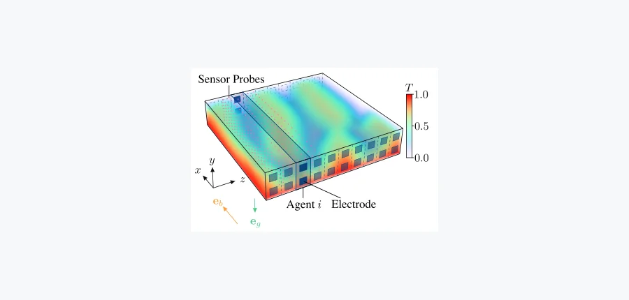 arXiv 2026-11-17 · cs.LG · #6 **[Sample-Efficient Control of Magnetoconvective Flows via Differentiable Simulation](https://arxiv.org/abs/2611.18008)** [Jannis Becktepe , Dmitry Krasnov , Nils Thuerey , Jörg Schumacher , Sebastian Peitz](https://arxiv.org/abs/2611.18008) 机构：TU Dortmund University / TU Ilmenau / TU Munich / Paderborn University（[PDF](https://arxiv.org/pdf/2611.18008)） [Paper](https://arxiv.org/abs/2611.18008) · [图源](https://arxiv.org/html/2611.18008v1/control_setup.png) 

中文摘要
磁流体动力学（MHD）流动对聚变包层冷却等工程应用很重要，流动控制有望优化传热等关键性质。机器学习推动了主动流动控制（AFC），但其在 MHD 流动中的应用仍少有探索。我们提出用于 AFC 的可微、GPU 加速 MHD 求解器 φ-PICT。我们以 MHD 基准验证 φ-PICT，并展示其较高的计算效率。集成到 FluidGym 后，φ-PICT 使样本高效的梯度方法将传热提高超过 25%，并使优化器在逆向设计中的精度达到黑箱方法的 10³ 倍。φ-PICT 已公开提供，链接见原论文页面。 <a href="https://arxiv.org/abs/2611.18008">原摘要来源</a>
 |
| 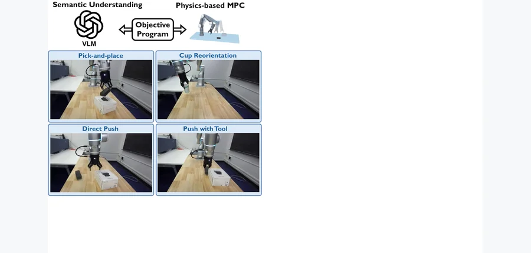 arXiv 2026-11-17 · cs.RO · #7 **[Objectives as Policies: Vision-Language Model Cost Programs for Contact-Rich Manipulation](https://arxiv.org/abs/2611.18298)** [Zihao Lu , Trong Gia Hung Nguyen , Fuquan Wang , Yifan Zhu](https://arxiv.org/abs/2611.18298) 机构：University of Illinois Chicago（[PDF](https://arxiv.org/pdf/2611.18298)） [Paper](https://arxiv.org/abs/2611.18298) · [Project](https://zihaolu001.github.io/oap-project/) · [图源](https://arxiv.org/html/2611.18298v1/star_figure.png) 

中文摘要
视觉语言模型（VLM）在三维环境中展现出较强的语义和空间推理能力。近期，把 VLM 与模型预测控制器（MPC）连接，成为结合语义推理与基于物理的规划的一种方式。但在接触丰富的机器人操作中，两者之间仍需要一种能表示物理交互、供 VLM 推理的任务表达。我们提出 Objectives as Policies（OaP），通过可编辑的目标程序，把预训练 VLM 连接到共享的采样式 MPC。每个程序规定完成任务的一系列阶段，结合代价库中的运行代价、终端代价及阶段完成条件。给定自然语言任务和场景观测，我们通过真实到仿真构建数字孪生；VLM 生成目标程序，由 MPC 在仿真中执行。VLM 根据 MPC 的滚动轨迹迭代更新程序，然后部署到真实世界。我们在四个桌面操作任务的仿真和真实实验中评估该框架，结果优于所比较的强基线。项目网站提供额外视频和示例。 <a href="https://arxiv.org/abs/2611.18298">原摘要来源</a>
 | 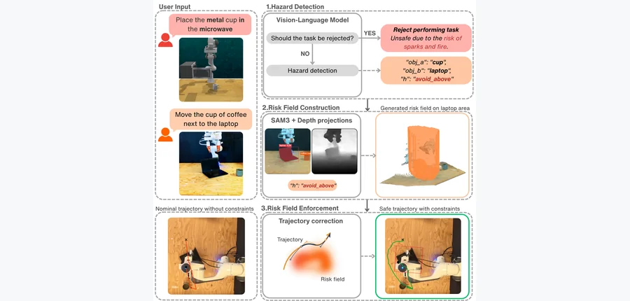 arXiv 2026-11-17 · cs.RO · #8 **[Grounding Object-to-Object Hazard Reasoning into 3D Risk Fields for Task-Conditioned Safety](https://arxiv.org/abs/2611.17566)** [Mariana Sosa Guzmán , Yide Song , Amin Abyaneh , Gregory Dudek , Hsiu-Chin Lin](https://arxiv.org/abs/2611.17566) 机构：McGill University（[PDF](https://arxiv.org/pdf/2611.17566)） [Paper](https://arxiv.org/abs/2611.17566) · [Project](https://vlm-hazard-riskfield.github.io/) · [图源](https://arxiv.org/html/2611.17566v1/figures-tables/ICRA2026-VLM_hazard_detection_1.png) 

中文摘要
机器人安全不仅依赖几何约束，也依赖任务、环境属性和场景中物体交互的语义。我们提出基于视觉语言模型（VLM）的框架，为机器人操作推断依任务和场景而变的安全约束。给定 RGB-D 观测与自然语言任务指令，VLM 使用结构化安全工具，先判断任务是否因可能造成不可恢复的危险后果而应被拒绝；否则识别可预防的物体对危险，并指定必须避免的空间关系。随后，开放词汇分割与深度信息把相关物体定位到三维空间，构造表示危险区域的连续风险场。风险场与避障模块结合，在执行时考虑风险并修正名义机器人运动。我们在仿真和真实世界中评估可预防危险、需要拒绝的任务及其安全变体。项目网站见原论文页面。 <a href="https://arxiv.org/abs/2611.17566">原摘要来源</a>
 | 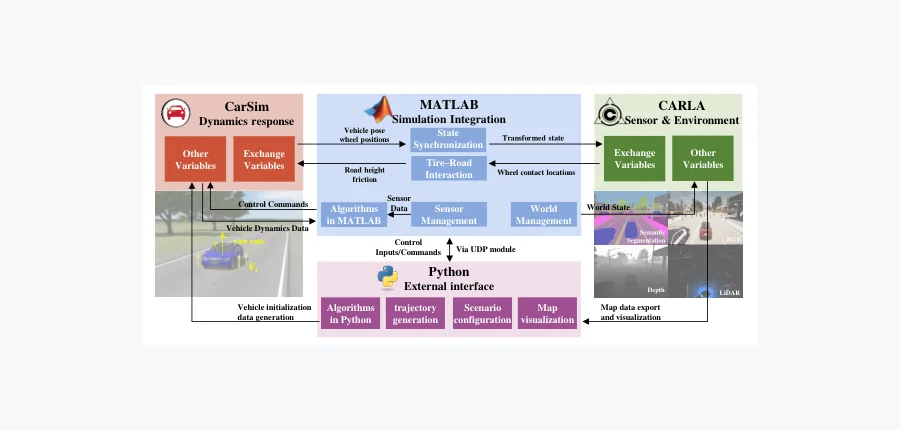 arXiv 2026-11-17 · cs.RO · #9 **[EViDS: An Environment--Vehicle Dynamics Integrated Simulation Platform for Intelligent Chassis Development](https://arxiv.org/abs/2611.17660)** [Lu Xiong , Yiming Zhou , Xuge Hu , Yi Zhang , Haoran Lv , Chen Tang](https://arxiv.org/abs/2611.17660) 机构：Tongji University（[PDF](https://arxiv.org/pdf/2611.17660)） [Paper](https://arxiv.org/abs/2611.17660) · [图源](https://arxiv.org/html/2611.17660v1/Architecture.png) 

中文摘要
智能底盘的发展日益需要把环境与感知信息和高保真车辆动力学结合，以支持感知环境的底盘控制。然而，现有自动驾驶模拟器与专业车辆动力学工具通常面向不同目的，难以统一环境信息、车辆动力学和底盘算法。本文提出面向智能底盘开发的环境—车辆动力学一体化仿真平台 EViDS。EViDS 将基于 CARLA 的环境和传感器仿真与基于 CarSim 的高保真车辆动力学结合。基于参考位姿的状态对齐及多速率交互维持空间和时间一致性；基于射线投射的轮胎—路面交互将环境信息传给车辆动力学模型。场景配置、同步数据采集和算法接口进一步支持底盘开发。平台通过环境—动力学交互测试、车辆动力学一致性比较和智能底盘应用接受评估。结果表明，EViDS 保留车辆动力学特性，可靠地传递环境信息，并支持在线闭环底盘控制，为面向环境的智能底盘开发和验证提供统一仿真基础。 <a href="https://arxiv.org/abs/2611.17660">原摘要来源</a>
 |
| 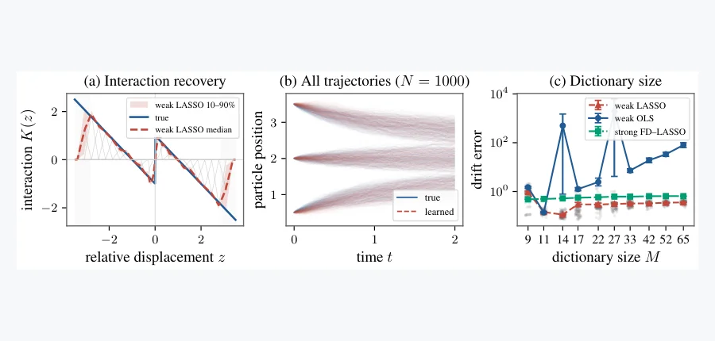 arXiv 2026-11-17 · stat.ML · #10 **[Mesh-Free Weak-Form Regression for Learning Interaction Kernels from Particle Trajectories](https://arxiv.org/abs/2611.18455)** [Daisuke Inoue , Dante Kalise](https://arxiv.org/abs/2611.18455) 机构：Imperial College London（[PDF](https://arxiv.org/pdf/2611.18455)） [Paper](https://arxiv.org/abs/2611.18455) · [图源](https://arxiv.org/html/2611.18455v1/one_dimensional_hat_practical.png) 

中文摘要
我们提出无网格弱形式回归，从含噪粒子轨迹学习交互核。方法用平滑测试函数避免对噪声数据求导，用粒子经验平均避免密度重建和空间网格。随后，我们拟合候选函数的稀疏组合，并只在抽样粒子对上计算交互项，避免所有粒子对带来的二次复杂度。通过把可辨识性从平均场极限迁移过来，我们证明了高概率系数误差界，分别刻画有限粒子数、时间离散、观测噪声和粒子对采样误差，而不包含网格分辨率或密度估计项。我们在一维牛顿排斥、二维捕食者—猎物和十维距离局域化实验中评估。数值结果的趋势与理论系数误差界一致。把弱形式与前向差分形式分别结合 LASSO、Ridge 和 OLS 比较后，弱形式 LASSO 在三个标称实验中的系数误差和漂移误差最小。 <a href="https://arxiv.org/abs/2611.18455">原摘要来源</a>
 | 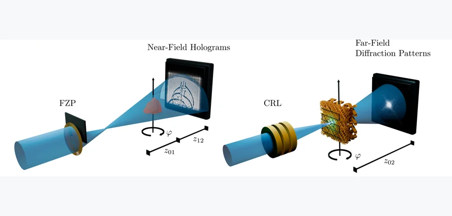 arXiv 2026-11-17 · eess.IV · #11 **[BeST: Beta splatted tomography for direct reconstruction from coherent imaging measurements](https://arxiv.org/abs/2611.17982)** [Johannes Gruen , Philipp Paetzold , Andreas Schropp , Aknur Karabay , Shahin Sepanlou , Sebastian Eberle , Martin Seyrich… 机构：DESY / Paul Scherrer Institute / EPFL / University of Siegen / Helmholtz-Zentrum Hereon（[PDF](https://arxiv.org/pdf/2611.17982)） [Paper](https://arxiv.org/abs/2611.17982) · [图源](https://arxiv.org/html/2611.17982v1/figures/experimental_sketch.png) 

中文摘要
传统相干 X 射线断层成像要求高保真重建每个投影的相位，但单个投影的重建可能因定位误差等因素出错，导致断层重建彼此不一致。直接耦合相位恢复与断层成像，可借助共同的物体体积施加一致性约束，但重建完整体积需要大量算力。为降低这一需求，我们提出 Beta Splatted Tomography（BeST）：用具有紧支撑且投影可解析求得的 beta 基元表示共同物体体积，从相干散射图像直接高效重建。相较体素网格，这种表示大幅减少可优化参数。我们在硬 X 射线近场全息和远场叠层相干衍射成像的实验数据集上展示 BeST；两种情况下，联合方法的重建质量均优于分两步处理的方法。 <a href="https://arxiv.org/abs/2611.17982">原摘要来源</a>
 | 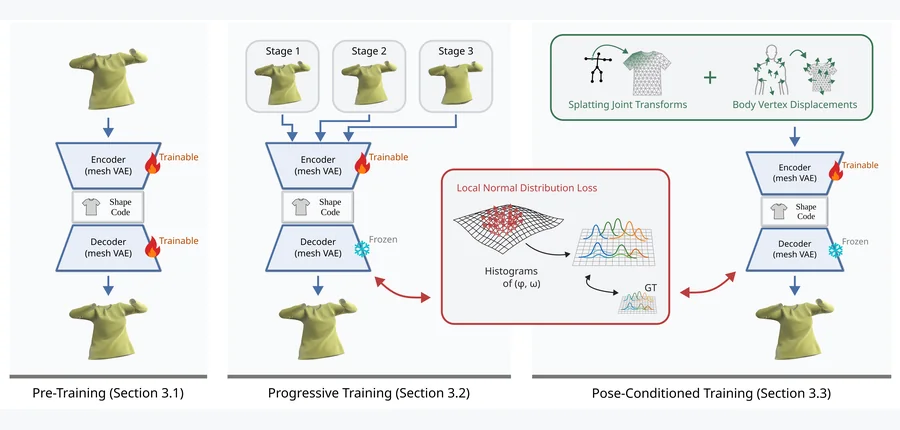 arXiv 2026-11-17 · cs.GR · #12 **[Pose-based Neural Clothing for Animated Characters](https://arxiv.org/abs/2611.18253)** [Julian N. Heidenreich , Vinicius C. Azevedo , Jakob Buhmann , Lento Manickathan , Arnold Moon , Paul Kanyuk , Amit H. Ber… 机构：Disney Research Studios / ETH Zürich / Pixar Animation Studios（[PDF](https://arxiv.org/pdf/2611.18253)） [Paper](https://arxiv.org/abs/2611.18253) · [图源](https://arxiv.org/html/2611.18253v1/figures/overview_image_v2.png) 

中文摘要
传统动画角色服装仿真速度慢、参数调整繁琐，是艺术家工作流程中的耗时瓶颈。近期数据驱动方法可从仿真数据学习高质量形变，轻量网络还可达到实时推理速度，使艺术家能在摆姿态时即时查看褶皱和垂坠效果，并提前作创作决定。然而，现有神经服装方法虽在 SMPL 等写实人体数据集上效果良好，在动画角色数据集上训练时却难以泛化到未见姿态。本文设计神经网络与训练策略，改善未见姿态下的实时泛化，以支持交互式摆姿态应用。我们聚焦面向生产的准静态设定：每件服装单独训练一个模型。技术上，我们先训练变分自编码器（VAE）以获得平滑而富表达力的潜在空间，再逐步训练 VAE 编码器，使其从重建过渡到姿态驱动预测。预测同时以低维姿态参数和角色身体表面位移为条件。最后，我们提出局部梯度直方图损失，减轻重建损失造成的过度平滑。在生产级资产和公开数据集上的广泛评估表明，该方法以实时速度生成清晰、逼真的褶皱、平滑的大尺度垂坠和时间连贯的结果，适合整合进交互式摆姿态流程。 <a href="https://arxiv.org/abs/2611.18253">原摘要来源</a>
 |
| 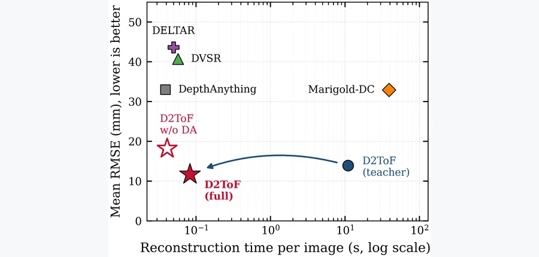 arXiv 2026-11-17 · eess.IV · #13 **[D2ToF: One-Step Diffusion for Depth Super-Resolution from Lightweight Single-Photon LiDAR Waveforms](https://arxiv.org/abs/2611.18243)** [Pallabjyoti Deka , Lewis Wilson , Stephen McLaughlin , Jonathan Leach , Abderrahim Halimi](https://arxiv.org/abs/2611.18243) 机构：Heriot-Watt University（[PDF](https://arxiv.org/pdf/2611.18243)） [Paper](https://arxiv.org/abs/2611.18243) · [图源](https://arxiv.org/html/2611.18243v1/figures/speed_quality.png) 

中文摘要
单光子 LiDAR（SPL）传感器具有很高的时间分辨率和单光子灵敏度，但低成本 SPL 阵列的空间分辨率通常极低，例如只有 8×8 像素，限制了实际用途。本文提出一步式超分辨率框架 D2ToF（Distilled Diffusion for Time-of-Flight），兼顾高保真生成建模与实时执行。方法采用摊销变分蒸馏，将基于测量的数据一致性项直接纳入一步训练目标，促使合成的高分辨率深度图与采集的低分辨率飞行时间（ToF）直方图一致。为应对从极度退化输入上采样的严重不适定性，我们提出多模态引导策略：利用基础单目深度模型从高分辨率反射率图像提取结构先验，并以 ToF 直方图、反射率图和相对深度估计共同引导网络。实验结果优于所评估基线，实现 16 倍空间超分辨率，从 8×8×100 直方图生成 128×128 深度图，推理时间约 83 毫秒。 <a href="https://arxiv.org/abs/2611.18243">原摘要来源</a>
 | 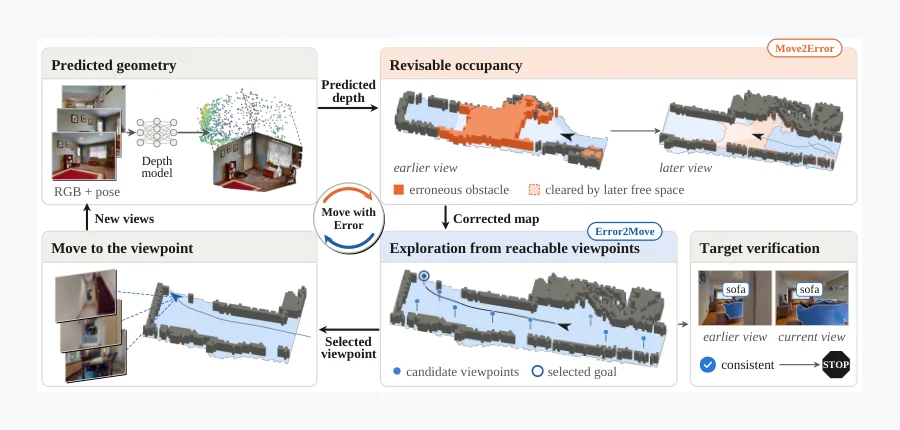 arXiv 2026-11-17 · cs.RO · #14 **[ERA: Error-Resistant Autonomous Object Navigation with Predicted Depth](https://arxiv.org/abs/2611.17730)** [Shunyang Huang , Shuo Wang , Wenyuan Xie , Mingyu Lin , Yue Ding , Hongtao Lu](https://arxiv.org/abs/2611.17730) 机构：Shanghai Jiao Tong University / Tsinghua University（[PDF](https://arxiv.org/pdf/2611.17730)） [Paper](https://arxiv.org/abs/2611.17730) · [图源](https://arxiv.org/html/2611.17730v1/overview_v4_draft.png) 

中文摘要
深度与三维基础模型可从 RGB 图像预测几何，使机器人在没有深度传感器时也能零样本导航到目标物体。但若把预测深度当作传感器测量直接制图，随视角变化的误差会在地图中累积，抹去探索目标，使智能体在能够观测并修正错误前终止搜索。我们提出免训练物体导航系统 ERA，用 RGB 图像和位姿预测的深度取代深度传感器。ERA 遵循“带着错误移动”的范式：移动提供新视角来纠正地图错误，修正后的地图又支持继续移动。它通过可修订的占据表示和从可达视点展开探索实现这一点：当前沿消失后仍继续搜索，停止前跨视角核验目标。在三个基准上，ERA 在无深度传感器的免训练方法中达到最佳表现。在同样使用预测深度时，其地图和探索组件还将 VLFM 的成功率从 10.8% 提高到 61.7%。我们进一步在真实机器人上部署 ERA。 <a href="https://arxiv.org/abs/2611.17730">原摘要来源</a>
 | 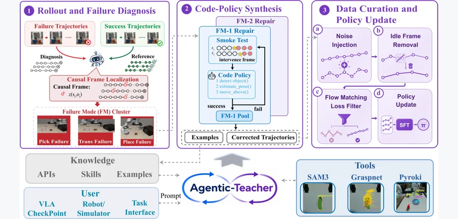 arXiv 2026-11-17 · cs.RO · #15 **[Agentic-Teacher: An Agentic Data Engine for Failure-Driven VLA Post-Training](https://arxiv.org/abs/2611.17394)** [Gongyue Teng , Yuqing Xie , Yixian Zhang , Feng Gao , Shu'ang Yu , Jiaji Rao , Sukai Wang , Guanghui Ren , Ya Zhang , Mao… 机构：Tsinghua University / Striding AI / AGIBot（[PDF](https://arxiv.org/pdf/2611.17394)） [Paper](https://arxiv.org/abs/2611.17394) · [图源](https://arxiv.org/html/2611.17394v1/Agentic-Teacher_overview.png) 

中文摘要
改进预训练视觉语言动作（VLA）模型，需要能针对其弱点并提供有效监督的示范。编程智能体可通过环境交互自动生成示范，但成功执行本身不保证这些数据有助于 VLA 学习。我们提出 Agentic-Teacher，一个用于失败驱动 VLA 后训练的自动数据引擎。给定 VLA 检查点、任务规范和配置好的环境工具，引擎分析失败轨迹、选择干预状态，并借助执行反馈迭代开发闭环代码策略。通过验证的策略成为可复用的示范生成器，从 VLA 薄弱状态收集成功后续轨迹。为了让这些示范适于学习，Agentic-Teacher 引入时间相关动作噪声拓宽状态—动作覆盖，删除空闲帧同时保留夹爪状态转变，并用冻结基座模型的流匹配损失筛选轨迹。所得示范与成功的 VLA 轨迹结合进行后训练，更新后的策略在没有编程智能体辅助时运行。Agentic-Teacher 因而把目标 VLA 的弱点与训练数据的生成、筛选连接起来。在仿真中，它将 π₀ 在 LIBERO-10 上的成功率从 79.4% 提高到 87.8%，在 MetaWorld-10 上从 80.4% 提高到 90.6%，在三个 RoboCasa 任务上的成功率从 0% 提高到 30.0%。 <a href="https://arxiv.org/abs/2611.17394">原摘要来源</a>
 |
| 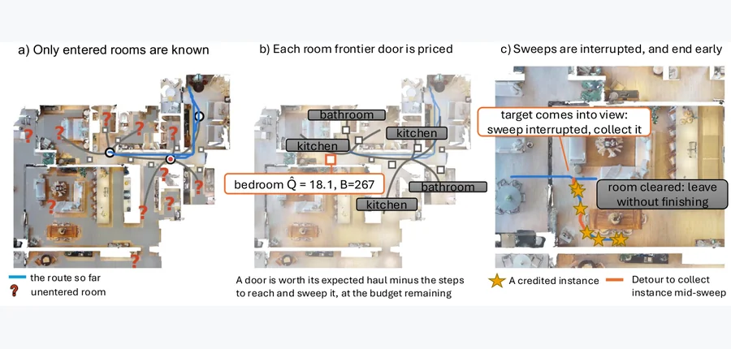 arXiv 2026-11-17 · cs.RO · #16 **[Racing the Clock: Teaching VLNs Budget-Conditioned Object Search](https://arxiv.org/abs/2611.17442)** [Maitree Meher , Siming He , S. Shankar Sastry , Jitendra Malik , Claire Tomlin , Jonas Frey](https://arxiv.org/abs/2611.1… 机构：University of California, Berkeley / Stanford University（[PDF](https://arxiv.org/pdf/2611.17442)） [Paper](https://arxiv.org/abs/2611.17442) · [图源](https://arxiv.org/html/2611.17442v1/fig_mechanism_p14_annot.png) 

中文摘要
一个进入建筑物的救援机器人，如果只剩三十秒，应冲向最有希望的房间；若有十分钟，则应探索更广的路线。然而，视觉语言导航（VLN）模型通常在固定回合上限下评估，策略却不知道该上限，难以按时间预算调整行为。我们研究预算条件化的物体搜索：给定目标类别和明确动作预算，智能体须在预算耗尽前找到尽可能多的不同目标实例。我们比较两种监督 VLN 的专家：掌握完整地图和真实目标位置、规划近最优路线的特权 TSP 专家，以及在部分可观测条件下利用跨场景高层语义先验最大化期望回报的房间级 Bellman 专家。尽管 TSP 专家的自身表现明显更强，其示范对学习探索却较差：在未见 HM3D 场景中，Bellman 监督的 VLN 一直优于 TSP 监督模型，且预算越长优势越明显。在 2,000 步（500 m）时，它找到 71.4% 的可达目标实例，而 TSP 监督模型为 65.5%，预训练 VLN 为 44.8%。结果强调最优路线与最优探索的区别：有效的探索监督应优化部分可观测条件下的决策，而不是模仿只有完全了解环境后才最优的路线。 <a href="https://arxiv.org/abs/2611.17442">原摘要来源</a>
 | 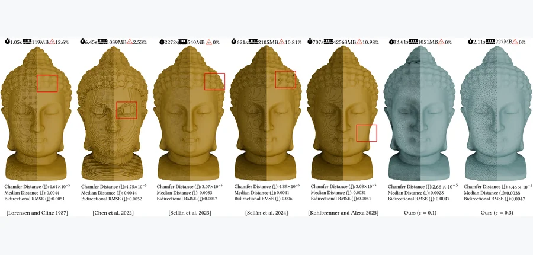 arXiv 2026-11-17 · cs.GR · #17 **[FOMOS: Feature-Oriented Meshing of SDFs](https://arxiv.org/abs/2611.17458)** [Stefan Ohrhallinger , Amal Dev Parakkat](https://arxiv.org/abs/2611.17458) 机构：TU Wien / Télécom Paris, Institut Polytechnique de Paris（[PDF](https://arxiv.org/pdf/2611.17458)） [Paper](https://arxiv.org/abs/2611.17458) · [图源](https://arxiv.org/html/2611.17458v1/SA26Teaser.png) 

中文摘要
我们提出 FOMOS，一种面向特征的有符号距离函数（SDF）纯几何网格化方法，解决现有最先进方法的多项难题。算法改善网格质量和运行时间，使 SDF 网格化可在数秒内完成。Marching Cubes 和 Neural Dual Contouring 等方法要么生成密集但低质量的三角网格，要么以稀疏性换取细节，且常需谨慎选择参数；FOMOS 只有一个参数，利用特征尺度采样，按局部特征尺度（LFS）动态调整网格分辨率。LFS 通过采样中轴骨架高效计算，既考虑曲率，也考虑形状厚度，并通过非局部结构捕捉大尺度特征，从而省去许多冗余小三角形。广泛比较展示了 FOMOS 在运行时间、重建精度和输出三角形质量上的优势。我们还提出面向巨大稀疏输入（10k³）的轻量版本；据我们所知，除 Marching Cubes 外，现有方法均无法处理这一规模。我们进一步展示 FOMOS 可用子采样中轴骨架即时预览，并可使体积仿真加速数个数量级。 <a href="https://arxiv.org/abs/2611.17458">原摘要来源</a>
 | 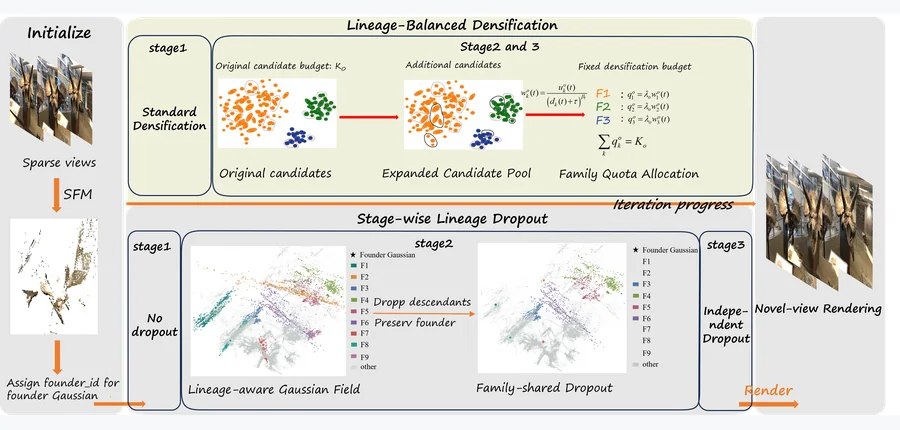 arXiv 2026-11-17 · cs.CV · #18 **[Stage-wise Lineage-aware Dropout for Sparse-View 3D Gaussian Splatting](https://arxiv.org/abs/2611.17752)** [Yan Xing , Zhi Chen , Fanglue Zhang , Junhong Zhao , Bing Xue , Mengjie Zhang](https://arxiv.org/abs/2611.17752) 机构：Hefei University of Technology / Victoria University of Wellington / University of New South Wales（[PDF](https://arxiv.org/pdf/2611.17752)） [Paper](https://arxiv.org/abs/2611.17752) · [图源](https://arxiv.org/html/2611.17752v1/3.1.png) 

中文摘要
稀疏视角三维 Gaussian Splatting（3DGS）容易过拟合，因为有限图像无法充分约束场景几何。Dropout 是缓解过拟合的一种正则化手段。我们引入谱系家族概念，描述从同一创始 Gaussian 经克隆或分裂产生的一组基元；创始 Gaussian 是初始化时生成的全部基元。同一家族的后代往往共同细化邻近局部区域，因此单独丢弃 Gaussian 时，邻近基元的补偿作用会削弱效果。为此，我们提出分阶段谱系感知 Dropout（SLD）：在结构正则化阶段按家族丢弃，在后期细化阶段切换为逐个丢弃。我们还提出谱系均衡致密化（LBD）：在致密化时扩展候选池，并根据各家族的平均梯度得分和已有后代数量重新分配致密化预算。LLFF、MipNeRF360 和 Blender 数据集上的实验显示，该框架在稀疏视角重建中取得有竞争力的表现。 <a href="https://arxiv.org/abs/2611.17752">原摘要来源</a>
 |
| 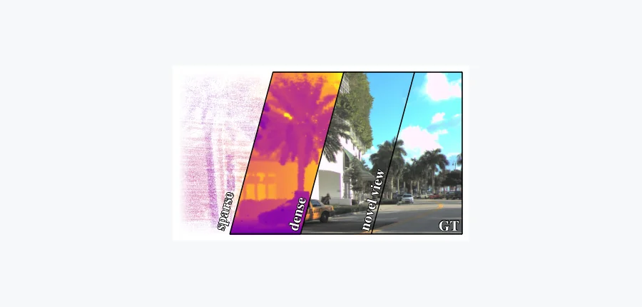 arXiv 2026-11-17 · cs.CV · #19 **[DIRT: Depth-completed Image-based Rendering using Two-band Blending for Live Novel-view Synthesis](https://arxiv.org/abs/2611.18340)** [Mathias Harrer , Laura Fink , Noah Lewis , Paul Himmler , Tim Weyrich](https://arxiv.org/abs/2611.18340) 机构：Friedrich-Alexander-Universität Erlangen-Nürnberg（[PDF](https://arxiv.org/pdf/2611.18340)） [Paper](https://arxiv.org/abs/2611.18340) · [图源](https://arxiv.org/html/2611.18340v1/paper_fig0.png) 

中文摘要
先进的新视角合成（NVS）方法通常需要先针对每个场景优化，限制了实时使用。实时或临时场景 NVS 要求采集期间低延迟渲染，并能泛化到新场景。部分先前方法改造训练和优化式模型，以质量换取低延迟。我们提出一种沿用传统图像渲染的实时 NVS 方法，输入是带位姿的深度传感器观测和图像。方法利用主动传感器产生的显式稀疏点几何，得到稀疏填充的深度缓冲区，再在新目标视角的屏幕空间补全它。借助这一代理，带位姿的图像被投影到目标帧，并通过感知频率的双频带混合策略融合。整个流程无神经网络且无需优化，不要求训练数据或场景专属优化，因此缩短采集到新视角渲染的延迟，也不依赖网络的有利泛化。我们验证了手持 RGB-D 相机、车载 LiDAR、热成像相机等异构传感器，以及低光照采集等困难场景。实验表明，该方法在实时重建场景中优于此前方法，并在常规 NVS 基准上保持有竞争力的表现。 <a href="https://arxiv.org/abs/2611.18340">原摘要来源</a>
 | 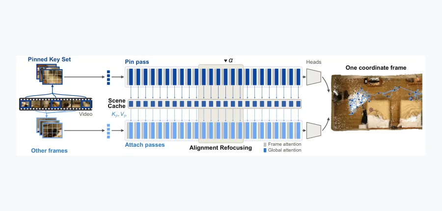 arXiv 2026-11-17 · cs.CV · #20 **[EcoVGGT: Pinned-Key Inference for Efficient and Streamable Feed-Forward 3D Reconstruction from Long Videos](https://arxiv.org/abs/2611.18099)** [Hongsen Cao , Shanxin Yuan , Mona Jaber , Ahmed Sayed](https://arxiv.org/abs/2611.18099) 机构：Queen Mary University of London（[PDF](https://arxiv.org/pdf/2611.18099)） [Paper](https://arxiv.org/abs/2611.18099) · [图源](https://arxiv.org/html/2611.18099v1/fig_pipeline.png) 

中文摘要
VGGT 等前馈多视角 Transformer 可一次性恢复视频的相机与几何，但跨帧注意力成本随帧数平方增长，长视频上的精度也会下降。已有改进多在预算内近似所有帧的注意力，或按内容选择少数键帧。我们假设长视频的键帧可不看内容而选定；VGGT 和 π³ 上的实验支持这一假设：均匀分布的几十帧可作为每一帧的键。我们提出免训练推理框架 EcoVGGT，其固定键集合包含 31 帧。固定帧处理阶段把它们的 token 存入场景缓存，其他帧以独立批次读取缓存，在每帧恒定成本下精确复现使用这些键时的联合推理。在线流在录制时更新固定帧。六个中间全局模块负责帧对齐，并构成可复用的 VGGT 模块：Alignment Score 从其注意力识别失败，Alignment Refocusing 仅微调这些模块（3.6 GPU 小时）来减少失败。在 1,000 帧 ScanNet 视频上，EcoVGGT（π³）以 13.8 倍速度达到 π³ 相同的成功率。加入重聚焦后，在 500 帧视频上，EcoVGGT（VGGT）以 8.5 倍速度将 VGGT 成功率从 70% 提高到 82%。EcoVGGT 可在一块 GPU 上重建 4,000 帧；EcoVGGT（π³）以每秒 18.6 帧流式处理 1,000 帧，并取得最低的在线绝对轨迹误差。 <a href="https://arxiv.org/abs/2611.18099">原摘要来源</a>
 |   |
<!-- PAPER_CARDS_END -->

## 检索概况

- **检索窗口**：北京时间 2026-11-16 09:00 至 2026-11-17 09:10；直接下载并解析 14 个 arXiv 官方 New 分类页。
- **官方批次**：[Monday, 16 November 2026](https://arxiv.org/list/cs.CV/new?show=2000)，14 页一致。主榜只含 `New submissions`，按 arXiv ID 去重。
- **总命中／去重／本轮入选**：545 条／545 个 ID／20 篇；并非按关键词直接收录，逐篇检查标题和摘要。
- **范围与排序**：先列 3D 与物理、接触、仿真交叉，再列具体机器人任务，最后列基础三维几何与重建。相关性、机构强度、局限及改进建议均为编辑推断；机构名称据 PDF 首页核对，机构强度未独立评级。
- **来源差异**：第 16 篇 arXiv 页面摘要给出 71.4%，PDF 首页摘要给出 72.7%；卡片忠实翻译所链接的 arXiv 页面摘要。

## 官方 New listing 状态

| 分类页 | 最新 listing 日期 | New |
|---|---|---:|
| [cond-mat](https://arxiv.org/list/cond-mat/new?show=2000) | 2026-11-16 | 80 |
| [cs.AI](https://arxiv.org/list/cs.AI/new?show=2000) | 2026-11-16 | 82 |
| [cs.CV](https://arxiv.org/list/cs.CV/new?show=2000) | 2026-11-16 | 72 |
| [cs.GR](https://arxiv.org/list/cs.GR/new?show=2000) | 2026-11-16 | 3 |
| [cs.LG](https://arxiv.org/list/cs.LG/new?show=2000) | 2026-11-16 | 78 |
| [cs.RO](https://arxiv.org/list/cs.RO/new?show=2000) | 2026-11-16 | 37 |
| [eess.IV](https://arxiv.org/list/eess.IV/new?show=2000) | 2026-11-16 | 7 |
| [eess.SP](https://arxiv.org/list/eess.SP/new?show=2000) | 2026-11-16 | 14 |
| [eess.SY](https://arxiv.org/list/eess.SY/new?show=2000) | 2026-11-16 | 35 |
| [math.DS](https://arxiv.org/list/math.DS/new?show=2000) | 2026-11-16 | 6 |
| [math.NA](https://arxiv.org/list/math.NA/new?show=2000) | 2026-11-16 | 12 |
| [math.OC](https://arxiv.org/list/math.OC/new?show=2000) | 2026-11-16 | 28 |
| [physics](https://arxiv.org/list/physics/new?show=2000) | 2026-11-16 | 78 |
| [stat.ML](https://arxiv.org/list/stat.ML/new?show=2000) | 2026-11-16 | 13 |
| **合计（原始记录）** | — | **545** |

## Top papers

| # | 论文 | 分类 | 作者 | 机构（PDF 首页） | 相关性（推断） | 机构强度（推断） | 阅读 |
|---:|---|---|---|---|---|---|---|
| 1 | [TelePhysica: Agentic Reconstruction of Physically Interactive Scenes](https://arxiv.org/abs/2611.18078) | [cs.CV](https://arxiv.org/abs/2611.18078) | [Ruiqi Shu , Xufeng Zhan , Yuanzhi Liang , Haibin Huang , Chi Zhang , Xuelong Li](https://arxiv.org/abs/2611.18078) | China Telecom, Institute of Artificial Intelligence (TeleAI)（[PDF](https://arxiv.org/pdf/2611.18078)） | 高：3D×物理或接触 | 未独立评级 | A |
| 2 | [Modeling the Frictional Contact of Continuum Robots with Environments through Linear Complementarity Problem](https://arxiv.org/abs/2611.18546) | [cs.RO](https://arxiv.org/abs/2611.18546) | [Jia Shen , Junhyoung Ha , Yue Chen](https://arxiv.org/abs/2611.18546) | Georgia Institute of Technology / Emory University / Ulsan National Institute of Science and Technology（[PDF](https://arxiv.org/pdf/2611.18546)） | 高：3D×物理或接触 | 未独立评级 | A |
| 3 | [VACO: Vertex-Aligned Decoding for Dense Hand Contact Estimation from a Single Image](https://arxiv.org/abs/2611.17755) | [cs.CV](https://arxiv.org/abs/2611.17755) | [Binhong Ye , Jin-Chuan Shi , Tao Liu , Xin Wang , Hao Chen , Chunhua Shen](https://arxiv.org/abs/2611.17755) | Zhejiang University / Zhejiang University of Technology（[PDF](https://arxiv.org/pdf/2611.17755)） | 高：3D×物理或接触 | 未独立评级 | A |
| 4 | [PoliMop: Policy-in-the-Loop Motion Planning in 3D Spaces for Mobile Robots](https://arxiv.org/abs/2611.18110) | [cs.RO](https://arxiv.org/abs/2611.18110) | [Yael Fassbind , Valentin N. Hartmann , Huang Su , Yijiang Huang , Stelian Coros](https://arxiv.org/abs/2611.18110) | ETH Zurich（[PDF](https://arxiv.org/pdf/2611.18110)） | 高：3D×物理或接触 | 未独立评级 | A |
| 5 | [A mesh-free deep energy method for phase-field modeling of thermally driven brittle fracture](https://arxiv.org/abs/2611.17630) | [cs.LG](https://arxiv.org/abs/2611.17630) | [Han Zhang , Mehrisadat Makki Alamdari , Babak Shahbodagh , Mohammad Vahab , Cosmin Anitescu , Timon Rabczuk , Elena Atroshchenko](https://arxiv.org/abs/2611.17630) | University of New South Wales / Central Queensland University / Bauhaus-Universität Weimar（[PDF](https://arxiv.org/pdf/2611.17630)） | 高：3D×物理或接触 | 未独立评级 | A |
| 6 | [Sample-Efficient Control of Magnetoconvective Flows via Differentiable Simulation](https://arxiv.org/abs/2611.18008) | [cs.LG](https://arxiv.org/abs/2611.18008) | [Jannis Becktepe , Dmitry Krasnov , Nils Thuerey , Jörg Schumacher , Sebastian Peitz](https://arxiv.org/abs/2611.18008) | TU Dortmund University / TU Ilmenau / TU Munich / Paderborn University（[PDF](https://arxiv.org/pdf/2611.18008)） | 高：3D×物理或接触 | 未独立评级 | A |
| 7 | [Objectives as Policies: Vision-Language Model Cost Programs for Contact-Rich Manipulation](https://arxiv.org/abs/2611.18298) | [cs.RO](https://arxiv.org/abs/2611.18298) | [Zihao Lu , Trong Gia Hung Nguyen , Fuquan Wang , Yifan Zhu](https://arxiv.org/abs/2611.18298) | University of Illinois Chicago（[PDF](https://arxiv.org/pdf/2611.18298)） | 高：3D×物理或接触 | 未独立评级 | A |
| 8 | [Grounding Object-to-Object Hazard Reasoning into 3D Risk Fields for Task-Conditioned Safety](https://arxiv.org/abs/2611.17566) | [cs.RO](https://arxiv.org/abs/2611.17566) | [Mariana Sosa Guzmán , Yide Song , Amin Abyaneh , Gregory Dudek , Hsiu-Chin Lin](https://arxiv.org/abs/2611.17566) | McGill University（[PDF](https://arxiv.org/pdf/2611.17566)） | 高：3D×物理或接触 | 未独立评级 | A |
| 9 | [EViDS: An Environment--Vehicle Dynamics Integrated Simulation Platform for Intelligent Chassis Development](https://arxiv.org/abs/2611.17660) | [cs.RO](https://arxiv.org/abs/2611.17660) | [Lu Xiong , Yiming Zhou , Xuge Hu , Yi Zhang , Haoran Lv , Chen Tang](https://arxiv.org/abs/2611.17660) | Tongji University（[PDF](https://arxiv.org/pdf/2611.17660)） | 高：3D×物理或接触 | 未独立评级 | A |
| 10 | [Mesh-Free Weak-Form Regression for Learning Interaction Kernels from Particle Trajectories](https://arxiv.org/abs/2611.18455) | [stat.ML](https://arxiv.org/abs/2611.18455) | [Daisuke Inoue , Dante Kalise](https://arxiv.org/abs/2611.18455) | Imperial College London（[PDF](https://arxiv.org/pdf/2611.18455)） | 高：3D×物理或接触 | 未独立评级 | A |
| 11 | [BeST: Beta splatted tomography for direct reconstruction from coherent imaging measurements](https://arxiv.org/abs/2611.17982) | [eess.IV](https://arxiv.org/abs/2611.17982) | [Johannes Gruen , Philipp Paetzold , Andreas Schropp , Aknur Karabay , Shahin Sepanlou , Sebastian Eberle , Martin Seyrich , Felix Wittwer , Imke Greving , Silja Flenner , Ken Vidar Falch , Jan Garrevoet , Manuel Guizar-Sicairos , Christian G. Schroer , Johannes Hagemann](https://arxiv.org/abs/2611.17982) | DESY / Paul Scherrer Institute / EPFL / University of Siegen / Helmholtz-Zentrum Hereon（[PDF](https://arxiv.org/pdf/2611.17982)） | 高：3D×物理或接触 | 未独立评级 | B |
| 12 | [Pose-based Neural Clothing for Animated Characters](https://arxiv.org/abs/2611.18253) | [cs.GR](https://arxiv.org/abs/2611.18253) | [Julian N. Heidenreich , Vinicius C. Azevedo , Jakob Buhmann , Lento Manickathan , Arnold Moon , Paul Kanyuk , Amit H. Bermano , Jingwei Tang](https://arxiv.org/abs/2611.18253) | Disney Research Studios / ETH Zürich / Pixar Animation Studios（[PDF](https://arxiv.org/pdf/2611.18253)） | 高：3D×物理或接触 | 未独立评级 | B |
| 13 | [D2ToF: One-Step Diffusion for Depth Super-Resolution from Lightweight Single-Photon LiDAR Waveforms](https://arxiv.org/abs/2611.18243) | [eess.IV](https://arxiv.org/abs/2611.18243) | [Pallabjyoti Deka , Lewis Wilson , Stephen McLaughlin , Jonathan Leach , Abderrahim Halimi](https://arxiv.org/abs/2611.18243) | Heriot-Watt University（[PDF](https://arxiv.org/pdf/2611.18243)） | 高：3D×物理或接触 | 未独立评级 | B |
| 14 | [ERA: Error-Resistant Autonomous Object Navigation with Predicted Depth](https://arxiv.org/abs/2611.17730) | [cs.RO](https://arxiv.org/abs/2611.17730) | [Shunyang Huang , Shuo Wang , Wenyuan Xie , Mingyu Lin , Yue Ding , Hongtao Lu](https://arxiv.org/abs/2611.17730) | Shanghai Jiao Tong University / Tsinghua University（[PDF](https://arxiv.org/pdf/2611.17730)） | 高：具身机器人 | 未独立评级 | B |
| 15 | [Agentic-Teacher: An Agentic Data Engine for Failure-Driven VLA Post-Training](https://arxiv.org/abs/2611.17394) | [cs.RO](https://arxiv.org/abs/2611.17394) | [Gongyue Teng , Yuqing Xie , Yixian Zhang , Feng Gao , Shu'ang Yu , Jiaji Rao , Sukai Wang , Guanghui Ren , Ya Zhang , Maoqing Yao , Yu Wang , Chao Yu , Xinlei Chen](https://arxiv.org/abs/2611.17394) | Tsinghua University / Striding AI / AGIBot（[PDF](https://arxiv.org/pdf/2611.17394)） | 高：具身机器人 | 未独立评级 | B |
| 16 | [Racing the Clock: Teaching VLNs Budget-Conditioned Object Search](https://arxiv.org/abs/2611.17442) | [cs.RO](https://arxiv.org/abs/2611.17442) | [Maitree Meher , Siming He , S. Shankar Sastry , Jitendra Malik , Claire Tomlin , Jonas Frey](https://arxiv.org/abs/2611.17442) | University of California, Berkeley / Stanford University（[PDF](https://arxiv.org/pdf/2611.17442)） | 高：具身机器人 | 未独立评级 | B |
| 17 | [FOMOS: Feature-Oriented Meshing of SDFs](https://arxiv.org/abs/2611.17458) | [cs.GR](https://arxiv.org/abs/2611.17458) | [Stefan Ohrhallinger , Amal Dev Parakkat](https://arxiv.org/abs/2611.17458) | TU Wien / Télécom Paris, Institut Polytechnique de Paris（[PDF](https://arxiv.org/pdf/2611.17458)） | 高：基础三维 | 未独立评级 | B |
| 18 | [Stage-wise Lineage-aware Dropout for Sparse-View 3D Gaussian Splatting](https://arxiv.org/abs/2611.17752) | [cs.CV](https://arxiv.org/abs/2611.17752) | [Yan Xing , Zhi Chen , Fanglue Zhang , Junhong Zhao , Bing Xue , Mengjie Zhang](https://arxiv.org/abs/2611.17752) | Hefei University of Technology / Victoria University of Wellington / University of New South Wales（[PDF](https://arxiv.org/pdf/2611.17752)） | 高：基础三维 | 未独立评级 | B |
| 19 | [DIRT: Depth-completed Image-based Rendering using Two-band Blending for Live Novel-view Synthesis](https://arxiv.org/abs/2611.18340) | [cs.CV](https://arxiv.org/abs/2611.18340) | [Mathias Harrer , Laura Fink , Noah Lewis , Paul Himmler , Tim Weyrich](https://arxiv.org/abs/2611.18340) | Friedrich-Alexander-Universität Erlangen-Nürnberg（[PDF](https://arxiv.org/pdf/2611.18340)） | 高：基础三维 | 未独立评级 | B |
| 20 | [EcoVGGT: Pinned-Key Inference for Efficient and Streamable Feed-Forward 3D Reconstruction from Long Videos](https://arxiv.org/abs/2611.18099) | [cs.CV](https://arxiv.org/abs/2611.18099) | [Hongsen Cao , Shanxin Yuan , Mona Jaber , Ahmed Sayed](https://arxiv.org/abs/2611.18099) | Queen Mary University of London（[PDF](https://arxiv.org/pdf/2611.18099)） | 高：基础三维 | 未独立评级 | B |

## 逐篇中文要点

### 1. [TelePhysica: Agentic Reconstruction of Physically Interactive Scenes](https://arxiv.org/abs/2611.18078)

- **论文事实／方法**：单图重建可执行三维物理世界，结合轮廓检查与重力平衡预检，并耦合刚体、关节、布料和弹性体。（[原摘要](https://arxiv.org/abs/2611.18078)）
- **论文事实／结果**：100 场景基准的平衡验证恢复率从 0% 升至 81%；轨迹条件化使动态掩膜重合度提高 2–5 倍。（[原摘要](https://arxiv.org/abs/2611.18078)）
- **推断／局限与改进**：可分别消融视觉轮廓和重力预检，并检查遮挡物的支撑识别错误。

### 2. [Modeling the Frictional Contact of Continuum Robots with Environments through Linear Complementarity Problem](https://arxiv.org/abs/2611.18546)

- **论文事实／方法**：用库仑摩擦互补约束描述连续体机器人与环境的静摩擦、滑动摩擦及滞后。（[原摘要](https://arxiv.org/abs/2611.18546)）
- **论文事实／结果**：287.9 mm 腱驱动机器人实验中，最大末端误差从无摩擦模型的 45.4 mm 降到 5.85 mm。（[原摘要](https://arxiv.org/abs/2611.18546)）
- **推断／局限与改进**：应在不同材料和接触切换速度下测量参数迁移及实时求解稳定性。

### 3. [VACO: Vertex-Aligned Decoding for Dense Hand Contact Estimation from a Single Image](https://arxiv.org/abs/2611.17755)

- **论文事实／方法**：在 MANO 顶点投影位置采样图像特征，直接估计稠密手部接触。（[原摘要](https://arxiv.org/abs/2611.17755)）
- **论文事实／结果**：五个交互基准取得最佳结果；Hi4D F1 比此前最强直接预测器高 20.7 个百分点。（[原摘要](https://arxiv.org/abs/2611.17755)）
- **推断／局限与改进**：可加入遮挡置信度和几何不可穿透约束，检验未见物体表面。

### 4. [PoliMop: Policy-in-the-Loop Motion Planning in 3D Spaces for Mobile Robots](https://arxiv.org/abs/2611.18110)

- **论文事实／方法**：将策略滚动执行和物理仿真纳入三维 RRT 扩展，以机器人的真实可达能力规划。（[原摘要](https://arxiv.org/abs/2611.18110)）
- **论文事实／结果**：简化质点路线引导采样，使规划时间最多降低 63%；在四足、人形和轮式机器人仿真中验证。（[原摘要](https://arxiv.org/abs/2611.18110)）
- **推断／局限与改进**：需评估仿真接触误差导致的可达性误判，以及策略失败后的重规划成本。

### 5. [A mesh-free deep energy method for phase-field modeling of thermally driven brittle fracture](https://arxiv.org/abs/2611.17630)

- **论文事实／方法**：以多分辨率神经能量表示模拟热驱动相场断裂，不预设裂纹萌生点或路径。（[原摘要](https://arxiv.org/abs/2611.17630)）
- **论文事实／结果**：缺口板峰值载荷接近有限元参考；淬冷玻璃条出现从直线到振荡、分叉的路径变化。（[原摘要](https://arxiv.org/abs/2611.17630)）
- **推断／局限与改进**：可在相同积分预算下比较裂纹间距误差，检查较密阵列是否源于积分采样。

### 6. [Sample-Efficient Control of Magnetoconvective Flows via Differentiable Simulation](https://arxiv.org/abs/2611.18008)

- **论文事实／方法**：提出 GPU 可微 MHD 求解器 φ-PICT，并集成 FluidGym 做梯度式主动流动控制。（[原摘要](https://arxiv.org/abs/2611.18008)）
- **论文事实／结果**：论文报告传热提高超过 25%，逆向设计精度达黑箱方法的 10³ 倍。（[原摘要](https://arxiv.org/abs/2611.18008)）
- **推断／局限与改进**：需对比相同算力预算并核查强磁场下梯度与离散守恒的一致性。

### 7. [Objectives as Policies: Vision-Language Model Cost Programs for Contact-Rich Manipulation](https://arxiv.org/abs/2611.18298)

- **论文事实／方法**：VLM 生成分阶段可编辑目标程序，在数字孪生中由采样式 MPC 执行并反复修正。（[原摘要](https://arxiv.org/abs/2611.18298)）
- **论文事实／结果**：四个桌面接触操作任务的仿真和真实实验优于所比较基线。（[原摘要](https://arxiv.org/abs/2611.18298)）
- **推断／局限与改进**：可对目标程序加入接触事件检查，区分视觉误判与 MPC 接触模型误差。

### 8. [Grounding Object-to-Object Hazard Reasoning into 3D Risk Fields for Task-Conditioned Safety](https://arxiv.org/abs/2611.17566)

- **论文事实／方法**：从 RGB-D 和任务指令识别物体对危险，并把空间关系落到连续三维风险场。（[原摘要](https://arxiv.org/abs/2611.17566)）
- **论文事实／结果**：论文在仿真与真实世界评估可预防危险、拒绝任务和安全变体。（[原摘要](https://arxiv.org/abs/2611.17566)）
- **推断／局限与改进**：可测试分割/深度偏差引起的风险场漏报，并评估错误拒绝率。

### 9. [EViDS: An Environment--Vehicle Dynamics Integrated Simulation Platform for Intelligent Chassis Development](https://arxiv.org/abs/2611.17660)

- **论文事实／方法**：将 CARLA 场景和传感器与 CarSim 车辆动力学耦合，以位姿对齐、多速率交互和轮胎—路面射线投射交换信息。（[原摘要](https://arxiv.org/abs/2611.17660)）
- **论文事实／结果**：论文报告车辆动力学特性得到保留，环境信息可用于在线闭环底盘控制。（[原摘要](https://arxiv.org/abs/2611.17660)）
- **推断／局限与改进**：可量化多速率同步误差和轮胎接触近似在低附着路面下的影响。

### 10. [Mesh-Free Weak-Form Regression for Learning Interaction Kernels from Particle Trajectories](https://arxiv.org/abs/2611.18455)

- **论文事实／方法**：用弱形式、粒子经验平均和粒子对抽样，从含噪轨迹稀疏识别交互核。（[原摘要](https://arxiv.org/abs/2611.18455)）
- **论文事实／结果**：在一维、二维和十维实验中，弱形式 LASSO 的系数与漂移误差在所比方法中最小。（[原摘要](https://arxiv.org/abs/2611.18455)）
- **推断／局限与改进**：可用三维接触颗粒数据测试非中心力和观测缺失下的识别偏差。

### 11. [BeST: Beta splatted tomography for direct reconstruction from coherent imaging measurements](https://arxiv.org/abs/2611.17982)

- **论文事实／方法**：用具有解析投影的紧支撑 beta 基元，联合相位恢复与三维断层重建。（[原摘要](https://arxiv.org/abs/2611.17982)）
- **论文事实／结果**：硬 X 射线近场全息和远场叠层衍射实验中，联合重建优于两步方法。（[原摘要](https://arxiv.org/abs/2611.17982)）
- **推断／局限与改进**：可在相同参数量下评估细边界的遗漏与基元支撑选择敏感性。

### 12. [Pose-based Neural Clothing for Animated Characters](https://arxiv.org/abs/2611.18253)

- **论文事实／方法**：准静态单服装设定下，以渐进训练 VAE 和局部梯度直方图损失预测姿态驱动形变。（[原摘要](https://arxiv.org/abs/2611.18253)）
- **论文事实／结果**：论文报告生产级资产与公开数据上的实时褶皱、垂坠和时间连贯结果。（[原摘要](https://arxiv.org/abs/2611.18253)）
- **推断／局限与改进**：需检查快速动作和碰撞接触下的布料惯性与穿透。

### 13. [D2ToF: One-Step Diffusion for Depth Super-Resolution from Lightweight Single-Photon LiDAR Waveforms](https://arxiv.org/abs/2611.18243)

- **论文事实／方法**：用一步扩散蒸馏并将 ToF 测量一致性写入训练目标，结合反射率图与单目深度先验。（[原摘要](https://arxiv.org/abs/2611.18243)）
- **论文事实／结果**：从 8×8×100 直方图生成 128×128 深度图，空间超分辨率 16 倍，推理约 83 ms。（[原摘要](https://arxiv.org/abs/2611.18243)）
- **推断／局限与改进**：可对薄物体和多路径回波分别测量几何偏差，不只看深度均方误差。

### 14. [ERA: Error-Resistant Autonomous Object Navigation with Predicted Depth](https://arxiv.org/abs/2611.17730)

- **论文事实／方法**：让机器人用新视角修订由预测深度造成的占据错误，并从可达视点继续物体搜索。（[原摘要](https://arxiv.org/abs/2611.17730)）
- **论文事实／结果**：相同预测深度下，地图和探索模块使 VLFM 成功率从 10.8% 提至 61.7%；另有实机部署。（[原摘要](https://arxiv.org/abs/2611.17730)）
- **推断／局限与改进**：可测地图反复修订的时间成本及动态障碍下的错误恢复。

### 15. [Agentic-Teacher: An Agentic Data Engine for Failure-Driven VLA Post-Training](https://arxiv.org/abs/2611.17394)

- **论文事实／方法**：针对 VLA 失败状态，编程智能体生成闭环示范，并用动作噪声与流匹配损失筛选数据。（[原摘要](https://arxiv.org/abs/2611.17394)）
- **论文事实／结果**：仿真中 π₀ 成功率在 LIBERO-10 从 79.4% 升至 87.8%，在 MetaWorld-10 从 80.4% 升至 90.6%。（[原摘要](https://arxiv.org/abs/2611.17394)）
- **推断／局限与改进**：可隔离“失败状态采样”与“数据筛选”两部分的收益，并测示范成本。

### 16. [Racing the Clock: Teaching VLNs Budget-Conditioned Object Search](https://arxiv.org/abs/2611.17442)

- **论文事实／方法**：比较完整地图 TSP 专家与部分可观测房间级 Bellman 专家，对预算条件化物体搜索进行监督。（[原摘要](https://arxiv.org/abs/2611.17442)）
- **论文事实／结果**：按 arXiv 页面摘要，2,000 步时找到可达目标比例为 71.4%、65.5%、44.8%，分别对应 Bellman、TSP 与预训练 VLN。（[原摘要](https://arxiv.org/abs/2611.17442)）
- **推断／局限与改进**：PDF 首页摘要报告 Bellman 数值 72.7%，与 arXiv 页面 71.4% 不同；引用具体数值前需核对版本。

### 17. [FOMOS: Feature-Oriented Meshing of SDFs](https://arxiv.org/abs/2611.17458)

- **论文事实／方法**：用中轴骨架估计局部特征尺度，对 SDF 做单参数自适应网格化。（[原摘要](https://arxiv.org/abs/2611.17458)）
- **论文事实／结果**：论文报告数秒级网格化，并展示巨大稀疏输入和体积仿真加速。（[原摘要](https://arxiv.org/abs/2611.17458)）
- **推断／局限与改进**：可用薄壁、尖角和多连通体测试拓扑与最小壁厚是否被保留。

### 18. [Stage-wise Lineage-aware Dropout for Sparse-View 3D Gaussian Splatting](https://arxiv.org/abs/2611.17752)

- **论文事实／方法**：按 Gaussian 克隆/分裂谱系先做家族级 Dropout，再做个体级 Dropout，并均衡致密化预算。（[原摘要](https://arxiv.org/abs/2611.17752)）
- **论文事实／结果**：在 LLFF、MipNeRF360 和 Blender 上达到有竞争力的稀疏视角重建表现。（[原摘要](https://arxiv.org/abs/2611.17752)）
- **推断／局限与改进**：可固定最终基元数，比较谱系 Dropout 与随机组 Dropout 的真正贡献。

### 19. [DIRT: Depth-completed Image-based Rendering using Two-band Blending for Live Novel-view Synthesis](https://arxiv.org/abs/2611.18340)

- **论文事实／方法**：使用深度传感器稀疏点几何补全目标视角深度，再做频率感知双频带图像融合。（[原摘要](https://arxiv.org/abs/2611.18340)）
- **论文事实／结果**：无需训练或场景优化，论文报告实时重建优于此前方法，常规 NVS 表现有竞争力。（[原摘要](https://arxiv.org/abs/2611.18340)）
- **推断／局限与改进**：可量化低纹理、深度空洞和动态遮挡时的融合伪影。

### 20. [EcoVGGT: Pinned-Key Inference for Efficient and Streamable Feed-Forward 3D Reconstruction from Long Videos](https://arxiv.org/abs/2611.18099)

- **论文事实／方法**：用 31 帧固定键集缓存跨帧 token，在长视频上以每帧恒定成本做前馈三维重建。（[原摘要](https://arxiv.org/abs/2611.18099)）
- **论文事实／结果**：论文报告 1,000 帧 ScanNet 上 13.8 倍提速，且支持一块 GPU 重建 4,000 帧。（[原摘要](https://arxiv.org/abs/2611.18099)）
- **推断／局限与改进**：可在快速转弯、重复纹理和场景切换处检验固定键失效检测。

## 今日最值得细读的 5 篇

1. [TelePhysica](https://arxiv.org/abs/2611.18078)：单图可执行物理场景，值得细查平衡验证与力反事实评估。
2. [连续体机器人摩擦接触](https://arxiv.org/abs/2611.18546)：互补约束直接连接接触模型与实机误差。
3. [VACO](https://arxiv.org/abs/2611.17755)：顶点对齐手部接触估计具有明确几何与交互价值。
4. [PoliMop](https://arxiv.org/abs/2611.18110)：物理仿真和控制策略共同定义三维可达性。
5. [热断裂无网格深度能量法](https://arxiv.org/abs/2611.17630)：自发裂纹路径与相场数值约束值得复核。

## 低算力可改进论文（方法建议均为推断）

| 论文 | 具体方法改法 | 小实验 | 低算力原因 | 预期收益与风险 |
|---|---|---|---|---|
| [连续体摩擦](https://arxiv.org/abs/2611.18546) | 给互补求解添加接触状态切换的滞回阈值与可识别参数先验。 | 在现有 287.9 mm 机器人轨迹上按材料留一验证末端误差和切换次数。 | 只改低维接触参数与求解器。 | 可能减少抖动；风险是阈值掩盖真实微滑。 |
| [VACO](https://arxiv.org/abs/2611.17755) | 对被遮挡顶点引入投影不确定度，并用相邻面法线约束接触传播。 | 在 HOCap 按遮挡比例分桶比较 F1 与穿透率。 | 冻结重建主干，仅训小型解码头。 | 可能改善局部接触边界；风险是法线误差传递。 |
| [PoliMop](https://arxiv.org/abs/2611.18110) | 在 RRT 节点记录仿真接触不确定度，优先重验高风险扩展边。 | 选两种地形摩擦扰动，比较失败率与仿真调用数。 | 只增加重采样和轻量统计。 | 可能减少虚假可达路径；风险是规划延迟增加。 |
| [粒子交互核](https://arxiv.org/abs/2611.18455) | 用局部邻域重要性采样替代均匀粒子对采样，并校正采样权重。 | 在二维捕食者—猎物与十维实验中固定粒子对预算比较核误差。 | 无需训练大模型，主要是稀疏回归。 | 可能提高近距离力识别；风险是远程作用被低估。 |
| [BeST](https://arxiv.org/abs/2611.17982) | 对 beta 基元加入边界敏感的自适应支撑尺度。 | 用小体积模拟含薄片目标，在等参数量下比较边界误差。 | 小型解析投影和少量参数优化。 | 可能保留细结构；风险是噪声放大。 |
| [3DGS 谱系 Dropout](https://arxiv.org/abs/2611.17752) | 把谱系丢弃概率与多视角几何不确定度挂钩。 | LLFF 三视角子集固定 Gaussian 数，比较深度一致性和 PSNR。 | 沿用现有 3DGS 训练，仅改采样规则。 | 可能减少浮点伪影；风险是少视角区域被过度丢弃。 |

本轮仅列 6 篇：其余论文的可行改动更依赖大规模仿真、专有平台或额外设备，不用泛泛调参凑数。

## Replacement 单列

本轮未发现经逐版核实且足以单列的重大 Replacement；主榜不包含 Replacement。
