# 2026-11-18 arXiv 每日论文订阅摘要

<!-- PAPER_CARDS_START -->
## 论文卡片

按原日报排名展示；点击标题或 Paper 查看原文，详细中文分析见下方。

| 论文 | 论文 | 论文 |
|---|---|---|
| 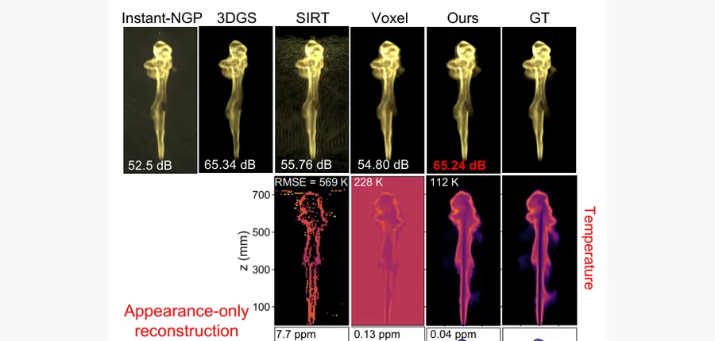 arXiv 2026-11-18 · cs.CV · #1 **[ThermoSight: From Appearance to Internal Thermofluid Fields via Physics-Guided Neural Reconstruction](https://arxiv.org/abs/2611.20786)** [Yuhao Fang , Chenglin Lu , Hefei Ling , Chun Lou](https://arxiv.org/abs/2611.20786) 机构：Huazhong University of Science and Technology（[PDF](https://arxiv.org/pdf/2611.20786)） [Paper](https://arxiv.org/abs/2611.20786) · [图源](https://arxiv.org/pdf/2611.20786) 

中文摘要
多数神经重建方法着眼于复现场景外观，但从视觉观测推断物理状态对于机器理解物理世界至关重要。重建火焰等辐射热流体内部的温度和烟炱场虽有挑战，却对提高能源效率及评估热暴露与火势蔓延十分重要。在火焰中，温度和烟炱浓度共同决定可见辐射，而烟炱的自吸收会改变到达各相机的光。视角有限时，两种场的变化可能在记录的 RGB 图像中互相抵消，因而难以分离温度与烟炱。我们提出面向科学成像的物理引导神经框架 ThermoSight：仅用少量已标定的火焰图像，在优化时不依赖场级真值，联合重建连续的三维温度场和烟炱体积分数场。可微光谱模型通过热辐射、自吸收和已标定相机响应，将这两个场连接到实测 RGB。随温度变化的辐射谱及随波长变化的衰减，在 RGB 通道之间约束共享场，降低温度与烟炱的歧义；色度一致性、由观测导出的空间约束和烟炱正则化则补充强度拟合。在合成消融中，相比三通道近似，按波长解析的衰减将高温、高烟炱区域的温度 RMSE 从 234 K 降至 112 K，而 RGB PSNR 几乎相同（65.23 与 65.24 dB）。实测数据产生连贯的场和有竞争力的 RGB 重建。这些结果表明，物理引导神经场能够恢复超越外观一致性的、可解释的内部物理量。 <a href="https://arxiv.org/abs/2611.20786">原摘要来源</a>
 | 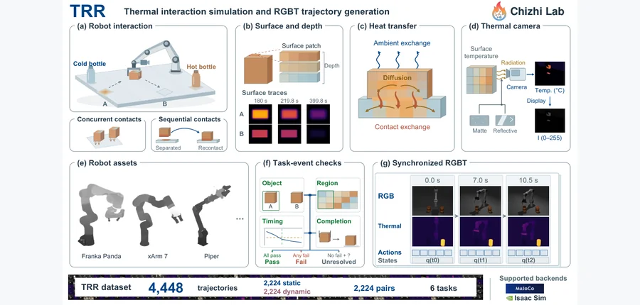 arXiv 2026-11-18 · cs.CV · #2 **[TRR: A Thermal Interaction Engine for Robot Simulation and RGBT Data Generation](https://arxiv.org/abs/2611.20792)** [Biwen Yang , Zhe Cao , Jin Zhang , Haoyang Sun , Zonglu Hu , Jintao Zhao , Zhehao Zhang , Kaizheng Chen , Chengyi Liu , C… 机构：Beijing Institute of Technology / Chizhi Lab（[PDF](https://arxiv.org/pdf/2611.20792)） [Paper](https://arxiv.org/abs/2611.20792) · [Project](https://beveryang.github.io/TRR-Thermal-Renderer-for-Robot/) · [图源](https://arxiv.org/html/2611.20792v1/TRR_Overview_Method.png) 

中文摘要
机器人的动作会改变下一次交互的热条件：物体释放后留存、随物体搬运或储存在表面下的热量，即便当前温度相似，也可能改变后续接触的结果。训练轨迹必须捕捉先前动作与后续观测和任务结果之间的这种联系。我们提出 TRR（Thermal Robot Renderer），为接触双方附加具有空间与深度分辨率的热状态，通过接触、传输和分离更新局部热交换，并在同一执行时钟上生成同步的 RGB–热成像（RGBT）观测与事件局部任务检查。受控干预说明留存热、空间传输和内部储热为何影响之后的接触结果。TRR 从同一状态生成六任务的 2,224 对静态—动态配对基准，即 4,448 条轨迹，包含同步的双视角观测、状态和动作。在专门的学习语料上，可见的热历史把安全接触位置选择率从 75.0% 提高到 91.7%；在采用共享反馈执行的新加热流程下，用动态历史训练使仿真转移完成率提高 50 个百分点。我们展示了 MuJoCo 和 Isaac Sim 的 RGBT 观测适配器，报告了十种已准备的机器人配置和六个已演示的相机视角的工程清单，并描述将现有机器人场景转为导出 RGBT 记录的开发流程。第 6 节所述基准、流程和平台资源构成计划公开发布的首批内容。演示及资源更新见项目页。 <a href="https://arxiv.org/abs/2611.20792">原摘要来源</a>
 | 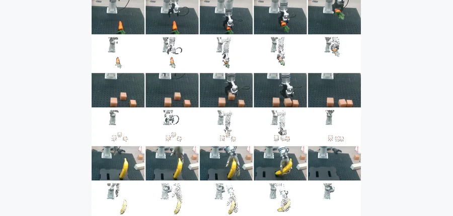 arXiv 2026-11-18 · cs.RO · #3 **[JEPA4R: Embodied JEPA World Models with 4D Point Planning](https://arxiv.org/abs/2611.19771)** [Jiarui Dong , Zhiheng Liang , Yanjun Li , Zeyu Zhang , Heejeong Nam , Haoyu Chen , Hao Tang](https://arxiv.org/abs/2611.1… 机构：Peking University / UC Berkeley BAIR / Brown University / University of Oulu（[PDF](https://arxiv.org/pdf/2611.19771)） [Paper](https://arxiv.org/abs/2611.19771) · [图源](https://arxiv.org/html/2611.19771v1/figures/fig8_real_grid.png) 

中文摘要
联合嵌入预测架构（JEPA）世界模型预测未来嵌入而非像素，并在潜在空间规划。仍有两个挑战：二维图像把操作所依赖的度量几何隐含起来并与外观纠缠；模型想象的内容不可见，评价又主要依赖仿真中的短时潜在规划。我们提出 JEPA4R：从单深度相机点云观测、在其潜在空间预测和规划，并通过冻结潜变量上的策略头执行动作的 JEPA 世界模型；我们将其称为 4D 点规划。冻结世界模型上的解码器以 4D 点云呈现其想象，在 200 步内平均点误差不超过 1.1 cm。遵循 OGBench 与 CortexBench 的策略学习协议，JEPA4R 在 OGBench 的 Cube-Single、Cube-Double、Cube-Triple 和 Scene 任务上领先像素 JEPA 模型；在 MetaWorld 和 Adroit Relocate 上分别以 98.4% 和 88.0% 排名第一，高于次名 R3M 的 96.0% 和 65.3%。仅在数字孪生中训练后，JEPA4R 及其策略头能以夹爪和灵巧手在真实机械臂上零样本运行。 <a href="https://arxiv.org/abs/2611.19771">原摘要来源</a>
 |
| 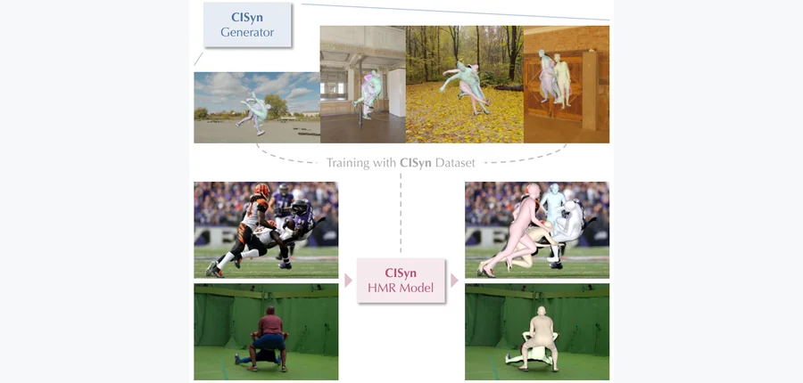 arXiv 2026-11-18 · cs.CV · #4 **[CISyn: Human Mesh Recovery in Close Interactions with Physics-Simulated Synthetic Data](https://arxiv.org/abs/2611.18894)** [Yufan Deng , Lorenza Prospero , Christian Rupprecht](https://arxiv.org/abs/2611.18894) 机构：University of Oxford / The Podium Institute（[PDF](https://arxiv.org/pdf/2611.18894)） [Paper](https://arxiv.org/abs/2611.18894) · [Code](https://github.com/yfde/CISyn) · [图源](https://arxiv.org/html/2611.18894v1/teaser2.png) 

中文摘要
近距离交互场景中的三维人体网格恢复（HMR）受制于缺少大规模、准确标注的训练数据：真实采集昂贵，现有合成数据集很少包含物理接触。我们提出 CISyn，一个专为近距离人际交互设计、由物理仿真和 Blender 渲染生成的大规模合成数据集。通过模拟 SMPL-X 驱动人体之间的碰撞动力学，CISyn 无需人工标注即可自然产生此类场景中的接触、相互遮挡和姿态纠缠。公开的数据集含 25,000 段序列及准确的三维标注。我们还提出不确定性感知损失，使模型更有效地从严重遮挡的样本学习。在先进 HMR 模型的训练中加入 CISyn，并用该不确定性感知损失替代回归损失，可在近距离交互基准上获得持续改进，表明 CISyn 可作为真实数据的可扩展补充。数据集、生成流水线和代码见原摘要所列仓库。 <a href="https://arxiv.org/abs/2611.18894">原摘要来源</a>
 | 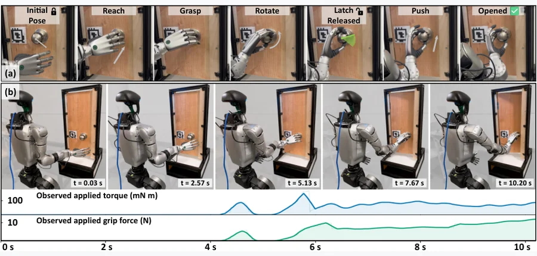 arXiv 2026-11-18 · cs.RO · #5 **[TMA: Sim-to-Real Forceful Humanoid Manipulation via Tactile-Driven Motor Adaptation](https://arxiv.org/abs/2611.18976)** [Yiting Chen , Kelin Yu , Sarthak Kaingade , Bryan Trinh , Kaiyu Hang , Roberto Martin-martin , Nima Fazeli , X. Alice Wu]… 机构：Amazon / Rice University / University of Maryland / University of Texas at Austin / University of Michigan（[PDF](https://arxiv.org/pdf/2611.18976)） [Paper](https://arxiv.org/abs/2611.18976) · [Project](https://humanoid-tma.github.io/) · [图源](https://arxiv.org/html/2611.18976v1/teaser_figure_v3.png) 

中文摘要
近期关节式环境中的人形机器人移动操作主要关注几何主导的交互，其成功主要取决于几何对齐和动作执行。相比之下，有力的多指操作需要机器人适应真实世界接触与交互动力学的不确定性。我们提出触觉驱动电机适应（TMA）及一套整合的全身系统，用于零样本从仿真迁移到真实环境的有力人形操作；并以开启圆形门把手为挑战性基准，该任务要求稳定的多指摩擦抓握、无滑动地产生足够扭矩、力调节推门和全身稳定。TMA 围绕触觉反馈可观测的交互组织策略学习，将锥几何作为多指接触表示的归纳偏置，并根据触觉历史在线调整电机行为。上半身操作策略与预训练的通用移动控制器共同训练，以协调灵巧交互和全身稳定。TMA 完全在仿真中训练，并零样本迁移到配备 BrainCo Revo2 多指手的 Unitree G1 人形机器人；在真实世界四款商用圆形门把手上，明显优于标准快速电机适应（RMA）和反应式触觉策略基线。 <a href="https://arxiv.org/abs/2611.18976">原摘要来源</a>
 | 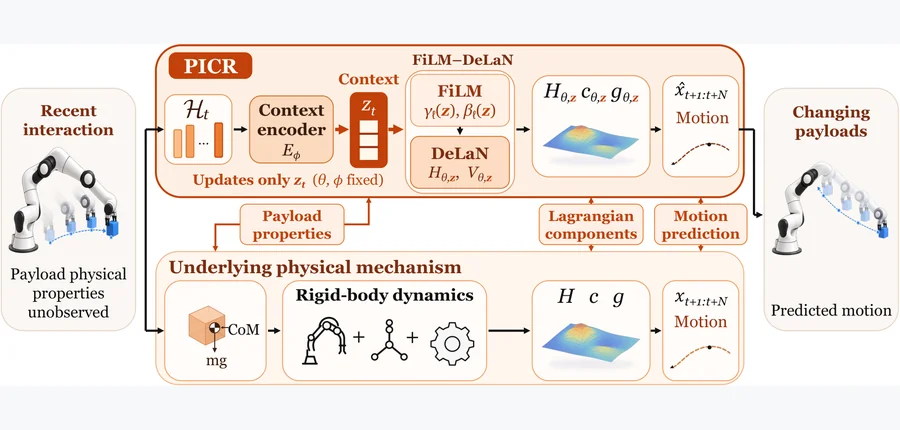 arXiv 2026-11-18 · cs.RO · #6 **[Physics-Informed Causal Reasoning for Nonstationary Robot Dynamics](https://arxiv.org/abs/2611.19251)** [Jungjin Lee , Se Jin Kim , Sung Kwon On , Insoon Yang](https://arxiv.org/abs/2611.19251) 机构：Seoul National University（[PDF](https://arxiv.org/pdf/2611.19251)） [Paper](https://arxiv.org/abs/2611.19251) · [图源](https://arxiv.org/html/2611.19251v1/fig_framework.png) 

中文摘要
推断动作会造成什么结果，需要内化系统的行为方式。由于条件很少保持不变，这往往必须在少数几次交互内完成。但快照看起来相同的系统，可能因快照未显示的物理条件而对同一动作作出不同反应。基于上下文的模型用最近的状态转移概括这种差异，却未规定上下文应如何改变运动方程。物理信息神经网络把这些方程纳入模型，但只描述单一系统，无法识别系统何时变化。我们提出物理信息因果推理（PICR），连接这两类方法。系统仅更新从最近交互重新推断的上下文；该上下文调节一个固定的物理信息网络，由后者确定机器人的惯性和势能，使机器人无需重训或人工指定的机器人模型，即可从自身经验适应新的物理条件。在 NVIDIA Isaac Sim 的 Franka Panda 机械臂上，PICR 预测载荷变化及未见载荷下的运动，对后者的误差比基线低 1.6–3.8 倍，并可回答施加不同扭矩的反事实问题。分析表明，仅由交互推断的上下文编码了载荷的物理属性、跟踪其变化并决定机械臂响应。上下文诱导的重力项和惯性项也分别在拉格朗日量单个分量层面与仿真器一致，进一步展示了物理有效性。 <a href="https://arxiv.org/abs/2611.19251">原摘要来源</a>
 |
| 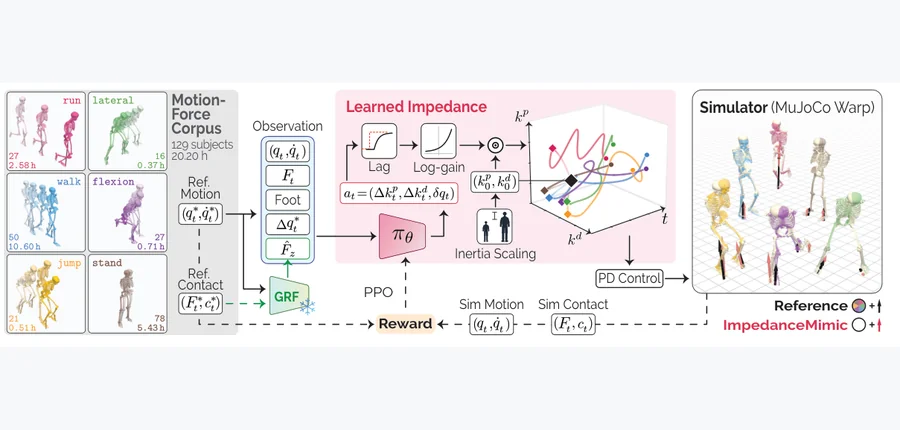 arXiv 2026-11-18 · cs.RO · #7 **[ImpedanceMimic: Learned Impedance as Action Space for Force-Accurate Motion Imitation](https://arxiv.org/abs/2611.19153)** [Matthias Jammot , Pembe Gizem Özdil](https://arxiv.org/abs/2611.19153) 机构：Harvard University / Kempner Institute（[PDF](https://arxiv.org/pdf/2611.19153)） [Paper](https://arxiv.org/abs/2611.19153) · [Project](https://impedancemimic.github.io/ImpedanceMimic/) · [图源](https://arxiv.org/pdf/2611.19153) 

中文摘要
从运动反推力是不适定问题：不同控制器能复现相同运动，却产生不同接触力。基于物理的运动模仿通过仿真缓解这种歧义，但依赖固定增益的比例—微分（PD）控制。我们表明，固定增益使运动跟踪与力跟踪发生权衡，因为接触阶段和摆动阶段对关节刚度、阻尼的需求相冲突。我们提出 ImpedanceMimic，一种强化学习策略，可根据运动与力测量调节逐关节刚度、阻尼和位置设定点，推理时却只需运动。在 129 名参与者、六类活动上，无论采用何种积分方案，ImpedanceMimic 在运动学和力的保真度上都优于匹配的固定增益 PD、直接扭矩控制、肌肉驱动及现有模仿控制器，并接近专门的运动到力回归器。通过将增益表示为惯性缩放先验的倍数，单一策略无需显式人体测量输入就能控制受试者专属的生物力学模型，并零样本迁移到未见过的人和人形机器人。学到的阻抗构成跨身体共享、可泛化至留出活动的低维运动状态表示：刚度随负载变化，阻尼提前响应卸载。 <a href="https://arxiv.org/abs/2611.19153">原摘要来源</a>
 | 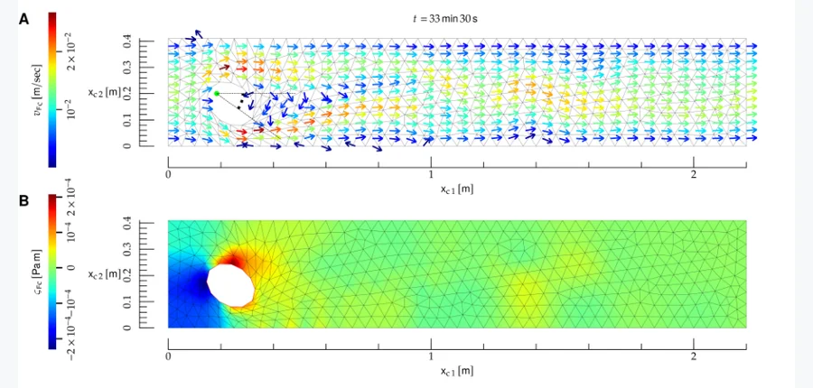 arXiv 2026-11-18 · cond-mat.soft · #8 **[Interaction between fluids and Helfrich membranes](https://arxiv.org/abs/2611.18808)** [Dennis Wörthmüller , Pierre Sens , Michele Castellana](https://arxiv.org/abs/2611.18808) 机构：Institut Curie / CNRS（[PDF](https://arxiv.org/pdf/2611.18808)） [Paper](https://arxiv.org/abs/2611.18808) · [图源](https://arxiv.org/html/2611.18808v1/figure_2.png) 

中文摘要
我们提出一种有限元方法，用于求解流体与膜的交互动力学；这里的膜是具有 Helfrich 弹性自由能的流体层［W. Helfrich, Z. Naturforschung C, 28, 693, (1973)］。分析采用分区方法，在交错步骤中分别求解流体、膜和网格的状态。通过弹性体膜与经通道注入的空气相互作用并鼓起的宏观实例，我们展示该方法的预测能力。该方法能够描述微扰方法无法处理的大变形膜。我们通过刻画附加质量不稳定性讨论其局限。最后，分析说明鼓包形成的物理机制来自弹性应力和膜边界条件的共同作用。 <a href="https://arxiv.org/abs/2611.18808">原摘要来源</a>
 | 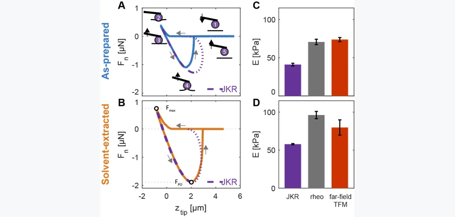 arXiv 2026-11-18 · cond-mat.soft · #9 **[Model-free stiffness measurement of microscale soft contacts by far-field traction force microscopy](https://arxiv.org/abs/2611.20918)** [Keumkyung Kuk , Shivaprakash N. Ramakrishna , Nancy A. Burnham , Robert W. Style , Lucio Isa](https://arxiv.org/abs/2611.… 机构：ETH Zürich / Empa / Worcester Polytechnic Institute（[PDF](https://arxiv.org/pdf/2611.20918)） [Paper](https://arxiv.org/abs/2611.20918) · [图源](https://arxiv.org/html/2611.20918v1/fig1.png) 

中文摘要
软材料的微尺度刚度支配其接触力学、黏附和摩擦，却很难测量。通常使用微压痕或纳米压痕，但从中提取刚度需要接触力学模型（如 JKR），其假设在柔软黏附接触中常常不成立。我们提出远场牵引力显微术（FF-TFM），无需任何接触模型即可提取刚度。我们让原子力显微镜上的胶体探针在软表面上拖动，在测量摩擦力的同时，对基底内荧光示踪粒子的位移成像。在远离接触处的弹性极限下，这些横向位移仅取决于摩擦力和基底刚度，因此用点力解拟合即可直接得到基底的杨氏模量。对于六种硅橡胶弹性体，FF-TFM 的结果与体相流变模量一致，而对压痕数据作 JKR 拟合时，所得模量比体相值最多低 40%。该方法还能跟踪探针如何在表面滑动。我们发现软接触可以在力信号中没有可检测迹象的情况下发生“预滑移”，这与较硬的接触不同。因此，FF-TFM 为测量微尺度刚度与滑移行为提供了无需接触模型的路径。 <a href="https://arxiv.org/abs/2611.20918">原摘要来源</a>
 |
| 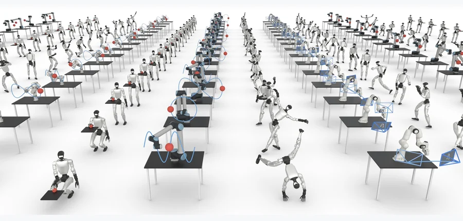 arXiv 2026-11-18 · cs.RO · #10 **[RoboKit: Accelerating Parallel Differentiable Optimization for Robot Learning](https://arxiv.org/abs/2611.20185)** [Jianglong Ye , Xuanbin Peng , Conor Mc Gartoll , Changwei Jing , Lai Wei , Jiali Chen , Xueyan Zou , Xiaolong Wang](https… 机构：UC San Diego（[PDF](https://arxiv.org/pdf/2611.20185)） [Paper](https://arxiv.org/abs/2611.20185) · [Project](https://openrobokit.com/robokit/) · [图源](https://arxiv.org/html/2611.20185v1/figures/teaser_v3.jpg) 

中文摘要
我们提出 RoboKit，一套用于机器人学习中并行可微优化的高性能通用工具包，基于三项原则：（i）性能与灵活性：GPU 并行多起点求解器将采样与多种优化器结合，在七项任务上比任务专用基线快 2–60 倍；（ii）几何、渲染与物理：混合及由粗到细的表示加速碰撞、可微渲染和仿真，在 2.97 秒内优化 4096 个抓取；（iii）与学习集成：代价可微且仿真并行，因此 RoboKit 既能将优化蒸馏为策略，也能训练强化学习；蒸馏策略在精度相近时快 9–240 倍，而在同一仿真器上，强化学习达到 GPU 基线分数的速度最多快 2.1 倍。 <a href="https://arxiv.org/abs/2611.20185">原摘要来源</a>
 | 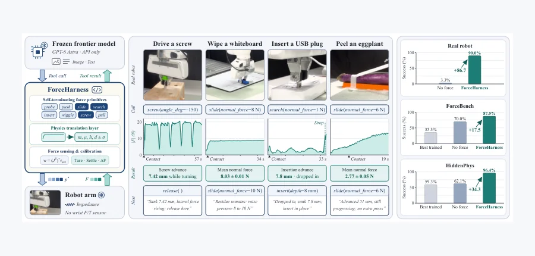 arXiv 2026-11-18 · cs.RO · #11 **[ForceHarness: Turning Force into Action and Physics for Frozen Frontier Models](https://arxiv.org/abs/2611.21099)** [Ke Sun , Kevin Yuchen Ma , Yike Zhang , Yanzhe Chen , Mike Zheng Shou](https://arxiv.org/abs/2611.21099) 机构：Show Lab, National University of Singapore（[PDF](https://arxiv.org/pdf/2611.21099)） [Paper](https://arxiv.org/abs/2611.21099) · [Project](https://showlab.github.io/ForceHarness/) · [图源](https://arxiv.org/html/2611.21099v1/fig1_teaser.png) 

中文摘要
前沿多模态模型如今能凭图像零样本控制机器人，但许多操作任务依赖图像无法显示的接触力。让只能通过 API 调用的冻结模型利用力，面临两个挑战。首先，接触变化远快于 API 模型作决策的速度，因此系统必须在模型之下闭环控制力。其次，冻结模型不能理解原始力序列，必须以可供模型推理的形式返回力信息。为此，我们提出 ForceHarness，使冻结模型无需演示或微调即可利用力。ForceHarness 从腕部传感器或仅从关节扭矩校准手部作用力后，用能够自行调节力并在接触事件时返回的自终止力基元解决第一个问题；再用物理转换层将每条力轨迹转换为带不确定性的物理量，作为工具结果返回，以解决第二个问题。为在相同条件下与专家力控制器和学习策略比较，我们还构建了含隐含物理变量的七任务 MuJoCo 基准 HiddenPhys。在没有腕部力传感器的真实机械臂上，ForceHarness 将 GPT-6 Astra 的零样本成功率从 3.3% 提高到 90.0%。仿真中，它在公开的 ForceBench 上提高 17.5 个百分点、在 HiddenPhys 上提高 34.3 个百分点；在两个基准上都超过以演示训练的力感知策略，并在 HiddenPhys 上达到手写专家控制器的水平。消融还表明，获得物理量而非原始力值时，较小模型能明显作出更好的决策。 <a href="https://arxiv.org/abs/2611.21099">原摘要来源</a>
 | 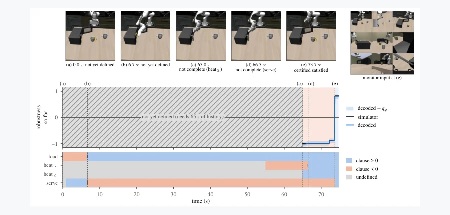 arXiv 2026-11-18 · cs.RO · #12 **[Physics-Grounded STL Monitoring from Image Observations](https://arxiv.org/abs/2611.19688)** [Xinpei Ni , Glen Chou , Samuel Coogan](https://arxiv.org/abs/2611.19688) 机构：Georgia Institute of Technology（[PDF](https://arxiv.org/pdf/2611.19688)） [Paper](https://arxiv.org/abs/2611.19688) · [图源](https://arxiv.org/html/2611.19688v1/fig_online_frames_compact.png) 

中文摘要
机器人操作任务必须满足可用信号时序逻辑（STL）表达的定时及条件要求。由相机图像监控这些要求虽可行，却有挑战，因为 STL 鲁棒性取决于距离、间隙等无法直接观测的物理裕量。我们没有为每个公式分别学习视觉监控器，而是从多视角图像学习共享潜在表示，并为各个谓词解码具有物理意义的裕量。与冻结编码器相比，联合训练编码器和谓词解码器使认证率从 58.7% 升至 96.3%，尽管谓词符号的准确率几乎不变。STL 语义随后把这些裕量组合为在已训练谓词上任意有界公式的鲁棒性估计，无需重训。我们还用保形预测校准所选 STL 子句的解码误差，得到可同时认证满足与违反的双侧区间，并通过区间 STL 传播到由这些子句构成的任意公式。在仿真厨房任务（LIBERO）中，监控器对 18 个未见公式的 4662 次评估，有 98.9% 正确预测满足或违反。对于最长 17 分钟的任务，校准后的边界能对 96.9% 的任务判定满足或违反，且无错误结论。一次校准还能为八个子句的全部 255 种合取提供同时 91.0% 的覆盖率，使新公式无需再次校准。 <a href="https://arxiv.org/abs/2611.19688">原摘要来源</a>
 |
| 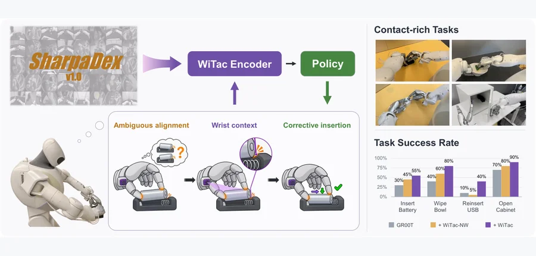 arXiv 2026-11-18 · cs.RO · #13 **[WiTac: Wrist-Informed Tactile Representations for Contact-Rich Manipulation](https://arxiv.org/abs/2611.21057)** [Haotian He , Yiyang Chen , Congsheng Xu , Wenchao Yue , Mingze Ye , Shuai Chen , Yi Yang , Yaping Li , Haonan Wang , Wein… 机构：Sharpa Robotics / PKU / SJTU / ShanghaiTech / CUHK（[PDF](https://arxiv.org/pdf/2611.21057)） [Paper](https://arxiv.org/abs/2611.21057) · [Project](https://wrist-informed-tactile-representations.github.io/) · [图源](https://arxiv.org/html/2611.21057v1/teaser_pptx.png) 

中文摘要
相似的触觉接触可能需要不同的修正，具体取决于手、物体和目标的配置。比起将触觉和腕部视觉分别送入策略，在策略输入前融合两者，能更好地把触觉特征锚定在视觉语境中，从而形成更准确的接触表示。我们提出腕部视觉引导的触觉表示 WiTac，一种在动作生成前学习这类表示的预训练编码器。WiTac 使用近 300 小时 SharpaDex 数据预训练，深度融合触觉信号、手部运动和腕部视角，形成综合接触表示。以 WiTac 为下游 VLA 策略（GR00T N1.7 和 π₀.₅）的条件，在四项接触丰富的操作任务中，相比纯视觉基础策略，平均成功率分别提高 28.8% 和 15.0%；相比不使用腕部视觉的触觉编码器，又分别高 18.8% 和 7.5%。离线分析还显示，腕部视觉带来更准确的接触描述、更强的任务与接触联合区分能力、更稳定的抗触觉噪声特征，以及从相似接触中更清晰地读出动作方向。项目页见原摘要所列链接。 <a href="https://arxiv.org/abs/2611.21057">原摘要来源</a>
 | 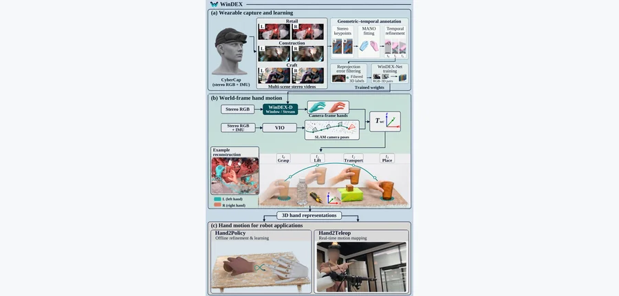 arXiv 2026-11-18 · cs.RO · #14 **[WinDEX: Metric 3D Hand Motion Reconstruction in the Wild for Dexterous Teleoperation and Policy Learning](https://arxiv.org/abs/2611.21143)** [Hongyu Ma , Hairong Qu , Shiqi Zhao , Yongsong Yang , Kai Shi , Jiahao Ai , Xin You , Peng Yin](https://arxiv.org/abs/261… 机构：City University of Hong Kong / CyberOrigin（[PDF](https://arxiv.org/pdf/2611.21143)） [Paper](https://arxiv.org/abs/2611.21143) · [图源](https://arxiv.org/html/2611.21143v1/teaser.png) 

中文摘要
人类操作数据广泛用于训练机器人获得类似人的灵巧性，但在真实环境中低成本、大规模收集仍有困难。现有方法在有几何依据的度量尺度重建、真实场景泛化和推理速度方面仍受限。我们提出 WinDEX，结合了：（1）从真实环境第一人称双目视频生成度量三维手部标注的几何—时间优化，以及用于世界坐标重建的视觉惯性 SLAM；（2）融合标定双目、局部细节和时间上下文的原生鱼眼端到端网络 WinDEX-Net，并通过模型辅助标注与重训构成数据—模型循环；（3）支持强化学习和遥操作的离线重建与因果流式蒸馏模型；（4）低成本 CyberCap 双目惯性采集系统，由此形成 WinDEX-Hand 数据集，包含 1,000 小时训练标注、留出的真实环境人工二维标注评估集，以及独立的光学动作捕捉评估集。离线重建速度为 43.61 FPS，因果流式处理为 171 FPS。在留出数据上，离线重建取得先进精度：真实环境重投影误差 14.5 像素，结合视觉惯性里程计后的世界坐标关节误差为 37.29 mm。相较用 WiLoR 和 HaWoR 运动参考训练的强化学习策略，我们的任务成功率分别达到其 7.6 倍和 3.6 倍，并展示了实时机械臂—灵巧手遥操作。项目网站见原摘要所列链接。 <a href="https://arxiv.org/abs/2611.21143">原摘要来源</a>
 | 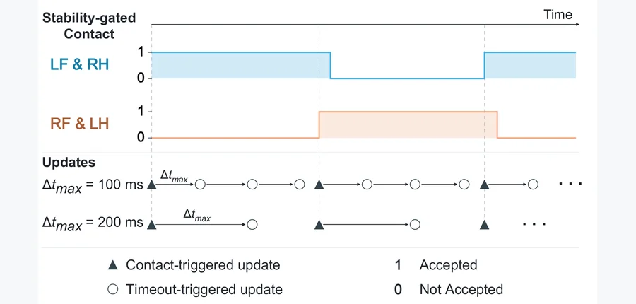 arXiv 2026-11-18 · cs.RO · #15 **[SG-ODOM: Event-Driven Proprioceptive State Estimation with Stability-Gated Contact Updates for Legged Robots](https://arxiv.org/abs/2611.20710)** [Francesco Iotti , Chiyun Noh , Franco Angelini , Manolo Garabini , Ayoung Kim , Maurice Fallon , Frank Dellaert](https://… 机构：University of Pisa / University of Oxford / Seoul National University / Georgia Institute of Technology（[PDF](https://arxiv.org/pdf/2611.20710)） [Paper](https://arxiv.org/abs/2611.20710) · [Code](https://github.com/ori-drs/SG-ODOM) · [图源](https://arxiv.org/html/2611.20710v1/Figure3.png) 

中文摘要
可靠的腿式机器人本体感知状态估计融合惯性传感与腿部编码器的运动学传感。后者假设足部在支撑期保持静止；但物理触地不一定能立即为里程计提供静止参考，尤其在冲击和载荷转移期间。在同一次接触阶段反复施加运动学修正，还可能引入冗余或不可靠信息。我们提出 SG-ODOM，一种利用稳定性门控接触选择来安排运动学更新的本体感知里程计框架。物理触地后，稳定性门控只有在足部达到足够稳定的支撑条件时才接受该接触用于状态估计。经验证的触地事件触发一次估计器修正，而附加的超时更新限制不间断 IMU 传播的最长时间。该框架在四足与人形等多个腿式平台上，与代表性先进本体感知估计器比较。在所评估序列上，SG-ODOM 的精度具有竞争力或更优；在 GrandTour 数据集的户外序列上，相比基线估计器，相对姿态误差（RPE）最多降低 25%。源代码与视频链接见原摘要。 <a href="https://arxiv.org/abs/2611.20710">原摘要来源</a>
 |
| 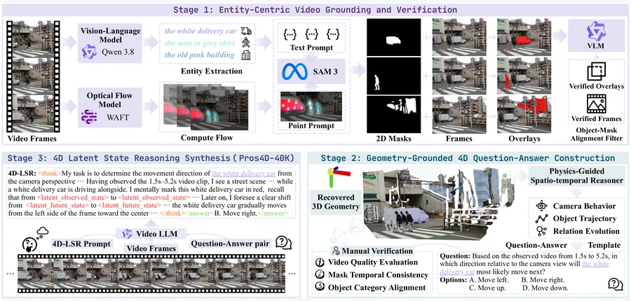 arXiv 2026-11-18 · cs.CV · #16 **[Pros4D: Modeling Evolving 4D Worlds in Latent Space for Dynamic Spatial Reasoning](https://arxiv.org/abs/2611.19803)** [Rongxin Gao , Dongxuan Liu , Chu Li , Chengyang Ji , Jialing Huang , Runyu Chen , Kairun Wen , Chenxin Li , Jingrui Ye… 机构：XMU / CUMT / CUHK / THU / HIT（[PDF](https://arxiv.org/pdf/2611.19803)） [Paper](https://arxiv.org/abs/2611.19803) · [Project](https://pros4d.github.io/) · [图源](https://arxiv.org/html/2611.19803v1/datagen_v4.png) 

中文摘要
从单目视频进行动态空间推理，使视觉语言模型（VLM）能够理解三维环境如何随时间演化，支持物理世界理解和具身智能。已有工作主要处理已观测动力学的理解，而动态环境中的智能体还需预测观测边界之后的未来动力学。此外，外部几何处理和文本描述可能增加推理复杂度，或在表示连续动力学时丢失信息。这些限制促使我们寻找既保留已观测动力学、又能预测输入视频之后变化的共享内部状态。为此，我们提出 Pros4D，在潜在空间建模演化的 4D 世界，统一对已观测动力学的回顾式理解与对未来动力学的前瞻推理。Pros4D-Engine 导出以几何为依据的监督，并为两项任务构造配对样本；Pros4D-Bench 则在覆盖动态相机、物体和场景的八类空间任务上评估它们。模型把已观测动力学压缩为潜在观测状态，再自回归地向前滚动为潜在未来状态。4D 潜在对齐（4DLA）通过互补的视觉语义与几何监督锚定这些状态，联合语言监督则将其连接到任务推理。跨基准实验显示，这两种能力相对强基线均获得持续提升。 <a href="https://arxiv.org/abs/2611.19803">原摘要来源</a>
 | 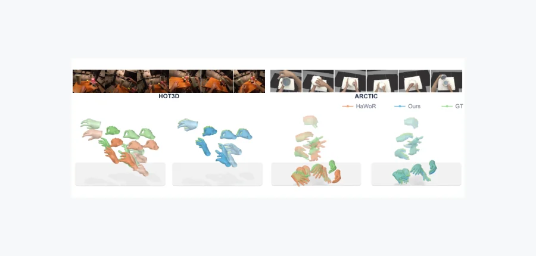 arXiv 2026-11-18 · cs.CV · #17 **[MetricHand: Geometry-Aware Flow Matching for 4D Hand Reconstruction in Metric World Space](https://arxiv.org/abs/2611.21060)** [Yibo Bai , Likui Zhang , Jinglei Zhang , Zhengbin Pang , Xingshen Song , Xiaoqing Yin , Jinsheng Deng](https://arxiv.org/… 机构：National University of Defense Technology / Sun Yat-sen University / Shanghai Jiao Tong University / Academy of Military Sciences（[PDF](https://arxiv.org/pdf/2611.21060)） [Paper](https://arxiv.org/abs/2611.21060) · [图源](https://arxiv.org/html/2611.21060v1/metrichand_teaser_panel_c.png) 

中文摘要
第一人称手部运动为灵巧操作和视觉语言动作模型预训练提供物理运动监督。可靠使用这种监督需要在度量世界坐标中准确且时间连贯的 4D 手部重建。现有方法通常将弱透视下得到的逐帧估计提升到世界坐标。由于忽略近距离时依关节而变的深度差异，这种近似使平移、朝向和关节姿态的误差耦合；提升到世界坐标后误差仍在，并在遮挡时加剧。我们提出 MetricHand，一种在度量世界坐标中进行 4D 手部重建的几何感知流匹配框架。MetricHand 将手物交互区域的深度先验编码为与关节关联的表示，以保留局部空间结构和度量尺度。与视觉特征融合后，这些几何信息引导粗略度量估计，并为时间生成的每一步提供条件。模型联合恢复世界坐标平移、全局朝向、MANO 关节姿态和形状；结构先验和时间上下文支持部分遮挡下的估计。相对 HaWoR，MetricHand 在两个评测设置中的相机坐标 MPJPE 分别降低 49.3% 和 52.9%，绝对世界坐标 MPJPE 分别降低 28.7% 和 21.7%，手腕定位误差分别降低 48.5% 和 37.9%。世界坐标加速度误差分别降低 44.2% 和 64.3%，表明绝对定位更准的同时，时间保真度也提高了。 <a href="https://arxiv.org/abs/2611.21060">原摘要来源</a>
 | 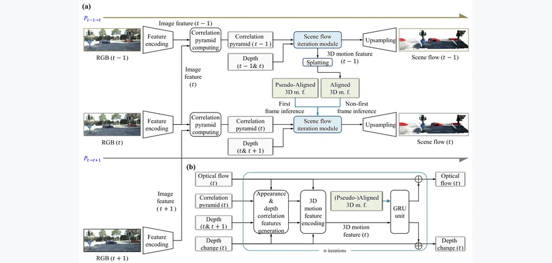 arXiv 2026-11-18 · cs.CV · #18 **[SplatFlow3D: Learning Scene Flow via 3D Motion Feature Splatting](https://arxiv.org/abs/2611.19409)** [Bo Wang , Dekang Zhu , Jian Li , Zhipeng Meng , Bo Wang , Dewen Hu](https://arxiv.org/abs/2611.19409) 机构：Chinese Academy of Military Science / National University of Defense Technology（[PDF](https://arxiv.org/pdf/2611.19409)） [Paper](https://arxiv.org/abs/2611.19409) · [Code](https://github.com/wwsource/SplatFlow3D) · [图源](https://arxiv.org/html/2611.19409v1/overview_20260930.png) 

中文摘要
考虑到短时间帧间三维物体运动的连续性和稳定性，多帧场景流估计有望处理遮挡。我们提出双帧主干 SimpleFlow3D：以先解耦、后耦合的方式分层构建三维运动特征，整合图像平面的稠密信息和深度维的稀疏信息。SimpleFlow3D 以较少参数取得先进结果。我们还提出共享权重的多帧框架，将上一时刻的三维运动特征 splat 到当前估计过程。该框架通过构造伪输入统一首帧和后续帧的推理。结合框架与主干后，多帧方法 SplatFlow3D 进一步提高了先进水平：误差低于双帧主干，参数少于现有多帧方法。在 KITTI 和 Spring 上，SplatFlow3D 均在所有已发表及已提交方法中排名第一。实验显示它改善了遮挡处理、非刚性运动估计及真实场景泛化。代码链接见原摘要。 <a href="https://arxiv.org/abs/2611.19409">原摘要来源</a>
 |
| 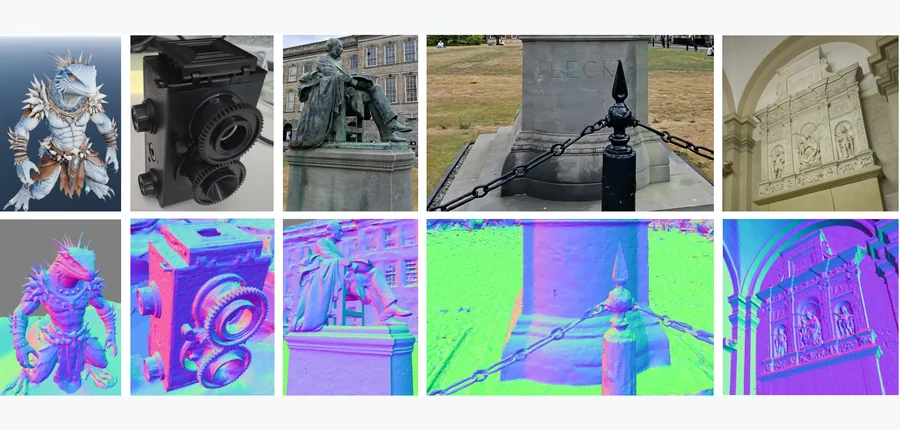 arXiv 2026-11-18 · cs.CV · #19 **[TopSDF: Topological Signed Distance Field for High-Quality Triangle Mesh Extraction from 3D Gaussian Splatting](https://arxiv.org/abs/2611.18708)** [Khoi Do , Yu-kun Lai , Binh-Son Hua](https://arxiv.org/abs/2611.18708) 机构：Trinity College Dublin / Cardiff University（[PDF](https://arxiv.org/pdf/2611.18708)） [Paper](https://arxiv.org/abs/2611.18708) · [图源](https://arxiv.org/html/2611.18708v1/teaser.png) 

中文摘要
三维高斯泼溅（3DGS）在逼真的新视角合成上已表现有效，但从 3DGS 中提取干净、水密的显式表面网格仍是关键挑战。既有方法用离散 Marching Tetrahedra 近似几何，每个网格顶点只分配一个标量符号距离值。在复杂边界和薄结构处，这种次优参数化迫使共享顶点上的估计作出严重折中，造成梯度冲突和几何受挫。此外，已有优化目标忽略单元形状条件性，产生退化三角形。我们提出 TopSDF，将符号距离状态建模为多元高斯随机场。通过学习四面体顶点之间的潜在拓扑协方差，该表示增加了局部 SDF 估计自由度，使候选网格顶点能在拓扑相关性的驱动下灵活布置于四面体的异号边。与此同时，我们将变分网格能量直接纳入联合优化，并耦合能量驱动的高斯增密策略以提高三角网格质量。在 Mip-NeRF 360、Tanks &amp; Temples 和 ScanNet++ 上，TopSDF 获得先进的基于网格的新视角渲染表现（Mip-NeRF 360 上 PSNR 提高 0.86 dB）及三角网格质量（长宽比从 0.37 升至 0.49）。 <a href="https://arxiv.org/abs/2611.18708">原摘要来源</a>
 | 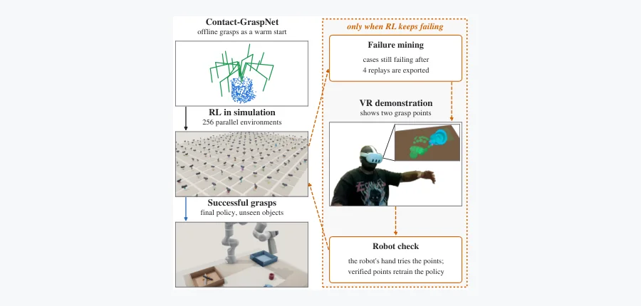 arXiv 2026-11-18 · cs.RO · #20 **[Correcting Persistent Failures in Point-Cloud Grasping Policies using Human Demonstrations in Virtual Reality](https://arxiv.org/abs/2611.18919)** [Achyuthan Unni Krishnan , Karthik Rengarajan , Bharath Narasimhan , Chris von Csefalvay](https://arxiv.org/abs/2611.18919) 机构：affiliation 未确认 [Paper](https://arxiv.org/abs/2611.18919) · [图源](https://arxiv.org/html/2611.18919v1/overview_figure_column.png) 

中文摘要
家庭、仓库和农场中的机器人必须抓取此前未见过的物体，通常没有三维模型或类别标签。直接处理深度传感器点云的抓取策略只需要机器人观测到的几何，因此可用于任何新物体。Contact-GraspNet 等离线抓取生成器以此工作，但它们依据学到的可信度而非抓取是否真正提起物体来排序。强化学习（RL）可以直接优化提起成功率，显著改善点云抓取策略的平均表现，但仍有一些特定抓取持续失败。我们提出针对这些抓取的人在回路失败修正流程：自动挖掘 RL 策略反复失败的情形，送到虚拟现实应用，由人用自己的手提起物体，再把两个抓取点送回训练。人只提供抓取位置，机器人自行选择接近路径。仿真中，RL 将未见物体的成功率从 Contact-GraspNet 的 55% 提高到 83%。增加 58 条人工演示后，RL 原本持续失败的困难案例成功率从 24% 升至 45%，接近翻倍；同时恢复 RL 单独训练时在相似但未演示案例上损失的性能，且不降低未见物体的成功率。 <a href="https://arxiv.org/abs/2611.18919">原摘要来源</a>
 |   |
<!-- PAPER_CARDS_END -->

## 检索概况

- **检索窗口**：北京时间 2026-11-18 09:00–09:16；官方 New listing 显示的批次日期为 2026-11-17。
- **主榜范围**：只收官方 New submissions；14 个目标分类页共 **1,407** 条 New 记录，按 arXiv ID 去重后仍为 **1,407** 篇；本期入选 **20** 篇。
- **排序规则**：先列三维物理场、接触与仿真，再列具体机器人交互及动态三维方法。相关性、机构强度、局限和改进建议均为编辑推断；标题、作者、分类和摘要以所链官方 arXiv 页面为准。
- **资源核实**：机构依据所链 PDF 首页；一篇机构未确认。10 个 Code/Project 链接逐一访问确认；无法确认的链接未填写。
- **图文缺失**：真实配图缺失 0 篇；原摘要缺失 0 篇。

## 官方 New listing 状态

| 分类页 | 官方 listing 日期 | New |
|---|---|---:|
| [cs.AI](https://arxiv.org/list/cs.AI/new?show=2000) | 2026-11-17 | 135 |
| [cs.CV](https://arxiv.org/list/cs.CV/new?show=2000) | 2026-11-17 | 285 |
| [cs.GR](https://arxiv.org/list/cs.GR/new?show=2000) | 2026-11-17 | 6 |
| [cs.LG](https://arxiv.org/list/cs.LG/new?show=2000) | 2026-11-17 | 252 |
| [cs.RO](https://arxiv.org/list/cs.RO/new?show=2000) | 2026-11-17 | 110 |
| [eess.IV](https://arxiv.org/list/eess.IV/new?show=2000) | 2026-11-17 | 18 |
| [eess.SP](https://arxiv.org/list/eess.SP/new?show=2000) | 2026-11-17 | 34 |
| [eess.SY](https://arxiv.org/list/eess.SY/new?show=2000) | 2026-11-17 | 81 |
| [math.DS](https://arxiv.org/list/math.DS/new?show=2000) | 2026-11-17 | 33 |
| [math.NA](https://arxiv.org/list/math.NA/new?show=2000) | 2026-11-17 | 41 |
| [math.OC](https://arxiv.org/list/math.OC/new?show=2000) | 2026-11-17 | 60 |
| [physics](https://arxiv.org/list/physics/new?show=2000) | 2026-11-17 | 178 |
| [cond-mat](https://arxiv.org/list/cond-mat/new?show=2000) | 2026-11-17 | 149 |
| [stat.ML](https://arxiv.org/list/stat.ML/new?show=2000) | 2026-11-17 | 25 |
| **合计** | — | **1,407** |

## Top papers

| # | 论文 | 分类 | 作者 | 机构（PDF 首页） | 相关性（推断） | 机构强度（推断） | 阅读 |
|---:|---|---|---|---|---|---|---|
| 1 | [ThermoSight: From Appearance to Internal Thermofluid Fields via Physics-Guided Neural Reconstruction](https://arxiv.org/abs/2611.20786) | [cs.CV](https://arxiv.org/abs/2611.20786) | [Yuhao Fang , Chenglin Lu , Hefei Ling , Chun Lou](https://arxiv.org/abs/2611.20786) | Huazhong University of Science and Technology（[PDF](https://arxiv.org/pdf/2611.20786)） | 高：3D×物理／接触 | 未独立评级 | A |
| 2 | [TRR: A Thermal Interaction Engine for Robot Simulation and RGBT Data Generation](https://arxiv.org/abs/2611.20792) | [cs.CV](https://arxiv.org/abs/2611.20792) | [Biwen Yang , Zhe Cao , Jin Zhang , Haoyang Sun , Zonglu Hu , Jintao Zhao , Zhehao Zhang , Kaizheng Chen , Chengyi Liu , Chengyu Wei , Siyuan Wu , Ruiheng Zhang](https://arxiv.org/abs/2611.20792) | Beijing Institute of Technology / Chizhi Lab（[PDF](https://arxiv.org/pdf/2611.20792)） | 高：3D×物理／接触 | 未独立评级 | A |
| 3 | [JEPA4R: Embodied JEPA World Models with 4D Point Planning](https://arxiv.org/abs/2611.19771) | [cs.RO](https://arxiv.org/abs/2611.19771) | [Jiarui Dong , Zhiheng Liang , Yanjun Li , Zeyu Zhang , Heejeong Nam , Haoyu Chen , Hao Tang](https://arxiv.org/abs/2611.19771) | Peking University / UC Berkeley BAIR / Brown University / University of Oulu（[PDF](https://arxiv.org/pdf/2611.19771)） | 高：3D×物理／接触 | 未独立评级 | A |
| 4 | [CISyn: Human Mesh Recovery in Close Interactions with Physics-Simulated Synthetic Data](https://arxiv.org/abs/2611.18894) | [cs.CV](https://arxiv.org/abs/2611.18894) | [Yufan Deng , Lorenza Prospero , Christian Rupprecht](https://arxiv.org/abs/2611.18894) | University of Oxford / The Podium Institute（[PDF](https://arxiv.org/pdf/2611.18894)） | 高：3D×物理／接触 | 未独立评级 | A |
| 5 | [TMA: Sim-to-Real Forceful Humanoid Manipulation via Tactile-Driven Motor Adaptation](https://arxiv.org/abs/2611.18976) | [cs.RO](https://arxiv.org/abs/2611.18976) | [Yiting Chen , Kelin Yu , Sarthak Kaingade , Bryan Trinh , Kaiyu Hang , Roberto Martin-martin , Nima Fazeli , X. Alice Wu](https://arxiv.org/abs/2611.18976) | Amazon / Rice University / University of Maryland / University of Texas at Austin / University of Michigan（[PDF](https://arxiv.org/pdf/2611.18976)） | 高：3D×物理／接触 | 未独立评级 | A |
| 6 | [Physics-Informed Causal Reasoning for Nonstationary Robot Dynamics](https://arxiv.org/abs/2611.19251) | [cs.RO](https://arxiv.org/abs/2611.19251) | [Jungjin Lee , Se Jin Kim , Sung Kwon On , Insoon Yang](https://arxiv.org/abs/2611.19251) | Seoul National University（[PDF](https://arxiv.org/pdf/2611.19251)） | 高：3D×物理／接触 | 未独立评级 | A |
| 7 | [ImpedanceMimic: Learned Impedance as Action Space for Force-Accurate Motion Imitation](https://arxiv.org/abs/2611.19153) | [cs.RO](https://arxiv.org/abs/2611.19153) | [Matthias Jammot , Pembe Gizem Özdil](https://arxiv.org/abs/2611.19153) | Harvard University / Kempner Institute（[PDF](https://arxiv.org/pdf/2611.19153)） | 高：3D×物理／接触 | 未独立评级 | A |
| 8 | [Interaction between fluids and Helfrich membranes](https://arxiv.org/abs/2611.18808) | [cond-mat.soft](https://arxiv.org/abs/2611.18808) | [Dennis Wörthmüller , Pierre Sens , Michele Castellana](https://arxiv.org/abs/2611.18808) | Institut Curie / CNRS（[PDF](https://arxiv.org/pdf/2611.18808)） | 高：3D×物理／接触 | 未独立评级 | A |
| 9 | [Model-free stiffness measurement of microscale soft contacts by far-field traction force microscopy](https://arxiv.org/abs/2611.20918) | [cond-mat.soft](https://arxiv.org/abs/2611.20918) | [Keumkyung Kuk , Shivaprakash N. Ramakrishna , Nancy A. Burnham , Robert W. Style , Lucio Isa](https://arxiv.org/abs/2611.20918) | ETH Zürich / Empa / Worcester Polytechnic Institute（[PDF](https://arxiv.org/pdf/2611.20918)） | 高：3D×物理／接触 | 未独立评级 | A |
| 10 | [RoboKit: Accelerating Parallel Differentiable Optimization for Robot Learning](https://arxiv.org/abs/2611.20185) | [cs.RO](https://arxiv.org/abs/2611.20185) | [Jianglong Ye , Xuanbin Peng , Conor Mc Gartoll , Changwei Jing , Lai Wei , Jiali Chen , Xueyan Zou , Xiaolong Wang](https://arxiv.org/abs/2611.20185) | UC San Diego（[PDF](https://arxiv.org/pdf/2611.20185)） | 高：3D×物理／接触 | 未独立评级 | A |
| 11 | [ForceHarness: Turning Force into Action and Physics for Frozen Frontier Models](https://arxiv.org/abs/2611.21099) | [cs.RO](https://arxiv.org/abs/2611.21099) | [Ke Sun , Kevin Yuchen Ma , Yike Zhang , Yanzhe Chen , Mike Zheng Shou](https://arxiv.org/abs/2611.21099) | Show Lab, National University of Singapore（[PDF](https://arxiv.org/pdf/2611.21099)） | 高：3D×物理／接触 | 未独立评级 | A |
| 12 | [Physics-Grounded STL Monitoring from Image Observations](https://arxiv.org/abs/2611.19688) | [cs.RO](https://arxiv.org/abs/2611.19688) | [Xinpei Ni , Glen Chou , Samuel Coogan](https://arxiv.org/abs/2611.19688) | Georgia Institute of Technology（[PDF](https://arxiv.org/pdf/2611.19688)） | 高：3D×物理／接触 | 未独立评级 | A |
| 13 | [WiTac: Wrist-Informed Tactile Representations for Contact-Rich Manipulation](https://arxiv.org/abs/2611.21057) | [cs.RO](https://arxiv.org/abs/2611.21057) | [Haotian He , Yiyang Chen , Congsheng Xu , Wenchao Yue , Mingze Ye , Shuai Chen , Yi Yang , Yaping Li , Haonan Wang , Weinan E , Wenzhao Lian , Zhijie Deng](https://arxiv.org/abs/2611.21057) | Sharpa Robotics / PKU / SJTU / ShanghaiTech / CUHK（[PDF](https://arxiv.org/pdf/2611.21057)） | 高：具身机器人／动态三维 | 未独立评级 | B |
| 14 | [WinDEX: Metric 3D Hand Motion Reconstruction in the Wild for Dexterous Teleoperation and Policy Learning](https://arxiv.org/abs/2611.21143) | [cs.RO](https://arxiv.org/abs/2611.21143) | [Hongyu Ma , Hairong Qu , Shiqi Zhao , Yongsong Yang , Kai Shi , Jiahao Ai , Xin You , Peng Yin](https://arxiv.org/abs/2611.21143) | City University of Hong Kong / CyberOrigin（[PDF](https://arxiv.org/pdf/2611.21143)） | 高：具身机器人／动态三维 | 未独立评级 | B |
| 15 | [SG-ODOM: Event-Driven Proprioceptive State Estimation with Stability-Gated Contact Updates for Legged Robots](https://arxiv.org/abs/2611.20710) | [cs.RO](https://arxiv.org/abs/2611.20710) | [Francesco Iotti , Chiyun Noh , Franco Angelini , Manolo Garabini , Ayoung Kim , Maurice Fallon , Frank Dellaert](https://arxiv.org/abs/2611.20710) | University of Pisa / University of Oxford / Seoul National University / Georgia Institute of Technology（[PDF](https://arxiv.org/pdf/2611.20710)） | 高：具身机器人／动态三维 | 未独立评级 | B |
| 16 | [Pros4D: Modeling Evolving 4D Worlds in Latent Space for Dynamic Spatial Reasoning](https://arxiv.org/abs/2611.19803) | [cs.CV](https://arxiv.org/abs/2611.19803) | [Rongxin Gao , Dongxuan Liu , Chu Li , Chengyang Ji , Jialing Huang , Runyu Chen , Kairun Wen , Chenxin Li , Jingrui Ye , Haosong Zhen , Xinghao Ding , Yue Huang , Yuzhi Huang , Xiaodong Tu , Jingyan Jiang](https://arxiv.org/abs/2611.19803) | XMU / CUMT / CUHK / THU / HIT（[PDF](https://arxiv.org/pdf/2611.19803)） | 高：动态／基础三维 | 未独立评级 | B |
| 17 | [MetricHand: Geometry-Aware Flow Matching for 4D Hand Reconstruction in Metric World Space](https://arxiv.org/abs/2611.21060) | [cs.CV](https://arxiv.org/abs/2611.21060) | [Yibo Bai , Likui Zhang , Jinglei Zhang , Zhengbin Pang , Xingshen Song , Xiaoqing Yin , Jinsheng Deng](https://arxiv.org/abs/2611.21060) | National University of Defense Technology / Sun Yat-sen University / Shanghai Jiao Tong University / Academy of Military Sciences（[PDF](https://arxiv.org/pdf/2611.21060)） | 高：动态／基础三维 | 未独立评级 | B |
| 18 | [SplatFlow3D: Learning Scene Flow via 3D Motion Feature Splatting](https://arxiv.org/abs/2611.19409) | [cs.CV](https://arxiv.org/abs/2611.19409) | [Bo Wang , Dekang Zhu , Jian Li , Zhipeng Meng , Bo Wang , Dewen Hu](https://arxiv.org/abs/2611.19409) | Chinese Academy of Military Science / National University of Defense Technology（[PDF](https://arxiv.org/pdf/2611.19409)） | 高：动态／基础三维 | 未独立评级 | B |
| 19 | [TopSDF: Topological Signed Distance Field for High-Quality Triangle Mesh Extraction from 3D Gaussian Splatting](https://arxiv.org/abs/2611.18708) | [cs.CV](https://arxiv.org/abs/2611.18708) | [Khoi Do , Yu-kun Lai , Binh-Son Hua](https://arxiv.org/abs/2611.18708) | Trinity College Dublin / Cardiff University（[PDF](https://arxiv.org/pdf/2611.18708)） | 高：动态／基础三维 | 未独立评级 | B |
| 20 | [Correcting Persistent Failures in Point-Cloud Grasping Policies using Human Demonstrations in Virtual Reality](https://arxiv.org/abs/2611.18919) | [cs.RO](https://arxiv.org/abs/2611.18919) | [Achyuthan Unni Krishnan , Karthik Rengarajan , Bharath Narasimhan , Chris von Csefalvay](https://arxiv.org/abs/2611.18919) | affiliation 未确认 | 高：动态／基础三维 | 未独立评级 | B |

## 逐篇中文要点

### 1. [ThermoSight: From Appearance to Internal Thermofluid Fields via Physics-Guided Neural Reconstruction](https://arxiv.org/abs/2611.20786)

- **论文事实／方法**：由少量已标定火焰图像联合重建三维温度及烟炱体积分数，使用可微热辐射与自吸收模型。（[原摘要](https://arxiv.org/abs/2611.20786)）
- **论文事实／结果**：合成消融中，高温烟炱区域温度 RMSE 从 234 降至 112 K，而 RGB PSNR 基本不变。（[原摘要](https://arxiv.org/abs/2611.20786)）
- **编辑推断／局限与改进**：应检验相机响应误标定、火焰光谱漂移和更少视角下的物理量可辨识性。

### 2. [TRR: A Thermal Interaction Engine for Robot Simulation and RGBT Data Generation](https://arxiv.org/abs/2611.20792)

- **论文事实／方法**：TRR 为机器人接触双方维护空间与深度分辨的热状态，并同步输出 RGBT 观测和任务检查。（[原摘要](https://arxiv.org/abs/2611.20792)）
- **论文事实／结果**：六任务基准含 4,448 条轨迹；可见热历史将安全接触位置选择率从 75.0% 提至 91.7%。（[原摘要](https://arxiv.org/abs/2611.20792)）
- **编辑推断／局限与改进**：热参数估计和跨材质迁移仍需检验；原摘要称资源为计划公开发布。

### 3. [JEPA4R: Embodied JEPA World Models with 4D Point Planning](https://arxiv.org/abs/2611.19771)

- **论文事实／方法**：JEPA4R 在单深度相机点云潜变量上预测、规划，再以策略头控制机械臂。（[原摘要](https://arxiv.org/abs/2611.19771)）
- **论文事实／结果**：200 步想象点云平均点误差不超过 1.1 cm，并报告数字孪生训练后的真实机械臂零样本运行。（[原摘要](https://arxiv.org/abs/2611.19771)）
- **编辑推断／局限与改进**：可测试透明或反光物体造成深度缺失时，4D 点规划的稳定性。

### 4. [CISyn: Human Mesh Recovery in Close Interactions with Physics-Simulated Synthetic Data](https://arxiv.org/abs/2611.18894)

- **论文事实／方法**：CISyn 用 SMPL-X 人体的物理碰撞仿真和 Blender 渲染生成近距离人际交互数据。（[原摘要](https://arxiv.org/abs/2611.18894)）
- **论文事实／结果**：公开数据含 25,000 段三维标注序列，不确定性感知损失改善遮挡场景的人体网格恢复。（[原摘要](https://arxiv.org/abs/2611.18894)）
- **编辑推断／局限与改进**：合成接触与真实衣物、皮肤形变之间的分布差异值得单独测量。

### 5. [TMA: Sim-to-Real Forceful Humanoid Manipulation via Tactile-Driven Motor Adaptation](https://arxiv.org/abs/2611.18976)

- **论文事实／方法**：TMA 用触觉历史在线适应电机行为，并用锥几何表示多指摩擦接触。（[原摘要](https://arxiv.org/abs/2611.18976)）
- **论文事实／结果**：在 Unitree G1 与 BrainCo Revo2 上，仿真训练后零样本开启四款真实圆形门把手。（[原摘要](https://arxiv.org/abs/2611.18976)）
- **编辑推断／局限与改进**：应拆分分析触觉、锥几何、全身控制各自对抗滑与扭矩的贡献。

### 6. [Physics-Informed Causal Reasoning for Nonstationary Robot Dynamics](https://arxiv.org/abs/2611.19251)

- **论文事实／方法**：PICR 用交互重新估计上下文，调节固定的物理信息网络所表示的惯性与势能。（[原摘要](https://arxiv.org/abs/2611.19251)）
- **论文事实／结果**：未见载荷下的运动误差较基线低 1.6–3.8 倍，并支持不同扭矩的反事实查询。（[原摘要](https://arxiv.org/abs/2611.19251)）
- **编辑推断／局限与改进**：目前摘要中的验证在 Isaac Sim；需检验传感噪声和真实柔性载荷。

### 7. [ImpedanceMimic: Learned Impedance as Action Space for Force-Accurate Motion Imitation](https://arxiv.org/abs/2611.19153)

- **论文事实／方法**：ImpedanceMimic 将逐关节刚度、阻尼和位置设定点作为动作空间，推理时仅需运动。（[原摘要](https://arxiv.org/abs/2611.19153)）
- **论文事实／结果**：129 名参与者、六类活动中，运动学与力保真度优于多类固定增益和模仿基线。（[原摘要](https://arxiv.org/abs/2611.19153)）
- **编辑推断／局限与改进**：可检查学得阻抗在不同地面摩擦和接触时序下是否仍可迁移。

### 8. [Interaction between fluids and Helfrich membranes](https://arxiv.org/abs/2611.18808)

- **论文事实／方法**：分区有限元在交错步骤中求解流体、Helfrich 膜与网格的状态。（[原摘要](https://arxiv.org/abs/2611.18808)）
- **论文事实／结果**：弹性体膜注气鼓包实例展示大变形，并分析附加质量不稳定性。（[原摘要](https://arxiv.org/abs/2611.18808)）
- **编辑推断／局限与改进**：可用小型耦合网格比较不同时间步与耦合迭代对稳定域的影响。

### 9. [Model-free stiffness measurement of microscale soft contacts by far-field traction force microscopy](https://arxiv.org/abs/2611.20918)

- **论文事实／方法**：FF-TFM 由远场示踪粒子位移与摩擦力直接估计软基底杨氏模量，不依赖局部接触模型。（[原摘要](https://arxiv.org/abs/2611.20918)）
- **论文事实／结果**：六种硅橡胶的结果吻合体相流变模量，并观察到力信号中不显现的预滑移。（[原摘要](https://arxiv.org/abs/2611.20918)）
- **编辑推断／局限与改进**：应测试材料非线性及空间非均匀性对点力解的偏差。

### 10. [RoboKit: Accelerating Parallel Differentiable Optimization for Robot Learning](https://arxiv.org/abs/2611.20185)

- **论文事实／方法**：RoboKit 把并行采样、可微碰撞、渲染与仿真用于机器人优化和策略蒸馏。（[原摘要](https://arxiv.org/abs/2611.20185)）
- **论文事实／结果**：七任务优化比专用基线快 2–60 倍；4096 个抓取优化用时 2.97 秒。（[原摘要](https://arxiv.org/abs/2611.20185)）
- **编辑推断／局限与改进**：速度结果依赖硬件和任务规模；需按同预算比较优化质量与显存。

### 11. [ForceHarness: Turning Force into Action and Physics for Frozen Frontier Models](https://arxiv.org/abs/2611.21099)

- **论文事实／方法**：ForceHarness 用自终止力基元闭环接触，并把力轨迹变成带不确定性的物理量供冻结模型推理。（[原摘要](https://arxiv.org/abs/2611.21099)）
- **论文事实／结果**：无腕部力传感器的真实机械臂上，报告 GPT-6 Astra 零样本成功率从 3.3% 到 90.0%。（[原摘要](https://arxiv.org/abs/2611.21099)）
- **编辑推断／局限与改进**：建议按任务分解校准误差、接触事件检测和物理量翻译的影响。

### 12. [Physics-Grounded STL Monitoring from Image Observations](https://arxiv.org/abs/2611.19688)

- **论文事实／方法**：从多视角图像解码距离等物理裕量，再由 STL 语义组合成未见公式的鲁棒性估计。（[原摘要](https://arxiv.org/abs/2611.19688)）
- **论文事实／结果**：在 LIBERO 的 18 个未见公式、4662 次评估中，满足或违反的判定准确率为 98.9%。（[原摘要](https://arxiv.org/abs/2611.19688)）
- **编辑推断／局限与改进**：相机遮挡和视觉域迁移可能改变裕量误差，需重测校准覆盖。

### 13. [WiTac: Wrist-Informed Tactile Representations for Contact-Rich Manipulation](https://arxiv.org/abs/2611.21057)

- **论文事实／方法**：WiTac 在动作生成前融合触觉、手部运动和腕部视觉，形成接触表示。（[原摘要](https://arxiv.org/abs/2611.21057)）
- **论文事实／结果**：近 300 小时数据预训练后，四项接触任务中两种 VLA 的平均成功率相对纯视觉提高 28.8% 和 15.0%。（[原摘要](https://arxiv.org/abs/2611.21057)）
- **编辑推断／局限与改进**：可量化腕部视角遮挡、相机位姿漂移与跨触觉传感器迁移影响。

### 14. [WinDEX: Metric 3D Hand Motion Reconstruction in the Wild for Dexterous Teleoperation and Policy Learning](https://arxiv.org/abs/2611.21143)

- **论文事实／方法**：WinDEX 用双目与视觉惯性 SLAM 标注度量三维手部运动，并训练离线和流式模型。（[原摘要](https://arxiv.org/abs/2611.21143)）
- **论文事实／结果**：数据集含 1,000 小时训练标注；流式推理为 171 FPS，并展示机械臂—手遥操作。（[原摘要](https://arxiv.org/abs/2611.21143)）
- **编辑推断／局限与改进**：动作策略收益还应与手部轨迹误差、时间延迟逐项关联。

### 15. [SG-ODOM: Event-Driven Proprioceptive State Estimation with Stability-Gated Contact Updates for Legged Robots](https://arxiv.org/abs/2611.20710)

- **论文事实／方法**：SG-ODOM 在触地后等待足部支撑稳定，才把接触用于腿式机器人运动学更新。（[原摘要](https://arxiv.org/abs/2611.20710)）
- **论文事实／结果**：在 GrandTour 户外序列上，相对姿态误差相较基线最多下降 25%。（[原摘要](https://arxiv.org/abs/2611.20710)）
- **编辑推断／局限与改进**：不同鞋底、地面柔顺性和冲击强度下的门控阈值需验证。

### 16. [Pros4D: Modeling Evolving 4D Worlds in Latent Space for Dynamic Spatial Reasoning](https://arxiv.org/abs/2611.19803)

- **论文事实／方法**：Pros4D 把单目视频的已观测动力学压缩为潜在状态，并向未来自回归展开。（[原摘要](https://arxiv.org/abs/2611.19803)）
- **论文事实／结果**：其引擎和基准覆盖动态相机、物体及场景的八类空间任务，报告两种推理能力持续优于强基线。（[原摘要](https://arxiv.org/abs/2611.19803)）
- **编辑推断／局限与改进**：需要区分真正的三维运动预测与依赖视觉语义先验的答案。

### 17. [MetricHand: Geometry-Aware Flow Matching for 4D Hand Reconstruction in Metric World Space](https://arxiv.org/abs/2611.21060)

- **论文事实／方法**：MetricHand 用手物区域深度先验调节流匹配，恢复度量世界坐标下的 4D 手部运动。（[原摘要](https://arxiv.org/abs/2611.21060)）
- **论文事实／结果**：相对 HaWoR，世界坐标加速度误差在两个设置中分别降低 44.2% 和 64.3%。（[原摘要](https://arxiv.org/abs/2611.21060)）
- **编辑推断／局限与改进**：近距离遮挡与错误深度先验可能放大时序漂移，应单独消融。

### 18. [SplatFlow3D: Learning Scene Flow via 3D Motion Feature Splatting](https://arxiv.org/abs/2611.19409)

- **论文事实／方法**：SplatFlow3D 将前帧三维运动特征 splat 至当前估计，结合轻量双帧主干处理多帧场景流。（[原摘要](https://arxiv.org/abs/2611.19409)）
- **论文事实／结果**：论文报告在 KITTI 和 Spring 排名第一，并改善遮挡及非刚性运动估计。（[原摘要](https://arxiv.org/abs/2611.19409)）
- **编辑推断／局限与改进**：应按相同参数和计算预算验证长遮挡段与运动突变时的优势。

### 19. [TopSDF: Topological Signed Distance Field for High-Quality Triangle Mesh Extraction from 3D Gaussian Splatting](https://arxiv.org/abs/2611.18708)

- **论文事实／方法**：TopSDF 学习四面体顶点间的拓扑协方差，并以变分网格能量和高斯增密优化表面。（[原摘要](https://arxiv.org/abs/2611.18708)）
- **论文事实／结果**：在 Mip-NeRF 360 上网格渲染 PSNR 提高 0.86 dB，三角形长宽比从 0.37 至 0.49。（[原摘要](https://arxiv.org/abs/2611.18708)）
- **编辑推断／局限与改进**：薄结构的水密性与网格条件数应在几何真值上单独评估。

### 20. [Correcting Persistent Failures in Point-Cloud Grasping Policies using Human Demonstrations in Virtual Reality](https://arxiv.org/abs/2611.18919)

- **论文事实／方法**：从点云抓取策略的持续失败案例中挖掘样本，让人在 VR 中只标出两个抓取点。（[原摘要](https://arxiv.org/abs/2611.18919)）
- **论文事实／结果**：58 条演示使困难案例成功率从 24% 提升到 45%，未见物体成功率没有下降。（[原摘要](https://arxiv.org/abs/2611.18919)）
- **编辑推断／局限与改进**：可比较提供抓取点与提供完整接近路径的标注成本及策略迁移。

## 今日最值得细读的 5 篇

- [ThermoSight](https://arxiv.org/abs/2611.20786)：视觉外观与三维热流体内部物理场之间有明确可微约束。
- [TRR](https://arxiv.org/abs/2611.20792)：接触历史与热状态影响后续机器人动作，具备新的任务评测。
- [JEPA4R](https://arxiv.org/abs/2611.19771)：4D 点云想象与真实机械臂迁移可以连起来评估。
- [TMA](https://arxiv.org/abs/2611.18976)：多指摩擦抓握、扭矩与触觉适应在真实门把手上联动。
- [PICR](https://arxiv.org/abs/2611.19251)：用交互上下文调节拉格朗日物理项，适合做载荷变化反事实测试。

## 低算力方法改进建议（编辑推断）

以下 8 项为基于论文摘要提出的可检验想法，不是论文已报告结果；不足 10 篇是因为只选方法改动可用小规模实验判断的题目。

### 1. [ThermoSight: From Appearance to Internal Thermofluid Fields via Physics-Guided Neural Reconstruction](https://arxiv.org/abs/2611.20786)

- **方法改动**：将光谱吸收模型加入可学习的相机响应误差项，并对温度—烟炱相关性加稀疏先验。
- **小实验**：以公开合成火焰的 2/3/4 视角小分辨率子集比较温度 RMSE 与不确定度校准。
- **低算力原因**：仅需小型神经场与低分辨率渲染。
- **预期收益**：提高少视角物理场可辨识性。
- **风险**：相机响应与烟炱浓度可能仍不可区分。

### 2. [TRR: A Thermal Interaction Engine for Robot Simulation and RGBT Data Generation](https://arxiv.org/abs/2611.20792)

- **方法改动**：给热交换添加材料条件化的低秩残差，并保持热量守恒约束。
- **小实验**：在六任务中取两种材质和一台机械臂，训练后交换材质测安全接触选择率。
- **低算力原因**：单场景、多材质的小型 MuJoCo 实验即可。
- **预期收益**：增强热历史的跨材质迁移。
- **风险**：残差可能吸收错误的接触时序。

### 3. [JEPA4R: Embodied JEPA World Models with 4D Point Planning](https://arxiv.org/abs/2611.19771)

- **方法改动**：在点云潜变量中加入接触前后的局部刚体一致性损失。
- **小实验**：对 OGBench Cube-Single 子集注入深度空洞，比较 200 步点误差和抓取成功率。
- **低算力原因**：可冻结 JEPA 主干仅训练小型局部约束头。
- **预期收益**：减轻深度缺失时的世界模型漂移。
- **风险**：错误的刚体假设会妨碍可变形物体。

### 4. [Physics-Informed Causal Reasoning for Nonstationary Robot Dynamics](https://arxiv.org/abs/2611.19251)

- **方法改动**：将载荷上下文拆成质量与质心两个可辨识槽，并施加拉格朗日一致性。
- **小实验**：在 Panda 小载荷网格上训练，测试未见质心偏移的扭矩反事实误差。
- **低算力原因**：只需单臂低维仿真与小网络。
- **预期收益**：改善参数迁移和解释性。
- **风险**：槽位分解可能不唯一。

### 5. [Interaction between fluids and Helfrich membranes](https://arxiv.org/abs/2611.18808)

- **方法改动**：将分区耦合的上一步界面速度外推改为附加质量感知的松弛。
- **小实验**：在二维注气膜基准扫流体密度比与时间步，画稳定域和鼓包高度误差。
- **低算力原因**：二维有限元即可检验耦合机制。
- **预期收益**：扩大稳定时间步并减少虚假振荡。
- **风险**：额外耦合迭代可能抵消节省的成本。

### 6. [Model-free stiffness measurement of microscale soft contacts by far-field traction force microscopy](https://arxiv.org/abs/2611.20918)

- **方法改动**：在远场点力解中加入空间变化的局部刚度基函数。
- **小实验**：合成两区弹性基底并用少量示踪点拟合，比较均匀模型的模量偏差。
- **低算力原因**：只需线弹性二维前向解和小规模拟合。
- **预期收益**：扩展到非均质软接触。
- **风险**：区域边界处的逆问题可能病态。

### 7. [SG-ODOM: Event-Driven Proprioceptive State Estimation with Stability-Gated Contact Updates for Legged Robots](https://arxiv.org/abs/2611.20710)

- **方法改动**：用足端速度和 IMU 创新量共同决定稳定门控，而非固定时间延迟。
- **小实验**：在公开腿式里程计序列中按地形和冲击强度分层比较 RPE 与漏更新率。
- **低算力原因**：在现有估计器上增加轻量门控即可。
- **预期收益**：降低触地后早期错误修正。
- **风险**：延迟过长会使 IMU 漂移累积。

### 8. [TopSDF: Topological Signed Distance Field for High-Quality Triangle Mesh Extraction from 3D Gaussian Splatting](https://arxiv.org/abs/2611.18708)

- **方法改动**：给薄结构四面体的协方差增加局部法向方向约束。
- **小实验**：在少量 ScanNet++ 场景提取网格，比较薄壁水密率、三角形质量和 PSNR。
- **低算力原因**：可冻结 3DGS，局部网格优化即可。
- **预期收益**：改善细结构拓扑。
- **风险**：过强约束可能牺牲新视角渲染。

## Replacement 核查

本期主榜仅使用官方 New；没有完成相邻版本内容比对的重大 Replacement，不单列未经核实的更新。
