# 2026-11-19 arXiv 每日论文订阅摘要

<!-- PAPER_CARDS_START -->
## 论文卡片

按原日报排名展示；点击标题或 Paper 查看原文，详细中文分析见下方。

| 论文 | 论文 | 论文 |
|---|---|---|
| 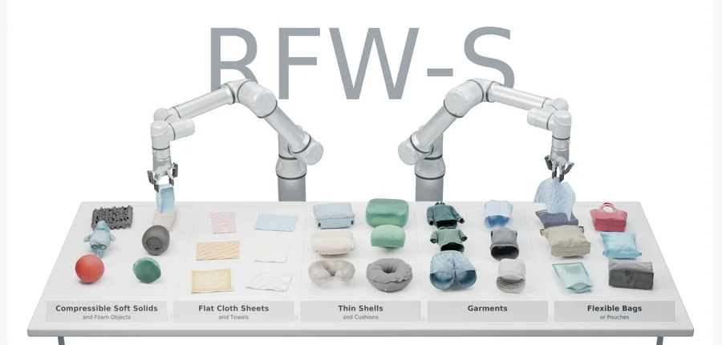 arXiv 2026-11-19 · cs.RO · #1 **[RFW-S: Everyday Deformable Objects with Independent Simulation Verification](https://arxiv.org/abs/2611.23056)** [Jiarui Guo , Saining Zhang , Jiaying Wan , Jiawei Weng , Junhao Chen , Rui Zhang , Yuanbo Lyu , Zhiheng Lee , Peishuo Li… 机构：Alibaba Group / Tsinghua University / Nanyang Technological University / Nanjing University / HKUST（[PDF](https://arxiv.org/pdf/2611.23056)） [Paper](https://arxiv.org/abs/2611.23056) · [Project](https://sjijs.github.io/RFW-S_website/) · [图源](https://arxiv.org/html/2611.23056v1/fig/teaser.png) 

中文摘要
大规模机器人仿真需要种类丰富、具有可执行物理属性且交互行为真实的可形变物体。然而，现有三维资产集合主要强调视觉多样性，可扩展的物理构建与验证仍有挑战。我们提出 RFW-S：一个大规模数据集，包含来自 485 个日常类别、跨软固体、布片、壳体、衣物和袋子五种结构家族的 83,365 个经仿真验证的资产。我们开发了整合参考引导三维生成、结构感知物理建模以及 LLM 辅助参数估计和标定的自动流水线。为保证物理可靠性，我们提出独立仿真验证框架，使用不同于参数标定所用交互的方式评价物体行为。大量实验展示了独立验证的有效性，并刻画不同物理配置下的形变响应。我们还从任务成功率和物体完整性两方面评价机器人抓取，并通过易碎物体操作的仿真到现实回放展示仿真物体的物理真实性。RFW-S 为有物理依据的仿真和具身机器人学习提供了可扩展基础。 <a href="https://arxiv.org/abs/2611.23056">原摘要来源</a>
 | 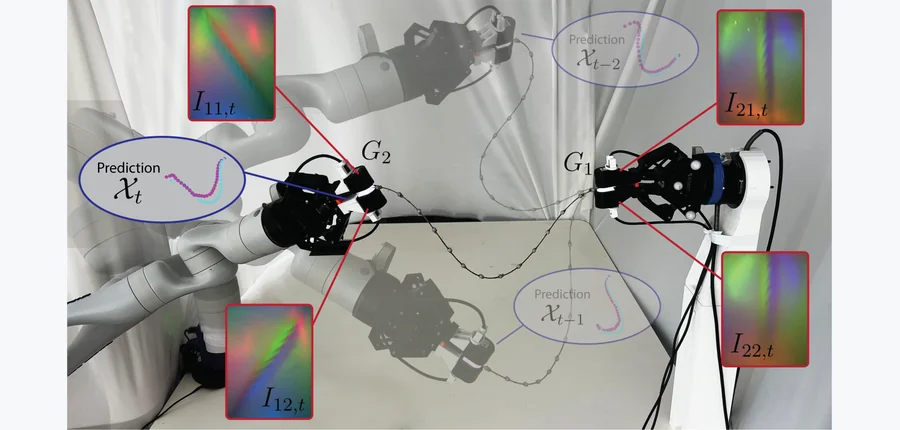 arXiv 2026-11-19 · cs.RO · #2 **[Physics-Informed Tactile-based Shape Estimation of Deformable Linear Objects](https://arxiv.org/abs/2611.22990)** [Rotem Atari , Stav Ashur , Avishai Sintov](https://arxiv.org/abs/2611.22990) 机构：Tel Aviv University（[PDF](https://arxiv.org/pdf/2611.22990)） [Paper](https://arxiv.org/abs/2611.22990) · [图源](https://arxiv.org/html/2611.22990v1/assests/System.png) 

中文摘要
准确估计可形变线状物体（DLO）的形状是机器人操作的基础难题，常受视觉遮挡及柔性材料高维构型空间的阻碍。已有力／力矩（F/T）和视觉方法往往难以应对抓取位置歧义与环境干扰。本文研究一个假设：无需任何视觉感知，仅凭触觉与本体感觉即可估计整体形状。我们认为，稠密、高分辨率触觉印迹能捕捉关键边界条件和接触梯度，足以确定 DLO 的高维构型。为验证这一点，我们提出物理信息视觉 Transformer（ViT）框架，将触觉图像映射为三维顶点链。模型利用自注意力及物理加权损失施加结构先验，使预测几何符合物体的物理流形。实验表明，该触觉方法在欧氏距离和 Chamfer 指标上取得更高的重建精度。我们还展示了这种模态的效率，以及模型向新 DLO 材料和几何形状迁移的能力。结果表明，在视觉质量差或存在遮挡的环境中，触觉反馈可作为 DLO 状态估计的一种鲁棒且计算高效的替代方式。 <a href="https://arxiv.org/abs/2611.22990">原摘要来源</a>
 | 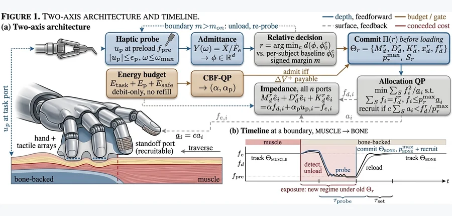 arXiv 2026-11-19 · cs.RO · #3 **[Haptic Probing for Subsurface-Aware Force Distribution on Layered Soft Tissue](https://arxiv.org/abs/2611.22195)** [Lei Shi , Xiaoyu Wang , Cheng Zhou , Yongjian Liu , Jing Wang , Dongsheng Zhang , Yonghui Zhu , Xiong Li](https://arxiv.o… 机构：affiliation 未确认 [Paper](https://arxiv.org/abs/2611.22195) · [图源](https://arxiv.org/html/2611.22195v1/Gemini_Generated_Image_ss19rtss19rtss19.png) 

中文摘要
对分层软组织进行力调节接触，最容易在皮下组成发生变化的位置失败：控制器只从加载信号推断基底，因而指导控制的估计滞后于变化；我们认为，这种滞后在柔顺组织上比骨骼支撑组织上更明显。我们使用独立的触觉通道消除滞后。在轻微预载下，短暂、低幅度的激励使局部动态导纳相对于每位受试者的基线区分肌肉和骨骼支撑组织，且发生在施加任务力之前；这种主动触觉感知用于确定控制决策，而非仅仅描述组织。随后，一个由力与触觉驱动的分配律在整个执行过程中使用该状态类别：瞬时分配使参与接触的指尖间压力均衡，而状态类别设定允许压力，继而决定手为传递目标力必须动用的接触面积；接触斑块面积因此成为受控变量，而非副产物。探测、切换和接触招募被计入分区无源性预算，因此安全监测不能抑制探测；若拒绝扩大接触范围，则放弃力跟踪而守住压力上界。我们在三名受试者的弯曲、迁移接触上报告了力跟踪和压力均匀性，状态标签来自解剖标志。 <a href="https://arxiv.org/abs/2611.22195">原摘要来源</a>
 |
| 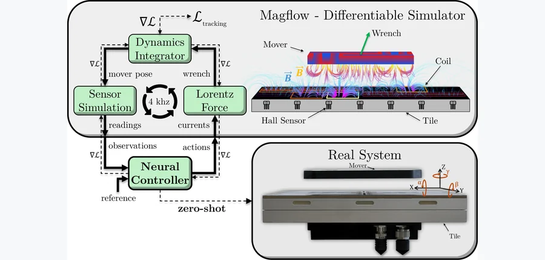 IEEE Robotics and Automation Letters (accepted Nov 2026) · #4 **[Magflow: Differentiable Simulation of Industrial-Grade 6D Magnetic Levitation](https://arxiv.org/abs/2611.23050)** [Philipp Hartmann , Jannick Stranghöner , Klaus Neumann](https://arxiv.org/abs/2611.23050) 机构：Bielefeld University / Fraunhofer IOSB-INA（[PDF](https://arxiv.org/pdf/2611.23050)） [Paper](https://arxiv.org/abs/2611.23050) · [图源](https://arxiv.org/html/2611.23050v1/magflow_VA.png) 

中文摘要
六自由度磁悬浮原则上能够实现无摩擦运输和微米级定位，但其复杂且不稳定的动力学使底层控制具有固有难度。工业系统通常依赖深入的硬件软件协同设计：联合设计动子和定子几何，以便用紧凑的手工电磁力近似将控制计算维持在千赫兹频率；然而，这对工作空间和可支持的动子拓扑施加了过于保守的限制。我们不采用手工近似来简化底层物理，而是直接计算物理过程。我们提出 Magflow，一个完全可微、GPU 并行的六自由度磁悬浮仿真器，并用它训练首个完全从仿真物理中学习的工业级六自由度磁悬浮神经控制器。我们表明，学习得到的控制器可从仿真零样本迁移到真实硬件，同时满足 4 kHz 的严格实时约束。该控制器实现了性质上新的行为，甚至能使一种不存在手工设计解的动子拓扑悬浮。这些结果表明，协同设计并非六自由度磁悬浮控制的物理必需条件。更广泛地说，从仿真物理中学习控制，可能在要求严苛的工业领域找到传统控制工程难以达到的解。源代码和演示视频已公开，链接见原文。 <a href="https://arxiv.org/abs/2611.23050">原摘要来源</a>
 | 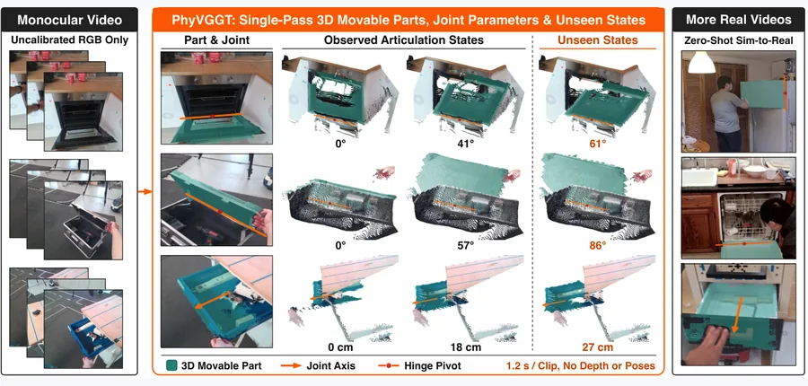 arXiv 2026-11-19 · cs.CV · #5 **[PhyVGGT: Feed-Forward Articulated Object Reconstruction from Monocular Videos](https://arxiv.org/abs/2611.22244)** [Qi Shao , Zhihao Cao , Shuhao Zhai , Anh Nguyen , Hong Liang , Baoru Huang , Liang Li](https://arxiv.org/abs/2611.22244) 机构：Harbin Engineering University / University of Liverpool / National University of Singapore / University of Macau / Imperial College London（[PDF](https://arxiv.org/pdf/2611.22244)） [Paper](https://arxiv.org/abs/2611.22244) · [图源](https://arxiv.org/html/2611.22244v1/teaser.png) 

中文摘要
从未标定的单目视频中重建关节物体的三维可动部件、关节参数和未见过的运动状态，对机器人操作和交互数字孪生十分重要。现有逐场景优化方法耗时数分钟至数小时，且需要外部深度或相机位姿；前馈三维基础模型虽能一次生成稠密点图，却不分割可动部件或推断关节。即使基于这些单目点图，直接回归或拟合连续关节也会在普通视频中失败，因为跨帧注意力在深层模糊运动部件边界、低估视线方向运动，并使小开合角下的连续关节轴病态。针对这些问题，我们提出 PhyVGGT：基于冻结的三维基础模型，在单次前向计算中将可动部件匹配和闭式关节估计锚定到静止基座的未畸变几何。首先，部件与运动解码器融合中间逐帧 token 和全局 token，并以静态基座查询为参照定义部件查询，从而分割三维部件、在静态基座上对齐点图并预测学习到的 Bingham 先验。其次，运动学推断层对静态表面法线拟合正交曼哈顿坐标系，在结合成对运动散布与学习先验的 Bingham 后验下闭式选择关节轴，再求解线性系统得到铰链枢轴，以驱动未见状态。仅用合成数据训练后，PhyVGGT 在五个基准上取得最先进单目表现，优于 FAMOS 和单目 ArtiPoint，中位误差也优于使用带位姿 RGB-D 的 ArtiPoint；处理 48 帧视频用时 6.8 秒，而 Articulat3D 的逐场景优化需数小时。项目页见原文。 <a href="https://arxiv.org/abs/2611.22244">原摘要来源</a>
 | 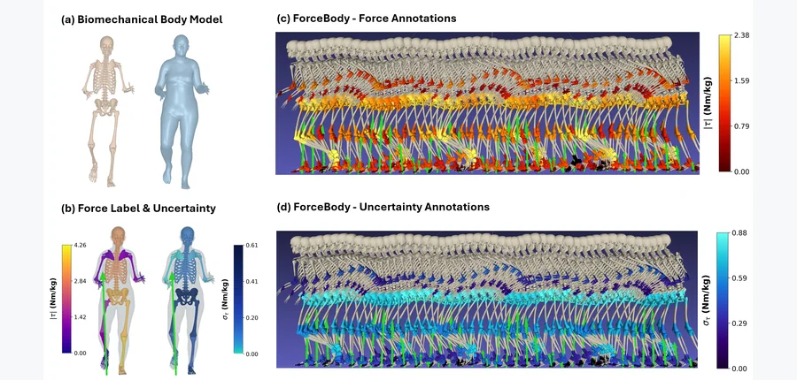 arXiv 2026-11-19 · cs.CV · #6 **[ForceBody: Force-Paired Parametric Body Motion with Torque Uncertainty](https://arxiv.org/abs/2611.22769)** [Joonwoo Kwon , Yufei Zhang , Xiaoming Liu , Zijun Cui](https://arxiv.org/abs/2611.22769) 机构：affiliation 未确认 [Paper](https://arxiv.org/abs/2611.22769) · [图源](https://arxiv.org/html/2611.22769v1/fig_new/teaser_new.png) 

中文摘要
力和力矩驱动人体运动，是生物力学、机器人与物理感知动画的核心，但基于学习的身体重建和生成流水线往往缺少这些量。部分运动数据集提供力标注，但与标注配对的运动序列不兼容现代学习流水线使用的参数化人体模型。此外，现有数据集通常通过逆动力学获得关节力矩，而逆动力学对输入运动学质量固有敏感；这些数据集却没有量化力矩估计的可靠性。我们用 ForceBody 填补这一空白：这是首个把真实力监督带入参数化人体表示、并提供逐样本力矩不确定性的数据集。ForceBody 将 SKEL 人体模型与地面反作用力及逆动力学关节力矩配对，覆盖 140 名受试者的 10,386 次运动试验（970 万帧、26.9 小时）。每个力矩标签都有逐帧、逐关节的不确定性标注，由在逆动力学流水线中进行蒙特卡洛采样获得。我们以 SKEL 运动预测地面反作用力和关节力矩，评测了六种架构：MLP、Conv1D、LSTM、GRU、Mamba2 和 Transformer。作为发布的不确定性的一种用法，以逐样本不确定性加权微调 Transformer，使关节力矩估计的平均绝对误差（MAE）降低 5%。代码和数据链接见原文。 <a href="https://arxiv.org/abs/2611.22769">原摘要来源</a>
 |
| 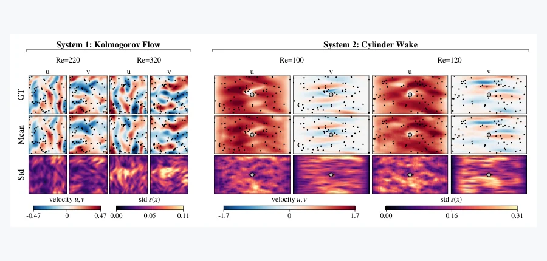 arXiv 2026-11-19 · cs.LG · #7 **[Physically Admissible Generative Flow Matching for Sparse Flow Reconstruction](https://arxiv.org/abs/2611.22549)** [Yuhao Wang , Yuanxi Peng](https://arxiv.org/abs/2611.22549) 机构：National University of Defense Technology（[PDF](https://arxiv.org/pdf/2611.22549)） [Paper](https://arxiv.org/abs/2611.22549) · [图源](https://arxiv.org/html/2611.22549v1/fig_recon_combined.png) 

中文摘要
从稀疏、局部观测重建完整流体速度场是高度不适定的逆问题：大部分空间域没有观测，离散守恒律必须严格成立，预测不确定性还必须可靠。现有生成模型通常仅在最终输出施加物理约束或使用软惩罚，使中间生成轨迹不受约束。我们提出可行子空间一致性（FSC）框架，把物理可容许性保持为连续生成动力学的不变量：切空间匹配将整个 ODE 轨迹限制在离散守恒流形上，质量正交归一坐标则保持动能度量。稀疏重建因而转化为冻结 FSC 先验的潜空间中的摊销后验输运，使每个后验样本无需逐样本投影循环便继承不可压缩性和边界条件。我们在周期性 Kolmogorov 流上验证 FSC，使用精确谱投影分离路径切向性与度量等距性；也在带浸入障碍的有壁圆柱尾流上用无矩阵迭代投影验证。FSC 避免了终点投影导致的模式覆盖坍塌（覆盖率从 0.000 提升至 0.790），同时消除高波数频谱失真。在稀疏重建中，相比无条件先验，摊销 FSC 将全局相对误差分别降低 50% 和 46%，传感器残差分别降低 63% 和 55%，并给出经过校准、具有空间异质性的不确定性。 <a href="https://arxiv.org/abs/2611.22549">原摘要来源</a>
 | 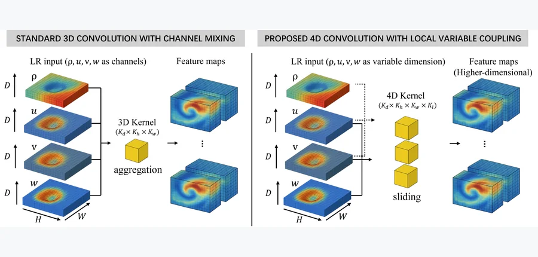 arXiv 2026-11-19 · physics.flu-dyn · #8 **[A high-dimensional spatial-physical coupling operator for generalizable super-resolution of three-dimensional turbulent flows](https://arxiv.org/abs/2611.22951)** [Zengyuan Zuo , Junjun Jiang , Fei Mu , Xubo Wang , Xianming Liu](https://arxiv.org/abs/2611.22951) 机构：Harbin Institute of Technology（[PDF](https://arxiv.org/pdf/2611.22951)） [Paper](https://arxiv.org/abs/2611.22951) · [图源](https://arxiv.org/html/2611.22951v1/pics/convl.jpg) 

中文摘要
准确表示湍流需要同时捕捉多尺度空间结构，以及不同物理量（例如速度分量和密度）之间复杂、非线性的耦合。然而在实践中，硬件限制和计算成本常使湍流数据的空间分辨率偏低。现有数据驱动超分辨率方法通过卷积神经网络（CNN）学习映射，已显示潜力，但通常把物理变量视为相互独立的通道。这种简化忽略变量间固有相关性，导致模型在极度稀疏条件或分布外情形下难以实现高保真重建。为解决这一问题，我们提出与架构无关的空间—物理耦合算子，把标准卷积扩展到联合空间—变量维度。与常规线性通道混合不同，该框架在 CNN 内构造统一的空间—物理表示，以显式捕捉局部变量间交互。通过把特征提升到更高维流形，该算子显著增强模型的表示能力。实验表明，这一方法能够实现较强的三维湍流重建性能与零样本泛化，并为超分辨率提供物理感知归纳偏置。更广泛地说，这项工作提示高维算子可能有助于建模复杂的多尺度湍流。 <a href="https://arxiv.org/abs/2611.22951">原摘要来源</a>
 | 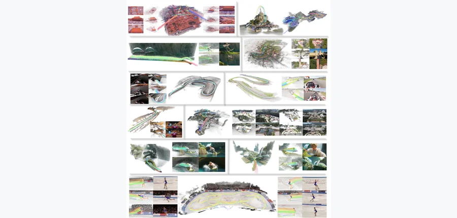 arXiv 2026-11-19 · cs.CV · #9 **[$π^4$: A Foundation Model for 4D Scene Geometry and Motion](https://arxiv.org/abs/2611.23144)** [Yifan Wang , Weiguang Zhao , Ni Yang , Haoyu Guo , Junting Dong , Weinan Zhang , Chunhua Shen](https://arxiv.org/abs/2611… 机构：Shanghai Artificial Intelligence Laboratory / Shanghai Jiao Tong University / Zhejiang University（[PDF](https://arxiv.org/pdf/2611.23144)） [Paper](https://arxiv.org/abs/2611.23144) · [图源](https://arxiv.org/html/2611.23144v1/teaser.png) 

中文摘要
π⁴ 是统一的四维场景感知基础模型。给定现实环境中多样的未标定 RGB 观测——单张图像、无序图像集合或视频序列——它可以恢复稠密几何、相机位姿和度量尺度，并在多图像输入时恢复二维／三维点轨迹及运动物体掩码。模型把几何分支与受几何条件约束的运动分支耦合；后者预测图像空间对应关系，再利用重建的目标视角几何将其提升到三维。在多种基准上，π⁴ 的几何评价总体平均排名最佳，单视角及多视角二维／三维点跟踪和运动物体分割表现也具有竞争力。共享骨干网络下，完整几何与运动系统约含 5 亿参数，少于多数基线的一半。它一次前向计算即可同时生成重建与轨迹，包括含上千张输入图像的大规模场景，尽管训练时上下文最多只有 64 个视角。我们还介绍了支撑这些能力的数据与训练方案，并对关键设计选择开展实证研究。代码和模型见原文链接。 <a href="https://arxiv.org/abs/2611.23144">原摘要来源</a>
 |
| 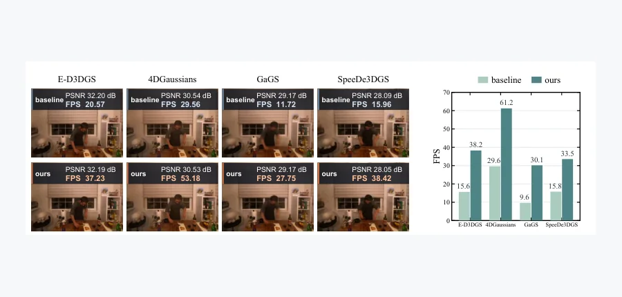 arXiv 2026-11-19 · cs.CV · #10 **[CueSplat: Learning to Schedule Sparse Deformation for Dynamic Gaussian Splatting on Edge Devices](https://arxiv.org/abs/2611.22095)** [Qingyuan Tang (1), He Zhu (1), Shixuan Sun (1), Anbang Wu (1), Jingwen Leng (1), Minyi Guo (1), Yu Feng (1) ((1) Shanghai… 机构：Shanghai Jiao Tong University（[PDF](https://arxiv.org/pdf/2611.22095)） [Paper](https://arxiv.org/abs/2611.22095) · [图源](https://arxiv.org/html/2611.22095v1/teaser_body.png) 

中文摘要
基于形变的四维高斯泼溅（4DGS）可用于动态场景渲染，但在边缘设备上为每一帧的所有高斯元运行形变网络开销很大。我们发现，高斯轨迹通常具有局部可预测性，但预测可靠性随高斯元和时间而变化。因此，我们提出 CueSplat：一个训练后框架，利用局部时间规律，同时冻结预训练骨干网络并保留原有高斯集合。具体而言，CueSplat 根据近期历史预测高斯属性，并用轻量的学习型路由器，在离线标定的场景特定预算内选择需要精确形变更新的高斯元。选择过程兼顾预测可靠性和渲染贡献。选出的索引在临近帧复用以降低路由开销，而选中高斯元仍每帧得到精确更新。为控制累积预测误差，系统利用漂移信号安排连续三帧全量形变，重建预测历史。在四种主流 4DGS 算法上的评测中，CueSplat 在 Jetson AGX Orin 和 Orin NX 上分别实现最高 6.74 倍和 8.15 倍加速，画质下降很小（数据集平均 PSNR 至多降低 0.16 dB）。 <a href="https://arxiv.org/abs/2611.22095">原摘要来源</a>
 | 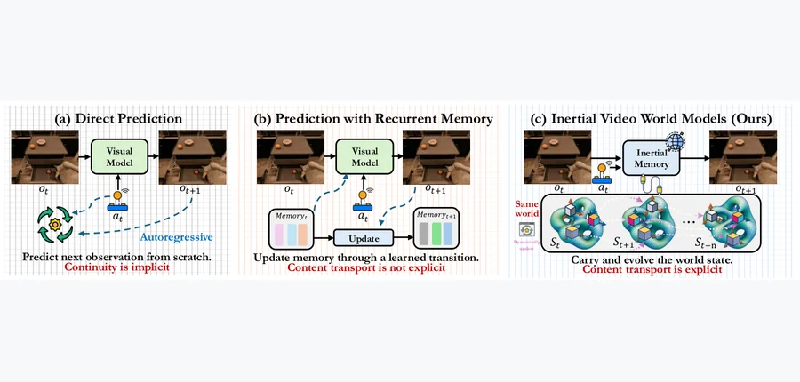 arXiv 2026-11-19 · cs.CV · #11 **[Inertial Video World Models](https://arxiv.org/abs/2611.22314)** [Yuan Gao , Fan Xu , Yu Guo , Yuxu Lu , Zhengru Fang , Hao Wu , Xiaomeng Huang](https://arxiv.org/abs/2611.22314) 机构：Tsinghua University / USTC / City University of Hong Kong / Hong Kong Polytechnic University / HKUST（[PDF](https://arxiv.org/pdf/2611.22314)） [Paper](https://arxiv.org/abs/2611.22314) · [图源](https://arxiv.org/html/2611.22314v1/fig_intro.png) 

中文摘要
物理世界具有惯性：它从既有状态继续演化，而非在每一瞬间重新生成。然而，许多现有视频世界模型没有显式的惯性状态演化机制，使运动和结构的连续性隐含在视频预测中。自回归展开时，反复重建会累积误差，使预测动力学不稳定。为解决这一问题，我们提出 InertialWorld 惯性视频世界模型，把惯性设为自回归预测的结构先验：既有场景证据随时间传递，而非每步重建。其核心是惯性记忆，它使记忆从被动的预测上下文变为演化中的视频状态，并包含两个互补视角：稠密欧拉网格保存与场景对齐的证据，持久的拉格朗日载体把局部内容绑定到学习得到的规范坐标。每一步，模型根据动作条件运动输运载体内容，从输运后的载体和稠密网格预测完整的下一视频状态，再以学习得到的门控结合已输运和新预测的内容，形成下一步的记忆。在机器人操作、三维游戏仿真和开放世界导航等多个领域的大量实验表明，相比强视频世界模型基线，InertialWorld 具有竞争力的自回归预测表现。代码链接见原文。 <a href="https://arxiv.org/abs/2611.22314">原摘要来源</a>
 | 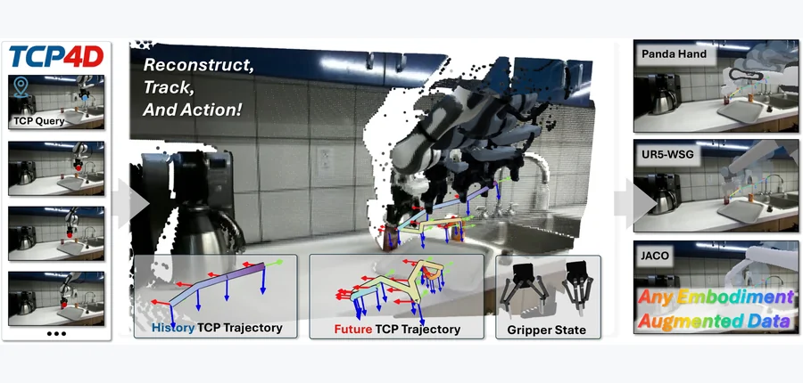 arXiv 2026-11-19 · cs.RO · #12 **[TCP4D: A Unified Tool-Center-Point Tracking and Generation Model for Robot Manipulation](https://arxiv.org/abs/2611.23143)** [Haosong Peng , Xiangyang Liu , Zhengshen Zhang , Yunfeng Fan , Tianyu Qi , Xin Xia , Yufeng Zhan , Wenchao Xu](https://ar… 机构：affiliation 未确认 [Paper](https://arxiv.org/abs/2611.23143) · [图源](https://arxiv.org/html/2611.23143v1/teaser.png) 

中文摘要
机器人操作视频提供丰富的视觉经验，但从 RGB 观测中恢复机器人动作和夹爪状态标注仍有挑战。以不依赖具体机器人形态的工具中心点（TCP）位姿为动作空间，我们提出 TCP4D：在统一模型中，共享的四维场景表示既追踪已观察的 TCP 运动，也生成未来 TCP 轨迹。给定单目视频和初始二维 TCP 查询，跟踪器直接恢复 SE(3) 中的度量 TCP 位姿和夹爪状态，同时恢复场景几何及相机参数。生成器沿恢复的 TCP 轨迹从同一四维表示采样局部特征，再与机器人观测和语言指令结合，预测未来 TCP 状态。我们提出跨形态数据增强流水线，将现有 RGB 视频转为其他机器人形态的演示：重定向恢复的运动并合成对应观测，无须记录源机器人状态。实验显示，跟踪器在 DROID 和 RoboLab 上的绝对轨迹误差分别为 7.60 和 16.07 mm，且仅用十次演示便可适配新机器人形态。生成器在 RoboTwin 上平均成功率为 69.19%，在两个真实任务上优于成熟策略模型；源演示和增强演示联合训练，相比只用增强演示，将目标机器人成功率提高 41.5%。 <a href="https://arxiv.org/abs/2611.23143">原摘要来源</a>
 |
| 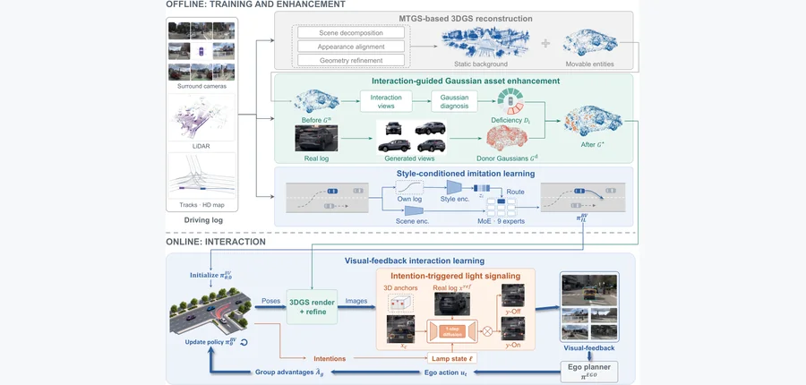 arXiv 2026-11-19 · cs.RO · #13 **[Making the World React Realistically: A Closed-Loop Interactive World Model for Autonomous Driving](https://arxiv.org/abs/2611.22691)** [Jia Hu , Yang Chang , Panqu Wang , Zhijun Fu , Chang Liu , Changjian Yu , Jintao Lai](https://arxiv.org/abs/2611.22691) 机构：Tongji University / ZERON / Zhengzhou University of Light Industry / Budapest University of Technology and Economics / HUN-REN SZTAKI（[PDF](https://arxiv.org/pdf/2611.22691)） [Paper](https://arxiv.org/abs/2611.22691) · [图源](https://arxiv.org/html/2611.22691v1/methodology_overview.png) 

中文摘要
世界模型（WM）能够生成超出记录日志的驾驶场景，以在未见交互中训练和评价自动驾驶系统。然而，现有世界模型忽视车辆交互与自车视觉观测的关系，因此难以同时保证行为真实性和视觉保真度。我们提出闭环交互世界模型，耦合行为建模与视觉渲染。首先，以模仿学习得到的背景车辆（BV）策略，在针对会对渲染图像作出反应的端到端自车规划器的闭环中，用多智能体强化学习微调，使交互行为匹配真实日志。其次，这些交互暴露的视角引导对每个三维高斯车辆资产的逐高斯诊断：减弱观测不足高斯元的视角依赖颜色，用生成高斯元填补从未观测的表面，同时保留已有观测外观。第三，信号灯由编辑器依据车辆驾驶意图渲染；编辑器通过带信号灯状态分类器的反事实微调，学习车辆未观测到的灯光状态。在长尾闭环场景中，该方法相比最先进世界模型，将与真实交互行为的差异降低 85%，并把新视角车辆 PSNR 提高 2.0 dB。结果还显示世界模型中的背景车辆信号灯具有作用：表达其驾驶意图的渲染信号灯，在四分之一的场景里间接影响自车驾驶行为。 <a href="https://arxiv.org/abs/2611.22691">原摘要来源</a>
 | 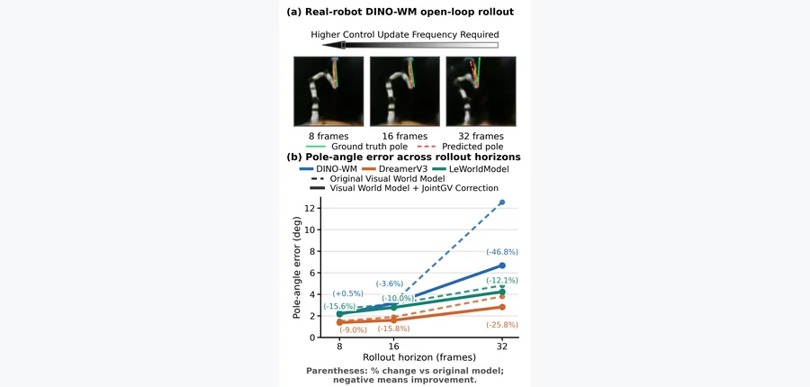 arXiv 2026-11-19 · cs.RO · #14 **[JointGV: Structure-Aware Correction of Visual World Models with Parallel Graph Dynamics for Long-Horizon Modeling](https://arxiv.org/abs/2611.22543)** [Tian Lyu , Yichen Jiang , Ziyuan Cheng , Yunda Yan , Xiangyu Pan , Junjie Jiang , Jialin Yu , Boyu Ning , Pietro Liò , Fa… 机构：University of Oxford / UESTC / Monash University / UCL / University of Bath / KTH / University of Cambridge（[PDF](https://arxiv.org/pdf/2611.22543)） [Paper](https://arxiv.org/abs/2611.22543) · [图源](https://arxiv.org/html/2611.22543v1/figures/real_cartpole_long_rollout.png) 

中文摘要
视觉世界模型根据动作预测未来视觉状态，但实体位姿和空间关系的递归误差限制了它们用于机器人规划与控制时的长时预测。我们研究是否能用独立预测的关系状态修正这种漂移，而无需重构视觉模型。难点在于图节点与视觉状态既不共享元素，也不共享特征空间。我们提出联合图—视觉动力学校正（JointGV）：一个基于跨粒度动力学假设的插件，即尽管表示不同，图节点和视觉状态的变化描述同一物理转移。JointGV 与视觉世界模型并行展开任务条件场景图，耦合二者的预测变化，再将得到的图运动上下文与图预测节点位置结合，计算有界残差。图学习和校正的梯度不会传入原视觉动力学模型。我们将 JointGV 接入 DINO-WM（空间 token）及 DreamerV3（全局潜状态），在 DMC Cheetah Run 和 Walker Walk 上以三个随机种子评测，并扩展到接触丰富的 DMC Finger Turn Hard 操作任务。在 32 步展开中，JointGV 改善结构及视觉预测精度，使关节位置误差降低 11%–28%。对空间 token，学习到的图—视觉变化耦合比向每个 token 广播相同的平均图运动上下文误差更低，特别是在图像中不相邻部件看起来靠近时。在真实机器人倒立摆序列上，JointGV 将 DINO-WM 的 32 步杆角误差从 12.56° 降到 6.69°，并改善 DreamerV3 和 LeWorldModel。在仿真倒立摆控制中，使用 JointGV 校正展开训练的 actor 完成 50 次中的 46 次，而使用原始展开则一次也未完成。 <a href="https://arxiv.org/abs/2611.22543">原摘要来源</a>
 | 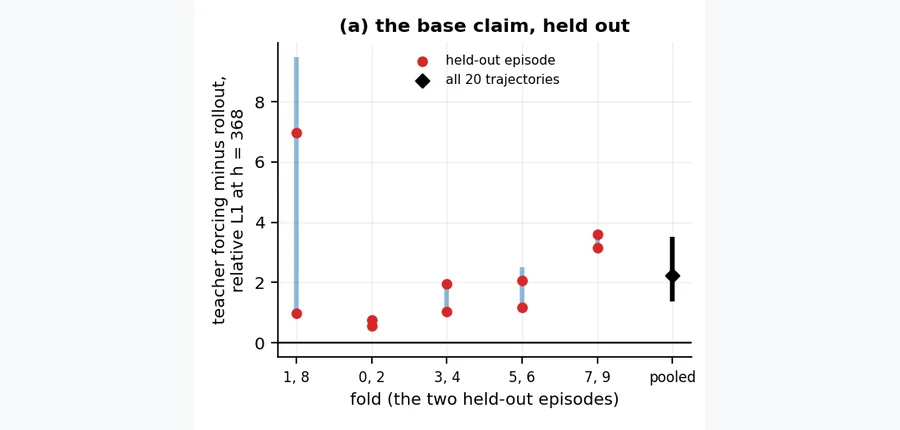 arXiv 2026-11-19 · cs.RO · #15 **[Auditing a Learned Simulator for Legged Robots: The Robotic World Model on ANYmal D](https://arxiv.org/abs/2611.23118)** [Joyjeet Singh](https://arxiv.org/abs/2611.23118) 机构：Independent Researcher（[PDF](https://arxiv.org/pdf/2611.23118)） [Paper](https://arxiv.org/abs/2611.23118) · [图源](https://arxiv.org/html/2611.23118v1/figures/fig02_heldout_episodes.png) 

中文摘要
腿式机器人可以在学习型仿真器中学会行走：神经网络预测机器人下一状态，并以自己的预测为输入持续展开。此类模型通常按单步预测训练和检查，尽管策略会使用它们展开一百步甚至更长。我们无需 GPU，对一个已发表系统进行端到端审计：ANYmal D 四足机器人的 Robotic World Model（RWM）动力学模型及其后续 RWM-U 的不确定性估计。我们重建模型，使输出、损失和梯度与发布代码完全一致，并测量 101 个已训练仿真器、200 个压缩副本，以及三种其他架构的 38 个仿真器；还在这些仿真器中训练策略，并在手工构建的机器人 MuJoCo 模型中测试。使用模型自身展开训练，在 368 步时的全部十次预注册留出测试中优于单步训练，尽管单步训练在一步预测上更好。因此，单步检查会误判设计选择：剪掉 30% 权重后，一步预测仍保留原模型技能的 90%，但在 2 秒时只保留 39%。集成模型分歧能很好地排序展开误差（100 步时 Spearman 相关系数为 +0.90），但其一倍标准差区间仅覆盖 4.6% 的结果，而校准估计应覆盖 68%，原因是每个网络自身的方差在实现的损失下坍塌。两个无需记录未来状态的检查方法能很好地排序一些仿真器集合，但在主要测试中均未被证明优于八步误差。在机器人层面，预测精度并未预示行走效果：测试的 18 个微调副本在一步和八步预测上都优于发布模型，但其中 13 个产生失败策略；对任何检查方法能否依据策略表现排序仿真器的预注册测试也未得出结论。在次要测试中，把作者策略放进各仿真器运行可较好地排序它们。我们还报告了撤回的九项自身主张。研究范围限于一台机器人、一种步态、仿真数据，无硬件实验。 <a href="https://arxiv.org/abs/2611.23118">原摘要来源</a>
 |
| 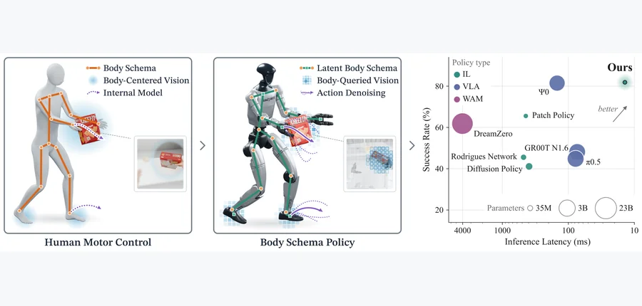 arXiv 2026-11-19 · cs.RO · #16 **[Body Schema Policy: Body as the Vision-Action Interface for Efficient Robot Loco-Manipulation](https://arxiv.org/abs/2611.22713)** [Lechen Zhang , Chenyuan Chen , Muxin Zhou , Zewen He , Yoshihiko Nakamura](https://arxiv.org/abs/2611.22713) 机构：Mohamed bin Zayed University of Artificial Intelligence（[PDF](https://arxiv.org/pdf/2611.22713)） [Paper](https://arxiv.org/abs/2611.22713) · [Project](https://www.lechen-zhang.com/BSP/) · [图源](https://arxiv.org/html/2611.22713v1/BSP_teaser_fig1_v24.png) 

中文摘要
目前，机器人能够通过扩大规模学习全身移动操作，但最强策略有数十亿参数，仍需针对任务微调。人类处理能力有限，却通过组织视觉与运动的身体图式高效学习和行动。我们提出身体图式策略（BSP），一种把身体图式纳入视觉—动作接口的模仿学习策略。它的潜在身体图式把关节与连杆 token 放在机器人运动学树上，学习得到的螺旋运动在连杆之间传递特征。通过身体部件查询视觉，每个部件提取自己的视觉证据，用来调节其动作的去噪。凭借这种归纳偏置，BSP 返回动作块的速度快于所比较的所有策略。即使没有空间监督，也会涌现紧凑且因身体部件而异的视觉读出：操作指令强烈依赖任务物体，移动指令则更广泛地响应场景。在九个仿真的 Unitree G1 全身任务上，BSP 以少 75 倍的参数匹配 Ψ₀ 人形机器人基础模型，并使 Diffusion Policy 的成功率近乎翻倍；在真实 G1 和 Fetch 移动机械臂上也观察到同样结果。 <a href="https://arxiv.org/abs/2611.22713">原摘要来源</a>
 | 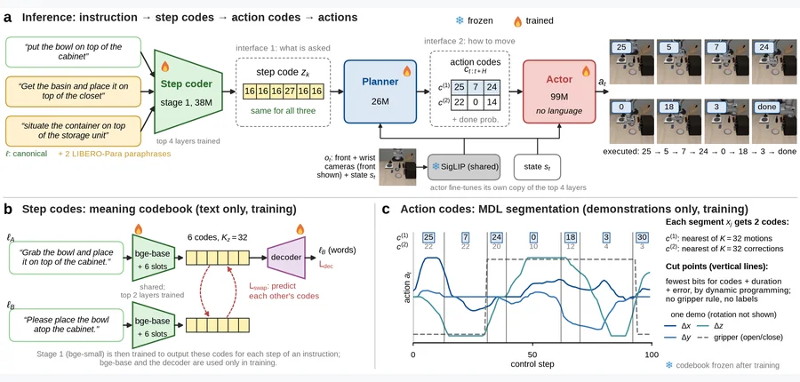 arXiv 2026-11-19 · cs.CV · #17 **[CoBoVLA: Decoupling Language from Action with Discrete Codes for Robust and Interpretable Robot Manipulation](https://arxiv.org/abs/2611.22395)** [Mehul Arora , Dhruv Agarwal , Ambuj Agrawal](https://arxiv.org/abs/2611.22395) 机构：UC San Diego / Carnegie Mellon University（[PDF](https://arxiv.org/pdf/2611.22395)） [Paper](https://arxiv.org/abs/2611.22395) · [图源](https://arxiv.org/html/2611.22395v1/fig/method_figure.png) 

中文摘要
视觉—语言—动作（VLA）模型在 LIBERO 基准上有较高成功率，但对指令改写仍敏感。参数量为 6 亿至 75 亿的现有 VLA 在 LIBERO-Para 上表现下降 22–52 个百分点；SmolVLA 下降更大，从 83% 降到 8%。由于多数 VLA 联合学习语言理解和动作生成，难以确定失败源于误解指令还是执行出错。为此，我们提出 CoBoVLA（CodeBookVLA），一个 2.5 亿参数的 VLA，通过学习得到的可解释离散码将语言理解、规划和控制解耦。文本编码器将指令映射为共享的步骤码，视觉规划器再转为动作码序列，由不依赖语言的 actor 执行。这种设计提高对指令改写的鲁棒性，也让失败可追溯到具体阶段。它还通过仅编码一次指令及使用紧凑离散表示，使各组件保持轻量，可在资源受限硬件上高效实时控制。在匹配协议下，CoBoVLA 在 LIBERO-Goal 上达到 91.4% 成功率，而 SmolVLA 为 82.8%；每个控制步延迟 17 ms。在 LIBERO-Para 上，它面对 4,092 种未见指令改写达到 81.1%，在匹配回合上达到 78.5%，而经改写指令 LoRA 微调的 SmolVLA 为 36.5%。在没有两步演示的条件下，CoBoVLA 完成 160 个自由形式两步任务的 48.8%。最后，指令正确编码时成功率达 91%，否则降至 27.2%，说明语言理解是剩余失败的主要来源。总体上，这些结果表明，解耦语言理解与控制可提高指令鲁棒性，并使 VLA 失败更易诊断。 <a href="https://arxiv.org/abs/2611.22395">原摘要来源</a>
 | 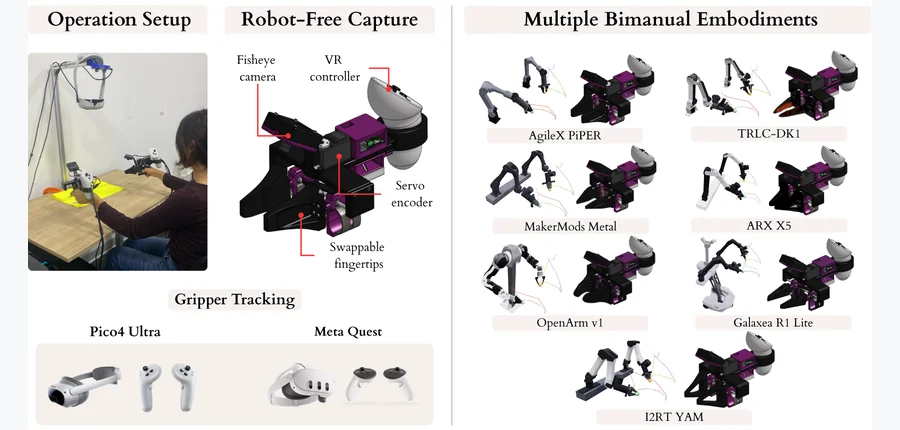 arXiv 2026-11-19 · cs.RO · #18 **[HandUMI: A Modular Hand-Worn Parallel-Jaw Interface for Robot-Free Bimanual Data Capture](https://arxiv.org/abs/2611.22146)** [Brik Meza , Leonardo Perez , Alvaro Mendoza-Li , Aniela Ubillus , Mitshell Ramos , Raul Bastidas , Mauricio Olivera , Bry… 机构：Mu Robotics / McGill University / Mila / PUCP / NONHUMAN / TUM / UPC（[PDF](https://arxiv.org/pdf/2611.22146)） [Paper](https://arxiv.org/abs/2611.22146) · [图源](https://arxiv.org/html/2611.22146v1/figures/handumi_overview.png) 

中文摘要
HandUMI 使用佩戴在手上的平行夹爪接口采集无需机器人的双臂演示。可更换的指尖与机器人已安装的夹爪匹配；Quest／PICO 控制器跟踪双手，编码器测量夹爪开度。与机器人型号无关的记录通过逆运动学重定向到七种仿真双臂机械臂（位置误差中位数不超过 1.2 mm；被拒绝的回合不超过 4.7%）。在双臂折毛巾任务中，562 条无机器人演示用于训练真实 PiPER 机械臂上的策略：ACT 在 20 次尝试中成功 12 次，微调的 π₀.₅ 成功 7 次；只用前 101 条演示训练的 ACT 和基础 π₀.₅ 都是 0/20。硬件和软件以 Apache-2.0 许可证开源；配合 Quest 3S，一对设备成本为 557 美元，不含可选 ZED Mini 和主机。项目网站见原文。 <a href="https://arxiv.org/abs/2611.22146">原摘要来源</a>
 |
| 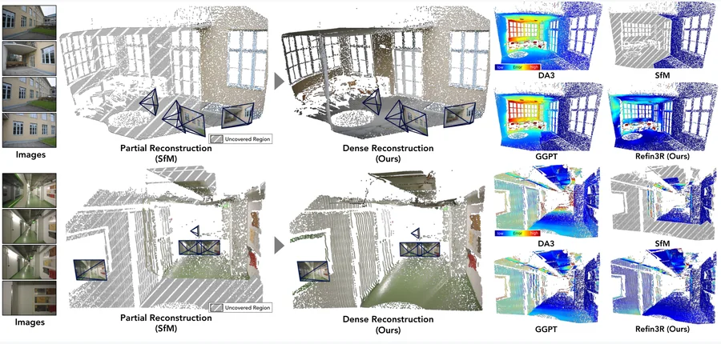 arXiv 2026-11-19 · cs.CV · #19 **[Refin3R: Geometry-Guided Refinement for Feed-Forward 3D Reconstruction](https://arxiv.org/abs/2611.23051)** [Jongmin Lee , Jaeyeong Kim , Seungryong Kim](https://arxiv.org/abs/2611.23051) 机构：KAIST AI（[PDF](https://arxiv.org/pdf/2611.23051)） [Paper](https://arxiv.org/abs/2611.23051) · [Project](https://cvlab-kaist.github.io/Refin3R) · [图源](https://arxiv.org/html/2611.23051v1/teaser.png) 

中文摘要
前馈三维重建模型从多张图像一次预测稠密点图。然而，缺少显式几何约束时，预测常在视角间不一致，且缺乏细粒度精度。近期方法加入相机位姿或深度等几何先验，但仅将其作为辅助输入、逐视角独立处理，或只在有先验的位置细化几何。我们提出 Refin3R，用运动恢复结构（SfM）点细化前馈点图，并将 SfM 几何传播到整个图像网格。在双分支架构中，二维分支用几何感知骨干特征把 SfM 几何扩展到其覆盖范围之外；三维分支则对所有视角的 SfM 点进行推理，捕捉仅凭图像网格无法表示的多视角结构。两个分支双向交换信息，联合细化每个视角，生成稠密且准确的点图。在 ScanNet++、ETH3D、Tanks&amp;Temples 及分布外人体和手术场景上，Refin3R 的点图精度持续优于前馈和几何引导方法，同时运行速度快于最强几何引导基线。 <a href="https://arxiv.org/abs/2611.23051">原摘要来源</a>
 |   |   |
<!-- PAPER_CARDS_END -->

## 检索概况

- **检索窗口**：北京时间 2026-11-19 09:00–09:09；官方 New listing 显示的批次日期为 2026-11-18。
- **主榜范围**：14 个目标分类页共 **743** 条 New 记录，按 arXiv ID 去重后仍为 **743** 篇；本期入选 **19** 篇，仅含官方 New submissions。
- **排序规则**：先列三维物理、形变、力与接触，再列动态三维与有具体任务证据的机器人工作。相关性、机构强度、局限和改进建议均为编辑推断；标题、作者、分类与摘要依据所链官方 arXiv 页面。
- **机构核实**：优先核对官方 PDF 首页；3 篇未能可靠确认，标注为“affiliation 未确认”。
- **图文缺失**：真实论文配图缺失 0 篇；原摘要缺失 0 篇。

## 官方 New listing 状态

| 分类页 | 官方 listing 日期 | New |
|---|---|---:|
| [cs.AI](https://arxiv.org/list/cs.AI/new?show=2000) | 2026-11-18 | 109 |
| [cs.CV](https://arxiv.org/list/cs.CV/new?show=2000) | 2026-11-18 | 175 |
| [cs.GR](https://arxiv.org/list/cs.GR/new?show=2000) | 2026-11-18 | 1 |
| [cs.LG](https://arxiv.org/list/cs.LG/new?show=2000) | 2026-11-18 | 107 |
| [cs.RO](https://arxiv.org/list/cs.RO/new?show=2000) | 2026-11-18 | 65 |
| [eess.IV](https://arxiv.org/list/eess.IV/new?show=2000) | 2026-11-18 | 2 |
| [eess.SP](https://arxiv.org/list/eess.SP/new?show=2000) | 2026-11-18 | 13 |
| [eess.SY](https://arxiv.org/list/eess.SY/new?show=2000) | 2026-11-18 | 29 |
| [math.DS](https://arxiv.org/list/math.DS/new?show=2000) | 2026-11-18 | 11 |
| [math.NA](https://arxiv.org/list/math.NA/new?show=2000) | 2026-11-18 | 25 |
| [math.OC](https://arxiv.org/list/math.OC/new?show=2000) | 2026-11-18 | 23 |
| [physics](https://arxiv.org/list/physics/new?show=2000) | 2026-11-18 | 83 |
| [cond-mat](https://arxiv.org/list/cond-mat/new?show=2000) | 2026-11-18 | 95 |
| [stat.ML](https://arxiv.org/list/stat.ML/new?show=2000) | 2026-11-18 | 5 |
| **合计** | — | **743** |

## Top papers

| # | 论文 | 分类 | 作者 | 机构（PDF 首页） | 相关性（推断） | 机构强度（推断） | 阅读 |
|---:|---|---|---|---|---|---|:---:|
| 1 | [RFW-S: Everyday Deformable Objects with Independent Simulation Verification](https://arxiv.org/abs/2611.23056) | [cs.RO](https://arxiv.org/abs/2611.23056) | [Jiarui Guo , Saining Zhang , Jiaying Wan , Jiawei Weng , Junhao Chen , Rui Zhang , Yuanbo Lyu , Zhiheng Lee , Peishuo Li , Jingrun Du , Weiqing Xiao , Weiyi Lin , Zenan Meng , Hu Wei , Lin Qu , Zongzheng Zhang , Hao Zhao , Chaojian Li](https://arxiv.org/abs/2611.23056) | Alibaba Group / Tsinghua University / Nanyang Technological University / Nanjing University / HKUST（[PDF](https://arxiv.org/pdf/2611.23056)） | 高：3D×物理／接触 | 未独立评级 | A |
| 2 | [Physics-Informed Tactile-based Shape Estimation of Deformable Linear Objects](https://arxiv.org/abs/2611.22990) | [cs.RO](https://arxiv.org/abs/2611.22990) | [Rotem Atari , Stav Ashur , Avishai Sintov](https://arxiv.org/abs/2611.22990) | Tel Aviv University（[PDF](https://arxiv.org/pdf/2611.22990)） | 高：3D×物理／接触 | 未独立评级 | A |
| 3 | [Haptic Probing for Subsurface-Aware Force Distribution on Layered Soft Tissue](https://arxiv.org/abs/2611.22195) | [cs.RO](https://arxiv.org/abs/2611.22195) | [Lei Shi , Xiaoyu Wang , Cheng Zhou , Yongjian Liu , Jing Wang , Dongsheng Zhang , Yonghui Zhu , Xiong Li](https://arxiv.org/abs/2611.22195) | affiliation 未确认 | 高：3D×物理／接触 | 未独立评级 | A |
| 4 | [Magflow: Differentiable Simulation of Industrial-Grade 6D Magnetic Levitation](https://arxiv.org/abs/2611.23050) | [cs.RO](https://arxiv.org/abs/2611.23050) | [Philipp Hartmann , Jannick Stranghöner , Klaus Neumann](https://arxiv.org/abs/2611.23050) | Bielefeld University / Fraunhofer IOSB-INA（[PDF](https://arxiv.org/pdf/2611.23050)） | 高：3D×物理／接触 | 未独立评级 | A |
| 5 | [PhyVGGT: Feed-Forward Articulated Object Reconstruction from Monocular Videos](https://arxiv.org/abs/2611.22244) | [cs.CV](https://arxiv.org/abs/2611.22244) | [Qi Shao , Zhihao Cao , Shuhao Zhai , Anh Nguyen , Hong Liang , Baoru Huang , Liang Li](https://arxiv.org/abs/2611.22244) | Harbin Engineering University / University of Liverpool / National University of Singapore / University of Macau / Imperial College London（[PDF](https://arxiv.org/pdf/2611.22244)） | 高：3D×物理／接触 | 未独立评级 | A |
| 6 | [ForceBody: Force-Paired Parametric Body Motion with Torque Uncertainty](https://arxiv.org/abs/2611.22769) | [cs.CV](https://arxiv.org/abs/2611.22769) | [Joonwoo Kwon , Yufei Zhang , Xiaoming Liu , Zijun Cui](https://arxiv.org/abs/2611.22769) | affiliation 未确认 | 高：3D×物理／接触 | 未独立评级 | A |
| 7 | [Physically Admissible Generative Flow Matching for Sparse Flow Reconstruction](https://arxiv.org/abs/2611.22549) | [cs.LG](https://arxiv.org/abs/2611.22549) | [Yuhao Wang , Yuanxi Peng](https://arxiv.org/abs/2611.22549) | National University of Defense Technology（[PDF](https://arxiv.org/pdf/2611.22549)） | 高：3D×物理／接触 | 未独立评级 | A |
| 8 | [A high-dimensional spatial-physical coupling operator for generalizable super-resolution of three-dimensional turbulent flows](https://arxiv.org/abs/2611.22951) | [physics.flu-dyn](https://arxiv.org/abs/2611.22951) | [Zengyuan Zuo , Junjun Jiang , Fei Mu , Xubo Wang , Xianming Liu](https://arxiv.org/abs/2611.22951) | Harbin Institute of Technology（[PDF](https://arxiv.org/pdf/2611.22951)） | 高：3D×物理／接触 | 未独立评级 | A |
| 9 | [$π^4$: A Foundation Model for 4D Scene Geometry and Motion](https://arxiv.org/abs/2611.23144) | [cs.CV](https://arxiv.org/abs/2611.23144) | [Yifan Wang , Weiguang Zhao , Ni Yang , Haoyu Guo , Junting Dong , Weinan Zhang , Chunhua Shen](https://arxiv.org/abs/2611.23144) | Shanghai Artificial Intelligence Laboratory / Shanghai Jiao Tong University / Zhejiang University（[PDF](https://arxiv.org/pdf/2611.23144)） | 高：动态／基础三维 | 未独立评级 | B |
| 10 | [CueSplat: Learning to Schedule Sparse Deformation for Dynamic Gaussian Splatting on Edge Devices](https://arxiv.org/abs/2611.22095) | [cs.CV](https://arxiv.org/abs/2611.22095) | [Qingyuan Tang (1), He Zhu (1), Shixuan Sun (1), Anbang Wu (1), Jingwen Leng (1), Minyi Guo (1), Yu Feng (1) ((1) Shanghai Jiaotong University)](https://arxiv.org/abs/2611.22095) | Shanghai Jiao Tong University（[PDF](https://arxiv.org/pdf/2611.22095)） | 高：动态／基础三维 | 未独立评级 | B |
| 11 | [Inertial Video World Models](https://arxiv.org/abs/2611.22314) | [cs.CV](https://arxiv.org/abs/2611.22314) | [Yuan Gao , Fan Xu , Yu Guo , Yuxu Lu , Zhengru Fang , Hao Wu , Xiaomeng Huang](https://arxiv.org/abs/2611.22314) | Tsinghua University / USTC / City University of Hong Kong / Hong Kong Polytechnic University / HKUST（[PDF](https://arxiv.org/pdf/2611.22314)） | 高：动态／基础三维 | 未独立评级 | B |
| 12 | [TCP4D: A Unified Tool-Center-Point Tracking and Generation Model for Robot Manipulation](https://arxiv.org/abs/2611.23143) | [cs.RO](https://arxiv.org/abs/2611.23143) | [Haosong Peng , Xiangyang Liu , Zhengshen Zhang , Yunfeng Fan , Tianyu Qi , Xin Xia , Yufeng Zhan , Wenchao Xu](https://arxiv.org/abs/2611.23143) | affiliation 未确认 | 高：具身机器人／世界模型 | 未独立评级 | B |
| 13 | [Making the World React Realistically: A Closed-Loop Interactive World Model for Autonomous Driving](https://arxiv.org/abs/2611.22691) | [cs.RO](https://arxiv.org/abs/2611.22691) | [Jia Hu , Yang Chang , Panqu Wang , Zhijun Fu , Chang Liu , Changjian Yu , Jintao Lai](https://arxiv.org/abs/2611.22691) | Tongji University / ZERON / Zhengzhou University of Light Industry / Budapest University of Technology and Economics / HUN-REN SZTAKI（[PDF](https://arxiv.org/pdf/2611.22691)） | 高：具身机器人／世界模型 | 未独立评级 | B |
| 14 | [JointGV: Structure-Aware Correction of Visual World Models with Parallel Graph Dynamics for Long-Horizon Modeling](https://arxiv.org/abs/2611.22543) | [cs.RO](https://arxiv.org/abs/2611.22543) | [Tian Lyu , Yichen Jiang , Ziyuan Cheng , Yunda Yan , Xiangyu Pan , Junjie Jiang , Jialin Yu , Boyu Ning , Pietro Liò , Fan Mo](https://arxiv.org/abs/2611.22543) | University of Oxford / UESTC / Monash University / UCL / University of Bath / KTH / University of Cambridge（[PDF](https://arxiv.org/pdf/2611.22543)） | 高：具身机器人／世界模型 | 未独立评级 | B |
| 15 | [Auditing a Learned Simulator for Legged Robots: The Robotic World Model on ANYmal D](https://arxiv.org/abs/2611.23118) | [cs.RO](https://arxiv.org/abs/2611.23118) | [Joyjeet Singh](https://arxiv.org/abs/2611.23118) | Independent Researcher（[PDF](https://arxiv.org/pdf/2611.23118)） | 高：具身机器人／世界模型 | 未独立评级 | B |
| 16 | [Body Schema Policy: Body as the Vision-Action Interface for Efficient Robot Loco-Manipulation](https://arxiv.org/abs/2611.22713) | [cs.RO](https://arxiv.org/abs/2611.22713) | [Lechen Zhang , Chenyuan Chen , Muxin Zhou , Zewen He , Yoshihiko Nakamura](https://arxiv.org/abs/2611.22713) | Mohamed bin Zayed University of Artificial Intelligence（[PDF](https://arxiv.org/pdf/2611.22713)） | 高：具身机器人／世界模型 | 未独立评级 | B |
| 17 | [CoBoVLA: Decoupling Language from Action with Discrete Codes for Robust and Interpretable Robot Manipulation](https://arxiv.org/abs/2611.22395) | [cs.CV](https://arxiv.org/abs/2611.22395) | [Mehul Arora , Dhruv Agarwal , Ambuj Agrawal](https://arxiv.org/abs/2611.22395) | UC San Diego / Carnegie Mellon University（[PDF](https://arxiv.org/pdf/2611.22395)） | 高：具身机器人／世界模型 | 未独立评级 | B |
| 18 | [HandUMI: A Modular Hand-Worn Parallel-Jaw Interface for Robot-Free Bimanual Data Capture](https://arxiv.org/abs/2611.22146) | [cs.RO](https://arxiv.org/abs/2611.22146) | [Brik Meza , Leonardo Perez , Alvaro Mendoza-Li , Aniela Ubillus , Mitshell Ramos , Raul Bastidas , Mauricio Olivera , Bryan Bastidas](https://arxiv.org/abs/2611.22146) | Mu Robotics / McGill University / Mila / PUCP / NONHUMAN / TUM / UPC（[PDF](https://arxiv.org/pdf/2611.22146)） | 高：具身机器人／世界模型 | 未独立评级 | B |
| 19 | [Refin3R: Geometry-Guided Refinement for Feed-Forward 3D Reconstruction](https://arxiv.org/abs/2611.23051) | [cs.CV](https://arxiv.org/abs/2611.23051) | [Jongmin Lee , Jaeyeong Kim , Seungryong Kim](https://arxiv.org/abs/2611.23051) | KAIST AI（[PDF](https://arxiv.org/pdf/2611.23051)） | 高：动态／基础三维 | 未独立评级 | B |

## 逐篇中文要点

### 1. [RFW-S: Everyday Deformable Objects with Independent Simulation Verification](https://arxiv.org/abs/2611.23056)

- **论文事实／方法**：提出 83,365 个经过独立仿真验证的形变资产，覆盖 485 个日常类别与五种结构家族。（[原摘要](https://arxiv.org/abs/2611.23056)）
- **论文事实／结果**：通过不同于标定交互的测试验证物理响应，并以机器人抓取和易碎物体 sim-to-real 回放评价。（[原摘要](https://arxiv.org/abs/2611.23056)）
- **编辑推断／局限与改进**：应公开参数识别误差与跨引擎的破损阈值敏感性。

### 2. [Physics-Informed Tactile-based Shape Estimation of Deformable Linear Objects](https://arxiv.org/abs/2611.22990)

- **论文事实／方法**：用高分辨触觉图像和本体感觉预测 DLO 的三维顶点链，物理加权损失施加结构先验。（[原摘要](https://arxiv.org/abs/2611.22990)）
- **论文事实／结果**：摘要报告欧氏距离和 Chamfer 精度优势，以及向新材料和几何形状的迁移。（[原摘要](https://arxiv.org/abs/2611.22990)）
- **编辑推断／局限与改进**：应单独测试多点自接触、滑移和未知边界固定条件。

### 3. [Haptic Probing for Subsurface-Aware Force Distribution on Layered Soft Tissue](https://arxiv.org/abs/2611.22195)

- **论文事实／方法**：轻微预载下用低幅探测识别肌肉／骨骼支撑状态，再按允许压力分配指尖接触面积。（[原摘要](https://arxiv.org/abs/2611.22195)）
- **论文事实／结果**：在三名受试者的曲面迁移接触上报告力跟踪和压力均匀性。（[原摘要](https://arxiv.org/abs/2611.22195)）
- **编辑推断／局限与改进**：样本量较小；可测试不同组织厚度与探测频率下的状态误判。

### 4. [Magflow: Differentiable Simulation of Industrial-Grade 6D Magnetic Levitation](https://arxiv.org/abs/2611.23050)

- **论文事实／方法**：构建全可微 GPU 并行六自由度磁悬浮仿真器，以物理仿真训练神经控制器。（[原摘要](https://arxiv.org/abs/2611.23050)）
- **论文事实／结果**：摘要报告控制器零样本迁移到真实设备，并满足 4 kHz 实时约束。（[原摘要](https://arxiv.org/abs/2611.23050)）
- **编辑推断／局限与改进**：可量化磁场模型误差和动子拓扑变化时的稳定裕量。

### 5. [PhyVGGT: Feed-Forward Articulated Object Reconstruction from Monocular Videos](https://arxiv.org/abs/2611.22244)

- **论文事实／方法**：从未标定单目视频估计三维可动部件、关节轴和铰链枢轴，并合成未见运动状态。（[原摘要](https://arxiv.org/abs/2611.22244)）
- **论文事实／结果**：仅用合成数据训练，在五个基准上报告领先的单目表现；48 帧视频处理时间为 6.8 秒。（[原摘要](https://arxiv.org/abs/2611.22244)）
- **编辑推断／局限与改进**：可检验小开角、遮挡及静止基座缺失时的可辨识性。

### 6. [ForceBody: Force-Paired Parametric Body Motion with Torque Uncertainty](https://arxiv.org/abs/2611.22769)

- **论文事实／方法**：将 SKEL 参数化身体运动与地面反作用力、逆动力学关节力矩及逐关节不确定性配对。（[原摘要](https://arxiv.org/abs/2611.22769)）
- **论文事实／结果**：覆盖 10,386 次试验、970 万帧和 140 名受试者；不确定性加权微调使力矩 MAE 降低 5%。（[原摘要](https://arxiv.org/abs/2611.22769)）
- **编辑推断／局限与改进**：应检查逆动力学误差是否在特定动作或接触模式下系统性偏高。

### 7. [Physically Admissible Generative Flow Matching for Sparse Flow Reconstruction](https://arxiv.org/abs/2611.22549)

- **论文事实／方法**：在连续生成轨迹中保持不可压缩和边界约束，并在冻结物理先验潜空间完成稀疏观测后验输运。（[原摘要](https://arxiv.org/abs/2611.22549)）
- **论文事实／结果**：摘要报告模式覆盖率从 0.000 提至 0.790，两个稀疏重建任务的相对误差分别降低 50% 和 46%。（[原摘要](https://arxiv.org/abs/2611.22549)）
- **编辑推断／局限与改进**：可测试复杂三维边界下投影算子的误差与计算开销。

### 8. [A high-dimensional spatial-physical coupling operator for generalizable super-resolution of three-dimensional turbulent flows](https://arxiv.org/abs/2611.22951)

- **论文事实／方法**：在三维湍流超分辨率中用空间—物理耦合算子显式表示速度分量与密度等变量间交互。（[原摘要](https://arxiv.org/abs/2611.22951)）
- **论文事实／结果**：摘要报告重建和零样本泛化优势，但未给出具体数值。（[原摘要](https://arxiv.org/abs/2611.22951)）
- **编辑推断／局限与改进**：应增加守恒残差和外推尺度上的谱误差评价。

### 9. [$π^4$: A Foundation Model for 4D Scene Geometry and Motion](https://arxiv.org/abs/2611.23144)

- **论文事实／方法**：统一预测稠密几何、相机位姿、度量尺度、二维／三维轨迹和动态物体掩码。（[原摘要](https://arxiv.org/abs/2611.23144)）
- **论文事实／结果**：约 5 亿参数；摘要报告几何评价总体平均排名最佳，并能一次处理上千张输入图像。（[原摘要](https://arxiv.org/abs/2611.23144)）
- **编辑推断／局限与改进**：需要检验快速形变、遮挡和长序列中的运动一致性。

### 10. [CueSplat: Learning to Schedule Sparse Deformation for Dynamic Gaussian Splatting on Edge Devices](https://arxiv.org/abs/2611.22095)

- **论文事实／方法**：冻结原 4DGS 骨干，用轻量路由选择需要精确形变更新的高斯元，并以漂移信号触发全量更新。（[原摘要](https://arxiv.org/abs/2611.22095)）
- **论文事实／结果**：在 Jetson AGX Orin 和 Orin NX 上分别实现最高 6.74 倍、8.15 倍加速，平均 PSNR 下降至多 0.16 dB。（[原摘要](https://arxiv.org/abs/2611.22095)）
- **编辑推断／局限与改进**：可研究快速接触或拓扑变化时漂移信号是否来得太晚。

### 11. [Inertial Video World Models](https://arxiv.org/abs/2611.22314)

- **论文事实／方法**：结合欧拉网格与拉格朗日载体，让视频世界模型沿动作条件运动传递场景记忆。（[原摘要](https://arxiv.org/abs/2611.22314)）
- **论文事实／结果**：在机器人操作、三维游戏和导航等场景取得与强基线有竞争力的自回归预测表现。（[原摘要](https://arxiv.org/abs/2611.22314)）
- **编辑推断／局限与改进**：需用碰撞、接触和遮挡持久性指标区分视觉连续性与物理正确性。

### 12. [TCP4D: A Unified Tool-Center-Point Tracking and Generation Model for Robot Manipulation](https://arxiv.org/abs/2611.23143)

- **论文事实／方法**：共享四维场景表示同时恢复单目视频中的度量 TCP 位姿与夹爪状态，并生成未来 TCP 轨迹。（[原摘要](https://arxiv.org/abs/2611.23143)）
- **论文事实／结果**：DROID 与 RoboLab 绝对轨迹误差为 7.60 和 16.07 mm；RoboTwin 平均成功率 69.19%。（[原摘要](https://arxiv.org/abs/2611.23143)）
- **编辑推断／局限与改进**：应检验遮挡和夹爪接触状态切换下的位姿误差传播。

### 13. [Making the World React Realistically: A Closed-Loop Interactive World Model for Autonomous Driving](https://arxiv.org/abs/2611.22691)

- **论文事实／方法**：闭环耦合背景车行为策略和三维高斯车辆渲染，并依据驾驶意图生成信号灯状态。（[原摘要](https://arxiv.org/abs/2611.22691)）
- **论文事实／结果**：摘要报告长尾场景交互行为差异降低 85%，新视角车辆 PSNR 提升 2.0 dB。（[原摘要](https://arxiv.org/abs/2611.22691)）
- **编辑推断／局限与改进**：需检验视觉逼真度增加是否稳定改善真实驾驶决策。

### 14. [JointGV: Structure-Aware Correction of Visual World Models with Parallel Graph Dynamics for Long-Horizon Modeling](https://arxiv.org/abs/2611.22543)

- **论文事实／方法**：用任务条件场景图的动力学变化计算有界残差，修正视觉世界模型的长时预测。（[原摘要](https://arxiv.org/abs/2611.22543)）
- **论文事实／结果**：32 步关节位置误差降低 11%–28%；仿真倒立摆控制成功 46/50，对照为 0/50。（[原摘要](https://arxiv.org/abs/2611.22543)）
- **编辑推断／局限与改进**：可在更复杂接触任务中测试图节点身份漂移和遮挡。

### 15. [Auditing a Learned Simulator for Legged Robots: The Robotic World Model on ANYmal D](https://arxiv.org/abs/2611.23118)

- **论文事实／方法**：无 GPU 审计 ANYmal D 学习型仿真器，比较单步、长时展开、不确定性和下游行走策略。（[原摘要](https://arxiv.org/abs/2611.23118)）
- **论文事实／结果**：剪枝 30% 后一步技能保留 90%，2 秒时仅保留 39%；18 个更准的微调模型中 13 个产生失败策略。（[原摘要](https://arxiv.org/abs/2611.23118)）
- **编辑推断／局限与改进**：局限于一台机器人、一种步态和仿真数据；可扩展到多地形与真实硬件。

### 16. [Body Schema Policy: Body as the Vision-Action Interface for Efficient Robot Loco-Manipulation](https://arxiv.org/abs/2611.22713)

- **论文事实／方法**：在机器人运动学树上放置关节与连杆 token，以身体部件查询视觉并生成去噪动作。（[原摘要](https://arxiv.org/abs/2611.22713)）
- **论文事实／结果**：九个仿真 G1 任务上，以少 75 倍参数匹配 Ψ₀，并在真实 G1 和 Fetch 上报告相似结果。（[原摘要](https://arxiv.org/abs/2611.22713)）
- **编辑推断／局限与改进**：需分析运动学树误差和新形态迁移时的鲁棒性。

### 17. [CoBoVLA: Decoupling Language from Action with Discrete Codes for Robust and Interpretable Robot Manipulation](https://arxiv.org/abs/2611.22395)

- **论文事实／方法**：用离散步骤码与动作码分离语言理解、视觉规划和机器人控制。（[原摘要](https://arxiv.org/abs/2611.22395)）
- **论文事实／结果**：匹配协议下 LIBERO-Goal 成功率 91.4%，LIBERO-Para 上 4,092 种未见改写成功率 81.1%。（[原摘要](https://arxiv.org/abs/2611.22395)）
- **编辑推断／局限与改进**：可将语言编码错误与视觉／执行错误分开评测，并测试真实机械臂。

### 18. [HandUMI: A Modular Hand-Worn Parallel-Jaw Interface for Robot-Free Bimanual Data Capture](https://arxiv.org/abs/2611.22146)

- **论文事实／方法**：可更换指尖的手戴式平行夹爪接口采集双臂演示，再用逆运动学重定向到不同机器人。（[原摘要](https://arxiv.org/abs/2611.22146)）
- **论文事实／结果**：562 条无机器人演示训练后，真实 PiPER 折毛巾任务 ACT 成功 12/20，微调 π₀.₅ 为 7/20。（[原摘要](https://arxiv.org/abs/2611.22146)）
- **编辑推断／局限与改进**：可测试接触力缺失是否限制织物折叠的跨材料迁移。

### 19. [Refin3R: Geometry-Guided Refinement for Feed-Forward 3D Reconstruction](https://arxiv.org/abs/2611.23051)

- **论文事实／方法**：以双分支交换二维图像特征与跨视角 SfM 点信息，细化前馈三维点图。（[原摘要](https://arxiv.org/abs/2611.23051)）
- **论文事实／结果**：在 ScanNet++、ETH3D、Tanks&Temples 等场景报告精度优势，并快于最强几何引导基线。（[原摘要](https://arxiv.org/abs/2611.23051)）
- **编辑推断／局限与改进**：可测量稀疏 SfM 点分布偏差对低纹理和动态区域的影响。

## 今日最值得细读的 5 篇

1. **RFW-S**：资产规模大且把参数标定与独立仿真验证分开，适合追踪形变物体真实性。
2. **FSC 稀疏流场重建**：将守恒约束施加在整条生成轨迹，而非只约束终点。
3. **PhyVGGT**：静止基座几何与 Bingham 后验联用，直接估计单目关节运动学。
4. **Magflow**：可微电磁物理仿真与 4 kHz 真实硬件控制形成明确验证链。
5. **TCP4D**：把四维几何跟踪和机器人 TCP 生成放在同一表示下。

## 低算力可改进方向（编辑推断）

以下为可检验的方法建议，不代表论文已验证。

| 论文 | 方法级改法 | 小实验 | 低算力原因、预期收益与风险 |
|---|---|---|---|
| DLO 触觉估形 | 加入基于弧长的局部弯曲能与触点滑移门控。 | 在两种材质、三种遮挡配置下比较 3D 顶点误差和自交率。 | 固定 ViT，只训练小型门控头；或改善滑移鲁棒性，风险是过强正则抹平真实曲率。 |
| Haptic Probing | 用少量探测频率做顺序贝叶斯状态判别，触发时动态调整接触面积。 | 三名受试者的已有条件上留一受试者验证，测压力峰值与探测次数。 | 判别器参数很少；可能减少不必要探测，风险是先验错配。 |
| PhyVGGT | 以静止基座的法线一致性对 Bingham 轴后验做置信度校准。 | 人工遮掉 25% 基座，在小开角序列中测轴角误差。 | 冻结主干，只校准后验；或改善退化情形，风险是基座误分割。 |
| ForceBody | 对关节力矩损失按蒙特卡洛不确定性分桶，并加入接触相位一致性。 | 用同一 Transformer 对比总 MAE 与高不确定性帧 MAE。 | 仅改损失与少量标签；或改善高风险帧，风险是接触相位错误。 |
| FSC 稀疏流场 | 在潜空间后验输运中加入局部守恒残差驱动的传感器位置权重。 | 用二维圆柱尾流的 8/16 个传感器测误差、覆盖率和校准误差。 | 冻结 FSC 先验；或更好利用稀疏观测，风险是权重放大噪声。 |
| CueSplat | 把漂移触发器改为运动边界与预测不确定性联合门控。 | 在 N3DV 快速运动片段比较 FPS、PSNR 和全量刷新次数。 | 冻结 4DGS，仅训练小门控；或减少接触瞬间的拖影，风险是频繁刷新损失速度。 |
| JointGV | 对图节点加 SE(3) 相对位姿一致性残差，替代纯像素近邻。 | 在 DMC Finger Turn Hard 的 32 步展开测关节误差与任务成功率。 | 冻结视觉模型，只训图校正器；或降低遮挡漂移，风险是位姿估计噪声。 |
| Refin3R | 用 SfM 点的不确定性控制二维／三维分支信息交换。 | 在低纹理 ETH3D 子集稀疏化 SfM 点，测点图精度。 | 冻结前馈骨干，只训权重头；或防止坏 SfM 点扩散，风险是可靠点也被削弱。 |

本期只列 8 篇：其余入选工作更依赖大模型训练、硬件实验或大规模数据。

## 重大 Replacement

未单列：本次未完成相邻版本摘要与实验差异核实，不将普通 Replacement 自动视为重大更新。
