# 2026-11-20 arXiv 每日论文订阅摘要

<!-- PAPER_CARDS_START -->
## 论文卡片

按原日报排名展示；点击标题或 Paper 查看原文，详细中文分析见下方。

| 论文 | 论文 | 论文 |
|---|---|---|
| 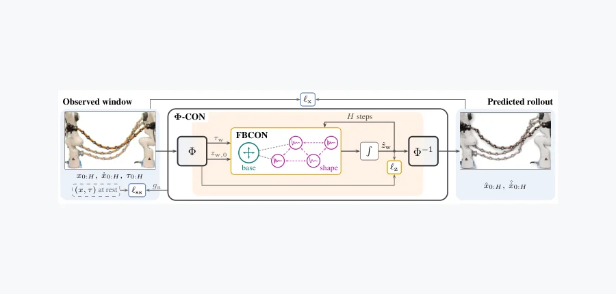 arXiv 2026-11-20 · cs.RO · #1 **[Learning the Dynamics of Deformable Linear Objects Through Coupled Oscillators for Bimanual Robotic Manipulation](https://arxiv.org/abs/2611.23563)** [Iván López-Broceño , Maximilian Stölzle , Daniel Feliu-Talegon , Daniela Rus , Cosimo Della Santina](https://arxiv.org/ab… 机构：Delft University of Technology / MIT CSAIL（[PDF](https://arxiv.org/pdf/2611.23563)） [Paper](https://arxiv.org/abs/2611.23563) · [图源](https://arxiv.org/html/2611.23563v1/training_pipeline_v12_1.png) 

中文摘要
许多针对可形变线状物体（DLO）的学习方法依赖简化的形变模型，忽略动态效应和物体的力学响应，因而适用范围局限于轻质、柔顺物体和缓慢运动。受耦合振子网络（CON）学习物理结构化动力学的进展启发，我们提出用于学习受力驱动 DLO 动力学的 Φ-CON。该模型结合浮动基座耦合振子网络（FBCON）与学习得到的仿射微分同胚 Φ；前者的潜在势能只依赖 DLO 形状，后者连接沿 DLO 观测到的位置与潜在坐标。其形状动力学在构造上稳定，拉格朗日结构给出动能和势能的显式表达。我们利用这一结构设计基于模型的比例—微分（PD）控制器，以补偿学习到的势力，从而建立闭环稳定性保证并确保收敛。我们在四种仿真 DLO 和真实双臂机器人装置上评估该方法。在仿真中，Φ-CON 的预测精度与神经常微分方程（NODE）模型和拉格朗日神经网络（LNN）相当，参数量分别减少 97.2% 和 90.2%。相较于无模型 PD 基线，所提控制器在仿真中将平均端点调节误差降低 97.5%–99.7%，在真实实验中使两个端点的逐目标平均误差降低 27.9%，说明明确考虑刚重物体的力学响应十分重要。 <a href="https://arxiv.org/abs/2611.23563">原摘要来源</a>
 | 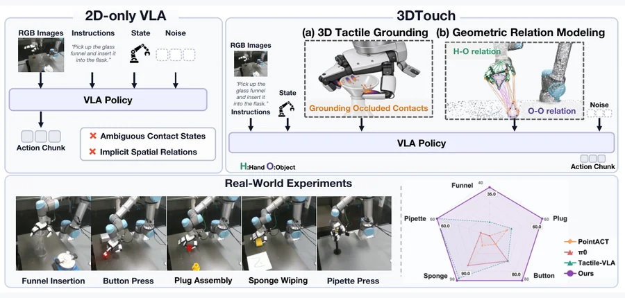 arXiv 2026-11-20 · cs.RO · #2 **[3DTouch: A Tactile-aware VLA Model with 3D Geometric Relations for Dexterous Manipulation](https://arxiv.org/abs/2611.23961)** [Xin Zhang , Shiqi Zhang , Siyuan Cao , Juncheng Cai , Yedong Shen , Yuxuan Gao , Dianlong Wen , Kaixue Long , Lu Zhang… 机构：University of Science and Technology of China（[PDF](https://arxiv.org/pdf/2611.23961)） [Paper](https://arxiv.org/abs/2611.23961) · [图源](https://arxiv.org/html/2611.23961v1/intro.png) 

中文摘要
在接触密集的灵巧操作中，手指和交互物体的遮挡会掩盖局部几何，使视觉观测无法完整捕捉接触位置。视觉上相似的场景也可能因交互物体相对位置的细微差异而具有不同的接触状态。我们提出 3DTouch，一种用于视觉—语言—动作（VLA）模型的触觉几何条件化方法。3DTouch 将 RGB-D 场景点和稠密的五指触觉测量统一表达到机器人基座坐标系，构建共享的三维视觉触觉表示，保留每个触觉单元的空间位置和力向量。由手部标志点及位姿对齐的重建表面导出的手物与物物关系，明确描述交互实体的相对布局。这些表示共同为 VLA 动作专家提供局部化接触力和相对表面几何的条件信号，直接提示接触调整与物体对齐。我们用装配 XHand 灵巧手的 UR7e 机械臂，在五项真实世界接触密集操作任务上评估 3DTouch。相对于对应的 VLA 基线，平均成功率提高 42 个百分点；相对于评估中最强的替代方法，提高 20 个百分点。消融实验显示场景几何与空间触觉反馈具有互补作用，共享空间定位和显式几何关系还带来额外增益。 <a href="https://arxiv.org/abs/2611.23961">原摘要来源</a>
 | 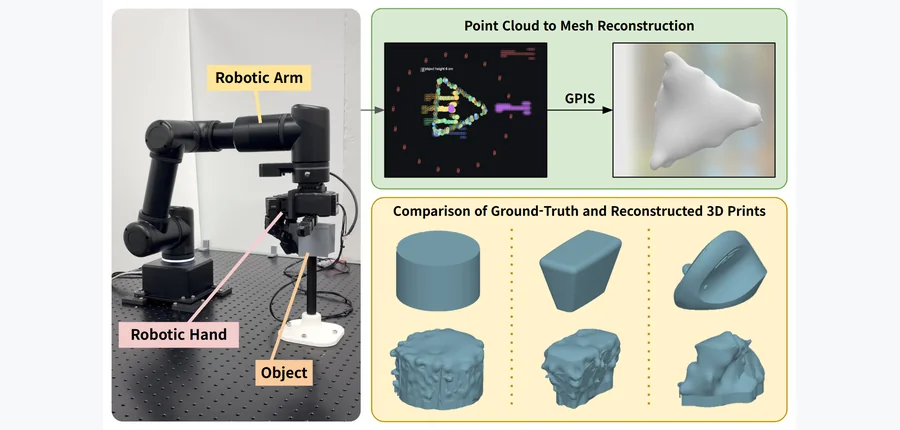 arXiv 2026-11-20 · cs.RO · #3 **[TapTacTouch: Shape Completion from Sparse Tactile Contacts with Geometric Priors](https://arxiv.org/abs/2611.24207)** [Yoobin Shin , Jaeyoung Lee , Jieun Kang , Hyun Song , Woojin Kim , Andrew Jaeyong Choi](https://arxiv.org/abs/2611.24207) 机构：Gachon University / Namseoul University（[PDF](https://arxiv.org/pdf/2611.24207)） [Paper](https://arxiv.org/abs/2611.24207) · [图源](https://arxiv.org/html/2611.24207v1/figures/flow.png) 

中文摘要
三维物体重建对机器人感知和操作至关重要，但常规方法主要依赖视觉观测，在遮挡或视觉受限环境中会受限。本文提出一个无需视觉、无需训练且不依赖物体类别的框架，从稀疏触觉接触重建三维物体网格，也不依赖预训练形状模型。一台 6 自由度机械臂配备 20 自由度多指机械手，利用安装在指腹上的 3×3 压力传感器阵列采集触觉观测。触觉测量通过机器人运动学转换为三维接触约束，并融入多尺度高斯过程隐式曲面（GPIS）。为处理稀疏且不完整的表面观测，方法引入接触置信度加权、弱伪表面约束和观测驱动的几何先验，以保留局部表面几何并为未观测区域提供结构指导。六个物体上的真实实验取得 1.610 的 Chamfer Distance、7.738 的 Earth Mover's Distance 和 95.00 的 F-Score，平均每个物体耗时 49.99 秒完成重建。这些结果表明，无需视觉或语义信息，稀疏触觉感知也能为连续三维物体重建提供足够的几何信息。 <a href="https://arxiv.org/abs/2611.24207">原摘要来源</a>
 |
| 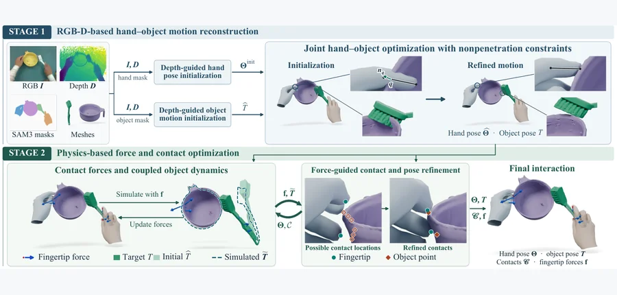 arXiv 2026-11-20 · cs.CV · #4 **[HOForce: Motion and Force Reconstruction of Hand-Object Interaction Using a Single-View RGB-D Video](https://arxiv.org/abs/2611.23871)** [Jiahui Wang , Wanqing Du , Yuanbin Zou , Zhefeng Xu , Feng Xu](https://arxiv.org/abs/2611.23871) 机构：Tsinghua University / Parity Lab / Hangzhou Dianzi University（[PDF](https://arxiv.org/pdf/2611.23871)） [Paper](https://arxiv.org/abs/2611.23871) · [图源](https://arxiv.org/html/2611.23871v1/two_stage_force_contact.png) 

中文摘要
重建手物交互是一项重要任务；单相机方案使大规模采集可行，却因严重遮挡而具有挑战。我们提出 HOForce，利用单视角 RGB-D 视频和已知物体属性，跟踪手与物体并进一步恢复交互力。对于双手操作，我们联合建模两只手的指尖力，以及存在两个物体时的物物接触力。重建的力还通过为遮挡区域提供位姿约束来改善运动跟踪。在 DexYCB 和 TACO 上，HOForce 更准确地恢复手和物体运动；在 DexYCB 上，相较交互基线产生更少的手物穿透。在我们用触觉传感器记录指尖力的数据集上，相比最强基线，HOForce 将法向力平均绝对误差降低 24.5%。恢复的力可以在 MuJoCo 中复现物体运动，并在适配后迁移到其他引擎。 <a href="https://arxiv.org/abs/2611.23871">原摘要来源</a>
 | 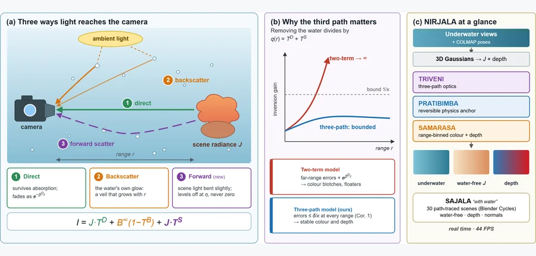 arXiv 2026-11-20 · cs.CV · #5 **[NIRJALA: Draining the Sea out of Gaussian Splatting with Three-Path Optics and Reversible Physics](https://arxiv.org/abs/2611.23450)** [Latchan Chhetri , Aman Kumar](https://arxiv.org/abs/2611.23450) 机构：Halo Mind Research Group / Sikkim Manipal Institute of Technology（[PDF](https://arxiv.org/pdf/2611.23450)） [Paper](https://arxiv.org/abs/2611.23450) · [图源](https://arxiv.org/pdf/2611.23450) 

中文摘要
水不仅给水下照片染色，还会改写其成像。每个像素混合了衰减的场景辐射、后向散射光和到达相机途中发生前向散射的场景光，因此多种场景与水体组合都能解释相同像素。多数水下场景高斯泼溅方法只建模前两种效应，并通过除以随距离指数衰减的透射率来去水，导致反演增益无界增长。我们提出 NIRJALA（梵语意为“无水”），一种同时恢复无水外观和几何的三维高斯泼溅框架。三路径成像模型 TRIVENI 在直接透射和后向散射之外加入随距离饱和的前向散射项；我们证明这使所有距离上的反演增益保持有界，并界定估计后向散射与衰减的误差如何传递到恢复颜色。可逆物理锚 PRATIBIMBA 在两个方向上将灵活的神经水体模型约束到十参数物理模型，使场景内容不能隐藏进水体表示。SAMARASA 汇集物理信息目标，包括按距离分箱的颜色先验。为以真值评估去水效果，我们用 Blender Cycles 路径追踪构建了 30 个场景的 SAJALA 测试集，在受控水色和浑浊度下提供无水图像、深度与法线。在 SAJALA 上，相比最强基线，NIRJALA 将 PSNR 从 24.34 提高到 24.76 dB，将深度 AbsRel 从 0.109 降到 0.091；在真实 SeaThru-NeRF 场景上，将 LPIPS 从 0.194 降到 0.175，渲染速度为 44 FPS。我们还讨论水下外观指标与几何评价不一致的情况以及评估局限。 <a href="https://arxiv.org/abs/2611.23450">原摘要来源</a>
 | 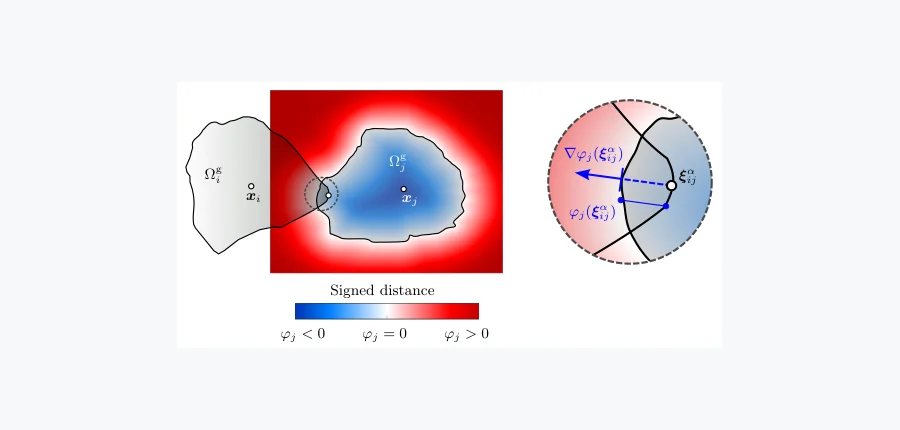 arXiv 2026-11-20 · math.NA · #6 **[Modeling fluid--solid interaction in three-dimensional granular systems: Two-way coupling of SPH and LS-DEM](https://arxiv.org/abs/2611.23592)** [Sebastián Pazmiño , Nitin P. Daphalapurkar , Jacinto Ulloa](https://arxiv.org/abs/2611.23592) 机构：University of Michigan / Los Alamos National Laboratory（[PDF](https://arxiv.org/pdf/2611.23592)） [Paper](https://arxiv.org/abs/2611.23592) · [图源](https://arxiv.org/html/2611.23592v1/lsdem_tex.png) 

中文摘要
本文提出基于水平集离散元方法（LS-DEM）与光滑粒子流体动力学（SPH）的双向耦合颗粒系统流固交互框架。该方法无需网格、完全采用拉格朗日形式，并能无缝描述任意固体形状。具体而言，颗粒几何的水平集表示同时用于接触检测和流固耦合，使真实且高度不规则的颗粒能在统一计算框架中处理。此外，该方法方便处理移动边界，并具有简明的计算实现。我们通过溃坝流、穿过多孔介质的流动、颗粒坍塌和饱和颗粒试样循环加载等数值基准，展示所提出 SPH–LS-DEM 框架的能力。这项研究为跨学科多物理问题的进一步扩展奠定基础。 <a href="https://arxiv.org/abs/2611.23592">原摘要来源</a>
 |
| 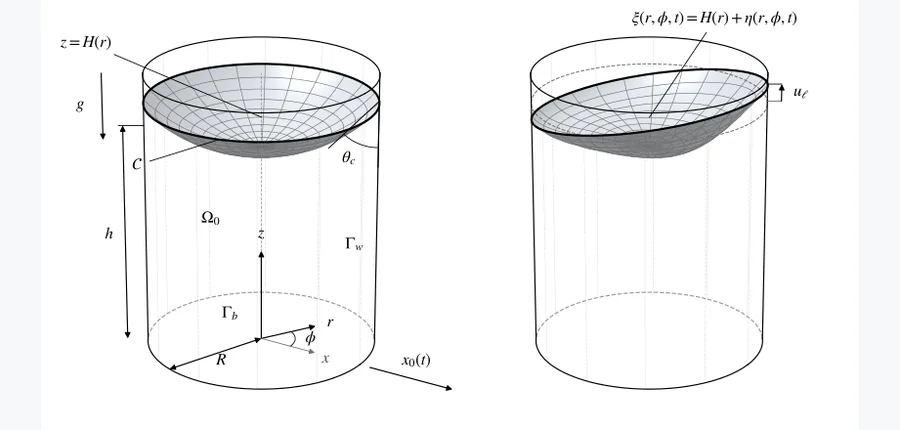 arXiv 2026-11-20 · physics.flu-dyn · #7 **[A curvature-corrected port-Hamiltonian reduced-order model for dissipative sloshing with contact-line hysteresis in low-gravity tanks](https://arxiv.org/abs/2611.24736)** [Gianni Cassoni , Fabrizio Gennari , Jacopo Serafini , Pierangelo Masarati](https://arxiv.org/abs/2611.24736) 机构：Roma Tre University / Thales Alenia Space Italia / Politecnico di Milano（[PDF](https://arxiv.org/pdf/2611.24736)） [Paper](https://arxiv.org/abs/2611.24736) · [图源](https://arxiv.org/html/2611.24736v1/geometry_sketch_col.png) 

中文摘要
一个基于物理的降阶模型，在用于圆柱罐横向晃动的无源端口哈密顿框架中，统一描述弯曲液面惯性、黏性损失和非光滑接触线粘滑。Dirichlet–Neumann 与 Jacobi 算子描述惯性及恢复力；一个凸势函数组合体相、Stokes 层和接触线耗散。粘滑事件之间的解析传播支持比实时更快地仿真航天器平移与液体晃动的耦合。黏性闭合与参考 Stokes 计算的差异在 5% 以内，并复现 Henderson–Miles 模态测量及 Cocciaro 滞后衰减。跨 42 次落塔和地面测量，曲率校正使频率均方根误差从 24% 降至 4%。在 Middeck 0-Gravity Dynamics Experiment（MODE）的飞行和地面测试中，频率误差为 0.9%–7.1%；理想接触线则将 MODE 拟合所得阻尼比低估 38%–87%。在最低轨道水激励条件下标定的单一滞后宽度，预测更高轨道激励及地面测试的归一化力误差为 11%–35%，而理想钉扎接触线为 149%–208%。模型预测 8.5% 的共振软化，测量为 7.3%，所测试的单参数阻尼律未捕捉到这一点。润湿不确定性和残余响应差异提示，航天器控制分析需考虑阻尼范围。 <a href="https://arxiv.org/abs/2611.24736">原摘要来源</a>
 | 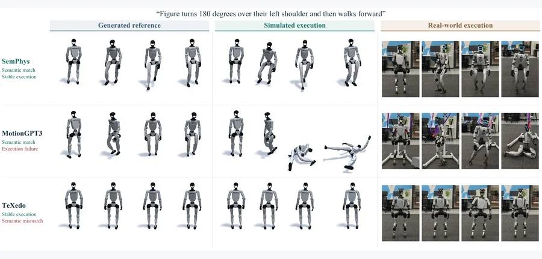 arXiv 2026-11-20 · cs.RO · #8 **[SemPhys: Semantic-Physical Co-Learning for Humanoid Motion Generation via Differentiable World Models](https://arxiv.org/abs/2611.24074)** [Zejian Kang , Yeqiang Wang , Zekai Chen , Boyang Shen , Mingyu Ma , Bingqian Wu , Fan Zhou , Jianjie Zhang , Chentao Shen… 机构：Zhejiang University / Westlake University / Shanghai Jiao Tong University / Shanghai Innovation Institute / Beijing Institute of Technology / Huazhong University of Science and Technology / Northwestern Polytechnical University / Xmov / Fudan University（[PDF](https://arxiv.org/pdf/2611.24074)） [Paper](https://arxiv.org/abs/2611.24074) · [图源](https://arxiv.org/html/2611.24074v1/fig01_semphys_teaser_hardware.png) 

中文摘要
在人机协作中，自然语言使人们无需编写关节轨迹即可指挥人形机器人的全身动作。常见方法先由指令生成运动学参考，再由跟踪控制器执行。但控制器在接触约束下维持平衡时，实际动作可能偏离参考，甚至改变其表达的行为。我们的核心见解是：语义一致性应直接在机器人实际执行的完整动作上评估。基于此，我们提出 SemPhys，一个利用仿真执行结果的语义反馈训练动作生成器的框架。可微世界模型与固定跟踪控制器预测已记录执行过程中的一小段；SemPhys 将该预测放回原位置，按指令评分完整轨迹，并通过预测片段反向传播。成对锚定损失使每个生成参考保持接近初始生成器的对应输出，以稳定适配。在 BONES-SEED 上，SemPhys 基本保留了从参考动作到执行动作的指令检索准确率，并在所评估方法中获得最高的执行动作检索准确率。 <a href="https://arxiv.org/abs/2611.24074">原摘要来源</a>
 | 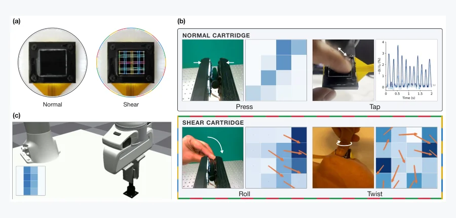 arXiv 2026-11-20 · cs.RO · #9 **[LuxTac: A Flexible, Scalable, and Open-Source Optical Taxel Array with Distributed Three-Axis Force Sensing for Tactile Robot Learning](https://arxiv.org/abs/2611.23575)** [Md Rakibul Islam Prince , John Pelan , Zhiyuan Zhang , Adyaa Khera , Katherine Pesetski , Adeesh Desai , Akimizu Sugiyama… 机构：Purdue University / Stony Brook University / Stevens Institute of Technology / University of Wisconsin–Madison（[PDF](https://arxiv.org/pdf/2611.23575)） [Paper](https://arxiv.org/abs/2611.23575) · [Project](https://luxtac.github.io/) · [图源](https://arxiv.org/html/2611.23575v1/fig1_luxtac_ieee_v2.png) 

中文摘要
低成本触觉阵列使触觉成为机器人学习的实用输入，但压阻设计只感知压力；也能解析剪切力的相机传感器则过于庞大，难以铺满夹爪。为解决这一问题，我们提出 LuxTac：约 3.5 毫米厚、由现成部件制成的柔性可扩展光学触觉单元阵列。每个单元是在半透明白色硅胶层和不透光黑膜下的数字 RGBC 光电转换器，因此后向散射的 LED 光随局部压入深度单调下降。同一块电路板可使用两种可互换胶体盒：普通盒测量法向力；带彩色侧壁的盒通过返回光的颜色编码局部剪切力，无需相机、磁铁或凸点覆盖层。据我们所知，这使 LuxTac 成为首个可在单个单元上解析剪切力的光学触觉阵列。使用自动 CNC 压头和六轴力／力矩传感器表征时，法向盒在 104 mN 至至少 5.8 N 范围内对力呈线性响应（R²=0.999），重复性为 2.0%，滞后为 5.9%，归一化后单元间变异为 6%–10%。使用剪切盒时，逐单元模型估计每个单元上的三轴力；跨三种压头形状和九次留出测试，求和估计在 x/y/z 轴上的 R² 分别为 0.96/0.96/0.92，逐单元估计为 0.92/0.93/0.94，剪切方向误差中位数为 4.8 度。将 LuxTac 压力读数加入 Action Chunking Transformer 策略，相比纯视觉基线显著提高了插销入孔成功率。设计文件、代码和视频可通过原文给出的链接获取。 <a href="https://arxiv.org/abs/2611.23575">原摘要来源</a>
 |
| 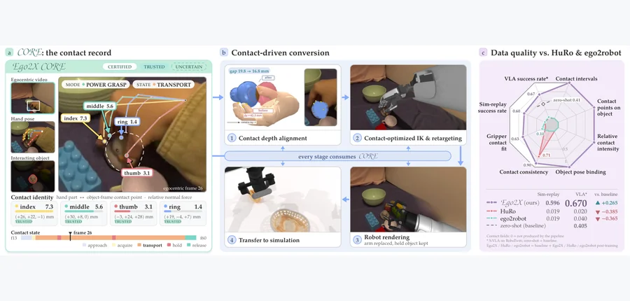 arXiv 2026-11-20 · cs.RO · #10 **[Ego2X: Contact-aware Transfer from Egocentric Human Data to Any Robot](https://arxiv.org/abs/2611.24138)** [Xinke Lyu , Bowen Yang , Zhicheng Wang](https://arxiv.org/abs/2611.24138) 机构：Beijing University of Posts and Telecommunications / Chinese Academy of Sciences / PowerTech（[PDF](https://arxiv.org/pdf/2611.24138)） [Paper](https://arxiv.org/abs/2611.24138) · [图源](https://arxiv.org/html/2611.24138v1/teaser.png) 

中文摘要
具身模型依赖真实交互数据，但在实体机器人上采集既慢又费人力。近期从自我视角视频到机器人数据的流水线通过迁移手臂和手部运动来重定向第一人称人类视频，主要以视觉外观评估保真度。然而，这些轨迹在物理层面经常失效：手指悬停在物体旁，夹爪闭合时却没有抓到物体。我们认为物体如何运动以及驱动运动的接触也应计入。因此，我们提出 Ego2X，一个以物体为中心的框架，将单目自我视角视频转成适用于灵巧手和并联夹爪的可物理执行机器人数据。Ego2X 的核心是 CORE（以接触为中心的物体交互表示），它用物体表面锚点、相对力、抓取模式和交互状态记录每次接触。贯穿整个流程，CORE 通过物体相对约束校正手物漂移，引导逆运动学实现机器人必须达成的接触，并在去除人臂及合成机器人时维持被持有物体。在 HOT3D 上，接触驱动校正使接触中的手部深度误差降低 33.7%；在 EgoDex 上，接触驱动重定向实现了 62.9% 的标注接触，超过官方 HuRo 流水线的 27.9%。在 RoboTwin 2.0 的 200 个配对场景中，仅用 Ego2X 片段对 X-VLA 后训练且不使用仿真器示范，使任务成功率从零样本的 40.5% 提升至 67.0%。我们计划公开转换流水线以及面向灵巧手和并联夹爪的 CORE 标注数据集。 <a href="https://arxiv.org/abs/2611.24138">原摘要来源</a>
 | 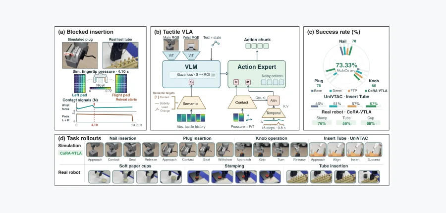 arXiv 2026-11-20 · cs.RO · #11 **[CoRA-VTLA: Contact-Guided Attention and Queryable Response Memory for Tactile Post-Training](https://arxiv.org/abs/2611.23963)** [Chengye Song , Rui Song , Shengqi Wang , Jiawei Zhang , Hongzhou Wang , Xueyang Guo , Yang Liu](https://arxiv.org/abs/261… 机构：Dalian University of Technology / Jilin University / Tsinghua University / Enomind Technology（[PDF](https://arxiv.org/pdf/2611.23963)） [Paper](https://arxiv.org/abs/2611.23963) · [Project](https://cora-vtla.github.io/) · [图源](https://arxiv.org/html/2611.23963v1/Fig1-VTLA_svg-raw.png) 

中文摘要
在精密操作中，对齐或力的微小误差可能导致卡滞或形变，因此接触反馈对将预训练视觉—语言—动作（VLA）模型适配到这些任务至关重要。单次触觉观测不足以判断近期动作引起的响应；后训练时直接融合触觉也可能分散动作专家的视觉注意，降低对接触区域的关注。为解决这些问题，CoRA-VTLA 为预训练 VLA 加入轻量触觉模块。可查询的动作—响应记忆检索近期接触响应，使动作专家将其与即时触觉反馈结合。接触引导的注视监督将触觉语义 token 的视觉注意集中于对应指尖接触的图像区域。在三个 MuJoCo 任务上，CoRA-VTLA 的平均成功率为 73.33%，而传感器输入相同的直接触觉融合方法为 50%。在公开 UniVTAC 基准的一项光学触觉任务中成功率为 67%；三个真实机器人任务上的平均成功率为 66.7%。结果表明，触觉后训练有助于预训练 VLA 适应变化的接触。 <a href="https://arxiv.org/abs/2611.23963">原摘要来源</a>
 | 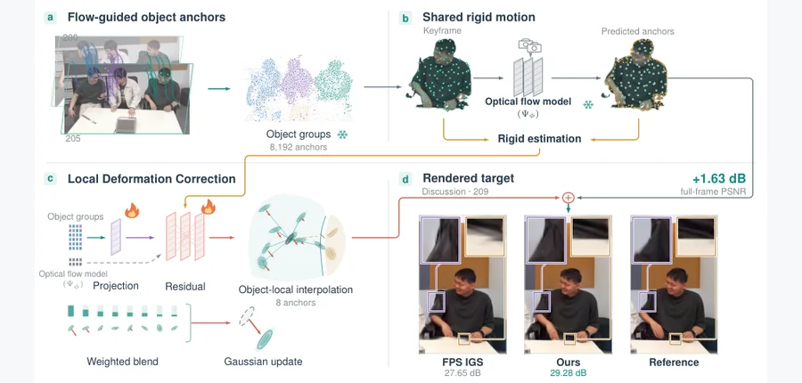 arXiv 2026-11-20 · cs.CV · #12 **[OCLDA-GS: Object-Centric Local Deformation-Aware Gaussian Streaming](https://arxiv.org/abs/2611.23416)** [Ashim Dahal , Nikesh Subedi , Rabab Abdelfattah , Nick Rahimi](https://arxiv.org/abs/2611.23416) 机构：University of Southern Mississippi / University of Utah（[PDF](https://arxiv.org/pdf/2611.23416)） [Paper](https://arxiv.org/abs/2611.23416) · [图源](https://arxiv.org/html/2611.23416v1/methodology.png) 

中文摘要
流式三维高斯泼溅（3DGS）可从多视角视频在线重建动态场景，用于自由视点视频（FVV）。现有兼顾时间和存储效率的方法通过选取一部分锚定高斯元并进行邻域插值，实现快速的流式 3DGS；但它们可能忽略物体特有的运动，并在物体边界附近引入不一致。我们提出 OCLDA-GS，一个以物体为中心的流式框架，动态重新分配兼顾物体与运动的高斯锚点，为大幅运动的物体提供支持，同时把高斯邻域限制在物体组内，以提高边界精度。此外，该框架估计逐物体刚体变换（例如手的移动），并据此学习逐锚点的局部形变校正，以处理细微形变（例如衬衣褶皱）。随后，我们在三个动态多视角视频数据集上开展实验，相比既有基线取得改进，并提高细化时间步之间的画质。在匹配细化预算下，相比 Instant Gaussian Stream（IGS），我们的方法在 N3DV、Meeting Room 和 Google Immersive 上分别将 PSNR 提高 0.169、0.202 和 0.199 dB，并在 N3DV 和 Meeting Room 上分别将细化步骤之间的平均 PSNR 下降减少 9.2% 和 13.8%。 <a href="https://arxiv.org/abs/2611.23416">原摘要来源</a>
 |
| 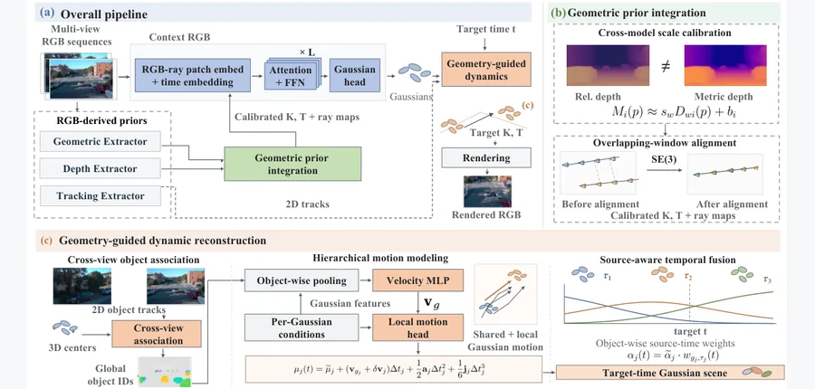 arXiv 2026-11-20 · cs.CV · #13 **[Freeforward4d: Annotation-free feed-forward 4d reconstruction of driving scenes](https://arxiv.org/abs/2611.24007)** [Luosong Guo , Xiang Yang , Chaoyang Li , Ao Gao , Jiangming Shi , Yanyun Qu , Zhizhong Zhang , Jingyu Gong , Yuan Xie](ht… 机构：East China Normal University / Shanghai Innovation Institute / Xiamen University（[PDF](https://arxiv.org/pdf/2611.24007)） [Paper](https://arxiv.org/abs/2611.24007) · [图源](https://arxiv.org/html/2611.24007v1/figure2by1112.png) 

中文摘要
前馈式 4D 重建能高效创建可渲染的驾驶场景，用于自动驾驶仿真。然而，多数现有方法高度依赖数据集提供的相机、LiDAR 深度或三维框标注，限制了其对无标注驾驶视频的适用性。预训练视觉模型可仅从 RGB 预测相机、深度和物体轨迹，但它们的几何彼此不一致：多视角预测来自尺度和坐标系独立的短窗口，单目深度也只在单张图像内具有度量尺度。我们的关键见解是，将这些先验统一到单一度量坐标系后，它们可以替代数据集标注用于前馈式 4D 重建。我们提出 FreeForward4D：将重叠预测窗口与单目度量深度对齐，并跨时间注册到同一坐标系。在此几何之上，二维轨迹跨相机完成三维关联，物体通过结合共享物体速度和局部高斯校正的分层运动表示移动，因此训练与推理都只使用 RGB 视频。在 Waymo 上，FreeForward4D 达到 27.66 dB PSNR 和 0.836 SSIM，并在无需尺度对齐的条件下恢复度量尺度相机与深度。它在整图 PSNR 上超过依赖数据集标注的 STORM、SLARM-F、UFO、DGGT 和 StreetForward，并在 8 秒窗口上取得最佳 RGB 保真度。仅用 RGB 微调还可将框架适配至 nuScenes 和 Argoverse 2。代码将公开。 <a href="https://arxiv.org/abs/2611.24007">原摘要来源</a>
 | 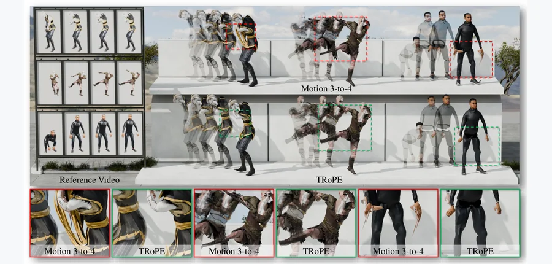 arXiv 2026-11-20 · cs.CV · #14 **[TRoPE: Topology-aware Relative Positional Encoding for 4D Generation](https://arxiv.org/abs/2611.23933)** [Chengzhuo Gui , Zhenglin Zhou , Fan Ma , Zongxin Yang , Yi Yang](https://arxiv.org/abs/2611.23933) 机构：Zhejiang University（[PDF](https://arxiv.org/pdf/2611.23933)） [Paper](https://arxiv.org/abs/2611.23933) · [Project](https://akui1321.github.io/TRoPE/) · [图源](https://arxiv.org/html/2611.23933v1/teaser.png) 

中文摘要
从视频生成 4D 网格已在从单目视频恢复动态三维几何与运动方面取得明显进展。然而，常见前馈方法仍容易出现粘连伪影：测地距离很远的顶点在空间上接近时会错误地一起运动。我们将该问题归因于跨部位运动信息泄漏；当运动解码无法区分空间接近和网格连接关系时，空间相近但结构相远的顶点可能获取相似运动信息。为此，我们提出拓扑感知相对位置编码 TRoPE，在顶点查询与网格支持的运动源之间显式加入网格连接信息。TRoPE 从图拉普拉斯算子提取谱特征，依据多尺度扩散特征之间的距离构建成对拓扑关系，再用旋转相位调制顶点—锚点注意。我们还提出逐顶点尾部风险目标，重点惩罚持续高误差顶点，从而抑制粘连伪影。为更好描述和量化这类失败，我们构建专门的 MeshSticking-4D 基准。实验表明，TRoPE 在 MeshSticking-4D 上抑制粘连并提高整体运动精度；相比基线，最差顶点误差降低 39.4%，分离失败率从 49.35% 降至 34.90%。在 Motion-80 和 Motion324-Subset 上，方法还降低了多类物体的尾部误差；迁移到 Mesh4D 则显示其跨骨干的适用性。 <a href="https://arxiv.org/abs/2611.23933">原摘要来源</a>
 | 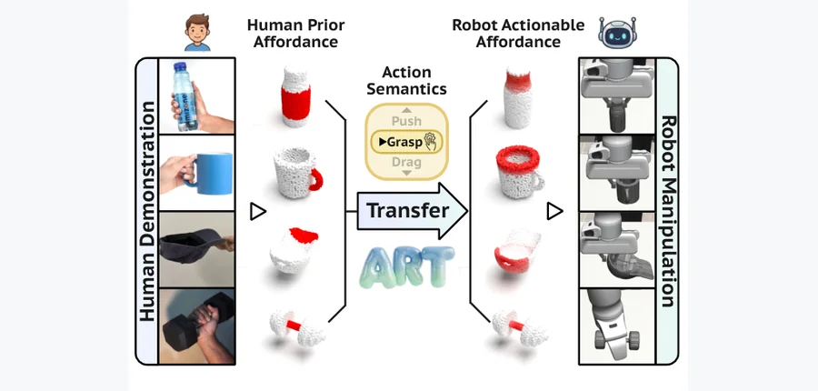 arXiv 2026-11-20 · cs.CV · #15 **[ART: Bridging the Embodiment Gap in 3D Human-to-Robot Affordance Transfer](https://arxiv.org/abs/2611.24182)** [Zichen Zhang , Wei Zhai , Xuji Zhang , Yang Cao , Yu Kang](https://arxiv.org/abs/2611.24182) 机构：University of Science and Technology of China / Hefei Comprehensive National Science Center / Hefei University of Technology（[PDF](https://arxiv.org/pdf/2611.24182)） [Paper](https://arxiv.org/abs/2611.24182) · [Project](https://derek0907.github.io/ART/) · [图源](https://arxiv.org/html/2611.24182v1/fig01_task_overview.png) 

中文摘要
三维可供性连接感知与行动，为机器人操作提供先验。现有方法多直接借用人类先验，但常忽略可供性并非物体的固有属性，而是与执行者的身体形态耦合。人手与机器人末端执行器的结构和形态差异，使直接应用人类先验可能严重不兼容机器人执行。为此，我们提出“三维人到机器人可供性迁移”这一新任务，处理不同身体结构带来的可供性错位。我们构建人机配对可供性数据集 HPAD，这是首个对每个物体同时标注人类先验和经过仿真验证的机器人标签的大规模三维可供性基准。HPAD 涵盖 80 个类别中的 2,137 个物体和 13 种原子动作基元，形成超过 27,000 个物体—动作对。基于 HPAD，我们提出三维可供性迁移网络 ART。ART 首先通过可靠性门控分支过滤人类先验中的几何假阳性，再通过分层重建和图扩散细化，将先验重建为机器人可执行分布，解决人类与机器人可供性的拓扑错位。HPAD 上的实验展示该任务的可靠性及 ART 的优势。我们还在配有并联夹爪的 6 自由度机械臂上，以 12 个物体、4 类动作开展 2,400 次执行评估；ART 在自身 480 次试验中取得最佳成功率 86.5%，验证迁移范式的实用性。项目页链接见原文。 <a href="https://arxiv.org/abs/2611.24182">原摘要来源</a>
 |
| 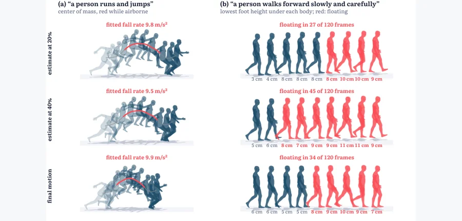 arXiv 2026-11-20 · cs.LG · #16 **[Probing Physics in Motion Diffusion Models Against Their Own Estimate](https://arxiv.org/abs/2611.24423)** [Saeed Ghorbani](https://arxiv.org/abs/2611.24423) 机构：Independent Researcher（[PDF](https://arxiv.org/pdf/2611.24423)） [Paper](https://arxiv.org/abs/2611.24423) · [图源](https://arxiv.org/html/2611.24423v1/fig_teaser.png) 

中文摘要
近期研究报告称，视频扩散模型“知道的比展示的多”：从激活中比从输入或输出中更容易解码物理属性。但扩散模型正是从同一批激活计算干净样本估计，因此这种比较衡量的是读出器提取信息的难易程度；模型是否隐藏信息是另一个问题。我们在运动学文本到运动扩散模型中寻找隐藏的物理知识：这里每个中间估计的物理属性都可精确计算。我们记录了 MDM（两个检查点）和 MotionDiffuse 采样轨迹中每一层的激活。按通常的基线，层表示在平衡与腾空方面看似领先于模型自身估计；但对所有读出器采用同样调优后，估计值填平了差距：在平衡与腾空任务中，额外加入一层最多提高 0.01，而阳性对照表明这一量级本可被检测到。跳跃跌倒率是唯一明确例外。去噪早期，MDM 的层表示在模型估计之外额外提供约 0.08 的 R²（重新拟合时最高 0.11），但增益随采样逐渐消失；MotionDiffuse 上的增益很小且不稳健。模型估计还可无需训练地识别悬浮样本，但提前中止它们节省的计算量不足十分之一。在一个视频模型中，Wan 2.1 干净潜变量里线性探针无法读出的合理性信息，经过一个固定非线性变换后变得可读。 <a href="https://arxiv.org/abs/2611.24423">原摘要来源</a>
 | 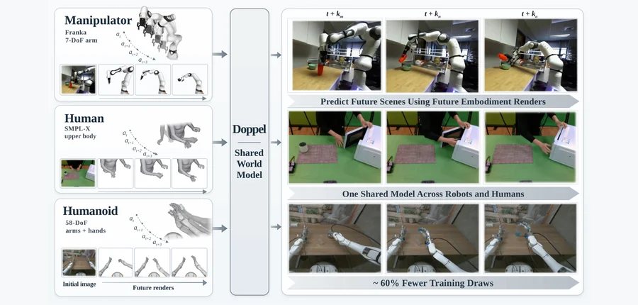 arXiv 2026-11-20 · cs.RO · #17 **[Render the Robot, Generate the World: One Video World Model Across Embodiments](https://arxiv.org/abs/2611.24925)** [Yash Jangir , Karan Mirakhor , Renos Zabounidis , Muhammad Zubair Irshad , Sergey Zakharov , Yonatan Bisk , Homanga Bhara… 机构：Johns Hopkins University / Carnegie Mellon University / Toyota Research Institute（[PDF](https://arxiv.org/pdf/2611.24925)） [Paper](https://arxiv.org/abs/2611.24925) · [Project](https://doppelwm.github.io/) · [图源](https://arxiv.org/html/2611.24925v1/Doppel.png) 

中文摘要
预测智能体动作的后果，需要同时建模其身体运动与环境响应。多数视频世界模型试图仅凭数值动作共同学习两者，尽管机器人几何与运动学已经能指定预期运动。我们提出 Doppel，一个不依赖具体身体形态的视频世界模型，以与相机对齐的未来身体构型渲染图和数值动作轨迹为条件。通过显式提供预期运动，Doppel 可以将建模重点放在物体运动和交互驱动的环境变化上。运动渲染也为不同身体形态和动作空间提供共同的视觉接口。为利用缺少相机外参的机器人数据集训练，我们恢复相机位姿并将渲染轨迹与记录的观测对齐。我们用约 600 小时、无需身体形态标签的视频，在八个数据集上联合训练一个共享视频骨干与条件适配器；数据跨八类机器人和人类身体形态，从单臂、双臂机器人到灵巧人形机器人以及人手和人体。跨三个机械臂数据集，Doppel 在留出轨迹上比仅以动作作为条件的基线提高 1.00 dB PSNR，在分布外评估中提高 1.20 dB，并预测出更一致的物体运动。在全部八种身体形态训练的 Doppel-8，相比仅在三种机器人上训练的 Doppel-3，于六个评估集中的四个上改进了机器人预测。项目页见原文。 <a href="https://arxiv.org/abs/2611.24925">原摘要来源</a>
 | 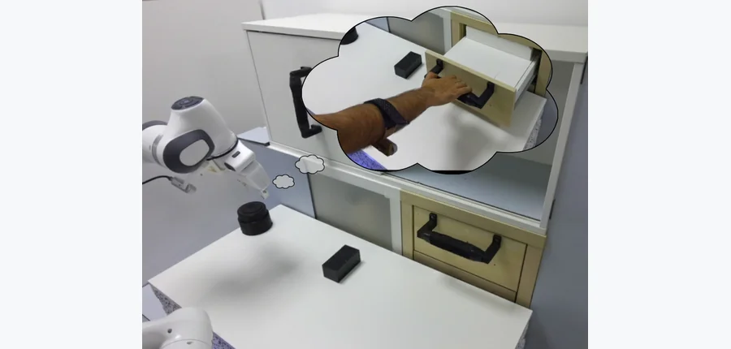 arXiv 2026-11-20 · cs.RO · #18 **[DiWALI: Diffusion Policy Learning in World Models via Latent Action Inference from Human and Robot Play](https://arxiv.org/abs/2611.24836)** [Akshay L Chandra , Iman Nematollahi , Lingyue Zhao , Daria Kulikova , Angela P. Schoellig , Fabien Despinoy , Abhinav Val… 机构：University of Freiburg / Toyota Motor Europe / ZUSE School ELIZA / Technical University of Munich（[PDF](https://arxiv.org/pdf/2611.24836)） [Paper](https://arxiv.org/abs/2611.24836) · [图源](https://arxiv.org/html/2611.24836v1/figures/cover_v3.png) 

中文摘要
机器人操作学习受到带动作标签的机器人数据供应限制，模仿学习和世界模型训练皆如此。人类可以在数秒内演示技能，但其演示缺少所需的机器人动作。我们提出 DiWALI，在人类和机器人自由交互数据训练的世界模型中学习并改进扩散策略。DiWALI 通过逆动力学模型从连续帧推断潜在动作，使世界模型能在无动作标签下训练；另用机器人自由交互数据训练的解码器，将潜在动作对应到机器人指令。技能策略利用无动作标签的人类演示中的潜在动作训练，再通过想象中的强化学习改进。在 CALVIN 基准上，仅从人类演示训练的 DiWALI 策略显著优于使用机器人演示训练的基线。将人类自由交互数据用于世界模型训练，随后微调所得策略也优于仅使用等量机器人自由交互数据。实体机器人实验表明，主要从人类演示学得的技能，还能在由人机自由交互数据训练的世界模型中通过想象进一步改进。总体而言，这些结果表明人类经验既能支持操作技能获取，也能支持后续策略改进，减少对带动作标签的机器人数据的依赖。视频、数据集和代码链接见原文。 <a href="https://arxiv.org/abs/2611.24836">原摘要来源</a>
 |
| 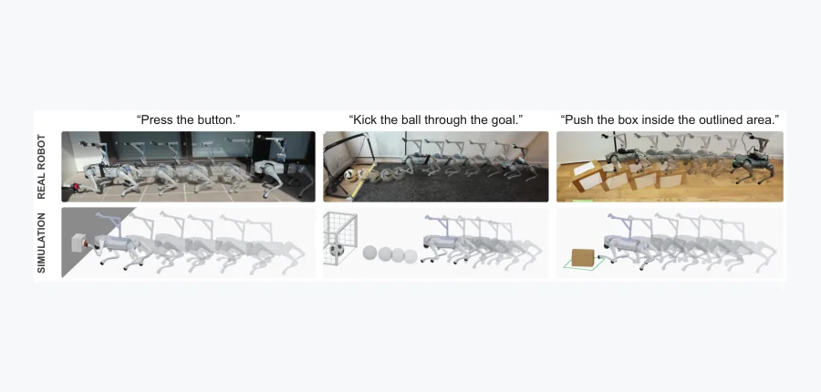 arXiv 2026-11-20 · cs.RO · #19 **[WAM-Policy: World Action Models with On-Policy Distillation for Quadrupedal Loco-Manipulation](https://arxiv.org/abs/2611.24011)** [Junlin Long , Xu Deng , Yiran Wang , Yue Yang , Yang Zhao , Zeyu Zhang](https://arxiv.org/abs/2611.24011) 机构：University of Sydney / UNSW Sydney / Maincode / La Trobe University（[PDF](https://arxiv.org/pdf/2611.24011)） [Paper](https://arxiv.org/abs/2611.24011) · [Code](https://github.com/AIGeeksGroup/WAM-Policy) · [Project](https://aigeeksgroup.github.io/WAM-Policy/) · [图源](https://arxiv.org/html/2611.24011v1/teaser.png) 

中文摘要
无机械臂的四足机器人可以三足行走、以前腿操作来完成移动操作，但现有此类策略都不能遵循语言指令。世界动作模型（WAM）已是有效的语言条件操作策略，却主要在机械臂上预训练，且采样缓慢。WAM-Policy 分两阶段将一个 WAM 转为四足移动操作策略。第一阶段“跨形态策略适配与加速”把以机械臂为中心的 WAM 适配四足机器人，并通过在策略分布上的自蒸馏（OPSD），将迁移后的策略蒸馏成使用一个视频步和两个动作步的学生模型。但这个学生受只模仿演示的教师限制。第二阶段“任务专属改进与合并”因此通过强化学习（RL）调整教师，再用多教师在策略分布上的蒸馏（M-OPD），把缓慢的专用教师合并成一个少步学生。在包含十个仿真任务、1,000 个无需遥操作合成示范的 QLM-Bench 上，迁移策略成功率达 77.0%；OPSD 学生以快 14 倍的采样速度维持 76.7%；任务专属 RL 与 M-OPD 将其提高至 85.0%。我们还在真实 Unitree Go2 Air 上部署 OPSD 学生。WAM-Policy 因而以更低推理成本获得更强的四足策略。 <a href="https://arxiv.org/abs/2611.24011">原摘要来源</a>
 | 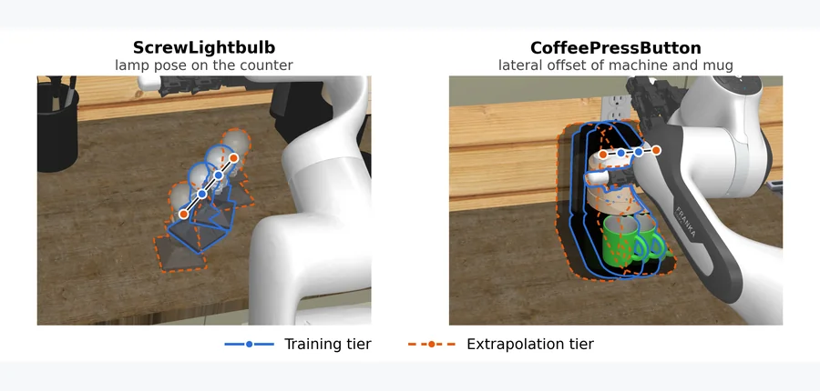 arXiv 2026-11-20 · cs.RO · #20 **[Finetuning VLAs for Dexterous Manipulation: The Right Checkpoint Is All You Need](https://arxiv.org/abs/2611.23676)** [Artur Kuramshin , Charlotte Cloutier , Michael Przystupa , Kirsty Ellis , Mohammad S. Akhter , Glen Berseth](https://arxi… 机构：Mila / Université de Montréal / Renesas Electronics Canada（[PDF](https://arxiv.org/pdf/2611.23676)） [Paper](https://arxiv.org/abs/2611.23676) · [图源](https://arxiv.org/html/2611.23676v1/images/placement_tiers.png) 

中文摘要
视觉—语言—动作模型已展示较强操作能力，但多数 VLA 操作数据集聚焦并联夹爪，使模型向多指手迁移具有挑战，尤其因为多指机器人遥操作数据更难采集。本文研究如何通过结合监督微调（SFT）与扩散引导强化学习（DSRL）来更好地适配灵巧手。使用 π0.5 与 LEAP 手，我们仅用少量示范，在两项仿真任务上评估五种微调方案。实证分析得到三项关键发现：（1）SFT 成功率与 DSRL 后成功率相关性弱，因此最佳 SFT 检查点很少是最易被引导的检查点；（2）冻结视觉—语言模型（VLM）、只调整动作专家，在训练和分布外摆放条件下都产生最容易引导的策略；（3）低秩适配（LoRA）最不易引导。因此，我们推荐冻结 VLM、完整训练动作专家，并且不要以 SFT 展开成功率作为检查点选择指标。 <a href="https://arxiv.org/abs/2611.23676">原摘要来源</a>
 |   |
<!-- PAPER_CARDS_END -->

## 检索概况

- **检索窗口**：北京时间 2026-11-20 09:02–09:14；官方 New listing 显示的批次日期为 2026-11-19。
- **主榜范围**：14 个目标分类页共 **781** 条 New 记录，按 arXiv ID 去重后为 **778** 篇；本期入选 **20** 篇，仅含官方 New submissions。
- **排序规则**：先列三维动力学、力与接触、物理一致重建，再列动态三维和有具体机器人实验的具身工作。相关性、机构强度、局限与改进建议均为编辑推断；标题、作者、分类和摘要依据所链官方 arXiv 页面。
- **机构核实**：20 篇均据官方 PDF 首页核对；未确认 0 篇。
- **摘要与配图**：20 篇均保存官方原摘要和完整中文译文；20 篇均有已核对的官方论文配图；缺图 0 篇，缺原摘要 0 篇。

## 官方 New listing 状态

| 分类页 | 官方 listing 日期 | New |
|---|---|---:|
| [cs.AI](https://arxiv.org/list/cs.AI/new?show=2000) | 2026-11-19 | 82 |
| [cs.CV](https://arxiv.org/list/cs.CV/new?show=2000) | 2026-11-19 | 185 |
| [cs.GR](https://arxiv.org/list/cs.GR/new?show=2000) | 2026-11-19 | 3 |
| [cs.LG](https://arxiv.org/list/cs.LG/new?show=2000) | 2026-11-19 | 118 |
| [cs.RO](https://arxiv.org/list/cs.RO/new?show=2000) | 2026-11-19 | 85 |
| [eess.IV](https://arxiv.org/list/eess.IV/new?show=2000) | 2026-11-19 | 10 |
| [eess.SP](https://arxiv.org/list/eess.SP/new?show=2000) | 2026-11-19 | 20 |
| [eess.SY](https://arxiv.org/list/eess.SY/new?show=2000) | 2026-11-19 | 26 |
| [math.DS](https://arxiv.org/list/math.DS/new?show=2000) | 2026-11-19 | 22 |
| [math.NA](https://arxiv.org/list/math.NA/new?show=2000) | 2026-11-19 | 24 |
| [math.OC](https://arxiv.org/list/math.OC/new?show=2000) | 2026-11-19 | 28 |
| [physics](https://arxiv.org/list/physics/new?show=2000) | 2026-11-19 | 92 |
| [cond-mat](https://arxiv.org/list/cond-mat/new?show=2000) | 2026-11-19 | 72 |
| [stat.ML](https://arxiv.org/list/stat.ML/new?show=2000) | 2026-11-19 | 14 |
| **合计** | — | **781** |

## Top papers

| # | 论文 | 分类 | 作者 | 机构（PDF 首页） | 相关性（推断） | 机构强度（推断） | 阅读 |
|---:|---|---|---|---|---|---|---|
| 1 | [Learning the Dynamics of Deformable Linear Objects Through Coupled Oscillators for Bimanual Robotic Manipulation](https://arxiv.org/abs/2611.23563) | [cs.RO](https://arxiv.org/abs/2611.23563) | [Iván López-Broceño , Maximilian Stölzle , Daniel Feliu-Talegon , Daniela Rus , Cosimo Della Santina](https://arxiv.org/abs/2611.23563) | Delft University of Technology / MIT CSAIL（[PDF](https://arxiv.org/pdf/2611.23563)） | 高：三维物理／接触 | 未独立评级 | A |
| 2 | [3DTouch: A Tactile-aware VLA Model with 3D Geometric Relations for Dexterous Manipulation](https://arxiv.org/abs/2611.23961) | [cs.RO](https://arxiv.org/abs/2611.23961) | [Xin Zhang , Shiqi Zhang , Siyuan Cao , Juncheng Cai , Yedong Shen , Yuxuan Gao , Dianlong Wen , Kaixue Long , Lu Zhang , Yao Li , Jiajun Deng , Yanyong Zhang](https://arxiv.org/abs/2611.23961) | University of Science and Technology of China（[PDF](https://arxiv.org/pdf/2611.23961)） | 高：三维物理／接触 | 未独立评级 | A |
| 3 | [TapTacTouch: Shape Completion from Sparse Tactile Contacts with Geometric Priors](https://arxiv.org/abs/2611.24207) | [cs.RO](https://arxiv.org/abs/2611.24207) | [Yoobin Shin , Jaeyoung Lee , Jieun Kang , Hyun Song , Woojin Kim , Andrew Jaeyong Choi](https://arxiv.org/abs/2611.24207) | Gachon University / Namseoul University（[PDF](https://arxiv.org/pdf/2611.24207)） | 高：三维物理／接触 | 未独立评级 | A |
| 4 | [HOForce: Motion and Force Reconstruction of Hand-Object Interaction Using a Single-View RGB-D Video](https://arxiv.org/abs/2611.23871) | [cs.CV](https://arxiv.org/abs/2611.23871) | [Jiahui Wang , Wanqing Du , Yuanbin Zou , Zhefeng Xu , Feng Xu](https://arxiv.org/abs/2611.23871) | Tsinghua University / Parity Lab / Hangzhou Dianzi University（[PDF](https://arxiv.org/pdf/2611.23871)） | 高：三维物理／接触 | 未独立评级 | A |
| 5 | [NIRJALA: Draining the Sea out of Gaussian Splatting with Three-Path Optics and Reversible Physics](https://arxiv.org/abs/2611.23450) | [cs.CV](https://arxiv.org/abs/2611.23450) | [Latchan Chhetri , Aman Kumar](https://arxiv.org/abs/2611.23450) | Halo Mind Research Group / Sikkim Manipal Institute of Technology（[PDF](https://arxiv.org/pdf/2611.23450)） | 高：三维物理／接触 | 未独立评级 | A |
| 6 | [Modeling fluid--solid interaction in three-dimensional granular systems: Two-way coupling of SPH and LS-DEM](https://arxiv.org/abs/2611.23592) | [math.NA](https://arxiv.org/abs/2611.23592) | [Sebastián Pazmiño , Nitin P. Daphalapurkar , Jacinto Ulloa](https://arxiv.org/abs/2611.23592) | University of Michigan / Los Alamos National Laboratory（[PDF](https://arxiv.org/pdf/2611.23592)） | 高：三维物理／接触 | 未独立评级 | B |
| 7 | [A curvature-corrected port-Hamiltonian reduced-order model for dissipative sloshing with contact-line hysteresis in low-gravity tanks](https://arxiv.org/abs/2611.24736) | [physics.flu-dyn](https://arxiv.org/abs/2611.24736) | [Gianni Cassoni , Fabrizio Gennari , Jacopo Serafini , Pierangelo Masarati](https://arxiv.org/abs/2611.24736) | Roma Tre University / Thales Alenia Space Italia / Politecnico di Milano（[PDF](https://arxiv.org/pdf/2611.24736)） | 高：三维物理／接触 | 未独立评级 | B |
| 8 | [SemPhys: Semantic-Physical Co-Learning for Humanoid Motion Generation via Differentiable World Models](https://arxiv.org/abs/2611.24074) | [cs.RO](https://arxiv.org/abs/2611.24074) | [Zejian Kang , Yeqiang Wang , Zekai Chen , Boyang Shen , Mingyu Ma , Bingqian Wu , Fan Zhou , Jianjie Zhang , Chentao Shen , Wentao Yang , Rui Qian , Xiangru Huang](https://arxiv.org/abs/2611.24074) | Zhejiang University / Westlake University / Shanghai Jiao Tong University / Shanghai Innovation Institute / Beijing Institute of Technology / Huazhong University of Science and Technology / Northwestern Polytechnical University / Xmov / Fudan University（[PDF](https://arxiv.org/pdf/2611.24074)） | 高：三维物理／接触 | 未独立评级 | B |
| 9 | [LuxTac: A Flexible, Scalable, and Open-Source Optical Taxel Array with Distributed Three-Axis Force Sensing for Tactile Robot Learning](https://arxiv.org/abs/2611.23575) | [cs.RO](https://arxiv.org/abs/2611.23575) | [Md Rakibul Islam Prince , John Pelan , Zhiyuan Zhang , Adyaa Khera , Katherine Pesetski , Adeesh Desai , Akimizu Sugiyama , Minwoo Ki , Benjamin Alan Capelle , Temitope Ibrahim Amosa , Zijie Xu , Yihan Huang , Taehun Chung , Long Wang , Wei Li , Shaoting Lin , Yu She](https://arxiv.org/abs/2611.23575) | Purdue University / Stony Brook University / Stevens Institute of Technology / University of Wisconsin–Madison（[PDF](https://arxiv.org/pdf/2611.23575)） | 高：三维物理／接触 | 未独立评级 | B |
| 10 | [Ego2X: Contact-aware Transfer from Egocentric Human Data to Any Robot](https://arxiv.org/abs/2611.24138) | [cs.RO](https://arxiv.org/abs/2611.24138) | [Xinke Lyu , Bowen Yang , Zhicheng Wang](https://arxiv.org/abs/2611.24138) | Beijing University of Posts and Telecommunications / Chinese Academy of Sciences / PowerTech（[PDF](https://arxiv.org/pdf/2611.24138)） | 高：三维物理／接触 | 未独立评级 | B |
| 11 | [CoRA-VTLA: Contact-Guided Attention and Queryable Response Memory for Tactile Post-Training](https://arxiv.org/abs/2611.23963) | [cs.RO](https://arxiv.org/abs/2611.23963) | [Chengye Song , Rui Song , Shengqi Wang , Jiawei Zhang , Hongzhou Wang , Xueyang Guo , Yang Liu](https://arxiv.org/abs/2611.23963) | Dalian University of Technology / Jilin University / Tsinghua University / Enomind Technology（[PDF](https://arxiv.org/pdf/2611.23963)） | 高：三维物理／接触 | 未独立评级 | B |
| 12 | [OCLDA-GS: Object-Centric Local Deformation-Aware Gaussian Streaming](https://arxiv.org/abs/2611.23416) | [cs.CV](https://arxiv.org/abs/2611.23416) | [Ashim Dahal , Nikesh Subedi , Rabab Abdelfattah , Nick Rahimi](https://arxiv.org/abs/2611.23416) | University of Southern Mississippi / University of Utah（[PDF](https://arxiv.org/pdf/2611.23416)） | 高：动态三维／几何 | 未独立评级 | B |
| 13 | [Freeforward4d: Annotation-free feed-forward 4d reconstruction of driving scenes](https://arxiv.org/abs/2611.24007) | [cs.CV](https://arxiv.org/abs/2611.24007) | [Luosong Guo , Xiang Yang , Chaoyang Li , Ao Gao , Jiangming Shi , Yanyun Qu , Zhizhong Zhang , Jingyu Gong , Yuan Xie](https://arxiv.org/abs/2611.24007) | East China Normal University / Shanghai Innovation Institute / Xiamen University（[PDF](https://arxiv.org/pdf/2611.24007)） | 高：动态三维／几何 | 未独立评级 | B |
| 14 | [TRoPE: Topology-aware Relative Positional Encoding for 4D Generation](https://arxiv.org/abs/2611.23933) | [cs.CV](https://arxiv.org/abs/2611.23933) | [Chengzhuo Gui , Zhenglin Zhou , Fan Ma , Zongxin Yang , Yi Yang](https://arxiv.org/abs/2611.23933) | Zhejiang University（[PDF](https://arxiv.org/pdf/2611.23933)） | 高：动态三维／几何 | 未独立评级 | B |
| 15 | [ART: Bridging the Embodiment Gap in 3D Human-to-Robot Affordance Transfer](https://arxiv.org/abs/2611.24182) | [cs.CV](https://arxiv.org/abs/2611.24182) | [Zichen Zhang , Wei Zhai , Xuji Zhang , Yang Cao , Yu Kang](https://arxiv.org/abs/2611.24182) | University of Science and Technology of China / Hefei Comprehensive National Science Center / Hefei University of Technology（[PDF](https://arxiv.org/pdf/2611.24182)） | 高：动态三维／几何 | 未独立评级 | B |
| 16 | [Probing Physics in Motion Diffusion Models Against Their Own Estimate](https://arxiv.org/abs/2611.24423) | [cs.LG](https://arxiv.org/abs/2611.24423) | [Saeed Ghorbani](https://arxiv.org/abs/2611.24423) | Independent Researcher（[PDF](https://arxiv.org/pdf/2611.24423)） | 高：动态三维／几何 | 未独立评级 | B |
| 17 | [Render the Robot, Generate the World: One Video World Model Across Embodiments](https://arxiv.org/abs/2611.24925) | [cs.RO](https://arxiv.org/abs/2611.24925) | [Yash Jangir , Karan Mirakhor , Renos Zabounidis , Muhammad Zubair Irshad , Sergey Zakharov , Yonatan Bisk , Homanga Bharadhwaj](https://arxiv.org/abs/2611.24925) | Johns Hopkins University / Carnegie Mellon University / Toyota Research Institute（[PDF](https://arxiv.org/pdf/2611.24925)） | 高：具身机器人／世界模型 | 未独立评级 | B |
| 18 | [DiWALI: Diffusion Policy Learning in World Models via Latent Action Inference from Human and Robot Play](https://arxiv.org/abs/2611.24836) | [cs.RO](https://arxiv.org/abs/2611.24836) | [Akshay L Chandra , Iman Nematollahi , Lingyue Zhao , Daria Kulikova , Angela P. Schoellig , Fabien Despinoy , Abhinav Valada](https://arxiv.org/abs/2611.24836) | University of Freiburg / Toyota Motor Europe / ZUSE School ELIZA / Technical University of Munich（[PDF](https://arxiv.org/pdf/2611.24836)） | 高：具身机器人／世界模型 | 未独立评级 | B |
| 19 | [WAM-Policy: World Action Models with On-Policy Distillation for Quadrupedal Loco-Manipulation](https://arxiv.org/abs/2611.24011) | [cs.RO](https://arxiv.org/abs/2611.24011) | [Junlin Long , Xu Deng , Yiran Wang , Yue Yang , Yang Zhao , Zeyu Zhang](https://arxiv.org/abs/2611.24011) | University of Sydney / UNSW Sydney / Maincode / La Trobe University（[PDF](https://arxiv.org/pdf/2611.24011)） | 高：具身机器人／世界模型 | 未独立评级 | B |
| 20 | [Finetuning VLAs for Dexterous Manipulation: The Right Checkpoint Is All You Need](https://arxiv.org/abs/2611.23676) | [cs.RO](https://arxiv.org/abs/2611.23676) | [Artur Kuramshin , Charlotte Cloutier , Michael Przystupa , Kirsty Ellis , Mohammad S. Akhter , Glen Berseth](https://arxiv.org/abs/2611.23676) | Mila / Université de Montréal / Renesas Electronics Canada（[PDF](https://arxiv.org/pdf/2611.23676)） | 高：具身机器人／世界模型 | 未独立评级 | B |

## 逐篇中文要点

### 1. [Learning the Dynamics of Deformable Linear Objects Through Coupled Oscillators for Bimanual Robotic Manipulation](https://arxiv.org/abs/2611.23563)

- **论文事实／方法**：以 Φ-CON 学习受力驱动线状物体动力学，并用势力补偿设计稳定 PD 控制器。（[原摘要](https://arxiv.org/abs/2611.23563)）
- **论文事实／结果**：仿真参数比 NODE/LNN 少 97.2%/90.2%；真实双臂端点误差平均降低 27.9%。（[原摘要](https://arxiv.org/abs/2611.23563)）
- **编辑推断／局限与改进**：可检验不同刚度与外力频率下的能量表达及闭环收敛边界。

### 2. [3DTouch: A Tactile-aware VLA Model with 3D Geometric Relations for Dexterous Manipulation](https://arxiv.org/abs/2611.23961)

- **论文事实／方法**：把 RGB-D 点和五指触觉力统一到机器人基座坐标系，再显式编码手物与物物关系。（[原摘要](https://arxiv.org/abs/2611.23961)）
- **论文事实／结果**：五项真实灵巧操作任务平均成功率比对应 VLA 基线高 42 个百分点。（[原摘要](https://arxiv.org/abs/2611.23961)）
- **编辑推断／局限与改进**：需评估触觉标定漂移和物体位姿误差对动作调整的影响。

### 3. [TapTacTouch: Shape Completion from Sparse Tactile Contacts with Geometric Priors](https://arxiv.org/abs/2611.24207)

- **论文事实／方法**：稀疏触点经运动学变成三维约束，融合到多尺度 GPIS 与几何先验。（[原摘要](https://arxiv.org/abs/2611.24207)）
- **论文事实／结果**：六个真实物体平均重建耗时 49.99 秒，F-Score 为 95.00。（[原摘要](https://arxiv.org/abs/2611.24207)）
- **编辑推断／局限与改进**：可测少触点与软接触条件下的几何不确定性和网格稳定性。

### 4. [HOForce: Motion and Force Reconstruction of Hand-Object Interaction Using a Single-View RGB-D Video](https://arxiv.org/abs/2611.23871)

- **论文事实／方法**：从单视角 RGB-D 同时恢复双手、物体运动及指尖与物物接触力。（[原摘要](https://arxiv.org/abs/2611.23871)）
- **论文事实／结果**：触觉记录数据上的法向力 MAE 较最强基线降低 24.5%。（[原摘要](https://arxiv.org/abs/2611.23871)）
- **编辑推断／局限与改进**：应检验未知质量与摩擦系数下的力重建可辨识性。

### 5. [NIRJALA: Draining the Sea out of Gaussian Splatting with Three-Path Optics and Reversible Physics](https://arxiv.org/abs/2611.23450)

- **论文事实／方法**：三路径水下成像与十参数可逆物理锚联合恢复无水外观和几何。（[原摘要](https://arxiv.org/abs/2611.23450)）
- **论文事实／结果**：SAJALA 上 PSNR 由 24.34 升至 24.76 dB，深度 AbsRel 由 0.109 降至 0.091。（[原摘要](https://arxiv.org/abs/2611.23450)）
- **编辑推断／局限与改进**：可进一步分离水体参数误差与几何误差的贡献。

### 6. [Modeling fluid--solid interaction in three-dimensional granular systems: Two-way coupling of SPH and LS-DEM](https://arxiv.org/abs/2611.23592)

- **论文事实／方法**：水平集颗粒几何同时服务接触检测和 SPH–LS-DEM 双向流固耦合。（[原摘要](https://arxiv.org/abs/2611.23592)）
- **论文事实／结果**：用溃坝、多孔流、颗粒坍塌和饱和颗粒循环加载数值基准展示能力。（[原摘要](https://arxiv.org/abs/2611.23592)）
- **编辑推断／局限与改进**：建议报告复杂颗粒下的守恒误差、时间步限制和计算成本。

### 7. [A curvature-corrected port-Hamiltonian reduced-order model for dissipative sloshing with contact-line hysteresis in low-gravity tanks](https://arxiv.org/abs/2611.24736)

- **论文事实／方法**：端口哈密顿降阶模型统一弯曲液面、黏性耗散和接触线粘滑。（[原摘要](https://arxiv.org/abs/2611.24736)）
- **论文事实／结果**：42 次测量中曲率校正将频率均方根误差从 24% 降至 4%。（[原摘要](https://arxiv.org/abs/2611.24736)）
- **编辑推断／局限与改进**：应跨液体与接触角验证单一滞后宽度的可迁移性。

### 8. [SemPhys: Semantic-Physical Co-Learning for Humanoid Motion Generation via Differentiable World Models](https://arxiv.org/abs/2611.24074)

- **论文事实／方法**：以可微世界模型预测执行片段，再在完整轨迹上计算语义反馈。（[原摘要](https://arxiv.org/abs/2611.24074)）
- **论文事实／结果**：BONES-SEED 上执行动作的指令检索准确率在所评估方法中最高。（[原摘要](https://arxiv.org/abs/2611.24074)）
- **编辑推断／局限与改进**：可检验世界模型预测偏差对真实人形机器人语义动作的影响。

### 9. [LuxTac: A Flexible, Scalable, and Open-Source Optical Taxel Array with Distributed Three-Axis Force Sensing for Tactile Robot Learning](https://arxiv.org/abs/2611.23575)

- **论文事实／方法**：薄型光学触觉阵列用可换胶体盒区分法向与逐单元剪切力。（[原摘要](https://arxiv.org/abs/2611.23575)）
- **论文事实／结果**：跨留出测试的三轴求和力估计 R² 为 0.96/0.96/0.92。（[原摘要](https://arxiv.org/abs/2611.23575)）
- **编辑推断／局限与改进**：需对多次抓握后的胶体老化和剪切标定漂移作长期测试。

### 10. [Ego2X: Contact-aware Transfer from Egocentric Human Data to Any Robot](https://arxiv.org/abs/2611.24138)

- **论文事实／方法**：CORE 以物体表面锚点、相对力及交互状态约束自我视角视频到机器人数据的转换。（[原摘要](https://arxiv.org/abs/2611.24138)）
- **论文事实／结果**：RoboTwin 2.0 中仅用转换片段后训练，成功率由 40.5% 提至 67.0%。（[原摘要](https://arxiv.org/abs/2611.24138)）
- **编辑推断／局限与改进**：可测接触标签噪声和物体追踪漂移对可执行性的影响。

### 11. [CoRA-VTLA: Contact-Guided Attention and Queryable Response Memory for Tactile Post-Training](https://arxiv.org/abs/2611.23963)

- **论文事实／方法**：动作—触觉响应记忆与接触引导注意力共同适配预训练 VLA。（[原摘要](https://arxiv.org/abs/2611.23963)）
- **论文事实／结果**：三项 MuJoCo 任务平均成功率 73.33%，同输入直接融合为 50%。（[原摘要](https://arxiv.org/abs/2611.23963)）
- **编辑推断／局限与改进**：可检验记忆长度与触觉时延对接触切换的影响。

### 12. [OCLDA-GS: Object-Centric Local Deformation-Aware Gaussian Streaming](https://arxiv.org/abs/2611.23416)

- **论文事实／方法**：以逐物体刚体变换和锚点局部形变校正改进流式动态 3DGS。（[原摘要](https://arxiv.org/abs/2611.23416)）
- **论文事实／结果**：匹配细化预算下，三个数据集的 PSNR 较 IGS 分别高 0.169/0.202/0.199 dB。（[原摘要](https://arxiv.org/abs/2611.23416)）
- **编辑推断／局限与改进**：应单独测量物体边界错误、快速运动拖影及流式延迟。

### 13. [Freeforward4d: Annotation-free feed-forward 4d reconstruction of driving scenes](https://arxiv.org/abs/2611.24007)

- **论文事实／方法**：对齐 RGB 预测的相机、度量深度和轨迹，开展无标注驾驶场景 4D 重建。（[原摘要](https://arxiv.org/abs/2611.24007)）
- **论文事实／结果**：Waymo 上达到 27.66 dB PSNR 和 0.836 SSIM，无需额外尺度对齐。（[原摘要](https://arxiv.org/abs/2611.24007)）
- **编辑推断／局限与改进**：可检验跨时间尺度漂移与近距离动态交互的几何一致性。

### 14. [TRoPE: Topology-aware Relative Positional Encoding for 4D Generation](https://arxiv.org/abs/2611.23933)

- **论文事实／方法**：以网格拓扑扩散特征调制顶点—锚点注意，抑制跨部位运动泄漏。（[原摘要](https://arxiv.org/abs/2611.23933)）
- **论文事实／结果**：最差顶点误差降低 39.4%，分离失败率由 49.35% 降至 34.90%。（[原摘要](https://arxiv.org/abs/2611.23933)）
- **编辑推断／局限与改进**：可检验拓扑噪声或网格重划分时的粘连鲁棒性。

### 15. [ART: Bridging the Embodiment Gap in 3D Human-to-Robot Affordance Transfer](https://arxiv.org/abs/2611.24182)

- **论文事实／方法**：HPAD 为人类和机器人分别标注可供性，ART 通过门控与图扩散完成迁移。（[原摘要](https://arxiv.org/abs/2611.24182)）
- **论文事实／结果**：12 物体、4 动作的机器人评测中，ART 自身 480 次试验成功率 86.5%。（[原摘要](https://arxiv.org/abs/2611.24182)）
- **编辑推断／局限与改进**：建议分开评估仿真标签误差与末端执行器形态变化。

### 16. [Probing Physics in Motion Diffusion Models Against Their Own Estimate](https://arxiv.org/abs/2611.24423)

- **论文事实／方法**：用模型自身的干净样本估计作为物理知识探针的严格比较基线。（[原摘要](https://arxiv.org/abs/2611.24423)）
- **论文事实／结果**：平衡与腾空的层表示增益最多 0.01；跳跃跌倒率在 MDM 去噪早期有约 0.08 R² 增益。（[原摘要](https://arxiv.org/abs/2611.24423)）
- **编辑推断／局限与改进**：需在三维接触和动力学任务中重复同等调优的探针比较。

### 17. [Render the Robot, Generate the World: One Video World Model Across Embodiments](https://arxiv.org/abs/2611.24925)

- **论文事实／方法**：用与相机对齐的未来机器人渲染图为视频世界模型显式提供身体运动。（[原摘要](https://arxiv.org/abs/2611.24925)）
- **论文事实／结果**：三个机械臂数据集上，留出与分布外轨迹的 PSNR 分别提高 1.00 和 1.20 dB。（[原摘要](https://arxiv.org/abs/2611.24925)）
- **编辑推断／局限与改进**：可评估渲染几何错误和接触状态错配对物体运动预测的影响。

### 18. [DiWALI: Diffusion Policy Learning in World Models via Latent Action Inference from Human and Robot Play](https://arxiv.org/abs/2611.24836)

- **论文事实／方法**：从无动作标签的人类视频推断潜在动作，再用机器人数据训练解码器和世界模型。（[原摘要](https://arxiv.org/abs/2611.24836)）
- **论文事实／结果**：CALVIN 与实体机器人实验显示人类演示可支持策略学习和想象中的改进。（[原摘要](https://arxiv.org/abs/2611.24836)）
- **编辑推断／局限与改进**：需测跨身体形态潜在动作对齐失败时的策略风险。

### 19. [WAM-Policy: World Action Models with On-Policy Distillation for Quadrupedal Loco-Manipulation](https://arxiv.org/abs/2611.24011)

- **论文事实／方法**：通过跨形态迁移、在策略分布上蒸馏和强化学习使 WAM 控制四足移动操作。（[原摘要](https://arxiv.org/abs/2611.24011)）
- **论文事实／结果**：十项 QLM-Bench 任务中，少步学生 14 倍更快，最终成功率达 85.0%。（[原摘要](https://arxiv.org/abs/2611.24011)）
- **编辑推断／局限与改进**：需区分真实机部署的任务覆盖与仿真成功率。

### 20. [Finetuning VLAs for Dexterous Manipulation: The Right Checkpoint Is All You Need](https://arxiv.org/abs/2611.23676)

- **论文事实／方法**：比较 VLA 的 SFT 与 DSRL 组合，在 LEAP 手两项仿真任务上研究可引导性。（[原摘要](https://arxiv.org/abs/2611.23676)）
- **论文事实／结果**：冻结 VLM、完整训练动作专家最易引导；LoRA 方案最不易引导。（[原摘要](https://arxiv.org/abs/2611.23676)）
- **编辑推断／局限与改进**：可用少量真实抓取验证检查点选择规律能否迁移。

## 今日最值得细读的 5 篇

1. **Φ-CON**：线状物体动力学与双臂闭环控制有明确的物理结构和真实实验。
2. **3DTouch**：把五指触觉力放进统一三维几何坐标系，验证了接触密集任务。
3. **TapTacTouch**：稀疏触觉到三维网格的无需训练重建，适合仔细检查先验与可观测性。
4. **HOForce**：单视角重建手物运动与接触力，给出触觉力误差和仿真迁移。
5. **NIRJALA**：物理有界的三路径水下成像反演，并同时评估外观和深度。

## 低算力可改进方向（编辑推断）

以下为可检验的方法建议，不代表论文已验证。

| 论文 | 方法级改法 | 小实验 | 低算力原因、预期收益与风险 |
|---|---|---|---|
| Φ-CON | 给潜在势能加入局部弯曲模态门控，使高频挥动时只激活必要模态。 | 在两种模拟 DLO 的不同挥动频率上测 20 步预测误差和端点控制误差。 | 冻结主干、训练小门控；可能改善频率外推，风险是模态切换破坏稳定性证明。 |
| TapTacTouch | 用 GPIS 后验方差驱动下一个手指触点，并在接触滑移时降低该点权重。 | 六物体上限制 5/10/20 个触点，比较 Chamfer 距离与采样耗时。 | 只改采样和权重；或减少触点数，风险是方差低估引发局部盲区。 |
| HOForce | 将物体质量、摩擦系数作小维度联合后验，而非固定已知值。 | 对 DexYCB 子集扰动质量/摩擦，测法向力误差和 MuJoCo 运动重放误差。 | 仅优化少量物理参数；或提升未知物体泛化，风险是力与参数不可辨识。 |
| NIRJALA | 对前向散射的距离饱和系数加跨视角共享约束，同时保留局部残差。 | 在 SAJALA 的不同浑浊度上测深度 AbsRel、PSNR 和参数偏差。 | 固定 3DGS 主干，只估水体参数；或改善几何稳定性，风险是水体非均匀时欠拟合。 |
| SPH–LS-DEM | 在水平集接触带加自适应分辨率，以局部曲率和流速共同决定采样密度。 | 小规模溃坝与 100 颗不规则颗粒测试守恒误差、碰撞穿透和运行时间。 | 无需训练大模型；或降低计算量，风险是界面重采样破坏动量守恒。 |
| OCLDA-GS | 用物体边界的光流不确定性控制锚点增删，并在快速接触时临时提高预算。 | N3DV 快速运动片段比较 PSNR、边界错位率与每帧耗时。 | 只训练小型预算控制器；或减轻拖影，风险是频繁刷新损失实时性。 |
| FreeForward4D | 对重叠窗口加入度量尺度环一致性，依据置信度拒绝冲突深度。 | Waymo 两段长序列延伸到 16 秒，测尺度漂移与动态物体渲染误差。 | 冻结视觉先验，只优化窗口对齐；或降低长期漂移，风险是置信度错误。 |
| TRoPE | 将拓扑相位调制的权重设为局部测地距离不确定性函数。 | MeshSticking-4D 上随机断开少量边，比较分离失败率和最差顶点误差。 | 只训练注意力小头；或增强网格缺陷鲁棒性，风险是拓扑信息被过度弱化。 |
| Ego2X | 对 CORE 接触锚点施加对象坐标系下的时序力闭合一致性。 | HOT3D 少量片段人工扰动跟踪，测接触实现率及仿真重放成功率。 | 冻结 VLA，只改转换优化；或减少空抓，风险是错误力先验会抑制真实滑移。 |
| CoRA-VTLA | 以接触状态变化检测控制响应记忆的检索窗口，避免旧动作污染新接触。 | 三项 MuJoCo 任务加入 1–3 帧触觉延迟，比较成功率及卡滞次数。 | 只训练小门控；或提升时延鲁棒性，风险是切换误判造成记忆丢失。 |

## 重大 Replacement

未单列：本次未完成相邻版本摘要与实验差异核实，不将普通 Replacement 自动视为重大更新。
