# 2026-11-21 arXiv 每日论文订阅摘要

<!-- PAPER_CARDS_START -->
## 论文卡片

按原日报排名展示；点击标题或 Paper 查看原文，详细中文分析见下方。

| 论文 | 论文 | 论文 |
|---|---|---|
| 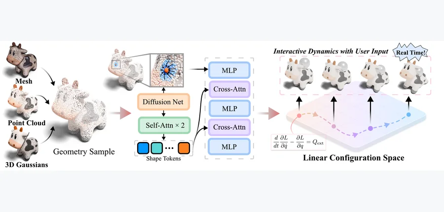 arXiv 2026-11-21 · cs.CV · #1 **[PRIO: Pre-trained Representation for Interactive Objects in 4D Worlds](https://arxiv.org/abs/2611.25500)** [Shixun Huang , Lifu Wei , Yue Chang , Chen Geng , Heng Zhang , Jinhyung Ahn , Caoliwen Wang , Siyuan Chen , Donglai Xiang… 机构：University of British Columbia / University of Toronto / Stanford University / Yonsei University / NVIDIA（[PDF](https://arxiv.org/pdf/2611.25500)） [Paper](https://arxiv.org/abs/2611.25500) · [图源](https://arxiv.org/html/2611.25500v1/fig/pipline_new.png) 

中文摘要
如今，三维（3D）世界已能被大规模捕获、重建和生成，但其中物体仍是静止的：按压枕头不会使其压缩，拉门也不会使其转动。让这些物体进入可交互的四维（4D）世界模型，需要一种表示，使其能实时运动、形变，并对用户动作作出物理响应。我们提出预训练的交互物体表示 PRIO。给定静态几何，PRIO 通过一次前向传播预测物体专属的构形空间。该空间为拉格朗日力学提供广义坐标，使物理定律和用户动作能够支配运动。构形在这些坐标中呈线性，因此动力学所需的量可以预先计算；随后动力学可以交互速率运行，无须进一步的网络推理。PRIO 在多样的四维轨迹上预训练，学得可泛化到未见形状的物体构形先验。它支持网格、点云和三维高斯，使重建与生成场景中的物体能够交互。我们展示其在真实到仿真流程和机器人操作中的应用。相较现有四维生成方法，PRIO 还能更快生成动力学结果，并更忠实地遵循用户动作。 <a href="https://arxiv.org/abs/2611.25500">原摘要来源</a>
 | 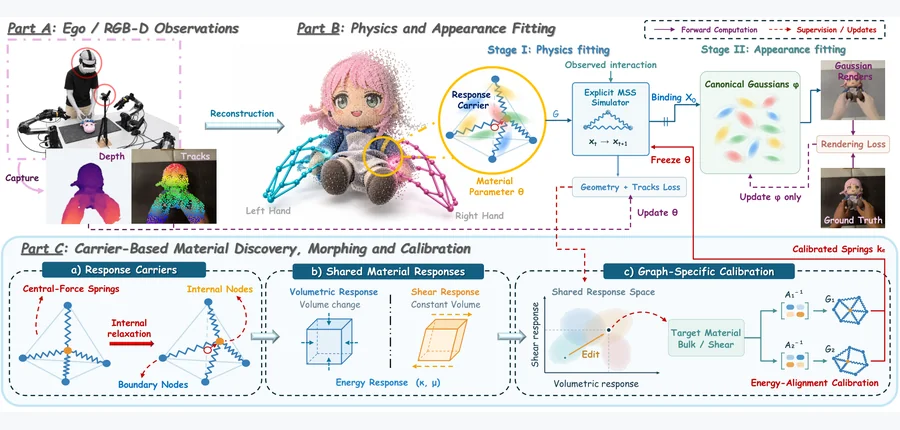 arXiv 2026-11-21 · cs.CV · #2 **[MorphTwin: Enriching Deformable Material Responses from Videos for Morphable and Interactive Physical Twins](https://arxiv.org/abs/2611.25963)** [Haoqin Hong , Ding Fan , Fubin Dou , Tianyu Huang , Yuzhuo Chen , Zhemeng Zhang , Hanxiao Jiang , Congcong Zhu , Gerhard… 机构：University of Science and Technology of China / City University of Hong Kong / The University of Hong Kong / Columbia University（[PDF](https://arxiv.org/pdf/2611.25963)） [Paper](https://arxiv.org/abs/2611.25963) · [图源](https://arxiv.org/html/2611.25963v1/MorphTwin-method-framework-final.png) 

中文摘要
从视频重建可交互的物理孪生体，既要准确捕捉物体形变，也要保持高效仿真。我们发现，当物理表示限制物体的形变方式时，复现视频中的运动并不保证物体会正确响应新施加的力。在基于弹簧的孪生体中，体积响应与形状响应的耦合造成了这种限制。我们提出 MorphTwin，在保留标准弹簧力和显式仿真的同时，扩充局部形变模态，以捕捉并独立控制这两类响应。为支持可解释的材料编辑与迁移，我们使用离线标定，将共享的相对响应变化映射为各重建图上的刚度更新。在合成场景中采用相同逆向设置时，相比 PhysTwin，MorphTwin 将泊松比的平均绝对误差降低 75.8%，杨氏模量的平均相对误差降低 22.1%。我们还提出一个自我中心双目与 RGB-D 基准，覆盖与不同刚度物体的交互。真实实验表明，在交互速率下，其重建精度有所提高，未来跟踪误差相较 PhysTwin 最多降低 14.4%。 <a href="https://arxiv.org/abs/2611.25963">原摘要来源</a>
 | 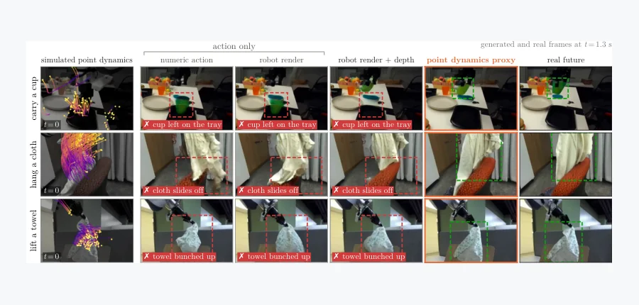 arXiv 2026-11-21 · cs.CV · #3 **[Point Dynamics as Proxy for Robotic World Models](https://arxiv.org/abs/2611.25946)** [Dong An , Tianyu Liu , Haoran Ding , Wen Yang , Anqing Duan , Zhengzhong Liu , Eric P. Xing , Guangyi Liu](https://arxiv.… 机构：Institute of Foundation Models / Mohamed bin Zayed University of Artificial Intelligence（[PDF](https://arxiv.org/pdf/2611.25946)） [Paper](https://arxiv.org/abs/2611.25946) · [Project](https://marsaki.github.io/point-dynamics-proxy/) · [图源](https://arxiv.org/html/2611.25946v1/qual.png) 

中文摘要
机器人世界模型根据当前观测和一系列机器人动作预测未来视频帧。尽管近期模型能较好地遵循指定动作，被操作物体却常常塌缩，或以与动作不一致的方式运动。我们认为问题在于条件信号：动作或机器人渲染图指定了机器人去向，却没有说明场景如何响应，使单一视频模型必须在渲染外观的同时隐式推断交互动力学。因此，我们将动力学预测与视觉渲染分开，以三维（3D）点动力学作为两者之间的代理。具体而言，我们将首帧提升为三维点，用学得的点动力学模型模拟其对机器人运动的响应，再把模拟点渲染回像素对齐的视频，供任意视频模型读取。在 DROID 数据集上，使用两种不同架构的视频渲染器进行受控实验时，该代理分别将物体运动误差降低 8.6% 和 6.2%，且不降低图像质量；在真实双臂机器人上降低 8.1%。此外，视频会跟随仿真：更准确的动力学带来更准确的物体运动，编辑点也能引导视频。这表明动力学建模的进步可转化为更忠实的机器人世界模型。 <a href="https://arxiv.org/abs/2611.25946">原摘要来源</a>
 |
| 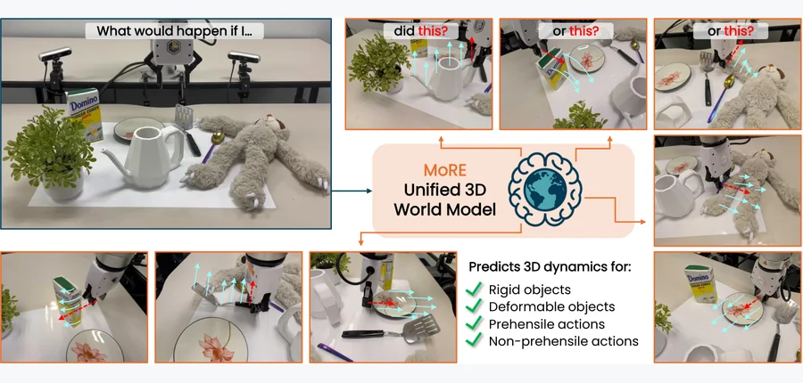 arXiv 2026-11-21 · cs.RO · #4 **[MoRE: Mixture-of-Experts for Multi-Physics Robotic World Models](https://arxiv.org/abs/2611.25336)** [Ziyu Zhu , Shaowei Liu , Albert J. Zhai , Henry Che , Wei-Chiu Ma , Shenlong Wang](https://arxiv.org/abs/2611.25336) 机构：University of Illinois Urbana-Champaign / Georgia Institute of Technology / Cornell University（[PDF](https://arxiv.org/pdf/2611.25336)） [Paper](https://arxiv.org/abs/2611.25336) · [Code](https://github.com/AlwaySleepy/MoRE-WM) · [Project](https://alwaysleepy.github.io/MoRE-WM-site/) · [Data](https://huggingface.co/datasets/MoRE-WM/MoRE-Data) · [图源](https://arxiv.org/html/2611.25336v1/more_teaser1.png) 

中文摘要
机器人世界模型应能预测物体在机器人动作和物理动力学作用下如何演化。近期三维（3D）世界模型虽具有较强预测能力，仍难以处理多样物体交互产生的异质动力学。为在统一框架中解决这一问题，我们把机器人交互分解为不同的物理机制，并为每种机制配置专门的运动专家。我们提出 MoRE，一种按刚体、可形变和抓持动力学组织运动专家混合体的三维世界模型。这一设计让单一模型在保留各机制专属先验的同时捕捉不同物理行为。MoRE 使用混合的仿真与真实数据训练，并与模型预测控制（MPC）结合，支持多种操作任务。实验表明，MoRE 提高了跨物理机制的预测精度，从而改善真实世界 MPC 性能。代码、数据和项目网站的链接见原论文。 <a href="https://arxiv.org/abs/2611.25336">原摘要来源</a>
 | 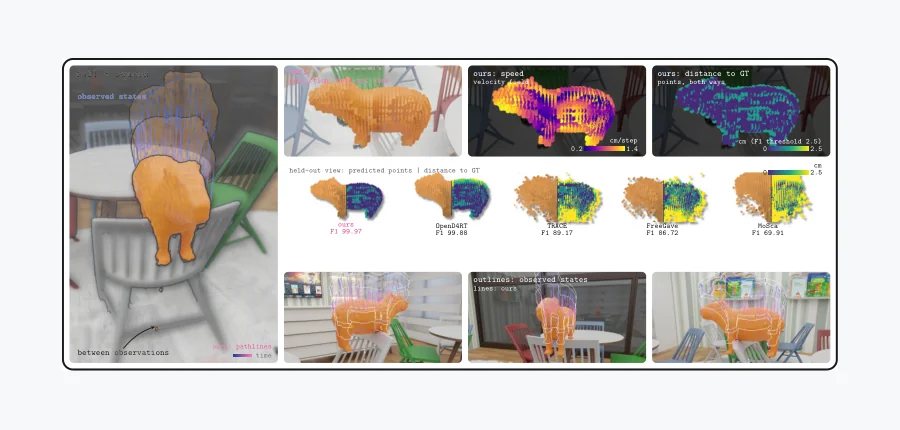 arXiv 2026-11-21 · cs.CV · #5 **[AdaPixFlow: Learning Continuous-Time 3D Dynamics Across Scenes from Sparse Multi-view Observations](https://arxiv.org/abs/2611.26433)** [Hrishikesh Viswanath , Aniket Bera](https://arxiv.org/abs/2611.26433) 机构：Purdue University（[PDF](https://arxiv.org/pdf/2611.26433)） [Paper](https://arxiv.org/abs/2611.26433) · [Code](https://github.com/HrishikeshVish/adapixflow) · [图源](https://arxiv.org/html/2611.26433v1/teaser.png) 

中文摘要
理解动态场景中物体的运动，需要从视觉观测恢复三维（3D）运动，并预测未观测时刻的位置。现有方法要么针对每个场景优化速度场，要么施加预设的物理与运动学假设。我们转而研究跨场景学习连续时间动力学算子，将多视角视觉观测映射为三维物体运动学。我们提出 Adaptive Pixel Flows，从多视角 RGB-D 观测学习这一算子，无须逐场景优化或预设运动模型。方法把所有相机的观测融合到世界坐标系的共享体素网格，再由网络预测连续时间速度场。由于算子跨场景训练，它学得的运动先验可迁移至未见场景。对该场积分可从观测状态预测观测之间及观测序列之后的物体位置。在留出的 PhysInOne 场景上，相比最强竞争方法，插值预测和未来预测的 F1 分别提高 2.5% 和 15%；相比逐场景速度场方法，分别提高 30% 和 85%。零样本应用于 Spring-Gaus 时，未来预测 F1 提高 12%。 <a href="https://arxiv.org/abs/2611.26433">原摘要来源</a>
 | 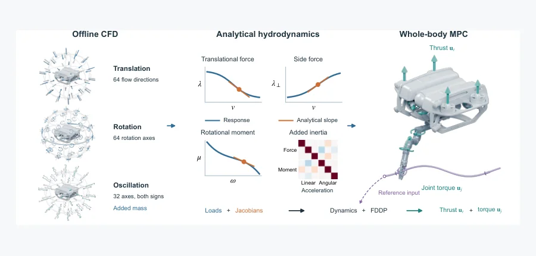 arXiv 2026-11-21 · cs.RO · #6 **[Differentiable Hydrodynamics for Whole-Body MPC of Underwater Robots](https://arxiv.org/abs/2611.25373)** [Hefan Wang , Yvan Petillot , Carlos Mastalli](https://arxiv.org/abs/2611.25373) 机构：Heriot-Watt University（[PDF](https://arxiv.org/pdf/2611.25373)） [Paper](https://arxiv.org/abs/2611.25373) · [Video](https://youtu.be/oX3EtKuudBg) · [图源](https://arxiv.org/html/2611.25373v1/fig_pipeline_overview_3d.png) 

中文摘要
水下航行器—机械臂系统的驱动力分布在推进器和关节电机之间。相较分别控制航行器与机械臂，全身模型预测控制（MPC）可协调两者，扩大工作空间并利用系统完整的运动学能力。但这要求在整个预测时域内获得水动力模型及其导数。计算流体力学（CFD）能够捕捉与几何相关的力和力矩，却过于昂贵，无法在线求值。我们提出可微的解析水动力模型，将平滑的球谐力与力矩场，同从 CFD 辨识的耦合附加惯性矩阵结合。它紧凑表示依赖速度和加速度的载荷，并以闭式形式提供导数。这些导数经由自由漂浮的航行器—机械臂动力学传播，用于全身轨迹优化与滚动时域控制，联合优化到达和连续跟踪所需的推进力及关节力矩。留出的 CFD 测试验证了主要平动力、转动力矩场和附加惯性响应。解析雅可比计算更快，且避免中心差分对步长的敏感性。在独立海洋仿真器 Stonefish 中的闭环实验展示了全身 MPC。通过使依赖几何的水动力及其敏感度可直接用于梯度控制，该模型把水力纳入航行器与机械臂之间的运动分配，而不只是将其视为扰动。 <a href="https://arxiv.org/abs/2611.25373">原摘要来源</a>
 |
| 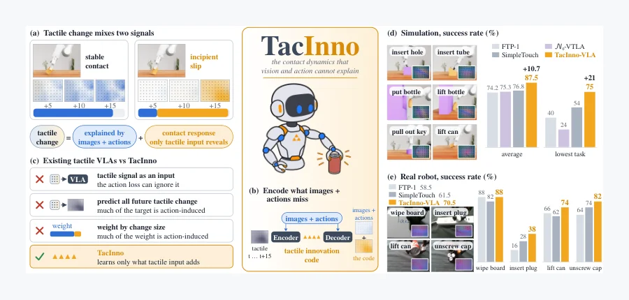 arXiv 2026-11-21 · cs.RO · #7 **[TacInno: Teaching Vision-Language-Action Models the Contact Dynamics Beyond Vision and Action](https://arxiv.org/abs/2611.26405)** [Weile Li , Yunfan Lou , Muqing Shi , Zihao Zhang , Zhenbiao Huang , Boxian Yao , Xiyu Zhu , Zhibo Pang](https://arxiv.org… 机构：ShanghaiTech University / Chinese Academy of Sciences / Peking University / Washington University in St. Louis / Beijing FiveAges Technology（[PDF](https://arxiv.org/pdf/2611.26405)） [Paper](https://arxiv.org/abs/2611.26405) · [Code](https://github.com/LisavilaLee/TacInno) · [Project](https://tacinno.github.io/) · [图源](https://arxiv.org/html/2611.26405v1/tacinno_teaser_v27.png) 

中文摘要
视觉—语言—动作（VLA）模型近来加入触觉感知，以识别接触密集操作中视觉上不明显的接触事件。然而，触觉输入带来的收益并不稳定，一些视觉触觉 VLA 模型也很少使用触觉，因为触觉变化中的很大一部分（如夹爪闭合时凝胶的形变）可由视觉观测和已执行动作预测。为解决这一问题，我们提出 TacInno：隔离出视觉和已执行动作无法解释的接触动力学，称为“触觉创新量”，并只把它用作训练目标。具体而言，以视觉观测和已执行动作为条件的 TacInno tokenizer 将未来触觉变化压缩为离散编码；策略 TacInno-VLA 学习预测该编码，部署时不增加编码模块。在六项仿真任务和四项真实任务中，TacInno-VLA 的平均成功率分别为 87.5% 和 70.5%，较最强视觉触觉基线分别高 10.7 和 9.0 个百分点。消融实验验证了视觉与动作条件化、多帧编码及辅助编码预测的作用。这些结果表明，触觉创新量可有效监督接触密集操作。 <a href="https://arxiv.org/abs/2611.26405">原摘要来源</a>
 | 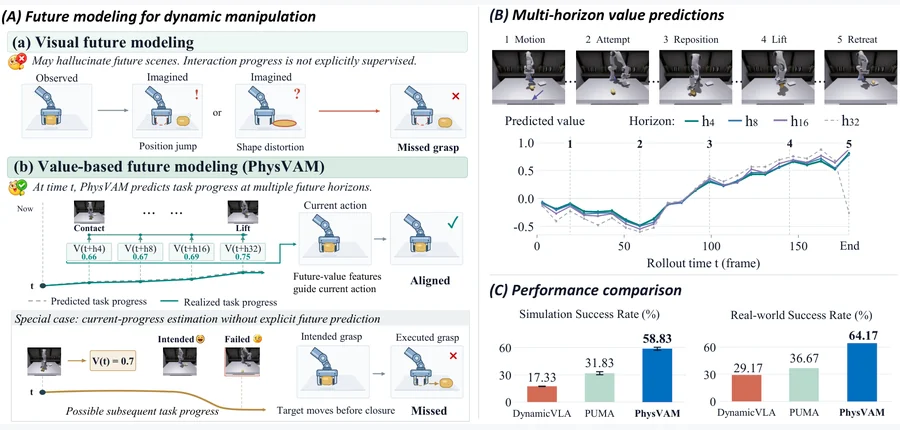 arXiv 2026-11-21 · cs.RO · #8 **[PhysVAM: Physics-oriented Future Value Action Model for Dynamic Object Manipulation](https://arxiv.org/abs/2611.26105)** [Yuxiang Yang , Jingbo Zhang , Jiaru Zhong , Junliang Chen , Yirui Zhou , Guangming Wang , Haitao Lin , Huaiyuan Xu , Yi W… 机构：Hong Kong Polytechnic University / Robotics X, Tencent / University of Cambridge（[PDF](https://arxiv.org/pdf/2611.26105)） [Paper](https://arxiv.org/abs/2611.26105) · [Project](https://metarobo.github.io/physvam.github.io/) · [图源](https://arxiv.org/html/2611.26105v1/intro_final_11.17.png) 

中文摘要
预测未来场景或物体状态，未必能揭示机器人与物体的交互会推进还是阻碍任务。在动态机器人操作中，这一问题尤其明显，因为物体在感知和执行期间仍持续运动。有效生成动作因而既要建模物体动力学，也要预判未来交互如何影响任务进展。为此，我们提出 PhysVAM，一种面向物理的未来价值动作模型，通过预期交互对未来任务进展的作用来表示这些交互。这种基于价值的形式提供面向任务的前瞻信息，无须重建未来视觉状态。以当前观测及物体、机器人运动历史为条件，PhysVAM 联合学习动作生成和多时域未来价值预测。价值分支利用成功与失败轨迹中的未来任务价值预测，学习各时域专属的潜在表示。这些未来价值表示通过门控交叉注意力融入动作策略，引导动作生成有助于任务成功的交互。大量仿真与真实实验表明，相比最强基线，仿真和真实任务的成功率绝对值分别提高 27.0 和 27.5 个百分点。项目页链接见原论文。 <a href="https://arxiv.org/abs/2611.26105">原摘要来源</a>
 | 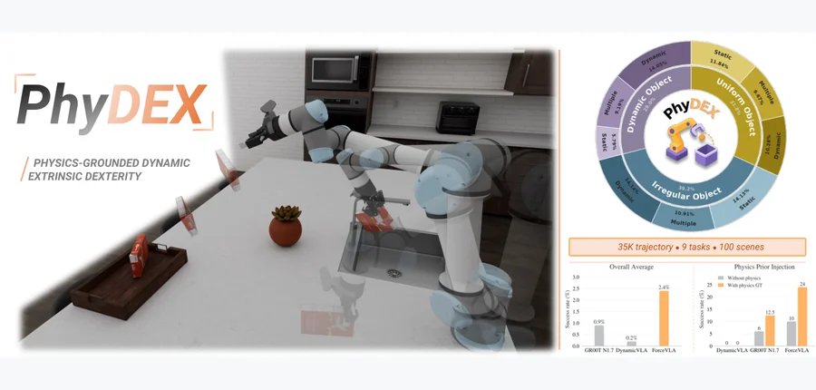 arXiv 2026-11-21 · cs.RO · #9 **[PhyDEX: A Benchmark for Physical Reasoning in Vision-Language-Action Models via Dynamic Extrinsic Dexterity](https://arxiv.org/abs/2611.26565)** [Hao Vo , Taisei Hanyu , Yuki Ikebe , Pham Tri Quang , Sreevenkata Anjani Tishita Godavarthi , Nghi D. Q. Bui , Daniel Son… 机构：University of Arkansas / VinUniversity / University of Stuttgart / DFKI / Max Planck Research School for Intelligent Systems / University of Liverpool（[PDF](https://arxiv.org/pdf/2611.26565)） [Paper](https://arxiv.org/abs/2611.26565) · [图源](https://arxiv.org/html/2611.26565v1/teaser-v8-v8.png) 

中文摘要
视觉—语言—动作（VLA）模型在语言条件机器人操作中进展迅速，但现有基准主要评价夹爪与物体的接触，大体忽略物体如何通过重力、摩擦、惯性和质量分布与环境交互。因此，尚不清楚当前策略是真正理解物理，还是只在训练数据之间插值。我们从动态外在灵巧性的角度切入，提出投掷基准 PhyDEX：机器人必须推断物体的质量、质心和摩擦，将其送到运动学工作空间之外的目标。PhyDEX 涵盖九项任务、100 个场景中的 35K（3.5 万）条轨迹（143 小时），包含质量均匀、不规则及质量动态变化的物体，以及静态、多目标和运动目标。全部数据由可扩展的全自动流程生成，结合了随机物理属性下的抓取生成、运动规划与闭环投掷优化。我们评估 GR00T N1.7、DynamicVLA 和 ForceVLA 三个代表性 VLA，发现成功率均低于 3%。分析揭示两个主要瓶颈：预训练模型鲁棒性不足，导致大多数失败发生在投掷之前；以及物理感知不足，提供真实物理属性可使成功率大致翻倍。人形机器人和真实世界实验显示出相同的失败模式。我们希望 PhyDEX 推动物理扎根的机器人策略发展。 <a href="https://arxiv.org/abs/2611.26565">原摘要来源</a>
 |
| 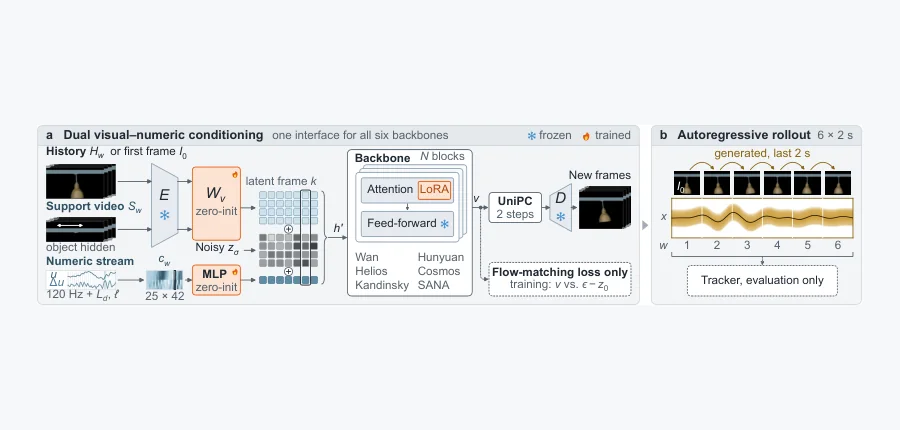 arXiv 2026-11-21 · cs.CV · #10 **[Physical Laws without Physics Loss? Probing Learned Dynamics in Video World Models through Forced Response](https://arxiv.org/abs/2611.25626)** [Yutao Li , Chen Wang , Wangmeng Zuo , Hui Li](https://arxiv.org/abs/2611.25626) 机构：Harbin Institute of Technology（[PDF](https://arxiv.org/pdf/2611.25626)） [Paper](https://arxiv.org/abs/2611.25626) · [图源](https://arxiv.org/html/2611.25626v1/figure_002.png) 

中文摘要
视频世界模型在没有物理损失的情况下能学到物理定律，还是只会模仿运动？整体运动和外观分数无法回答。我们通过非线性受迫响应研究这一问题：外部激励摇动悬挂物体的支撑。我们引入视觉—数值双条件，将六种图像到视频骨干适配为仅用流匹配损失预测该运动。Wan 能准确预测运动，并泛化到未见的激励、物体、姿态和场景。反事实测试表明，其能力可能超越训练视频的重放。但模型学到了什么规律？我们利用动力学与几何的泰勒展开设计三级测试。六种模型均能复现包括共振在内的线性响应；其中五种捕捉包括非线性软化在内的高阶动力学。值得注意的是，软化在训练数据中几乎不存在：仅占摆动位移平方的 0.74%。双摆与摇摆块的扩展实验表明，持续动力学比短暂碰撞学得更忠实。不过，状态估计或传播出错时，学得的动力学可能无法表现出来。我们将这些测试和发现转化为改进视频训练与生成的策略。 <a href="https://arxiv.org/abs/2611.25626">原摘要来源</a>
 | 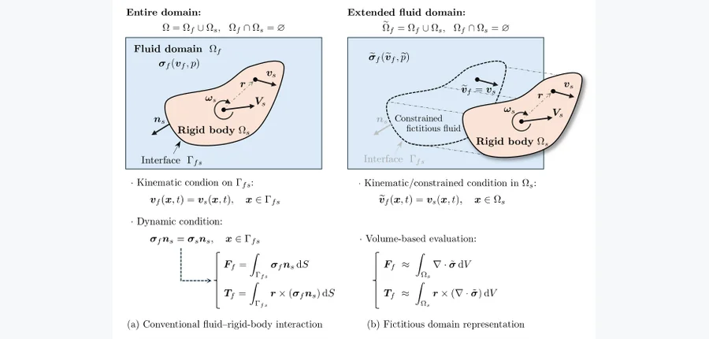 arXiv 2026-11-21 · physics.flu-dyn · #11 **[Partitioned iterative FD-SPH for fluid-rigid-body interaction: Stability and validation for lightweight floating bodies](https://arxiv.org/abs/2611.25923)** [Kumpei Tsuji , Ciara Galvin , Hiroyuki Omura , Naoto Mitsume , Mitsuteru Asai](https://arxiv.org/abs/2611.25923) 机构：Tohoku University / National Research Institute for Earth Science and Disaster Resilience / University of Tsukuba / Kyushu University（[PDF](https://arxiv.org/pdf/2611.25923)） [Paper](https://arxiv.org/abs/2611.25923) · [图源](https://arxiv.org/html/2611.25923v1/Fig_01.png) 

中文摘要
本研究评估用于自由表面流体—刚体相互作用的分区迭代虚拟域光滑粒子流体动力学（FD-SPH）。该方法扩展针对可形变结构的强耦合框架，将基于体积的水动力载荷与牛顿—欧拉刚体更新结合。每个时间步内，压力投影后的虚拟流体速度与刚体速度之间的差异被迭代反馈。分步解释给出了被动运动固体（PMS）投影与牛顿—欧拉更新产生相同刚体速度的条件。研究在匹配条件下比较单次和迭代 FD-SPH。二维沉降圆盘基准与已发表结果一致。在三维浮力驱动立方体测试中，单次耦合在比重 0.1 和 0.2 时不稳定；比重为 0.1 时，将时间步缩小 500 倍也无法消除不稳定。迭代强耦合在测试的 0.1–1.0 范围内保持稳定。平衡高度和方向分别符合静水力预期及已发表的稳定构形。二维和三维湿床溃坝仿真复现了波高、浮体升沉与俯仰的实验趋势。两个星形刚体展示了方法无需显式界面重建或表面法线计算即可处理复杂几何。所有正式强耦合仿真在达到最大耦合迭代次数前，每个时间步均满足预设的相对残差标准。结果支持将迭代 FD-SPH 用于瞬态自由表面流中的轻质复杂浮体。 <a href="https://arxiv.org/abs/2611.25923">原摘要来源</a>
 | 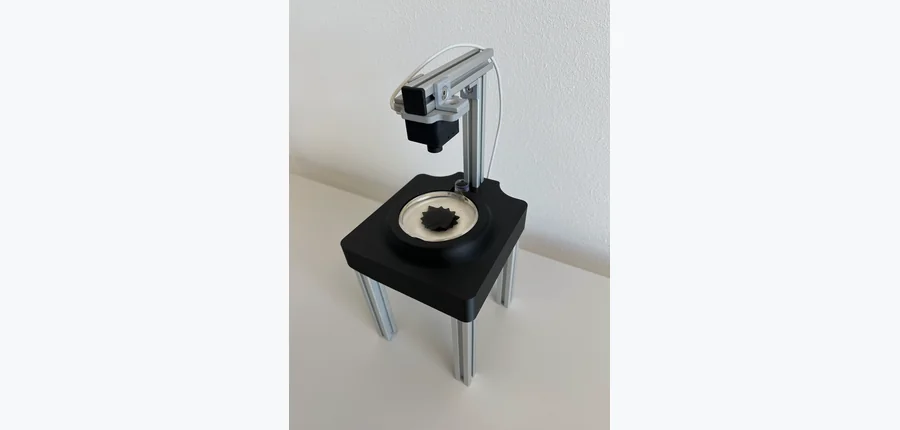 arXiv 2026-11-21 · cs.RO · #12 **[Ferrofluid Shape Control with Deep Reinforcement Learning](https://arxiv.org/abs/2611.25232)** [Anthony Czubarow , Antonio Terpin , Raffaello D'Andrea](https://arxiv.org/abs/2611.25232) 机构：ETH Zürich（[PDF](https://arxiv.org/pdf/2611.25232)） [Paper](https://arxiv.org/abs/2611.25232) · [图源](https://arxiv.org/html/2611.25232v1/figures/testbed.png) 

中文摘要
铁磁流体是含有磁性纳米粒子的液体，可通过外部磁场控制形状。这种可形变性使其能作为软体机器人本体，在狭窄空间中移动和操作物体，但非线性连续介质动力学使可靠控制颇具挑战。现有研究表明，电磁铁阵列产生的空间磁场可建立并维持目标铁磁流体构形。与之互补的目标是利用有限驱动下的流体动力学，达到平衡态下可能无法维持的指定形状。本文使用深度基于模型的强化学习控制这些瞬态形状。策略直接通过物理交互学习，根据视觉观测选择单个固定电磁铁的电流指令，引导运动中的铁磁流体达到指定几何形状。学得的策略能反复达到多种形状，包括多边形、星号形和五连方形。结果表明，直接从物理交互学习可实现可靠的流体塑形，为控制基于铁磁流体的软体机器人带来新可能。 <a href="https://arxiv.org/abs/2611.25232">原摘要来源</a>
 |
| 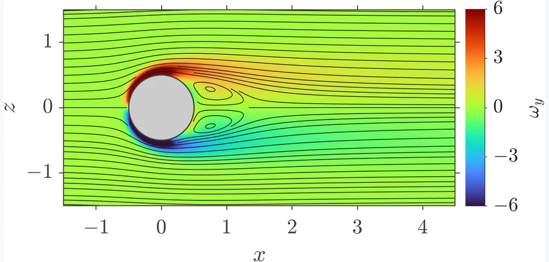 arXiv 2026-11-21 · physics.comp-ph · #13 **[A branch-free three-dimensional ghost-cell immersed boundary method with direction-averaged extrapolation kernels](https://arxiv.org/abs/2611.25618)** [Itsuki Takarabe , Ryuto Saeki , Koji Fukagata](https://arxiv.org/abs/2611.25618) 机构：Keio University（[PDF](https://arxiv.org/pdf/2611.25618)） [Paper](https://arxiv.org/abs/2611.25618) · [图源](https://arxiv.org/html/2611.25618v1/figs/sphere_wake_Re100.png) 

中文摘要
幽灵单元浸入边界方法通过为物体内部、紧邻边界的网格点（幽灵点）赋值，在笛卡尔网格上施加壁面边界条件。常见方法从镜像点重建幽灵值，要求每个幽灵点都有壁面法线。当插值模板伸出流体区域时，例如在复杂物体的薄、凹或高曲率部位附近，通常还需要特殊处理。我们提出一种既不需要壁面法线、也不需要镜像点的幽灵单元方法。它不用单一外推方向，而是利用距幽灵点 2.5 个网格间距内、满足简单几何条件的所有流体节点。幽灵值由这些节点经连接线段与壁面的交点作一维线性外推后取平均得到。权重只依赖几何，离线计算为每个幽灵点的 5×5×5 模板上的一个核。因此运行时边界处理是显式、无分支的加权求和。对球体和斯坦福兔周围流动，自收敛研究显示速度在 L1 和 L2 范数下约为二阶收敛。球体的最大差异也以二阶下降；斯坦福兔的下降较慢，最大差异出现在壁旁少数节点。雷诺数 25–200 时，球体阻力系数在每直径 32 和 64 个网格单元下，与先前研究分别相差不超过 2.4% 和 0.4%。雷诺数 100 时，斯坦福兔的力系数在每参考长度 64 个网格单元下，与贴体网格解相差不到 1%，无须针对几何作特殊处理。尽管未在壁面施加压力条件，压力场仍平滑且与贴体网格解一致。 <a href="https://arxiv.org/abs/2611.25618">原摘要来源</a>
 | 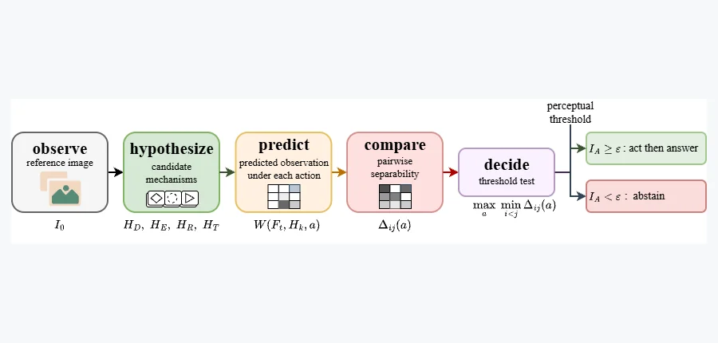 arXiv 2026-11-21 · cs.CV · #14 **[Less Than Meets the Eye: Action-Set Identifiability and Principled Abstention for 3D Physical Geometry](https://arxiv.org/abs/2611.26056)** [Reshad Ul Karim , Abrar Samin , Sammam Mahdi , Syeda Maliha Tabassum , Md Rashad Al Hasan Rony](https://arxiv.org/abs/261… 机构：BRAC University / Deutsche Telekom AG（[PDF](https://arxiv.org/pdf/2611.26056)） [Paper](https://arxiv.org/abs/2611.26056) · [图源](https://arxiv.org/html/2611.26056v1/figures/fig_pipeline.png) 

中文摘要
走廊、它在镜中的反射和显示屏上的图像可能看起来完全相同，但对应物理表面处于不同深度。我们测试受限的相机运动能否区分这些解释。Intervene3D 接收图像和初始几何估计，预测各假设和候选运动下的视图，并按最大最小可分性选择运动。只有可用运动足以区分仍然成立的假设时，它才报告成像机制和第一个物理表面；否则选择弃答。适合性测试还会拒绝任何假设都无法解释的观测。在使用精确地标的匹配合成基准上，关闭弃答会对 76.4% 本来不可判定的场景给出自信答案；启用后，无论地标精确还是含噪，这类场景均不会得到自信答案。在已回答场景达到 100% 准确率时，最大最小选择覆盖 61.0% 场景，而求和选择覆盖 43.1%。适合性测试将强曲率镜面场景中的错误回答率从 56.8% 降至 12.4%。真实显示屏实验使用一个冻结深度网络的估计比较两种假设；第二张图像只提供光度证据，从不输入深度网络。执行一次运动使十二个网络汇总的表面误差中位数降低 31.5%。在错觉基准图像中，这些网络有 33.4% 的图像在标注面板内部的误差大于外部；在 Mirror3D 帧中，有 36.9% 将第一个物理表面放在玻璃之后。 <a href="https://arxiv.org/abs/2611.26056">原摘要来源</a>
 | 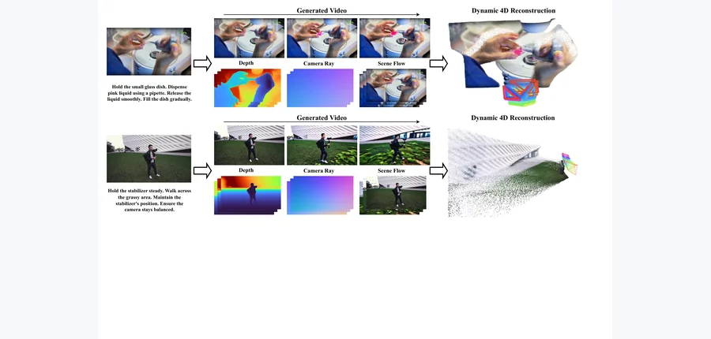 arXiv 2026-11-21 · cs.CV · #15 **[Plan4D: Generative Plannable 4D Worlds](https://arxiv.org/abs/2611.26516)** [Hangwei Zhang , Rujing Dang , Ruimin Lin , Jiahong Wu , Xiangxiang Chu , Chuanxia Zheng](https://arxiv.org/abs/2611.26516) 机构：Nanyang Technological University / Alibaba Group（[PDF](https://arxiv.org/pdf/2611.26516)） [Paper](https://arxiv.org/abs/2611.26516) · [Project](https://fogradio.github.io/plan4d-project/) · [图源](https://arxiv.org/html/2611.26516v1/plan4d_teaser-v1.png) 

中文摘要
多数预测未来的世界模型优先考虑生成视频的美观程度，但由于缺乏显式四维建模，其物理基础较弱，跨时间的几何一致性也有限。本文提出 Plan4D，作为构建可生成、可规划的四维世界模型的一种可能进展：它根据观测场景上下文和文本指定的动作，同时预测未来 RGB 视频及稠密四维几何，包括深度、相机、点云和场景流。由于同时具有配对动作与稠密四维标注的训练数据天然稀缺，Plan4D 利用基础视频生成器与三维（3D）重建器的互补先验。具体而言，我们提出模型拼接架构，将 Depth Anything 3 与 LongCat-Video 耦合，并增设辅助 DPT 头预测场景流。得到的模型可在动态三维场景中规划并生成复杂、长时域、细粒度动作，同时显著改善生成未来视频的视觉保真度和几何精度。在合成和真实数据集上的大量实验表明，Plan4D 在环境反应的生成式四维建模中达到最先进水平。项目页链接见原论文。 <a href="https://arxiv.org/abs/2611.26516">原摘要来源</a>
 |
| 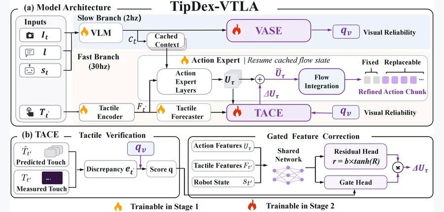 arXiv 2026-11-21 · cs.RO · #16 **[TipDex-VTLA: Learning When to Refine Actions with Touch for Dexterous Manipulation](https://arxiv.org/abs/2611.25683)** [Xudi Ge , Yepeng Liu , Haifeng Liu , Enze Shi , Liangqi Zhang , Yongchao Xu](https://arxiv.org/abs/2611.25683) 机构：Wuhan University / Wuhan Huaweike Intelligent Technology（[PDF](https://arxiv.org/pdf/2611.25683)） [Paper](https://arxiv.org/abs/2611.25683) · [图源](https://arxiv.org/html/2611.25683v1/figures/new-method01.png) 

中文摘要
即使物理状态不变，照明变化也会使灵巧操作的动作发生漂移。现有视觉—触觉—语言—动作（VTLA）策略虽纳入触觉反馈，在变化的视觉条件下，何时以及如何用触觉修正动作仍有挑战。我们提出 TipDex-VTLA：结合估计的视觉动作可靠性与触觉预测核验，调节执行时的修正。具体而言，视觉动作敏感度估计（VASE）依据冻结参考策略对照明扰动的动作敏感度，学习视觉可靠性。执行中的触觉预判与修正（TACE）在匹配时刻比较预测触觉与实测触觉，并将差异与视觉可靠性结合，门控对尚未执行动作的有界特征修正。这有助于在未见的困难视觉条件下修正动作。我们在四项真实灵巧操作任务和 UniVTAC 仿真基准上评价 TipDex-VTLA。仅用正常视觉条件采集的数据训练时，该方法在真实任务的正常和困难未见光照下，完整任务平均成功率分别达到 87.5% 和 73.8%，显著优于部分最先进方法。作者表示将发布采集的数据与源代码。 <a href="https://arxiv.org/abs/2611.25683">原摘要来源</a>
 | 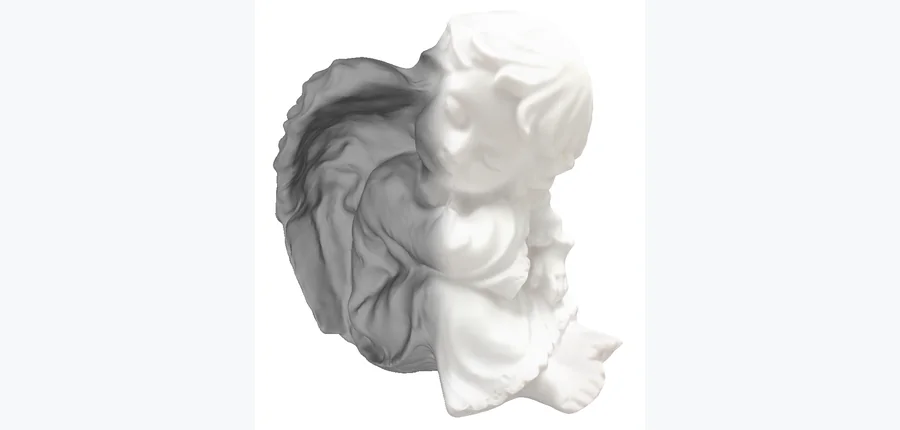 arXiv 2026-11-21 · cs.CV · #17 **[Watertight Mesh Optimization of Textured Objects](https://arxiv.org/abs/2611.25414)** [Nathaniel Burgdorfer , Philippos Mordohai](https://arxiv.org/abs/2611.25414) 机构：Stevens Institute of Technology（[PDF](https://arxiv.org/pdf/2611.25414)） [Paper](https://arxiv.org/abs/2611.25414) · [图源](https://arxiv.org/html/2611.25414v1/assets/mesh/angel_mix.png) 

中文摘要
从图像重建高质量三维（3D）资产时，现有方法往往在一个目标上表现出色，却牺牲另一个目标，还常忽视重建表面的内在质量。我们提出 MODL，在水密三角网格上直接联合优化几何与视角相关的外观。方法结合拉普拉斯预条件优化，以平滑更新顶点，并用曲率自适应重网格化保留细节和良好的三角形形状。三角网格在多视角归一化互相关约束下优化，无须分割、几何监督或 alpha 混合。物体重建数据集上的评估表明，MODL 在新视角合成方面具有竞争力，同时生成几何准确、内在网格质量更优的模型。结果显示，直接网格优化有望统一照片级真实感渲染、几何重建与实用三维资产创建。 <a href="https://arxiv.org/abs/2611.25414">原摘要来源</a>
 | 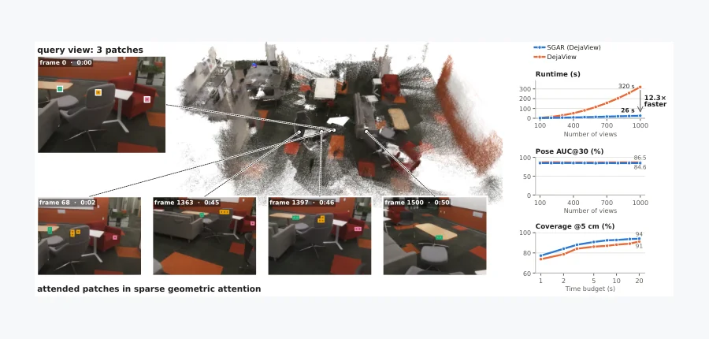 arXiv 2026-11-21 · cs.CV · #18 **[SGAR: Feed-Forward 3D Reconstruction via Sparse Geometry-Guided Attention](https://arxiv.org/abs/2611.26493)** [Aoxiang Fan , Maria Pilligua , Corentin Dumery , Oliver Heinimann , Pascal Fua](https://arxiv.org/abs/2611.26493) 机构：EPFL（[PDF](https://arxiv.org/pdf/2611.26493)） [Paper](https://arxiv.org/abs/2611.26493) · [图源](https://arxiv.org/html/2611.26493v1/teaser.png) 

中文摘要
前馈模型凭借让各视图图像块密集关联的临时注意力设计，在三维（3D）重建中取得成功。然而，密集全局注意力的成本随视图数平方增长，限制其用于更大规模重建。本文从经典运动恢复结构的角度指出：三维结构源于二维区域之间的几何匹配，大部分密集注意力计算并无必要。我们以稀疏几何注意力重建方法 SGAR，将这一原则引入学习式前馈重建。在 SGAR 中，每个图像块 token 只关注其他视图中少量 token；它们由轻量级学得的键选择模块选出，该模块训练目标是预测 token 的跨视图三维邻近性。这样，密集全局注意力便由更高效的几何相似性引导稀疏注意力替代。SGAR 是通用方法，可通过微调用于不同的前馈模型。实验表明，在最先进的密集与稀疏方法中，SGAR 速度最快，并且是最准确的稀疏方法。在 1000 个视图下，其速度最多比密集注意力快 12 倍，姿态精度仍稳定，而现有稀疏方法失效；在相同时间预算下，它重建出更完整的几何。 <a href="https://arxiv.org/abs/2611.26493">原摘要来源</a>
 |
| 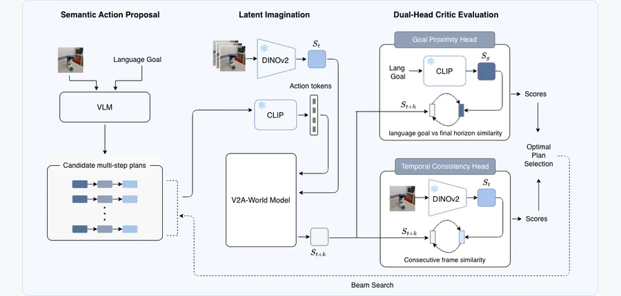 arXiv 2026-11-21 · cs.RO · #19 **[Verify2Act: Critic-Guided Latent World Models for Verifying Language-Conditioned Manipulation Plans](https://arxiv.org/abs/2611.25243)** [Chrisantus Eze , Christopher Crick](https://arxiv.org/abs/2611.25243) 机构：Oklahoma State University（[PDF](https://arxiv.org/pdf/2611.25243)） [Paper](https://arxiv.org/abs/2611.25243) · [图源](https://arxiv.org/html/2611.25243v1/architectural_diagram.png) 

中文摘要
视觉语言模型（VLM）可以提出多步操作计划，却缺少场景如何变化的扎根模型；可用于检查计划的像素级世界模型则速度慢，并会在长时域中漂移。我们提出 Verify2Act，一个将语义动作提议与潜在物理核验分开的模块化框架。VLM 提出候选计划，潜在世界模型 V2A-WM 在 DINOv2 特征空间中想象各计划的结果，双头评估器在执行前检查想象轨迹的时间一致性和目标满足情况。V2A-WM 在近期流匹配世界模型基础上加入交叉注意力动作扎根和因果时间历史窗口。我们将完整系统部署在低成本机械臂上，世界模型与评估器仅用数字孪生生成的数据训练。在六项语言条件任务中，Verify2Act 的任务成功率为 83.3%，高于未采用所提架构改动的潜在世界模型（61.7%）、单独 VLM（53.3%）和像素扩散世界模型（46.7%）。它核验了执行的每个计划，未发生规划诱发的失败；所有失败回合均由底层抓取或放置滑移造成。仿真中，在比较的基线里，Verify2Act 在 CALVIN 上取得最高的五任务链成功率，反思式 VLM 调用比像素扩散核验少 30 倍；在杂乱螺母装配上也取得最高成功率。 <a href="https://arxiv.org/abs/2611.25243">原摘要来源</a>
 | 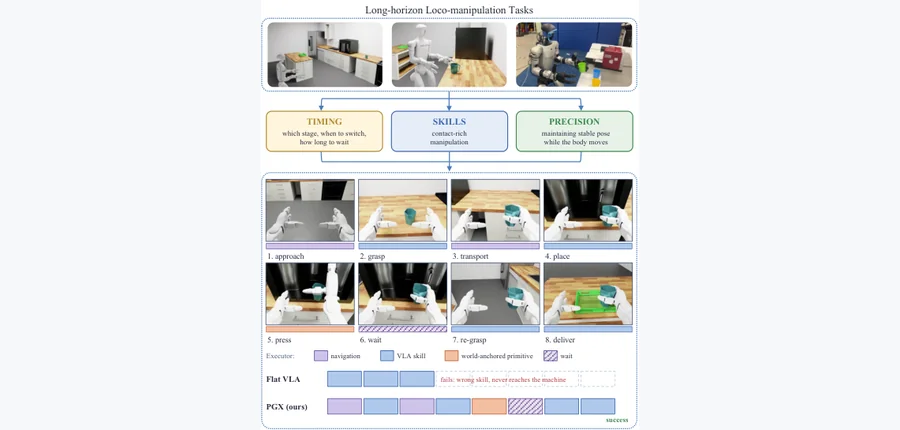 arXiv 2026-11-21 · cs.RO · #20 **[PGX: Physically Grounded Execution for Long-Horizon Humanoid Loco-Manipulation](https://arxiv.org/abs/2611.26596)** [Kai Lu , Chenyang Ma , Ioannis Havoutis](https://arxiv.org/abs/2611.26596) 机构：University of Oxford（[PDF](https://arxiv.org/pdf/2611.26596)） [Paper](https://arxiv.org/abs/2611.26596) · [Project](https://kl-research.github.io/pgx/) · [图源](https://arxiv.org/html/2611.26596v1/teaser_pdf3.png) 

中文摘要
机器人视觉—语言—动作（VLA）模型可以执行多样的单项操作技能，但在长时域移动操作中仍有困难，因为时间结构、技能与精度在单体模型中紧密耦合。我们提出物理扎根执行框架 PGX，将时间与精度控制交给两个无需训练的经典组件，使 VLA 聚焦各阶段的技能动力学。PGX 将长时域移动操作分为三层：（i）基于谓词的状态机管理任务进程，利用物理谓词控制阶段转换、触发恢复，并协调导航与等待；共享的谓词语义连接离线示范分段、在线执行和分阶段评价；（ii）VLA 技能在激活的操作阶段运行，普通或按阶段训练的模型聚焦任务相关动作；（iii）世界坐标锁定（WCL）通过底座定点、相对物体定位与世界坐标锚定的接触目标，维持空间一致性。我们在三项仿真任务和一项真实任务中，使用宇树 G1 人形机器人开展长时域移动操作实验，表明 PGX 提高了阶段推进与任务成功率。项目页链接见原论文。 <a href="https://arxiv.org/abs/2611.26596">原摘要来源</a>
 |   |
<!-- PAPER_CARDS_END -->

## 检索概况

- **官方批次**：arXiv `New submissions`，Friday, 20 November 2026；本日报于北京时间 2026-11-21 生成。
- **检索窗口**：从上期 2026-11-19 官方批次之后，至 2026-11-20 官方 New 批次；检索 `cs.CV`、`cs.GR`、`cs.RO`、`cs.AI`、`cs.LG`、`physics.flu-dyn`、`physics.comp-ph`、`cond-mat.soft`、`cond-mat.mtrl-sci`、`eess.IV`、`eess.SP`、`eess.SY`、`math.NA`、`stat.ML` 的 [官方 New 页面](https://arxiv.org/list/cs.CV/new)，并按标题与摘要人工筛选同义概念。
- **总命中／入选**：14 个分类共 631 条 New 分类记录；按 arXiv ID 去重后 625 篇，精选 20 篇。跨分类记录只计一次。主榜均来自本次官方 New；未发现需要单列且已核实的重大 Replacement。
- **事实与推断**：标题、作者、分类、摘要链接指向 arXiv；机构由 PDF 首页核对。相关性、阅读优先级、局限和改进建议是编辑推断。

## Top papers

| # | 论文 | 分类 | 作者 | 机构 | 相关性（推断） | 机构强度（推断） | 阅读优先级（推断） |
|---:|---|---|---|---|---|---|:---:|
| 1 | [PRIO: Pre-trained Representation for Interactive Objects in 4D Worlds](https://arxiv.org/abs/2611.25500) | [cs.CV](https://arxiv.org/abs/2611.25500) | [Shixun Huang , Lifu Wei , Yue Chang , Chen Geng , Heng Zhang , Jinhyung Ahn , Caoliwen Wang , Siyuan Chen , Donglai Xiang , Jiajun Wu , Peter Yichen Chen](https://arxiv.org/abs/2611.25500) | University of British Columbia / University of Toronto / Stanford University / Yonsei University / NVIDIA（[PDF](https://arxiv.org/pdf/2611.25500)） | 可交互 4D／物理表示 | 未独立评级 | A |
| 2 | [MorphTwin: Enriching Deformable Material Responses from Videos for Morphable and Interactive Physical Twins](https://arxiv.org/abs/2611.25963) | [cs.CV](https://arxiv.org/abs/2611.25963) | [Haoqin Hong , Ding Fan , Fubin Dou , Tianyu Huang , Yuzhuo Chen , Zhemeng Zhang , Hanxiao Jiang , Congcong Zhu , Gerhard Petrus Hancke , Jingrun Chen , Rynson WH Lau](https://arxiv.org/abs/2611.25963) | University of Science and Technology of China / City University of Hong Kong / The University of Hong Kong / Columbia University（[PDF](https://arxiv.org/pdf/2611.25963)） | 形变材料／逆向物理 | 未独立评级 | A |
| 3 | [Point Dynamics as Proxy for Robotic World Models](https://arxiv.org/abs/2611.25946) | [cs.CV](https://arxiv.org/abs/2611.25946) | [Dong An , Tianyu Liu , Haoran Ding , Wen Yang , Anqing Duan , Zhengzhong Liu , Eric P. Xing , Guangyi Liu](https://arxiv.org/abs/2611.25946) | Institute of Foundation Models / Mohamed bin Zayed University of Artificial Intelligence（[PDF](https://arxiv.org/pdf/2611.25946)） | 三维点动力学／机器人世界模型 | 未独立评级 | A |
| 4 | [MoRE: Mixture-of-Experts for Multi-Physics Robotic World Models](https://arxiv.org/abs/2611.25336) | [cs.RO](https://arxiv.org/abs/2611.25336) | [Ziyu Zhu , Shaowei Liu , Albert J. Zhai , Henry Che , Wei-Chiu Ma , Shenlong Wang](https://arxiv.org/abs/2611.25336) | University of Illinois Urbana-Champaign / Georgia Institute of Technology / Cornell University（[PDF](https://arxiv.org/pdf/2611.25336)） | 多物理机制／机器人世界模型 | 未独立评级 | A |
| 5 | [AdaPixFlow: Learning Continuous-Time 3D Dynamics Across Scenes from Sparse Multi-view Observations](https://arxiv.org/abs/2611.26433) | [cs.CV](https://arxiv.org/abs/2611.26433) | [Hrishikesh Viswanath , Aniket Bera](https://arxiv.org/abs/2611.26433) | Purdue University（[PDF](https://arxiv.org/pdf/2611.26433)） | 连续时间三维运动 | 未独立评级 | A |
| 6 | [Differentiable Hydrodynamics for Whole-Body MPC of Underwater Robots](https://arxiv.org/abs/2611.25373) | [cs.RO](https://arxiv.org/abs/2611.25373) | [Hefan Wang , Yvan Petillot , Carlos Mastalli](https://arxiv.org/abs/2611.25373) | Heriot-Watt University（[PDF](https://arxiv.org/pdf/2611.25373)） | 可微水动力／全身控制 | 未独立评级 | A |
| 7 | [TacInno: Teaching Vision-Language-Action Models the Contact Dynamics Beyond Vision and Action](https://arxiv.org/abs/2611.26405) | [cs.RO](https://arxiv.org/abs/2611.26405) | [Weile Li , Yunfan Lou , Muqing Shi , Zihao Zhang , Zhenbiao Huang , Boxian Yao , Xiyu Zhu , Zhibo Pang](https://arxiv.org/abs/2611.26405) | ShanghaiTech University / Chinese Academy of Sciences / Peking University / Washington University in St. Louis / Beijing FiveAges Technology（[PDF](https://arxiv.org/pdf/2611.26405)） | 触觉接触动力学 | 未独立评级 | A |
| 8 | [PhysVAM: Physics-oriented Future Value Action Model for Dynamic Object Manipulation](https://arxiv.org/abs/2611.26105) | [cs.RO](https://arxiv.org/abs/2611.26105) | [Yuxiang Yang , Jingbo Zhang , Jiaru Zhong , Junliang Chen , Yirui Zhou , Guangming Wang , Haitao Lin , Huaiyuan Xu , Yi Wang , Lap-Pui Chau](https://arxiv.org/abs/2611.26105) | Hong Kong Polytechnic University / Robotics X, Tencent / University of Cambridge（[PDF](https://arxiv.org/pdf/2611.26105)） | 动态物体操作／未来价值 | 未独立评级 | A |
| 9 | [PhyDEX: A Benchmark for Physical Reasoning in Vision-Language-Action Models via Dynamic Extrinsic Dexterity](https://arxiv.org/abs/2611.26565) | [cs.RO](https://arxiv.org/abs/2611.26565) | [Hao Vo , Taisei Hanyu , Yuki Ikebe , Pham Tri Quang , Sreevenkata Anjani Tishita Godavarthi , Nghi D. Q. Bui , Daniel Sonntag , Chase Rainwater , Duy Minh Ho Nguyen , Anh Nguyen , Ngan Le](https://arxiv.org/abs/2611.26565) | University of Arkansas / VinUniversity / University of Stuttgart / DFKI / Max Planck Research School for Intelligent Systems / University of Liverpool（[PDF](https://arxiv.org/pdf/2611.26565)） | 物理推理／机器人评测 | 未独立评级 | A |
| 10 | [Physical Laws without Physics Loss? Probing Learned Dynamics in Video World Models through Forced Response](https://arxiv.org/abs/2611.25626) | [cs.CV](https://arxiv.org/abs/2611.25626) | [Yutao Li , Chen Wang , Wangmeng Zuo , Hui Li](https://arxiv.org/abs/2611.25626) | Harbin Institute of Technology（[PDF](https://arxiv.org/pdf/2611.25626)） | 视频世界模型／物理规律 | 未独立评级 | A |
| 11 | [Partitioned iterative FD-SPH for fluid-rigid-body interaction: Stability and validation for lightweight floating bodies](https://arxiv.org/abs/2611.25923) | [physics.flu-dyn](https://arxiv.org/abs/2611.25923) | [Kumpei Tsuji , Ciara Galvin , Hiroyuki Omura , Naoto Mitsume , Mitsuteru Asai](https://arxiv.org/abs/2611.25923) | Tohoku University / National Research Institute for Earth Science and Disaster Resilience / University of Tsukuba / Kyushu University（[PDF](https://arxiv.org/pdf/2611.25923)） | 流固耦合／数值稳定性 | 未独立评级 | B |
| 12 | [Ferrofluid Shape Control with Deep Reinforcement Learning](https://arxiv.org/abs/2611.25232) | [cs.RO](https://arxiv.org/abs/2611.25232) | [Anthony Czubarow , Antonio Terpin , Raffaello D'Andrea](https://arxiv.org/abs/2611.25232) | ETH Zürich（[PDF](https://arxiv.org/pdf/2611.25232)） | 铁磁流体／软体机器人 | 未独立评级 | B |
| 13 | [A branch-free three-dimensional ghost-cell immersed boundary method with direction-averaged extrapolation kernels](https://arxiv.org/abs/2611.25618) | [physics.comp-ph](https://arxiv.org/abs/2611.25618) | [Itsuki Takarabe , Ryuto Saeki , Koji Fukagata](https://arxiv.org/abs/2611.25618) | Keio University（[PDF](https://arxiv.org/pdf/2611.25618)） | 三维浸入边界／流体仿真 | 未独立评级 | B |
| 14 | [Less Than Meets the Eye: Action-Set Identifiability and Principled Abstention for 3D Physical Geometry](https://arxiv.org/abs/2611.26056) | [cs.CV](https://arxiv.org/abs/2611.26056) | [Reshad Ul Karim , Abrar Samin , Sammam Mahdi , Syeda Maliha Tabassum , Md Rashad Al Hasan Rony](https://arxiv.org/abs/2611.26056) | BRAC University / Deutsche Telekom AG（[PDF](https://arxiv.org/pdf/2611.26056)） | 主动视角／物理几何 | 未独立评级 | B |
| 15 | [Plan4D: Generative Plannable 4D Worlds](https://arxiv.org/abs/2611.26516) | [cs.CV](https://arxiv.org/abs/2611.26516) | [Hangwei Zhang , Rujing Dang , Ruimin Lin , Jiahong Wu , Xiangxiang Chu , Chuanxia Zheng](https://arxiv.org/abs/2611.26516) | Nanyang Technological University / Alibaba Group（[PDF](https://arxiv.org/pdf/2611.26516)） | 可规划 4D 场景 | 未独立评级 | B |
| 16 | [TipDex-VTLA: Learning When to Refine Actions with Touch for Dexterous Manipulation](https://arxiv.org/abs/2611.25683) | [cs.RO](https://arxiv.org/abs/2611.25683) | [Xudi Ge , Yepeng Liu , Haifeng Liu , Enze Shi , Liangqi Zhang , Yongchao Xu](https://arxiv.org/abs/2611.25683) | Wuhan University / Wuhan Huaweike Intelligent Technology（[PDF](https://arxiv.org/pdf/2611.25683)） | 触觉修正／灵巧操作 | 未独立评级 | B |
| 17 | [Watertight Mesh Optimization of Textured Objects](https://arxiv.org/abs/2611.25414) | [cs.CV](https://arxiv.org/abs/2611.25414) | [Nathaniel Burgdorfer , Philippos Mordohai](https://arxiv.org/abs/2611.25414) | Stevens Institute of Technology（[PDF](https://arxiv.org/pdf/2611.25414)） | 水密网格／三维重建 | 未独立评级 | B |
| 18 | [SGAR: Feed-Forward 3D Reconstruction via Sparse Geometry-Guided Attention](https://arxiv.org/abs/2611.26493) | [cs.CV](https://arxiv.org/abs/2611.26493) | [Aoxiang Fan , Maria Pilligua , Corentin Dumery , Oliver Heinimann , Pascal Fua](https://arxiv.org/abs/2611.26493) | EPFL（[PDF](https://arxiv.org/pdf/2611.26493)） | 稀疏几何注意力／三维重建 | 未独立评级 | B |
| 19 | [Verify2Act: Critic-Guided Latent World Models for Verifying Language-Conditioned Manipulation Plans](https://arxiv.org/abs/2611.25243) | [cs.RO](https://arxiv.org/abs/2611.25243) | [Chrisantus Eze , Christopher Crick](https://arxiv.org/abs/2611.25243) | Oklahoma State University（[PDF](https://arxiv.org/pdf/2611.25243)） | 潜在世界模型／机器人操作 | 未独立评级 | B |
| 20 | [PGX: Physically Grounded Execution for Long-Horizon Humanoid Loco-Manipulation](https://arxiv.org/abs/2611.26596) | [cs.RO](https://arxiv.org/abs/2611.26596) | [Kai Lu , Chenyang Ma , Ioannis Havoutis](https://arxiv.org/abs/2611.26596) | University of Oxford（[PDF](https://arxiv.org/pdf/2611.26596)） | 物理谓词／人形移动操作 | 未独立评级 | B |

## 逐篇中文要点

### 1. [PRIO: Pre-trained Representation for Interactive Objects in 4D Worlds](https://arxiv.org/abs/2611.25500)

- **论文事实／方法**：从静态几何一次预测物体构形空间，用拉格朗日动力学实时驱动网格、点云和三维高斯。（[原摘要](https://arxiv.org/abs/2611.25500)）
- **论文事实／结果**：论文报告对未见形状的泛化，并展示真实到仿真和机器人操作。（[原摘要](https://arxiv.org/abs/2611.25500)）
- **编辑推断／局限与改进**：需比较物体间碰撞及复杂接触下的速度与能量稳定性。

### 2. [MorphTwin: Enriching Deformable Material Responses from Videos for Morphable and Interactive Physical Twins](https://arxiv.org/abs/2611.25963)

- **论文事实／方法**：扩充弹簧物理孪生体的局部形变模态，使体积和形状响应可分别控制。（[原摘要](https://arxiv.org/abs/2611.25963)）
- **论文事实／结果**：相较 PhysTwin，泊松比误差降低 75.8%，杨氏模量误差降低 22.1%。（[原摘要](https://arxiv.org/abs/2611.25963)）
- **编辑推断／局限与改进**：可在接触位置与加载频率变化时测材料参数可辨识性。

### 3. [Point Dynamics as Proxy for Robotic World Models](https://arxiv.org/abs/2611.25946)

- **论文事实／方法**：以学习到的三维点动力学作为机器人动作与视频渲染之间的代理。（[原摘要](https://arxiv.org/abs/2611.25946)）
- **论文事实／结果**：DROID 两种渲染器的物体运动误差分别降低 8.6% 和 6.2%；真实双臂降低 8.1%。（[原摘要](https://arxiv.org/abs/2611.25946)）
- **编辑推断／局限与改进**：应测试长时域滚动预测时点云遮挡与新接触的累积误差。

### 4. [MoRE: Mixture-of-Experts for Multi-Physics Robotic World Models](https://arxiv.org/abs/2611.25336)

- **论文事实／方法**：按刚体、可形变与抓持机制组织运动专家的三维机器人世界模型。（[原摘要](https://arxiv.org/abs/2611.25336)）
- **论文事实／结果**：摘要报告跨机制预测改进和真实世界 MPC 性能提升，但未给出具体数值。（[原摘要](https://arxiv.org/abs/2611.25336)）
- **编辑推断／局限与改进**：可检验机制边界附近的专家路由与混合接触泛化。

### 5. [AdaPixFlow: Learning Continuous-Time 3D Dynamics Across Scenes from Sparse Multi-view Observations](https://arxiv.org/abs/2611.26433)

- **论文事实／方法**：融合多视角 RGB-D 到世界坐标体素，学习可积分的连续时间速度场。（[原摘要](https://arxiv.org/abs/2611.26433)）
- **论文事实／结果**：PhysInOne 留出场景的插值及未来 F1 较最强方法提高 2.5% 和 15%。（[原摘要](https://arxiv.org/abs/2611.26433)）
- **编辑推断／局限与改进**：需测跨相机标定误差和碰撞时速度场的不连续性。

### 6. [Differentiable Hydrodynamics for Whole-Body MPC of Underwater Robots](https://arxiv.org/abs/2611.25373)

- **论文事实／方法**：用球谐力矩场及 CFD 辨识的附加惯性矩阵，构建闭式可微水动力模型。（[原摘要](https://arxiv.org/abs/2611.25373)）
- **论文事实／结果**：留出 CFD 与 Stonefish 闭环仿真支持全身 MPC；摘要未报告实体水下实验。（[原摘要](https://arxiv.org/abs/2611.25373)）
- **编辑推断／局限与改进**：可在小型水槽中检验不同流速与机械臂姿态下的残差。

### 7. [TacInno: Teaching Vision-Language-Action Models the Contact Dynamics Beyond Vision and Action](https://arxiv.org/abs/2611.26405)

- **论文事实／方法**：将视觉与已执行动作不能解释的触觉变化压缩为训练目标，部署不增模块。（[原摘要](https://arxiv.org/abs/2611.26405)）
- **论文事实／结果**：六项仿真与四项真实任务的平均成功率为 87.5% 和 70.5%。（[原摘要](https://arxiv.org/abs/2611.26405)）
- **编辑推断／局限与改进**：需测试触觉传感器漂移和接触材质变化是否破坏创新量。

### 8. [PhysVAM: Physics-oriented Future Value Action Model for Dynamic Object Manipulation](https://arxiv.org/abs/2611.26105)

- **论文事实／方法**：联合预测动作和多时域未来任务价值，以门控交叉注意力引导动态操作。（[原摘要](https://arxiv.org/abs/2611.26105)）
- **论文事实／结果**：相较最强基线，仿真与真实成功率分别提高 27.0 和 27.5 个百分点。（[原摘要](https://arxiv.org/abs/2611.26105)）
- **编辑推断／局限与改进**：可分析错误物理参数下价值预测是否偏向短期成功。

### 9. [PhyDEX: A Benchmark for Physical Reasoning in Vision-Language-Action Models via Dynamic Extrinsic Dexterity](https://arxiv.org/abs/2611.26565)

- **论文事实／方法**：用投掷任务检验 VLA 对质量、质心和摩擦的推断能力。（[原摘要](https://arxiv.org/abs/2611.26565)）
- **论文事实／结果**：基准含 3.5 万轨迹、九任务和 100 场景；三个 VLA 成功率均低于 3%。（[原摘要](https://arxiv.org/abs/2611.26565)）
- **编辑推断／局限与改进**：宜分开评价投掷前抓取失败和真正的物理推理失败。

### 10. [Physical Laws without Physics Loss? Probing Learned Dynamics in Video World Models through Forced Response](https://arxiv.org/abs/2611.25626)

- **论文事实／方法**：通过非线性受迫响应和泰勒展开三级测试探查视频模型学到的动力学。（[原摘要](https://arxiv.org/abs/2611.25626)）
- **论文事实／结果**：六个骨干均复现线性响应，五个捕捉高阶动力学；短暂碰撞更难。（[原摘要](https://arxiv.org/abs/2611.25626)）
- **编辑推断／局限与改进**：可用小幅可控撞击建立状态估计误差与动力学误差的因果分解。

### 11. [Partitioned iterative FD-SPH for fluid-rigid-body interaction: Stability and validation for lightweight floating bodies](https://arxiv.org/abs/2611.25923)

- **论文事实／方法**：分区迭代 FD-SPH 把体积水动力载荷与牛顿—欧拉刚体更新强耦合。（[原摘要](https://arxiv.org/abs/2611.25923)）
- **论文事实／结果**：轻质立方体在比重 0.1–1.0 范围保持稳定；单次耦合在 0.1、0.2 失稳。（[原摘要](https://arxiv.org/abs/2611.25923)）
- **编辑推断／局限与改进**：可测试更多非凸几何与多体碰撞下的迭代收敛成本。

### 12. [Ferrofluid Shape Control with Deep Reinforcement Learning](https://arxiv.org/abs/2611.25232)

- **论文事实／方法**：基于模型强化学习以单个固定电磁铁的电流控制铁磁流体瞬态形状。（[原摘要](https://arxiv.org/abs/2611.25232)）
- **论文事实／结果**：真实交互学习的策略能重复达到多边形、星形和五连方形。（[原摘要](https://arxiv.org/abs/2611.25232)）
- **编辑推断／局限与改进**：可测未见液量和磁场滞后对形状跟踪的影响。

### 13. [A branch-free three-dimensional ghost-cell immersed boundary method with direction-averaged extrapolation kernels](https://arxiv.org/abs/2611.25618)

- **论文事实／方法**：利用半径 2.5 网格间距内的流体节点，离线形成无分支幽灵单元外推核。（[原摘要](https://arxiv.org/abs/2611.25618)）
- **论文事实／结果**：球体和斯坦福兔流动速度约二阶自收敛；兔体力系数与贴体网格解相差不足 1%。（[原摘要](https://arxiv.org/abs/2611.25618)）
- **编辑推断／局限与改进**：可检验移动薄壁与随时间变化几何时离线核的更新代价。

### 14. [Less Than Meets the Eye: Action-Set Identifiability and Principled Abstention for 3D Physical Geometry](https://arxiv.org/abs/2611.26056)

- **论文事实／方法**：主动选择可区分镜面、屏幕和真实表面的相机运动，证据不足时弃答。（[原摘要](https://arxiv.org/abs/2611.26056)）
- **论文事实／结果**：一次真实运动使十二个网络汇总的表面误差中位数降低 31.5%。（[原摘要](https://arxiv.org/abs/2611.26056)）
- **编辑推断／局限与改进**：可测试反射曲率、相机位姿误差和动作预算联合变化。

### 15. [Plan4D: Generative Plannable 4D Worlds](https://arxiv.org/abs/2611.26516)

- **论文事实／方法**：耦合视频生成与三维重建器，同时预测 RGB 视频、深度、相机、点云和场景流。（[原摘要](https://arxiv.org/abs/2611.26516)）
- **论文事实／结果**：摘要报告合成与真实数据上的生成式 4D 建模性能领先，未列具体指标。（[原摘要](https://arxiv.org/abs/2611.26516)）
- **编辑推断／局限与改进**：需单独检查文本动作与真实物理结果的一致性。

### 16. [TipDex-VTLA: Learning When to Refine Actions with Touch for Dexterous Manipulation](https://arxiv.org/abs/2611.25683)

- **论文事实／方法**：以视觉动作可靠性和触觉预测误差门控执行时动作特征修正。（[原摘要](https://arxiv.org/abs/2611.25683)）
- **论文事实／结果**：真实任务正常与困难未见光照下，完整任务成功率分别为 87.5% 和 73.8%。（[原摘要](https://arxiv.org/abs/2611.25683)）
- **编辑推断／局限与改进**：可测照明变化与接触材料变化同时发生时的门控误判。

### 17. [Watertight Mesh Optimization of Textured Objects](https://arxiv.org/abs/2611.25414)

- **论文事实／方法**：在水密三角网格上联合优化几何和视角相关外观，并做曲率自适应重网格化。（[原摘要](https://arxiv.org/abs/2611.25414)）
- **论文事实／结果**：摘要称在新视角合成保持竞争力，同时改善几何和网格内在质量。（[原摘要](https://arxiv.org/abs/2611.25414)）
- **编辑推断／局限与改进**：可量化薄结构上水密先验带来的拓扑偏差。

### 18. [SGAR: Feed-Forward 3D Reconstruction via Sparse Geometry-Guided Attention](https://arxiv.org/abs/2611.26493)

- **论文事实／方法**：预测跨视图 token 的三维邻近性，用稀疏几何注意力替代密集全局注意力。（[原摘要](https://arxiv.org/abs/2611.26493)）
- **论文事实／结果**：1000 视图时最多加速 12 倍，并保持姿态精度。（[原摘要](https://arxiv.org/abs/2611.26493)）
- **编辑推断／局限与改进**：可在低纹理和重复结构场景中测试邻近性选择的失败模式。

### 19. [Verify2Act: Critic-Guided Latent World Models for Verifying Language-Conditioned Manipulation Plans](https://arxiv.org/abs/2611.25243)

- **论文事实／方法**：VLM 提议操作计划，DINOv2 潜在世界模型与双头评估器在执行前核验。（[原摘要](https://arxiv.org/abs/2611.25243)）
- **论文事实／结果**：六项实体机械臂任务成功率 83.3%，高于摘要列出的三类基线。（[原摘要](https://arxiv.org/abs/2611.25243)）
- **编辑推断／局限与改进**：需区分数字孪生失配与底层抓取滑移对长链任务的影响。

### 20. [PGX: Physically Grounded Execution for Long-Horizon Humanoid Loco-Manipulation](https://arxiv.org/abs/2611.26596)

- **论文事实／方法**：用物理谓词状态机、阶段 VLA 技能和世界坐标锁定执行长时域移动操作。（[原摘要](https://arxiv.org/abs/2611.26596)）
- **论文事实／结果**：三项仿真任务和一项宇树 G1 真实任务报告阶段推进与成功率提升。（[原摘要](https://arxiv.org/abs/2611.26596)）
- **编辑推断／局限与改进**：可测试谓词噪声和底座定位漂移导致的阶段切换失败。

## 今日最值得细读的 5 篇

1. [PRIO](https://arxiv.org/abs/2611.25500)：统一可交互物体表示、拉格朗日动力学与 4D 资产。
2. [MorphTwin](https://arxiv.org/abs/2611.25963)：物理孪生体的形变模态与材料参数可辨识性。
3. [Point Dynamics as Proxy](https://arxiv.org/abs/2611.25946)：把三维交互动力学显式接入机器人视频世界模型。
4. [MoRE](https://arxiv.org/abs/2611.25336)：刚体、形变和抓持机制分工的世界模型。
5. [Differentiable Hydrodynamics](https://arxiv.org/abs/2611.25373)：几何相关水动力的解析导数与全身 MPC。

## 低算力可改进方向（编辑推断）

以下是方法级假设和可执行的小实验，并非论文已验证的结论。

### 1. [MorphTwin](https://arxiv.org/abs/2611.25963)

- **方法改法**：把局部体积模态的刚度更新改为按接触区域自适应稀疏门控。
- **小实验**：在 2–3 个合成软体、两档接触面积上固定逆问题设置，比较泊松比、杨氏模量误差和新力跟踪。
- **低算力原因**：只修改小图上的模态与刚度映射。
- **预期收益与风险**：减少局部接触下的材料参数串扰；风险是门控削弱全局形变。

### 2. [Point Dynamics](https://arxiv.org/abs/2611.25946)

- **方法改法**：给三维点代理添加基于最近表面的接触投影残差，修正穿透点的速度。
- **小实验**：在 DROID 少量推物片段上冻结视频渲染器，比较接触时物体位移与穿透率。
- **低算力原因**：训练或拟合轻量残差头，无须重训视频骨干。
- **预期收益与风险**：提升接触一致性；风险是错误几何导致过度投影。

### 3. [MoRE](https://arxiv.org/abs/2611.25336)

- **方法改法**：将硬专家选择改成由接触状态约束的双专家插值，处理抓持与非抓持过渡。
- **小实验**：在小型刚体加软物体混合任务中，只替换路由器，测切换前后位置误差与 MPC 成功率。
- **低算力原因**：复用预训练专家，仅训练门控。
- **预期收益与风险**：缓和机制边界误差；风险是专家混合破坏物理约束。

### 4. [AdaPixFlow](https://arxiv.org/abs/2611.26433)

- **方法改法**：在速度场积分时加入基于深度占据的局部非穿透投影。
- **小实验**：用 PhysInOne 的少量碰撞场景比较未来 F1、穿透体积及推理时间。
- **低算力原因**：只用稀疏体素局部算子。
- **预期收益与风险**：改善接触事件的外推；风险是错误占据抑制真实形变。

### 5. [Differentiable Hydrodynamics](https://arxiv.org/abs/2611.25373)

- **方法改法**：在球谐解析模型后加低秩速度相关残差，并保持解析雅可比。
- **小实验**：以留出 CFD 轨迹拟合小型残差，比较力误差、雅可比误差与 Stonefish 跟踪。
- **低算力原因**：只训练少量残差参数，CFD 样本可复用。
- **预期收益与风险**：覆盖解析闭式模型遗漏的耦合；风险是控制优化变得不稳。

### 6. [TacInno](https://arxiv.org/abs/2611.26405)

- **方法改法**：把触觉创新量按接触区域分块编码，并用局部可预测度调整训练权重。
- **小实验**：在一项夹取和一项插入任务上做小规模消融，测滑移召回与成功率。
- **低算力原因**：冻结 VLA 主干，仅训练 tokenizer 与辅助头。
- **预期收益与风险**：减少无关凝胶形变的监督噪声；风险是分块丢失跨指耦合。

### 7. [FD-SPH](https://arxiv.org/abs/2611.25923)

- **方法改法**：用上一步残差估计预测每时间步所需耦合迭代次数，同时保留收敛阈值。
- **小实验**：在轻质立方体与星形浮体上测稳定范围、平均迭代次数和升沉误差。
- **低算力原因**：不改变 SPH 求解器核心，仅加入标量调度。
- **预期收益与风险**：降低强耦合计算；风险是预测低估导致少数步失稳。

### 8. [Intervene3D](https://arxiv.org/abs/2611.26056)

- **方法改法**：将相机位姿不确定性纳入最大最小可分性目标，并传播至弃答阈值。
- **小实验**：用合成镜面场景施加 1–3 度位姿扰动，测正确回答率和覆盖率。
- **低算力原因**：只优化少量候选运动与假设。
- **预期收益与风险**：减少错误自信；风险是过度弃答。

### 9. [TipDex-VTLA](https://arxiv.org/abs/2611.25683)

- **方法改法**：让触觉修正门控同时估计传感器漂移，区分环境光变化与触觉偏置。
- **小实验**：在一项真实任务上注入触觉零点漂移，测完整任务成功率和错误修正次数。
- **低算力原因**：冻结动作策略，只训练小型漂移估计头。
- **预期收益与风险**：提升跨日鲁棒性；风险是弱接触信号被误当漂移。

### 10. [SGAR](https://arxiv.org/abs/2611.26493)

- **方法改法**：给稀疏键选择加入多视图循环一致性过滤，避免重复纹理错配。
- **小实验**：在小型重复结构场景上固定主模型，测匹配精度、姿态误差和额外延迟。
- **低算力原因**：只微调轻量键选择模块。
- **预期收益与风险**：改善几何匹配稳定性；风险是有效稀疏邻居被过滤。

## 配图与摘要核对

- 20 篇均已从官方 arXiv Abstract 保存英文原文及完整中文译文；卡片内的“中文摘要”与 Top papers 一一对应。
- 配图使用 `scripts/fetch_figures.py --date 2026-11-21` 从官方 HTML 提取，并逐张核对；缺图 0 篇，缺摘要 0 篇。两个 PDF 所列项目页返回 404，未加入卡片链接。
- 非 cs 主分类论文已在表格中标明原分类：`physics.flu-dyn`、`physics.comp-ph`。
