# 2026-11-24 arXiv 每日论文订阅摘要

<!-- PAPER_CARDS_START -->
## 论文卡片

按原日报排名展示；点击标题或 Paper 查看原文，详细中文分析见下方。

| 论文 | 论文 | 论文 |
|---|---|---|
| 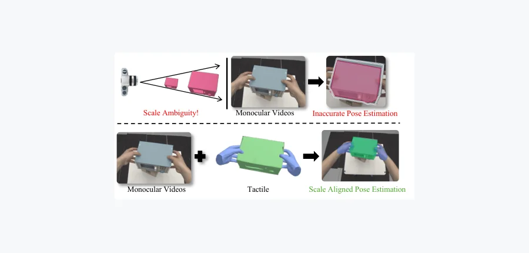 arXiv 2026-11-24 · cs.RO · #1 **[TacHOI: Contact-Aware Object Reconstruction and Tracking for Egocentric Videos](https://arxiv.org/abs/2611.26764)** [Jackson Codd , Haoyu Li , Xianyi Cheng](https://arxiv.org/abs/2611.26764) 机构：affiliation 未确认 [Paper](https://arxiv.org/abs/2611.26764) · [图源](https://arxiv.org/html/2611.26764v1/teaser.png) 

中文摘要
第一视角视频为机器人学习提供了可规模化的人类示范来源。然而，从单目视频恢复物体的米制几何和运动受到尺度—深度歧义及手部遮挡的阻碍；仅靠图像推断的接触与形状先验也无法唯一确定米制尺度。我们提出 TacHOI，一种无需训练的框架，将触觉接触与单目视觉结合，在不依赖物体模板或深度传感器的情况下联合重建和跟踪手与物体。TacHOI 从预训练视觉估计出发，利用触觉接触约束物体相对估计手部的深度；在经过米制标定的手上，空间分离的接触点则充当测量物体尺寸的物理标尺。框架把这些约束与视觉对齐共同纳入手部姿态、物体轨迹及物体各向异性尺度的联合优化。在 100 段具有合成触觉观测的 ARCTIC 和 HO3D 序列上，TacHOI 在所评估基线中取得最低的 ADD-S* 中位数，将 ARCTIC 的误差从 15.6 厘米降至 3.6 厘米，并在 HO3D 上达到 2.8 厘米。OpenTouch 上的额外实验表明，该方法也适用于实测触觉观测。 <a href="https://arxiv.org/abs/2611.26764">原摘要来源</a>
 | 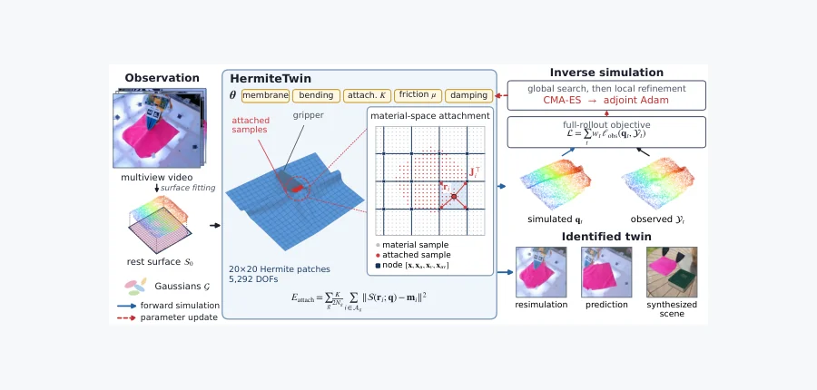 arXiv 2026-11-24 · cs.RO · #2 **[HermiteTwin: Bicubic Hermite Shell Digital Twins for Contact-Rich Deformable Manipulation](https://arxiv.org/abs/2611.27282)** [Kangrui Zhang , Mu Huang , Xing Shen , Tiantian Liu , Bo Ren](https://arxiv.org/abs/2611.27282) 机构：Nankai University / Fudan University / Shanghai Artificial Intelligence Laboratory / Independent Researcher（[PDF](https://arxiv.org/pdf/2611.27282)） [Paper](https://arxiv.org/abs/2611.27282) · [图源](https://arxiv.org/html/2611.27282v1/hermite_twin_overview.png) 

中文摘要
现有可形变物体操作重建方法虽已取得显著进展，通常仍用同一组粒子同时承担薄物体弯曲建模和机器人接触求解两项任务。为解决这一问题，我们提出 HermiteTwin：从机器人操作薄物体的多视角视频中重建物理数字孪生体的框架。核心思想是以各自适合的分辨率分别表示形变与接触。物体被模拟为双三次 Hermite 壳：粗网格中的 C^1 单元以节点位置和导数定义具有 Kirchhoff–Love 弯曲特性的光滑曲面；夹爪则通过材料空间中的密集采样点进行抓持、夹紧和释放，附着力经 Hermite 基函数传递至壳体。这种解耦使物理状态保持紧凑，同时保留细粒度接触。我们先以 CMA-ES、再以基于伴随法的细化识别有效材料与接触参数，并用模拟壳体驱动重建的 Gaussian 外观模型。在真实布料和泡沫操作实验中，HermiteTwin 在重建、重新仿真和未来预测方面优于先进的弹簧—质量孪生体。 <a href="https://arxiv.org/abs/2611.27282">原摘要来源</a>
 | 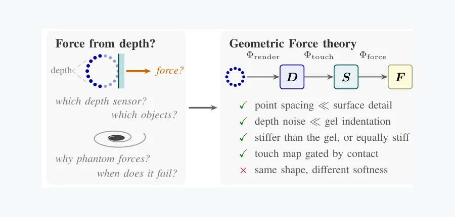 arXiv 2026-11-24 · cs.RO · #3 **[Geo-Force: A Theory of Force Sensing from Object Geometry](https://arxiv.org/abs/2611.26992)** [Abdullah Ayad](https://arxiv.org/abs/2611.26992) 机构：Independent Researcher；部分工作于 University of Technology Nuremberg（[PDF](https://arxiv.org/pdf/2611.26992)） [Paper](https://arxiv.org/abs/2611.26992) · [图源](https://arxiv.org/pdf/2611.26992) 

中文摘要
机器人需要接触力来处理易损物体，但触觉传感器脆弱且难集成，而 RGB-D 相机等深度传感器已广泛可用。虚拟触觉传感器可以保留触觉传感器的感测表面，却以根据深度传感器测得的目标物体几何预测的触觉信号取代电子器件；但它究竟计算什么、何时可信尚不清楚。我们给出形式化答案：将几何力定义为虚拟触觉传感器各触觉单元上的力，计算分为三步：从虚拟传感器视角渲染待接触表面；用学习或仿真的触觉映射预测触觉信号；再从信号估计力。我们证明其三个性质：坐标系变化只使力向量旋转；渲染表面未接触虚拟传感器时力为零；对于 Lipschitz 映射，误差至多随三步各自的误差线性增长。渲染误差又取决于表面采样或重建质量及传感器定位精度。我们还指出根本限制：几何无法揭示物体刚度，因此对形状相同、刚度不同的物体，任何触觉映射都无法精确预测接触。在弹性接触模型下，全部物体专属知识存在于触觉映射中。由此，我们推导出对深度传感器和物体的要求、设计规则，以及虚拟传感器失效的条件。 <a href="https://arxiv.org/abs/2611.26992">原摘要来源</a>
 |
| 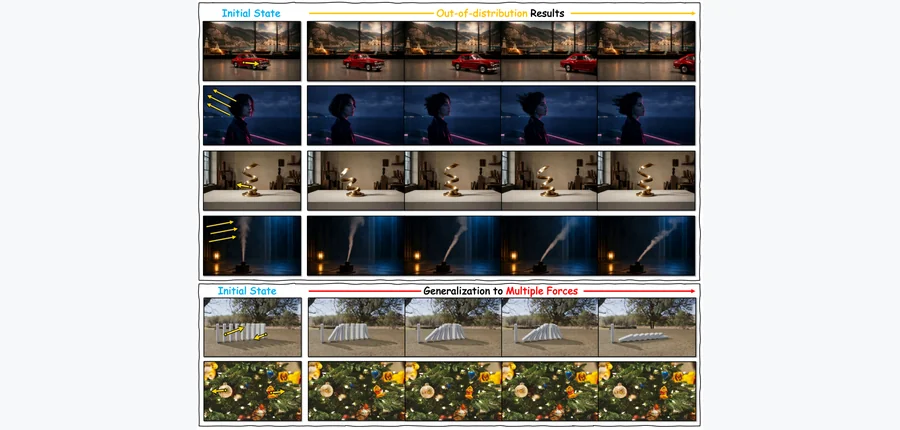 arXiv 2026-11-24 · cs.CV · #4 **[PhysForce: Physics-aware Force Control for Interactive Video World Model](https://arxiv.org/abs/2611.27164)** [Xuancheng Xu , Xiaofeng Wang , Yue Ma , Zheng Zhu , Bing-Kun Bao](https://arxiv.org/abs/2611.27164) 机构：Nanjing University of Posts and Telecommunications / GigaAI / Tsinghua University / Hefei University of Technology（[PDF](https://arxiv.org/pdf/2611.27164)） [Paper](https://arxiv.org/abs/2611.27164) · [图源](https://arxiv.org/html/2611.27164v1/teaser.png) 

中文摘要
交互式视频世界模型旨在预测视觉环境如何响应用户干预，包括外力引起的物理一致状态变化。现有方法常把力表示为运动轨迹，可能引入不合适的运动先验，使模型过度依赖编码的位移模式。更根本的是，模型内部表示不能可靠定位力导致的状态变化，难以把施力与物理响应关联起来；带力标注的数据有限，也使未见场景中的物理一致、时间稳定预测变得困难。为此，我们提出 PhysForce，两阶段框架通过三个互补组件结合监督微调与强化学习。监督微调阶段，（1）潜在力干预编码器在不暴露未来运动的情况下，把力的位置、方向和大小映射至视频潜空间；（2）物理归因网络把施力与局部潜状态变化关联，增强对物理响应的学习。强化学习阶段，（3）物理感知强化学习利用分布外视频上的自监督奖励提高物理一致性与泛化。大量实验显示，PhysForce 改善了力响应性、物理一致性和泛化能力，证明其用于交互式视频世界模型的有效性。 <a href="https://arxiv.org/abs/2611.27164">原摘要来源</a>
 | 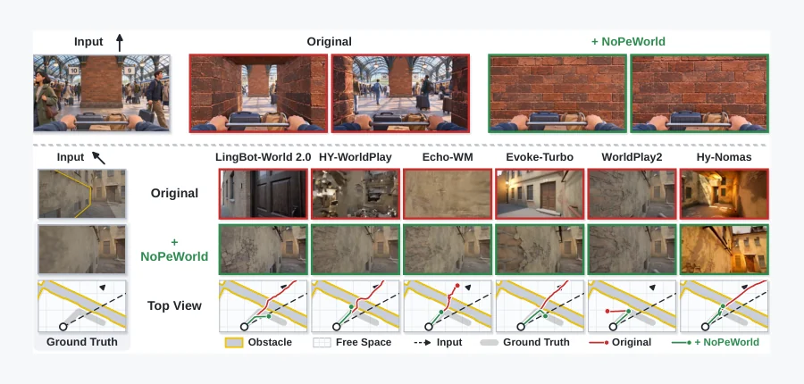 arXiv 2026-11-24 · cs.CV · #5 **[Non-penetrating World Models](https://arxiv.org/abs/2611.27963)** [Yuhang Dai , Yinwei Wu , Ziyue Lin , Han Ji , Xingyi Yang](https://arxiv.org/abs/2611.27963) 机构：The Hong Kong Polytechnic University（[PDF](https://arxiv.org/pdf/2611.27963)） [Paper](https://arxiv.org/abs/2611.27963) · [Code](https://github.com/yuhangdai427/NoPeWorld) · [Project](https://nopeworld.github.io) · [图源](https://arxiv.org/html/2611.27963v1/fig_teaser.png) 

中文摘要
我们研究交互式视频世界模型中防止物体穿透的新问题。为了解现有模型的表现，我们提出 NoPeBench，评估世界模型如何响应物理障碍。评估发现，开源模型均不能可靠避免此类失败。但令人意外的是，这些模型已经编码了预测穿透所需的信息：扩散 Transformer（DiT）的隐藏状态可以判断候选动作是否会穿透障碍。基于这一发现，我们提出轻量框架 NoPeWorld，用于检测并防止穿透。具体而言，在冻结的 DiT 隐藏状态上训练一个小预测头，读出候选动作是否安全；随后用尽量保留原始意图的安全动作替换不安全动作。尽管方法简单，它将六个视频世界模型的平均物理违规率从 74% 大幅降至 16%。该方法还对开放域图像、第三人称视角和移动障碍表现出零样本泛化。我们公开代码、NoPeBench 基准及模型权重。项目页见原文。 <a href="https://arxiv.org/abs/2611.27963">原摘要来源</a>
 | 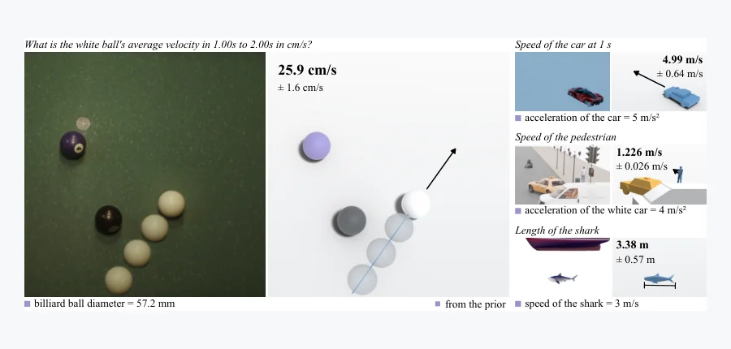 arXiv 2026-11-24 · cs.CV · #6 **[SceneRuler: Measuring Physical Quantities in Video via Minimal Sufficient Reconstruction](https://arxiv.org/abs/2611.26994)** [Yumeng He , Gezheng Kang , Fanlian Zeng , Yin Yang , Chenfanfu Jiang](https://arxiv.org/abs/2611.26994) 机构：University of California, Los Angeles / Envora Inc. / University of Utah（[PDF](https://arxiv.org/pdf/2611.26994)） [Paper](https://arxiv.org/abs/2611.26994) · [图源](https://arxiv.org/html/2611.26994v1/teaser.png) 

中文摘要
许多关于视频的问题要求给出数值，例如人的身高、推车行进距离或球离开斜坡的速度。我们研究视频定量物理推理：输入包括视频、问题，以及物体尺寸、速度或相机至指定物体距离等已知事实先验。端到端视频语言模型缺少显式米制尺度与物理一致性，错误也难以检查。我们提出 SceneRuler，恢复可测量的物理场景，并以该场景为证据作答。其核心原则“最小充分重建”为每个问题仅建立足以测量所问量的最小场景，并通过测量检验充分性。场景写成程序，视觉语言模型负责其结构，数值则交由测量确定。物理引导拟合借助运动定律测量数值，使重力本身能够锚定米制尺度，并将每个参数及所问量的读出标记为已确定或未确定。每个问题都有读出和答案；读出是在场景上计算的所问量，若场景无法确定该量则为空；答案始终由以场景为证据的模型给出。我们在 QuantiPhy 上评估，也将方法用于自采集的 27 个无真值自然视频。验证集上，最终答案的平均相对准确率为 0.709，最强基线为 0.624；重建在 158 个问题中的 47 个确定了所问量，这部分最终答案的准确率为 0.781。由于所有中间量均显式表示，每个答案都可追溯到相关物体、尺度和运动。 <a href="https://arxiv.org/abs/2611.26994">原摘要来源</a>
 |
| 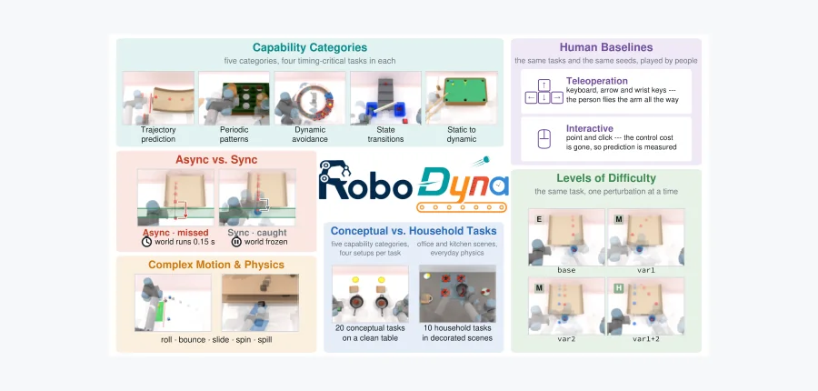 arXiv 2026-11-24 · cs.RO · #7 **[RoboDyna: A Benchmark for Evaluating Robotic Manipulation under Physically Grounded Dynamics](https://arxiv.org/abs/2611.26969)** [Zhiyuan Li , Rui Heng Yang , Xuan Zhao , Amir Rasouli](https://arxiv.org/abs/2611.26969) 机构：Huawei Technologies / University of Toronto（[PDF](https://arxiv.org/pdf/2611.26969)） [Paper](https://arxiv.org/abs/2611.26969) · [Project](https://robodyna.github.io/robodyna/) · [图源](https://arxiv.org/html/2611.26969v1/fig1_teaser.png) 

中文摘要
在动态真实世界中操作物体，需要理解环境如何运作和演变并据此行动，但现有基准未充分覆盖这些要求。面向物理的基准评估预测保真度而非闭环动作；动态机器人操作基准常采用过于简化且物理上不可信的物体运动，限制了对真实动力学下推理与动作的评估。评估通常还采用同步方式，在模型推理时冻结环境，使计算时间不影响任务结果。为此，我们提出 RoboDyna，评估操作策略在动态场景中的物理理解与行动能力。它包括跨五类能力的 20 个概念性动态任务，采用简单物体、少量场景杂物和双因素难度设计；另有 10 个家居任务，在视觉和语义更丰富的仿真真实环境中实现相同能力。RoboDyna 提供 3,500 条专家示范、成对的同步与异步评估协议、任务成功与部分完成指标，以及交互式人类基线评估工具。在 5.4K 个回合中评估视觉语言动作模型和世界动作模型时，所有策略成功率均低于 20%，显示动态操作仍有显著不足。世界动作模型能捕捉简单动力学，却难以处理复杂交互，预测保真度也不总与任务成功一致。同步与异步比较中，推理延迟改变了 5–12% 回合的结果，但平均成功率变化最多 3%。在匹配条件下，人类基线显著优于所有策略。项目页见原文。 <a href="https://arxiv.org/abs/2611.26969">原摘要来源</a>
 | 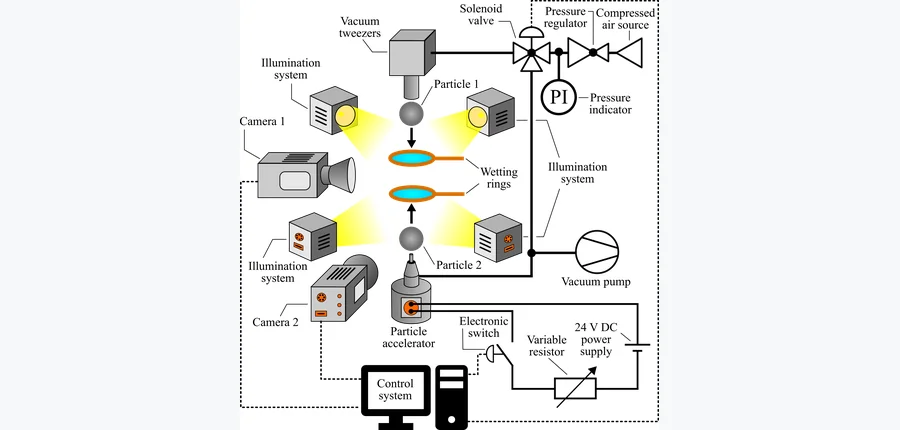 arXiv 2026-11-24 · physics.flu-dyn · #8 **[A new restitution model for wet particle collisions using fully resolved numerical simulations](https://arxiv.org/abs/2611.27593)** [A.H. Huijgen , F. Bunke , S. Heinrich , Y. Tang , N.G. Deen , M.W. Baltussen](https://arxiv.org/abs/2611.27593) 机构：Eindhoven University of Technology / Hamburg University of Technology（[PDF](https://arxiv.org/pdf/2611.27593)） [Paper](https://arxiv.org/abs/2611.27593) · [图源](https://arxiv.org/html/2611.27593v1/figures/experimental/Experimental_Setup.png) 

中文摘要
粒子碰撞在造粒、干燥和化学反应器等湿颗粒过程中发挥核心作用，但液体如何影响碰撞动力学仍未得到充分理解。本研究利用数值仿真考察液体黏度、密度和含量、撞击速度、固体密度及表面张力对湿碰撞恢复系数的影响。所用直接数值仿真（DNS）框架已针对专门的湿—湿粒子碰撞实验验证，在液桥演化与回弹动力学方面均有良好一致性。恢复系数随液体黏度、液体密度及液固密度比增大而降低，撞击速度增大则增强回弹。在所考察条件下，表面张力影响可忽略，说明黏性耗散是能量损失的主导来源。由于现有 Stokes 数表达仅能捕捉部分控制物理，研究提出综合黏性与惯性响应时间尺度的广义 Stokes 数。基于它修正的恢复系数模型将数值和实验数据归并为单一趋势，并以仅 4.99% 的 RMSE 预测湿碰撞恢复系数。 <a href="https://arxiv.org/abs/2611.27593">原摘要来源</a>
 | 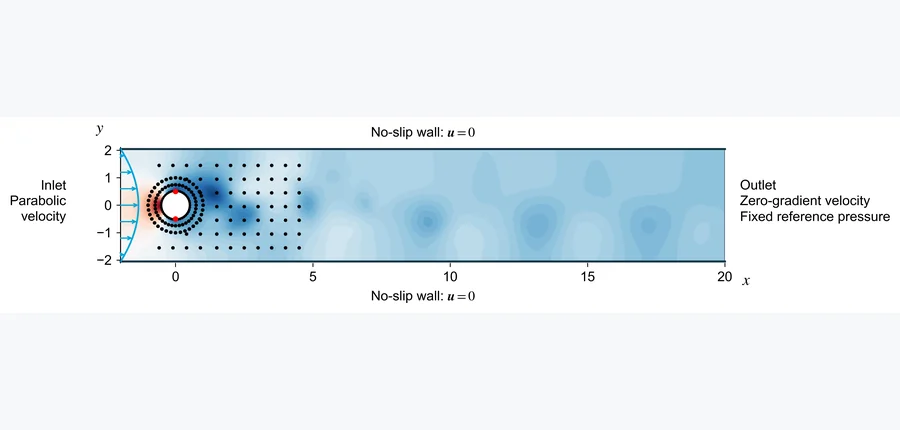 arXiv 2026-11-24 · physics.comp-ph · #9 **[Closed-loop policy optimisation for cylinder wake control via differentiable simulation](https://arxiv.org/abs/2611.27670)** [Siwen Zhang , Xizeng Zhao , Zhouteng Ye , Yulin Xie , Zesheng Yao](https://arxiv.org/abs/2611.27670) 机构：Zhejiang University / Beihang University / Changsha University of Science &amp; Technology（[PDF](https://arxiv.org/pdf/2611.27670)） [Paper](https://arxiv.org/abs/2611.27670) · [图源](https://arxiv.org/html/2611.27670v1/3_1_computational_setup.png) 

中文摘要
抑制圆柱尾流中的涡脱落是主动流动控制的经典问题。无模型深度强化学习（DRL）通过与流体交互学习此类策略，不对动力学求导，通常需要大量交互。本研究通过可微仿真优化闭环策略：控制损失的梯度穿过仿真流场传至策略参数，再用反向模式自动微分更新。策略把局部速度测量映射为经可微合成射流边界条件施加的射流幅度。在雷诺数 100 的二维受限圆柱尾流中，八次策略更新（约相当于 78 个涡脱落周期的前向仿真）带来约 8% 的阻力降低和 99.6% 的升力波动抑制，阻力水平与已报告的 DRL 结果相当。抑制由反馈维持：均值匹配的恒定射流无法维持效果，而同一策略在三个启动相位响应相近，并能在上游扰动后恢复。仅用速度偏差奖励仍能强力抑制；仅观测尾流近区或表面一个位置的两个瞬时速度分量即可达到约 99.8% 的抑制，而单一表面压力观测仍有残余振荡。结合相关 DRL 结果，这表明此处的奖励与观测要求由策略优化和流动物理共同决定。 <a href="https://arxiv.org/pdf/2611.27670">原摘要来源</a>
 |
| 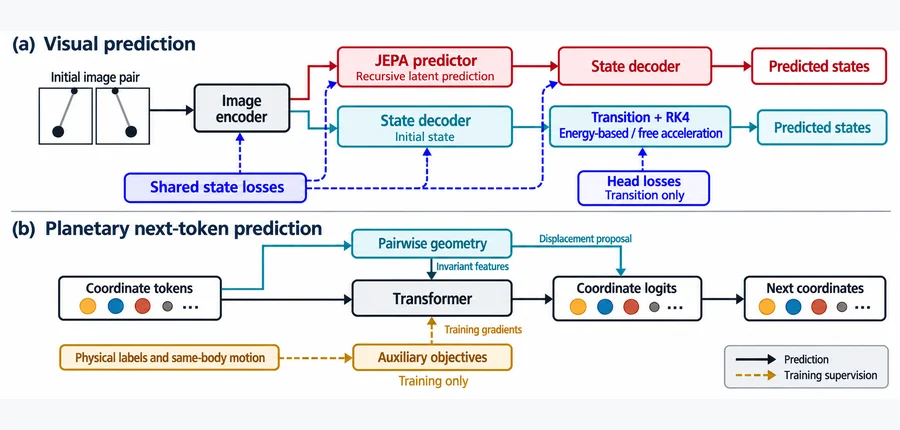 arXiv 2026-11-24 · cs.AI · #10 **[Where Structure Enters a World Model: From Predictive Fit to Physical Rollout](https://arxiv.org/abs/2611.27149)** [Panayiotis Christou , Satyapragnya Kar , Flavjo Xhelollari , Parijat Dube , Rajarshi Das](https://arxiv.org/abs/2611.27149) 机构：Fordham University / New York University / Oracle / MQube Cognition（[PDF](https://arxiv.org/pdf/2611.27149)） [Paper](https://arxiv.org/abs/2611.27149) · [图源](https://arxiv.org/html/2611.27149v1/figures/completed_campaign/prediction_paths_generated.png) 

中文摘要
预测式世界模型学习预报观测，但准确的短期预测未必能在更长时间尺度上产生物理连贯行为。我们研究如何在保留底层预测目标的同时，利用物理结构增强世界模型。在行星运动的 token 模型与机械系统的 JEPA 式视觉模型中，我们考察守恒量监督、对称性感知表示、时间一致性和学习到的结构化动力学。在行星运动中，角动量监督改善自主下一 token 预测，而时间正则化的收益取决于配套的物理目标与表示。在视觉模型中，通过受监督的能量动力学头生成 rollout，可得到更忠实的轨迹和相空间演化。这些发现表明，物理结构以何种方式参与预测至关重要：辅助物理读出或局部加速度估计的改善不会自动转化为更可靠的长时域行为。跨初始条件和物理参数变化的评估进一步揭示收益能否保持以及泛化的限制。本研究支持物理结构作为改善预测世界模型的实用手段，并为理解其对表示、学习到的状态转移和自主 rollout 的影响提供统一框架。核心结论是，有效的物理归纳偏置既应帮助模型表示物理规律，也应帮助它利用这些规律生成未来状态。 <a href="https://arxiv.org/abs/2611.27149">原摘要来源</a>
 | 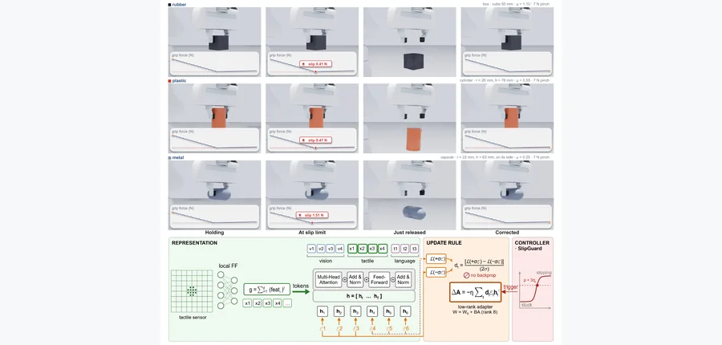 arXiv 2026-11-24 · cs.RO · #11 **[FORTH: Grounding Tactile VLA Execution via Forward-Only Proxy-Control Pairing](https://arxiv.org/abs/2611.26744)** [Junde Li , Wei-Han Yu , Xiangyi Chu , Yaoxin Li , Jiawei Xu , Ka-Fai Un , Pui-In Mak](https://arxiv.org/abs/2611.26744) 机构：University of Macau（[PDF](https://arxiv.org/pdf/2611.26744)） [Paper](https://arxiv.org/abs/2611.26744) · [Code](https://github.com/Jordanlllll/FORTH) · [图源](https://arxiv.org/html/2611.26744v1/figures/teaser_3x4.png) 

中文摘要
视觉语言动作（VLA）策略常被认为具备力控制能力，其背后未经验证的假设是代理损失最小化意味着物理力已被锚定。我们表明，这一假设在部署的三个关键层面失效：冻结的视觉骨干丢弃接触几何，下游损失掩盖 token 级梯度对齐，离散指示量导致优化崩溃。为解决这些脱节，我们提出 FORTH，一种只使用前向计算的测量工具和执行框架，将各层级的优化目标与其物理控制可观测量明确配对。FORTH 包含三个基于物理观测的支柱：无需反向传播、保留空间接触几何的层内前向触觉编码器；可在激活空间更新的 token 并行零阶适配器；以及在滑移初现时触发的连续触觉验证门 SlipGuard。在弹塑性结构壳体上，FORTH 闭环门控的峰值抓握力比单调反射式增力低 29 倍，避免了基线留下永久形变的结构压坏。此外，FORTH 在三个所评估 LIBERO 套件上取得 97.6% 平均成功率，匹配先进执行性能，同时相对同一骨干的一次反向传播步骤，将峰值激活内存降低 7.12 倍。增强的感知有助于更深层的物理智能。 <a href="https://arxiv.org/abs/2611.26744">原摘要来源</a>
 | 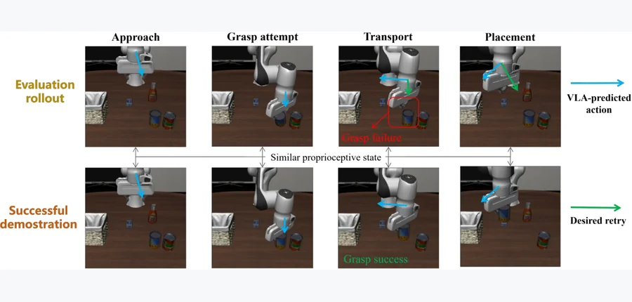 arXiv 2026-11-24 · cs.RO · #12 **[FoRe: A Force-Guided Framework for Autonomous Grasp Recovery in Vision-Language-Action Models](https://arxiv.org/abs/2611.27011)** [Shuai Peng , Yongkai Liao , Yuxin Cheng , Haoyuan Wang , Jian Huang](https://arxiv.org/abs/2611.27011) 机构：affiliation 未确认 [Paper](https://arxiv.org/abs/2611.27011) · [图源](https://arxiv.org/html/2611.27011v1/p1.png) 

中文摘要
视觉语言动作（VLA）模型在基于抓取的操作中已表现出较强性能，但从局部抓取失败中可靠恢复仍很困难。具体而言，在拾取放置任务中，策略可能在抓取失败后继续搬运而不重试，这可能反映了阶段推进过度依赖本体感知线索，以及重试监督不足。现有恢复方法通常依靠部署时引导或扩增示范。我们提出力引导恢复框架 FoRe，用于从局部抓取失败中自主恢复。FoRe 使用力反馈将示范划分为接近—抓取与搬运—放置阶段，并训练独立策略。为弥补重试监督不足，它从接近—抓取策略初始化专门的重试策略，再用失败后状态出发的局部强化学习细化。为避免不恰当的阶段推进，推理时控制器把力反馈与抓取命令状态结合，协调各阶段策略、检测抓取失败并调用重试策略。我们还构建了 LIBERO-SUCTION，这是由 LIBERO 改造的力增强吸附操作基准，包含完整示范轨迹供策略训练。FoRe 在 LIBERO-SUCTION、LIBERO 和真实任务上持续提高 VLA-Adapter 与 π0.5 的成功率。在 LIBERO-SUCTION 上，二者平均绝对增益分别为 18.4% 和 6.5%；真实世界中分别为 25.0% 和 21.7%。在两个仿真基准上，每任务仅有一条示范时方法仍有效。 <a href="https://arxiv.org/abs/2611.27011">原摘要来源</a>
 |
| 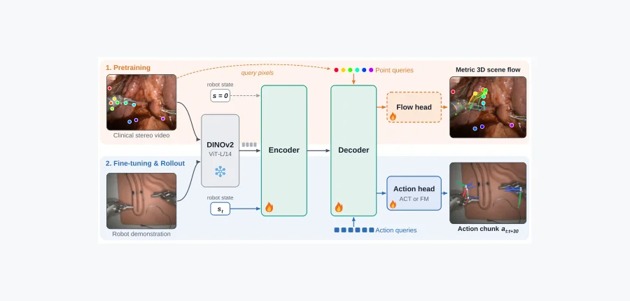 arXiv 2026-11-24 · cs.CV · #13 **[FlowScope: 3D Scene Flow Pretraining Improves Surgical Robot Policies](https://arxiv.org/abs/2611.26865)** [John J. Han , Adam Schmidt , Jingpei Lu , Zooey He , Muhammad Abdullah Jamal , Jie Ying Wu , Omid Mohareri](https://arxiv… 机构：Vanderbilt University / Intuitive Surgical Inc.（[PDF](https://arxiv.org/pdf/2611.26865)） [Paper](https://arxiv.org/abs/2611.26865) · [图源](https://arxiv.org/html/2611.26865v1/fig1.png) 

中文摘要
外科机器人模仿学习受示范采集成本限制。与此同时，许多机器人辅助手术记录为双目视频，但临床视频没有动作标签，策略无法直接从中学习。我们提出 FlowScope：用现成双目深度和光流模型计算标签，通过预测场景流（场景点的米制 3D 运动），在无标签临床视频上预训练外科策略网络。我们用 1,149 台临床手术的 1.35M 个片段预训练动作分块 Transformer（ACT）的主干，随后丢弃场景流头，因此部署策略仍是标准 ACT，不增加推理成本。在真实外科机器人系统上，相比从零训练，FlowScope 将取针成功率从 54% 提高至 90%，将针重新抓取中的首次交接成功率从 4% 提高至 52%（完整任务从 2% 提高至 14%），每种条件各 50 次试验；使用生成式流匹配动作头时，收益仍在。消融表明，在所测预训练信号中，米制 3D 运动最强；与运动学信号结合的运动学、2D 轨迹、单独深度和无尺度 3D 流，收益较小或没有收益。表示分析提示，场景流预训练更准确地编码针的米制深度，运动学预训练使模型更依赖机器人状态；针深度探针与真实机器人成功率的排序相符，而离线验证误差并非如此。 <a href="https://arxiv.org/abs/2611.26865">原摘要来源</a>
 | 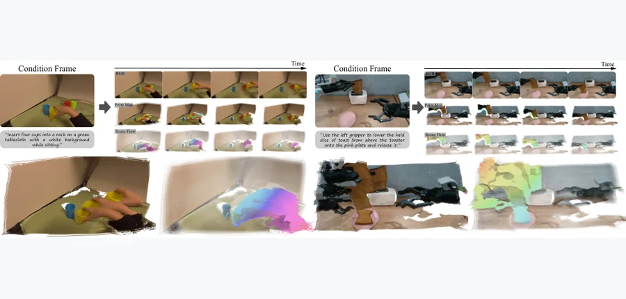 arXiv 2026-11-24 · cs.RO · #14 **[Ego4Gen: Generating Geometry-Grounded Motion Tokens as a World-Action Interface](https://arxiv.org/abs/2611.27513)** [Yang Liu , Chao Ye , Jiahao Zhang , Zeyuan Hou , Ruijie Fang , Xiyin Ni , Xinyang Ren , Weiyang Lin](https://arxiv.org/ab… 机构：Harbin Institute of Technology / Yunnan Minzu University（[PDF](https://arxiv.org/pdf/2611.27513)） [Paper](https://arxiv.org/abs/2611.27513) · [图源](https://arxiv.org/html/2611.27513v1/fig1.png) 

中文摘要
我们提出 Ego4Gen（第一视角四维未来生成），用于机器人操作的四维未来生成世界模型。给定一张第一视角图像和文本提示，Ego4Gen 联合生成时间对齐的 RGB 帧、稠密点图和稠密场景流，显式预测场景外观、空间结构与运动的演化。它基于 Cosmos3-Nano，通过按模态路由的 LoRA 和非对称注意力扩展预训练生成骨干，并使用 MotionCrafter 生成的几何伪标签学习预测未来几何及运动潜变量。这些潜变量既可解码成显式三维结构与运动，也可映射成机器人动作。为此，我们还提出 FlowInverse，一个分两阶段训练的轻量逆动力学网络，将预测的四维潜变量转化为机器人动作。实验表明，在分布外设置中，这些几何与运动潜变量优于所评估的潜在动作和视频潜变量基线。闭环策略评估进一步表明，它们有助于把预测的四维未来转化为机器人控制。总体而言，结果支持以几何为基础的运动 token 作为连接四维未来生成与机器人操作的世界—动作接口，并提示了减少对动作标注数据依赖的路径。 <a href="https://arxiv.org/abs/2611.27513">原摘要来源</a>
 | 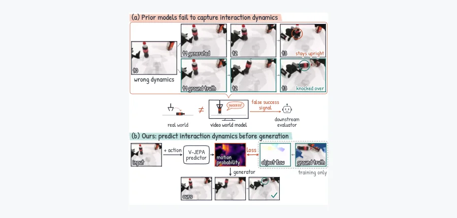 arXiv 2026-11-24 · cs.RO · #15 **[Learning Interaction Dynamics via Motion-Region Guidance for Robotic Video World Models](https://arxiv.org/abs/2611.27344)** [Yongkang He , Xiaofen Xing , Xiangmin Xu](https://arxiv.org/abs/2611.27344) 机构：South China University of Technology / Foshan University（[PDF](https://arxiv.org/pdf/2611.27344)） [Paper](https://arxiv.org/abs/2611.27344) · [图源](https://arxiv.org/html/2611.27344v1/motivation_v7.png) 

中文摘要
动作条件视频世界模型可在候选机器人动作下想象未来观测，为机器人策略评估与交互仿真提供有前景的视觉工具。然而，现有模型常优化全局重建误差，未突出交互相关区域；因此可能保留整体场景外观，却忽略局部交互细节，产生虚构接触效应和不一致的机器人—物体交互等物理上不可信的结果。我们提出 MoReWorld，统一的运动区域引导框架，使用共同的运动区域——环境中响应机器人动作而移动的部分——使动力学学习与视频生成聚焦于交互相关区域。相同运动区域引导局部运动预测、区域感知监督和运动门控的未来特征条件。在推理时，运动区域由视觉历史和机器人动作预测为运动概率图，无须未来观测或真实运动标签。在 WorldSimProbe 上，MoReWorld 获得最高的整体仿真器保真度分数，并在局部一致性、全局一致性和交互动力学方面表现最强。这些结果表明，运动区域引导有助于模型保留场景层面的一致性，同时更忠实地预测动作条件下的交互动力学。 <a href="https://arxiv.org/abs/2611.27344">原摘要来源</a>
 |
| 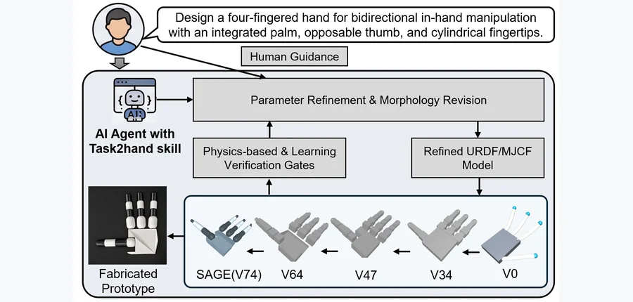 arXiv 2026-11-24 · cs.RO · #16 **[Task2Hand: A Contact-Grounded Skill for Parametric Dexterous-Hand Morphology Design](https://arxiv.org/abs/2611.27967)** [Haoyang Wang , Weibo Gao , Zhengxiong Li , Lingfeng Tao](https://arxiv.org/abs/2611.27967) 机构：Beijing University of Chemical Technology / North Carolina State University / University of Colorado Denver / Kennesaw State University（[PDF](https://arxiv.org/pdf/2611.27967)） [Paper](https://arxiv.org/abs/2611.27967) · [图源](https://arxiv.org/html/2611.27967v1/figure/fig1.jpg) 

中文摘要
灵巧手设计在几何、机器人描述代码、碰撞调试、抓取初始化和策略训练等环节反复需要专家投入。我们提出 Task2Hand，一种 Skill 规范包，将功能性操作需求转化为参数化手部模型，并让每个候选设计依次通过按成本排序的接触、动力学和学习关卡。每个关卡返回状态和证据记录；若失败，Skill 记录最早阻碍，只调整一个有边界的参数组并重新运行较便宜的关卡。智能体在声明的边界内自主生成、验证和训练，在出现权衡、停滞或证据冲突时交由人类决定下一步设计方向。一条由证据驱动、针对双向手内操作的设计轨迹得到 SAGE Hand（Skill-Aware Generative Embodiment）：四根手指、16 个驱动自由度、集成引导掌面、紧凑指根、圆柱形指尖和通过碰撞检查的对掌拇指。在匹配的训练协议下，SAGE Hand 在六角棱柱上的任务成功率为 45.6%，LEAP 手为 37.3%；双色圆柱上为 70.8%，LEAP 手为 51.6%。稠密仿真触觉输入使圆柱掉落率降低超过一半。在受控迭代研究中，采用 Skill 的路径在 165 次试验中保持 164 次成功抓持，而不用 Skill 的路径降至 165 次中的 14 次，证实这些关卡在改进过程中起到回归防护作用。被接受的候选方案连同 URDF/MJCF、指标、检查点和溯源清单一起打包。 <a href="https://arxiv.org/abs/2611.27967">原摘要来源</a>
 | 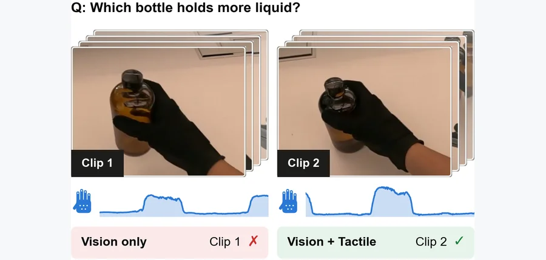 arXiv 2026-11-24 · cs.CV · #17 **[TouchBench: Can Vision-Language Models Feel Invisible Physical Properties?](https://arxiv.org/abs/2611.26883)** [Ziyao Zeng , Ziyi Kou , Chuan Qin , Mia Huang , Roger Boldu , Zhiwen Fan , Daniel Rakita , Eric Whitmire , Li Guan](https… 机构：Meta Reality Labs / Yale University / Texas A&amp;M University（[PDF](https://arxiv.org/pdf/2611.26883)） [Paper](https://arxiv.org/abs/2611.26883) · [图源](https://arxiv.org/html/2611.26883v1/figs/qualitative.png) 

中文摘要
视觉语言模型（VLM）越来越多用于具身感知与推理，但对其物理理解的评估大多停留在仅凭图像即可回答的问题。操作所需的许多属性，例如不透明瓶子的液位或物体柔顺性，可能只有触摸才能揭示。我们提出第一视角视觉—语言—触觉基准 TouchBench，区分视觉可答问题（Tier A）和相机无法观察到的属性问题（Tier B）。它将头戴视频与同步的 137 通道全手触觉感知配对，包含五名参与者执行 11 项任务的 900 个片段，以及 900 个绝对问题和 4,102 个相对问题。四个先进 VLM 在 Tier A 相对问题上的平均准确率为 66.4%，在 Tier B 上仅为 49.8%，接近随机水平（50%）。为缩小差距，我们提出 Tactile-as-Prompt（TaP），把 34 个可解释的触觉统计量表示为文本，使 VLM 不依赖学习式触觉编码器也能利用触觉推理。TaP 将 Tier B 相对问题的零样本准确率提高到 62.9%，留一用户微调后达到 73.1%，高于仅用视频的 67.4% 和学习式触觉 token 编码器的 67.3%。收益也延伸至未见物体和用户。在另一个 20 小时自然场景语料上，触觉文本使微调后接触问题准确率从 67.1% 提高至 75.5%。这些结果揭示了仅用视觉进行物理推理的局限，并表明语言可作为触觉感知的有效接口。 <a href="https://arxiv.org/abs/2611.26883">原摘要来源</a>
 | 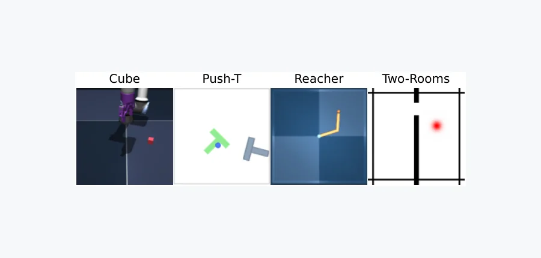 arXiv 2026-11-24 · cs.RO · #18 **[Skill-JEPA: Learning Planner-Aligned Action Spaces for World Models](https://arxiv.org/abs/2611.26825)** [Tomás Couso Coddou , Christ Devia , Rex G. Liu , Rodrigo Toro Icarte](https://arxiv.org/abs/2611.26825) 机构：Centro Nacional de Inteligencia Artificial / Pontificia Universidad Católica de Chile（[PDF](https://arxiv.org/pdf/2611.26825)） [Paper](https://arxiv.org/abs/2611.26825) · [Code](https://github.com/tcouso/Skill-JEPA) · [图源](https://arxiv.org/html/2611.26825v1/task_frames.png) 

中文摘要
基于联合嵌入预测架构（JEPA）的世界模型从像素学习预测动作在潜空间中的结果。为到达目标，规划器采样许多候选动作序列，用模型预测其终点，再执行最佳序列。但标准规划器从高斯分布采样，而模型训练时只见过具有结构、依赖状态的动作；因此候选序列的预测不可靠，目标越远，规划越容易失败。我们提出 Skill-JEPA，学习与规划器对齐的动作空间。以当前状态为条件的变分自编码器把短动作序列编码为具有标准高斯先验的潜在技能，再将其解码回动作。世界模型预测技能而非原始动作的作用，规划器从相同高斯分布中搜索技能，使候选更像模型的训练数据。Skill-JEPA 仅增加一个与世界模型端到端训练的模块，规划器保持不变，也不需要子目标、层级结构或手工技能。在三个 JEPA 世界模型和四个基准上，距离 80 步的目标平均成功率从使用原始动作的 42% 升至 62%；目标越远收益越大，四种规划器上均成立。在四足移动任务 AntMaze 中，距离两个迷宫单元的目标成功率从 0.4% 升至 38%。这提示远距离目标难以抵达的一部分原因在动作空间，而无需改变规划器即可缓解。 <a href="https://arxiv.org/abs/2611.26825">原摘要来源</a>
 |
| 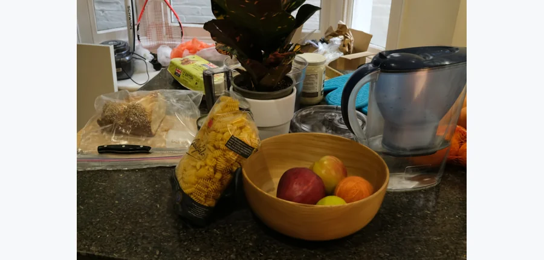 arXiv 2026-11-24 · cs.GR · #19 **[PennyGS: Full Resolution 3DGS Training in Minutes on Consumer GPUs](https://arxiv.org/abs/2611.27525)** [Nicholas Jing Shou Nge , Yuang Shi , Geraldine Morin , Simone Gasparini , Anand Bhojan , Wei Tsang Ooi](https://arxiv.org… 机构：National University of Singapore / Université de Toulouse / IPAL（[PDF](https://arxiv.org/pdf/2611.27525)） [Paper](https://arxiv.org/abs/2611.27525) · [图源](https://arxiv.org/html/2611.27525v1/figures/teaser/counter_ours.jpg) 

中文摘要
三维高斯泼溅（3DGS）越来越多地使用普通设备获取的高分辨率影像，但训练仍常降低分辨率并依赖研究级 GPU。我们提出 PennyGS，通过提高训练步骤各阶段的效率，使消费级 GPU 能在数分钟内完成全分辨率（4K）3DGS 训练。改进包括采用平面 RGB 颜色和方向锥形不透明度的更精简 splat、融合投影与 key 生成、带跨步像素采样的前向光栅化优化、近似 tile SSIM 损失、每个 splat 一个 warp 的反向光栅化，以及融合反向投影和稀疏 Adam 步骤。在标准 30k 步预算下，PennyGS 在四块 GPU 的 Mip-NeRF 360 和 Tanks&amp;Temples 4K 上均是10 种方法中速度最快者，同时保持有竞争力的质量，至少比其他最快方法快 3.9 倍，峰值显存低于 2 GB。在 RTX 3060 上，全分辨率 Mip-NeRF 360 场景训练耗时 6 分 25 秒，比其他任何方法在 RTX 4090 上训练还快。 <a href="https://arxiv.org/abs/2611.27525">原摘要来源</a>
 | 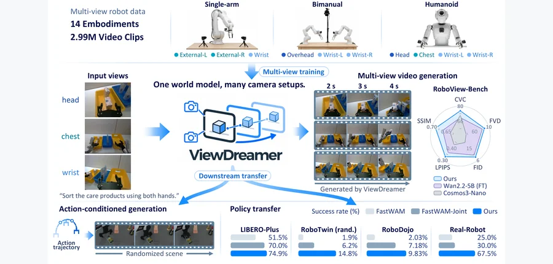 arXiv 2026-11-24 · cs.CV · #20 **[ViewDreamer: A Robot World Model beyond Fixed Camera Setups](https://arxiv.org/abs/2611.26981)** [Ye Mao , Jinhui Xiong , Egor Larionov , Shiyang Lu , Krystian Mikolajczyk , Wei Ye](https://arxiv.org/abs/2611.26981) 机构：Meta AI / Imperial College London（[PDF](https://arxiv.org/pdf/2611.26981)） [Paper](https://arxiv.org/abs/2611.26981) · [Project](https://matchlab-imperial.github.io/ViewDreamer/) · [图源](https://arxiv.org/html/2611.26981v1/teaser.png) 

中文摘要
视频生成模型对机器人学习越来越重要，但多数模型逐个生成相机视角，或把所有视角拼进固定布局。机器人示范却来自同步相机，其数量、位置和顺序会随机器人形态变化。我们提出 ViewDreamer：通过分离单视角生成与跨视角交互，以单一世界模型处理可变相机集合。每个视角沿预训练单视角模型的生成路径处理，视角之间只通过共享 slot token 交互。我们以逐渐增加视角数的课程稳定多视角训练。跨视角 slot 一致性使用视觉基础模型，将各视角中几何与语义相似的区域归入共享 slot。在覆盖一至四台相机的 RoboView-Bench 上，ViewDreamer 在所评估模型中获得最佳生成质量，并比独立逐视角生成具有更高跨视角一致性。收益延伸至我们的世界动作模型（WAM）和动作条件世界模型（AC-WM）。我们的 WAM 在 LIBERO-Plus、RoboTwin 2.0、RoboDojo 以及真实 Franka 机器人上优于 FastWAM-Joint 基线。两种变体均改善了对不同相机配置和场景的分布外泛化。 <a href="https://arxiv.org/abs/2611.26981">原摘要来源</a>
 |   |
<!-- PAPER_CARDS_END -->

## 检索概况

- **官方批次**：arXiv `New submissions`，Monday, 23 November 2026；本日报于北京时间 2026-11-24 生成。
- **检索窗口**：北京时间 2026-11-23 09:05 至 2026-11-24 09:05；检查 [cs.CV](https://arxiv.org/list/cs.CV/new?show=2000)、cs.GR、cs.RO、cs.AI、cs.LG、physics.flu-dyn、physics.comp-ph、cond-mat.soft、cond-mat.mtrl-sci、eess.IV、eess.SP、eess.SY、math.NA、stat.ML 的官方 New 页，按标题和摘要核实同义概念。
- **总命中／去重／入选**：14 个分类共 **500** 条 New 分类记录，按 arXiv ID 去重后 **500** 篇；精选 **20** 篇。仅将官方 New 纳入主榜，不含 Cross-lists 或 Replacements。
- **事实与推断**：标题、作者、分类和原摘要来自链接的 arXiv 官方页面；机构核对 PDF 首页，无法确认者明确标注。相关性、机构强度、阅读优先级、局限与改进建议均为编辑推断。
- **完整性**：20 篇对应 20 张卡片和 20 份完整中文 Abstract；缺原摘要 0 篇。配图完整性见下方核验记录。

## 官方 New listing 状态

| 分类 | 官方批次 | New 条数 |
|---|---|---:|
| [cs.CV](https://arxiv.org/list/cs.CV/new?show=2000) | 2026-11-23 | 132 |
| [cs.GR](https://arxiv.org/list/cs.GR/new?show=2000) | 2026-11-23 | 2 |
| [cs.RO](https://arxiv.org/list/cs.RO/new?show=2000) | 2026-11-23 | 69 |
| [cs.AI](https://arxiv.org/list/cs.AI/new?show=2000) | 2026-11-23 | 87 |
| [cs.LG](https://arxiv.org/list/cs.LG/new?show=2000) | 2026-11-23 | 96 |
| [physics.flu-dyn](https://arxiv.org/list/physics.flu-dyn/new?show=2000) | 2026-11-23 | 12 |
| [physics.comp-ph](https://arxiv.org/list/physics.comp-ph/new?show=2000) | 2026-11-23 | 2 |
| [cond-mat.soft](https://arxiv.org/list/cond-mat.soft/new?show=2000) | 2026-11-23 | 12 |
| [cond-mat.mtrl-sci](https://arxiv.org/list/cond-mat.mtrl-sci/new?show=2000) | 2026-11-23 | 25 |
| [eess.IV](https://arxiv.org/list/eess.IV/new?show=2000) | 2026-11-23 | 9 |
| [eess.SP](https://arxiv.org/list/eess.SP/new?show=2000) | 2026-11-23 | 9 |
| [eess.SY](https://arxiv.org/list/eess.SY/new?show=2000) | 2026-11-23 | 18 |
| [math.NA](https://arxiv.org/list/math.NA/new?show=2000) | 2026-11-23 | 20 |
| [stat.ML](https://arxiv.org/list/stat.ML/new?show=2000) | 2026-11-23 | 7 |
| **合计** | — | **500** |

## Top papers

| # | 论文 | 分类 | 作者 | 机构 | 相关性（推断） | 机构强度（推断） | 阅读优先级（推断） |
|---:|---|---|---|---|---|---|:---:|
| 1 | [TacHOI: Contact-Aware Object Reconstruction and Tracking for Egocentric Videos](https://arxiv.org/abs/2611.26764) | [cs.RO](https://arxiv.org/abs/2611.26764) | [Jackson Codd , Haoyu Li , Xianyi Cheng](https://arxiv.org/abs/2611.26764) | affiliation 未确认 | 触觉接触／米制手物重建 | 未独立评级 | A |
| 2 | [HermiteTwin: Bicubic Hermite Shell Digital Twins for Contact-Rich Deformable Manipulation](https://arxiv.org/abs/2611.27282) | [cs.RO](https://arxiv.org/abs/2611.27282) | [Kangrui Zhang , Mu Huang , Xing Shen , Tiantian Liu , Bo Ren](https://arxiv.org/abs/2611.27282) | Nankai University / Fudan University / Shanghai Artificial Intelligence Laboratory / Independent Researcher（[PDF](https://arxiv.org/pdf/2611.27282)） | 形变壳体／细粒度接触 | 未独立评级 | A |
| 3 | [Geo-Force: A Theory of Force Sensing from Object Geometry](https://arxiv.org/abs/2611.26992) | [cs.RO](https://arxiv.org/abs/2611.26992) | [Abdullah Ayad](https://arxiv.org/abs/2611.26992) | Independent Researcher；部分工作于 University of Technology Nuremberg（[PDF](https://arxiv.org/pdf/2611.26992)） | 几何力感知／接触理论 | 未独立评级 | A |
| 4 | [PhysForce: Physics-aware Force Control for Interactive Video World Model](https://arxiv.org/abs/2611.27164) | [cs.CV](https://arxiv.org/abs/2611.27164) | [Xuancheng Xu , Xiaofeng Wang , Yue Ma , Zheng Zhu , Bing-Kun Bao](https://arxiv.org/abs/2611.27164) | Nanjing University of Posts and Telecommunications / GigaAI / Tsinghua University / Hefei University of Technology（[PDF](https://arxiv.org/pdf/2611.27164)） | 力条件视频世界模型 | 未独立评级 | A |
| 5 | [Non-penetrating World Models](https://arxiv.org/abs/2611.27963) | [cs.CV](https://arxiv.org/abs/2611.27963) | [Yuhang Dai , Yinwei Wu , Ziyue Lin , Han Ji , Xingyi Yang](https://arxiv.org/abs/2611.27963) | The Hong Kong Polytechnic University（[PDF](https://arxiv.org/pdf/2611.27963)） | 碰撞约束／视频世界模型 | 未独立评级 | A |
| 6 | [SceneRuler: Measuring Physical Quantities in Video via Minimal Sufficient Reconstruction](https://arxiv.org/abs/2611.26994) | [cs.CV](https://arxiv.org/abs/2611.26994) | [Yumeng He , Gezheng Kang , Fanlian Zeng , Yin Yang , Chenfanfu Jiang](https://arxiv.org/abs/2611.26994) | University of California, Los Angeles / Envora Inc. / University of Utah（[PDF](https://arxiv.org/pdf/2611.26994)） | 可测量场景／物理参数 | 未独立评级 | A |
| 7 | [RoboDyna: A Benchmark for Evaluating Robotic Manipulation under Physically Grounded Dynamics](https://arxiv.org/abs/2611.26969) | [cs.RO](https://arxiv.org/abs/2611.26969) | [Zhiyuan Li , Rui Heng Yang , Xuan Zhao , Amir Rasouli](https://arxiv.org/abs/2611.26969) | Huawei Technologies / University of Toronto（[PDF](https://arxiv.org/pdf/2611.26969)） | 动态操作／物理评测 | 未独立评级 | A |
| 8 | [A new restitution model for wet particle collisions using fully resolved numerical simulations](https://arxiv.org/abs/2611.27593) | [physics.flu-dyn](https://arxiv.org/abs/2611.27593) | [A.H. Huijgen , F. Bunke , S. Heinrich , Y. Tang , N.G. Deen , M.W. Baltussen](https://arxiv.org/abs/2611.27593) | Eindhoven University of Technology / Hamburg University of Technology（[PDF](https://arxiv.org/pdf/2611.27593)） | 湿颗粒碰撞／流体动力学 | 未独立评级 | A |
| 9 | [Closed-loop policy optimisation for cylinder wake control via differentiable simulation](https://arxiv.org/abs/2611.27670) | [physics.comp-ph](https://arxiv.org/abs/2611.27670) | [Siwen Zhang , Xizeng Zhao , Zhouteng Ye , Yulin Xie , Zesheng Yao](https://arxiv.org/abs/2611.27670) | Zhejiang University / Beihang University / Changsha University of Science & Technology（[PDF](https://arxiv.org/pdf/2611.27670)） | 可微流体仿真／反馈控制 | 未独立评级 | A |
| 10 | [Where Structure Enters a World Model: From Predictive Fit to Physical Rollout](https://arxiv.org/abs/2611.27149) | [cs.AI](https://arxiv.org/abs/2611.27149) | [Panayiotis Christou , Satyapragnya Kar , Flavjo Xhelollari , Parijat Dube , Rajarshi Das](https://arxiv.org/abs/2611.27149) | Fordham University / New York University / Oracle / MQube Cognition（[PDF](https://arxiv.org/pdf/2611.27149)） | 物理结构／长时域动力学 | 未独立评级 | A |
| 11 | [FORTH: Grounding Tactile VLA Execution via Forward-Only Proxy-Control Pairing](https://arxiv.org/abs/2611.26744) | [cs.RO](https://arxiv.org/abs/2611.26744) | [Junde Li , Wei-Han Yu , Xiangyi Chu , Yaoxin Li , Jiawei Xu , Ka-Fai Un , Pui-In Mak](https://arxiv.org/abs/2611.26744) | University of Macau（[PDF](https://arxiv.org/pdf/2611.26744)） | 触觉 VLA／滑移控制 | 未独立评级 | A |
| 12 | [FoRe: A Force-Guided Framework for Autonomous Grasp Recovery in Vision-Language-Action Models](https://arxiv.org/abs/2611.27011) | [cs.RO](https://arxiv.org/abs/2611.27011) | [Shuai Peng , Yongkai Liao , Yuxin Cheng , Haoyuan Wang , Jian Huang](https://arxiv.org/abs/2611.27011) | affiliation 未确认 | 力引导抓取恢复 | 未独立评级 | A |
| 13 | [FlowScope: 3D Scene Flow Pretraining Improves Surgical Robot Policies](https://arxiv.org/abs/2611.26865) | [cs.CV](https://arxiv.org/abs/2611.26865) | [John J. Han , Adam Schmidt , Jingpei Lu , Zooey He , Muhammad Abdullah Jamal , Jie Ying Wu , Omid Mohareri](https://arxiv.org/abs/2611.26865) | Vanderbilt University / Intuitive Surgical Inc.（[PDF](https://arxiv.org/pdf/2611.26865)） | 三维场景流／真实机器人 | 未独立评级 | B |
| 14 | [Ego4Gen: Generating Geometry-Grounded Motion Tokens as a World-Action Interface](https://arxiv.org/abs/2611.27513) | [cs.RO](https://arxiv.org/abs/2611.27513) | [Yang Liu , Chao Ye , Jiahao Zhang , Zeyuan Hou , Ruijie Fang , Xiyin Ni , Xinyang Ren , Weiyang Lin](https://arxiv.org/abs/2611.27513) | Harbin Institute of Technology / Yunnan Minzu University（[PDF](https://arxiv.org/pdf/2611.27513)） | 4D 几何世界动作接口 | 未独立评级 | B |
| 15 | [Learning Interaction Dynamics via Motion-Region Guidance for Robotic Video World Models](https://arxiv.org/abs/2611.27344) | [cs.RO](https://arxiv.org/abs/2611.27344) | [Yongkang He , Xiaofen Xing , Xiangmin Xu](https://arxiv.org/abs/2611.27344) | South China University of Technology / Foshan University（[PDF](https://arxiv.org/pdf/2611.27344)） | 机器人交互动力学 | 未独立评级 | B |
| 16 | [Task2Hand: A Contact-Grounded Skill for Parametric Dexterous-Hand Morphology Design](https://arxiv.org/abs/2611.27967) | [cs.RO](https://arxiv.org/abs/2611.27967) | [Haoyang Wang , Weibo Gao , Zhengxiong Li , Lingfeng Tao](https://arxiv.org/abs/2611.27967) | Beijing University of Chemical Technology / North Carolina State University / University of Colorado Denver / Kennesaw State University（[PDF](https://arxiv.org/pdf/2611.27967)） | 接触驱动灵巧手设计 | 未独立评级 | B |
| 17 | [TouchBench: Can Vision-Language Models Feel Invisible Physical Properties?](https://arxiv.org/abs/2611.26883) | [cs.CV](https://arxiv.org/abs/2611.26883) | [Ziyao Zeng , Ziyi Kou , Chuan Qin , Mia Huang , Roger Boldu , Zhiwen Fan , Daniel Rakita , Eric Whitmire , Li Guan](https://arxiv.org/abs/2611.26883) | Meta Reality Labs / Yale University / Texas A&M University（[PDF](https://arxiv.org/pdf/2611.26883)） | 触觉／隐藏物理属性 | 未独立评级 | B |
| 18 | [Skill-JEPA: Learning Planner-Aligned Action Spaces for World Models](https://arxiv.org/abs/2611.26825) | [cs.RO](https://arxiv.org/abs/2611.26825) | [Tomás Couso Coddou , Christ Devia , Rex G. Liu , Rodrigo Toro Icarte](https://arxiv.org/abs/2611.26825) | Centro Nacional de Inteligencia Artificial / Pontificia Universidad Católica de Chile（[PDF](https://arxiv.org/pdf/2611.26825)） | 潜技能／世界模型规划 | 未独立评级 | B |
| 19 | [PennyGS: Full Resolution 3DGS Training in Minutes on Consumer GPUs](https://arxiv.org/abs/2611.27525) | [cs.GR](https://arxiv.org/abs/2611.27525) | [Nicholas Jing Shou Nge , Yuang Shi , Geraldine Morin , Simone Gasparini , Anand Bhojan , Wei Tsang Ooi](https://arxiv.org/abs/2611.27525) | National University of Singapore / Université de Toulouse / IPAL（[PDF](https://arxiv.org/pdf/2611.27525)） | 低显存 3DGS | 未独立评级 | B |
| 20 | [ViewDreamer: A Robot World Model beyond Fixed Camera Setups](https://arxiv.org/abs/2611.26981) | [cs.CV](https://arxiv.org/abs/2611.26981) | [Ye Mao , Jinhui Xiong , Egor Larionov , Shiyang Lu , Krystian Mikolajczyk , Wei Ye](https://arxiv.org/abs/2611.26981) | Meta AI / Imperial College London（[PDF](https://arxiv.org/pdf/2611.26981)） | 多相机机器人世界模型 | 未独立评级 | B |

## 逐篇中文要点

### 1. [TacHOI: Contact-Aware Object Reconstruction and Tracking for Egocentric Videos](https://arxiv.org/abs/2611.26764)

- **论文事实／方法**：触觉接触和标定手部构成米制约束，联合优化手、物体轨迹与各向异性尺度。（[原摘要](https://arxiv.org/abs/2611.26764)）
- **论文事实／结果**：100 段合成触觉序列中，ARCTIC 误差由 15.6 降至 3.6 厘米；OpenTouch 另有实测触觉实验。（[原摘要](https://arxiv.org/abs/2611.26764)）
- **编辑推断／局限与改进**：需检验触觉标定误差和接触稀疏时的尺度稳定性。

### 2. [HermiteTwin: Bicubic Hermite Shell Digital Twins for Contact-Rich Deformable Manipulation](https://arxiv.org/abs/2611.27282)

- **论文事实／方法**：以粗双三次 Hermite 壳描述弯曲，以密集材料空间采样描述夹爪接触。（[原摘要](https://arxiv.org/abs/2611.27282)）
- **论文事实／结果**：真实布料和泡沫实验中，重建、重新仿真、未来预测均优于对比的弹簧—质量孪生体。（[原摘要](https://arxiv.org/abs/2611.27282)）
- **编辑推断／局限与改进**：材料参数与接触参数可能相互代偿，应报告可辨识性。

### 3. [Geo-Force: A Theory of Force Sensing from Object Geometry](https://arxiv.org/abs/2611.26992)

- **论文事实／方法**：形式化定义由几何渲染、触觉映射、力估计三步得到的几何力。（[原摘要](https://arxiv.org/abs/2611.26992)）
- **论文事实／结果**：证明坐标变换、非接触零力和 Lipschitz 稳定性，并指出几何不能推断刚度。（[原摘要](https://arxiv.org/abs/2611.26992)）
- **编辑推断／局限与改进**：需要在跨刚度物体和深度噪声下量化理论界限。

### 4. [PhysForce: Physics-aware Force Control for Interactive Video World Model](https://arxiv.org/abs/2611.27164)

- **论文事实／方法**：用不暴露未来运动的力编码、物理归因及自监督强化学习改善交互视频。（[原摘要](https://arxiv.org/abs/2611.27164)）
- **论文事实／结果**：摘要报告力响应性、物理一致性与泛化改进，未给出具体指标。（[原摘要](https://arxiv.org/abs/2611.27164)）
- **编辑推断／局限与改进**：可单独检查施力位置偏差和长期接触约束。

### 5. [Non-penetrating World Models](https://arxiv.org/abs/2611.27963)

- **论文事实／方法**：从冻结 DiT 隐状态读出穿透风险，再以安全动作替换候选动作。（[原摘要](https://arxiv.org/abs/2611.27963)）
- **论文事实／结果**：六个视频世界模型的平均物理违规率从 74% 降至 16%。（[原摘要](https://arxiv.org/abs/2611.27963)）
- **编辑推断／局限与改进**：替换动作可能偏离原任务，应同时评估任务达成率。

### 6. [SceneRuler: Measuring Physical Quantities in Video via Minimal Sufficient Reconstruction](https://arxiv.org/abs/2611.26994)

- **论文事实／方法**：针对问题构建最小充分物理场景，用运动定律拟合可测量参数。（[原摘要](https://arxiv.org/abs/2611.26994)）
- **论文事实／结果**：QuantiPhy 验证集平均相对准确率 0.709，对比最强基线 0.624。（[原摘要](https://arxiv.org/abs/2611.26994)）
- **编辑推断／局限与改进**：已确定读出仅覆盖 158 题中的 47 题，宜诊断其余不可辨识原因。

### 7. [RoboDyna: A Benchmark for Evaluating Robotic Manipulation under Physically Grounded Dynamics](https://arxiv.org/abs/2611.26969)

- **论文事实／方法**：构建同步和异步成对评测，覆盖 20 个概念任务与 10 个家居任务。（[原摘要](https://arxiv.org/abs/2611.26969)）
- **论文事实／结果**：5.4K 回合中所测策略成功率均低于 20%；延迟改变 5–12% 回合结果。（[原摘要](https://arxiv.org/abs/2611.26969)）
- **编辑推断／局限与改进**：需区分动力学推断、动作生成和推理延迟的独立影响。

### 8. [A new restitution model for wet particle collisions using fully resolved numerical simulations](https://arxiv.org/abs/2611.27593)

- **论文事实／方法**：DNS 分析液桥碰撞，并以兼顾黏性和惯性时间尺度的广义 Stokes 数建模。（[原摘要](https://arxiv.org/abs/2611.27593)）
- **论文事实／结果**：修正恢复系数模型对数值与实验数据的预测 RMSE 为 4.99%。（[原摘要](https://arxiv.org/abs/2611.27593)）
- **编辑推断／局限与改进**：需测试该归并在不同表面粗糙度和非球形粒子上是否成立。

### 9. [Closed-loop policy optimisation for cylinder wake control via differentiable simulation](https://arxiv.org/abs/2611.27670)

- **论文事实／方法**：通过可微流体仿真反传控制损失，以局部速度反馈优化合成射流策略。（[原摘要](https://arxiv.org/abs/2611.27670)）
- **论文事实／结果**：雷诺数 100、二维受限圆柱尾流中，八次更新使升力波动降低约 99.6%。（[原摘要](https://arxiv.org/abs/2611.27670)）
- **编辑推断／局限与改进**：应检查跨雷诺数与三维尾流的迁移。

### 10. [Where Structure Enters a World Model: From Predictive Fit to Physical Rollout](https://arxiv.org/abs/2611.27149)

- **论文事实／方法**：比较守恒量监督、对称表示、时间一致性与结构化能量动力学。（[原摘要](https://arxiv.org/abs/2611.27149)）
- **论文事实／结果**：角动量监督改善行星运动预测；能量动力学头使视觉 rollout 更忠实。（[原摘要](https://arxiv.org/abs/2611.27149)）
- **编辑推断／局限与改进**：辅助物理指标提升不必然意味着长时域预测改进，宜加入统一误差分解。

### 11. [FORTH: Grounding Tactile VLA Execution via Forward-Only Proxy-Control Pairing](https://arxiv.org/abs/2611.26744)

- **论文事实／方法**：前向触觉编码、零阶适配器与连续滑移门控共同校准力控制。（[原摘要](https://arxiv.org/abs/2611.26744)）
- **论文事实／结果**：三个 LIBERO 套件平均成功率 97.6%；壳体峰值抓握力比反射增力低 29 倍。（[原摘要](https://arxiv.org/abs/2611.26744)）
- **编辑推断／局限与改进**：真实传感器漂移和材质差异仍需受控验证。

### 12. [FoRe: A Force-Guided Framework for Autonomous Grasp Recovery in Vision-Language-Action Models](https://arxiv.org/abs/2611.27011)

- **论文事实／方法**：按力反馈划分操作阶段，并从失败状态训练专门的重试策略。（[原摘要](https://arxiv.org/abs/2611.27011)）
- **论文事实／结果**：LIBERO-SUCTION 上两种 VLA 的平均绝对成功率增益为 18.4% 与 6.5%。（[原摘要](https://arxiv.org/abs/2611.27011)）
- **编辑推断／局限与改进**：应区分失败检测误报与重试策略本身的收益。

### 13. [FlowScope: 3D Scene Flow Pretraining Improves Surgical Robot Policies](https://arxiv.org/abs/2611.26865)

- **论文事实／方法**：用无标签双目临床视频的米制 3D 场景流预训练 ACT 主干。（[原摘要](https://arxiv.org/abs/2611.26865)）
- **论文事实／结果**：真实外科机器人取针成功率由 54% 升至 90%，首次交接由 4% 升至 52%。（[原摘要](https://arxiv.org/abs/2611.26865)）
- **编辑推断／局限与改进**：需测试伪深度与光流错误在遮挡及器械反光下的影响。

### 14. [Ego4Gen: Generating Geometry-Grounded Motion Tokens as a World-Action Interface](https://arxiv.org/abs/2611.27513)

- **论文事实／方法**：联合生成 RGB、点图和场景流，再将 4D 潜变量映射至机器人动作。（[原摘要](https://arxiv.org/abs/2611.27513)）
- **论文事实／结果**：摘要报告分布外潜变量基线优势和闭环策略效用，未给出具体指标。（[原摘要](https://arxiv.org/abs/2611.27513)）
- **编辑推断／局限与改进**：应测量几何伪标签误差是否传递到动作生成。

### 15. [Learning Interaction Dynamics via Motion-Region Guidance for Robotic Video World Models](https://arxiv.org/abs/2611.27344)

- **论文事实／方法**：以机器人动作诱发的运动区域统一引导局部预测、监督和未来特征。（[原摘要](https://arxiv.org/abs/2611.27344)）
- **论文事实／结果**：WorldSimProbe 上整体仿真器保真度与三项交互指标均为所测最佳。（[原摘要](https://arxiv.org/abs/2611.27344)）
- **编辑推断／局限与改进**：接触前的静止区域可能被门控忽略，需做接触启动评估。

### 16. [Task2Hand: A Contact-Grounded Skill for Parametric Dexterous-Hand Morphology Design](https://arxiv.org/abs/2611.27967)

- **论文事实／方法**：把手部形态设计送经按成本排序的接触、动力学和学习验证关卡。（[原摘要](https://arxiv.org/abs/2611.27967)）
- **论文事实／结果**：SAGE Hand 在六角棱柱和双色圆柱任务上分别达到 45.6% 和 70.8% 成功率。（[原摘要](https://arxiv.org/abs/2611.27967)）
- **编辑推断／局限与改进**：应检验相同训练预算下跨物体类别与真实硬件的迁移。

### 17. [TouchBench: Can Vision-Language Models Feel Invisible Physical Properties?](https://arxiv.org/abs/2611.26883)

- **论文事实／方法**：以全手触觉统计文本连接 VLM，评估图像不可见物理属性。（[原摘要](https://arxiv.org/abs/2611.26883)）
- **论文事实／结果**：Tier B 零样本相对问题准确率由近随机水平提高至 62.9%。（[原摘要](https://arxiv.org/abs/2611.26883)）
- **编辑推断／局限与改进**：需比较文本统计对时序滑移和复杂接触变化的信息损失。

### 18. [Skill-JEPA: Learning Planner-Aligned Action Spaces for World Models](https://arxiv.org/abs/2611.26825)

- **论文事实／方法**：以条件 VAE 将短动作序列映射到与规划器高斯采样对齐的潜在技能。（[原摘要](https://arxiv.org/abs/2611.26825)）
- **论文事实／结果**：80 步目标平均成功率从 42% 升至 62%；AntMaze 两单元目标从 0.4% 升至 38%。（[原摘要](https://arxiv.org/abs/2611.26825)）
- **编辑推断／局限与改进**：规划器对训练分布外技能的可靠性仍需检验。

### 19. [PennyGS: Full Resolution 3DGS Training in Minutes on Consumer GPUs](https://arxiv.org/abs/2611.27525)

- **论文事实／方法**：压缩 3DGS splat 并融合投影、光栅化与优化器步骤以降低 4K 训练成本。（[原摘要](https://arxiv.org/abs/2611.27525)）
- **论文事实／结果**：标准 3 万步预算下至少快 3.9 倍，峰值显存低于 2 GB。（[原摘要](https://arxiv.org/abs/2611.27525)）
- **编辑推断／局限与改进**：应检验低纹理及高频镜面场景的质量损失。

### 20. [ViewDreamer: A Robot World Model beyond Fixed Camera Setups](https://arxiv.org/abs/2611.26981)

- **论文事实／方法**：共享 slot token 连接可变数量的相机视角，并逐步增加训练视角数。（[原摘要](https://arxiv.org/abs/2611.26981)）
- **论文事实／结果**：在 RoboView-Bench 取得所测最佳生成质量，WAM 在多个操作基准和真实 Franka 上优于基线。（[原摘要](https://arxiv.org/abs/2611.26981)）
- **编辑推断／局限与改进**：要检查不重叠视野和失同步相机下的跨视角一致性。

## 今日最值得细读的 5 篇

1. [TacHOI](https://arxiv.org/abs/2611.26764)：触觉给单目手物重建提供米制尺度，直接关联接触与 3D 几何。
2. [HermiteTwin](https://arxiv.org/abs/2611.27282)：薄壳物理与细粒度接触解耦，用于形变物体数字孪生。
3. [Geo-Force](https://arxiv.org/abs/2611.26992)：明确几何推力感知能做什么、不能做什么及误差界。
4. [Non-penetrating World Models](https://arxiv.org/abs/2611.27963)：从世界模型内部读出碰撞风险，直接干预动作。
5. [SceneRuler](https://arxiv.org/abs/2611.26994)：以最小充分重建和物理拟合实现可检查的量化推理。

## 低算力可改进方向（编辑推断）

以下是基于摘要提出的研究假设，尚非论文已验证结论。

1. **[TacHOI](https://arxiv.org/abs/2611.26764)**：把硬触觉接触约束改为随传感器置信度变化的鲁棒残差。用现有 100 段序列注入接触漏报和毫米级标定误差，测 ADD-S* 与尺度偏差。只需优化小规模轨迹；预期提高噪声鲁棒性，风险是过度降权导致米制尺度重新不可辨识。
2. **[HermiteTwin](https://arxiv.org/abs/2611.27282)**：对材料与接触参数增加局部 Fisher 信息或 Hessian 谱筛查，仅更新可辨识方向。选一段布料、一段泡沫轨迹做参数扰动与未来预测对比。低维参数优化即可；预期降低参数互相代偿，风险是数值导数受接触不连续影响。
3. **[Geo-Force](https://arxiv.org/abs/2611.26992)**：用极少量主动压入动作估计对象刚度，把几何触觉映射改为几何与在线刚度后验的组合。在两种同形不同刚度仿真物体上比较力误差。小型接触模型即可；预期突破纯几何的不可辨识限制，风险是压入动作本身损伤易损物。
4. **[NoPeWorld](https://arxiv.org/abs/2611.27963)**：将二分类安全头改为带不确定度的最小位移动作投影。冻结同一世界模型，在障碍边界加入位姿噪声，评估违规率、任务进度和动作改变量。只训练小头与求解局部投影；预期减少过度避障，风险是置信度校准不可靠。
5. **[SceneRuler](https://arxiv.org/abs/2611.26994)**：在最小重建程序中显式枚举可辨识的尺度锚，并给不可辨识读出返回区间而非点估计。在 QuantiPhy 的 158 道验证题上分层比较确定率和区间覆盖率。主要是小规模拟合；预期提高可解释覆盖率，风险是区间过宽而失去实用性。
6. **[湿颗粒碰撞](https://arxiv.org/abs/2611.27593)**：以广义 Stokes 数为主变量，增加一个可学习的表面粗糙度修正项。用论文数值与实验曲线作留一条件验证，比较 RMSE 与单调性。只训练标量模型；预期扩展碰撞规律适用范围，风险是粗糙度与液膜厚度混淆。
7. **[Skill-JEPA](https://arxiv.org/abs/2611.26825)**：对潜在技能解码加入一步动力学可行性投影，使高斯采样保持规划器对齐同时过滤离谱动作。在 AntMaze 小地图上比较远目标成功率和模型 rollout 误差。只微调技能解码器；预期降低分布外规划错误，风险是投影过强损失可达动作。
8. **[TouchBench](https://arxiv.org/abs/2611.26883)**：把 34 个静态触觉统计量扩展为接触发生、滑移起始、释放三个事件 token。用原有片段进行 Tier B 与接触问答消融。无需训练触觉大模型；预期保留关键时间信息，风险是事件检测在传感器漂移下误报。

## Replacement 单列

检查官方 Replacements 分区；本轮未将未经逐版核实的修订列为重大 Replacement。

## 卡片素材核验

20 张缩略图均与论文对应：19 张由 `scripts/fetch_figures.py` 提取自官方 arXiv HTML，Geo-Force 的 1 张从官方 PDF 首页矢量图裁取；缺图 **0 篇**，缺原摘要 **0 篇**。
