# 2026-11-25 arXiv 每日论文订阅摘要

<!-- PAPER_CARDS_START -->
## 论文卡片

按原日报排名展示；点击标题或 Paper 查看原文，详细中文分析见下方。

| 论文 | 论文 | 论文 |
|---|---|---|
| 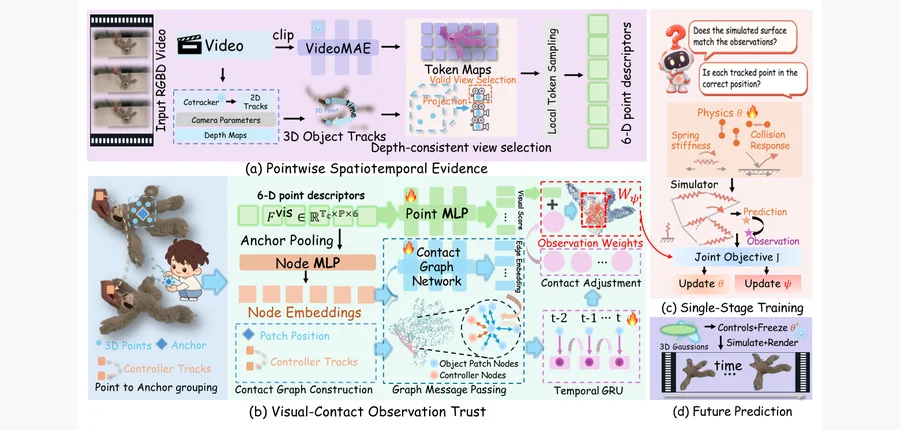 arXiv 2026-11-25 · cs.CV · #1 **[ViTrust: Learning 3D Observation Trust for Deformable Physical World Models](https://arxiv.org/abs/2611.28815)** [Zhihao Guo , Zhihao Li , Xu Ge , Lijian Zhong , Yu Lu , Haitao Wu , Longqing Zhao , Yue Ma](https://arxiv.org/abs/2611.28… 机构：Hesai Technology / Shanghai Jiao Tong University / Southeast University（[PDF](https://arxiv.org/pdf/2611.28815)） [Paper](https://arxiv.org/abs/2611.28815) · [图源](https://arxiv.org/html/2611.28815v1/physical_overview.png) 

中文摘要
学习可形变物理世界模型需要能泛化到已观测运动之外的动力学。准确重建本身并不保证准确的未来预测，因此我们希望学习观测应如何影响物理参数辨识。然而，视觉可靠性本身不能决定一项观测对物理动力学有多大信息量。我们提出 ViTrust，学习三维观测可信度，以确定每个被跟踪点在物理参数辨识中的影响权重。其关键设计是视觉—接触可信度适配器：它结合逐点时空证据与持久接触图上的交互历史，预测随时间变化的观测权重。单阶段、共享前向过程的目标函数通过加权几何损失和对应关系损失，联合优化这些权重与物理参数，并用约束防止观测权重塌缩。所有学习仅使用已观测前缀。拟合后的物理参数在给定控制量下预测未来时保持固定。真实序列实验表明，相比所评估基线，该方法改善了未来预测，并展示了新控制量下的定性展开和跨物体迁移。 <a href="https://arxiv.org/abs/2611.28815">原摘要来源</a>
 | 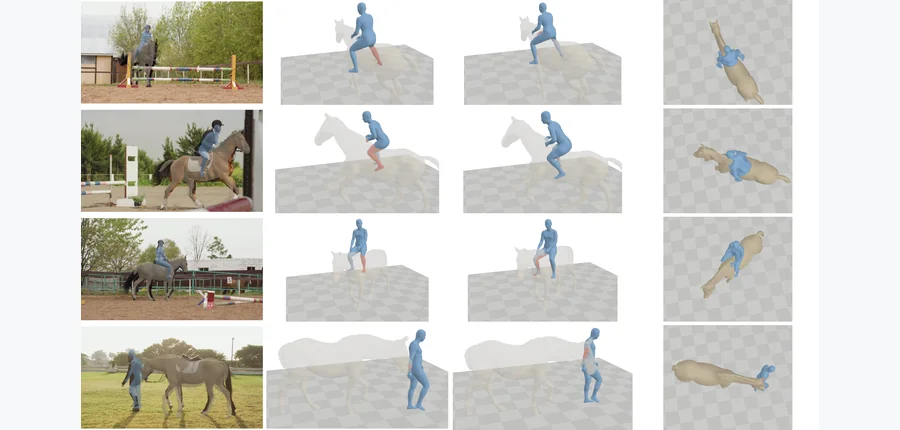 arXiv 2026-11-25 · cs.CV · #2 **[Ride on Anything: Contact-Coupled Monocular 4D Reconstruction of a Rider and Horse in Camera and World Frames](https://arxiv.org/abs/2611.29435)** [Zehang Weng , Ci Li](https://arxiv.org/abs/2611.29435) 机构：affiliation 未确认 [Paper](https://arxiv.org/abs/2611.29435) · [图源](https://arxiv.org/html/2611.29435v1/fig/qualitative.png) 

中文摘要
我们研究从单段视频重建马及骑手。若分别使用人体估计器和马匹估计器，两者网格虽能很好贴合轮廓，骑手却可能悬在马旁、穿过马身、沿马背滑动，或相对马匹抖动。这些误差位于相机轴向，在输入视角中不可见。我们提出 Ride on Anything（RoA），一种通用且无需训练的方法，在测试时耦合骑手与坐骑的冻结估计器，并以骑马场景实例化，采用 SAM 3D Body 和 4DEquine。RoA 将两个估计器对齐到共同帧索引，使用由马匹估计器初始化的同一像素各向同性相机投影两者，并在马体坐标系中定义的交互项下联合优化有界修正；其中包括基于广义绕数的碰撞项，即使马匹网格不封闭也有效。随后，利用背景估计出的相机旋转和 MoGe-2 的视场角，将结果提升至水平世界坐标系。在骑马片段上，原始估计结果中骑手骨盆距马背平均 15 厘米。RoA 将座位间隙降至 1 厘米，将座位沿脊柱和横向的漂移分别降低 64% 和 89%，将第 90 百分位穿透深度降低 57%，并把位于马体内的骑手表面比例从 12.1% 降至 7.9%。运动也明显更平滑：骑手相对马匹的加速度降低 94%，马匹冲击度降低 80%；但骑手轮廓 IoU 从 0.59 降至 0.52。定性结果中，骑手保持就座并随马运动。三维精度的定量评估仍需带标定的骑乘动物录像。我们还测试了一段任务外的牵马步行视频，并分析失败模式。 <a href="https://arxiv.org/abs/2611.29435">原摘要来源</a>
 | 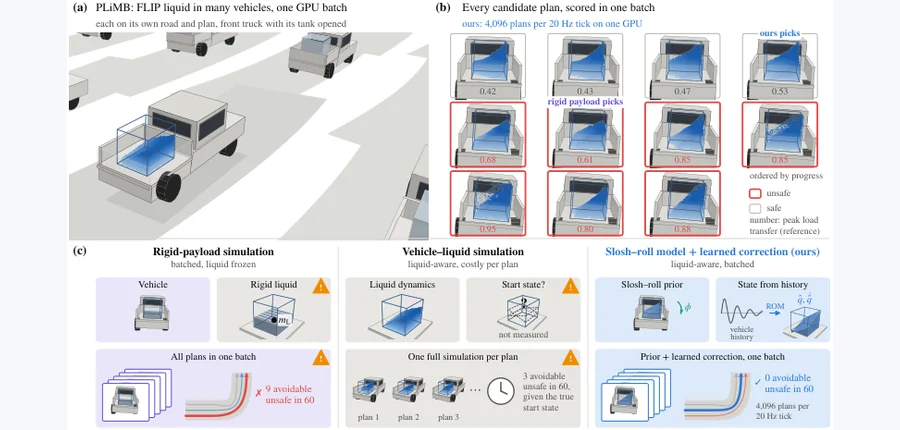 arXiv 2026-11-25 · cs.RO · #3 **[Knowing What You Carry: Scalable Physics-Anchored World Models for Robotic Planning with Liquid Payloads](https://arxiv.org/abs/2611.28387)** [Yicheng Zhu , Linfeng Tian , Yang Chen , Tao Li , Zilin Bian](https://arxiv.org/abs/2611.28387) 机构：Rochester Institute of Technology / City University of Hong Kong（[PDF](https://arxiv.org/pdf/2611.28387)） [Paper](https://arxiv.org/abs/2611.28387) · [图源](https://arxiv.org/html/2611.28387v1/teaser_render.png) 

中文摘要
载荷运输机器人（如配送机器人和自动驾驶卡车）需要选择使自身与载荷安全的运动，因此规划器会预测每个候选运动的结果。现代规划器在 GPU 上每步比较数千个候选方案，使用批量仿真器或学习型预测器等世界模型。多数模型假设载荷为刚体，但液体载荷在转向后仍会运动，其状态也很少被直接测量。接近安全边界时，微小预测误差便可能让不安全方案显得安全。耦合流体仿真准确，却无法对每个候选方案都运行；低阶晃荡模型便宜，却仅在远离共振时准确。我们在接近侧翻极限、装有部分液体的地面车辆上研究这一取舍。首先构建 PLiMB（Parallel Liquid-MultiBody），一种 GPU 并行晃荡仿真器；据我们所知，它首次将 FLIP 液体与许多多体车辆双向耦合，提供训练数据和高保真参照。其次提出可扩展的物理锚定世界模型，结合模态晃荡及侧倾先验、从车辆自身运动历史估计的隐藏液体状态（无需罐内传感器）和学习型修正。它无需仿真流体，就能在单 GPU 上的一个 20 Hz 控制周期内批量评估数千个候选方案。我们依据世界模型使规划器选出的方案来评价它。在侧翻极限附近，把液体视为刚体或采用已发表低阶晃荡模型的规划器，常在有安全方案时选择不安全方案；我们的方法在标准罐体中没有出现这种情况，在晃荡模态落入机动频带的宽罐体中则将其约减半。在后者中，先前驾驶留下的液体状态会改变最佳方案；从车辆历史读取该状态使模型在极限附近的预测误差减半。 <a href="https://arxiv.org/abs/2611.28387">原摘要来源</a>
 |
| 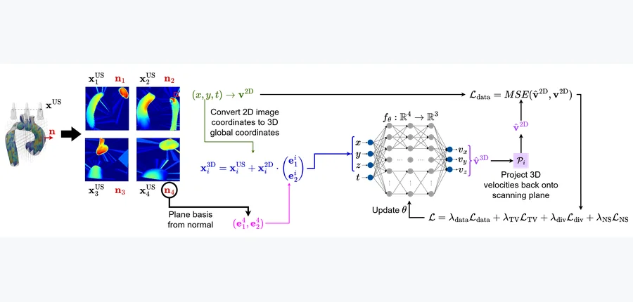 arXiv 2026-11-25 · cs.CV · #4 **[Reconstructing 3D+t Cardiovascular Flow From Sparse Planar Velocity Fields With Neural Fields](https://arxiv.org/abs/2611.30775)** [Viraj Patel , Deblina Bhattacharjee , Katharine Fraser](https://arxiv.org/abs/2611.30775) 机构：University of Bath（[PDF](https://arxiv.org/pdf/2611.30775)） [Paper](https://arxiv.org/abs/2611.30775) · [图源](https://arxiv.org/html/2611.30775v1/figures/framework.png) 

中文摘要
从稀疏平面测量重建随时间变化的三维（3D+t）心血管流场很困难，因为每个平面只观测体积中很小区域的两个平面内速度分量。我们提出感知测量平面的神经场框架，通过逐平面投影，从空间和时间坐标学习连续三维速度场，并研究物理约束可能带来的收益。我们在计算得到的主动脉和动脉瘤数据集，以及从真实心脏 4D Flow MRI 扫描重采样的平面上评估。普通多层感知机（MLP）在两个计算数据集上都比经典径向基函数（RBF）插值更准确。对于主动脉，物理约束 SIREN（PC-SIREN）将 rRMSE 进一步降至 0.3756，而普通 MLP 为 0.4273，RBF 为 0.7256；它也是 MRI 数据每个解剖分段中最准确的模型。对于动脉瘤，普通 MLP 仍最准确，rRMSE 为 0.07–0.16，而 PC-SIREN 为 0.55–0.71。进一步实验考察了扫描配置、扫描次数和空间分辨率。结果表明，连续神经场可从稀疏平面测量重建体积心血管流场，而物理约束必须与流动特性匹配。 <a href="https://arxiv.org/abs/2611.30775">原摘要来源</a>
 | 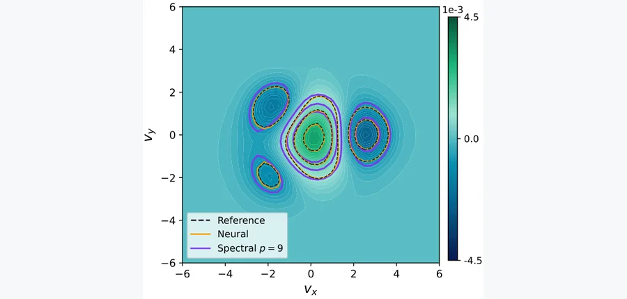 arXiv 2026-11-25 · math.NA · #5 **[Learning the Boltzmann Collision Operator with Structural Constraints for Fast Kinetic Simulation](https://arxiv.org/abs/2611.28864)** [Hao Wang , Zhenning Cai](https://arxiv.org/abs/2611.28864) 机构：National University of Singapore（[PDF](https://arxiv.org/pdf/2611.28864)） [Paper](https://arxiv.org/abs/2611.28864) · [图源](https://arxiv.org/html/2611.28864v1/three_stream_collision_t5.png) 

中文摘要
玻尔兹曼碰撞算子中的高维积分是确定性动理学仿真的主要计算瓶颈。我们开发一种保持结构的神经算子，以高效近似这一非线性碰撞映射。该算子保留原碰撞算子的增益—损失结构，且按构造与气体密度的平方成正比。守恒矩投影和熵修正强制满足质量、动量和能量守恒以及熵耗散。按构造，碰撞项在所有 Maxwellian 分布上也为零。在气体动力学仿真的数值格式中，我们确立了使用学习型碰撞算子时分布函数的非负性，并在施加正谱隙时证明其向矩匹配平衡态指数收敛。针对常数碰撞核的数值实验表明，相比 Fourier 谱方法求值，它在精度与成本之间取得有利取舍。尽管仅在光滑分布上训练，同一算子仍能处理不连续分布函数，并无需重训即可嵌入稳态 Couette 流、法向激波和二维顶盖驱动方腔求解器。这些结果展示了一种可重复用于碰撞求值的近似方法，既保留动理学结构，也支持准确的确定性仿真。 <a href="https://arxiv.org/abs/2611.28864">原摘要来源</a>
 | 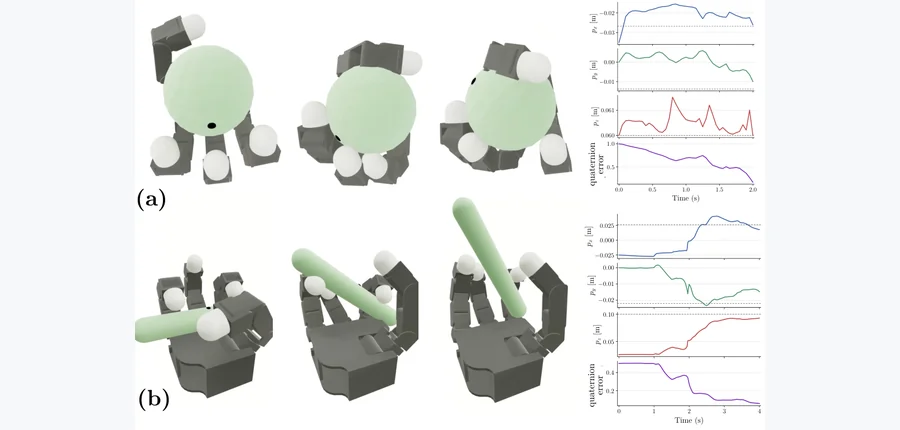 arXiv 2026-11-25 · cs.RO · #6 **[Lifted Multiple Shooting for Parallel-in-Time Contact-Rich Trajectory Optimization](https://arxiv.org/abs/2611.28512)** [Wei-Chen Li , Glen Chou](https://arxiv.org/abs/2611.28512) 机构：Georgia Institute of Technology（[PDF](https://arxiv.org/pdf/2611.28512)） [Paper](https://arxiv.org/abs/2611.28512) · [图源](https://arxiv.org/html/2611.28512v1/fig1.png) 

中文摘要
穿越接触进行规划，需要考虑机器人及环境的耦合动力学，包括惯性效应、接触力与摩擦。然而，接触动力学与接触几何的非光滑性和多模态性，使基于梯度的优化充满挑战。我们提出提升式多重打靶，一种可直接由非线性规划求解器求解的轨迹优化转录形式。通过将接触冲量引入优化变量，我们的形式允许优化器利用满足摩擦锥约束的冲量满足状态转移约束，同时单独强制其与接触模型一致。该形式支持广泛的接触本构关系，并通过隐式微分计算敏感度。为高效规划长时域和高维系统，我们进一步提出 IP-PAS，一种时间并行的原始—对偶内点求解器，其并行计算深度为 O(log T)。我们在六个完全动态的接触密集型规划任务上评估方法，包括非抓取推动和手内操作，且不使用接触引导代价。提升式多重打靶相比标准多重打靶将成功率最多提高 81.5 个百分点；IP-PAS 的求解质量与串行方法相近，速度最多提升 3.1 倍，并可扩展至 40,000 步的时域。 <a href="https://arxiv.org/abs/2611.28512">原摘要来源</a>
 |
| 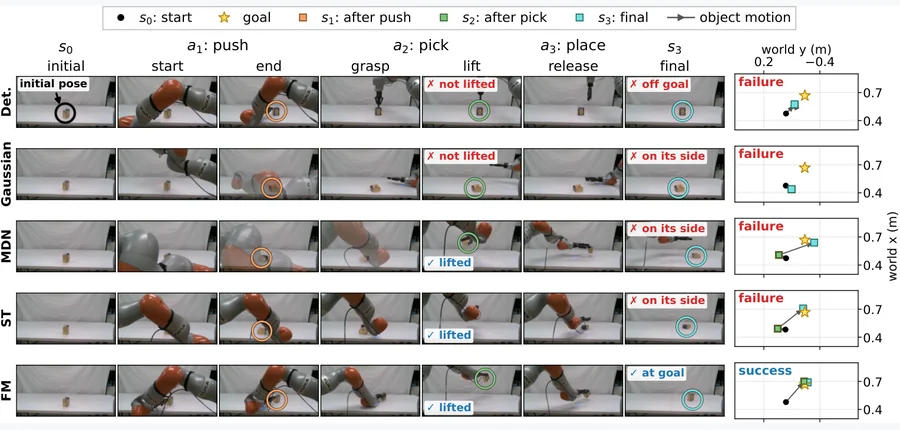 arXiv 2026-11-25 · cs.RO · #7 **[Grounded in Contact: Reducing Floating and Interpenetration Artifacts with Multimodal Skill-Effect Models](https://arxiv.org/abs/2611.29662)** [Siyeon Kim , Mohanraj Devendran Shanthi , Joseph C. Liechty , Tucker Hermans](https://arxiv.org/abs/2611.29662) 机构：University of Utah / NVIDIA Research（[PDF](https://arxiv.org/pdf/2611.29662)） [Paper](https://arxiv.org/abs/2611.29662) · [图源](https://arxiv.org/html/2611.29662v1/real_showcase_potted_meat_can_192.png) 

中文摘要
学习预测接触密集型操作技能的效果，需要模型表示不同的结果模态，而不是单一的期望结果。即便是推、抓、放等基本技能，接触条件或物体几何的微小变化，也可能使几乎相同的状态和动作产生截然不同的物体运动。确定性模型和高斯模型倾向于平均这些可能性，或将其表示为单个宽分布，从而模糊滑动、倾倒和旋转等不同模态。我们研究概率型技能效果模型：给定局部点云和动作，学习物体位姿变化的多模态分布。我们用三类代表性模型实现这一抽象：混合密度网络、状态 token 化和流匹配，各自配有用于下一步预测的潜在动力学。在多种物体和技能上，显式多模态模型比确定性和高斯基线更准确地预测实际出现的结果。在规划中，流匹配在每种技能上都显著改善了相对确定性基线的任务成功率，并在每个多步序列上取得最高成功率。真实机器人实验中，概率模型的拾取成功率约为确定性基线的两倍，表明概率技能效果是处理不确定性推理和规划的实用抽象。 <a href="https://arxiv.org/abs/2611.29662">原摘要来源</a>
 | 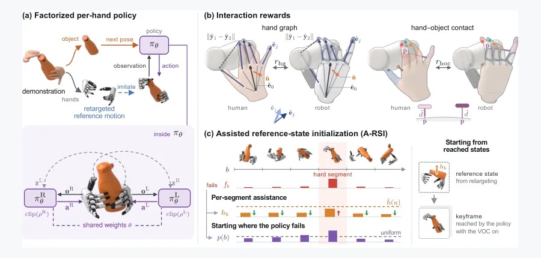 arXiv 2026-11-25 · cs.RO · #8 **[DexDuet: Learning Contact-Preserving Bimanual Dexterity from Human Demonstrations](https://arxiv.org/abs/2611.30495)** [Haoran Zhang , Haokai Ding , Han Zhou , Zuxing Lu , Heng Zhang , Xingxing Zuo](https://arxiv.org/abs/2611.30495) 机构：Mohamed bin Zayed University of Artificial Intelligence / Motphys（[PDF](https://arxiv.org/pdf/2611.30495)） [Paper](https://arxiv.org/abs/2611.30495) · [图源](https://arxiv.org/html/2611.30495v1/method.png) 

中文摘要
人类示范提供了丰富的双手灵巧技能，但将其迁移到机器人手仍有挑战。现有方法主要优化物体轨迹跟踪，常忽略人手如何与物体交互。即使跟踪准确，机器人仍可能接触错误部位或手指打滑，导致操作不稳定。我们提出 DexDuet，一种从单次人类示范学习保持接触的双手灵巧操作的框架。DexDuet 使用两项交互奖励保持人手—物体配置和接触。为实现协调操作，我们将双手策略分解为两个共享权重的单手策略，并使其以对方状态为条件。我们还提出辅助参考状态初始化（A-RSI），一种自适应课程，通过调整物体辅助程度和示范片段中的训练起点，克服困难操作阶段。在覆盖三个仿真器、五种机器人形态的四个基准上，DexDuet 相比对应基线将物体跟踪 ADD-AUC 提高 11–41 点，同时持续更好地保持接触。值得注意的是，在物体跟踪精度相近的 122 组配对运行中，有 117 组的 DexDuet 更好地保持了人类接触。代码和视频见原文链接。 <a href="https://arxiv.org/abs/2611.30495">原摘要来源</a>
 | 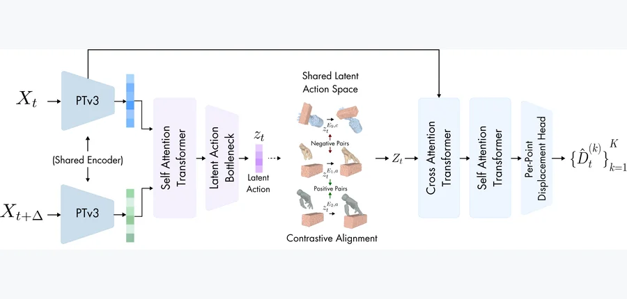 arXiv 2026-11-25 · cs.RO · #9 **[DexLatentWorld: 3D Cross-Embodiment Latent Action World Models for Zero-Shot Robotic Manipulation](https://arxiv.org/abs/2611.30907)** [Vinay Udit Mohan , Xuchuan Huang , Rolandos Alexandros Potamias](https://arxiv.org/abs/2611.30907) 机构：Imperial College London（[PDF](https://arxiv.org/pdf/2611.30907)） [Paper](https://arxiv.org/abs/2611.30907) · [图源](https://arxiv.org/html/2611.30907v1/Images/model_architecture.png) 

中文摘要
世界模型通过让智能体预测动作后果来辅助机器人操作中的规划与控制。然而，它们通常依赖获取成本高且难以规模化的动作标注交互数据，而且常与训练时使用的机器人形态绑定，限制了向未见形态的迁移。我们提出一种三维潜在动作世界模型，直接从重定向的人类操作示范点云观测中学习连续动作表示。对比目标促使跨形态运动得到一致表示。由此形成的统一潜在动作空间可直接作为模型预测控制的搜索空间：采样的潜在动作对基于粒子的未来预测施加条件。随后从预测的几何运动恢复可执行机器人命令，无需特定形态的动作解码器。大量评估表明，学习到的潜在动作具有可控、可组合的运动，能迁移至未见机器人形态，并支持未见夹爪几何的零样本操作。在与任务无关的适配后，模型在到达、抓取和放置上的成功率分别为 90%、92% 和 60%，对照 DexWM 报告的 72%、58% 和 28%。最后，我们以未见的灵巧手展示真实世界零样本操作：在五种涉及推动、抓取和提起日常物体的任务中，共 50 次试验取得 86% 的成功率。这些结果说明，几何锚定潜在动作有望成为基于世界模型的机器人操作的统一、可迁移接口。项目材料（包括示范视频和源代码）见原文链接。 <a href="https://arxiv.org/abs/2611.30907">原摘要来源</a>
 |
| 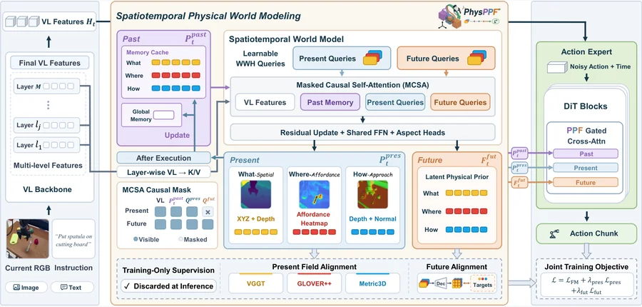 arXiv 2026-11-25 · cs.RO · #10 **[PhysPPF: Learning Robotic Manipulation with Past, Present, and Future Physical Representations](https://arxiv.org/abs/2611.28551)** [Junjie Li , Dawei Yan , Guoting Wei , Ruike Song , Lu Wang , Qingguo Chen , Zhenbo Luo , Haokui Zhang , Chunhua Shen](htt… 机构：Northwestern Polytechnical University / Alibaba Cloud Computing / Xiaomi Inc / Zhejiang University（[PDF](https://arxiv.org/pdf/2611.28551)） [Paper](https://arxiv.org/abs/2611.28551) · [图源](https://arxiv.org/html/2611.28551v1/Fig2_v6.png) 

中文摘要
视觉—语言—动作（VLA）模型推动了机器人操作，但兼具精确三维接触与长时域协调的复杂任务仍然困难。多数现有研究分别增强 VLA 的空间感知或时间推理：空间方法主要向当前帧感知注入几何或可供性先验，却不跟踪多步转移；考虑历史的 VLA 和世界模型 VLA 通常在二维特征或像素空间表示过去或未来，缺乏显式三维接触线索，或引入较高生成开销。为此，我们提出 PhysPPF，在紧凑物理 token 空间中统一进行时空建模。空间方面，WWH（What-Where-How）仅在训练时从预训练感知教师中蒸馏紧凑 token 组，分别捕捉场景中有哪些三维结构、交互位置和夹爪接近方式，测试时无需三维编码器。时间方面，PPF（Past-Present-Future）直接在 WWH 空间工作，不重建像素；它将已执行状态整合到有界的过去物理记忆，并通过非对称世界模型联合推断当前和未来物理 token。并行门控分支再将过去、当前和未来表示注入流匹配动作专家，指导操作而不造成跨时间干扰。在 SimplerEnv、CALVIN 和 LIBERO 上的大量实验显示，PhysPPF 以适度延迟和参数开销持续优于现有空间、历史感知和世界模型 VLA；相较 StarVLA 基线，在三个基准上分别提高 17.2、29.3 和 3.5 个百分点。 <a href="https://arxiv.org/abs/2611.28551">原摘要来源</a>
 | 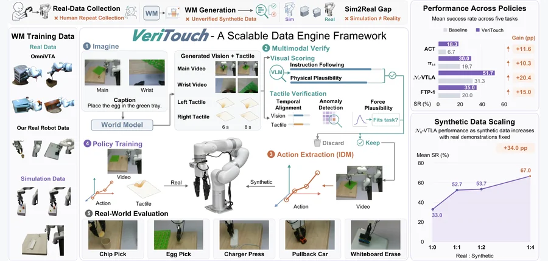 arXiv 2026-11-25 · cs.RO · #11 **[VeriTouch: Verified Visuo-Tactile World Models that Improve Robot Policy Learning](https://arxiv.org/abs/2611.30572)** [Shuxun Wang , Xiaonan Jiang , Zhaoyu Wang , Ziyuan Chu , Xihang Yue , Pengfei Liu , Haodong Zhu , Shiqi Liu , Mingzhi Zhe… 机构：Zhejiang University / City University of Hong Kong / Nanyang Technological University / Technical University of Munich / Zhejiang University City College / Nanjing University / Hangzhou Institute for Advanced Study, UCAS（[PDF](https://arxiv.org/pdf/2611.30572)） [Paper](https://arxiv.org/abs/2611.30572) · [图源](https://arxiv.org/html/2611.30572v1/teaser.png) 

中文摘要
视觉—触觉策略学习的规模化受制于真实数据收集成本高，以及逼真仿真难以构建。生成模型能提供可扩展的训练数据，但有用的示范需要可信的触觉反馈、与视觉接触的时间对齐和准确动作。为此，我们提出 VeriTouch，一个生成并验证合成视觉—触觉轨迹以学习策略的框架。给定初始图像和任务指令，世界模型 VeriGen 联合生成覆盖完整操作轨迹的高保真双视角视频和逼真触觉序列。它将专门的触觉专家与预训练视频模型结合，通过联合视觉—触觉建模捕捉视觉细节和触觉形变动力学。多模态验证器 VeriEval 在检查视觉质量的同时聚焦触觉可靠性，评估触觉真实性、接触力合理性，以及可见接触与触觉信号间的时间对齐，从而直接过滤不可靠序列。最后，逆动力学模型 VeriIDM 结合两个相机视角的全局场景信息、精细夹爪细节及相邻帧运动，从验证过的视频中提取动作。五项真实任务的实验显示，合成数据改善了所评估的全部四种策略；继续增加合成轨迹还显著提升策略表现，而无需增加真实数据采集。 <a href="https://arxiv.org/abs/2611.30572">原摘要来源</a>
 | 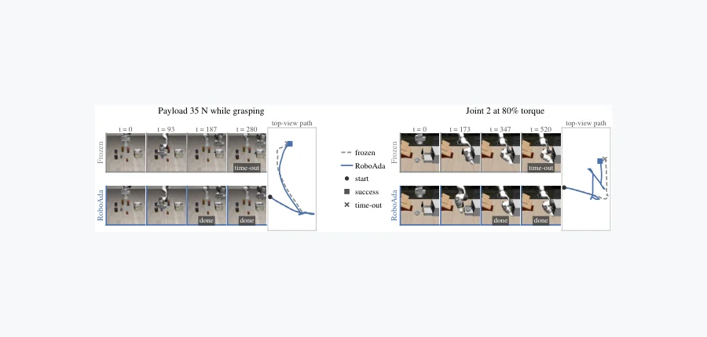 arXiv 2026-11-25 · cs.RO · #12 **[RoboAda: Adapting Frozen Robot Policies at Test Time to Physics They Cannot See](https://arxiv.org/abs/2611.30209)** [Yunbei Zhang , Zijian Jin , Shuaicheng Niu , Baian Chen , Weirui Ye , Jihun Hamm , Yilun Du](https://arxiv.org/abs/2611.3… 机构：Tulane University / New York University / Nanyang Technological University / MIT / Harvard University（[PDF](https://arxiv.org/pdf/2611.30209)） [Paper](https://arxiv.org/abs/2611.30209) · [图源](https://arxiv.org/html/2611.30209v1/fig_qualitative.png) 

中文摘要
预训练机器人策略根据相机图像决策，但有些决定计划能否成功的物理量不可见。一个物体看似很轻，却可能重 100 倍；关节变弱或控制器延迟也不会在图像中留下痕迹。部署时的物理条件若与训练不同，计划常仍然正确，执行命令却沿用旧校准。预先训练各种变化无法覆盖未见变化；部署后适配若只改变计划，会留下失准的命令，若通过梯度步骤更新机器人模型，却又不知道更新有多可靠，甚至可能在没有变化时使机器人变差。我们提出 RoboAda：保持策略和计划不变，在测试时推断机器人如何将命令转化为运动，并修正执行命令。关键观察是机器人自身运动会暴露变化：每个动作块之后，原机器人逆动力学模型把观测运动转换为原机器人实现该运动所需的命令，从而每步免费获得标签。多个有关机器人响应的假设（包括“没有变化”）按预测这些标签的准确程度加权，再以最能在这些假设下实现计划的命令发送下一动作块。RoboAda 不需要奖励、梯度步骤，也不需要变化后机器人的数据。我们在 LIBERO 上用五个冻结策略评估，包括两个世界动作模型和三个视觉—语言—动作模型。面对 11 类物理变化，平均成功率从 27.8% 提升到 62.9%，超过翻倍。在 Cosmos Policy 上，它比七种测试时适配方法中的最佳者高 17.3 点，且在物理条件未变时基本保留策略成功率。在关节空间的双手 RoboTwin 2.0 中，面对关节目标偏移，成功率从 24.9% 提升到 78.8%。 <a href="https://arxiv.org/abs/2611.30209">原摘要来源</a>
 |
| 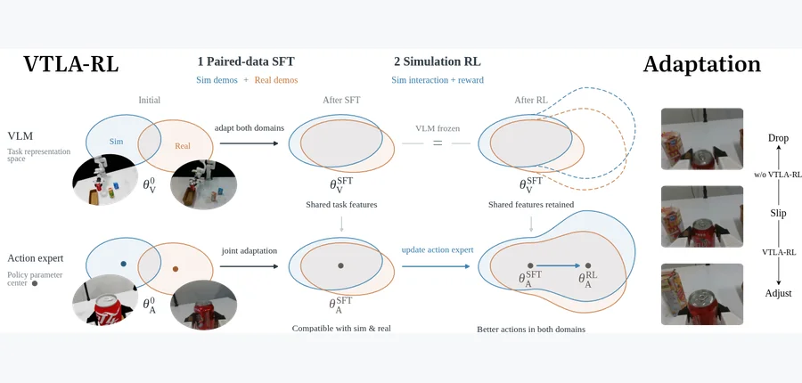 arXiv 2026-11-25 · cs.RO · #13 **[VTLA-RL: Learning Visuotactile Policies for Load-Adaptive Grasping](https://arxiv.org/abs/2611.28752)** [Qiwei Wu , Qixuan Li , Xin Xiang , Xiangyu Chen , Xiang Xiao , Daochen Shi , Ruihua Zhang , Renjing Xu](https://arxiv.org… 机构：The Hong Kong University of Science and Technology (Guangzhou) / NVIDIA（[PDF](https://arxiv.org/pdf/2611.28752)） [Paper](https://arxiv.org/abs/2611.28752) · [图源](https://arxiv.org/html/2611.28752v1/figures/exports/fig1_overview.png) 

中文摘要
视觉—语言—动作基础模型学到了通用操作先验，但仅凭视觉难以推断物体质量和局部滑移。载荷变化需要由接触驱动的抓取调整，而在固定条件下收集的示范可能覆盖不足。我们提出 VTLA-RL，研究不同载荷下的视觉—触觉抓取策略及其强化学习（RL）后训练。主要方法在触觉图像历史与 RGB 输入之间共享视觉编码器，在统一动作空间中联合生成并执行运动目标和双侧力目标。混合真实与仿真的示范先建立运动和接触先验。随后，两阶段多任务 RL 仅用仿真交互、依据任务成功回报优化策略，不再使用真实示范监督；训练后的策略直接部署到真实机器人。我们在仿真中比较触觉表示和 RL 后训练路径，并在硬件上分别评估载荷变化与放置扰动。完整方法的抓取成功率高于监督初始化，但不同方法的 RL 后训练收益各异，为该任务中的表示和训练方法选择提供实证依据。 <a href="https://arxiv.org/abs/2611.28752">原摘要来源</a>
 | 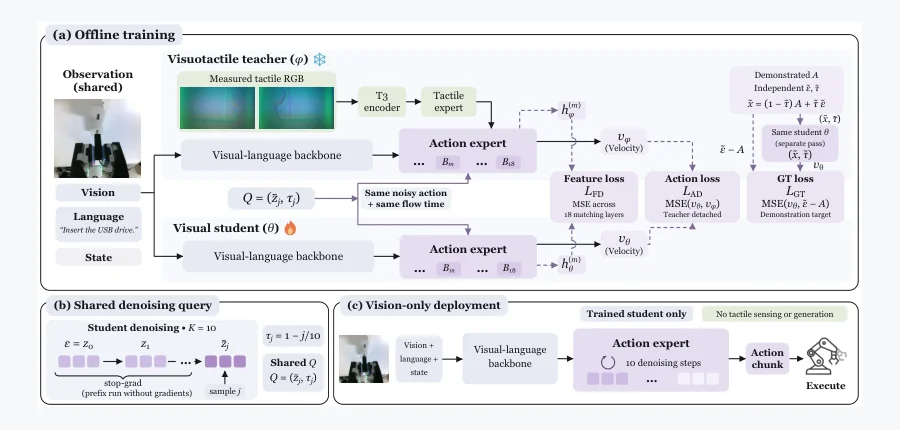 arXiv 2026-11-25 · cs.RO · #14 **[Distilling Touch into Vision-Only Policies for Contact-Rich Manipulation](https://arxiv.org/abs/2611.28697)** [Chen Yang , Linhao Wang , Linzhe Shi , Guohui Zhang , Changjie Wu , Hang Zhang , Haoyu Li , Mu Xu , Jiansheng Fan , Chen… 机构：Tsinghua University / Amap, Alibaba Group（[PDF](https://arxiv.org/pdf/2611.28697)） [Paper](https://arxiv.org/abs/2611.28697) · [图源](https://arxiv.org/html/2611.28697v1/overview.png) 

中文摘要
触觉反馈有助于接触密集型操作，但部署触觉传感器会增加硬件和维护要求。触觉经验仍可监督部署时不使用触觉传感器的策略。TacImag 等触觉想象方法通过预测触觉观测摆脱硬件依赖，但保留了重建阶段，其误差可能传播到动作生成。我们提出 TacitTouch，一种将触觉引导的行为直接迁移到纯视觉策略的蒸馏框架。核心转变是从“学会想象触觉会是什么样”转向“学会像能感知触觉那样行动”：学生无需重建触觉观测，直接学习触觉引导的动作模式。冻结的视觉—触觉教师在相同的带噪动作和流时间下，监督学生的去噪预测及中间动作表示。训练还使用示范动作监督。部署时仅保留视觉策略，不需要触觉编码器、专家或生成器。在四项仿真 UniVTAC 任务与四项真实任务上，TacitTouch 的平均成功率相对纯视觉控制分别绝对提高 16.0% 和 22.5%；与使用实测触觉输入的教师相比，绝对差距仅为 2.0% 和 3.75%。在鲁棒性测试中，它也优于 TacImag，平均成功率绝对增益最高为 20.0%。项目页见原文链接。 <a href="https://arxiv.org/abs/2611.28697">原摘要来源</a>
 | 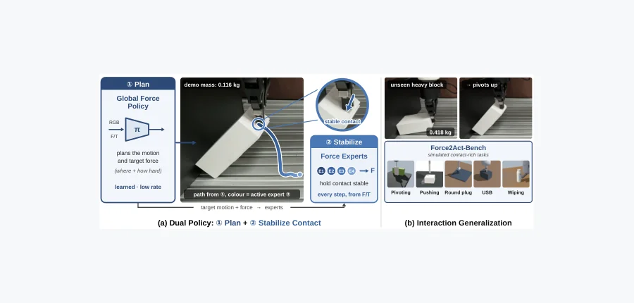 arXiv 2026-11-25 · cs.RO · #15 **[Force2Act: A Force-Aware Visuomotor Policy for Generalizable Compliant Robot Manipulation](https://arxiv.org/abs/2611.29208)** [Keerthi Vasan Murugan , Fangguo Zhao , Jiafei Duan](https://arxiv.org/abs/2611.29208) 机构：National University of Singapore / Zhejiang University（[PDF](https://arxiv.org/pdf/2611.29208)） [Paper](https://arxiv.org/abs/2611.29208) · [图源](https://arxiv.org/html/2611.29208v1/force2act_teaser.png) 

中文摘要
接触密集型操作要求机器人调节施加的力，而不只是移动位置。现有力感知策略从示范学习力，因此会复现训练时的力水平；一旦交互需要的力超过所有示范，就会失败。我们提出 Force2Act，一种结合两种互补机制的力—位置混合策略。全局力策略每个动作块规划一次运动和交互力，并以相对当前实测交互力的方式表示力，使规划力随载荷变化。在规划间隔中，称为 Mixture of Force Experts 的反应式柔顺策略，在每个控制步识别主导当前交互的力专家并通过它调节力，使接触在动作块内部发生变化时仍可保持。我们还提出 Force2Act-Bench，包含五个接触密集型任务的仿真基准，为测试力感知策略并测量其交互力调节能力提供共同、可重复的平台。Force2Act 总成功率为 93.8%，最强基线为 77.0%；反应式调节使方块翻转任务在 150 次试验中的失败次数从 30 降至 10。真实机器人四项任务上的平均成功率为 94.2%，基线最高为 27.5%。 <a href="https://arxiv.org/abs/2611.29208">原摘要来源</a>
 |
| 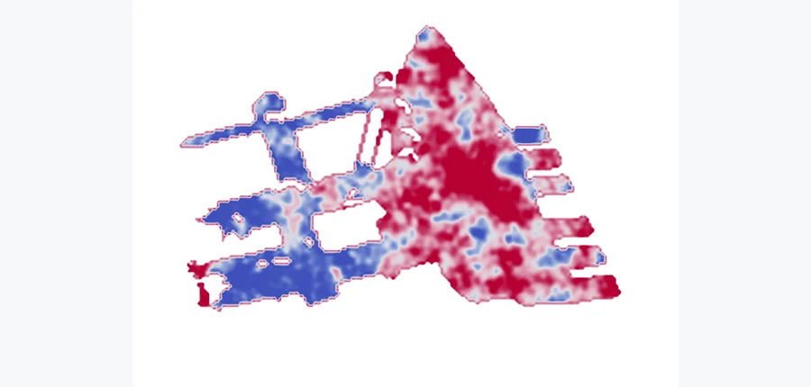 arXiv 2026-11-25 · cs.CV · #16 **[Dynamic Gaussian Scene Reconstruction by Integrating Events and Structural Priors](https://arxiv.org/abs/2611.29920)** [Zihao Yu , Guozhen Liu , Jie Yan , Jialiang Liu , Panlong Tan , Qinglin Sun , Hao Sun](https://arxiv.org/abs/2611.29920) 机构：Nankai University / Haihe Laboratory of Information Technology Application Innovation（[PDF](https://arxiv.org/pdf/2611.29920)） [Paper](https://arxiv.org/abs/2611.29920) · [图源](https://arxiv.org/pdf/2611.29920) 

中文摘要
现有事件驱动动态 Gaussian 重建方法在补充表示支撑和估计可靠性时依赖两项假设：其一，已有 Gaussian 能吸收重建误差；其二，光度优化已充分收敛，可用解析方差估计可靠性。快速运动时，两项假设都可能失效。第一项失效时，没有 Gaussian 支撑的区域无法生成增密候选；第二项失效时，优化未收敛的运动区域 Gaussian 可能被排除出运动参考。我们提出事件—结构协同动态 Gaussian 重建（ESC-DGR），利用不依赖这两项条件的事件观测。事件首先定位需要额外支撑的变化，只在渲染深度有效处增添支撑。增强后的表示仍需要可靠运动参考，因此，在线渲染统计和历史事件证据将可靠 Gaussian 的位移估计传播到观测较弱的邻域。这些参考描述帧间时间尺度上的主导运动；目标时刻事件进一步为活跃 Gaussian 的位置残差提供有界条件。支撑放置、参考选择和残差预测由此在一次优化中作用于同一个演化中的表示。在事件驱动单目动态场景重建中，该方法在 E-D3DGS 基准上取得所评估方法中的最佳重建质量。相对 E-D3DGS，合成和真实场景的动态区域 PSNR（dPSNR）分别提高 1.02 和 1.45 dB；八个合成场景中的动态 Gaussian 总数减少 8.5%。虽然平均帧率相对 E-D3DGS 下降约 21%–25%，全部 12 个场景的渲染仍超过 80 FPS。代码见原文链接。 <a href="https://arxiv.org/abs/2611.29920">原摘要来源</a>
 | 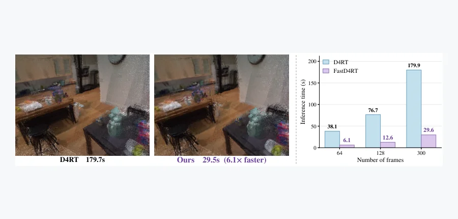 arXiv 2026-11-25 · cs.CV · #17 **[FastD4RT: Training-Free Acceleration of Dynamic 4D Reconstruction and Tracking](https://arxiv.org/abs/2611.28193)** [Meng Bi , Yili Jin , Kaiyuan Hu , Xize Duan , Jiaxin Huang , Hong Huang , Xue Liu](https://arxiv.org/abs/2611.28193) 机构：Mohamed bin Zayed University of Artificial Intelligence / MirrorSpace / McGill University / City University of Hong Kong（[PDF](https://arxiv.org/pdf/2611.28193)） [Paper](https://arxiv.org/abs/2611.28193) · [图源](https://arxiv.org/html/2611.28193v1/teaser.png) 

中文摘要
D4RT 等基于查询的 4D 重建模型先把视频编码为全局场景表示，再通过解码独立点查询得到输出。然而，推理常受到密集输出和长视频的影响。虽然 D4RT 将编码与解码分离，密集输出仍需为每帧的每个像素运行一次解码查询，长视频仍需编码为许多重叠片段。我们分析 D4RT 的推理成本，发现其中很大一部分是冗余的。具体而言，较后层的解码器块主要关注所有查询共享的一小组 token。基于此，我们提出无需训练的 FastD4RT 加速框架。利用输出在时间和像素间的平滑性，它只在稀疏锚点编码和解码，再通过插值恢复其余输出；剩余查询则针对每段只选择一次的共享 token 集合解码。我们还刻画了两部分引入的误差。实验结果显示，FastD4RT 在全部任务上平均将 D4RT 加速约五倍，同时保持有竞争力的精度，并进一步改善长视频精度。代码见原文链接。 <a href="https://arxiv.org/abs/2611.28193">原摘要来源</a>
 | 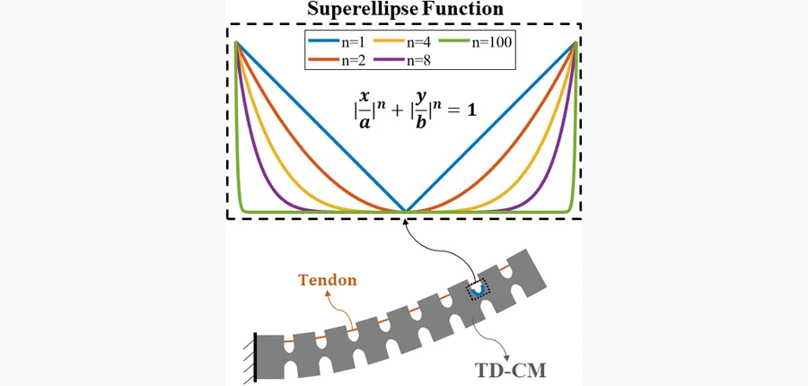 arXiv 2026-11-25 · cs.RO · #18 **[Superellipse Function: A Powerful Geometric Tool for the Design and Deformation Modeling of Tendon-Driven Continuum Manipulators With Flexural Patterns Experiencing Tension Loss](https://arxiv.org/abs/2611.29801)** [Yang Liu , Farshid Alambeigi](https://arxiv.org/abs/2611.29801) 机构：University of Texas at Austin / Rice University / Houston Methodist Research Institute（[PDF](https://arxiv.org/pdf/2611.29801)） [Paper](https://arxiv.org/abs/2611.29801) · [图源](https://arxiv.org/html/2611.29801v1/Figure/concept_figure.png) 

中文摘要
本文将超椭圆函数作为几何且通用的工具，用于有效设计和建模腱驱动连续体机械臂中具有不连续截面几何的柔性图案。我们还提出独特的配套数学框架和求解算法，建模部分约束的腱引起的分布式与集中摩擦力如何影响拉力损失及采用超椭圆函数设计的连续体机械臂的形变。具体而言，利用这一几何函数，我们建立四个直观函数映射，联系机械臂的几何参数、运动学与形变行为。借助这些映射和超椭圆函数的性质，我们进一步引入设计空间与设计曲线概念，以便直观设计经历腱拉力损失、具有一般柔性图案几何的连续体机械臂。为全面评估新框架及上述特性，我们对基于超椭圆函数设计和制造的连续体机械臂进行了多种仿真与实验研究，并用不同误差指标分析和比较结果。 <a href="https://arxiv.org/abs/2611.29801">原摘要来源</a>
 |
| 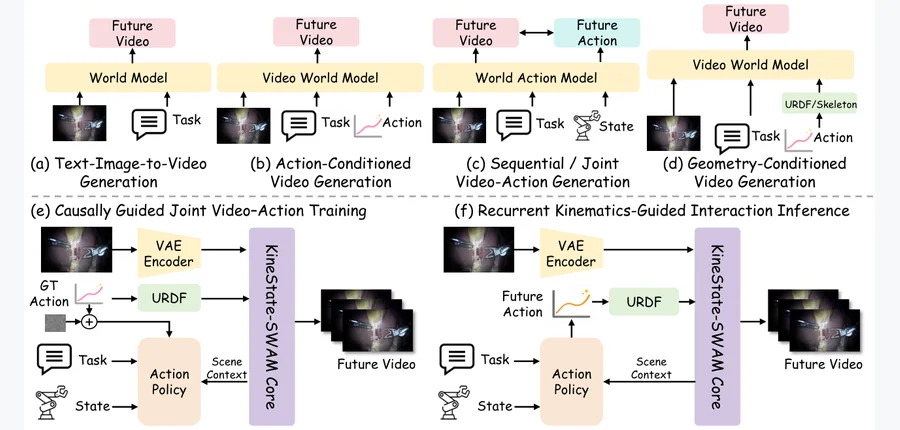 arXiv 2026-11-25 · cs.CV · #19 **[KineState-SWAM: A Surgical World Action Model with Explicit Kinematics and Causal Interaction Dynamics](https://arxiv.org/abs/2611.28871)** [Rulin Zhou , Yujie Ma , Rui Tang , Qiujie Song , Wanhao Liu , Guoheng Ma , Liangjing Shao , An Wang , Hongliang Ren](http… 机构：The Chinese University of Hong Kong / Shenzhen Loop Area Institute / Shenzhen University / The Hong Kong University of Science and Technology (Guangzhou) / Guangdong University of Technology / Southern University of Science and Technology（[PDF](https://arxiv.org/pdf/2611.28871)） [Paper](https://arxiv.org/abs/2611.28871) · [图源](https://arxiv.org/html/2611.28871v1/overview.png) 

中文摘要
现有手术世界模型通常没有显式说明器械运动如何驱动局部组织响应，也没有说明交互历史如何影响后续动作。我们提出 KineState-SWAM，一种通过持续交互状态耦合动作预测和视频生成的手术世界动作模型，将由运动学决定的器械运动与学习得到的场景演化分开。流匹配策略以交互状态、机器人配置和任务指令为条件预测关节轨迹。运动学几何条件化使用标定的 URDF 运动学，将这些轨迹转为表面运动 token 和空间对齐的器械渲染。因果交互动力学通过几何引导注意力和运动对齐特征传输循环更新状态，无需中间视频合成，就把交互历史带入后续动作预测。状态—几何适配器结合依赖状态的空间调制和局部几何残差，指导视频生成。交互感知监督强调器械工作区域附近的组织响应。我们提出 dVRK-Chole5.2k，包含覆盖 17 项手术任务的 5,255 段视频。在匹配动作条件的设置下，实验表明其动作精度和视频保真度优于所评估基线。消融结果支持保留并传输交互状态以进行长时域预测。 <a href="https://arxiv.org/abs/2611.28871">原摘要来源</a>
 | 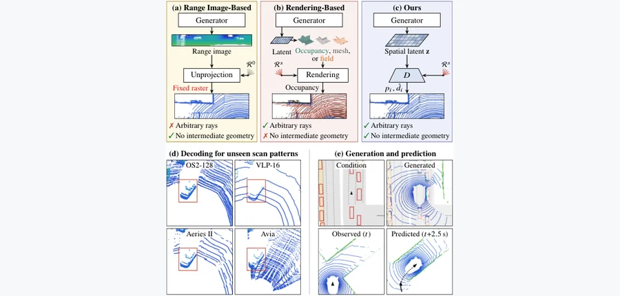 arXiv 2026-11-25 · cs.RO · #20 **[One Latent World for Heterogeneous LiDARs: A Scan Pattern Agnostic 4D World Model via Direct Ray Decoding](https://arxiv.org/abs/2611.30007)** [Minwoo Jung , Dongjae Lee , DongGuw Lee , Yeong Sang Park , Maurice Fallon , Ayoung Kim](https://arxiv.org/abs/2611.30007) 机构：Seoul National University / Korea Institute of Machinery &amp; Materials / University of Oxford（[PDF](https://arxiv.org/pdf/2611.30007)） [Paper](https://arxiv.org/abs/2611.30007) · [图源](https://arxiv.org/html/2611.30007v1/fig1_teaser.png) 

中文摘要
LiDAR 世界模型以 LiDAR 扫描形式生成和预测米制三维观测。它们通常依照训练传感器的扫描模式合成扫描，或从中间三维表面或场渲染。但遵循单一扫描模式会限制迁移到其他模式的 LiDAR；从中间几何渲染则可能产生错误深度和虚假回波。本文提出与扫描模式无关的 4D LiDAR 世界模型，将场景与传感器观测解耦，使位于相同安装位置的异构 LiDAR 无需重新生成场景，就能观测同一空间潜在表示。解码器从潜在表示直接预测每条射线的命中概率与深度，结合全局场景上下文与在初步深度检索的局部特征。无需中间表面或场，它可减少错误深度和虚假回波；每条射线都从同一潜在表示独立解码，因此共享射线的 LiDAR 会得到相同回波，观测到一致场景。最后，扩散 Transformer 在该潜在空间生成场景，并从按给定自车和物体运动变换的已观测潜在表示预测 4D 序列。在 KITTI-360 和 nuScenes 上，模型生成逼真场景，并使预测帧之间的配准误差比最佳对比世界模型降低约 70%。其解码器深度误差比其他世界模型所用渲染低 19%–28%，生成的扫描也有益于多个下游任务。作者表示将开源代码；更多细节见原文链接。 <a href="https://arxiv.org/abs/2611.30007">原摘要来源</a>
 |   |
<!-- PAPER_CARDS_END -->

## 检索概况

- **检索窗口**：北京时间 2026-11-24 09:23 至 2026-11-25 09:06；以 14 个 arXiv 官方分类页的 `New submissions` 为准。
- **官方最新批次**：Tuesday, 24 November 2026；不同于上一期的 Monday, 23 November 2026。
- **总命中／去重／入选**：官方 New 分区共 **1,236 条**，按 arXiv ID 去重后 **1,236 篇**；本期精选 **20 篇**。Cross-lists 与 Replacements 不进入主榜。
- **筛选口径**：逐篇阅读官方列表的标题和完整摘要，优先三维与物理交叉，其次具备具体机器人任务、方法或实验的工作。相关性、阅读优先级、局限和改进建议均为**编辑推断**。
- **缺原摘要／缺图**：0 篇／0 篇（以本期 20 篇入选论文为分母；图片均来自对应官方论文 HTML 或 PDF）。

## 官方 New listing 状态

| 分类页 | listing 日期 | New |
|---|---|---:|
| [cs.CV](https://arxiv.org/list/cs.CV/new?show=2000) | 2026-11-24 | 407 |
| [cs.GR](https://arxiv.org/list/cs.GR/new?show=2000) | 2026-11-24 | 5 |
| [cs.RO](https://arxiv.org/list/cs.RO/new?show=2000) | 2026-11-24 | 161 |
| [cs.AI](https://arxiv.org/list/cs.AI/new?show=2000) | 2026-11-24 | 172 |
| [cs.LG](https://arxiv.org/list/cs.LG/new?show=2000) | 2026-11-24 | 220 |
| [physics.flu-dyn](https://arxiv.org/list/physics.flu-dyn/new?show=2000) | 2026-11-24 | 32 |
| [physics.comp-ph](https://arxiv.org/list/physics.comp-ph/new?show=2000) | 2026-11-24 | 11 |
| [cond-mat.soft](https://arxiv.org/list/cond-mat.soft/new?show=2000) | 2026-11-24 | 8 |
| [cond-mat.mtrl-sci](https://arxiv.org/list/cond-mat.mtrl-sci/new?show=2000) | 2026-11-24 | 49 |
| [eess.IV](https://arxiv.org/list/eess.IV/new?show=2000) | 2026-11-24 | 16 |
| [eess.SP](https://arxiv.org/list/eess.SP/new?show=2000) | 2026-11-24 | 38 |
| [eess.SY](https://arxiv.org/list/eess.SY/new?show=2000) | 2026-11-24 | 39 |
| [math.NA](https://arxiv.org/list/math.NA/new?show=2000) | 2026-11-24 | 52 |
| [stat.ML](https://arxiv.org/list/stat.ML/new?show=2000) | 2026-11-24 | 26 |
| **合计** | — | **1,236** |

## Top papers

| # | 论文 | 分类 | 作者 | 机构（PDF 首页） | 相关性（编辑推断） | 机构强度（编辑推断） | 阅读优先级（编辑推断） |
|---:|---|---|---|---|---|---|---|
| 1 | [ViTrust: Learning 3D Observation Trust for Deformable Physical World Models](https://arxiv.org/abs/2611.28815) | [cs.CV](https://arxiv.org/abs/2611.28815) | [Zhihao Guo , Zhihao Li , Xu Ge , Lijian Zhong , Yu Lu , Haitao Wu , Longqing Zhao , Yue Ma](https://arxiv.org/abs/2611.28815) | Hesai Technology / Shanghai Jiao Tong University / Southeast University（[PDF](https://arxiv.org/pdf/2611.28815)） | 可形变三维物理世界模型 | 未独立评级 | A |
| 2 | [Ride on Anything: Contact-Coupled Monocular 4D Reconstruction of a Rider and Horse in Camera and World Frames](https://arxiv.org/abs/2611.29435) | [cs.CV](https://arxiv.org/abs/2611.29435) | [Zehang Weng , Ci Li](https://arxiv.org/abs/2611.29435) | affiliation 未确认 | 接触约束的单目 4D 重建 | 未独立评级 | A |
| 3 | [Knowing What You Carry: Scalable Physics-Anchored World Models for Robotic Planning with Liquid Payloads](https://arxiv.org/abs/2611.28387) | [cs.RO](https://arxiv.org/abs/2611.28387) | [Yicheng Zhu , Linfeng Tian , Yang Chen , Tao Li , Zilin Bian](https://arxiv.org/abs/2611.28387) | Rochester Institute of Technology / City University of Hong Kong（[PDF](https://arxiv.org/pdf/2611.28387)） | 液体载荷／流固耦合规划 | 未独立评级 | A |
| 4 | [Reconstructing 3D+t Cardiovascular Flow From Sparse Planar Velocity Fields With Neural Fields](https://arxiv.org/abs/2611.30775) | [cs.CV](https://arxiv.org/abs/2611.30775) | [Viraj Patel , Deblina Bhattacharjee , Katharine Fraser](https://arxiv.org/abs/2611.30775) | University of Bath（[PDF](https://arxiv.org/pdf/2611.30775)） | 稀疏平面到三维流场 | 未独立评级 | A |
| 5 | [Learning the Boltzmann Collision Operator with Structural Constraints for Fast Kinetic Simulation](https://arxiv.org/abs/2611.28864) | [math.NA](https://arxiv.org/abs/2611.28864) | [Hao Wang , Zhenning Cai](https://arxiv.org/abs/2611.28864) | National University of Singapore（[PDF](https://arxiv.org/pdf/2611.28864)） | 气体碰撞／结构保持仿真 | 未独立评级 | A |
| 6 | [Lifted Multiple Shooting for Parallel-in-Time Contact-Rich Trajectory Optimization](https://arxiv.org/abs/2611.28512) | [cs.RO](https://arxiv.org/abs/2611.28512) | [Wei-Chen Li , Glen Chou](https://arxiv.org/abs/2611.28512) | Georgia Institute of Technology（[PDF](https://arxiv.org/pdf/2611.28512)） | 接触轨迹优化 | 未独立评级 | A |
| 7 | [Grounded in Contact: Reducing Floating and Interpenetration Artifacts with Multimodal Skill-Effect Models](https://arxiv.org/abs/2611.29662) | [cs.RO](https://arxiv.org/abs/2611.29662) | [Siyeon Kim , Mohanraj Devendran Shanthi , Joseph C. Liechty , Tucker Hermans](https://arxiv.org/abs/2611.29662) | University of Utah / NVIDIA Research（[PDF](https://arxiv.org/pdf/2611.29662)） | 点云条件接触结果分布 | 未独立评级 | A |
| 8 | [DexDuet: Learning Contact-Preserving Bimanual Dexterity from Human Demonstrations](https://arxiv.org/abs/2611.30495) | [cs.RO](https://arxiv.org/abs/2611.30495) | [Haoran Zhang , Haokai Ding , Han Zhou , Zuxing Lu , Heng Zhang , Xingxing Zuo](https://arxiv.org/abs/2611.30495) | Mohamed bin Zayed University of Artificial Intelligence / Motphys（[PDF](https://arxiv.org/pdf/2611.30495)） | 保持人手接触的双手灵巧操作 | 未独立评级 | A |
| 9 | [DexLatentWorld: 3D Cross-Embodiment Latent Action World Models for Zero-Shot Robotic Manipulation](https://arxiv.org/abs/2611.30907) | [cs.RO](https://arxiv.org/abs/2611.30907) | [Vinay Udit Mohan , Xuchuan Huang , Rolandos Alexandros Potamias](https://arxiv.org/abs/2611.30907) | Imperial College London（[PDF](https://arxiv.org/pdf/2611.30907)） | 跨形态三维潜在动作世界模型 | 未独立评级 | A |
| 10 | [PhysPPF: Learning Robotic Manipulation with Past, Present, and Future Physical Representations](https://arxiv.org/abs/2611.28551) | [cs.RO](https://arxiv.org/abs/2611.28551) | [Junjie Li , Dawei Yan , Guoting Wei , Ruike Song , Lu Wang , Qingguo Chen , Zhenbo Luo , Haokui Zhang , Chunhua Shen](https://arxiv.org/abs/2611.28551) | Northwestern Polytechnical University / Alibaba Cloud Computing / Xiaomi Inc / Zhejiang University（[PDF](https://arxiv.org/pdf/2611.28551)） | 三维物理 token 机器人策略 | 未独立评级 | A |
| 11 | [VeriTouch: Verified Visuo-Tactile World Models that Improve Robot Policy Learning](https://arxiv.org/abs/2611.30572) | [cs.RO](https://arxiv.org/abs/2611.30572) | [Shuxun Wang , Xiaonan Jiang , Zhaoyu Wang , Ziyuan Chu , Xihang Yue , Pengfei Liu , Haodong Zhu , Shiqi Liu , Mingzhi Zheng , Liang Su , Linchao Zhu](https://arxiv.org/abs/2611.30572) | Zhejiang University / City University of Hong Kong / Nanyang Technological University / Technical University of Munich / Zhejiang University City College / Nanjing University / Hangzhou Institute for Advanced Study, UCAS（[PDF](https://arxiv.org/pdf/2611.30572)） | 视觉—触觉世界模型 | 未独立评级 | A |
| 12 | [RoboAda: Adapting Frozen Robot Policies at Test Time to Physics They Cannot See](https://arxiv.org/abs/2611.30209) | [cs.RO](https://arxiv.org/abs/2611.30209) | [Yunbei Zhang , Zijian Jin , Shuaicheng Niu , Baian Chen , Weirui Ye , Jihun Hamm , Yilun Du](https://arxiv.org/abs/2611.30209) | Tulane University / New York University / Nanyang Technological University / MIT / Harvard University（[PDF](https://arxiv.org/pdf/2611.30209)） | 不可见物理变化的测试时适配 | 未独立评级 | A |
| 13 | [VTLA-RL: Learning Visuotactile Policies for Load-Adaptive Grasping](https://arxiv.org/abs/2611.28752) | [cs.RO](https://arxiv.org/abs/2611.28752) | [Qiwei Wu , Qixuan Li , Xin Xiang , Xiangyu Chen , Xiang Xiao , Daochen Shi , Ruihua Zhang , Renjing Xu](https://arxiv.org/abs/2611.28752) | The Hong Kong University of Science and Technology (Guangzhou) / NVIDIA（[PDF](https://arxiv.org/pdf/2611.28752)） | 变载荷视觉—触觉抓取 | 未独立评级 | A |
| 14 | [Distilling Touch into Vision-Only Policies for Contact-Rich Manipulation](https://arxiv.org/abs/2611.28697) | [cs.RO](https://arxiv.org/abs/2611.28697) | [Chen Yang , Linhao Wang , Linzhe Shi , Guohui Zhang , Changjie Wu , Hang Zhang , Haoyu Li , Mu Xu , Jiansheng Fan , Chen Wang](https://arxiv.org/abs/2611.28697) | Tsinghua University / Amap, Alibaba Group（[PDF](https://arxiv.org/pdf/2611.28697)） | 触觉行为到纯视觉策略的蒸馏 | 未独立评级 | A |
| 15 | [Force2Act: A Force-Aware Visuomotor Policy for Generalizable Compliant Robot Manipulation](https://arxiv.org/abs/2611.29208) | [cs.RO](https://arxiv.org/abs/2611.29208) | [Keerthi Vasan Murugan , Fangguo Zhao , Jiafei Duan](https://arxiv.org/abs/2611.29208) | National University of Singapore / Zhejiang University（[PDF](https://arxiv.org/pdf/2611.29208)） | 力调节与柔顺操作 | 未独立评级 | A |
| 16 | [Dynamic Gaussian Scene Reconstruction by Integrating Events and Structural Priors](https://arxiv.org/abs/2611.29920) | [cs.CV](https://arxiv.org/abs/2611.29920) | [Zihao Yu , Guozhen Liu , Jie Yan , Jialiang Liu , Panlong Tan , Qinglin Sun , Hao Sun](https://arxiv.org/abs/2611.29920) | Nankai University / Haihe Laboratory of Information Technology Application Innovation（[PDF](https://arxiv.org/pdf/2611.29920)） | 事件驱动动态 Gaussian 重建 | 未独立评级 | B |
| 17 | [FastD4RT: Training-Free Acceleration of Dynamic 4D Reconstruction and Tracking](https://arxiv.org/abs/2611.28193) | [cs.CV](https://arxiv.org/abs/2611.28193) | [Meng Bi , Yili Jin , Kaiyuan Hu , Xize Duan , Jiaxin Huang , Hong Huang , Xue Liu](https://arxiv.org/abs/2611.28193) | Mohamed bin Zayed University of Artificial Intelligence / MirrorSpace / McGill University / City University of Hong Kong（[PDF](https://arxiv.org/pdf/2611.28193)） | 动态 4D 重建加速 | 未独立评级 | B |
| 18 | [Superellipse Function: A Powerful Geometric Tool for the Design and Deformation Modeling of Tendon-Driven Continuum Manipulators With Flexural Patterns Experiencing Tension Loss](https://arxiv.org/abs/2611.29801) | [cs.RO](https://arxiv.org/abs/2611.29801) | [Yang Liu , Farshid Alambeigi](https://arxiv.org/abs/2611.29801) | University of Texas at Austin / Rice University / Houston Methodist Research Institute（[PDF](https://arxiv.org/pdf/2611.29801)） | 连续体机械臂几何与摩擦形变 | 未独立评级 | B |
| 19 | [KineState-SWAM: A Surgical World Action Model with Explicit Kinematics and Causal Interaction Dynamics](https://arxiv.org/abs/2611.28871) | [cs.CV](https://arxiv.org/abs/2611.28871) | [Rulin Zhou , Yujie Ma , Rui Tang , Qiujie Song , Wanhao Liu , Guoheng Ma , Liangjing Shao , An Wang , Hongliang Ren](https://arxiv.org/abs/2611.28871) | The Chinese University of Hong Kong / Shenzhen Loop Area Institute / Shenzhen University / The Hong Kong University of Science and Technology (Guangzhou) / Guangdong University of Technology / Southern University of Science and Technology（[PDF](https://arxiv.org/pdf/2611.28871)） | 几何约束的手术世界动作模型 | 未独立评级 | B |
| 20 | [One Latent World for Heterogeneous LiDARs: A Scan Pattern Agnostic 4D World Model via Direct Ray Decoding](https://arxiv.org/abs/2611.30007) | [cs.RO](https://arxiv.org/abs/2611.30007) | [Minwoo Jung , Dongjae Lee , DongGuw Lee , Yeong Sang Park , Maurice Fallon , Ayoung Kim](https://arxiv.org/abs/2611.30007) | Seoul National University / Korea Institute of Machinery & Materials / University of Oxford（[PDF](https://arxiv.org/pdf/2611.30007)） | 异构 LiDAR 的 4D 世界模型 | 未独立评级 | B |

## 逐篇中文要点

### 1. [ViTrust: Learning 3D Observation Trust for Deformable Physical World Models](https://arxiv.org/abs/2611.28815)

- **论文事实／方法**：以视觉—接触可信度适配器为跟踪点赋予时变权重，与物理参数一起优化。（[原摘要](https://arxiv.org/abs/2611.28815)）
- **论文事实／结果**：真实序列的未来预测优于所评估基线；还展示了新控制和跨物体迁移。（[原摘要](https://arxiv.org/abs/2611.28815)）
- **编辑推断／局限与改进**：应检验稀疏接触、错误跟踪和未知材料下的参数可辨识性。

### 2. [Ride on Anything: Contact-Coupled Monocular 4D Reconstruction of a Rider and Horse in Camera and World Frames](https://arxiv.org/abs/2611.29435)

- **论文事实／方法**：联合优化骑手与马匹网格，使用非封闭网格适用的绕数碰撞项。（[原摘要](https://arxiv.org/abs/2611.29435)）
- **论文事实／结果**：座位间隙由 15 降至 1 厘米，但轮廓 IoU 从 0.59 降至 0.52。（[原摘要](https://arxiv.org/abs/2611.29435)）
- **编辑推断／局限与改进**：需要带三维真值的标定录像，检验隐面穿透与视觉拟合的取舍。

### 3. [Knowing What You Carry: Scalable Physics-Anchored World Models for Robotic Planning with Liquid Payloads](https://arxiv.org/abs/2611.28387)

- **论文事实／方法**：以 GPU 并行 FLIP—多体仿真为参照，学习晃荡先验、隐藏液体状态与残差。（[原摘要](https://arxiv.org/abs/2611.28387)）
- **论文事实／结果**：在标准罐体的近侧翻情形未选择可避免的不安全方案；宽罐体错误约减半。（[原摘要](https://arxiv.org/abs/2611.28387)）
- **编辑推断／局限与改进**：应评估罐体形状、填充率和传感延迟超出训练范围时的安全裕度。

### 4. [Reconstructing 3D+t Cardiovascular Flow From Sparse Planar Velocity Fields With Neural Fields](https://arxiv.org/abs/2611.30775)

- **论文事实／方法**：用逐平面投影的神经场恢复连续 3D+t 速度，并比较物理约束。（[原摘要](https://arxiv.org/abs/2611.30775)）
- **论文事实／结果**：主动脉 PC-SIREN rRMSE 0.3756，动脉瘤上普通 MLP 反而更好。（[原摘要](https://arxiv.org/abs/2611.30775)）
- **编辑推断／局限与改进**：宜按流型自适应选择物理损失，避免错误约束损害精度。

### 5. [Learning the Boltzmann Collision Operator with Structural Constraints for Fast Kinetic Simulation](https://arxiv.org/abs/2611.28864)

- **论文事实／方法**：神经算子保留增益—损失结构，并施加守恒、熵修正和 Maxwellian 零点。（[原摘要](https://arxiv.org/abs/2611.28864)）
- **论文事实／结果**：常数碰撞核实验显示有利的精度成本取舍，且无需重训用于三类流动求解器。（[原摘要](https://arxiv.org/abs/2611.28864)）
- **编辑推断／局限与改进**：应检验非恒定核和极端非平衡分布下的结构保持与误差。

### 6. [Lifted Multiple Shooting for Parallel-in-Time Contact-Rich Trajectory Optimization](https://arxiv.org/abs/2611.28512)

- **论文事实／方法**：把接触冲量提升为变量，并用时间并行内点求解器规划长时域。（[原摘要](https://arxiv.org/abs/2611.28512)）
- **论文事实／结果**：六项动态接触任务中，成功率最多增加 81.5 个百分点，速度最多提升 3.1 倍。（[原摘要](https://arxiv.org/abs/2611.28512)）
- **编辑推断／局限与改进**：应报告接触模型误差与摩擦系数偏差下的稳健性。

### 7. [Grounded in Contact: Reducing Floating and Interpenetration Artifacts with Multimodal Skill-Effect Models](https://arxiv.org/abs/2611.29662)

- **论文事实／方法**：从局部点云和动作学习多模态的物体位姿变化，用于技能效果规划。（[原摘要](https://arxiv.org/abs/2611.29662)）
- **论文事实／结果**：流匹配在每个多步序列取得最高成功率；真实机器人拾取约为确定性基线的两倍。（[原摘要](https://arxiv.org/abs/2611.29662)）
- **编辑推断／局限与改进**：可校准各结果模态的概率，并测试罕见接触模式。

### 8. [DexDuet: Learning Contact-Preserving Bimanual Dexterity from Human Demonstrations](https://arxiv.org/abs/2611.30495)

- **论文事实／方法**：以交互奖励和共享权重双手策略，从单次示范保持接触配置。（[原摘要](https://arxiv.org/abs/2611.30495)）
- **论文事实／结果**：四个基准的 ADD-AUC 提高 11–41 点；122 组配对运行中 117 组接触更好。（[原摘要](https://arxiv.org/abs/2611.30495)）
- **编辑推断／局限与改进**：应将接触保持与任务成功、真实手部摩擦变化共同评估。

### 9. [DexLatentWorld: 3D Cross-Embodiment Latent Action World Models for Zero-Shot Robotic Manipulation](https://arxiv.org/abs/2611.30907)

- **论文事实／方法**：从人类操作点云学跨形态潜在动作，并在该空间进行 MPC。（[原摘要](https://arxiv.org/abs/2611.30907)）
- **论文事实／结果**：未见灵巧手在五项真实任务的 50 次试验中成功率为 86%。（[原摘要](https://arxiv.org/abs/2611.30907)）
- **编辑推断／局限与改进**：需比较重定向误差和未见物体几何对零样本控制的影响。

### 10. [PhysPPF: Learning Robotic Manipulation with Past, Present, and Future Physical Representations](https://arxiv.org/abs/2611.28551)

- **论文事实／方法**：以 WWH token 表示结构、交互位置和接近方式，结合过去—当前—未来物理记忆。（[原摘要](https://arxiv.org/abs/2611.28551)）
- **论文事实／结果**：相比 StarVLA，在 SimplerEnv、CALVIN、LIBERO 分别提高 17.2、29.3、3.5 点。（[原摘要](https://arxiv.org/abs/2611.28551)）
- **编辑推断／局限与改进**：应独立测试接触定位误差与长时域记忆失配。

### 11. [VeriTouch: Verified Visuo-Tactile World Models that Improve Robot Policy Learning](https://arxiv.org/abs/2611.30572)

- **论文事实／方法**：联合生成双视角视频与触觉序列，再验证接触力和时间对齐。（[原摘要](https://arxiv.org/abs/2611.30572)）
- **论文事实／结果**：五项真实任务上，合成数据改善了全部四种所评估策略。（[原摘要](https://arxiv.org/abs/2611.30572)）
- **编辑推断／局限与改进**：应避免验证器共享生成器偏差，加入独立实测接触检验。

### 12. [RoboAda: Adapting Frozen Robot Policies at Test Time to Physics They Cannot See](https://arxiv.org/abs/2611.30209)

- **论文事实／方法**：利用逆动力学从执行运动获取自监督标签，加权比较机器人响应假设。（[原摘要](https://arxiv.org/abs/2611.30209)）
- **论文事实／结果**：11 类物理变化下，五种冻结策略平均成功率从 27.8% 升至 62.9%。（[原摘要](https://arxiv.org/abs/2611.30209)）
- **编辑推断／局限与改进**：需测试误差反馈延迟和非平稳变化时的错误补偿风险。

### 13. [VTLA-RL: Learning Visuotactile Policies for Load-Adaptive Grasping](https://arxiv.org/abs/2611.28752)

- **论文事实／方法**：共享视觉编码器输入 RGB 与触觉历史，输出运动和双侧力目标并进行仿真 RL 后训练。（[原摘要](https://arxiv.org/abs/2611.28752)）
- **论文事实／结果**：完整方法的抓取成功率高于监督初始化；不同 RL 路径收益不同。（[原摘要](https://arxiv.org/abs/2611.28752)）
- **编辑推断／局限与改进**：应分离质量估计、滑移识别和控制调节的贡献。

### 14. [Distilling Touch into Vision-Only Policies for Contact-Rich Manipulation](https://arxiv.org/abs/2611.28697)

- **论文事实／方法**：冻结视觉—触觉教师，在相同噪声和流时间下蒸馏动作表示。（[原摘要](https://arxiv.org/abs/2611.28697)）
- **论文事实／结果**：仿真和真实任务的平均成功率相对纯视觉分别绝对增加 16.0% 和 22.5%。（[原摘要](https://arxiv.org/abs/2611.28697)）
- **编辑推断／局限与改进**：可检验部署场景的隐藏触觉状态能否由历史视觉充分辨识。

### 15. [Force2Act: A Force-Aware Visuomotor Policy for Generalizable Compliant Robot Manipulation](https://arxiv.org/abs/2611.29208)

- **论文事实／方法**：动作块级全局力规划与控制步级反应式力专家协同。（[原摘要](https://arxiv.org/abs/2611.29208)）
- **论文事实／结果**：仿真总成功率 93.8% 对比最强基线 77.0%；真实四任务平均 94.2%。（[原摘要](https://arxiv.org/abs/2611.29208)）
- **编辑推断／局限与改进**：需报告力传感噪声和新材料刚度下的闭环稳定性。

### 16. [Dynamic Gaussian Scene Reconstruction by Integrating Events and Structural Priors](https://arxiv.org/abs/2611.29920)

- **论文事实／方法**：以事件补足快速运动区域的 Gaussian 支撑，传播可靠运动并预测有界残差。（[原摘要](https://arxiv.org/abs/2611.29920)）
- **论文事实／结果**：相对 E-D3DGS，真实场景动态区域 dPSNR 提高 1.45 dB；帧率下降约 21%–25%。（[原摘要](https://arxiv.org/abs/2611.29920)）
- **编辑推断／局限与改进**：应核对事件噪声和深度失效区域对增密的影响。

### 17. [FastD4RT: Training-Free Acceleration of Dynamic 4D Reconstruction and Tracking](https://arxiv.org/abs/2611.28193)

- **论文事实／方法**：只编码与解码稀疏时空锚点，复用跨查询共享的解码 token。（[原摘要](https://arxiv.org/abs/2611.28193)）
- **论文事实／结果**：在所测任务上平均加速约五倍，长视频精度进一步改善。（[原摘要](https://arxiv.org/abs/2611.28193)）
- **编辑推断／局限与改进**：应在高频接触或突变运动场景检验插值误差。

### 18. [Superellipse Function: A Powerful Geometric Tool for the Design and Deformation Modeling of Tendon-Driven Continuum Manipulators With Flexural Patterns Experiencing Tension Loss](https://arxiv.org/abs/2611.29801)

- **论文事实／方法**：以超椭圆参数化柔性图案，并建模腱摩擦、拉力损失与形变。（[原摘要](https://arxiv.org/abs/2611.29801)）
- **论文事实／结果**：摘要报告了多种仿真和实物实验，但未给出定量误差数值。（[原摘要](https://arxiv.org/abs/2611.29801)）
- **编辑推断／局限与改进**：应与常见截面参数化在相同制造约束下比较设计敏感度。

### 19. [KineState-SWAM: A Surgical World Action Model with Explicit Kinematics and Causal Interaction Dynamics](https://arxiv.org/abs/2611.28871)

- **论文事实／方法**：用显式 URDF 运动学和持续交互状态耦合动作与局部组织响应。（[原摘要](https://arxiv.org/abs/2611.28871)）
- **论文事实／结果**：发布覆盖 17 项任务的 5,255 段视频；匹配设置下动作与视频指标优于对比方法。（[原摘要](https://arxiv.org/abs/2611.28871)）
- **编辑推断／局限与改进**：需测试工具标定误差和不同组织接触动力学的迁移。

### 20. [One Latent World for Heterogeneous LiDARs: A Scan Pattern Agnostic 4D World Model via Direct Ray Decoding](https://arxiv.org/abs/2611.30007)

- **论文事实／方法**：从同一空间潜在表示直接逐射线解码命中率与深度。（[原摘要](https://arxiv.org/abs/2611.30007)）
- **论文事实／结果**：预测帧配准误差相对最佳对比世界模型降低约 70%，深度误差低 19%–28%。（[原摘要](https://arxiv.org/abs/2611.30007)）
- **编辑推断／局限与改进**：应检验安装位姿变化和稀疏扫描时共享潜在场景的一致性。

## 今日最值得细读的 5 篇

- [ViTrust: Learning 3D Observation Trust for Deformable Physical World Models](https://arxiv.org/abs/2611.28815)：可形变三维物理世界模型。
- [Ride on Anything: Contact-Coupled Monocular 4D Reconstruction of a Rider and Horse in Camera and World Frames](https://arxiv.org/abs/2611.29435)：接触约束的单目 4D 重建。
- [Knowing What You Carry: Scalable Physics-Anchored World Models for Robotic Planning with Liquid Payloads](https://arxiv.org/abs/2611.28387)：液体载荷／流固耦合规划。
- [Reconstructing 3D+t Cardiovascular Flow From Sparse Planar Velocity Fields With Neural Fields](https://arxiv.org/abs/2611.30775)：稀疏平面到三维流场。
- [Learning the Boltzmann Collision Operator with Structural Constraints for Fast Kinetic Simulation](https://arxiv.org/abs/2611.28864)：气体碰撞／结构保持仿真。

## 低算力可改进方向（编辑推断）

以下建议属于方法级假设，并非论文已有实验或已验证收益。

### [ViTrust: Learning 3D Observation Trust for Deformable Physical World Models](https://arxiv.org/abs/2611.28815)

- **方法改法**：将可信度权重分解为视觉噪声项与接触信息增益项，并加入权重校准约束。
- **可执行小实验**：在小型软体物体序列上人为删除接触点、扰动跟踪点，再比较参数误差和未来轨迹误差。
- **低算力原因**：只微调权重适配器与少量物理参数。
- **预期收益与风险（推断）**：提高弱观测下的辨识稳定性；错误接触图可能使权重系统性偏移。

### [Ride on Anything: Contact-Coupled Monocular 4D Reconstruction of a Rider and Horse in Camera and World Frames](https://arxiv.org/abs/2611.29435)

- **方法改法**：把座位接触约束改为具有不确定度的软约束，并显式约束隐面穿透。
- **可执行小实验**：选几段单目骑乘片段，逐级调节遮挡比例，测座位间隙、穿透及轮廓 IoU。
- **低算力原因**：冻结原估计器，仅优化少量位姿变量。
- **预期收益与风险（推断）**：减少几何纠正对可见轮廓的损伤；估计器错位时软约束仍可能收敛到错误接触。

### [Knowing What You Carry: Scalable Physics-Anchored World Models for Robotic Planning with Liquid Payloads](https://arxiv.org/abs/2611.28387)

- **方法改法**：给晃荡模态状态增加基于车辆历史的置信区间，按上界筛除近侧翻候选。
- **可执行小实验**：用简化二维液罐与车辆模型扫描填充率、急转弯频率，比较不安全方案选择次数。
- **低算力原因**：低阶模型和小批量仿真即可先验证。
- **预期收益与风险（推断）**：用少量算力改善安全边界校准；过保守会降低行驶效率。

### [Reconstructing 3D+t Cardiovascular Flow From Sparse Planar Velocity Fields With Neural Fields](https://arxiv.org/abs/2611.30775)

- **方法改法**：按局部流动的残差自适应门控连续性和动量约束。
- **可执行小实验**：在开源二维/三维简化流场上模拟稀疏平面采样，对比固定物理权重与门控方案。
- **低算力原因**：小型 SIREN 与少量采样平面即可运行。
- **预期收益与风险（推断）**：保留主动脉收益同时避免动脉瘤劣化；残差估计自身可能受测量噪声干扰。

### [Learning the Boltzmann Collision Operator with Structural Constraints for Fast Kinetic Simulation](https://arxiv.org/abs/2611.28864)

- **方法改法**：在碰撞核近似头后加入逐样本守恒投影与可检验的熵修正强度。
- **可执行小实验**：用二维速度网格测试平滑和激波初值，记录守恒误差、熵变化和耗时。
- **低算力原因**：低维网格足以检验结构约束。
- **预期收益与风险（推断）**：为轻量算子提供物理失效边界；投影可能牺牲局部精度。

### [Grounded in Contact: Reducing Floating and Interpenetration Artifacts with Multimodal Skill-Effect Models](https://arxiv.org/abs/2611.29662)

- **方法改法**：在流匹配的多模态输出上加接触模式概率校准头。
- **可执行小实验**：用少量推、抓、放点云数据，比较模态覆盖率、负对数似然及规划成功率。
- **低算力原因**：冻结点云编码器，仅训练轻量输出头。
- **预期收益与风险（推断）**：降低罕见结果被低估的风险；模式标签难从轨迹稳定划分。

### [RoboAda: Adapting Frozen Robot Policies at Test Time to Physics They Cannot See](https://arxiv.org/abs/2611.30209)

- **方法改法**：为测试时命令修正加入变化检测门控和置信区间。
- **可执行小实验**：在简化机械臂仿真中插入关节延迟与目标偏移，比较误触发率和恢复时间。
- **低算力原因**：冻结策略，仅更新小型响应假设权重。
- **预期收益与风险（推断）**：减少未变化场景中的错误适配；变化过快时置信更新可能滞后。

### [Dynamic Gaussian Scene Reconstruction by Integrating Events and Structural Priors](https://arxiv.org/abs/2611.29920)

- **方法改法**：将事件驱动增密改为深度置信度与运动边界联合门控。
- **可执行小实验**：在 E-D3DGS 小场景中加入事件噪声和深度缺口，比较 dPSNR、Gaussian 数与 FPS。
- **低算力原因**：只改增密规则，不重训大型模型。
- **预期收益与风险（推断）**：避免噪声诱发的冗余 Gaussian；深度缺口附近真实运动可能被漏检。

本期筛出 8 篇适合明确小实验的低算力方向；其余论文暂不强行提出低算力改法。

## Replacement 单列

本轮未将未经逐版内容对比的 Replacement 认定为重大更新；主榜仅含上述官方 New submissions。
