# 2026-11-26 arXiv 每日论文订阅摘要

<!-- PAPER_CARDS_START -->
## 论文卡片

按原日报排名展示；点击标题或 Paper 查看原文，详细中文分析见下方。

| 论文 | 论文 | 论文 |
|---|---|---|
| 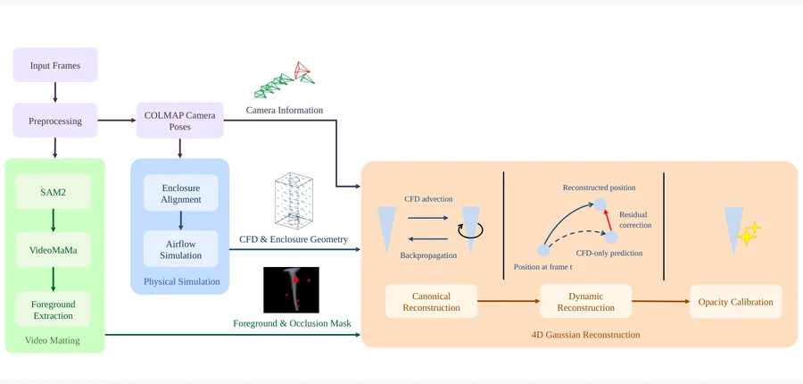 arXiv 2026-11-26 · cs.CV · #1 **[Tornado4D: Physics-Guided 4D Gaussian Reconstruction of a Laboratory Tornado from Sparse One-Sided Videos](https://arxiv.org/abs/2611.31435)** [Yucheng Zhu , Maria J. Molina , Christopher Metzler](https://arxiv.org/abs/2611.31435) 机构：University of Maryland, College Park（[PDF](https://arxiv.org/pdf/2611.31435)） [Paper](https://arxiv.org/abs/2611.31435) · [图源](https://arxiv.org/html/2611.31435v1/method_overview.png) 

中文摘要
刻画龙卷风在时空中的演化，对于理解和应对这种破坏性天气事件至关重要。为此，我们开发从稀疏单侧视频生成实验室烟雾龙卷风时变三维重建的算法。即使在受控环境中，重建也严重欠约束：外观随视角变化，运动非刚性，未观测体积可能对应多种几何形状。我们提出 Tornado4D，一种从稀疏单侧视频重建实验室龙卷风的物理引导四维 Gaussian 框架。它利用围挡几何知识引入旋转气流场先验，约束三维结构的时间演化，从而恢复原本不可见的结构。我们在留出的相机视角上以新视角合成精度评估重建；Tornado4D 明显优于逐帧 3DGS 和基于视频的 4DGS。 <a href="https://arxiv.org/abs/2611.31435">原摘要来源</a>
 | 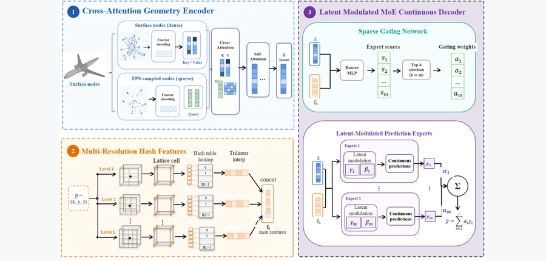 arXiv 2026-11-26 · eess.IV · #2 **[GeoCANO: A Geometry-Conditioned Adaptive Neural Operator for Physical-Field Prediction on Varying Domains](https://arxiv.org/abs/2611.31274)** [Biao Chen , Xinrui Zhou , Xianlin Jin , Jing Wang , Jifa Zhang , Chen Zhai , Wei Liu , Miao Zhang](https://arxiv.org/abs/… 机构：Shanghai Jiao Tong University / Huawei Technologies / Zhejiang University / Shanghai Aircraft Design and Research Institute（[PDF](https://arxiv.org/pdf/2611.31274)） [Paper](https://arxiv.org/abs/2611.31274) · [图源](https://arxiv.org/html/2611.31274v1/framework.png) 

中文摘要
工业设计需要反复评估候选构型。整体性能指标无法解析关键局部现象，而高保真仿真成本仍高。现有物理场代理模型常借助预设网格拓扑将几何表示与坐标求值耦合，限制了跨分辨率复用。我们提出几何条件自适应神经算子 GeoCANO，将采样得到的完整三维几何映射为依赖坐标的场函数。基于注意力的编码器从无序表面坐标提取几何状态；多分辨率轴分解哈希编码和逐查询稀疏专家混合解码器增强多尺度表达。GeoCANO 在引入输出坐标之前构建场表示，因此同一几何编码可跨区域复用，无须为每种输出拓扑重建图。我们用包含 10,484 种翼身短舱几何的雷诺平均 Navier–Stokes 数据集，评估完整飞机构型的跨声速气动场预测。对于采样设计族内未见过的构型，GeoCANO 在完整表面预测、高梯度压力重建和压力阻力恢复上优于基线；压力系数平均绝对误差相对最强基线降低 77.9%，并在有限的壁面法向距离范围内保持优势。消融表明，几何调制坐标编码以明显更少的参数达到与常规三维哈希编码相近的精度；路由分析显示空间结构化、随查询变化的专家分工。这些结果展示了可用于不同几何快速物理场评估的可复用连续坐标表示。 <a href="https://arxiv.org/abs/2611.31274">原摘要来源</a>
 | 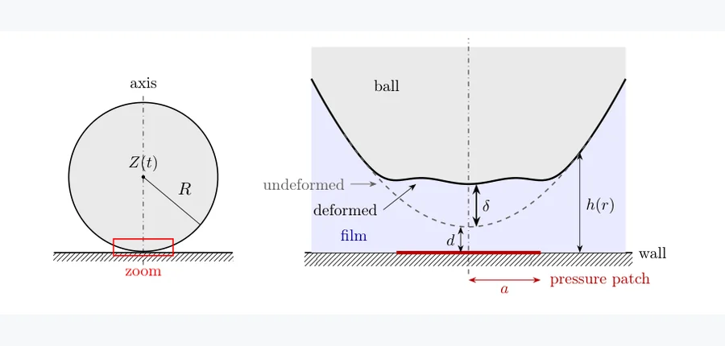 arXiv 2026-11-26 · physics.flu-dyn · #3 **[Elastic rebound in viscous fluid: an efficient rigid--elastic splitting with an asymptotic gap model](https://arxiv.org/abs/2611.32010)** [Thomas Richter](https://arxiv.org/abs/2611.32010) 机构：Otto von Guericke University Magdeburg（[PDF](https://arxiv.org/pdf/2611.32010)） [Paper](https://arxiv.org/abs/2611.32010) · [图源](https://arxiv.org/pdf/2611.32010) 

中文摘要
我们构建并检验一个模型：弹性物体在重力作用下落向充满黏性不可压流体的容器底部，并在没有拓扑接触的情况下反弹。物体表示为刚体加由固定柔度算子描述的微小准静态弹性形变。近接触区域的薄流体膜由含空化的 Reynolds 方程描述，因此可以使用无需解析狭窄间隙的粗网格，实现高效仿真。流体膜与弹性表面位移、刚体法向运动隐式耦合；主体流体与刚体整体耦合。对于仅作竖直平移的轴对称情形，耦合步精确化为关于膜压力的小型稠密非线性问题，主体流体通过 2×2 仿射映射消去。模型在 NGSolve 中实现，并与 Hagemeier 等（2021）的实验和 Wahl 等（2021a）的 Eulerian 流固耦合仿真比较。对于 PTFE 球，该方法与 Eulerian FSI 的差异为 1%；对于软橡胶球（St 约 120），纯弹性模型给出的反弹约为实测值三倍。材料阻尼是最重要的缺失效应：损耗因子 tanδ=0.6 的 Kelvin–Voigt 柔度给出 4.0 mm，而实测为 4.4 mm。模型的平面版本还与 Corti 等（2026）最近发表的二维基准比较。流体膜区域半径是该分解方法唯一的数值参数；它通过基于干接触 Hertz 估计的一条先验规则为所有构型确定，结果对其不太敏感。 <a href="https://arxiv.org/abs/2611.32010">原摘要来源</a>
 |
| 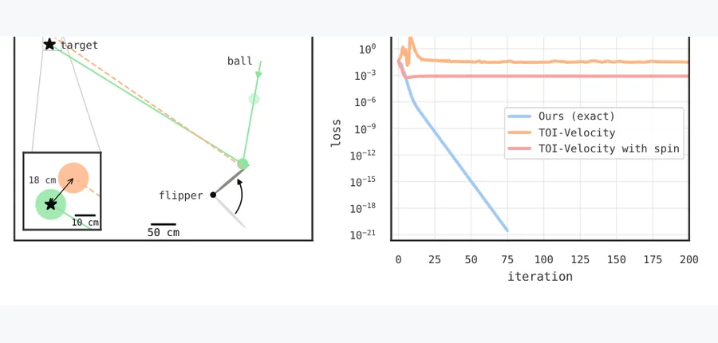 arXiv 2026-11-26 · cs.RO · #4 **[Exact Collision Gradients for Ellipsoids in Differentiable Simulation](https://arxiv.org/abs/2611.31676)** [Shamak Dutta , Biswadip Dey](https://arxiv.org/abs/2611.31676) 机构：Meta（[PDF](https://arxiv.org/pdf/2611.31676)） [Paper](https://arxiv.org/abs/2611.31676) · [图源](https://arxiv.org/pdf/2611.31676) 

中文摘要
可微仿真支持对包含碰撞的学习与控制问题进行梯度优化，但在速度突变的撞击瞬间，梯度最不可靠。固定步长仿真器通常在物体相互穿透后才发现碰撞，一些可微仿真器通过线性估计撞击时间来修正。本文研究椭球体之间的撞击，表明这种估计的梯度误差会随碰撞斜度、接触处曲率和时间步长增大而增长，忽略自旋还会增加误差。随后，我们在 Perram–Wertheim 接触函数上进行连续碰撞检测以找到撞击时间，并对接触条件而非搜索过程求导，从而在任意步长下获得精确梯度。我们在最优控制和系统辨识问题上验证该方法：两者中精确梯度都恢复了最优控制和真实参数，而线性估计即使考虑自旋也未做到。 <a href="https://arxiv.org/abs/2611.31676">原摘要来源</a>
 | 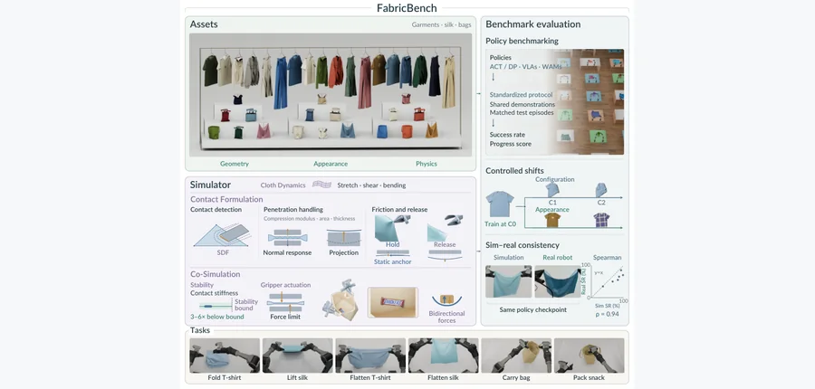 arXiv 2026-11-26 · cs.RO · #5 **[FabricBench: A Standardized Policy Benchmark for Bimanual Fabric Manipulation with a Contact-Driven Deformable Simulator](https://arxiv.org/abs/2611.31577)** [Wenkang Hu , Haoran Wang , Liu Liu , Wenchao Huang , Yiji Chen , Mengao Zhao , Xincheng Tang , Zhengjie Shu , Lai Jiang… 机构：Shanghai Jiao Tong University / Horizon Robotics / Style3D Research（[PDF](https://arxiv.org/pdf/2611.31577)） [Paper](https://arxiv.org/abs/2611.31577) · [Project](https://fabricbench.github.io/) · [图源](https://arxiv.org/html/2611.31577v1/overview_fabricbench.png) 

中文摘要
布料操作中的几何变化、自遮挡和接触给机器人策略带来挑战，而标准化评测仍主要针对刚体。我们提出 FabricBench，包含服装、丝绸和袋子等六项双手布料操作任务、10,000 个可用于仿真的资产，以及对构型和外观泛化的受控测试。其仿真器基于 Newton 中的开源求解器，通过接触力实现稳定的双手抓取、保持和释放，无需人为附着。重新设计的布料—刚体接触和双向力耦合支持机器人手臂、布料与自由刚体相互作用，使袋子能承载内容物并将其重量传给夹爪。在受控的抓取—保持—释放评估中，求解器在全部 45 次试验中成功，而所测试基线配置均未成功。对包括 VLA 和世界动作模型在内的六种代表策略的评测显示仍有明显挑战：最好策略的平均成功率为 77%，但长时域 T 恤折叠任务没有策略超过 36%。在形变最严重的初始 T 恤构型下，各策略成功率降至 6–14%，降幅大于所评估的外观变化。π0.5 在真实机器人上的零样本部署基本保留六项任务的难度排序（Spearman ρ=0.94）。这些结果使 FabricBench 成为测量布料操作能力、揭示构型泛化局限的可复现测试平台。论文还提供项目网站。 <a href="https://arxiv.org/abs/2611.31577">原摘要来源</a>
 | 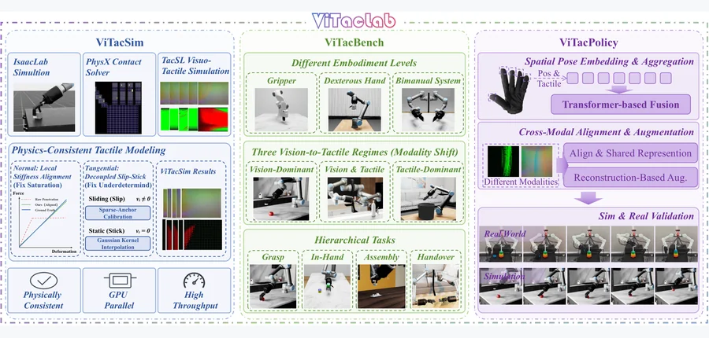 arXiv 2026-11-26 · cs.RO · #6 **[ViTacLab: Physically Consistent Visuo-Tactile Simulation, Benchmarking, and Representation Learning for Robotic Manipulation](https://arxiv.org/abs/2611.32476)** [Linjing You , Zeming Yang , Zhenhao Shen , Shengqiang Xu , Guanda Li , Wenxuan Li , Jiyu Guo , Jasper Lu , Kyle Xu , Shaw… 机构：University of Hong Kong / Ant Group / Peking University / Zhejiang University / Lightwheel / PsiBot / National University of Singapore / University of California, Berkeley（[PDF](https://arxiv.org/pdf/2611.32476)） [Paper](https://arxiv.org/abs/2611.32476) · [图源](https://arxiv.org/html/2611.32476v1/vitaclab-teaser.png) 

中文摘要
触觉感知对接触密集型机器人操作至关重要，但现有视觉—触觉仿真器在物理保真度与扩展性之间取舍，评测也多集中于双指夹爪。我们提出 ViTacLab，由 ViTacSim、ViTacBench 和 ViTacPolicy 组成。ViTacSim 使用三模态触觉原语：全局稀疏接触力网格、局部稠密力阵列和触觉图像。它以 PhysX 接触求解器输出为锚，通过局部刚度对齐修正法向不一致，并在分离的黏着—滑移状态下重建切向力，同时保持 GPU 并行；联合投影保留稀疏力旋量并施加局部摩擦锥约束。ViTacBench 涵盖平行夹爪、灵巧手和双手系统，任务从视觉主导延伸至触觉主导。ViTacPolicy 使用空间位姿嵌入和 Transformer 聚合数量可变的异构触觉输入，并以共享码本的双流 VQ-VAE 对齐力阵列与触觉图像。受控的 Hertz 参考压入与真实传感器滑动测试将法向和切向力 RMSE 分别从 2.31、1.85 N 降至 0.42、0.53 N。在 256 个并行环境中，触觉流水线吞吐量达 2,482.9 FPS。仿真和真实实验在若干接触密集任务上显示提升，但触觉主导任务的绝对成功率仍低，凸显纯触觉控制的困难。 <a href="https://arxiv.org/abs/2611.32476">原摘要来源</a>
 |
| 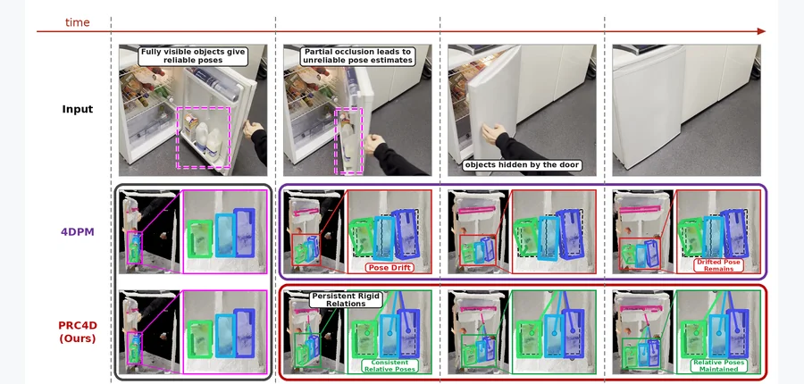 arXiv 2026-11-26 · cs.CV · #7 **[PRC4D: Physical Relation-Constrained Persistent 4D Reconstruction](https://arxiv.org/abs/2611.32396)** [Junho Kim , Hyunyoung Choi , Jiseok Kim , Seongwon Lee](https://arxiv.org/abs/2611.32396) 机构：Kookmin University（[PDF](https://arxiv.org/pdf/2611.32396)） [Paper](https://arxiv.org/abs/2611.32396) · [图源](https://arxiv.org/html/2611.32396v1/fig/teaser.png) 

中文摘要
可靠的四维重建应在物体从视野消失后仍捕获其形状和运动。现有方法保留已观测几何，并通过局部空间与运动关联将运动延伸到遮挡期间。然而，将短暂接触或共同运动视为持久刚性关系的充分证据，会引入错误运动约束并扭曲整体重建。为此，我们提出物理关系约束框架 PRC4D，识别可靠的刚性关系，并利用它们维持遮挡期间的空间一致性。PRC4D 结合三维接触、相对运动一致性与序列级核验，区分持久耦合和瞬时交互。所得关系图引导可见物体位姿细化，以及从可见部件向遮挡部件传播运动，而不改变已重建几何。多样的真实多物体序列和受控遮挡仿真实验显示，在可见性变化时，重建精度提高、相对位姿误差降低、物体构型更一致。 <a href="https://arxiv.org/abs/2611.32396">原摘要来源</a>
 | 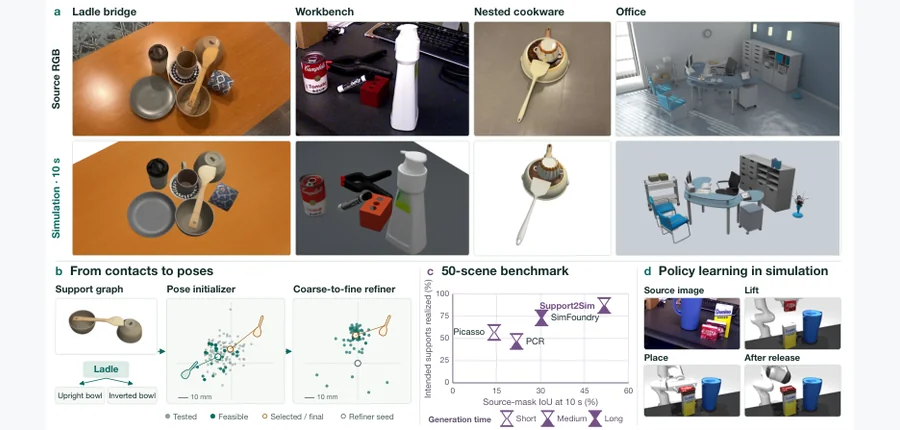 arXiv 2026-11-26 · cs.RO · #8 **[Support2Sim: Visually Faithful Real2Sim with Stable Object Supports](https://arxiv.org/abs/2611.32727)** [Samarth Chopra , Ankit Prabhu , Akshayan Nagarajah , Sumer Murthy , Pratik Chaudhari , Vijay Kumar](https://arxiv.org/abs… 机构：University of Pennsylvania（[PDF](https://arxiv.org/pdf/2611.32727)） [Paper](https://arxiv.org/abs/2611.32727) · [Project](https://support2sim.github.io) · [Video](https://support2sim.github.io/assets/video/Support2Sim_video.mp4?v=full-first-floor) · [图源](https://arxiv.org/html/2611.32727v1/overview_fig.png) 

中文摘要
为物理仿真重建场景，需要恢复其空间布局及决定行为的支撑关系。我们提出 Support2Sim，从单张 RGB 图像重建可用于仿真的场景。设计目标是在实际场景生成时间预算内，最大化与源图像的一致性、支撑关系的实现程度和稳定性。Support2Sim 推断支撑图，接触引导的位姿初始化器据此为具有多个支撑的物体提出位姿，并按几何拟合度及与源图像的一致性排序候选。由粗到细的细化器在受支撑物体间分配固定搜索预算，用物理展开评估位姿更新；每次接受更新后，从新位姿出发以更细的平移和旋转尺度继续搜索。我们在四个数据集的 50 个场景上评测。相较最强基线，Support2Sim 在 10 秒后的源图像掩码 IoU 上提高 21.4 个百分点，预期支撑的实现率为 87.1% 对 73.2%，平均物体漂移从 79.6 降至 45.3 mm。论文还提供项目页。 <a href="https://arxiv.org/abs/2611.32727">原摘要来源</a>
 | 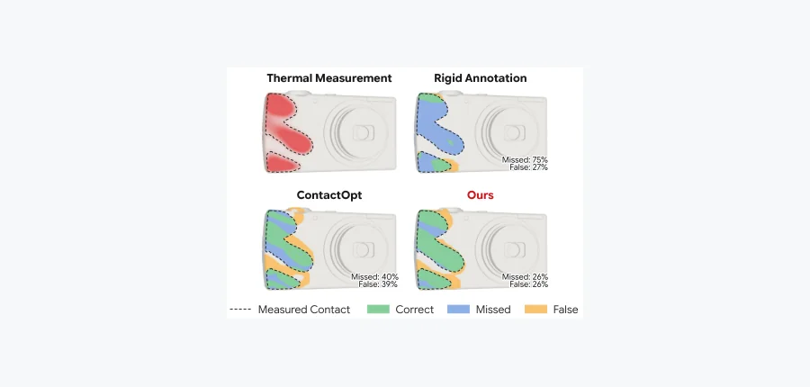 arXiv 2026-11-26 · cs.CV · #9 **[Beyond Rigid Hands: Deforming Skin into Contact-Consistent Hand Meshes](https://arxiv.org/abs/2611.31950)** [Seonghwan Park , Min-Gyu Park](https://arxiv.org/abs/2611.31950) 机构：Korea Electronics Technology Institute（[PDF](https://arxiv.org/pdf/2611.31950)） [Paper](https://arxiv.org/abs/2611.31950) · [图源](https://arxiv.org/html/2611.31950v1/teaser.png) 

中文摘要
人手用柔软皮肤抓握物体：指尖会在杯子上压平，手掌会沿瓶身弯曲。然而，手物数据集与估计器把手表示为刚性关节网格，在皮肤本应压住物体之处出现悬空或穿透。现有细化方法保持网格刚性、只调整姿态，以姿态精度换取物理合理性。我们研究能否让刚性手模型像皮肤那样接触物体，同时保持接近原姿态。方法通过优化将标注或估计的刚性手转换为接触一致的网格：(i) 小幅调整关节与手腕，让手指贴近物体；(ii) 使皮肤形变，让穿透区域落到物体表面；(iii) 保持时间上的形变一致性。由于形变只作用于原本靠近物体的皮肤，方法还在转换后的标注上训练轻量预测头，预测估计手应接触的位置，并引导形变。与已有细化方法不同，这种转换对三个已发表估计器均使落在物体表面的皮肤面积增加一倍以上，而姿态几乎不变。学习头的引导还可消除估计留下的接触间隙，提高抓握稳定性。因此，现有手物数据集和估计器无需更换手模型或重训估计器，就能采用接触一致的手。 <a href="https://arxiv.org/abs/2611.31950">原摘要来源</a>
 |
| 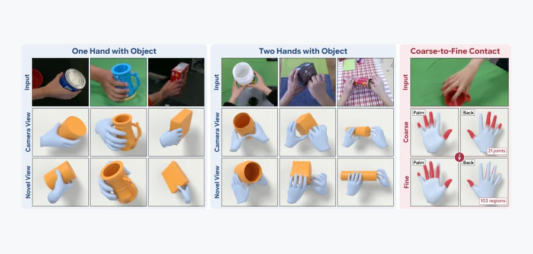 arXiv 2026-11-26 · cs.CV · #10 **[Generalizable Feed-Forward 3D Hand-Object Reconstruction with Coarse-to-Fine Contact Estimation](https://arxiv.org/abs/2611.31812)** [Seonghwan Park , Yong-Hoon Kwon , Min-Gyu Park](https://arxiv.org/abs/2611.31812) 机构：Korea Electronics Technology Institute（[PDF](https://arxiv.org/pdf/2611.31812)） [Paper](https://arxiv.org/abs/2611.31812) · [图源](https://arxiv.org/html/2611.31812v1/teaser.png) 

中文摘要
从单张图像联合重建手与物体的三维位姿及其接触，是理解操作的基础。实用的重建须泛化到未见物体，并精确定位接触。但联合前馈估计器往往依赖预定义物体集合；接触通常仅由图像特征预测，缺少精确定位所需的显式几何。为解决这两个问题，我们提出 HORCRUX，一种带由粗到细接触估计的统一前馈 Transformer。对于未见物体，冻结的基础模型根据给定网格或从图像重建的网格编码物体，而不依赖物体特定知识。共享 Transformer 随后联合推理物体和一只或两只手，使它们保持对齐。为精确估计接触，模型利用重建几何，将潜在特征得到的逐关节粗预测细化到更小的手部区域。在七个基准上，HORCRUX 在联合估计器中达到先进的物体与手位姿精度，并在细粒度接触上优于专门的接触估计器。结果表明，接触适合与重建联合估计，因为重建几何能直接定位接触。 <a href="https://arxiv.org/abs/2611.31812">原摘要来源</a>
 | 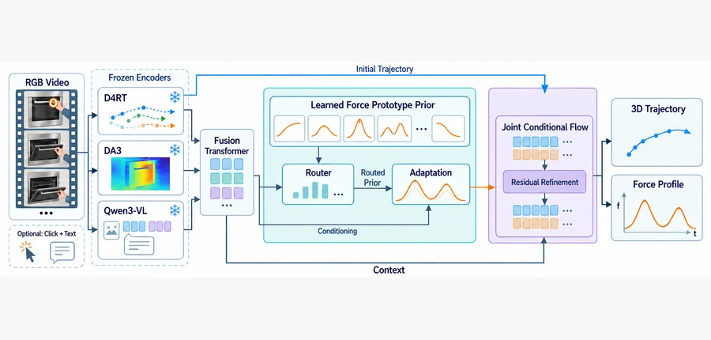 arXiv 2026-11-26 · cs.CV · #11 **[VidForce: Predicting Force-Aware Articulation by Observing Humans](https://arxiv.org/abs/2611.32967)** [Rafay Mohiuddin , Jiaqi Chen , Marc Pollefeys , Hermann Blum](https://arxiv.org/abs/2611.32967) 机构：University of Bonn / Lamarr Institute / ETH Zurich / Microsoft（[PDF](https://arxiv.org/pdf/2611.32967)） [Paper](https://arxiv.org/abs/2611.32967) · [Project](https://rafaymhddn.github.io/vidforce/) · [图源](https://arxiv.org/html/2611.32967v1/figures/architecture/overview_architecture_generated_v4_cropped.png) 

中文摘要
人们通过观察他人，就能预判物体如何运动以及交互需要多大力气。具身智能体如何从视频获得这种理解？力测量能提供直接监督，但需要专用设备且数量有限。我们提出 VidForce，从第三人称 RGB 视频同时估计交互轨迹与力曲线；二维接触点击及文本物体—动作提示可选。该方法把有限的仪器测量转化为学习型物理原型先验，用于解读人类交互。原型在所需力度相近的交互之间共享力值和时间曲线，视觉及语义线索决定各原型对观测的贡献。几何和视觉语言特征使先验适应当前交互，联合条件流进一步细化初始跟踪轨迹与力曲线。成对的人类与仪器夹爪录像提供实测力参照来监督人类视频；单独训练的力矩模型展示该形式可扩展到其他传感量。我们在 Hoi! 数据集的留出交互上，通过基线比较和受控消融评估轨迹恢复与力估计。在该评估子集上，VidForce 的 ATE 为 6.6 cm，峰值力 MAE 和 RMSE 分别为 4.81 N、5.92 N，力曲线 RMSE 为 5.52 N。在真实视频中，即使人类执行方式不同，VidForce 仍能稳定推断运动和力。我们还将它部署在 Spot 机器人上，使用从人类示范估计的轨迹和力曲线驱动真实关节物体操作，并报告重复试验的成功率。论文提供项目页。 <a href="https://arxiv.org/abs/2611.32967">原摘要来源</a>
 | 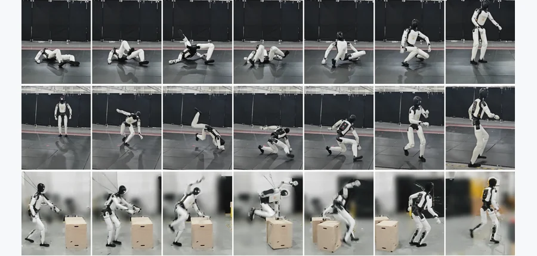 arXiv 2026-11-26 · cs.RO · #12 **[DynaMimic: A Physics-Informed World Model for Humanoid Motion Tracking](https://arxiv.org/abs/2611.32944)** [Chaoyue Xing , Linyi Huang , Yiting He , Yixuan Yin , Siqi Hou , Yi Zhang , Liyuan Pan , Miaomiao Liu , Daqi Liu](https:/… 机构：Australian National University / AgiBot / Hong Kong University of Science and Technology (Guangzhou) / Beijing Institute of Technology（[PDF](https://arxiv.org/pdf/2611.32944)） [Paper](https://arxiv.org/abs/2611.32944) · [图源](https://arxiv.org/html/2611.32944v1/cvpr-3.png) 

中文摘要
全身运动跟踪使人形机器人能复现人类示范中的多种技能。现有无模型强化学习方法要么将专门动作策略蒸馏为单一策略而损失性能，要么依赖集群算力直接训练通用策略。SuperMimic 通过可微世界模型从当前状态和动作预测下一状态，隐式学习动作间共享的物理规律，以降低计算成本；但这种隐式形式可能无法完整刻画物理过程，支撑状态变化附近的误差会在训练跟踪策略的想象展开中累积。我们提出 DynaMimic，在状态预测中显式引入共享物理规律。网络为每个候选支撑连杆预测接触力旋量和残差广义力，再通过闭式拉格朗日前向动力学计算下一状态。在 60 段完整 LAFAN1 动作上，相较 SuperMimic，DynaMimic 将平均逐关节位置误差（MPJPE）降低 18.6%。地形跟踪中，两种方法使用相同的局部高度图；相较带地形条件的 SuperMimic，DynaMimic 在 A3 Parkour 上降低 14.9%（66.15 至 56.28 mm），在 GRAIL 地形片段上降低 10.8%（141.88 至 126.57 mm）。真实 A3 人形机器人上的策略能够完成起身、侧手翻和越箱等技能。 <a href="https://arxiv.org/abs/2611.32944">原摘要来源</a>
 |
| 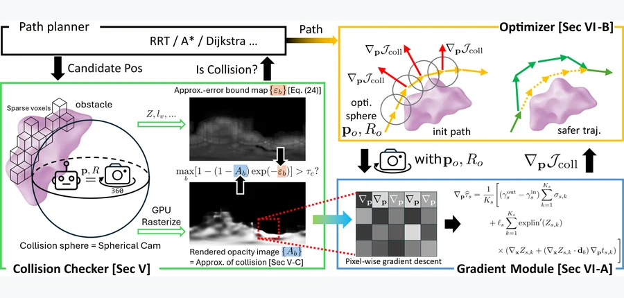 arXiv 2026-11-26 · cs.RO · #13 **[Collision Rendering: GPU-Accelerated Trajectory Planning on Sparse Voxel Radiance Fields with Risk-Bounded Collision Checking](https://arxiv.org/abs/2611.31658)** [Byoungkwon Yoon , Han Gyeom Lee , Hojun Lee , Yuseop Sim , Daniel Sungwoo Bae , Martin Byung-Guk Jun](https://arxiv.org/a… 机构：Purdue University（[PDF](https://arxiv.org/pdf/2611.31658)） [Paper](https://arxiv.org/abs/2611.31658) · [图源](https://arxiv.org/html/2611.31658v1/figures/ov_export.png) 

中文摘要
辐射场为机器人提供细致的场景表示，但其轨迹规划用途仍未充分探索，因为尚无公认的方法把学习到的空间原语转化为可靠碰撞判据。我们提出 Collision Rendering，据作者所知，这是首个基于稀疏体素辐射场（SVR）的轨迹规划框架，支持 GPU 加速、带风险上界的碰撞检查和可微碰撞代价。核心观察是，SVR 的结构化体密度使渲染流水线可快速数值近似碰撞概率。我们用碰撞球近似机器人，并在每个球的位置放置重合的球形相机；在概率碰撞模型下，从相机渲染过程推导每个球最大方向碰撞概率的上界。GPU 上计算该上界得到模块化碰撞检查器，可接入现有采样式规划器，无需额外几何地图或改变学习表示。方法还从同一流水线渲染的不透明度计算碰撞代价及其梯度，从而扩展到轨迹优化。实验在消费级 GPU 上实现毫秒级碰撞检查，并在全部查询中获得无碰撞轨迹，优于所比较的其他辐射场规划器。 <a href="https://arxiv.org/abs/2611.31658">原摘要来源</a>
 | 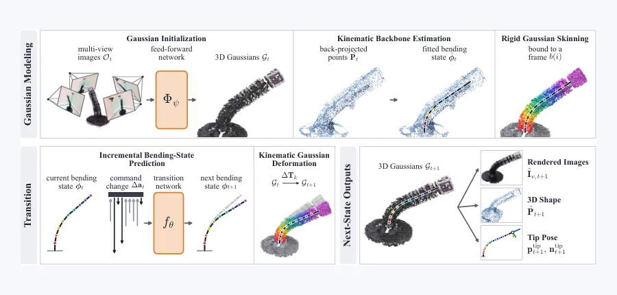 arXiv 2026-11-26 · cs.RO · #14 **[BendGS: Observation-Conditioned Gaussian Self-Modeling for Continuum Robots](https://arxiv.org/abs/2611.31844)** [Jeong Woon Lee , Doungjun Kim , Namho Kim , Seungheon Chae , Jongwoo Kim , Hyoseok Hwang](https://arxiv.org/abs/2611.31844) 机构：Kyung Hee University（[PDF](https://arxiv.org/pdf/2611.31844)） [Paper](https://arxiv.org/abs/2611.31844) · [图源](https://arxiv.org/html/2611.31844v1/fig2_framework_v74_ntip.png) 

中文摘要
视觉自模型从图像学习机器人在电机命令下如何运动。连续体机器人持续弯曲，且没有测得的关节角或固定连杆几何，因此更需要此类模型。现有连续体自模型可预测点云、图像平面曲线或未来图像，却不能从已观测身体同时预测下一时刻的三维形状、外观和末端位姿。三维 Gaussian 可以渲染形状与外观，但现有关节式 Gaussian 自模型依赖关节角驱动形变。我们提出 BendGS，以从观测估计的虚拟主干驱动命令条件的 Gaussian 形变，在无需测量关节角的情况下预测连续体机器人下一状态。建模阶段，前馈网络从多视角图像重建机器人的三维 Gaussian，并将由坐标系链组成的主干拟合到深度反投影点上，以估计弯曲状态。转移阶段，网络在相对电机命令下预测主干变化，再使绑定的 Gaussian 形变。形变后的 Gaussian 渲染下一时刻图像和三维形状，末端坐标系给出末端位姿。训练仅使用 RGB-D 图像与掩码，无需弯曲或末端标签。在仿真与真实机器人上，BendGS 在比较方法中获得最低 Chamfer 距离、最佳图像质量和最低末端误差。 <a href="https://arxiv.org/abs/2611.31844">原摘要来源</a>
 | 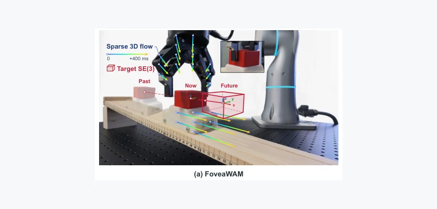 arXiv 2026-11-26 · cs.RO · #15 **[FoveaWAM: Role-Aware 4D World-Action Modeling for Dynamic Manipulation](https://arxiv.org/abs/2611.31705)** [Jiaqi Yin , Baoyue Zhang , Jiyuan Zhang , Wenxuan Liu , Zhaofei Yu , Yue Deng , Tiejun Huang](https://arxiv.org/abs/2611.… 机构：Beijing Zhongguancun Academy / Peking University / Beijing Academy of Artificial Intelligence（[PDF](https://arxiv.org/pdf/2611.31705)） [Paper](https://arxiv.org/abs/2611.31705) · [Code](https://github.com/ArrebolBlack/FoveaWAM) · [Project](https://foveawam.github.io/) · [Data](https://huggingface.co/datasets/JiaqiYin/OnTimeBench) · [图源](https://arxiv.org/html/2611.31705v1/real_scene.png) 

中文摘要
操作运动物体时，策略必须预测动作执行瞬间的场景，但预测每多花一毫秒，执行时刻也会向后推迟。场景级预测开销大，只预测目标又可能漏掉影响接触的邻近物体。我们的核心见解是预测精度可按角色分配：决定接触的目标位姿需要毫米级精度，而周围环境主要通过可用间隙和施加的运动产生影响。我们提出 FoveaWAM，一种按角色分配精度的原生四维世界动作模型。它把目标的过去和未来运动表示为度量 SE(3) 轨迹，把环境表示为稀疏三维流，静态内容则依赖当前帧。这种紧凑表示使 FoveaWAM 在单张 RTX 5090 上以 15.1 ms 作出动作，约比视频世界动作基线快 10 倍，因此在动作执行前留给场景演化的时间更短。我们提出 OnTimeBench，在策略计算期间场景持续运动，以各策略自身的延迟评估动态操作。FoveaWAM 在该基准取得 82.1% 成功率，比最强基线高 20.8 个百分点，在 DOMINO 和真实机器人任务上也领先。论文提供项目页。 <a href="https://arxiv.org/abs/2611.31705">原摘要来源</a>
 |
| 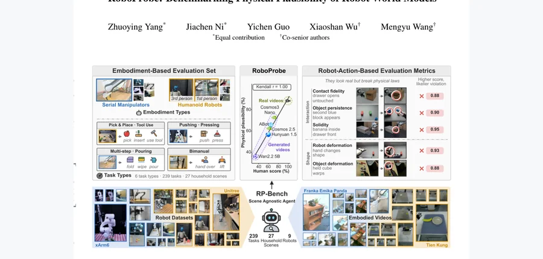 arXiv 2026-11-26 · cs.CV · #16 **[RoboProbe: Benchmarking Physical Plausibility of Robot World Models](https://arxiv.org/abs/2611.32152)** [Zhuoying Yang , Jiachen Ni , Yichen Guo , Xiaoshan Wu , Mengyu Wang](https://arxiv.org/abs/2611.32152) 机构：affiliation 未确认 [Paper](https://arxiv.org/abs/2611.32152) · [图源](https://arxiv.org/pdf/2611.32152) 

中文摘要
评估生成视频的物理合理性对使用世界模型进行可靠机器人规划至关重要。视频会在真实执行前用于提出和评估动作，未发现的物理违规可能导致错误判断动作的可行性与安全性。然而，现有视频生成器常产生物理上不合理的交互。仅靠视觉语言模型（VLM）直接检测这些违规也很困难，因为物理核验需要基于证据的时空推理，而不只是高层语义理解。我们将分割、跟踪、三维几何或外观比较得到的时空证据与有针对性的 VLM 推理结合，设计五种面向具体物理规律的合理性指标：接触忠实性、物体持续性、实体不可穿透性、机器人形变和物体形变。在此基础上，提出协调指标执行并通过受约束动作选择性细化评估的 RoboProbe 框架。我们还提出 RP-Bench，用于评价机器人世界模型的物理合理性，包含来自 12 个机器人数据集、239 项操作任务的 761 段带人工标签的生成视频与 130 段真实示范。在 RP-Bench 上，全部五项指标的 AUROC 均超过 0.85，并优于所评估的学习型判别器、既有评估器和仅看帧的 Gemini 基线。将指标应用于五个视频生成器后，可观察到不同模型在违规类型与频率上的不同模式。 <a href="https://arxiv.org/abs/2611.32152">原摘要来源</a>
 | 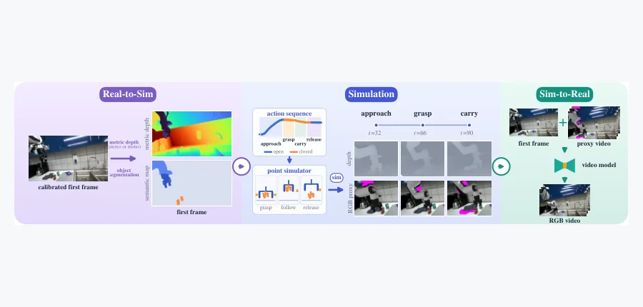 arXiv 2026-11-26 · cs.RO · #17 **[Simulator-as-Proxy World Model for Robot Manipulation](https://arxiv.org/abs/2611.32786)** [Tingting Liao , Mingjia Huo , Hao Li , Zhengzhong Liu , Eric P. Xing , Guangyi Liu](https://arxiv.org/abs/2611.32786) 机构：Mohamed bin Zayed University of Artificial Intelligence / University of California, San Diego / Pinscreen（[PDF](https://arxiv.org/pdf/2611.32786)） [Paper](https://arxiv.org/abs/2611.32786) · [Code](https://github.com/TingtingLiao/SimPWM) · [Project](https://sim-pwm.pages.dev) · [图源](https://arxiv.org/html/2611.32786v1/wpm_overview.png) 

中文摘要
机器人视频世界模型越来越常以仿真或渲染的场景代理为条件，前提是假设生成视频会呈现代理所表示的状态。检验该假设需要状态显式且可扰动的代理。我们提出 SimPWM（以仿真器为代理的世界模型）：给定标定相机，它仅从首帧用三维模型表示机器人，并用三维点表示夹爪可能接触的物体；不含训练参数的规则仿真器按动作移动这些对象，再由视频模型渲染结果。SimPWM 同时输出真实感视频和仿真状态。我们让手臂按记录运动、冻结仿真物体，再检查视频是否仍显示物体被提起。在未见过配置的 DROID 片段上，手臂与物体的情况不同。对三种基础视频模型，手臂均遵循代理（机器人 IoU 为 0.75–0.78，端到端模型至多 0.69）；仅渲染机器人已能得到这一效果。加入仿真物体改善的是物体状态：相较仅含机器人的代理，漏掉抓起动作的比例从 54% 降至 38%，但视频只有在部分基础模型下会遵循物体代理。对于刚体，冻结物体会使 MiniMax-H3 的提起率从 42% 降至 10%；该模型在仿真与真实视频一致的片段上微调过。用相同片段训练的 LTX-2.3 则仅从 57% 降至 49%，仿佛它根据手臂运动自行推断抓握；MiniMax-H3 剩余提起现象中超过一半涉及布料和绳索，而仿真器将它们作为刚体搬运。对于任何基础模型，仿真状态都记录仿真实际发生的事；在扰动动作下，若视频与其不一致，就说明视频忽略了仿真状态。 <a href="https://arxiv.org/abs/2611.32786">原摘要来源</a>
 | 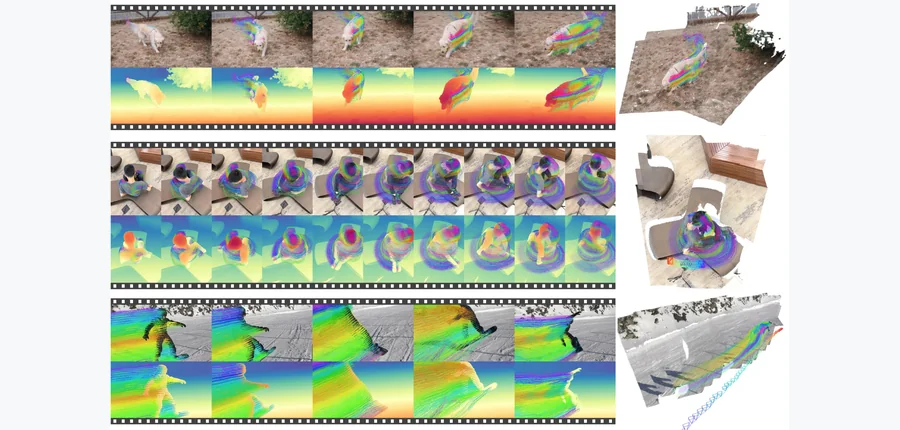 arXiv 2026-11-26 · cs.CV · #18 **[MoGe-4D: Efficient, Flexible, and Unified Dense 4D Reconstruction and Tracking](https://arxiv.org/abs/2611.32198)** [Ruicheng Wang , Linlin Xin , Sicheng Xu , Jianfeng Xiang , Zelong Lv , Yu Deng , Yue Dong , Guangzhong Sun , Tong Zhang… 机构：University of Science and Technology of China / Microsoft Research / University of Chinese Academy of Sciences / Tsinghua University（[PDF](https://arxiv.org/pdf/2611.32198)） [Paper](https://arxiv.org/abs/2611.32198) · [图源](https://arxiv.org/html/2611.32198v1/teaser.png) 

中文摘要
从 RGB 视频重建动态场景需要跨视角同时推理三维几何与运动，但现有方法或把重建和跟踪拆成多个环节，或承担高昂的稠密时空解码成本。我们提出 MoGe-4D，使用成对的全局与自我中心动态点图的有序查询，在前馈框架中统一几何和运动预测。每项查询同时在两个相机坐标系中把源像素映射到目标时刻，以闭式形式解出相对相机位姿，并灵活支持深度、动态配准与稠密三维跟踪。为高效进行稠密查询，MoGe-4D 将场景建模与查询解码分开：高容量上下文编码器一次缓存粗粒度全局时空特征，轻量查询编码器则在灵活分辨率下快速解码稠密点图。此外，监督稠密四维查询需要连续三维对应，而直接储存轨迹成本过高；因此我们提出合成数据流水线和数据集 RigIDTrack，将表面动力学压缩为经刚性正则化的仿射物体，仅以比 RGB-D 视频多约 15% 的储存成本，即可恢复任意帧的精确三维轨迹。在多个基准上，MoGe-4D 的稠密三维跟踪达到先进水平，重建表现与专门的三维基础模型相当，运行速度明显快于已有四维基线。 <a href="https://arxiv.org/abs/2611.32198">原摘要来源</a>
 |
| 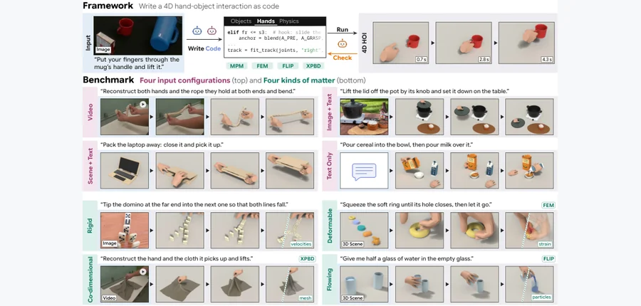 arXiv 2026-11-26 · cs.CV · #19 **[CodeHOI: Code with Agents for Physically Plausible 4D Hand-Object Interaction](https://arxiv.org/abs/2611.31976)** [Seonghwan Park , Inho Chang , Min-Gyu Park](https://arxiv.org/abs/2611.31976) 机构：Korea Electronics Technology Institute（[PDF](https://arxiv.org/pdf/2611.31976)） [Paper](https://arxiv.org/abs/2611.31976) · [图源](https://arxiv.org/html/2611.31976v1/teaser.png) 

中文摘要
四维手物交互（HOI）建模是理解操作的基础。它需要物理规律，因为手只能通过接触移动物体，而不同材料的响应各异。现有方法却忽略物理，或只仿真有限的材料类型。程序可以描述各种材料及其物理规律，但编程智能体遗漏了驱动交互的手。为填补这一缺口，我们提出 CodeHOI；据作者所知，这是首个把物理合理的四维手物交互编写为程序的智能体框架。首先，物体智能体按材料物理构建每个物体；随后，HOI 智能体通过接触定义手，并用成熟的物理求解器仿真各类材料；最后，评估智能体依据物理定律检查结果。我们还提出 CodeHOI-Bench，包含横跨四类材料的 100 项重建与生成任务。使用现成前沿模型时，CodeHOI 为每类材料写出的交互都具有物理合理性，迁移到独立物理引擎后仍然如此。因此，它使编程智能体能够针对多种材料编写物理合理的手物交互。 <a href="https://arxiv.org/abs/2611.31976">原摘要来源</a>
 | 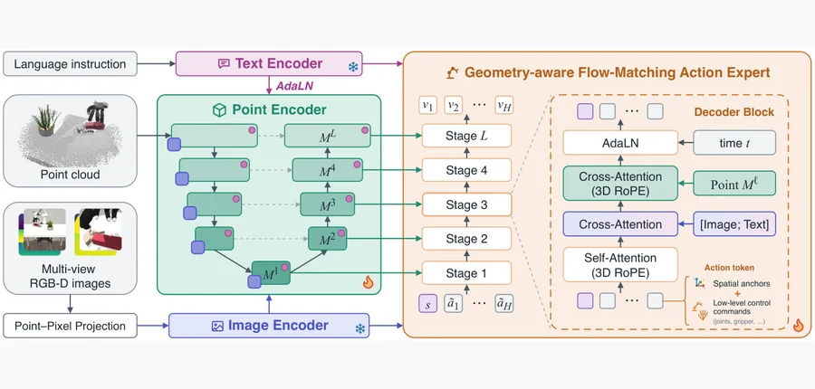 arXiv 2026-11-26 · cs.RO · #20 **[Hi3R-VLA: Grounding Semantics and Actions in 3D](https://arxiv.org/abs/2611.31535)** [Shizhe Chen , Paul Pacaud , Cordelia Schmid](https://arxiv.org/abs/2611.31535) 机构：Inria / École normale supérieure / CNRS / PSL Research University（[PDF](https://arxiv.org/pdf/2611.31535)） [Paper](https://arxiv.org/abs/2611.31535) · [Project](https://cshizhe.github.io/projects/hi3r_vla.html) · [图源](https://arxiv.org/html/2611.31535v1/method.png) 

中文摘要
近期视觉语言动作（VLA）模型日益引入三维几何，但如何有效利用几何作出精确且可泛化的动作预测仍是核心挑战。我们提出 Hi3R-VLA，一种将视觉、语言和动作等异构模态锚定在显式三维几何中的机器人操作策略。模型把空间对齐的视觉特征及语言条件融合进点云表示，为场景几何加入细粒度、与任务相关的语义；随后在同一三维坐标系中锚定底层控制命令，并借助 3D-RoPE 增强的动作到点注意力，在由粗到细的点特征上建模动作目标与观测点之间的几何关系。分析显示三维空间中的语义融合，以及观测和动作的空间对齐都很重要。Hi3R-VLA 的可训练参数少于 250M，却在 RoboCasa、RLBench、RoboTwin2、DexJoCo、DexSuite 的不同操作任务与机器人形态上达到先进性能，涵盖单臂与双臂夹爪到灵巧手。真实机器人评估进一步展示其在物理世界中的有效性。模型、代码和数据集已公开。 <a href="https://arxiv.org/abs/2611.31535">原摘要来源</a>
 |   |
<!-- PAPER_CARDS_END -->

## 检索概况

- **检索窗口**：北京时间 2026-11-25 09:06 至 2026-11-26 09:09；按 14 个 arXiv 官方分类页的 `New submissions`。
- **官方最新批次**：Wednesday, 25 November 2026；不同于上一期 Tuesday, 24 November 2026。
- **总命中／去重／入选**：官方 New 共 **736 条**，按 arXiv ID 去重后 **736 篇**；本期入选 **20 篇**。Cross-lists 和 Replacements 不进入主榜。
- **筛选口径**：阅读官方列表的标题与完整摘要；三维物理和接触优先，具体机器人方法随后。相关性、机构强度、阅读优先级、局限与改进均为**编辑推断**。
- **缺原摘要／缺图**：0 篇／0 篇（20 篇均有对应官方论文 HTML 或 PDF 配图）。

## 官方 New listing 状态

| 分类页 | listing 日期 | New |
|---|---|---:|
| [cs.CV](https://arxiv.org/list/cs.CV/new?show=2000) | 2026-11-25 | 264 |
| [cs.GR](https://arxiv.org/list/cs.GR/new?show=2000) | 2026-11-25 | 1 |
| [cs.RO](https://arxiv.org/list/cs.RO/new?show=2000) | 2026-11-25 | 91 |
| [cs.AI](https://arxiv.org/list/cs.AI/new?show=2000) | 2026-11-25 | 102 |
| [cs.LG](https://arxiv.org/list/cs.LG/new?show=2000) | 2026-11-25 | 144 |
| [physics.flu-dyn](https://arxiv.org/list/physics.flu-dyn/new?show=2000) | 2026-11-25 | 12 |
| [physics.comp-ph](https://arxiv.org/list/physics.comp-ph/new?show=2000) | 2026-11-25 | 4 |
| [cond-mat.soft](https://arxiv.org/list/cond-mat.soft/new?show=2000) | 2026-11-25 | 15 |
| [cond-mat.mtrl-sci](https://arxiv.org/list/cond-mat.mtrl-sci/new?show=2000) | 2026-11-25 | 25 |
| [eess.IV](https://arxiv.org/list/eess.IV/new?show=2000) | 2026-11-25 | 5 |
| [eess.SP](https://arxiv.org/list/eess.SP/new?show=2000) | 2026-11-25 | 19 |
| [eess.SY](https://arxiv.org/list/eess.SY/new?show=2000) | 2026-11-25 | 19 |
| [math.NA](https://arxiv.org/list/math.NA/new?show=2000) | 2026-11-25 | 26 |
| [stat.ML](https://arxiv.org/list/stat.ML/new?show=2000) | 2026-11-25 | 9 |
| **合计** | — | **736** |

## Top papers

| # | 论文 | 分类 | 作者 | 机构（PDF 首页） | 相关性（编辑推断） | 机构强度（编辑推断） | 阅读优先级（编辑推断） |
|---:|---|---|---|---|---|---|---|
| 1 | [Tornado4D: Physics-Guided 4D Gaussian Reconstruction of a Laboratory Tornado from Sparse One-Sided Videos](https://arxiv.org/abs/2611.31435) | [cs.CV](https://arxiv.org/abs/2611.31435) | [Yucheng Zhu , Maria J. Molina , Christopher Metzler](https://arxiv.org/abs/2611.31435) | University of Maryland, College Park（[PDF](https://arxiv.org/pdf/2611.31435)） | 物理引导龙卷风 4DGS | 未独立评级 | A |
| 2 | [GeoCANO: A Geometry-Conditioned Adaptive Neural Operator for Physical-Field Prediction on Varying Domains](https://arxiv.org/abs/2611.31274) | [eess.IV](https://arxiv.org/abs/2611.31274) | [Biao Chen , Xinrui Zhou , Xianlin Jin , Jing Wang , Jifa Zhang , Chen Zhai , Wei Liu , Miao Zhang](https://arxiv.org/abs/2611.31274) | Shanghai Jiao Tong University / Huawei Technologies / Zhejiang University / Shanghai Aircraft Design and Research Institute（[PDF](https://arxiv.org/pdf/2611.31274)） | 三维几何条件物理场算子 | 未独立评级 | A |
| 3 | [Elastic rebound in viscous fluid: an efficient rigid--elastic splitting with an asymptotic gap model](https://arxiv.org/abs/2611.32010) | [physics.flu-dyn](https://arxiv.org/abs/2611.32010) | [Thomas Richter](https://arxiv.org/abs/2611.32010) | Otto von Guericke University Magdeburg（[PDF](https://arxiv.org/pdf/2611.32010)） | 薄膜流固耦合反弹 | 未独立评级 | A |
| 4 | [Exact Collision Gradients for Ellipsoids in Differentiable Simulation](https://arxiv.org/abs/2611.31676) | [cs.RO](https://arxiv.org/abs/2611.31676) | [Shamak Dutta , Biswadip Dey](https://arxiv.org/abs/2611.31676) | Meta（[PDF](https://arxiv.org/pdf/2611.31676)） | 可微椭球碰撞 | 未独立评级 | A |
| 5 | [FabricBench: A Standardized Policy Benchmark for Bimanual Fabric Manipulation with a Contact-Driven Deformable Simulator](https://arxiv.org/abs/2611.31577) | [cs.RO](https://arxiv.org/abs/2611.31577) | [Wenkang Hu , Haoran Wang , Liu Liu , Wenchao Huang , Yiji Chen , Mengao Zhao , Xincheng Tang , Zhengjie Shu , Lai Jiang , Wei Li , Zhendong Wang , Zhizhong Su , Huamin Wang , Ruigang Yang](https://arxiv.org/abs/2611.31577) | Shanghai Jiao Tong University / Horizon Robotics / Style3D Research（[PDF](https://arxiv.org/pdf/2611.31577)） | 接触驱动布料操作基准 | 未独立评级 | A |
| 6 | [ViTacLab: Physically Consistent Visuo-Tactile Simulation, Benchmarking, and Representation Learning for Robotic Manipulation](https://arxiv.org/abs/2611.32476) | [cs.RO](https://arxiv.org/abs/2611.32476) | [Linjing You , Zeming Yang , Zhenhao Shen , Shengqiang Xu , Guanda Li , Wenxuan Li , Jiyu Guo , Jasper Lu , Kyle Xu , Shawn Xie , Junjie Zhu , Siyu Wu , Jian Liu , Changhao Zhang , Rongchong Li , Zeyi Li , Hengshuang Zhao , Ruihai Wu](https://arxiv.org/abs/2611.32476) | University of Hong Kong / Ant Group / Peking University / Zhejiang University / Lightwheel / PsiBot / National University of Singapore / University of California, Berkeley（[PDF](https://arxiv.org/pdf/2611.32476)） | 物理一致视觉触觉仿真 | 未独立评级 | A |
| 7 | [PRC4D: Physical Relation-Constrained Persistent 4D Reconstruction](https://arxiv.org/abs/2611.32396) | [cs.CV](https://arxiv.org/abs/2611.32396) | [Junho Kim , Hyunyoung Choi , Jiseok Kim , Seongwon Lee](https://arxiv.org/abs/2611.32396) | Kookmin University（[PDF](https://arxiv.org/pdf/2611.32396)） | 物理关系约束 4D 重建 | 未独立评级 | A |
| 8 | [Support2Sim: Visually Faithful Real2Sim with Stable Object Supports](https://arxiv.org/abs/2611.32727) | [cs.RO](https://arxiv.org/abs/2611.32727) | [Samarth Chopra , Ankit Prabhu , Akshayan Nagarajah , Sumer Murthy , Pratik Chaudhari , Vijay Kumar](https://arxiv.org/abs/2611.32727) | University of Pennsylvania（[PDF](https://arxiv.org/pdf/2611.32727)） | 稳定支撑的 Real2Sim | 未独立评级 | A |
| 9 | [Beyond Rigid Hands: Deforming Skin into Contact-Consistent Hand Meshes](https://arxiv.org/abs/2611.31950) | [cs.CV](https://arxiv.org/abs/2611.31950) | [Seonghwan Park , Min-Gyu Park](https://arxiv.org/abs/2611.31950) | Korea Electronics Technology Institute（[PDF](https://arxiv.org/pdf/2611.31950)） | 接触一致手部皮肤网格 | 未独立评级 | A |
| 10 | [Generalizable Feed-Forward 3D Hand-Object Reconstruction with Coarse-to-Fine Contact Estimation](https://arxiv.org/abs/2611.31812) | [cs.CV](https://arxiv.org/abs/2611.31812) | [Seonghwan Park , Yong-Hoon Kwon , Min-Gyu Park](https://arxiv.org/abs/2611.31812) | Korea Electronics Technology Institute（[PDF](https://arxiv.org/pdf/2611.31812)） | 三维手物重建与接触 | 未独立评级 | A |
| 11 | [VidForce: Predicting Force-Aware Articulation by Observing Humans](https://arxiv.org/abs/2611.32967) | [cs.CV](https://arxiv.org/abs/2611.32967) | [Rafay Mohiuddin , Jiaqi Chen , Marc Pollefeys , Hermann Blum](https://arxiv.org/abs/2611.32967) | University of Bonn / Lamarr Institute / ETH Zurich / Microsoft（[PDF](https://arxiv.org/pdf/2611.32967)） | 由视频预测关节力 | 未独立评级 | A |
| 12 | [DynaMimic: A Physics-Informed World Model for Humanoid Motion Tracking](https://arxiv.org/abs/2611.32944) | [cs.RO](https://arxiv.org/abs/2611.32944) | [Chaoyue Xing , Linyi Huang , Yiting He , Yixuan Yin , Siqi Hou , Yi Zhang , Liyuan Pan , Miaomiao Liu , Daqi Liu](https://arxiv.org/abs/2611.32944) | Australian National University / AgiBot / Hong Kong University of Science and Technology (Guangzhou) / Beijing Institute of Technology（[PDF](https://arxiv.org/pdf/2611.32944)） | 接触显式人形世界模型 | 未独立评级 | A |
| 13 | [Collision Rendering: GPU-Accelerated Trajectory Planning on Sparse Voxel Radiance Fields with Risk-Bounded Collision Checking](https://arxiv.org/abs/2611.31658) | [cs.RO](https://arxiv.org/abs/2611.31658) | [Byoungkwon Yoon , Han Gyeom Lee , Hojun Lee , Yuseop Sim , Daniel Sungwoo Bae , Martin Byung-Guk Jun](https://arxiv.org/abs/2611.31658) | Purdue University（[PDF](https://arxiv.org/pdf/2611.31658)） | 辐射场概率碰撞规划 | 未独立评级 | A |
| 14 | [BendGS: Observation-Conditioned Gaussian Self-Modeling for Continuum Robots](https://arxiv.org/abs/2611.31844) | [cs.RO](https://arxiv.org/abs/2611.31844) | [Jeong Woon Lee , Doungjun Kim , Namho Kim , Seungheon Chae , Jongwoo Kim , Hyoseok Hwang](https://arxiv.org/abs/2611.31844) | Kyung Hee University（[PDF](https://arxiv.org/pdf/2611.31844)） | 连续体机器人 Gaussian 自模型 | 未独立评级 | A |
| 15 | [FoveaWAM: Role-Aware 4D World-Action Modeling for Dynamic Manipulation](https://arxiv.org/abs/2611.31705) | [cs.RO](https://arxiv.org/abs/2611.31705) | [Jiaqi Yin , Baoyue Zhang , Jiyuan Zhang , Wenxuan Liu , Zhaofei Yu , Yue Deng , Tiejun Huang](https://arxiv.org/abs/2611.31705) | Beijing Zhongguancun Academy / Peking University / Beijing Academy of Artificial Intelligence（[PDF](https://arxiv.org/pdf/2611.31705)） | 动态操作四维世界动作模型 | 未独立评级 | A |
| 16 | [RoboProbe: Benchmarking Physical Plausibility of Robot World Models](https://arxiv.org/abs/2611.32152) | [cs.CV](https://arxiv.org/abs/2611.32152) | [Zhuoying Yang , Jiachen Ni , Yichen Guo , Xiaoshan Wu , Mengyu Wang](https://arxiv.org/abs/2611.32152) | affiliation 未确认 | 机器人世界模型物理评测 | 未独立评级 | A |
| 17 | [Simulator-as-Proxy World Model for Robot Manipulation](https://arxiv.org/abs/2611.32786) | [cs.RO](https://arxiv.org/abs/2611.32786) | [Tingting Liao , Mingjia Huo , Hao Li , Zhengzhong Liu , Eric P. Xing , Guangyi Liu](https://arxiv.org/abs/2611.32786) | Mohamed bin Zayed University of Artificial Intelligence / University of California, San Diego / Pinscreen（[PDF](https://arxiv.org/pdf/2611.32786)） | 仿真代理的机器人视频世界模型 | 未独立评级 | A |
| 18 | [MoGe-4D: Efficient, Flexible, and Unified Dense 4D Reconstruction and Tracking](https://arxiv.org/abs/2611.32198) | [cs.CV](https://arxiv.org/abs/2611.32198) | [Ruicheng Wang , Linlin Xin , Sicheng Xu , Jianfeng Xiang , Zelong Lv , Yu Deng , Yue Dong , Guangzhong Sun , Tong Zhang , Jiaolong Yang](https://arxiv.org/abs/2611.32198) | University of Science and Technology of China / Microsoft Research / University of Chinese Academy of Sciences / Tsinghua University（[PDF](https://arxiv.org/pdf/2611.32198)） | 统一四维重建与跟踪 | 未独立评级 | B |
| 19 | [CodeHOI: Code with Agents for Physically Plausible 4D Hand-Object Interaction](https://arxiv.org/abs/2611.31976) | [cs.CV](https://arxiv.org/abs/2611.31976) | [Seonghwan Park , Inho Chang , Min-Gyu Park](https://arxiv.org/abs/2611.31976) | Korea Electronics Technology Institute（[PDF](https://arxiv.org/pdf/2611.31976)） | 可执行物理手物交互生成 | 未独立评级 | B |
| 20 | [Hi3R-VLA: Grounding Semantics and Actions in 3D](https://arxiv.org/abs/2611.31535) | [cs.RO](https://arxiv.org/abs/2611.31535) | [Shizhe Chen , Paul Pacaud , Cordelia Schmid](https://arxiv.org/abs/2611.31535) | Inria / École normale supérieure / CNRS / PSL Research University（[PDF](https://arxiv.org/pdf/2611.31535)） | 三维几何锚定 VLA | 未独立评级 | B |

## 逐篇中文要点

### 1. [Tornado4D: Physics-Guided 4D Gaussian Reconstruction of a Laboratory Tornado from Sparse One-Sided Videos](https://arxiv.org/abs/2611.31435)

- **论文事实／方法**：围挡几何诱导旋转气流先验，约束稀疏单侧视频的四维 Gaussian 演化（[原摘要](https://arxiv.org/abs/2611.31435)）
- **论文事实／结果**：留出视角合成明显优于逐帧 3DGS 与视频 4DGS（[原摘要](https://arxiv.org/abs/2611.31435)）
- **编辑推断／局限与改进**：应检验真实野外龙卷风与错误旋转先验下的重建稳健性

### 2. [GeoCANO: A Geometry-Conditioned Adaptive Neural Operator for Physical-Field Prediction on Varying Domains](https://arxiv.org/abs/2611.31274)

- **论文事实／方法**：对无序三维表面编码，再以轴分解哈希和稀疏专家查询连续气动场（[原摘要](https://arxiv.org/abs/2611.31274)）
- **论文事实／结果**：在 10,484 种几何的跨声速数据集上，压力系数 MAE 较最强基线低 77.9%（[原摘要](https://arxiv.org/abs/2611.31274)）
- **编辑推断／局限与改进**：需检验训练设计族外构型及激波位置的可靠性

### 3. [Elastic rebound in viscous fluid: an efficient rigid--elastic splitting with an asymptotic gap model](https://arxiv.org/abs/2611.32010)

- **论文事实／方法**：以含空化 Reynolds 薄膜和柔度算子耦合粗网格流体、刚体及弹性体（[原摘要](https://arxiv.org/abs/2611.32010)）
- **论文事实／结果**：PTFE 球与 Eulerian FSI 相差 1%；软橡胶须加入阻尼才接近实测反弹（[原摘要](https://arxiv.org/abs/2611.32010)）
- **编辑推断／局限与改进**：可进一步验证非轴对称接触和不同材料的损耗因子

### 4. [Exact Collision Gradients for Ellipsoids in Differentiable Simulation](https://arxiv.org/abs/2611.31676)

- **论文事实／方法**：连续检测 Perram–Wertheim 接触时间，并对接触条件求导（[原摘要](https://arxiv.org/abs/2611.31676)）
- **论文事实／结果**：最优控制与系统辨识中，精确梯度恢复目标解，线性撞击时间近似未恢复（[原摘要](https://arxiv.org/abs/2611.31676)）
- **编辑推断／局限与改进**：应检查非椭球复合形状及多次同时碰撞

### 5. [FabricBench: A Standardized Policy Benchmark for Bimanual Fabric Manipulation with a Contact-Driven Deformable Simulator](https://arxiv.org/abs/2611.31577)

- **论文事实／方法**：Newton 中的布料—刚体双向力耦合支持抓取、承重、保持和释放（[原摘要](https://arxiv.org/abs/2611.31577)）
- **论文事实／结果**：求解器 45/45 次受控试验成功；最难 T 恤构型中策略成功率仅 6–14%（[原摘要](https://arxiv.org/abs/2611.31577)）
- **编辑推断／局限与改进**：应控制接触参数与布料材料分布，区分策略失误和仿真偏差

### 6. [ViTacLab: Physically Consistent Visuo-Tactile Simulation, Benchmarking, and Representation Learning for Robotic Manipulation](https://arxiv.org/abs/2611.32476)

- **论文事实／方法**：用 PhysX 接触力锚定稀疏力网格、稠密力阵列和触觉图像（[原摘要](https://arxiv.org/abs/2611.32476)）
- **论文事实／结果**：法向/切向 RMSE 从 2.31/1.85 N 降至 0.42/0.53 N（[原摘要](https://arxiv.org/abs/2611.32476)）
- **编辑推断／局限与改进**：低成功率的触觉主导任务需要按接触模式单独诊断

### 7. [PRC4D: Physical Relation-Constrained Persistent 4D Reconstruction](https://arxiv.org/abs/2611.32396)

- **论文事实／方法**：以三维接触、相对运动与序列级检验确认持久刚性关系（[原摘要](https://arxiv.org/abs/2611.32396)）
- **论文事实／结果**：多物体遮挡实验报告重建和相对位姿一致性改善（[原摘要](https://arxiv.org/abs/2611.32396)）
- **编辑推断／局限与改进**：需测试暂时共运动、遮挡中关系切换和接触误检

### 8. [Support2Sim: Visually Faithful Real2Sim with Stable Object Supports](https://arxiv.org/abs/2611.32727)

- **论文事实／方法**：由支撑图初始化多支撑物体位姿，再用物理展开细化（[原摘要](https://arxiv.org/abs/2611.32727)）
- **论文事实／结果**：50 个场景中支撑实现率为 87.1% 对 73.2%，漂移降至 45.3 mm（[原摘要](https://arxiv.org/abs/2611.32727)）
- **编辑推断／局限与改进**：应测试未知摩擦与软支撑，以区分几何和材料误差

### 9. [Beyond Rigid Hands: Deforming Skin into Contact-Consistent Hand Meshes](https://arxiv.org/abs/2611.31950)

- **论文事实／方法**：小幅位姿修正后让近物体皮肤形变并保持时序一致（[原摘要](https://arxiv.org/abs/2611.31950)）
- **论文事实／结果**：三个估计器上贴合物体的皮肤面积增加一倍以上，位姿变化很小（[原摘要](https://arxiv.org/abs/2611.31950)）
- **编辑推断／局限与改进**：应以真实接触压力或触觉标注验证表面贴合是否等于物理接触

### 10. [Generalizable Feed-Forward 3D Hand-Object Reconstruction with Coarse-to-Fine Contact Estimation](https://arxiv.org/abs/2611.31812)

- **论文事实／方法**：用物体网格及共享 Transformer 联合定位一至两只手的粗到细接触（[原摘要](https://arxiv.org/abs/2611.31812)）
- **论文事实／结果**：七项基准上联合位姿达到先进水平，细接触优于专用估计器（[原摘要](https://arxiv.org/abs/2611.31812)）
- **编辑推断／局限与改进**：应评估错误物体网格对接触定位的传播误差

### 11. [VidForce: Predicting Force-Aware Articulation by Observing Humans](https://arxiv.org/abs/2611.32967)

- **论文事实／方法**：结合物理原型先验、视觉几何特征与条件流，联合估计轨迹和力曲线（[原摘要](https://arxiv.org/abs/2611.32967)）
- **论文事实／结果**：Hoi! 留出子集 ATE 6.6 cm、峰值力 MAE 4.81 N；有 Spot 实机部署（[原摘要](https://arxiv.org/abs/2611.32967)）
- **编辑推断／局限与改进**：需检验不同摩擦和执行风格下力的可辨识性

### 12. [DynaMimic: A Physics-Informed World Model for Humanoid Motion Tracking](https://arxiv.org/abs/2611.32944)

- **论文事实／方法**：网络预测候选支撑连杆的接触力旋量与残差广义力，再算拉格朗日动力学（[原摘要](https://arxiv.org/abs/2611.32944)）
- **论文事实／结果**：60 段 LAFAN1 动作的 MPJPE 较 SuperMimic 下降 18.6%（[原摘要](https://arxiv.org/abs/2611.32944)）
- **编辑推断／局限与改进**：应检验接触切换时的长期误差和实机外力扰动

### 13. [Collision Rendering: GPU-Accelerated Trajectory Planning on Sparse Voxel Radiance Fields with Risk-Bounded Collision Checking](https://arxiv.org/abs/2611.31658)

- **论文事实／方法**：以碰撞球和球形相机在稀疏体素辐射场中渲染风险上界与梯度（[原摘要](https://arxiv.org/abs/2611.31658)）
- **论文事实／结果**：消费级 GPU 上毫秒级检查，报告所有测试查询均无碰撞（[原摘要](https://arxiv.org/abs/2611.31658)）
- **编辑推断／局限与改进**：风险界依赖密度校准和场景观测，须测未见薄障碍

### 14. [BendGS: Observation-Conditioned Gaussian Self-Modeling for Continuum Robots](https://arxiv.org/abs/2611.31844)

- **论文事实／方法**：以观测估计的虚拟主干驱动命令条件 Gaussian 形变（[原摘要](https://arxiv.org/abs/2611.31844)）
- **论文事实／结果**：仿真和实机比较中 Chamfer、图像质量及末端误差均最佳（[原摘要](https://arxiv.org/abs/2611.31844)）
- **编辑推断／局限与改进**：可测试遮挡主干和不同材料刚度的跨机体迁移

### 15. [FoveaWAM: Role-Aware 4D World-Action Modeling for Dynamic Manipulation](https://arxiv.org/abs/2611.31705)

- **论文事实／方法**：将目标表示为 SE(3) 轨迹、环境表示为稀疏三维流（[原摘要](https://arxiv.org/abs/2611.31705)）
- **论文事实／结果**：单 RTX 5090 上延迟 15.1 ms；OnTimeBench 成功率 82.1%（[原摘要](https://arxiv.org/abs/2611.31705)）
- **编辑推断／局限与改进**：应在同等端到端延迟下比较更低功耗设备

### 16. [RoboProbe: Benchmarking Physical Plausibility of Robot World Models](https://arxiv.org/abs/2611.32152)

- **论文事实／方法**：结合分割、跟踪、三维几何与定向 VLM 推理检查五类物理违规（[原摘要](https://arxiv.org/abs/2611.32152)）
- **论文事实／结果**：RP-Bench 的五项指标 AUROC 均超过 0.85（[原摘要](https://arxiv.org/abs/2611.32152)）
- **编辑推断／局限与改进**：需检验指标在域外物体和隐蔽接触上的人工一致性

### 17. [Simulator-as-Proxy World Model for Robot Manipulation](https://arxiv.org/abs/2611.32786)

- **论文事实／方法**：首帧构建显式三维机器人/物体代理，以冻结物体反事实测试视频服从度（[原摘要](https://arxiv.org/abs/2611.32786)）
- **论文事实／结果**：机器人 IoU 0.75–0.78；加入物体代理使漏抓从 54% 降至 38%（[原摘要](https://arxiv.org/abs/2611.32786)）
- **编辑推断／局限与改进**：软物体被刚体代理搬运，需评估柔性仿真与生成视频的一致性

### 18. [MoGe-4D: Efficient, Flexible, and Unified Dense 4D Reconstruction and Tracking](https://arxiv.org/abs/2611.32198)

- **论文事实／方法**：成对动态点图查询联合预测几何、相机位姿和稠密轨迹（[原摘要](https://arxiv.org/abs/2611.32198)）
- **论文事实／结果**：稠密跟踪达到先进水平，重建接近专门三维模型且速度更快（[原摘要](https://arxiv.org/abs/2611.32198)）
- **编辑推断／局限与改进**：需检验大遮挡和非刚性接触对点对应的影响

### 19. [CodeHOI: Code with Agents for Physically Plausible 4D Hand-Object Interaction](https://arxiv.org/abs/2611.31976)

- **论文事实／方法**：物体与 HOI 智能体编写材料和接触程序，评估智能体检查物理定律（[原摘要](https://arxiv.org/abs/2611.31976)）
- **论文事实／结果**：100 项四类材料任务中，生成结果迁移至独立物理引擎仍被报告为合理（[原摘要](https://arxiv.org/abs/2611.31976)）
- **编辑推断／局限与改进**：应公开定量物理误差及失败样例，避免仅凭视觉判断

### 20. [Hi3R-VLA: Grounding Semantics and Actions in 3D](https://arxiv.org/abs/2611.31535)

- **论文事实／方法**：将语言和视觉融合到点云，并以 3D-RoPE 对齐动作目标与场景点（[原摘要](https://arxiv.org/abs/2611.31535)）
- **论文事实／结果**：少于 250M 可训练参数，在五项机器人操作基准达到先进表现（[原摘要](https://arxiv.org/abs/2611.31535)）
- **编辑推断／局限与改进**：应与同参数量策略在遮挡与接触误差下做受控比较

## 今日最值得细读的 5 篇

1. [Tornado4D](https://arxiv.org/abs/2611.31435)：旋转气流先验直接约束未观测的四维体积。
2. [GeoCANO](https://arxiv.org/abs/2611.31274)：完整三维飞机几何到连续气动场，可细读查询式算子。
3. [Elastic rebound in viscous fluid](https://arxiv.org/abs/2611.32010)：薄膜、弹性与阻尼的耦合给出可验证物理机制。
4. [Exact Collision Gradients](https://arxiv.org/abs/2611.31676)：撞击时刻的精确梯度有清晰的系统辨识应用。
5. [FabricBench](https://arxiv.org/abs/2611.31577)：布料—刚体双向力和策略泛化失败可共同研究。

## 低算力可改进论文（编辑推断）

以下是方法级假设与小实验设计，预期收益均待验证。

### 1. [Tornado4D: Physics-Guided 4D Gaussian Reconstruction of a Laboratory Tornado from Sparse One-Sided Videos](https://arxiv.org/abs/2611.31435)

- **方法改法**：把固定旋转先验改成由少量已见流线估计的空间变化旋转场，并为不确定区域降低权重。
- **小实验**：在小型合成烟柱上遮掉一侧相机，比较固定/自适应先验的新视角 PSNR 与隐面几何误差。
- **低算力原因**：只拟合小场参数，不训练完整生成模型。
- **预期收益／风险（推断）**：减轻错误先验造成的隐面伪影；先验自由度过高会重现欠约束。

### 2. [Elastic rebound in viscous fluid: an efficient rigid--elastic splitting with an asymptotic gap model](https://arxiv.org/abs/2611.32010)

- **方法改法**：将固定 Kelvin–Voigt 损耗因子替换为依压缩速度变化的一维阻尼函数。
- **小实验**：用论文两类球和三种入射速度拟合，再留一速度测试反弹高度。
- **低算力原因**：小型非线性方程与少量参数即可求解。
- **预期收益／风险（推断）**：跨速度更准确的反弹预测；可能把薄膜空化误差吸收到阻尼。

### 3. [Exact Collision Gradients for Ellipsoids in Differentiable Simulation](https://arxiv.org/abs/2611.31676)

- **方法改法**：把精确椭球接触梯度组合成多椭球物体的分段平滑接触雅可比。
- **小实验**：两椭球刚体在斜向碰撞下，对比有限差分、线性时间估计与新雅可比。
- **低算力原因**：二维或小型三维仿真即可。
- **预期收益／风险（推断）**：扩展到可组合工具与物体的辨识；多个同时接触点造成不连续。

### 4. [PRC4D: Physical Relation-Constrained Persistent 4D Reconstruction](https://arxiv.org/abs/2611.32396)

- **方法改法**：在持久刚性关系图中加入可撤销的贝叶斯关系置信度。
- **小实验**：合成序列先共同运动再分离，比较误连边率及遮挡后相对位姿。
- **低算力原因**：只优化小型关系图，无需重训重建器。
- **预期收益／风险（推断）**：降低短暂接触导致的错误传播；过于保守会丢失真持久关系。

### 5. [Support2Sim: Visually Faithful Real2Sim with Stable Object Supports](https://arxiv.org/abs/2611.32727)

- **方法改法**：为支撑图加入低维静摩擦区间并在细化时做多假设物理展开。
- **小实验**：50 场景中挑选易滑落子集，比较单摩擦值与区间搜索的漂移。
- **低算力原因**：固定图像编码器，只做少量仿真搜索。
- **预期收益／风险（推断）**：提升未知材料下的稳定性；摩擦和位姿可能不可辨识。

### 6. [Beyond Rigid Hands: Deforming Skin into Contact-Consistent Hand Meshes](https://arxiv.org/abs/2611.31950)

- **方法改法**：用可微压力代理替代表面距离，约束皮肤贴合面积与局部压力分布。
- **小实验**：在少量带热接触图像的手物样本上比较距离损失和压力代理。
- **低算力原因**：仅优化手网格和小型预测头。
- **预期收益／风险（推断）**：减少虚假表面接触；代理压力未必与真实压力标定一致。

### 7. [Collision Rendering: GPU-Accelerated Trajectory Planning on Sparse Voxel Radiance Fields with Risk-Bounded Collision Checking](https://arxiv.org/abs/2611.31658)

- **方法改法**：将辐射场密度到碰撞概率的映射按观测稀疏度做校准。
- **小实验**：构造细杆与透明障碍小场景，测风险上界覆盖率和规划成功率。
- **低算力原因**：场景小、仅拟合单调校准函数。
- **预期收益／风险（推断）**：降低未见薄障碍的漏检风险；校准分布外仍可能失效。

### 8. [RoboProbe: Benchmarking Physical Plausibility of Robot World Models](https://arxiv.org/abs/2611.32152)

- **方法改法**：将五项物理违规指标中的接触判据替换为三维相对运动突变检验。
- **小实验**：从 130 段真实示范生成轻微漂浮/穿透扰动，测 AUROC 与定位误差。
- **低算力原因**：不训练大视频模型，只处理现成跟踪与点云。
- **预期收益／风险（推断）**：更早识别接触开始帧；跟踪噪声也会造成突变。

## Replacements

本期未列出经版本差异核实的重大 Replacement；主榜仅含官方 New。
