# 2026-11-27 arXiv 每日论文订阅摘要

<!-- PAPER_CARDS_START -->
## 论文卡片

按原日报排名展示；点击标题或 Paper 查看原文，详细中文分析见下方。

| 论文 | 论文 | 论文 |
|---|---|---|
| 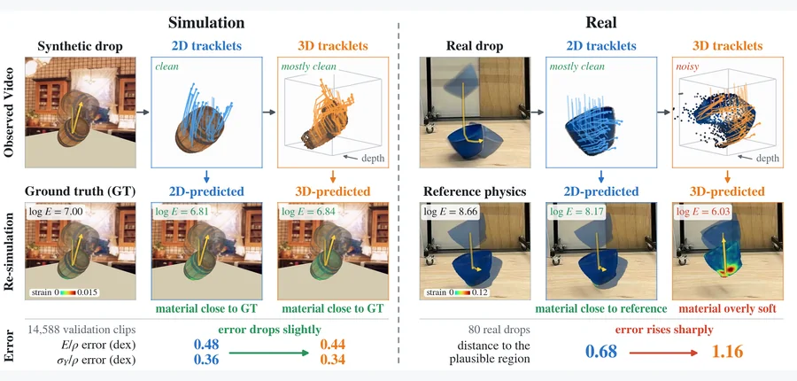 arXiv 2026-11-27 · cs.CV · #1 **[What a Drop Reveals: Sim-to-Real Material Estimation for Deformable Objects from Video](https://arxiv.org/abs/2611.34894)** [Ziyue Peng , Yanxi Hu , Junyoung Kim , Andrew Chen , Jin Yang , Chandrajit L. Bajaj , Etienne Vouga , William T. Freeman… 机构：University of Texas at Austin / Massachusetts Institute of Technology（[PDF](https://arxiv.org/pdf/2611.34894)） [Paper](https://arxiv.org/abs/2611.34894) · [Project](https://bjxdw.github.io/PhysReader/) · [图源](https://arxiv.org/html/2611.34894v1/fig/teaser.png) 

中文摘要
物体落地时如何形变，透露了它由什么材料构成。我们从一次真实跌落视频估计可形变物体的密度归一化刚度 $E/\rho$，若撞击造成塑性形变，还估计屈服应力 $\sigma_Y/\rho$；前馈预测器仅在仿真中训练。真实视频没有材料标签，因此这类预测器只能用合成数据开发和验证。我们发现，合成验证对几何输入的排序是错误的。材料通过三维形变起作用，用估计深度提升至三维的短轨迹确实是仿真中最准确的输入；但在真实跌落中它们最不准确，而且更好的深度也无法修复这一问题：训练时使用仿真器深度、测试时使用 LiDAR 深度，以及在真实跌落的渲染回放中使用精确深度，失败依然存在。短二维光流轨迹则相反：它们在仿真中没有带来提升，却迁移得最好。因此，读取材料更应依靠两域感知都能一致测得的信号，而非仿真中信息量最高的信号。我们的 PhysReader 读取视频和二维轨迹，并在仿真中通过匹配可见精确三维形变的教师，学习向三维的提升。为测量迁移，我们提出 PhysReader-Real：16 种日常物体各跌落五次；参考材料参数由各物体的多次跌落联合拟合，并通过拉伸试验检查。在 PhysReader-Real 上，PhysReader 比其他所有输入和基线更接近参考材料。唯一例外是以 PhysReader 预测为起点的逐场景优化器，它略微更接近参考值，但每段视频耗时 49 分钟，而 PhysReader 只需 12 秒。 <a href="https://arxiv.org/abs/2611.34894">原摘要来源</a>
 | 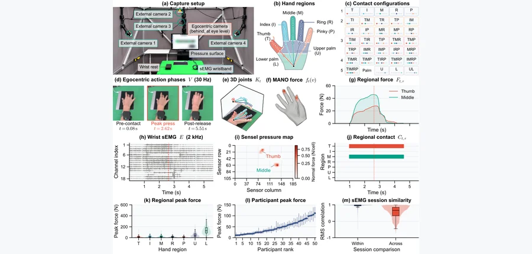 arXiv 2026-11-27 · cs.CV · #2 **[EgoMyo: Physical Hand State Estimation from Egocentric Video and Wrist Electromyography](https://arxiv.org/abs/2611.34224)** [Guanglong Sun , Kanglei Zhou , Ziteng Wang , Nana Wang , Hengkai Tan , Xiaolong Liu , Hang Su , Yi Zhong , Jun Zhu](https… 机构：Tsinghua University / GensPI Technology / AstrAlive Intelligence / Cortix AI（[PDF](https://arxiv.org/pdf/2611.34224)） [Paper](https://arxiv.org/abs/2611.34224) · [图源](https://arxiv.org/html/2611.34224v1/capture_setup_acquisition_dataset_overview.png) 

中文摘要
物理手部交互取决于构型、接触和力，但几乎相同的外观可能隐藏不同的接触状态和施力。我们因此提出从第一人称视频和腕部表面肌电（sEMG）估计物理手部状态，结合视觉几何与神经肌肉证据，联合恢复这些耦合成分。为支持该任务，我们提出 EgoMyo 基准，包含 575 万帧视频、50 名参与者、34 种接触构型和重复佩戴采集；输入与三维手部姿态，以及从裸手压力配准到手表面的接触和法向力同步。受控分析表明，视觉解析空间结构，sEMG 更善于估计力的大小；sEMG 的增益集中在视觉最不可靠的区域，而接触定位限制了力估计精度。基于这些发现，我们提出 MyoBridge，以手部区域为视觉与 sEMG 融合单元，让每个区域分别门控所用 sEMG，并在推理时仅把区域力值分配给预测的接触顶点。在留出试验上，相比最强基线，MyoBridge 将姿态和力误差分别降低 39.8% 和 18.5%，并在未见过的采集会话和受试者上取得最低姿态误差。 <a href="https://arxiv.org/abs/2611.34224">原摘要来源</a>
 | 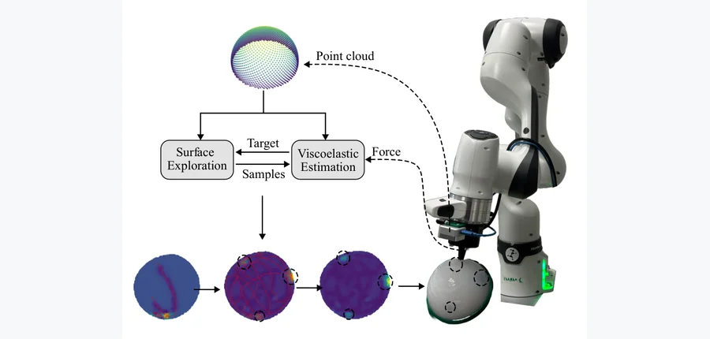 arXiv 2026-11-27 · cs.RO · #3 **[Autonomous Ergodic Robotic Palpation for Elastic Mapping of Curved Soft Tissues](https://arxiv.org/abs/2611.34670)** [Luca Beber , Cem Bilaloglu , Edoardo Lamon , Matteo Saveriano , Daniele Fontanelli , Luigi Palopoli , Sylvain Calinon](ht… 机构：University of Trento / University of Genoa / Idiap Research Institute / EPFL（[PDF](https://arxiv.org/pdf/2611.34670)） [Paper](https://arxiv.org/abs/2611.34670) · [图源](https://arxiv.org/html/2611.34670v1/overview.png) 

中文摘要
自主机器人触诊可为定位硬质包块提供可重复的组织属性定量估计。然而，现有方法常依赖预先给定的网格或平面表面假设，难以推广到复杂人体解剖结构。我们提出直接在点云表示的弯曲软表面上运行的遍历式触诊框架。其核心是 Laplace–Beltrami 算子，它将在线估计和探索都锚定在表面的内在几何上。我们用无迹 Kalman 滤波器（UKF）估计局部黏弹参数，并将它们融入具有表面感知能力的 Gaussian 过程（GP）。这一概率模型驱动基于扩散的遍历运动规划器，生成连续探索轨迹，把新的有效采样闭环反馈给 GP。期间，混合力–阻抗控制器调节交互力以维持接触。我们在仿真中与现有方法比较，并在几何与黏弹属性各异的仿组织硅胶体模上进行物理实验验证，展示了接触丰富条件下的几何一致属性映射与硬质包块定位。 <a href="https://arxiv.org/abs/2611.34670">原摘要来源</a>
 |
| 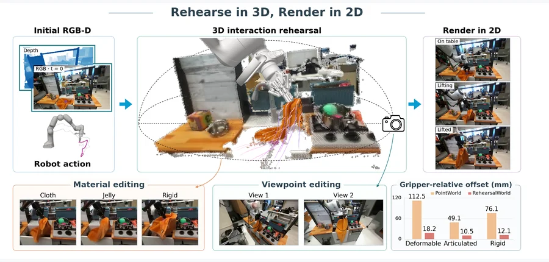 arXiv 2026-11-27 · cs.RO · #4 **[Rehearse in 3D, Render in 2D: Physically Consistent and Editable Robot World Models](https://arxiv.org/abs/2611.34288)** [Guangyu Liu , Hanzhang Wang , Huijia Zhang , Hanbei Zhan , Linjie Hu , Bin Xiao , Xuan Zhou , Dong Zhang , Hanwei Liu](ht… 机构：Tongji University / Huawei Technologies / Zhejiang University（[PDF](https://arxiv.org/pdf/2611.34288)） [Paper](https://arxiv.org/abs/2611.34288) · [图源](https://arxiv.org/html/2611.34288v1/assets/teaser_v81_compact_alignment.png) 

中文摘要
具身世界模型要预测既视觉真实又符合物理的未来交互，但仅预测显式三维运动并不能保证物体结构和接触关系得到保持。三维表示还提供了一个可施加结构与物理约束的显式状态空间。基于这一点，我们提出由三维交互预演（3DIR）驱动的可编辑机器人世界模型 RehearsalWorld。给定初始 RGB-D 观测和机器人动作，交互一致预演（ICR）以预训练三维点流模型为运动先验，并通过响应感知的物体分组、持久抓取记忆和接触结构修正器细化预测轨迹，以保持场景稳定、物体结构和抓取附着。预演对齐视频生成（RAVG）再将预演的几何投影作为时间条件；我们在投影–视频配对数据上微调视频生成器，合成真实感交互视频。由于物理响应与视觉合成分开，RehearsalWorld 还支持独立编辑材料属性和相机视角。在真实 DROID 抓取序列上，相比 PointWorld，它在可形变、关节和刚体物体上的夹爪相对偏移降低约 79%–84%，参考运动误差也更低。视频预测达到 23.92 dB PSNR 和 149 FVD。 <a href="https://arxiv.org/abs/2611.34288">原摘要来源</a>
 | 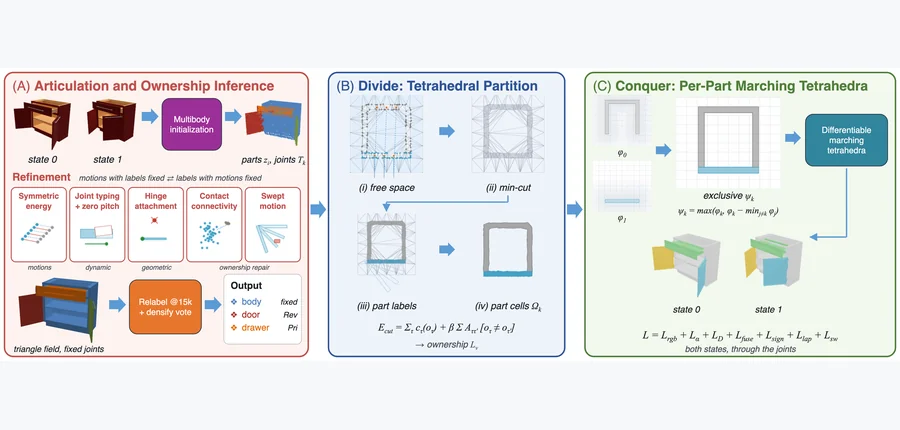 arXiv 2026-11-27 · cs.CV · #5 **[ArtTet: Watertight Part Meshes of Articulated Objects from Rigid-Body Rules and Partitioned Marching Tetrahedra](https://arxiv.org/abs/2611.33382)** [Sylvia Yuan , Dan Wang , Ravi Ramamoorthi , Xinrui Cui](https://arxiv.org/abs/2611.33382) 机构：University of California San Diego / University of Arizona / University of North Texas（[PDF](https://arxiv.org/pdf/2611.33382)） [Paper](https://arxiv.org/abs/2611.33382) · [图源](https://arxiv.org/html/2611.33382v1/figures/framework/framework.png) 

中文摘要
我们提出 ArtTet：从关节物体两个运动状态的多视角观测重建物体，为每个刚性部件输出一张水密网格及驱动它的关节。Mesh splatting 虽给出显式三角形，却把物体当成一个场景，只提取单一全局表面，无法区分不同部件的三角形；导出的网格会分层、自交且有许多孔洞。ArtTet 改用分而治之策略。首先，通过受动力学和几何约束的关节及归属推断，把物体分为刚性部件；对两个状态进行多刚体配准，恢复部件和螺旋关节。随后，关于附着、接触和扫掠运动的刚体规则在没有部件标注的情况下修正关节类型与部件标签。接着用关节四面体划分将空间分为部件单元，在共享四面体网格上为各单元分别建立可微符号距离场。分区 marching tetrahedra 的场按构造互斥，因此提取出的部件网格闭合且互不重叠。全部部件网格通过恢复的关节和两个状态的图像联合优化。在 Articulate-100 上，在无需部件掩码的方法中，ArtTet 对所有物体取得最准确的轴方向、部件运动和几何，其部件网格几乎没有开放边界；文中还展示了 SplArt 真实采集的重建。 <a href="https://arxiv.org/abs/2611.33382">原摘要来源</a>
 | 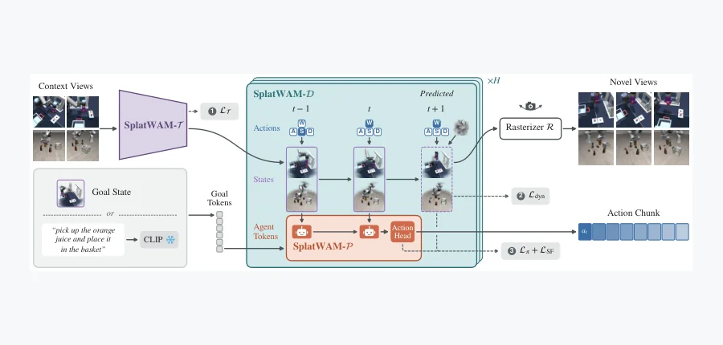 arXiv 2026-11-27 · cs.CV · #6 **[SplatWAM: Splatting World Action Models for Real-Time 3D Imagination](https://arxiv.org/abs/2611.33467)** [Frank Tsu-Fang Lu , Karthik Sundar Senthilkumar , Christopher Thirgood , Oscar Mendez , Simon Hadfield](https://arxiv.org… 机构：University of Surrey / Locus Robotics（[PDF](https://arxiv.org/pdf/2611.33467)） [Paper](https://arxiv.org/abs/2611.33467) · [图源](https://arxiv.org/html/2611.33467v1/fig_arch.png) 

中文摘要
世界模型通常在像素或潜空间预测未来观测，限制了直接表示真实三维场景演化的能力。我们提出生成式世界模型 SplatWAM（Splatting World Action Model），直接在紧凑三维 Gaussian 基元上学习动作条件动力学。分词器 SplatWAM-T 先将数量可变、未标定姿态的视角编码为固定预算的 Gaussian token；动力学模型 SplatWAM-D 再对每个动作通过一次前向传播预测未来 Gaussian 状态，采用对数欧氏协方差坐标与可微渲染监督，以支持显式三维空间中的学习。每个预测状态都可从任意视角光栅化，按构造强制跨视角共享三维表示。在 OGBench Scene 上，SplatWAM 的新视角渲染比视频世界模型快 12 倍（RTX 5090 上约 80 FPS），PSNR 最高提高 2.0 dB。我们还提出与动力学模型联合训练的轻量流匹配策略头 SplatWAM-P。在 8 组任务中，无模型 Gaussian token 策略比像素策略最高高出 24.8 个百分点。SplatWAM-P 比 Latent Particle World Model（LPWM）高 12 个百分点，且无需学习价值函数即可达到 HIQL 的水平。在 LIBERO 上，我们约 10 亿参数的模型优于 WorldVLA（约 70 亿）和经机器人预训练的 OpenVLA（约 70 亿）；当两者都不使用大规模机器人预训练时，达到 OpenVLA-OFT 的水平。代码与检查点将在未来发布。 <a href="https://arxiv.org/abs/2611.33467">原摘要来源</a>
 |
| 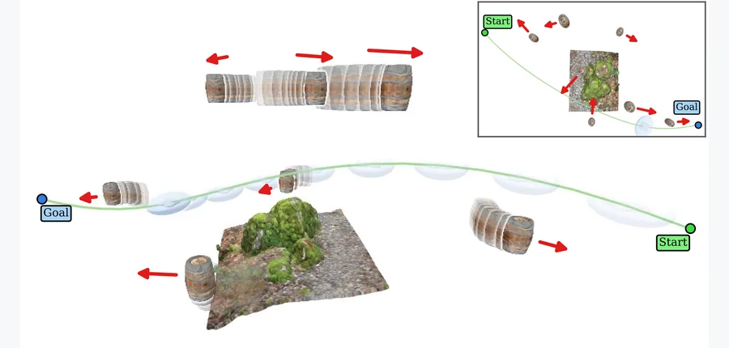 arXiv 2026-11-27 · cs.RO · #7 **[FOCI: Trajectory Optimization on Gaussian Splats for Gaussian Robots](https://arxiv.org/abs/2611.33380)** [Mario Gomez Andreu , Carlos Martinez Cuenca , Maximum Wilder-Smith , Victor Klemm , Vaishakh Patil , Marco Hutter , Jesus… 机构：affiliation 未确认 [Paper](https://arxiv.org/abs/2611.33380) · [Code](https://github.com/leggedrobotics/foci) · [Video](https://youtu.be/H8clpnsGk8s) · [图源](https://arxiv.org/html/2611.33380v1/figures/Dynamic_Environment.png) 

中文摘要
三维 Gaussian Splatting（3DGS）近年来在三维重建和新视角合成中成为比 Neural Radiance Field（NeRF）更快的替代表示。利用 3DGS 编码的空间信息，本文提出 FOCI（Field Overlap Collision Integral），可直接在 Gaussian 上优化轨迹。FOCI 以 Gaussian 间的重叠积分构建新的、可解释的 3DGS 碰撞公式。该公式适用于固定底座和移动底座机械臂、腿式机器人及无人机等不同形态，并处理静态与动态 Gaussian 环境。不同于用保守包围盒表示机器人、从而低估环境可通行性的做法，本文把环境和机器人都表示为 Gaussian Splats。这既有良好的计算性质，也支持考虑朝向的规划，使机器人能通过非常狭窄的空间。作者在合成和真实 Gaussian Splats 上广泛测试，表明即使环境由数十万个 Gaussian 构成，也可在数秒内为腿式、空中及机械臂机器人计算无碰撞轨迹。论文称代码已提供于其链接。 <a href="https://arxiv.org/abs/2611.33380">原摘要来源</a>
 | 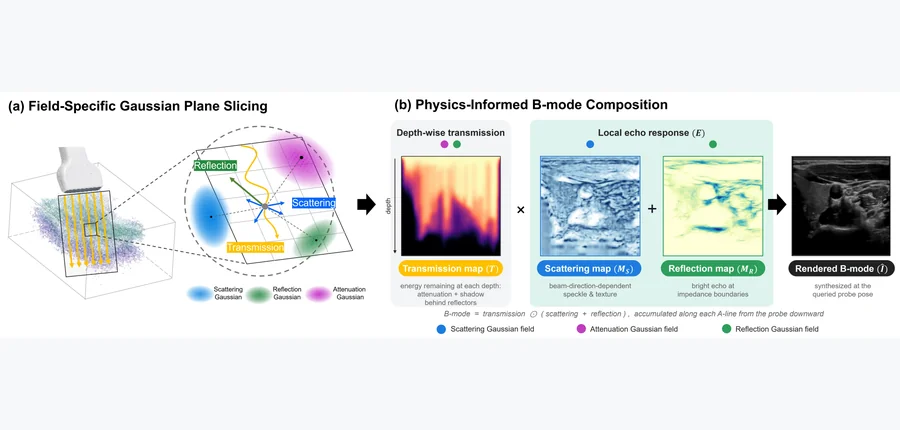 arXiv 2026-11-27 · cs.CV · #8 **[UPP-Gauss: Ultrasound Propagation Physics-informed Gaussian Splatting for B-mode Novel-View Synthesis](https://arxiv.org/abs/2611.33920)** [Guil Jung , Seok-Hwan Oh , Myeong-Gee Kim , Young-Min Kim , Hyeon-Jik Lee , Sang-Yun Kim , Hyeok-Jun Kwon , Hyuk-Sool Kwo… 机构：Barreleye / KAIST / Seoul National University Bundang Hospital（[PDF](https://arxiv.org/pdf/2611.33920)） [Paper](https://arxiv.org/abs/2611.33920) · [图源](https://arxiv.org/html/2611.33920v1/Figures/overall.jpg) 

中文摘要
准确合成 B 模式超声图像的新视角，需要建模声波在组织中的传播，以及不同探头姿态引起的外观变化。我们提出超声传播物理信息 Gaussian Splatting（UPP-Gauss），将这些声学交互纳入显式 Gaussian 表示。UPP-Gauss 根据探头姿态和声束传播方向采样三个三维 Gaussian 场，构建声学图，再依照超声传播规律组合这些图以合成 B 模式图像。在三个声学条件不同的数据集上，UPP-Gauss 以高效渲染取得最佳重建质量；各数据集相对最强基线的 PSNR 平均提高 1.43 dB。结果展示了通过显式 Gaussian 建模超声传播来准确、高效合成 B 模式新视角图像的能力。 <a href="https://arxiv.org/abs/2611.33920">原摘要来源</a>
 | 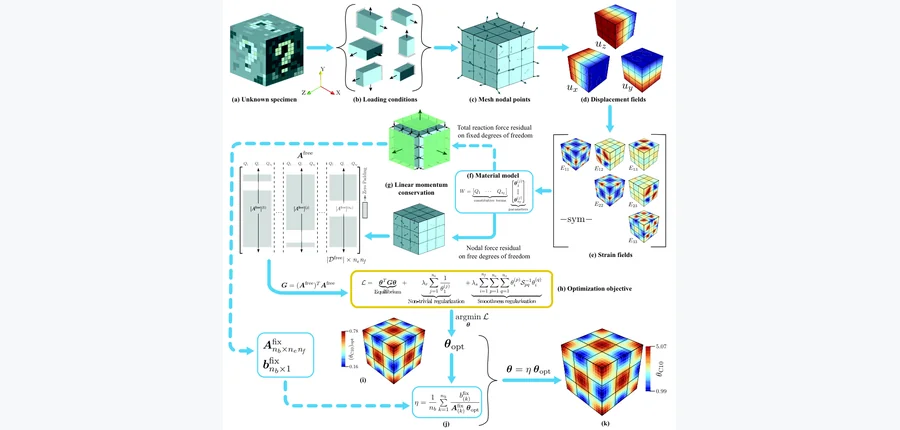 arXiv 2026-11-27 · cs.LG · #9 **[Interpretable identification of constitutive parameter field for three-dimensional heterogeneous and graded hyperelastic materials from full-field displacements](https://arxiv.org/abs/2611.34310)** [Kanhaiya Lal Chaurasiya , Vaskar Halder , Prajyot Patil , Gaurav Navnath Shinde , Debashish Das , Akshay Joshi](https://a… 机构：Indian Institute of Science, Bengaluru（[PDF](https://arxiv.org/pdf/2611.34310)） [Paper](https://arxiv.org/abs/2611.34310) · [图源](https://arxiv.org/html/2611.34310v1/fig_graphical_abstract.png) 

中文摘要
仅凭实验可获得的位移场与边界反作用力，识别非均匀固体空间变化的材料属性仍有挑战。表征非均匀及梯度固体有利于功能梯度材料和复合材料的设计制造；高效识别方法也有望用于体内测量，以表征非均匀生物组织。过去二十年虽已有多种针对均匀材料的反向识别技术，涵盖线弹性、超弹性、黏弹性和弹塑性固体，但研究非均匀及梯度材料的工作相对较少。近期若干方法使用参数量很大的深度学习框架，在材料内指定配置点强制力平衡。本文提出一种可解释且省时的框架，仅利用位移场数据，预测非均匀超弹材料多个本构参数场的三维相对空间变化。我们在涉及非均匀、梯度和各向异性超弹材料的三维合成及二维实验基准上验证。通过利用超弹材料逆问题的线性性质，直接在有限元层面优化本构参数，相比近期报道的深度学习框架，本文在显著减少计算时间的同时取得可接受的预测精度。 <a href="https://arxiv.org/abs/2611.34310">原摘要来源</a>
 |
| 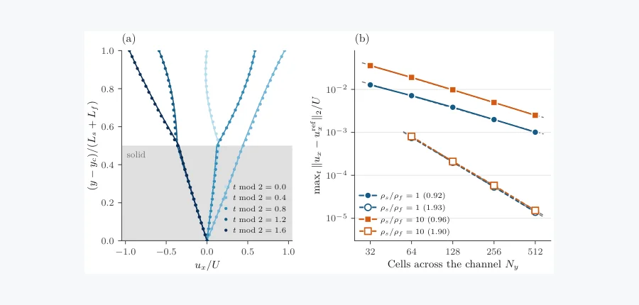 arXiv 2026-11-27 · physics.comp-ph · #10 **[A Monolithic Fully Eulerian Lattice Boltzmann Framework for Fluid--Structure Interaction with Neo-Hookean Elastic Solids](https://arxiv.org/abs/2611.34510)** [Tristan Millet , Erwan Liberge](https://arxiv.org/abs/2611.34510) 机构：Université de La Rochelle / CNRS（[PDF](https://arxiv.org/pdf/2611.34510)） [Paper](https://arxiv.org/abs/2611.34510) · [图源](https://arxiv.org/html/2611.34510v1/layers_convergence.png) 

中文摘要
我们提出一种完全 Eulerian、整体式的 lattice Boltzmann 方法，用于不同密度的不可压 Neo-Hookean 固体与流体的相互作用，并在单一笛卡尔网格上计算 Turek–Hron FSI2 和 FSI3 基准。基于压力的动力学格式推进混合动量；多项式 MTHINC 重建以闭式通量输运固体体积分数；左 Cauchy–Green 张量给出弹性应力。所有更新均为显式且局部。由于密度独立于分布函数进行输运，本文引入两项修正：格点连线修正使任意密度比下的匀速平移成为精确离散解，在 $\rho_s/\rho_f=1000$ 时验证到舍入误差级；由格式渐近分析得到的压力模态修正去除与参考系有关、否则会导致固体质量长期漂移的缺陷。验证区分了两种误差来源：固定界面厚度时，对弥散界面解具有二阶精度；当厚度随网格缩放时，对尖锐界面解具有一阶精度，与界面截断误差估计一致。方法复现了 Taylor–Green 流和顶盖驱动方腔流中的可形变圆盘，以及密度比为 1 和 10 的 FSI3 与 FSI2 基准。 <a href="https://arxiv.org/abs/2611.34510">原摘要来源</a>
 | 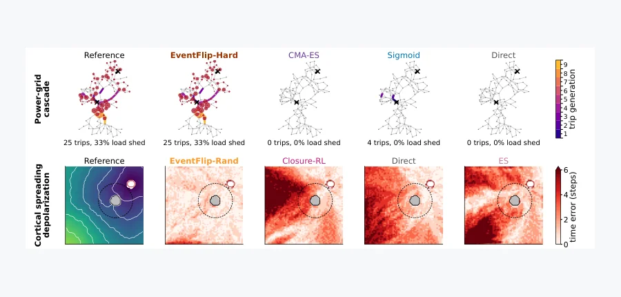 arXiv 2026-11-27 · cs.LG · #11 **[Flipping the Coins: Training Physical Simulators through Hard Switches](https://arxiv.org/abs/2611.33716)** [Tianrun Gao , Ruiqi Feng , Haomin Wen , Tailin Wu , Liangqiong Qu , Xiaomeng Huang , Ruiqi Shu](https://arxiv.org/abs/261… 机构：University of Hong Kong / Westlake University / Shanghai Innovation Institute / Tsinghua University（[PDF](https://arxiv.org/pdf/2611.33716)） [Paper](https://arxiv.org/abs/2611.33716) · [图源](https://arxiv.org/html/2611.33716v1/Fig_teaser.png) 

中文摘要
混合仿真器在物理求解器中嵌入神经网络等可学习组件，并用参考轨迹训练。许多科学求解器有硬切换，例如输电线路跳闸、网格单元起燃或脑组织去极化；当切换翻转时，损失出现离散跳变，标准自动微分只能捕捉平滑部分。现有训练范式面临根本权衡：基于梯度的松弛会平滑切换并在跳变附近引入偏差，而无导数方法将求解器视作黑箱，丢弃连续动力学的路径梯度。我们提出 EventFlip：从保存的状态翻转一个接近阈值的切换，重放原求解器，测量两次运行的损失差，实际上是在切换两侧作有限差分。通过给每个阈值加入小幅 Gaussian 噪声，我们将每次切换视为随机二元决策，推导出把连续路径梯度与反事实回放构造的跳变项相结合的无偏梯度估计器。EventFlip-Rand 优化这一噪声平均目标；EventFlip-Hard 则作用于部署时使用的确定性硬切换仿真器，并可证明针对完整的不连续损失。在相同前向评估预算下，我们在电网级联、爆轰波和皮质扩布性去极化任务上与 12 个基线比较，各任务误差均最低，分别比最强基线降低 1.5、1.4 和 1.4 倍。 <a href="https://arxiv.org/abs/2611.33716">原摘要来源</a>
 | 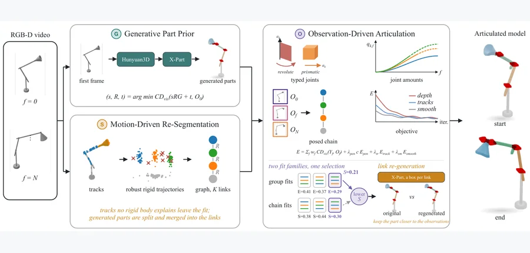 arXiv 2026-11-27 · cs.CV · #12 **[ArtKit: Motion-Driven Re-Segmentation and Link Re-Generation for Articulated Objects from RGB-D Video](https://arxiv.org/abs/2611.33403)** [Sylvia Yuan , Dan Wang , Vivian Yu , Ravi Ramamoorthi , Xinrui Cui](https://arxiv.org/abs/2611.33403) 机构：University of California San Diego / University of Arizona / University of North Texas（[PDF](https://arxiv.org/pdf/2611.33403)） [Paper](https://arxiv.org/abs/2611.33403) · [图源](https://arxiv.org/html/2611.33403v1/framework.png) 

中文摘要
一台拍摄运动物体的 RGB-D 相机通常只能从单视角看到物体的一面及部件运动。我们提出 ArtKit，以这类视频为输入，生成具有完整部件、运动学树和类型化关节的关节模型。核心思想是生成隐藏几何，再与相机所见进行核验。生成式部件先验根据第一帧提出完整、分部件的几何；按刚体轨迹分组的点轨迹再把生成部件拆分或合并为连杆。随后拟合旋转和平移关节，以可见性感知能量确保关节模型解释视频中的观测深度。一条依据视频进行检查的规则，在同步组拟合与逐帧链拟合之间选择，使同一流程适用于家居物品和机器人手等不同关节物体。最后，把所选拟合中的每个连杆重新生成为一个部件，并在其更符合观测时保留。我们在 Articulate-100 和新基准 HArt 上评估；HArt 将 60 个 PartNet-Mobility 物体及 8 只机器人手和夹爪渲染为带真实部件与关节标注的 RGB-D 视频。在物体上，ArtKit 将最强基线的轴与部件运动误差都降低超过一半，在手部上也将轴误差降低超过一半；它还可用于真实录像和生成视频。 <a href="https://arxiv.org/abs/2611.33403">原摘要来源</a>
 |
| 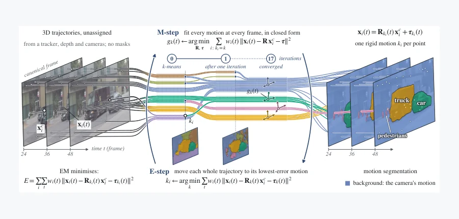 arXiv 2026-11-27 · cs.CV · #13 **[DynMF2: Rigid Motion Factorization by Expectation-Maximization for Monocular 4D Reconstruction and Motion Segmentation](https://arxiv.org/abs/2611.34931)** [Agelos Kratimenos , Yile Hua , Kostas Daniilidis](https://arxiv.org/abs/2611.34931) 机构：University of Pennsylvania / Robotics Institute, Athena RC（[PDF](https://arxiv.org/pdf/2611.34931)） [Paper](https://arxiv.org/abs/2611.34931) · [图源](https://arxiv.org/html/2611.34931v1/overview.png) 

中文摘要
单段随手拍摄的视频使运动场景重建欠约束：一个从不同位置各被看见一次的点，可以朝向或远离相机滑动而仍匹配每帧。我们用运动本身的结构约束重建。在 DynMF 基础上，我们把场景运动建模为少数几条刚性的 SE(3) 轨迹，每个点只跟随其中一条，不进行混合。DynMF2 不通过渲染，而是直接从三维点轨迹用期望最大化（EM）求解该分解：M 步以闭式方法把每项刚体运动拟合到被分配的点；E 步把每个点重新分配给误差最小的运动。背景只是另一项运动，即相机运动，因此不需要掩码。随后用三种工具修正分解：requery 在渲染暴露跟踪器遗漏部件处补充轨迹；merge 合并同步运动；split 分开不同运动，因此运动数量由场景决定。无需掩码，DynMF2 在 iPhone 和 NVIDIA 数据的新视角合成以及 iPhone 三维跟踪上明显优于依赖掩码的基线。它恢复掩码遗漏的细部、薄部件和远处小型运动物体。尽管从未训练做分割，其运动在 MOVi-F 和 iTACO 场景中也能有竞争力地分割运动部件。场景里什么在运动并非预先决定，而是从刚体运动本身显现。 <a href="https://arxiv.org/abs/2611.34931">原摘要来源</a>
 | 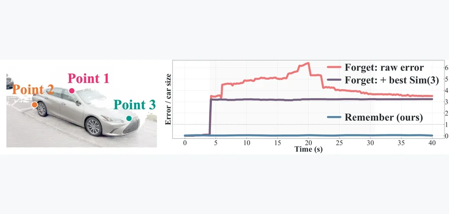 arXiv 2026-11-27 · cs.CV · #14 **[Recall4D: Forgetting, Not Misalignment, Limits Long-Horizon Feed-Forward 4D Reconstruction](https://arxiv.org/abs/2611.33655)** [Tianle Lyu](https://arxiv.org/abs/2611.33655) 机构：Carnegie Mellon University（[PDF](https://arxiv.org/pdf/2611.33655)） [Paper](https://arxiv.org/abs/2611.33655) · [图源](https://arxiv.org/html/2611.33655v1/fig2_top.png) 

中文摘要
前馈式四维跟踪器能从短视频恢复相机运动、深度和点轨迹，但把多个时间窗口串联用于长视频时精度下降。我们发现，即使用真实变换替代窗口间配准，跟踪误差也基本不变。相反，静态点误差随其最后一次被观测后的时间增长：在不再看见该点的窗口中重复预测，会破坏已恢复的几何。我们称此为“遗忘”。无需修改跟踪器，仅保留不可见点最后一次被观测的位置，就能使 PointOdyssey 误差降低 26%。我们提出无需训练的 Recall4D，以持久世界状态和稀疏运动锚点增强冻结的跟踪器。静态点离开视野后保留其世界坐标位置，在可见时通过对稀疏关键帧解码的观测取平均来细化。对动态物体，跟踪器解码稀疏代表锚点，几何蒙皮把位移传递给密集查询。在两个长时基准上，Recall4D 提高骨干精度，同时速度快 7.6–9.0 倍；精度增益也迁移到另外五个骨干和三个长序列任务，体现其通用性。 <a href="https://arxiv.org/abs/2611.33655">原摘要来源</a>
 | 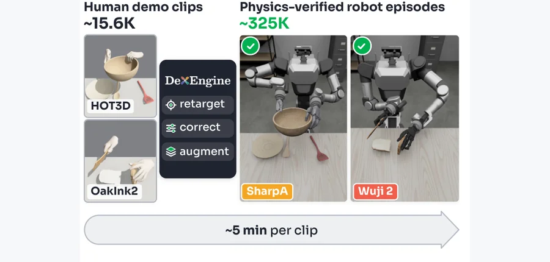 arXiv 2026-11-27 · cs.RO · #15 **[DexEngine: Scaling Human Demonstrations into Physically Executable Whole-Robot Data](https://arxiv.org/abs/2611.33579)** [Wongyun Yu , Honggeun Kim , Donguk Lee , Minchan Kim , Kyoung Whan Choe , Minsu Cho](https://arxiv.org/abs/2611.33579) 机构：POSTECH / RLWRLD（[PDF](https://arxiv.org/pdf/2611.33579)） [Paper](https://arxiv.org/abs/2611.33579) · [Code](https://github.com/wongyun-yu/DexEngine) · [Project](https://wongyun-yu.github.io/dexengine/) · [Data](https://huggingface.co/datasets/Wongyun/DexEngine) · [图源](https://arxiv.org/pdf/2611.33579) 

中文摘要
近期许多工作将人手物演示重定向到机器人手，但训练整机策略要求重定向运动在运动学上可行、物理上可执行，且能高效批量生成。我们提出 DexEngine 仿真流程，将人类操作数据转换为可用于训练、物理可执行的机械臂–手轨迹。DexEngine 先把每段手物运动放到机械臂可达的位置，寻找跟随人手的机械臂运动，再在物理仿真中用残差强化学习修正。基于九个人类手物数据集，我们为四种灵巧手各生成约 5,200 段片段，增强后总计 65,000 条轨迹（116 小时）及 325,000 个 episode（578 小时）。即便连接机械臂，DexEngine 的物体跟踪也优于既有悬浮手方法，运行速度比基于强化学习的方法快 10 倍以上。用其数据训练的策略远优于使用相同片段但没有物理修正、或先修正悬浮手再接上机械臂的数据所训练的策略，说明微调数据需要物理修正。在相同微调预算下，用这些数据进行中期训练还能进一步提高仿真和真实机器人上的表现。 <a href="https://arxiv.org/abs/2611.33579">原摘要来源</a>
 |
| 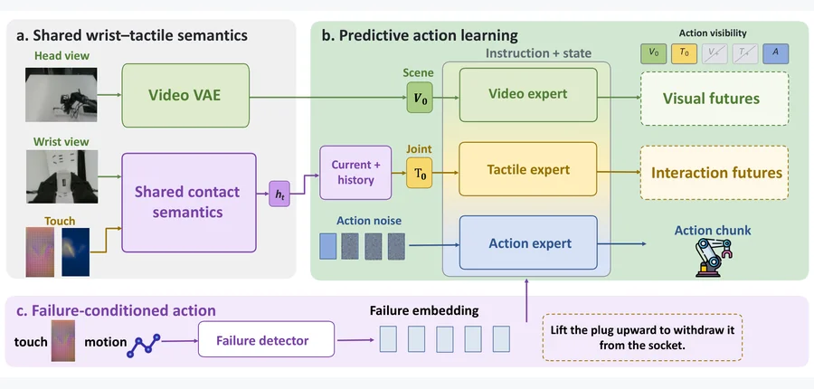 arXiv 2026-11-27 · cs.RO · #16 **[CoTacWAM: Joint Modeling of Vision and Touch for Robotic Manipulation](https://arxiv.org/abs/2611.34117)** [Lei Jin , Yiding Ma , Zhuohang Li , Jiachen Liu , Zibo Zhu , Kairui Liu , Chen Gao , Wei Wu , Yong Li](https://arxiv.org/… 机构：Tsinghua University / Beihang University / Manifold AI（[PDF](https://arxiv.org/pdf/2611.34117)） [Paper](https://arxiv.org/abs/2611.34117) · [图源](https://arxiv.org/html/2611.34117v1/method_overview.png) 

中文摘要
我们提出 CoTacWAM，一种学习腕部视觉与触觉之间共享接触语义的世界动作模型，在本文的常规操作及输入缺失评测中取得所观察到的最佳表现。两种模态通过不同信号观察同一局部交互：腕部图像显示附近几何，触觉记录物理接触。方法连接二者共同的接触意义，同时保留各模态独有的证据，使策略在不同可用输入组合下都获得联合交互描述。这一表示支持结合头部视角场景上下文的预测式动作学习，并在独立检测器确认尝试失败后为修正动作提供条件。四项真实世界任务的实验显示，其操作表现优于所评估的基线，对局部观测缺失有鲁棒性，自主重试还带来额外收益。 <a href="https://arxiv.org/abs/2611.34117">原摘要来源</a>
 | 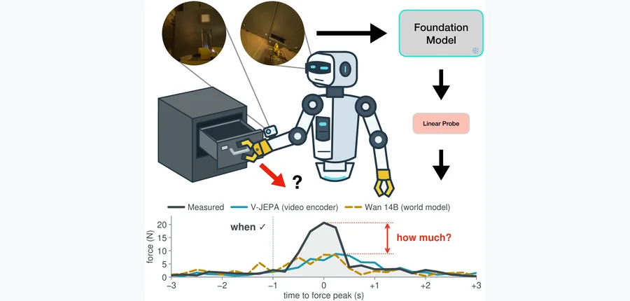 arXiv 2026-11-27 · cs.CV · #17 **[Can Visual World Models See Force?](https://arxiv.org/abs/2611.34422)** [Felix Tristram , Benjamin D. Killeen , Nassir Navab](https://arxiv.org/abs/2611.34422) 机构：Technical University of Munich / Munich Center for Machine Learning（[PDF](https://arxiv.org/pdf/2611.34422)） [Paper](https://arxiv.org/abs/2611.34422) · [图源](https://arxiv.org/html/2611.34422v1/teaser.png) 

中文摘要
世界模型和视觉语言动作（VLA）策略模型正越来越多地被视为机器人操作的基础。它们预测场景如何演化及应采取什么动作，但成功操作除遵循可见轨迹外，还取决于隐藏的交互力。神经生理学研究显示人类对这一隐藏变量具有视觉先验，因此本文追问：视觉基础模型的表示是否也包含交互中的力？我们把力感知定义为表示能够：（1）指出何时施加了接触力；（2）追踪交互过程中力的变化；（3）反映力的大小。我们使用两个操作数据集中同步采集的视频和力测量，训练轻量读出器，探测冻结的图像、视频、世界模型及策略模型表示。实验显示，多数模型能捕捉接触何时发生，却不能捕捉施力有多大。出人意料的是，机器人后训练也未改善这一点，揭示了当前模型能力中的重要缺口。 <a href="https://arxiv.org/abs/2611.34422">原摘要来源</a>
 | 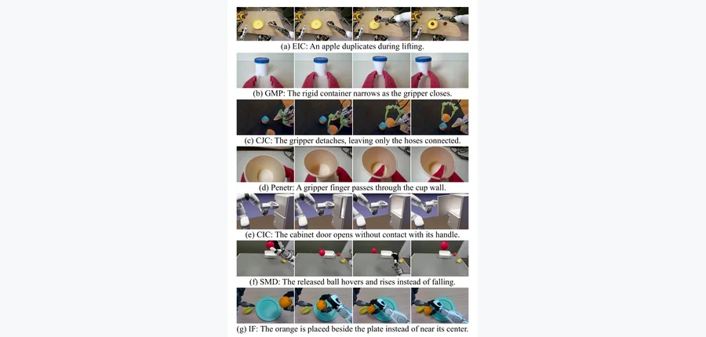 arXiv 2026-11-27 · cs.RO · #18 **[WorldPhy: Benchmarking Fine-Grained Physical Plausibility of World Models in Robotics](https://arxiv.org/abs/2611.34130)** [Ziyuan Chu , Mingzhi Zheng , Kaiyue Zhang , Jinan Zhang , Linchao Zhu](https://arxiv.org/abs/2611.34130) 机构：Zhejiang University / Nanjing University（[PDF](https://arxiv.org/pdf/2611.34130)） [Paper](https://arxiv.org/abs/2611.34130) · [图源](https://arxiv.org/html/2611.34130v1/worldphy_violations.png) 

中文摘要
世界模型越来越多地用于机器人系统，以提升具身模型表现。相比通用视频生成，机器人对世界模型要求更严格：生成视频必须满足机器人运动和物体交互的细粒度物理约束。然而，现有基准可能忽略机器人特有的物理细节，也难以准确评估。为此，我们提出 WorldPhy，面向机器人世界模型的细粒度物理合理性评测基准。基准包含 300 个任务，每项由初始帧图像和任务指令组成，覆盖不同机器人场景、任务类别、视角和机器人构型。我们还收集超过 1.2 万条高质量人工标注，用于训练 WorldPhyReward，使其对六个细粒度物理维度及一个指令遵循维度给出分数和原因。与通用 VLM 和现有奖励模型比较，WorldPhyReward 与人工评分更一致。我们系统评估了 13 个前沿开源和闭源世界模型，发现它们在不同机器人场景下尚不能稳定保持细粒度物理合理性。论文称代码已通过其链接提供。 <a href="https://arxiv.org/abs/2611.34130">原摘要来源</a>
 |
| 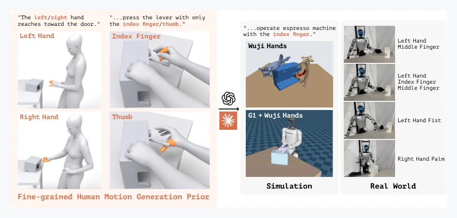 arXiv 2026-11-27 · cs.RO · #19 **[FineDex: Bridging Fine-Grained Human-Object Interaction Generation to Dexterous Humanoid Manipulation](https://arxiv.org/abs/2611.34884)** [Yujia Zeng , Yuxin Chen , Yuzhen Song , Runhan Huang , Chensheng Peng , Yiyang Shao , Koushil Sreenath , Masayoshi Tomizu… 机构：University of California, Berkeley / Harvard University（[PDF](https://arxiv.org/pdf/2611.34884)） [Paper](https://arxiv.org/abs/2611.34884) · [Project](https://finedex.github.io/) · [图源](https://arxiv.org/html/2611.34884v1/teaser.png) 

中文摘要
灵巧操作的核心是手指级控制，但现有灵巧操作和手物交互（HOI）生成方法很少允许指定交互如何完成：五指手常被简化成夹爪，或直接复制某次人类演示中的手指用法。我们提出 FineDex，使手指级意图既可表达又可执行。FineDex 学习协调的人体、手和物体运动，遵循关于用哪只手、具体手指以及如何接触关节物体的细粒度指令。为连接生成与执行，它把生成的交互作为可行动先验，让智能体在基于物理的数字孪生中练习，探索物理可行的接触策略。通过测试时适应而无需针对每个实例重新训练，FineDex 能泛化到不同的细粒度指令和物体构型。实验展示了当前最佳的 HOI 生成质量和细粒度可控性、灵巧操作成功率的大幅提升，以及在真实灵巧人形机器人上的成功部署。 <a href="https://arxiv.org/abs/2611.34884">原摘要来源</a>
 | 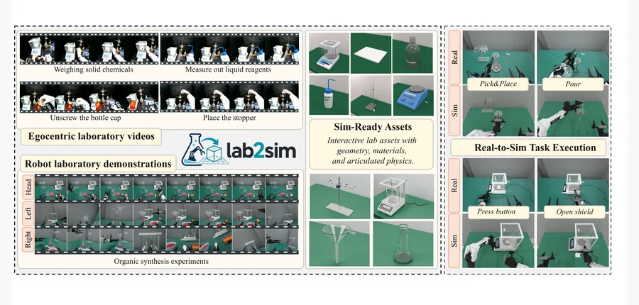 arXiv 2026-11-27 · cs.RO · #20 **[Lab2Sim: Agentic Generation of Interactive Laboratory Equipment from Operation Videos](https://arxiv.org/abs/2611.33705)** [Yuxin Lin , Pei Ren , Yirong Yang , Xuxin Lv , Xingchuang Liao , Diyuan Hou , Jiale He , Zhengping Che , Yongfei Zhang… 机构：Beihang University / Beijing Humanoid Robot Innovation Center（[PDF](https://arxiv.org/pdf/2611.33705)） [Paper](https://arxiv.org/abs/2611.33705) · [图源](https://arxiv.org/html/2611.33705v1/teaser123.png) 

中文摘要
生成能忠实再现真实实验设备外观、结构和关节运动的资产仍有挑战。现有方法难以从操作视频中为所有可见设备直接生成仿真资产，也难以忠实再现外观、关节运动和内部空腔。为此，我们提出 Lab2Sim，从第一人称或多视角操作视频生成可编辑、可用于仿真的实验室设备资产的多智能体框架。它包含四个专门模块：Evidence Agent 结合视频观测与实验室知识，指定设备部件、材料和功能要求，指导 Asset Agent 构建可编辑 Blender 资产；独立的 Verifier 对照证据与要求检查几何和外观，并给出有针对性的修改反馈；Simulation Integration Agent 把核验过的 Blender 资产转为具有物理属性和关节机制的仿真实例，利用执行反馈细化行为。在人和机器人实验室场景上的实验表明，Lab2Sim 的视觉保真度和交互能力优于编码智能体及 real-to-sim 基线，包括使用相同底层模型的 Codex 基线。作者还展示了阀门控制排水，并用生成的资产库在 RoboTwin 中重建实验室场景和操作，以支持可复用的机器人实验室任务仿真环境。 <a href="https://arxiv.org/abs/2611.33705">原摘要来源</a>
 |   |
<!-- PAPER_CARDS_END -->

## 检索概况

- **检索窗口**：北京时间 2026-11-26 09:09 至 2026-11-27 09:12；14 个 arXiv 官方分类页的 `New submissions`。
- **官方最新批次**：Thursday, 26 November 2026；不同于上一期 Wednesday, 25 November 2026。
- **总命中／去重／入选**：官方 New 共 **691 条**，按 arXiv ID 去重后 **691 篇**；本期入选 **20 篇**。Cross-lists 和 Replacements 不进入主榜。
- **筛选口径**：逐篇阅读官方列表标题与完整摘要；三维物理、接触、形变优先，具体机器人方法随后。相关性、阅读优先级、局限与改进为**编辑推断**。
- **缺原摘要／缺图**：0 篇／0 篇（20 篇均有对应官方论文 HTML 或 PDF 配图）。

## 官方 New listing 状态

| 分类页 | listing 日期 | New |
|---|---|---:|
| [cs.CV](https://arxiv.org/list/cs.CV/new?show=2000) | 2026-11-26 | 242 |
| [cs.GR](https://arxiv.org/list/cs.GR/new?show=2000) | 2026-11-26 | 3 |
| [cs.RO](https://arxiv.org/list/cs.RO/new?show=2000) | 2026-11-26 | 89 |
| [cs.AI](https://arxiv.org/list/cs.AI/new?show=2000) | 2026-11-26 | 77 |
| [cs.LG](https://arxiv.org/list/cs.LG/new?show=2000) | 2026-11-26 | 143 |
| [physics.flu-dyn](https://arxiv.org/list/physics.flu-dyn/new?show=2000) | 2026-11-26 | 10 |
| [physics.comp-ph](https://arxiv.org/list/physics.comp-ph/new?show=2000) | 2026-11-26 | 6 |
| [cond-mat.soft](https://arxiv.org/list/cond-mat.soft/new?show=2000) | 2026-11-26 | 7 |
| [cond-mat.mtrl-sci](https://arxiv.org/list/cond-mat.mtrl-sci/new?show=2000) | 2026-11-26 | 32 |
| [eess.IV](https://arxiv.org/list/eess.IV/new?show=2000) | 2026-11-26 | 10 |
| [eess.SP](https://arxiv.org/list/eess.SP/new?show=2000) | 2026-11-26 | 14 |
| [eess.SY](https://arxiv.org/list/eess.SY/new?show=2000) | 2026-11-26 | 20 |
| [math.NA](https://arxiv.org/list/math.NA/new?show=2000) | 2026-11-26 | 24 |
| [stat.ML](https://arxiv.org/list/stat.ML/new?show=2000) | 2026-11-26 | 14 |
| **合计** | — | **691** |

## Top papers

| # | 论文 | 分类 | 作者 | 机构（PDF 首页） | 相关性（编辑推断） | 机构强度（编辑推断） | 阅读优先级（编辑推断） |
|---:|---|---|---|---|---|---|---|
| 1 | [What a Drop Reveals: Sim-to-Real Material Estimation for Deformable Objects from Video](https://arxiv.org/abs/2611.34894) | [cs.CV](https://arxiv.org/abs/2611.34894) | [Ziyue Peng , Yanxi Hu , Junyoung Kim , Andrew Chen , Jin Yang , Chandrajit L. Bajaj , Etienne Vouga , William T. Freeman , Qixing Huang , Brandon Y. Feng](https://arxiv.org/abs/2611.34894) | University of Texas at Austin / Massachusetts Institute of Technology（[PDF](https://arxiv.org/pdf/2611.34894)） | 视频跌落反演软体材料参数 | 未独立评级 | A |
| 2 | [EgoMyo: Physical Hand State Estimation from Egocentric Video and Wrist Electromyography](https://arxiv.org/abs/2611.34224) | [cs.CV](https://arxiv.org/abs/2611.34224) | [Guanglong Sun , Kanglei Zhou , Ziteng Wang , Nana Wang , Hengkai Tan , Xiaolong Liu , Hang Su , Yi Zhong , Jun Zhu](https://arxiv.org/abs/2611.34224) | Tsinghua University / GensPI Technology / AstrAlive Intelligence / Cortix AI（[PDF](https://arxiv.org/pdf/2611.34224)） | 视觉与腕部肌电联合估计三维手姿、接触和法向力 | 未独立评级 | A |
| 3 | [Autonomous Ergodic Robotic Palpation for Elastic Mapping of Curved Soft Tissues](https://arxiv.org/abs/2611.34670) | [cs.RO](https://arxiv.org/abs/2611.34670) | [Luca Beber , Cem Bilaloglu , Edoardo Lamon , Matteo Saveriano , Daniele Fontanelli , Luigi Palopoli , Sylvain Calinon](https://arxiv.org/abs/2611.34670) | University of Trento / University of Genoa / Idiap Research Institute / EPFL（[PDF](https://arxiv.org/pdf/2611.34670)） | 点云曲面上以内在几何驱动触诊和黏弹性映射 | 未独立评级 | A |
| 4 | [Rehearse in 3D, Render in 2D: Physically Consistent and Editable Robot World Models](https://arxiv.org/abs/2611.34288) | [cs.RO](https://arxiv.org/abs/2611.34288) | [Guangyu Liu , Hanzhang Wang , Huijia Zhang , Hanbei Zhan , Linjie Hu , Bin Xiao , Xuan Zhou , Dong Zhang , Hanwei Liu](https://arxiv.org/abs/2611.34288) | Tongji University / Huawei Technologies / Zhejiang University（[PDF](https://arxiv.org/pdf/2611.34288)） | 三维点流经物体分组、抓取记忆和接触修正后引导视频生成 | 未独立评级 | A |
| 5 | [ArtTet: Watertight Part Meshes of Articulated Objects from Rigid-Body Rules and Partitioned Marching Tetrahedra](https://arxiv.org/abs/2611.33382) | [cs.CV](https://arxiv.org/abs/2611.33382) | [Sylvia Yuan , Dan Wang , Ravi Ramamoorthi , Xinrui Cui](https://arxiv.org/abs/2611.33382) | University of California San Diego / University of Arizona / University of North Texas（[PDF](https://arxiv.org/pdf/2611.33382)） | 刚体规则及分区四面体场生成各部件水密网格 | 未独立评级 | A |
| 6 | [SplatWAM: Splatting World Action Models for Real-Time 3D Imagination](https://arxiv.org/abs/2611.33467) | [cs.CV](https://arxiv.org/abs/2611.33467) | [Frank Tsu-Fang Lu , Karthik Sundar Senthilkumar , Christopher Thirgood , Oscar Mendez , Simon Hadfield](https://arxiv.org/abs/2611.33467) | University of Surrey / Locus Robotics（[PDF](https://arxiv.org/pdf/2611.33467)） | 动作条件三维 Gaussian token 预测及策略头 | 未独立评级 | A |
| 7 | [FOCI: Trajectory Optimization on Gaussian Splats for Gaussian Robots](https://arxiv.org/abs/2611.33380) | [cs.RO](https://arxiv.org/abs/2611.33380) | [Mario Gomez Andreu , Carlos Martinez Cuenca , Maximum Wilder-Smith , Victor Klemm , Vaishakh Patil , Marco Hutter , Jesus Tordesillas](https://arxiv.org/abs/2611.33380) | affiliation 未确认 | Gaussian 重叠积分定义可优化的机器人碰撞量 | 未独立评级 | A |
| 8 | [UPP-Gauss: Ultrasound Propagation Physics-informed Gaussian Splatting for B-mode Novel-View Synthesis](https://arxiv.org/abs/2611.33920) | [cs.CV](https://arxiv.org/abs/2611.33920) | [Guil Jung , Seok-Hwan Oh , Myeong-Gee Kim , Young-Min Kim , Hyeon-Jik Lee , Sang-Yun Kim , Hyeok-Jun Kwon , Hyuk-Sool Kwon , Hyeon-Min Bae](https://arxiv.org/abs/2611.33920) | Barreleye / KAIST / Seoul National University Bundang Hospital（[PDF](https://arxiv.org/pdf/2611.33920)） | 三种三维 Gaussian 场和声传播组合合成 B 模超声 | 未独立评级 | A |
| 9 | [Interpretable identification of constitutive parameter field for three-dimensional heterogeneous and graded hyperelastic materials from full-field displacements](https://arxiv.org/abs/2611.34310) | [cs.LG](https://arxiv.org/abs/2611.34310) | [Kanhaiya Lal Chaurasiya , Vaskar Halder , Prajyot Patil , Gaurav Navnath Shinde , Debashish Das , Akshay Joshi](https://arxiv.org/abs/2611.34310) | Indian Institute of Science, Bengaluru（[PDF](https://arxiv.org/pdf/2611.34310)） | 有限元层直接反演三维非均匀超弹本构参数场 | 未独立评级 | A |
| 10 | [A Monolithic Fully Eulerian Lattice Boltzmann Framework for Fluid--Structure Interaction with Neo-Hookean Elastic Solids](https://arxiv.org/abs/2611.34510) | [physics.comp-ph](https://arxiv.org/abs/2611.34510) | [Tristan Millet , Erwan Liberge](https://arxiv.org/abs/2611.34510) | Université de La Rochelle / CNRS（[PDF](https://arxiv.org/pdf/2611.34510)） | 完全 Eulerian 的单网格 Neo-Hookean 流固耦合 | 未独立评级 | A |
| 11 | [Flipping the Coins: Training Physical Simulators through Hard Switches](https://arxiv.org/abs/2611.33716) | [cs.LG](https://arxiv.org/abs/2611.33716) | [Tianrun Gao , Ruiqi Feng , Haomin Wen , Tailin Wu , Liangqiong Qu , Xiaomeng Huang , Ruiqi Shu](https://arxiv.org/abs/2611.33716) | University of Hong Kong / Westlake University / Shanghai Innovation Institute / Tsinghua University（[PDF](https://arxiv.org/pdf/2611.33716)） | 硬切换前后反事实回放补全仿真器梯度 | 未独立评级 | A |
| 12 | [ArtKit: Motion-Driven Re-Segmentation and Link Re-Generation for Articulated Objects from RGB-D Video](https://arxiv.org/abs/2611.33403) | [cs.CV](https://arxiv.org/abs/2611.33403) | [Sylvia Yuan , Dan Wang , Vivian Yu , Ravi Ramamoorthi , Xinrui Cui](https://arxiv.org/abs/2611.33403) | University of California San Diego / University of Arizona / University of North Texas（[PDF](https://arxiv.org/pdf/2611.33403)） | 生成隐藏部件并用 RGB-D 运动轨迹核验关节模型 | 未独立评级 | B |
| 13 | [DynMF2: Rigid Motion Factorization by Expectation-Maximization for Monocular 4D Reconstruction and Motion Segmentation](https://arxiv.org/abs/2611.34931) | [cs.CV](https://arxiv.org/abs/2611.34931) | [Agelos Kratimenos , Yile Hua , Kostas Daniilidis](https://arxiv.org/abs/2611.34931) | University of Pennsylvania / Robotics Institute, Athena RC（[PDF](https://arxiv.org/pdf/2611.34931)） | EM 将三维点轨迹分解为互斥 SE(3) 刚体运动 | 未独立评级 | B |
| 14 | [Recall4D: Forgetting, Not Misalignment, Limits Long-Horizon Feed-Forward 4D Reconstruction](https://arxiv.org/abs/2611.33655) | [cs.CV](https://arxiv.org/abs/2611.33655) | [Tianle Lyu](https://arxiv.org/abs/2611.33655) | Carnegie Mellon University（[PDF](https://arxiv.org/pdf/2611.33655)） | 保留离视野静态点并以稀疏运动锚点更新动态点 | 未独立评级 | B |
| 15 | [DexEngine: Scaling Human Demonstrations into Physically Executable Whole-Robot Data](https://arxiv.org/abs/2611.33579) | [cs.RO](https://arxiv.org/abs/2611.33579) | [Wongyun Yu , Honggeun Kim , Donguk Lee , Minchan Kim , Kyoung Whan Choe , Minsu Cho](https://arxiv.org/abs/2611.33579) | POSTECH / RLWRLD（[PDF](https://arxiv.org/pdf/2611.33579)） | 人类手物演示经机械臂可达性和物理残差修正生成数据 | 未独立评级 | B |
| 16 | [CoTacWAM: Joint Modeling of Vision and Touch for Robotic Manipulation](https://arxiv.org/abs/2611.34117) | [cs.RO](https://arxiv.org/abs/2611.34117) | [Lei Jin , Yiding Ma , Zhuohang Li , Jiachen Liu , Zibo Zhu , Kairui Liu , Chen Gao , Wei Wu , Yong Li](https://arxiv.org/abs/2611.34117) | Tsinghua University / Beihang University / Manifold AI（[PDF](https://arxiv.org/pdf/2611.34117)） | 腕部视觉与触觉共享接触语义并支持失败重试 | 未独立评级 | B |
| 17 | [Can Visual World Models See Force?](https://arxiv.org/abs/2611.34422) | [cs.CV](https://arxiv.org/abs/2611.34422) | [Felix Tristram , Benjamin D. Killeen , Nassir Navab](https://arxiv.org/abs/2611.34422) | Technical University of Munich / Munich Center for Machine Learning（[PDF](https://arxiv.org/pdf/2611.34422)） | 轻量读出器探测冻结视觉世界模型中的力信息 | 未独立评级 | B |
| 18 | [WorldPhy: Benchmarking Fine-Grained Physical Plausibility of World Models in Robotics](https://arxiv.org/abs/2611.34130) | [cs.RO](https://arxiv.org/abs/2611.34130) | [Ziyuan Chu , Mingzhi Zheng , Kaiyue Zhang , Jinan Zhang , Linchao Zhu](https://arxiv.org/abs/2611.34130) | Zhejiang University / Nanjing University（[PDF](https://arxiv.org/pdf/2611.34130)） | 按机器人运动和物体交互细分物理合理性评测 | 未独立评级 | B |
| 19 | [FineDex: Bridging Fine-Grained Human-Object Interaction Generation to Dexterous Humanoid Manipulation](https://arxiv.org/abs/2611.34884) | [cs.RO](https://arxiv.org/abs/2611.34884) | [Yujia Zeng , Yuxin Chen , Yuzhen Song , Runhan Huang , Chensheng Peng , Yiyang Shao , Koushil Sreenath , Masayoshi Tomizuka , Yilun Du](https://arxiv.org/abs/2611.34884) | University of California, Berkeley / Harvard University（[PDF](https://arxiv.org/pdf/2611.34884)） | 指令控制手指级 HOI 生成并在物理数字孪生中搜索接触策略 | 未独立评级 | B |
| 20 | [Lab2Sim: Agentic Generation of Interactive Laboratory Equipment from Operation Videos](https://arxiv.org/abs/2611.33705) | [cs.RO](https://arxiv.org/abs/2611.33705) | [Yuxin Lin , Pei Ren , Yirong Yang , Xuxin Lv , Xingchuang Liao , Diyuan Hou , Jiale He , Zhengping Che , Yongfei Zhang , Wenjun Wu , Zhaoxin Fan](https://arxiv.org/abs/2611.33705) | Beihang University / Beijing Humanoid Robot Innovation Center（[PDF](https://arxiv.org/pdf/2611.33705)） | 视频证据驱动可编辑实验设备资产及关节物理生成 | 未独立评级 | B |

## 逐篇中文要点

### 1. [What a Drop Reveals: Sim-to-Real Material Estimation for Deformable Objects from Video](https://arxiv.org/abs/2611.34894)

- **论文事实／方法**：视频跌落反演软体材料参数（[原摘要](https://arxiv.org/abs/2611.34894)）
- **论文事实／结果**：二维轨迹真实域迁移优于三维提升；16 种物体各跌落五次（[原摘要](https://arxiv.org/abs/2611.34894)）
- **编辑推断／局限与改进**：需检查相机帧率、视角与地面接触变化下的稳健性。

### 2. [EgoMyo: Physical Hand State Estimation from Egocentric Video and Wrist Electromyography](https://arxiv.org/abs/2611.34224)

- **论文事实／方法**：视觉与腕部肌电联合估计三维手姿、接触和法向力（[原摘要](https://arxiv.org/abs/2611.34224)）
- **论文事实／结果**：575 万帧、50 人；姿态及力误差分别下降 39.8% 和 18.5%（[原摘要](https://arxiv.org/abs/2611.34224)）
- **编辑推断／局限与改进**：需检验跨设备肌电标定及不同负载下的力泛化。

### 3. [Autonomous Ergodic Robotic Palpation for Elastic Mapping of Curved Soft Tissues](https://arxiv.org/abs/2611.34670)

- **论文事实／方法**：点云曲面上以内在几何驱动触诊和黏弹性映射（[原摘要](https://arxiv.org/abs/2611.34670)）
- **论文事实／结果**：仿真及硅胶体模实验支持弯曲表面硬包块定位（[原摘要](https://arxiv.org/abs/2611.34670)）
- **编辑推断／局限与改进**：还需人体组织、传感噪声和安全力上限验证。

### 4. [Rehearse in 3D, Render in 2D: Physically Consistent and Editable Robot World Models](https://arxiv.org/abs/2611.34288)

- **论文事实／方法**：三维点流经物体分组、抓取记忆和接触修正后引导视频生成（[原摘要](https://arxiv.org/abs/2611.34288)）
- **论文事实／结果**：DROID 序列的夹爪相对偏移降低约 79%–84%（[原摘要](https://arxiv.org/abs/2611.34288)）
- **编辑推断／局限与改进**：应验证长期多次接触和材料编辑是否保持动力学一致。

### 5. [ArtTet: Watertight Part Meshes of Articulated Objects from Rigid-Body Rules and Partitioned Marching Tetrahedra](https://arxiv.org/abs/2611.33382)

- **论文事实／方法**：刚体规则及分区四面体场生成各部件水密网格（[原摘要](https://arxiv.org/abs/2611.33382)）
- **论文事实／结果**：Articulate-100 无部件掩码方法中轴、运动和几何最准确（[原摘要](https://arxiv.org/abs/2611.33382)）
- **编辑推断／局限与改进**：需要评估单视角遮挡及柔性关节的适用性。

### 6. [SplatWAM: Splatting World Action Models for Real-Time 3D Imagination](https://arxiv.org/abs/2611.33467)

- **论文事实／方法**：动作条件三维 Gaussian token 预测及策略头（[原摘要](https://arxiv.org/abs/2611.33467)）
- **论文事实／结果**：OGBench Scene 新视角约 80 FPS，最高提升 2.0 dB PSNR（[原摘要](https://arxiv.org/abs/2611.33467)）
- **编辑推断／局限与改进**：应测试接触与碰撞预测，区分渲染质量与物理正确性。

### 7. [FOCI: Trajectory Optimization on Gaussian Splats for Gaussian Robots](https://arxiv.org/abs/2611.33380)

- **论文事实／方法**：Gaussian 重叠积分定义可优化的机器人碰撞量（[原摘要](https://arxiv.org/abs/2611.33380)）
- **论文事实／结果**：数十万个 Gaussian 场景中，报告数秒获得无碰撞轨迹（[原摘要](https://arxiv.org/abs/2611.33380)）
- **编辑推断／局限与改进**：需要独立核对真实机器人最小间隙和安全裕量。

### 8. [UPP-Gauss: Ultrasound Propagation Physics-informed Gaussian Splatting for B-mode Novel-View Synthesis](https://arxiv.org/abs/2611.33920)

- **论文事实／方法**：三种三维 Gaussian 场和声传播组合合成 B 模超声（[原摘要](https://arxiv.org/abs/2611.33920)）
- **论文事实／结果**：三个数据集相对最强基线平均高 1.43 dB PSNR（[原摘要](https://arxiv.org/abs/2611.33920)）
- **编辑推断／局限与改进**：需检查跨探头频率及声速失配时的稳健性。

### 9. [Interpretable identification of constitutive parameter field for three-dimensional heterogeneous and graded hyperelastic materials from full-field displacements](https://arxiv.org/abs/2611.34310)

- **论文事实／方法**：有限元层直接反演三维非均匀超弹本构参数场（[原摘要](https://arxiv.org/abs/2611.34310)）
- **论文事实／结果**：三维合成及二维实验上以较低计算量取得可接受精度（[原摘要](https://arxiv.org/abs/2611.34310)）
- **编辑推断／局限与改进**：需区分相对参数可辨识性与绝对材料标定。

### 10. [A Monolithic Fully Eulerian Lattice Boltzmann Framework for Fluid--Structure Interaction with Neo-Hookean Elastic Solids](https://arxiv.org/abs/2611.34510)

- **论文事实／方法**：完全 Eulerian 的单网格 Neo-Hookean 流固耦合（[原摘要](https://arxiv.org/abs/2611.34510)）
- **论文事实／结果**：密度比最高 1000 的匀速平移验证，复现 FSI2/FSI3（[原摘要](https://arxiv.org/abs/2611.34510)）
- **编辑推断／局限与改进**：需检查复杂接触边界和尖锐界面收敛成本。

### 11. [Flipping the Coins: Training Physical Simulators through Hard Switches](https://arxiv.org/abs/2611.33716)

- **论文事实／方法**：硬切换前后反事实回放补全仿真器梯度（[原摘要](https://arxiv.org/abs/2611.33716)）
- **论文事实／结果**：同预算下三类任务误差均低于 12 个基线（[原摘要](https://arxiv.org/abs/2611.33716)）
- **编辑推断／局限与改进**：需衡量频繁切换时的回放方差和计算开销。

### 12. [ArtKit: Motion-Driven Re-Segmentation and Link Re-Generation for Articulated Objects from RGB-D Video](https://arxiv.org/abs/2611.33403)

- **论文事实／方法**：生成隐藏部件并用 RGB-D 运动轨迹核验关节模型（[原摘要](https://arxiv.org/abs/2611.33403)）
- **论文事实／结果**：物体轴与部件运动误差较最强基线降低过半（[原摘要](https://arxiv.org/abs/2611.33403)）
- **编辑推断／局限与改进**：需检验遮挡更强时生成先验误导的情况。

### 13. [DynMF2: Rigid Motion Factorization by Expectation-Maximization for Monocular 4D Reconstruction and Motion Segmentation](https://arxiv.org/abs/2611.34931)

- **论文事实／方法**：EM 将三维点轨迹分解为互斥 SE(3) 刚体运动（[原摘要](https://arxiv.org/abs/2611.34931)）
- **论文事实／结果**：无掩码条件下提升新视角合成与三维跟踪（[原摘要](https://arxiv.org/abs/2611.34931)）
- **编辑推断／局限与改进**：需测试连续形变或长期遮挡下的分解稳定性。

### 14. [Recall4D: Forgetting, Not Misalignment, Limits Long-Horizon Feed-Forward 4D Reconstruction](https://arxiv.org/abs/2611.33655)

- **论文事实／方法**：保留离视野静态点并以稀疏运动锚点更新动态点（[原摘要](https://arxiv.org/abs/2611.33655)）
- **论文事实／结果**：PointOdyssey 简单保留操作降误差 26%；整体快 7.6–9.0 倍（[原摘要](https://arxiv.org/abs/2611.33655)）
- **编辑推断／局限与改进**：需区分重访后的漂移与静态点身份错误。

### 15. [DexEngine: Scaling Human Demonstrations into Physically Executable Whole-Robot Data](https://arxiv.org/abs/2611.33579)

- **论文事实／方法**：人类手物演示经机械臂可达性和物理残差修正生成数据（[原摘要](https://arxiv.org/abs/2611.33579)）
- **论文事实／结果**：65,000 条轨迹、325,000 个 episode；真实机器人也有收益（[原摘要](https://arxiv.org/abs/2611.33579)）
- **编辑推断／局限与改进**：数据生成仍依赖仿真模型与大规模残差训练。

### 16. [CoTacWAM: Joint Modeling of Vision and Touch for Robotic Manipulation](https://arxiv.org/abs/2611.34117)

- **论文事实／方法**：腕部视觉与触觉共享接触语义并支持失败重试（[原摘要](https://arxiv.org/abs/2611.34117)）
- **论文事实／结果**：四个真实任务表现优于评估基线且耐受局部输入缺失（[原摘要](https://arxiv.org/abs/2611.34117)）
- **编辑推断／局限与改进**：需独立检验新物体材质与触觉传感器更换。

### 17. [Can Visual World Models See Force?](https://arxiv.org/abs/2611.34422)

- **论文事实／方法**：轻量读出器探测冻结视觉世界模型中的力信息（[原摘要](https://arxiv.org/abs/2611.34422)）
- **论文事实／结果**：多数模型能识别接触发生，却不能估计力大小（[原摘要](https://arxiv.org/abs/2611.34422)）
- **编辑推断／局限与改进**：需区分数据集力标定误差和表示能力限制。

### 18. [WorldPhy: Benchmarking Fine-Grained Physical Plausibility of World Models in Robotics](https://arxiv.org/abs/2611.34130)

- **论文事实／方法**：按机器人运动和物体交互细分物理合理性评测（[原摘要](https://arxiv.org/abs/2611.34130)）
- **论文事实／结果**：300 任务、逾 1.2 万人工标注，评估 13 个世界模型（[原摘要](https://arxiv.org/abs/2611.34130)）
- **编辑推断／局限与改进**：需核对评分与真实执行成败的相关性。

### 19. [FineDex: Bridging Fine-Grained Human-Object Interaction Generation to Dexterous Humanoid Manipulation](https://arxiv.org/abs/2611.34884)

- **论文事实／方法**：指令控制手指级 HOI 生成并在物理数字孪生中搜索接触策略（[原摘要](https://arxiv.org/abs/2611.34884)）
- **论文事实／结果**：报告灵巧操作成功率提升及真实灵巧人形部署（[原摘要](https://arxiv.org/abs/2611.34884)）
- **编辑推断／局限与改进**：需检验新物体摩擦参数和手型变化。

### 20. [Lab2Sim: Agentic Generation of Interactive Laboratory Equipment from Operation Videos](https://arxiv.org/abs/2611.33705)

- **论文事实／方法**：视频证据驱动可编辑实验设备资产及关节物理生成（[原摘要](https://arxiv.org/abs/2611.33705)）
- **论文事实／结果**：在人和机器人实验室场景上优于比较基线（[原摘要](https://arxiv.org/abs/2611.33705)）
- **编辑推断／局限与改进**：需量化内部空腔及物理参数的真实测量误差。

## 今日最值得细读的 5 篇

- [What a Drop Reveals: Sim-to-Real Material Estimation for Deformable Objects from Video](https://arxiv.org/abs/2611.34894)：真实跌落显示三维提升的 sim-to-real 失效，适合研究物理参数反演的观测一致性。
- [EgoMyo: Physical Hand State Estimation from Egocentric Video and Wrist Electromyography](https://arxiv.org/abs/2611.34224)：三维手部接触、法向力与肌电的同步基准和区域融合设计。
- [Autonomous Ergodic Robotic Palpation for Elastic Mapping of Curved Soft Tissues](https://arxiv.org/abs/2611.34670)：曲面内在几何、触觉闭环探索与真实软组织体模验证。
- [Rehearse in 3D, Render in 2D: Physically Consistent and Editable Robot World Models](https://arxiv.org/abs/2611.34288)：将抓取附着和接触结构显式纳入三维交互世界模型。
- [ArtTet: Watertight Part Meshes of Articulated Objects from Rigid-Body Rules and Partitioned Marching Tetrahedra](https://arxiv.org/abs/2611.33382)：刚体规则与水密分部件网格的可检验几何机制。

## 低算力可改进论文（编辑推断，8 篇）

### 1. [What a Drop Reveals: Sim-to-Real Material Estimation for Deformable Objects from Video](https://arxiv.org/abs/2611.34894)

- **方法改法**：在二维光流轨迹后加入接触时刻对齐的无量纲速度/形变比编码。
- **小实验**：用 16 物体数据逐物体留出，比较原输入与新增编码的 $E/\rho$、$\sigma_Y/\rho$ 误差。
- **低算力原因**：冻结 PhysReader 主干，仅训练小读出头。
- **预期收益／风险**：可能提高跨帧率和视角迁移；接触检测错误可能放大噪声。

### 2. [EgoMyo: Physical Hand State Estimation from Egocentric Video and Wrist Electromyography](https://arxiv.org/abs/2611.34224)

- **方法改法**：在手区门控后加入接触顶点总力守恒投影。
- **小实验**：对现有留出试验分接触类型比较顶点力与区域总力误差。
- **低算力原因**：仅增加可微约束层。
- **预期收益／风险**：减少局部力虚报；标注压力未必严格守恒。

### 3. [Autonomous Ergodic Robotic Palpation for Elastic Mapping of Curved Soft Tissues](https://arxiv.org/abs/2611.34670)

- **方法改法**：用曲率自适应的表面 GP 核替代固定尺度核。
- **小实验**：在硅胶体模点云下采样并制造曲率分层，比较参数 RMSE 与触诊次数。
- **低算力原因**：只改小规模 GP 与规划器。
- **预期收益／风险**：提高曲面采样效率；曲率估计受点云噪声影响。

### 4. [Rehearse in 3D, Render in 2D: Physically Consistent and Editable Robot World Models](https://arxiv.org/abs/2611.34288)

- **方法改法**：对抓取记忆加入接触置信度衰减和重新附着判据。
- **小实验**：在 DROID 抓取序列人工标记松脱片段，比较夹爪偏移与结构误差。
- **低算力原因**：冻结点流与视频生成器，只改预演模块。
- **预期收益／风险**：减少错误持久抓取；判据可能错过弱接触。

### 5. [ArtTet: Watertight Part Meshes of Articulated Objects from Rigid-Body Rules and Partitioned Marching Tetrahedra](https://arxiv.org/abs/2611.33382)

- **方法改法**：用扫掠体积冲突的软惩罚修正刚体部件标签。
- **小实验**：在 Articulate-100 小子集对比开放边界、轴误差和自交率。
- **低算力原因**：只优化分区和局部距离场。
- **预期收益／风险**：改善遮挡处部件归属；过强惩罚会压掉真实间隙。

### 6. [FOCI: Trajectory Optimization on Gaussian Splats for Gaussian Robots](https://arxiv.org/abs/2611.33380)

- **方法改法**：把 Gaussian 重叠积分校准为带不确定性的碰撞上界。
- **小实验**：在少量窄通道场景对比实际最小间隙与规划成功率。
- **低算力原因**：只校准碰撞代价，低维轨迹优化。
- **预期收益／风险**：减少假安全轨迹；上界过保守损失可通行性。

### 7. [UPP-Gauss: Ultrasound Propagation Physics-informed Gaussian Splatting for B-mode Novel-View Synthesis](https://arxiv.org/abs/2611.33920)

- **方法改法**：在三个声学 Gaussian 场间加入传播深度单调衰减约束。
- **小实验**：对三个数据集逐探头角度留出，比较 PSNR 和声影一致性。
- **低算力原因**：冻结大部分场参数，仅调约束系数。
- **预期收益／风险**：提高跨角度物理一致性；真实组织散射可能非单调。

### 8. [Interpretable identification of constitutive parameter field for three-dimensional heterogeneous and graded hyperelastic materials from full-field displacements](https://arxiv.org/abs/2611.34310)

- **方法改法**：加入少量边界反力作为本构场尺度锚点。
- **小实验**：在三维合成基准对比仅位移与位移加少量反力的绝对参数误差。
- **低算力原因**：现有有限元逆求解的小规模增量。
- **预期收益／风险**：改善尺度可辨识性；反力测量噪声可能引入偏差。

其余候选通常需要大规模世界模型训练、机器人数据生成或物理实验；本期只列可隔离验证的方法改动。

## 重大 Replacement

本期未单列：未完成相邻版本内容核验的 Replacement 不认定为重大更新。
